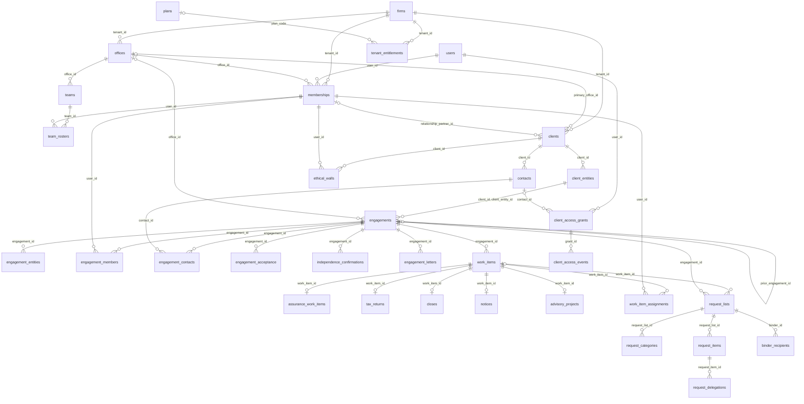

# Data model

What the schema on `main` holds today (migrations `0001` to `0101`), drawn from the migrated database's catalog and the module registries. It is a map, not a spec: the migrations are the source of truth, and `schema_check` is the gate. Update this file in the PR that adds or reshapes a core table.

Rules every table follows (`.claude/skills/migration/SKILL.md`):

- Tenant tables carry `tenant_id uuid NOT NULL`, row-level security enabled and forced, and the `tenant_isolation` policy on `app.tenant_id` (ADR-014).
- Foreign keys between tenant tables include `tenant_id`, so a row can never point into another firm: `(tenant_id, x_id) REFERENCES x (tenant_id, id)`.
- Each table has exactly one owning module (`registry.py` `TABLES`, ADR-103). Only the owner reads or writes it; other modules go through the owner's `api.py`.
- The app role (`abacus_app`) holds only the column-level INSERT and UPDATE grants its registry declares; insert-only tables have no UPDATE or DELETE (ADR-004).

## Core: firm, client, engagement, work item (F-03)



Every edge above is a foreign key in the database, all of them tenant-qualified except those to the global `users` and `plans` tables.

### What each table is for

| Table | Owner | What it holds | Key rules |
|---|---|---|---|
| `firms` | identity | One row per tenant; `tenant_id` is its key. Time zone, autonomy, synthetic flag, KMS key. | `synthetic` is owner-only (the demo clock reads it). |
| `users` | identity | A person's sign-in identity, across firms. | Global: no app privilege; read through `abacus_identity`. |
| `memberships` | identity | A user's place in a firm: `firm_role`, `kind`, `level`, `office_id`, `service_lines`, `offshore`. | Role changes and revocation go through definer functions (`membership_set_firm_role`, `membership_revoke`, `team_member_set_role`, `team_member_remove`). |
| `offices`, `teams`, `team_rosters` | organisations | Offices (a filter, never an access boundary, DEC-30), teams in an office, who is on each team. | |
| `clients` | organisations | A firm's client: kind, status, primary office, relationship partner, risk tier, portal status. | `is_attest_client` is derived by a trigger on `engagements` (`refresh_attest_client`, DEC-128). No TIN column. |
| `client_entities` | organisations | The legal entities under a client: entity type, fiscal year end, state, plan number, date of death, grantor status. | Name unique per client (normalised). |
| `contacts` | organisations | A client's people; `user_id` once they have a portal sign-in. | Email unique per client, case-insensitive. |
| `engagements` | engagements | One contract for one client entity: `type` (14 codes), `status` (8 lifecycle states), `service_line`, office, standards set, prior engagement. | Status moves through the transition table in `engagements/transitions.py`; accept, decline and hold are human-only (INV-1). |
| `engagement_entities` | engagements | The entities an engagement covers, `primary`, `component` or `household_member`. | Exactly one `primary`, written by the `engagement_work_item_defaults` trigger. Insert-only. |
| `engagement_members` | identity | A user's engagement role. | Ethical walls (`ethical_walls`) override it. |
| `engagement_contacts` | engagements | A contact's designation on an engagement (approver of record and the rest, DEC-63). | Insert-only. |
| `engagement_acceptance`, `independence_confirmations`, `engagement_letters` | engagements | The G1 to G3 facts: acceptance, each member's independence, the letter. | Newest acceptance row is live. |
| `gate_policy_overrides` | engagements | A firm's per-type-family gate requirement. | May only tighten the platform default. Insert-only: a new row per change. |
| `work_items` | engagements | A unit of work inside an engagement; `kind` is `assurance`, `tax_return`, `close`, `notice` or `advisory_project`. | `UNIQUE (tenant_id, engagement_id, id)` is the target of every subtype's foreign key. One `assurance` item per engagement (`work_items_one_assurance`), created by the trigger for the ten attest types. App may update only `name`, `status`, `due_on`, `archived_at`, `archive_locked_at`. |
| `assurance_work_items` | engagements | The assurance subtype: `assurance_type`, `phase`, `auto_mode`, group audit. | App may update `phase` and `auto_mode`. |
| `tax_returns` | tax | A return: its entity, form (1040, 1041, 1065, 1120s, 1120, 990, 706, 709) and tax year. | Insert-only until tax adds a lifecycle. |
| `closes` | closes | A monthly close: its `YYYY-MM` period. | One per engagement and period (`UNIQUE (tenant_id, engagement_id, period)`). Insert-only. |
| `notices` | notices | A tax notice's code and received date. | Insert-only. |
| `advisory_projects` | engagements | An advisory project's name. | Insert-only. |
| `work_item_assignments` | engagements | Who performs which function on a work item (preparer, reviewers, signer, EQR, close roles). | Insert-only; removal is a new row. |
| `client_access_grants` | identity | A portal user's role on a scope: `scope_kind` (client, client_entity, engagement, work_item, request_item, k1_package, governance_room, component, intake) and `scope_id`. | Statuses pending, active, revoked, expired; the app may change only `status`, and every change also writes an insert-only `client_access_events` row. A user's portal shell comes from the union of their grants (DEC-129). |
| `tenant_entitlements` | platform | Which modules a firm may use (attest, internal_audit, group_audit, statements_studio, office_addins, insights), seats, agent-minute allowance, validity. | Read-only to the app; set by the operator console and the scenario loader (ADR-148). |
| `plans` | platform | Plan codes and names. | Global: no app privilege. |
| `request_lists` | requests | A binder (DEC-31): one or more per work item, with `kind`, `part`, `status` and publish and done stamps. | Column-level UPDATE grants only (0100). |
| `request_items` | requests | One requested document or answer, with its status (request status v2) and client visibility. | `overdue` is derived, never stored. |

## Global and non-tenant tables

These have no row-level security. The app holds **no** privilege on them and reaches them only through reviewed SECURITY DEFINER functions (`schema_check.GLOBAL_TABLES`, `NON_TENANT_TABLES`, `DEFINER_FUNCTIONS`).

| Tables | Owner | Reached through |
|---|---|---|
| `users` | identity | `abacus_identity` reads; definer functions provision client users and memberships |
| `invitation_tokens`, `invitation_failures`, `staff_invitation_tokens` | identity | `invitation_token_*`, `staff_invitation_token_*` |
| `signup_codes`, `signup_attempts` | identity | `firm_signup` |
| `auth_login_states`, `auth_sessions`, `auth_session_cookies` | identity | `auth_state_*`, `auth_session_*` (0101) |
| `platform_controls`, `platform_control_changes`, `firm_provisioning_requests` | platform | `platform_control_state` (app); `set_platform_control`, `provision_firm` (`abacus_ops` only) |
| `plans` | platform | none yet (operator-set) |
| `email_templates`, `email_template_versions` | communications | `email_template_import`, `email_template_current`; firm rows (0196, R-01-T19) through `email_template_firm_row`, `email_template_firm_id`, `email_template_resolve`, `email_template_version_at`, `email_template_publish`, which take the firm from the session |
| `review_reason_codes` | evidence | `review_decision_reason_check`, `review_reason_codes_list` |
| `work_slots`, `work_waiters`, `work_grants`, `provider_capacity` | kernel.slots, ai_gateway | `work_slot_*`, `capacity_*` |
| `eval_runs`, `eval_case_results` | abacus_tools.evals | `eval_eligible` |

## Every table by owner

The full list lives in each module's `registry.py` and, for the kernel, gateway and tooling tables, `_PLATFORM_TABLE_OWNERS` in `backend/src/abacus_tools/quality/schema_check.py`. To print it:

```
cd backend && uv run python -c "import importlib; from abacus.modules import MODULES
for m in MODULES: print(m, sorted(importlib.import_module(f'abacus.modules.{m}.registry').TABLES))"
```

Modules that own tables today: agents, assurance, closes, communications, connections, engagements, evidence, fieldwork, identity, ledger, notices, notifications, organisations, platform, requests, review, tax, workpapers. The pre-registered modules adjustments, attest, audit_trail, collaboration, integrations, methodology, portal, practice, reporting, sampling, signatures and workbench own none yet.

Kernel and platform tables outside the modules: `audit_events`, `outbox`, `idempotency_keys` (kernel.uow); `usage_records`, `budgets`, `provider_capacity` (ai_gateway); `feature_flag_states` (kernel.flags); `work_slots`, `work_waiters`, `work_grants` (kernel.slots); `eval_runs`, `eval_case_results` (abacus_tools.evals); `alembic_version`.
