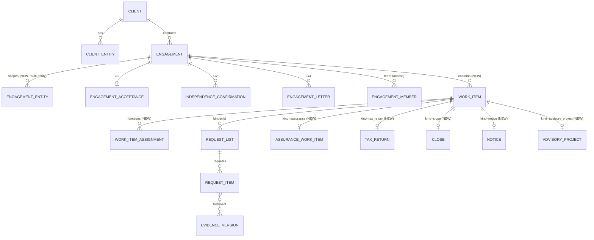
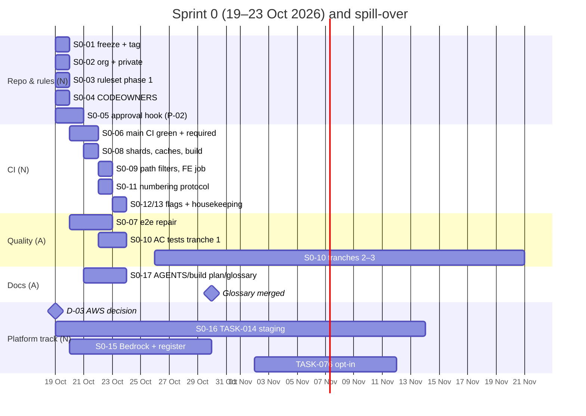
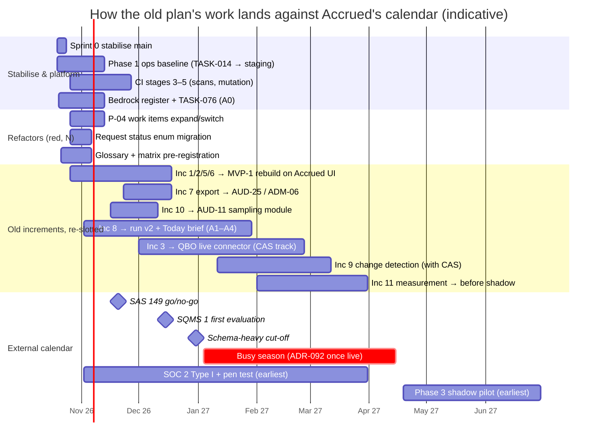

# 2. Current state & reconciliation

> **What this chapter is for.** It states what the `abacus` repository already gives Accrued, how mature each part is, and what to do with it: keep, extend, refactor, replace or retire. It also covers the process debt to clear before two founders build in parallel, the product-versus-code naming question, and how the repo's own build plan (phases 0–5, increments 1–11) folds into the Accrued roadmap.
>
> **Snapshot.** Repo `github.com/notanaskhan/abacus` at HEAD `a42034c` (Fri 2026-10-16 22:40 +0400, "TASK-075: provider terms register…"). Read on Sat 2026-10-17. Facts marked **verified** were re-checked against the clone for this chapter. Everything else comes from the 37-analyst digests (`digests/cross/repo-*.md`, `ai-agents.md`, `domain-model.md`, `catalog-waves.md`). **(inferred)** marks a conclusion or recommendation that no source states.
>
> **Who reads it.** Both founders, and the Claude Code sessions working on Sprint 0 and the refactors in §2.2. Paths are repo-relative unless absolute. **N** = notanaskhan (technical founder, red-zone owner). **A** = ayushkbhatia (product/design founder). **fd** = founder-day with Claude Code.

---

## 2.0 The chapter in one screen

**Bottom line:** keep the guarantees and change the nouns. The platform kernel and the AI governance layer are the most valuable code in the repo, and Accrued keeps them as-is. The domain layer was built for one audit-evidence job, so it is refactored into Accrued's engagement-and-work-item model. Its status words and glossary are migrated. The whole UI layer (the "Atelier" design system and all 51 screen files) is replaced, but its plumbing is kept. Before any of this, `main` has to become trustworthy again. Today it is public and unprotected, PR CI has not been green since 2026-10-07, the nightly e2e is red and nothing is deployed.

| Area | Maturity | Verdict | One-line reason |
|---|---|---|---|
| Tenancy/RLS, unit of work + audit + outbox, route guard, envelope crypto, Object Lock storage, Temporal work classes, config, classification, quality gates | production-ready / solid | **KEEP** | Accrued's trust model in code: hard to retrofit, already tested (≈ 1,000+ kernel/identity tests) |
| `authorise`/`visible` + permission matrix (14 roles, 88 actions) | solid for its scope | **EXTEND (major, red)** | The right shape, but the resource model covers only firm/engagement and the role catalogue is audit-only |
| AI gateway, data boundary, budgets, eval runner, citation verifiers | production-ready | **KEEP + EXTEND** | Governance is ready. The *runtime* (tools, plans, sessions, SSE, schedules) is absent |
| `engagements` (engagement = one audit job) | solid (audit) | **REFACTOR** → engagement (contract) + `work_items` | Accrued's central object-model difference (Q-01, P-04) |
| `requests` status enum `open/received/ready_for_review/needs_revision/accepted` | solid | **MIGRATE** to `draft/requested/uploaded/received/returned/not_applicable` | Repo `received` means Accrued's "Uploaded – needs review": a dangerous inversion (Q-04) |
| `evidence`, `ledger`, read-only `connections` | solid / production-grade core | **KEEP + EXTEND** | Already serves AUD-03, SHL-08/20, POR-03/04/16. Writes go in a new sibling `integrations` module |
| `sampling`, `audit_trail` read side | stub | **BUILD** | One-line modules; matrix actions already exist |
| `organisations`, `communications`, `notifications`, `platform` | thin | **EXTEND** | Name-only clients, `LocalMailbox` only, in-app notifications only, USD-only metering |
| Design system `packages/ui` ("Atelier", SPEC-016) | solid for its look | **REPLACE** | Contradicts the Accrued tokens, fonts, shell and weights. Keep `AgentText`, `cn`, the cva pattern and Radix behaviour |
| `apps/web` plumbing (generated client, TanStack Query, PKCE, MFA step-up, fetch-swap tests, security lint) | solid | **KEEP** | Works at Accrued scale with a router refactor |
| `apps/web` screens (51 files) | solid for the wedge | **REPLACE / RESTYLE / RETIRE** per file (§2.2.11) | About 45 Accrued IDs covered by behaviour, none visually; about 210 of 254 product screens are net-new |
| Glossary, permission matrix, AGENTS.md, build plan | binding but wedge-shaped | **ONE CHANGE SET EACH** in Sprint 0–1 | Otherwise every Claude Code session refuses Accrued words or "builds ahead of the plan" |
| Infra, staging, production adapters (KMS, SES, scanner, WorkOS, Bedrock) | absent / fail closed | **BUILD (TASK-014 + A0)** | Nothing is deployed. No real firm can reach a model (`provider-terms.yaml: entries: []`) |
| CI enforcement, branch protection, repo visibility | broken | **FIX in Sprint 0** (§2.3.2) | Gates exist in code, but nothing enforces them on GitHub |

**Naming (§2.4):** "Accrued" is the product in every user-facing string. `abacus` stays the code namespace. Move the repo into a GitHub organisation owned by both founders.

**Old build plan (§2.5):** keep its principles and its Phase 3 entry gate: SOC 2 Type I and a pen test before any real client data, and shadow before live. Supersede its Phase 2 increment order with the Accrued MVP-1 and bundles. Pull forward the Phase 5 items that the Accrued P0 design needs (LLM planner, Workbench sessions, tax, CAS, ledger writes), each under a new ADR. The plan currently tells coding agents to "never build ahead of the plan", so `docs/product/build-plan.md` and `AGENTS.md` must be rewritten in Sprint 0 or Claude Code sessions will stop on every Accrued task.

---

## 2.1 What exists, area by area

Maturity scale (same as the digests):

| Rating | Meaning |
|---|---|
| **production-ready** | Complete and tested. Needs only deploy wiring |
| **solid** | Complete and tested for its scope. Extend it for Accrued |
| **thin** | Works, but has minimal scope or tests |
| **stub** | An empty module or a placeholder |
| **absent** | Nothing in the repo |

### 2.1.1 Repository snapshot

| Fact | Value | Source |
|---|---|---|
| History | 377 commits, 2026-10-04 → 10-16, all by `notanaskhan`. 361 are co-authored by Claude Opus 5.5. Linear history, 144 remote branches | **verified** (`git log`, `git branch -r`) |
| Code | `backend/src/abacus` 41,720 lines · `abacus_tools` 13,524 · `backend/tests` 58,957 · `apps/web/src` ≈ 20.0k (13.3k non-test) · `packages/ui` 452 (+ `theme.css`) · `packages/api-client` generated (`openapi.json` 681 KB) | repo-backend-core §header |
| Database | 55 hand-numbered linear Alembic migrations, `0001_baseline` → `0055_usage_boundary_basis`. 81 product tables (82 with `alembic_version`). Forced RLS on every tenant table | **verified** (migration count); repo-backend-core §2 |
| API | 139 paths, 158 operations (74 POST, 66 GET, 16 PUT, 2 DELETE), 176 schemas. Each route declares exactly one matrix action | repo-backend-core §1.9 |
| Modules | 13 under `backend/src/abacus/modules`: identity, organisations, engagements, requests, evidence, connections, ledger, sampling (stub), agents, audit_trail (stub), communications, notifications, platform. `ai_gateway` sits outside them | **verified** (`ls modules`) |
| Tests | 3,267 backend test functions in 156 files (unit 1,916 · integration 1,268 · workflow replays 74 · property 9 · **security 0**). Frontend: 291 Vitest cases in 42 files and 1 Playwright journey | repo-backend-core §6.2; **verified** (156 files) |
| Docs | 115 ADRs (113 accepted; ADR-010 → 101 and ADR-112 → 115 superseded) · 37 specs SPEC-000…036 (all approved, 364 ACs) · 75 tasks (73 done, TASK-014 **blocked**, TASK-017 in progress) | repo-specs-tasks §0 |
| Product the repo was built for | "an AI-native evidence platform for US audit firms" (`AGENTS.md` line 3), code-named and branded **Abacus** | **verified** |

### 2.1.2 Platform kernel

| Area | What exists (evidence paths) | Tests / proof | Maturity |
|---|---|---|---|
| Tenancy & RLS | `kernel/db/session.py` (`tenant_session`, transaction-local `app.tenant_id/actor_*` GUCs, rollback-only join). `kernel/db/migration.py` (`tenant_table`, `insert_only`, `insert_columns`). Four DB roles in `backend/migrations/bootstrap.sql` (`abacus_owner`, `abacus_app` NOBYPASSRLS, `abacus_relay`, read-only `abacus_identity`). Gate `abacus_tools/quality/schema_check.py` (1,017 lines): up→down→up on every PR, `TABLE_OWNERS`, `INSERT_ONLY_TABLES`, `APP_INSERT_COLUMNS`, `DEFINER_FUNCTIONS` (25) | `integration/test_tenancy.py` 33, `test_schema_check_db.py` 111 | **production-ready** |
| Unit of work, audit events, outbox | `kernel/uow/__init__.py`: no commit without `tx.record(...)` (`MissingAuditEvent`); identifiers only, never text. `audit_events` is insert-only, with `actor_kind ∈ human/agent/system/support` (CHECK, migration 0023). `outbox` plus `kernel/uow/relay.py` (at-least-once, `FOR UPDATE SKIP LOCKED`, per-tenant fairness, backoff, park after 10) | `test_unit_of_work.py` 37, `test_outbox_relay.py` 21 | **production-ready** (write side). Read side: **stub** |
| Route guard & API shape | `modules/identity/routing.py` (`AbacusRouter`/`AbacusRoute`): `action=` is mandatory; a route that never calls `authorise`/`visible` returns **500**. `add_api_websocket_route`/`websocket` raise `TypeError` ("would bypass the action check", L245–251, **verified**). `api/app.py` mounts 20 routers with no middleware (no CORS, rate limit, security headers) and no health route | `unit/identity` routing tests | **solid** |
| Envelope encryption | `kernel/crypto/__init__.py` (AES-256-GCM, tenant- and fingerprint-bound AAD), `kernel/crypto/payload_codec.py` (Temporal payloads). Only `LocalKeyService`. Outside local/test it raises "no key service configured for this environment (ADR-104)" (**verified**, L120) | crypto unit tests | **production-ready (local)**. KMS adapter **absent** |
| Evidence storage | `kernel/storage.py` (only boto3 client), `modules/evidence/storage.py`: Object Lock **GOVERNANCE**, retain 2,555 days (floor 365). 50 MB uploads buffered in memory. No presigned URLs; every page is proxied | `test_evidence_storage.py` 30, `test_evidence.py` 74 | **solid** |
| Scanning, isolation, previews | `kernel/scanning.py` `LocalScanner` (EICAR, zip bombs; raises outside synthetic, **verified** L83). `kernel/isolation.py` (spawned child, CPU/memory/wall limits). `evidence/previews.py` (pypdfium2 + Pillow, ≤ 50 pages). No OCR and no word coordinates | evidence tests | **thin–solid** |
| Temporal | `kernel/temporal.py`, `kernel/dispatch.py` (the only start/signal path, DISPATCH-001), 4 work classes (`interactive`, `time_sensitive`, `background`, `batch`) in `kernel/config.py`, DB slots `kernel/slots.py`, admission `ai_gateway/admission.py`, replay fixtures `backend/tests/workflows/histories/`. **No Temporal Schedules.** The only time-based behaviour is the engagement agent's 09:00 tick | `test_work_slots_db.py` 61, 74 replay tests | **production-ready** |
| Worker | `worker/__main__.py` (`MODULES = (connections, agents, notifications, communications, evidence)`; relay, hourly spend-anomaly job, daily notification purge in-process) | `unit/worker` 39 | **solid** |
| Config, logging, telemetry, errors | `kernel/config.py` (421 lines, `extra="forbid"`, env validation), `kernel/logging.py`, `telemetry.py`, `metrics.py`, `error_tracking.py` (allowlist scrubbing). Exporters unset; no dashboards or SLOs | config + observability tests | **production-ready** (config) / **solid code, no backend** (observability) |
| Classification | `kernel/classification.py`: every DTO field tagged `restricted/confidential/internal/public`; an untagged field fails a test | unit test | **production-ready** |
| Feature flags | `kernel/flags.py`, `docs/architecture/feature-flags.yaml` → `kernel/_flags.py`. **9 flags**, all expiring **2027-01-05 … 01-13** (**verified**), set with `make flag` | codegen `--check` | **solid** (rollouts only, not entitlements) |
| Quality tooling | `abacus_tools/quality/` (`banned_patterns.py` 40 rules incl. `MODULE_DEPENDENCIES`, `schema_check.py`, `validate_docs.py`, `secrets_scan.py`, `check_dependencies.py`), import-linter contracts in `backend/pyproject.toml`, coverage `fail_under = 95` (**verified**) | `unit/quality` 401 | **production-ready** |

### 2.1.3 Identity, authorisation and people

| Area | What exists | Maturity | Gap to Accrued |
|---|---|---|---|
| Authorisation engine | `modules/identity/authz/__init__.py` (600 lines, PROTECTED). Layers: tenancy → wall → relationships → role → independence → agent ∩ initiator (ADR-025) → attributes. `visible(ctx, action, engagement_id_column)` agrees with `authorise`. Matrix `docs/architecture/permission-matrix.yaml` (245 lines, "Draft v0.1") → `identity/authz/_matrix.py` | **solid** (282 unit + 86 integration + 104 wall-agent tests) | `Resource` is only `firm`/`engagement`. `in_scope` and every `firm_setting(...)` except `autonomy_policy` **always deny**. 14 actions have no route (`legal_hold.place/lift`, `engagement.update/archive`, `request_item.waive/mark_ready`, `evidence.void`, `fulfilment.confirm`, `suggestion.create/resolve`, `sample_set.create`, `support_match.run`, `audit_event.read`, `export.create`) |
| Roles | Firm: `firm_admin`, `practice_leader`, `quality_partner`. Engagement: `engagement_partner`, `manager`, `senior`, `staff`, `reviewer`. Client: `client_admin`, `client_contributor`. Non-human: `agent`, `system`, `platform_support(_content)` | **solid** (wedge) | No IT/Security, EQR, Tax Preparer/Reviewer, offshore modifier or policy principal. No client scopes beyond the engagement. No role union |
| Sign-in | Vendor-neutral OIDC verifier `identity/tokens.py` (RS256, ≤ 1 h). Fake OIDC server `abacus_tools/fakes/oidc_server`. SPA PKCE hand-rolled (`apps/web/src/auth/pkce.ts`, `session.ts`), token in `sessionStorage`, **no refresh tokens**. WorkOS `pending` on the allowlist | **solid** (generic) / **thin** (Accrued) | SHL-06/POR-01 email-code + TOTP/passkey, SSO enforcement, lockout, JIT provisioning (needs a new SECURITY DEFINER function, because the app role cannot insert `users`) |
| Break-glass | `identity/support.py` (307 lines), `support_sessions`, `make access-review` | **solid** | PLT-01 forbids the emergency second-staff approval that the repo allows. Decide |
| Walls & independence | `ethical_walls` (person ↔ client; a walled user gets 404), `independence_confirmations` | **solid** | Walls by team/group (ADM-03). The SHL-02 "results hidden by wall" count contradicts the SPEC-002 404 rule |
| Invitations, signup, staff | Definer functions `provision_client_user`, `firm_signup`, `staff_invitation_*`, `membership_*`. 7-day client and 14-day staff tokens. Last-admin/last-partner invariants | **thin–solid** (AC tests deferred: TASK-030/040/041/042) | `client_access_grants`, contacts, PLT-01 provisioning instead of signup codes |

### 2.1.4 Domain modules

| Module | Size (lines · ops · tables) | What it models today | Maturity |
|---|---|---|---|
| `organisations` | 326 · 0 · 2 | `clients(name, normalised_name)`, `client_entities`. No routes, no type, no TIN, no households, contacts, relationships or offices | **thin** |
| `engagements` | 3,916 · 28 · 9 | **One job for one client entity and one fiscal period**. `type IN ('audit','review','compilation','agreed_upon_procedures')`, `status IN ('active','archived')` (**verified**, migration 0005). Acceptance, independence, letter *record* (SPEC-025, no e-signature), roll-forward (`/v1/engagements/proposal`), team. Methodology = xlsx request-list templates (`methodology_templates/versions/areas/request_items/account_rules`, insert-only), pinned **once** (`MethodologyAlreadyApplied`). `gate_client_data` blocks client-data actions until acceptance plus the partner's independence conclusion | **solid** (audit) |
| `requests` | 3,400 · 21 · 7 | One `request_list` per engagement. `request_items` with tiers A–E, guidance (`why`, `good_looks_like`), due dates, `client_visible`, `client_assignee`. Status `open → received → ready_for_review / needs_revision → accepted` (CHECK in migrations 0005/0015, **verified**). Comments are sealed, have mentions and redactions, and require a `request_item_id` | **solid core** |
| `evidence` (red) | 6,906 · 27 · 10 | Insert-only `evidence_versions` with provenance and fingerprint. Engagement-scoped `inbox_files`. `upload_extractions/checks/previews/preview_pages`. Review queue (take/release/assign). Human-only `review_decisions` (accept/reject/send_back + reason codes, DB CHECK `actor_kind='human'`) | **production-grade core** |
| `connections` (red) | 5,196 · 15 · 6 | Read-only connector contract (ADR-037/040, CONN-001). Providers `fake` and `import` only: CHECK `provider IN ('fake')` was later widened to `import` (**verified** 0009/0029). Dataset `trial_balance` only. Partial unique index: one live connection per entity. `sync_runs.request_item_id NOT NULL` (**verified**), so scheduled syncs cannot be recorded. Client OAuth flow (SPEC-020). TB and GL import for QBO, Xero, QBD, NetSuite, Sage Intacct | **solid** (contract) / **thin** (providers) |
| `ledger` (red) | 1,102 · 0 · 5 | Immutable `ledger_snapshots`/`trial_balance_lines`, `gl_snapshots`/`gl_account_balances`/`gl_entries`, keyed to `client_entity`. **No HTTP routes.** No layers, adjustments, groupings or tax lines | **solid** (snapshots) |
| `sampling` | 1 · 0 · 0 | Docstring only | **stub** |
| `agents` (red) | 8,261 · 29 · 16 | 4 single-call specialists plus the deterministic `EngagementAgent` (P-0…P-7, reminders, digest, pause), knowledge (pgvector), engagement graph (`GET /v1/engagements/{id}/graph`) | **solid** (see §2.1.5) |
| `audit_trail` (red) | 1 · 0 · 0 | Stub. `audit_events` is written by `kernel.uow`, but nothing reads it | **stub** |
| `communications` | 571 · 0 · 1 | Outbound `messages` with a deterministic scope checker (`communications/scope.py`). `LocalMailbox` only. SES raises "arrives with TASK-014" (**verified**). No inbound mail or template store | **thin** |
| `notifications` | 540 · 3 · 1 | 14 catalogued kinds, identifiers only, in-app, polled, 180-day purge | **thin** |
| `platform` | 118 · 3 · 0 | Budget and metering views over `ai_gateway` data (USD) | **thin** |

### 2.1.5 AI gateway and agents (as built)

| Component | Path | Maturity | Note |
|---|---|---|---|
| Gateway `call()` | `ai_gateway/__init__.py` (847 lines) | **production-ready** | Refuses calls without a purpose, schema, tier, budget, attribution or registered prompt. Per-attempt metering, one repair, escalation, admission, data boundary, route failover |
| Provider seam | `ai_gateway/providers.py` (`ModelRequest(system, user, …)`) | **production-ready, single-turn only** | No messages, tools, document blocks or streaming. This is the main technical blocker for Workbench |
| Routes & parity | `ai_gateway/routes/{direct,bedrock,_anthropic,parity}.py`; `docs/operations/route-parity/direct-2026-10-11.json` | `direct` **production-ready**. Bedrock parity **absent** | Models pinned: `claude-opus-5-5`, `claude-sonnet-5-5`, `claude-haiku-4-5-20251001` |
| Data boundary | `ai_gateway/boundary.py`, `kernel/provider_terms.py`; register `docs/operations/provider-terms.yaml` = **`entries: []`** (**verified**) | **production-ready (closed)** | Every non-synthetic firm is refused until: Bedrock route + register entry + firm opt-in (TASK-076) + per-agent `client_data: cleared` + stage |
| Budgets & usage | `ai_gateway/budgets.py`, `budgets`, `usage_records` | **production-ready** (USD) | The customer-facing unit in the design is agent-minutes (ADM-14). It is not modelled |
| Prompt registry, context builder, sanitiser | `ai_gateway/prompts/…` (9 prompts), `context.py`, `sanitise.py` | **production-ready** | Firm-written instructions must enter as delimited context (PROMPT-001) |
| Agent specs | `modules/agents/spec.py`, `specs/*.yaml` → `_specs.py`: `evidence.screener`, `evidence.upload_reviewer`, `evidence.matcher`, `requests.guidance_drafter` | **synthetic-only** | All `shape: single_call`, `autonomy: propose`, `tools: []`. The screener has no passing real-model report committed |
| Engagement agent | `agents/engagement_agent.py` (607), `engagement_agent_workflow.py` | **production-ready (deterministic)** | No planner (ADR-060 is Phase 5). Natural home for triggers (P-8) and the Today brief |
| Citations | `agents/citations.py` (spreadsheet cell/quote/value), `agents/document_citations.py` (quote vs page text) | **production-ready** | No region/bbox, workpaper-cell, ledger-line or form-line citations |
| Evals | `abacus_tools/evals/` (3,517 lines), `evals/*/suite.yaml`, `eval_runs` | **production-ready infra** | Real-model passes committed for upload_review v3, matcher v2 and guidance v1 (Haiku, direct, synthetic). `evals/baselines.yaml` missing |
| Output controls (UI) | `packages/ui/src/agent-text.tsx` (`AgentText`, plain text, 2,000-char cap) + ESLint OUT-001 | **production-ready** | Accrued needs structured agent blocks (P-24) |
| Absent | Tools, loop harness, sessions, plans, questions, proposals/approval grants, SSE, Temporal Schedules, firm-made agents, saved prompts, skills, learned context, agent columns, run trace API, AI threat model (`docs/architecture/ai-threat-model.md`, required by ADR-064) | **absent** | ai-agents §1.2 |

### 2.1.6 Frontend

| Area | What exists | Maturity |
|---|---|---|
| Stack | React 19, Vite 8, TanStack Router (code-based) + Query, Tailwind v4, Radix, cva, lucide-react, Vitest + jsdom, Playwright + axe, ESLint `strictTypeChecked`. `apps/web/package.json` name `@abacus/web` | **solid** |
| Router | `apps/web/src/router.tsx`: **346 lines** (**verified**), hand-edited and eagerly imported. One bundle, no code splitting. Guards live in components | **thin at Accrued scale** |
| API client | `packages/api-client` (`@hey-api/openapi-ts` 0.99.0, TanStack helpers, drift check in `make ci-contracts`). The generator already emits `serverSentEvents.gen.ts` | **production-ready** |
| Auth | PKCE, sanitised `returnTo`, 401 loop guard, step-up MFA (`prompt=login&max_age=0`, `shell/mfa.tsx`), fragment tokens for invitations | **solid** |
| Design system | `packages/ui`: 17 exports (Button, Dialog, Input/Label, Alert, Badge, Card, EmptyState, Skeleton, Spinner, AiTag, Count, Panel, Rail, RailButton, StatusPill, Table/Td/Th, AgentText, cn). `theme.css` = "Atelier" (Source Sans 3, Newsreader, accent `#7a4e12`, 15 px base, 600/700 headings, left icon rail) | **solid for the wrong design** |
| Screens | 51 `.tsx` screen modules + 8 helper `.ts` in `apps/web/src/screens/` (**verified**), plus `shell/{NotificationPanel,ClientBell,Tabs,mfa}.tsx`. About 26 routes, firm and client | **solid (wedge)**; mapping in §2.2.11 |
| Tests | 42 Vitest files / 291 cases named by spec and AC (`spec025rollforward.test.tsx`…). `testing/support.tsx` `mockApi` fetch-swap. One e2e `apps/web/e2e/journey.spec.ts` | **solid** (unit), **broken** (e2e) |
| Gaps | No real-time (11 `refetchInterval` polls). About 20 hard-coded role checks (`Board.tsx:54-55`, `ItemDetail.tsx:43-44`, `People.tsx:55-57`, `router.tsx:238-242`…). Flags inferred from 403/404 (`GlExport.tsx:34`). No virtualised tables, form library, portal shell, gallery or `vite build` in CI | — |

### 2.1.7 Docs, process artefacts and Claude Code configuration

| Artefact | State | Maturity |
|---|---|---|
| ADRs `docs/adr/` | 115. About 70 carry over unchanged. 5 directly conflict with designed screens (ADR-040, 005, 024, 065, 111), plus minor conflicts (034/004, 108, 047/058/063, 011, 013, 030, 092, 102, 109) | **solid**, wedge-scoped |
| Specs `docs/specs/` | 37 approved. They describe the as-built wedge behaviour precisely | **solid** |
| Tasks `work/tasks/` | 75. **About 55 defer ADR-078 independent tests** from TASK-018 onward ("Independent tests deferred by the founder"; 56 files mention the deferral, **verified**). Reviewer-agent results recorded only up to TASK-019 | **process debt** |
| Build plan `docs/product/build-plan.md` | Phases 0–5, increments 1–11, no dates. Its header says "Work only on the current phase and increment. Never build ahead of the plan" (**verified**) | **superseded in order**, kept in principle (§2.5) |
| Glossary `docs/product/glossary.md` (protected) | Wedge vocabulary. Bans `document`, `task`, `sign_off`, `approval`, `integration`, `project`, `reminder`, `phase`, `deadline`, `activity`… | **conflicts** (§2.2.8) |
| Missing files ADRs require | `docs/architecture/ai-threat-model.md` (ADR-064), `docs/architecture/e2e-journeys.md` (ADR-077), `docs/ops/slos.md` (ADR-093), `docs/runbooks/` (ADR-098), `docs/product/discovery/` (Phase 0) | **absent** (**verified** for runbooks/ops) |
| `.claude/` | `settings.json` deny list. Hooks `protect_paths.py`/`_protected.py`, `guard_bash.py`, `format_on_edit.sh`. Skills: ai-agent, backend-module, connector, frontend-feature, migration, observability, temporal-workflow. Agents: architecture, security, test and ai reviewers | **solid**, single-founder |
| `_protected.py` | Accepts only `approved_by: founder` (L130, **verified**). Treats an ADR or migration as immutable if the file **exists on disk** (`PROTECTED_IF_EXISTS`, L57/L145, **verified**), so a session cannot renumber its own unmerged migration | **blocks two-founder work** |
| CODEOWNERS | Both handles on every protected path. Includes the stale `/backend/quality/` (**verified**). Missing `/evals/`, `/docs/operations/provider-terms.yaml`, `**/package.json`, `/pnpm-workspace.yaml`, `**/.gitignore` | **needs fix** |

### 2.1.8 Infrastructure and production adapters

**Nothing is deployed.** There is no `infra/`, no `*.tf`, no Dockerfile and no deploy workflow (**verified**). `TASK-014` ("Staging on AWS through Terraform") has been `status: blocked` since 2026-10-06. It needs "an AWS account, budget and Terraform state location" (**verified**). Each production adapter fails closed outside local/test:

| # | Adapter | Evidence | Needed for |
|---|---|---|---|
| P1 | KMS `KeyService` | `kernel/crypto/__init__.py:120` raises | Any non-local process (the worker refuses to boot) |
| P2 | Temporal payload keys from Secrets Manager; Temporal Cloud namespace | `payload_codec.py`, `kernel/temporal.py` | Staging |
| P3 | SES email | `communications/transport.py:62` raises | Every invite, reminder and portal email |
| P4 | Malware scanner | `kernel/scanning.py:83` raises | Any real upload |
| P5 | WorkOS | allowlist `pending` | SSO, passwordless, refresh tokens |
| P6 | Bedrock route + provider-terms entry | `entries: []` | Any AI on real firm data |
| P7–P12 | Images, Terraform, DB bootstrap, Object Lock bucket, `/healthz` (ROUTE-001 exception), OTel/Sentry backends, CloudFront CSP/WAF | none | Staging |
| P13–P15 | Stage-3 security scans, mutation testing, `make loadtest`/`make seed-staging` (point at missing modules) | none | Phase-1 exit |

The ADR target is accepted and coherent: AWS US, ECS Fargate, managed Postgres 17 + pgvector, S3 Object Lock, KMS per tenant, Temporal Cloud, three accounts (ADR-021/087/088/091/096/104). Main auto-deploys to staging; production deploys on founder approval.

### 2.1.9 Coverage against the Accrued catalogue

From `catalog.tsv` (303 rows: 256 product screens + 24 specimens + 23 templates/overlays):

| Repo coverage | Rows | Examples |
|---|---|---|
| **substantial** | 7 | SHL-18 Comments, AUD-03 Source documents, CLS-03 Close intake, POR-16 Connections, ADM-02 Users & roles, template T7 (portal), specimen TPL-07 |
| **partial** | 150 | SHL-01/03/04/06/07/08/10/13/14/20, HOME-01/02, CLI-01/04/07/08, ENG-01/02/03/05/13, AUD-01/02/06/11, INB-01/02, KNW-01/02/03, POR-01/02/03/04/11/14, ADM-01/03/04/06/07, plus most templates |
| **none** | 146 | All of tax (TAX/TXI/TXT/TXP except intake reuse), NOT, most CLS, SIG, WB sessions/agents, SHT, FSP, ATT, IAU, INS, XLA, PLT |

**By journey** (journeys digest): J02 ≈ 45 % · J12 ≈ 40 % · J01 ≈ 35 % · J14 ≈ 30 % · J22 ≈ 25 % · J24 ≈ 20 % · J03/J04 ≈ 15 % (the PBC half) · all others 0–10 %. Tax, CAS close, notices, Workbench, signatures, attest, internal audit, statements and group audit start from zero. **No screen is visually reusable.**

### 2.1.10 Facts the digests disagreed on, settled by direct check

| Topic | Digest values | Settled value |
|---|---|---|
| Feature flags | "3 flags" (repo-adrs §5) vs "9 flags" (repo-backend-core) | **9 flags**, expiring 2027-01-05…01-13 (`feature-flags.yaml`) |
| Nightly e2e | "8 of 8 nights" vs "10 nights in a row" | Red every night since **2026-10-08**, at `apps/web/e2e/journey.spec.ts:42` (`getByRole('link', { name })`). The journey predates the SPEC-025 Setup-first flow |
| Tasks deferring independent tests | 53 / 55 | **About 55** (56 task files mention the deferral; TASK-018 onward) |
| Tables | "about 78" vs 81 | **81 product tables** (82 with `alembic_version`) |
| Screen files | "51" vs "59" | **51** `.tsx` screen modules + 8 `.ts` helpers = 59 non-test files |
| PR open→merge | "median 5 s" vs "0.3 min" | Under a minute either way (different samples). In practice nobody reviewed and stage 2 never finished before merge |

---

## 2.2 Reconciliation verdicts

### 2.2.1 Verdicts and the rules behind them

| Verdict | Meaning | Typical cost |
|---|---|---|
| **KEEP** | Use as-is; copy the pattern for new code | none |
| **EXTEND** | The shape is right but the scope is narrow: add columns, actions, adapters or layers without changing existing behaviour | S–M |
| **REFACTOR** | Change the structure while keeping the guarantees (data moves, FK changes, semantics change) | M–L, usually red zone |
| **REPLACE** | Build the Accrued version; reuse only the listed logic | M–XL |
| **RETIRE** | No Accrued counterpart; delete once the replacement ships | S |
| **BUILD** | Stub or absent; new code | per epic |

Five rules decide each verdict:

1. **Keep every guarantee.** These are the repo's guarantees:
   - forced RLS;
   - no commit without an audit event;
   - every route action-checked;
   - insert-only history for evidence and decisions;
   - human-only decisions;
   - code computes, models judge (ADR-050);
   - citations verified before display (ADR-066);
   - the AI data boundary.

   An Accrued affordance that seems to break one gets a new event row instead. Examples are Undo, Unlink, Remove file and Edit comment: each becomes an insert-only event row with recomputed state. Nothing is ever deleted (ADR-004/034 pattern).
2. **Change the nouns once.** Status words come from blueprint §3.3.1 + addendum §3.2, generated into a single registry. They do not come from repo CHECKs or the handoff's `lib/status.js`, which the handoff itself marks as a draft (Q-02). Vocabulary changes go through one glossary PR (§2.2.8).
3. **Content belongs in the database.** Firm content goes into DB tables behind admin screens, never into seed code or constants. That covers methodology and engagement templates, email templates (POR-20/ADM-10), reason-code labels, guidance, threshold policies, firm standards and AI policy. The working agreement says why: every commit is a build, a deploy and a cold cache. Feature flags stay for rollouts only. Entitlements and plans are DB rows (P-28).
4. **Migrate now, while there is no production data.** Nothing is deployed, and the only data is the dev seed. Schema refactors that later need multi-release expand/contract (ADR-091) cost one migration plus a backfill today, so the schema-heavy refactors land **before staging hosts design-partner data, and before 2026-12-31** (ADR-092). Keep expand → switch → contract as three PRs anyway, so `main` stays green at every step **(inferred)**.
5. **Red zone goes to N, design goes to A.** Red-zone refactors (identity, evidence, connections, ledger, agents, ai_gateway, kernel, migrations) are authored by N with A writing the independent AC tests (ADR-078). Design-system and screen work is authored by A with N reviewing. Contract-first PRs let the two lanes run in parallel.

### 2.2.2 Platform primitives

| Primitive | Maturity | Verdict | What changes for Accrued | ADR / proposal | Owner · size · when |
|---|---|---|---|---|---|
| Tenancy/RLS + `schema_check` | production-ready | **KEEP** | Every new table uses `tenant_table()` and gets a `TABLE_OWNERS` entry. Later, split registries per module (`modules/<m>/registry.py`) so two founders stop colliding in `schema_check.py` | ADR-014/103 | N · S · Sprint 1 (registry split optional) |
| UoW / `audit_events` / outbox / relay | production-ready | **KEEP + EXTEND** | Add nullable `audit_events.engagement_id`, `work_item_id`, `on_behalf_of_user_id`, `policy_ref` + indexes. This enables AUD-29, ADM-07 "{Verb} by {Actor}" and "<person> via Agent". Build the read side (`audit_event.read`, keyset pagination, name resolution at read time) | ADR-007/018; P-08 (policy actor later) | N · M · columns by Nov 6, read API with ADM-07 |
| `AbacusRouter` guard + generated client | solid | **KEEP + EXTEND** | Add an SSE route marker that keeps the action check (P-15). Add a `/healthz` exception (ROUTE-001 ADR). Add a pagination convention `(created_at,id)` keyset (gap G3) | ADR-012/013; P-15 | N · M · Sprint 1–2 |
| `authorise`/`visible` + matrix | solid (14 roles) | **EXTEND (major, red)** | Generalise `Resource` to `(kind, id, engagement_id?, client_id?, entity_id?, work_item_id?, facts)`. Generalise `visible()` to scope kinds (firm-wide lists, portal scopes). Add 10 condition kinds: `level_in`, `function_in`, `not_preparer_of_target`, `reserved_role`, `scope_only`, `consent(purpose)`, `not_offshore`, `attest_client`, `within_policy`, `gates_met`. Add per-firm **stricter-only** overrides as DB rows (`firm_policy_overrides`), with the YAML as the ceiling | P-06, P-10 (supersede ADR-102) | N · L · core by Nov 13 |
| Sign-in | solid / thin | **EXTEND** | WorkOS AuthKit (ADR-029), refresh tokens or a BFF session (ADR-030 revisit), JIT provisioning definer function, firm-required client MFA (ADR-030 amendment: Safeguards and ADM-06 require it), client passwordless OTP for the white-label portal | ADR-029/030; P-09, P-11 | N · M · with TASK-014 |
| Break-glass support | solid | **KEEP** | Decide whether the emergency second-staff approval stays. PLT-01 forbids it; recommend removing it **(inferred)** | ADR-028 | N · S |
| Walls & independence | solid | **KEEP + EXTEND** | Walls by team/group. A wall-hidden count is never shown (keep the SPEC-002 404 rule; fix SHL-02 copy). Per-type independence rules (P-13) | ADR-026; P-13 | N · M · Wave 3 |
| Envelope crypto / payload codec | production-ready (local) | **KEEP + BUILD KMS adapter** | `KmsKeyService` (one CMK + EncryptionContext=tenant, or per-tenant CMK), payload keys from Secrets Manager | ADR-104 | N · M · TASK-014 |
| Object Lock storage | solid | **KEEP + EXTEND** | Retention per record type, legal hold via S3 API, destruction workflow with dual approval and crypto-shred certificate. Chunked uploads > 50 MB. Signed short-lived page URLs | P-14 (supersede ADR-032/033 scope), P-31 | N · M–L · data model Wave 2, UI Wave 4 |
| Scanning / isolation / previews | thin–solid | **KEEP pattern, EXTEND** | Real scanner (GuardDuty Malware Protection for S3 recommended **(inferred)**). Background-class rendering. Word coordinates and bbox for SHL-08 region highlighting. OCR service (P-32). Masked PII renditions with logged reveal | ADR-110; P-32 | N · L · Wave 2 |
| Temporal infra | production-ready | **KEEP + EXTEND** | `kernel.dispatch.schedule()` for Temporal Schedules (agent schedules, reminder cadences, retention clocks, consent expiry). Turn off the legacy queue (`serve_legacy_queue`) | ADR-017/090 | N · S–M · A3 |
| Config, logging, telemetry, classification | production-ready | **KEEP** | Add an Accrued section per new subsystem. Every new DTO field is tagged | ADR-022/031 | — |
| Feature flags | solid | **KEEP for rollouts** | Use them for rollouts only. Entitlements, plans and seats move to DB tables (P-28). All 9 flags expire 2027-01-05…13: renew or retire them in the December release train | ADR-089; P-28 | N · S · by Dec 18 |
| Notifications | thin | **EXTEND** | Category, `actionable`, email channel via SES, digest, per-user preferences, templates overridable in DB (ADM-10/POR-20) | SPEC-013 | A spec / N impl · M · Wave 1–3 |
| Communications | thin | **EXTEND** | SES outbound with per-firm verified domains (DKIM). Inbound pipeline (SES receiving or M365 Graph → S3 → Temporal parse → INB). Template store in DB. Keep the scope checker on every outbound | P-11, P-17 | N · L · after TASK-014 |
| Platform (budgets/metering) | thin | **KEEP USD layer + EXTEND** | Add the agent-minute customer ledger (ADM-14, ENG-06, SHT-04) on top of USD safety budgets | P-28 | N · M · A3 |
| Audit trail read side | stub | **BUILD** | `GET /v1/audit-events?actor_kind&target_type&engagement_id&cursor` (`audit_event.read`), export as a batch workflow (`export.create`) | ADR-007/036 | N · M · with ADM-07 (Wave 3) |
| Search | absent | **BUILD** | Postgres `tsvector` + `pg_trgm` on metadata, with `visible()` and walls applied in SQL. Content search waits for a decision on sealed text | P-33 | N · M · Wave 1 (SHL-02) |
| Real-time | absent (refused) | **BUILD (SSE)** | `GET /v1/stream` per user, identifiers only, relay → `LISTEN/NOTIFY` → fan-out. Run streams of verified items (not raw tokens). WebSockets stay refused | P-15 | N · M · Sprint 2–3 |
| PDF/DOCX rendering | absent | **BUILD** | Deterministic rendering service in an isolated child or container (letters, reports, K-1 packages, FS, watermarked drafts) | P-19 (extends ADR-042) | N · L · Wave 2 |

### 2.2.3 Engagement → engagement + work items (REFACTOR, red, P-04)

**Problem.** In the repo, an engagement is "one job for one client entity and one fiscal period", and its type is one of `audit`, `review`, `compilation` or `agreed_upon_procedures`. That one row holds two kinds of facts:

- **contract facts:** acceptance (G1), independence (G2), the letter (G3) and the team;
- **work facts:** the request list, evidence, the methodology pin and the agent.

Accrued separates the two. The **Engagement** is the contract: one service, one period, one letter, a team and a budget, with the lifecycle `Prospect → Accepted/Declined → Contracted → Active ⇄ On hold → Delivered → Archived`. **Work items** are where the work happens: Return, Audit/Assurance, Close, Notice and Advisory project.

The seed requires one engagement to hold many work items: Copperleaf has 12 monthly closes and Thornbury has 4 returns. Group audits span five entities. Without this split, no tax, CAS, notice or advisory screen can be built.

**Options considered** (repo-backend-domain §4.1, domain-model §2.6.1):

| Option | Description | Verdict |
|---|---|---|
| A | Keep `engagements` as the work item and add a parent `contracts` table | ✗ Inverts Accrued's vocabulary in code. The "engagement agent" and every UI label would mean the opposite of the screen |
| B (full) | `engagements` becomes the contract; move every FK (`request_items`, `evidence_*`, `fulfilments`, `sync_runs`, `inbox_files`, `ledger_imports`, comments, reviews) to `work_items` | ✗ Rewrites composite FKs in four red-zone modules for little gain |
| **B-lite (recommended)** | `engagements` *is* Accrued's Engagement (contract). Add a `work_items` supertype with typed subtype tables owned by the service-line modules. **Keep `engagement_id` on every existing row** for `visible()`. Add `work_item_id` only where a screen needs work-item scope | ✓ Matches the UI, keeps evidence FKs intact, and backfill is trivial today |

**Target model** (mermaid; new objects marked `NEW`):



**Schema** (proposed; the `engagements` module owns `work_items`, and service-line modules own the subtypes):

```text
engagements            + service_line, lifecycle status (prospect|accepted|declined|contracted|active|on_hold|delivered|archived),
                         office_id, standards_set, fee, report_due_on; type CHECK replaced by the domain-model §2.6.2 enum
                         (fs_audit [alias of audit for one release], ebp_audit, review, compilation, preparation,
                          agreed_upon_procedures, soc1, soc2, readiness, internal_audit, tax_compliance,
                          cas_monthly_close, notice_response, advisory)
engagement_entities    (tenant_id, engagement_id, client_entity_id, role[primary|component|household_member], ownership_pct)
work_items             (tenant_id, id, engagement_id, kind, name, client_entity_id, period_start, period_end,
                         status_code, office_id, due_on, template_version_id, created_at, created_by)
work_item_assignments  (tenant_id, work_item_id, user_id, function[preparer|detail_reviewer|manager_reviewer|signer|eqr])
request_lists          + work_item_id (NOT NULL after backfill), name, kind[binder|intake|sample_wave], status
                         (draft|published|unpublished|complete|closed), published_at/by, marked_done_at/by;
                         drop the one-list-per-engagement rule; partial unique (work_item_id) WHERE kind='binder'  (inferred)
evidence_items         + work_item_id NULL (set for new uploads; engagement_id stays the visibility key)
```

**Behaviour changes:**

- **Gates.** G1–G3 stay on the engagement. G4–G9 attach to the assurance work item. `gate_client_data` becomes a per-type gate policy: audit/attest = G1–G3; tax = G1 + G3 + §7216 consents; non-attest CAS = G1 + G3. `independence: required` on matrix actions becomes conditional on engagement type (`attest_client`).
- **Methodology pin.** The pin moves from `engagements.methodology_version_id` to `work_items.template_version_id`. Gated re-pin comes later under the templates-v2 ADR (supersedes SPEC-008 Q4/AC-5).
- **Engagement agent.** `EngagementAgent` keeps its workflow ID `engagement-agent:<tenant>:<engagement>`. Its policies become work-item-aware via `workflow.patched` (ADR-090). Per-work-item runs arrive with the run v2 model (P-22).
- **Roll-forward.** It generalises per work-item kind (ENG-07 tax cohorts, ENG-13 audit/attest/close).
- **API** (proposed; endpoint names are **(inferred)**):
  - `GET|POST /v1/engagements/{engagement_id}/work-items`
  - `GET /v1/work-items/{work_item_id}`
  - `GET /v1/work-items?kind=&status=&office=&cursor=`, firm-wide; this needs P-06 `visible()` and pagination
  - New matrix actions `work_item.read|create|update|archive`
  - Existing `/v1/engagements/{engagement_id}/request-items…` routes stay, with an optional `work_item_id` filter, until AUD-03 and BND-02 are rebuilt. Then the work-item-scoped binder routes replace them (contract step).

**Migration plan** (three PRs, each green):

| Step | PR content | Owner | Size |
|---|---|---|---|
| Expand | Migration: `work_items`, `work_item_assignments`, `engagement_entities` (RLS, `TABLE_OWNERS`); new `engagements` columns; new type and lifecycle CHECKs (`audit` kept as an alias); `request_lists.work_item_id` nullable; backfill **one `assurance` work item per existing engagement**, copying `methodology_version_id` and linking its request list | N (tests by A) | M (2–3 fd) |
| Switch | Services, routes and the engagement agent read the work item. Generated client regenerated. Matrix actions added | N | M (3–4 fd) |
| Contract | `request_lists.work_item_id NOT NULL`; drop `engagements.methodology_version_id` and the alias | N | S (1 fd) |

**Decision needed:** Q-01 (blocks P0), by **Wed 21 Oct**. ADR P-04 (red) is drafted by N and reviewed by A. It must land **before any non-audit backend work and before the AUD-02/ENG-02 rebuilds; target: expand step merged by Fri 6 Nov** **(inferred)**.

### 2.2.4 Request status enum (MIGRATE, red-adjacent, Q-04)

**Problem.** The repo uses `received` to mean an upload has arrived but is unreviewed. Accrued's "Received ✓" means accepted. A screen built straight on repo codes therefore mislabels rows, and a mapping layer leaves the trap in every query, test and agent prompt. **Recommendation: migrate the stored codes** (domain-model Q-04).

| Repo code (today) | Meaning in repo | Accrued code | Display (§3.3.1) |
|---|---|---|---|
| — (only `client_visible=false`) | not yet sent | `draft` | Draft (never visible to the client; addendum §3.2) |
| `open` | sent, nothing uploaded | `requested` | Requested {date} (needs `requested_at`/`sent_at`) |
| `received` | upload arrived, unreviewed | `uploaded` | Uploaded – needs review |
| `ready_for_review` | upload passed checks / marked ready | `uploaded` (keep `ready_for_review_at` as an attribute) | Uploaded – needs review |
| `needs_revision` | sent back with reason code | `returned` | Returned · {reason} |
| `accepted` | reviewer accepted | `received` | Received ✓ |
| — (`request_item.waive` unimplemented) | — | `not_applicable` (+ `na_reason`, `na_note`, `na_by`, `na_side`) | Not applicable; client sees "Ignored" when `na_side='client'` |
| derived from `due_on` | — | (derived, not stored) | Overdue |
| — | — | `incorporated` (close variant; + `incorporated_by/_at`) | Matched · Pending incorporation · Incorporated |

Client projections are computed, not stored: **To do** = requested ∪ returned · **Done** = uploaded ∪ received · **Ignored** = not_applicable by the client.

**Work** (one red-zone task. The review paths touch evidence code guarded by REVIEW-001):

1. Glossary and ADR note (part of the §2.2.8 change set).
2. Migration: drop `request_items_status_check` and re-map the values with `CASE`. Add the new CHECK. Re-create the 0015 constraint logic that references `'accepted'`.
3. Code:
   - `requests/routes.py` `Status` Literal and `requests/service.py` `_REVIEWABLE`;
   - the evidence review-decision paths that set accepted / needs_revision;
   - `board_summary` and the client view;
   - engagement agent P-4 overdue logic and the notification catalogue.
4. Implement `request_item.waive` as `PUT /v1/engagements/{engagement_id}/request-items/{item_id}/not-applicable {reason, note}`, plus an undo route (both insert-only events).
5. Run `make generate` and fix the Board filter and status maps in the SPA, or delete them where the screen is being replaced.
6. Update the AC tests for TASK-019/037/038/039/060/061. A writes the independent tests.

Owner N; tests A; **size M (3–4 fd); land in Sprint 1, before the AUD-03/POR-03/BND-02 rebuilds.**

### 2.2.5 Other domain reconciliations

| Area | Today | Verdict | Accrued change | Proposal / Q | Owner · size · first needed |
|---|---|---|---|---|---|
| **Binders** | `request_lists` (1 per engagement, no state) | **EXTEND** | Binder = `request_list` with publish state, sections (`request_section`, since the glossary keeps `audit_area` for methodology), questions/decisions as request `kind ∈ {document, question, decision}`, third-party delegate, wave, period, firm owner, source tag | domain-model §2.8 | N/A split (requests is amber) · M · Wave 1 (BND-01/02, POR-03/04) |
| **Evidence → "Documents"** | `evidence_items/versions`, insert-only | **KEEP + EXTEND** | UI label "Document" (Files, portal) / "Evidence" (audit); code stays `evidence_*`. Add `channel`, `supersedes_version_id`, insert-only `document_classifications`, virtual splits (`parent_version_id` + page range), `evidence_withdrawals` (client removes own unaccepted upload, P-31), `evidence_annotations` (bbox), reason codes `wrong_document`/`wrong_year`. Client-scoped permanent files (`engagement_id` nullable + client-scope visibility) | P-31, P-32, Q-08 | N · L · Wave 1–2 |
| **Fulfilments** | composite FKs force same engagement | **EXTEND** | Same-engagement link route now (`fulfil_by_link`). Cross-engagement link (SHL-21, ATT-08) via a reference version pointing at the same stored object, with wall/visibility checks | new ADR (SHL-21) | N · M · Wave 3 |
| **Inbox** | engagement-scoped drop (`inbox_files`) | **KEEP + BUILD firm inbox** | Keep the engagement drop zone (POR-03 "drop anything"). Firm-wide INB-01/02 intake is a new aggregate (`inbound_message`, `inbox_attachment`) after the mailbox integration and TASK-014 | P-17 | N · L · after staging |
| **Connections** | read-only, `fake`/`import`, 1 live per entity | **KEEP contract + EXTEND** | Add `category ∈ {ledger, bank_feed, card_feed, sales, hr, ticketing, grc}`; uniqueness per (entity, category[, provider]); statuses `connecting`, `needs_reauth`, `disconnected`; datasets beyond `trial_balance`; `sync_runs.request_item_id` nullable + `purpose`; first live provider **QBO** (CAS designs are QBO-only; confirm against ADR-045 discovery). **Keep ADR-108 "Export instead"** (fix POR-16 design, which omits it) | ADR-037/040/045/108 | N · L · CAS track |
| **Integrations (firm-side + writes)** | absent | **BUILD new module** | New red-zone `integrations` module, separate from `connections`. It holds firm integrations (CCH Axcess Tax/Practice, M365 docs@ mailbox, DocuSign, KBA vendor, GRC), the catalogue (WB-10/11, ADM-08) and declared **write adapters**: GL posting, tax-engine export, practice-management time push, GRC sync. Writes are human-triggered and idempotent, logged in a client-visible access log, and never for attest clients. `connections` stays read-only | P-16, P-17, P-18 (umbrella write-adapter ADR + one per adapter, Q-19) | N · L · CCH file bridge Wave 2, CAS posting Wave 3 |
| **Ledger** | immutable snapshots, no routes | **KEEP + EXTEND** | Read APIs (`GET /v1/engagements/{id}/trial-balance?snapshot=`, `…/gl-entries?account&cursor`). `label`/`source_kind` on snapshots (incl. `document_extraction` for the EBP trust-report TB). Mapping sets and groupings (ledger owns them, Q-15). Consolidation structures. Layers (Unadjusted/AJE/RJE/Final/TTB) **computed, never written into snapshots** | ADR-004/039/050 | N · M–L · Wave 1 read API; mapping Wave 2; consolidation before the SAS 149 go/no-go (Nov 20) |
| **Adjustments** | absent | **BUILD** (`adjustments`, red) | `proposed_entries` (AJE/RJE/PAJE/TJE/proposed/elimination), lines, balanced-by-entry CHECK, human-only decisions, posting batches via `integrations` | P-16 | N · L · Wave 2–3 |
| **Sampling** | stub | **BUILD** | Deterministic seeded sampler with golden tests (no new RNG dependency), versioned `sample_sets`, completeness ties computed by code, override needs manager approval, bulk request generation (`wave='sample'`). This **supersedes build-plan Inc 10 "import samples"**: AUD-11 computes and draws in product | ADR-050 | N · M · Wave 2 (AUD-11 in MVP-1) |
| **Methodology → engagement templates** | xlsx request-list templates, pin once | **REFACTOR** into a new `methodology` module | Re-own the five `methodology_*` tables as the request-list component of a template version. Add programs/steps, `template_versions` (Draft/Published/Deprecated, effective date), `engagement_template_links` (update available / held), gated in-place upgrades that never touch signed-off rows (SHL-22/KNW-07). Keep the xlsx importer as one importer. Template content lives in the DB, edited in KNW-06 | new templates-v2 spec + ADR (supersede SPEC-008 Q4/AC-5) | A spec / N impl · L · Wave 2 (KNW-02/03), v2 in Wave 5 |
| **Comments** | sealed, request-item anchored (ADR-109) | **KEEP + EXTEND** | Move to a `collaboration` module with polymorphic anchor `(anchor_type, anchor_id, anchor jsonb)`; backfill `anchor_type='request_item'`. "Resolve" is thread state. "Edit" = correction row (exists: `corrects_comment_id`). "Delete" = redaction (exists). ADR-109 is amended, not broken. Comments never block sign-off; review notes do | ADR-109 amendment, Q-10 | A/N · M · Wave 1 (SHL-18 is in MVP-1) |
| **Review grammar** | evidence-only `review_decisions` | **KEEP + BUILD `review` module** (red) | `review_decisions` stays for evidence accept/return. New: `sign_offs` (L1–L5, content hash, stale on change), `review_notes` (Open→Responded→Cleared), `issues`, `decision_cards`/`decisions`, generic `suggestions` (agent output as drafts). All human-only, using the four-way repo pattern (matrix deny, live-human check, DB CHECK, static rule) | P-07, P-24 | N · L · Wave 2 (gates ~60 % of P0 screens; freeze contracts first) |
| **Organisations** | name-only | **EXTEND (amber)** | Client type (household/individual/organisation), entity type, sealed TIN + `tin_last4` + logged `tin.reveal`, FYE, `contacts`, `client_access_grants`, `entity_relationships`, `offices`, `teams` (identity) | P-09, P-12, Q-20/21 | A spec / N impl · M · Wave 1 (CLI-01/02/04) |
| **Follow-ups / reminders** | `reminders`, `reminder_items` (glossary says `follow_up`); auto-send at Routine | **KEEP** | Default to **human-sent** follow-ups (BND-04). Auto-send only for pre-approved templates under the ADM-04 policy. Optional rename to `follow_ups` later (Q-11) | SPEC-027 amendment | N · S |
| **Signatures** | `letter.record` only (SPEC-025 Q2: "don't build e-signature") | **BUILD** | Envelopes, signers, KBA via a bought vendor, IRS 8879 evidence package, PDF stamping. DocuSign as fallback/record mode for season 1 | P-26 (supersede SPEC-025 Q2) | N · L · must be stable before 2027-01-01 for 8879s |

### 2.2.6 AI runtime

| Component | Verdict | Change | Phase (ai-agents §6) |
|---|---|---|---|
| Gateway `call()`, admission, budgets, routes, prompt registry, sanitiser | **KEEP** | — | — |
| `ModelRequest` / provider seam | **EXTEND (gateway v2)** | Multi-turn messages, tool definitions, tool_use/tool_result, document blocks, stop reasons. Still one audited, budgeted path | A1 |
| `ContextBuilder` | **EXTEND** | Conversation, memory, skill and tool-result layers; per-tier budgets. Firm instructions enter as delimited context only | A1 |
| Data boundary | **KEEP + EXTEND** | A 6th check: §7216 taxpayer consent (purpose `ai_use` + AI disclosure, both spouses on joint returns). Generate consent sub-processor lists from the register | A0/A6 |
| Provider-terms register | **FILL** | Bedrock entry (founder-only edit; handle per P-02), Bedrock parity report, rerun the 4 suites on Bedrock, `client_data: cleared` where passing, TASK-076 opt-in | A0 (Sprint 0–2) |
| `AgentSpec` (`single_call`, `tools: []`, `propose`) | **EXTEND** | Shapes (loop, planner, session), typed per-module tools in four classes (read, compute, propose, write-after-approval). Library agents = declared specs; firm-made agents = `agent_definition` rows run by a declared `workbench.runner` spec whose `task_scope` is the ceiling (Q-14) | A1–A3; P-22 |
| `agent_runs` (4 states) | **REFACTOR → run v2** | §3.3.1 states (queued … awaiting_plan_approval … blocked_on_decision … succeeded/failed/cancelled). Add `agent_run_steps`, `run_events`, `agent_plans`, `agent_questions`, `proposals`, `approval_grants`, `run_artifacts` | A1–A2 |
| Specialist agents (screener, upload reviewer, matcher, guidance drafter) | **KEEP** | Project their bespoke tables into the generic `suggestions` queue for HOME-02 | A4 |
| `EngagementAgent` (deterministic P-0…P-7) | **KEEP** | Add trigger policy P-8 (ENG-11), the Today brief (HOME-05/SHL-23 behind `ff.today_brief`) and the ADR-060 planner (AUD-02) on synthetic data first | A4–A5 |
| Citations (cell, quote) | **EXTEND → Citation v2** | A union over 10 source types incl. page+bbox, workpaper cell, ledger line, form line. Number-provenance check on agent text. "Source moved" detection | A1 |
| `AgentText` | **KEEP + ADD `AgentBlocks`** | Structured JSON blocks rendered by components; still no HTML/markdown (amends ADR-065) | A1; P-24 |
| Autonomy (firm level 0–1) | **REPLACE** | Versioned AI policy (ADM-04): gates, Auto mode per engagement type, §7216 switch. Levels kept as semantics. Policy principal deferred: ship named-human batch approval first (Q-05) | A2; P-08 later |
| Model text to clients | **CONFLICT** | ADR-111 bars it even when a person approves the draft. Ship P-25 **disabled by default**; agent drafts stay firm-internal until conditions are met | A4+; P-25 |
| SSE, Temporal Schedules, sessions, saved prompts, skills, learned context, agent columns | **BUILD** | — | A1–A5 |
| Agent-minute metering | **BUILD** | Customer layer over USD safety budgets; define "agent-minute" in an ADR first | A3; P-28 |

### 2.2.7 Roles and the permission matrix

| Repo | Accrued (blueprint §2.2–2.4) | Reconciliation (recommended) |
|---|---|---|
| `firm_admin` (sees metadata; ADR-024) | Firm Admin (practice operations; publishes binders, sends client messages) + **IT/Security** (Qualified Individual) | Keep `firm_admin` metadata-only. Add firm role `security_admin`. Add engagement role **`client_service`** (binders, requests, envelopes, portal; no evidence content), which keeps ADR-024 intact (Q-07 option b) |
| `practice_leader`, `quality_partner` (`in_scope` = deny today) | Partner (firm-level capabilities), QM owner | Model `in_scope` properly. `quality_partner` ≈ QM owner (ADM-11/12, KNW publish) |
| `engagement_partner`, `manager`, `senior`, `staff`, `reviewer` | Partner, Manager, Senior, Staff, **EQR**, Tax Preparer, Tax Reviewer, specialist | Keep the access roles. Add `eqr_reviewer`, `specialist`. Add **work-item functions** (preparer, detail reviewer, manager reviewer, signer, EQR) on `work_item_assignments`. Keep `reviewer` as a read/QC role until the founders confirm its intent (Q-06) |
| — | Offshore/restricted modifier | Membership attributes `level`, `office_id`, `offshore`. `not_offshore` condition + server-side TIN masking |
| `client_admin`, `client_contributor` (engagement-scoped) | 11 client principals with role union (owner, approver of record, plan sponsor, trustee, taxpayer/spouse, delegate, third party, K-1 recipient, TCWG, confirmation respondent, prospect) | `client_access_grants` scoped by client / entity / work item / request / K-1 package / governance room / component / intake; `scope_only` condition; link-only respondents (POR-17) under P-09 |
| `agent` (task_scope ∩ initiator) | Accrued Agent | Keep. Add approval grants for write-after-approval tools |
| `system` | Policy principal | Defer `actor_kind='policy'` (P-08). Ship batch approval by a named human ("Approved by RM under BH AJE thresholds v2") |

About 18 of Accrued's 29 §2.4 capabilities are missing, and about 70 new actions are needed (domain-model §3.4–3.6). **Process:** pre-declare each wave's actions in one protected matrix PR, in per-module sections, append-only (§2.3.4). The first one is the Sprint 1 "pre-registration" PR.

### 2.2.8 Glossary change set (one PR, protected)

The repo glossary binds code, tables, API paths, specs **and UI**. The Accrued blueprint §3.1 binds every screen. Where the two collide, this rule settles it: **UI labels follow Accrued, and code identifiers follow the amended glossary**. This is the addendum §3.3 bridge. Hard collisions (🟥) must be settled before code:

| Accrued UI word | Repo rule today | Code identifier (decided) |
|---|---|---|
| Document (Files, portal) | "Document is not a domain term" | `evidence_item` / `evidence_version`. UI "Document" in Files/portal, "Evidence" in audit |
| Task (close tasks, agent rows, project tasks) | reserved for `work/tasks/` | `close_procedure`, `agent_run_step`, `todo`. Never `task` in product code |
| Sign-off (L1–L5) / Approve / Approvals | `sign_off`, `approval` banned as synonyms of review decision | `sign_off` (new, immutable, content-hash), `decision`, `review_decision` (evidence only). "Approvals" is a UI label only |
| Integration (WB-10) | banned synonym of connection | `integration` = firm-installed app (may write under ADR); `connection` = client-authorised read link |
| Project (advisory) | banned synonym of engagement | `advisory_project` |
| Audit (work item) | reserved for type/profession | `assurance_work_item` (kind `assurance`); types `fs_audit`, `ebp_audit`… |
| Received ✓ | repo `received` = unreviewed | enum migration (§2.2.4) |
| Phase / Deadline | banned synonyms of milestone | `phase` (assurance state dimension), `filing_deadline`, `due_date_rule`. `milestone` stays for ENG-12/PRJ-01 |
| Activity / Audit log | banned synonyms of audit event | `audit_event`. "Activity"/"Audit log" are UI labels |
| Reminder / Request Chaser | banned (`follow_up`) | `follow_up`. "Reminder" is a UI label (table rename optional, Q-11) |
| Prompts (saved), Skill, Agent (firm) | `prompt` = registry template; skills = dev skill files | `saved_prompt`, `agent_skill`, `agent_definition`. "Agent spec" stays the code-declared capability |
| Board (ENG-10 kanban) | repo `Board.tsx` = evidence board | `board` reserved for T19. The repo screen moves to `domain/requests/` |
| Inbox (firm mailbox) | `inbox_file` (engagement drop) | `inbound_message`, `inbox_attachment` (firm). `inbox_file` stays for the engagement drop |
| Sync chip (tax engine) | `sync_run` = one connection pull | `engine_sync_event` |
| Methodology (programs, steps) | methodology = PBC xlsx | `engagement_template`, `template_version`, `program`, `program_step`, `procedure` |
| Closed / Done / Delivered | banned synonyms of archived | Allowed as distinct canonical states: binder `closed`, client `done`, close `delivered`. `archived` stays the engagement end state |
| Policy principal | `actor.kind ∈ human/agent/system/support` | `actor_kind='policy'` (only with P-08) |

**Add** (from domain-model §4): `office, team, service_line, work_item, work_item_assignment, client_access_grant, entity_relationship, advisory_project, assurance_work_item, tax_return, close, notice, phase, filing_deadline, sign_off, review_note, issue, finding, decision_card, decision, citation, return_checkpoint, consent, envelope, integration, threshold_policy, agent_definition, agent_run_step, workbench_session, saved_prompt, agent_skill, memory_item, trigger, todo, program, program_step, procedure, workpaper, sheet, scoping_rule, agent_column, proposed_entry, posting_batch, consolidation, component, component_auditor, statement_document, framework, control, management_response, insight_metric, daily_briefing, gate`. Also add the long-requested terms "ethical wall", "evaluation run", "grader", "calibration" and "dangerous error".

**Amend:** `client` (households and individuals), `client_entity` (persons, trusts, estates, plans, exempt orgs), `engagement` (contract + types), `request_list` (UI "Binder"), `review_decision` (evidence scope; distinct from `sign_off`), `milestone` (not phase, not filing deadline), `connection` vs `integration`, and an entry **"Abacus: internal code namespace; never user-facing"** (§2.4).

Owner: A drafts in Sprint 0 and N approves the code-name side. **Merge by Fri 30 Oct**, before the first Accrued backend PR. Without it, both founders' agents will keep refusing Accrued words or inventing synonyms.

### 2.2.9 ADR and spec reconciliation

**ADRs.** About 70 of the 115 ADRs carry over unchanged:

- tenancy and RLS;
- authorise/visible;
- unit of work and audit;
- immutable versions;
- envelope encryption;
- the AI gateway and data boundary;
- code computes / models judge;
- citations;
- tests vs evals;
- CI stages;
- flags;
- build once, promote.

The 33 proposals P-01…P-33 (repo-adrs §3) become ADR-116 onward, with numbers reserved per §2.3.4. They are grouped below by the date they block:

| Needed by | Proposals | Why |
|---|---|---|
| **Sprint 0 (by Fri 23 Oct)** | P-01 naming, P-02 two-founder governance, P-03 Accrued design system (supersedes ADR-011's "shadcn as base" clause), decision records for Q-01/Q-02/Q-04 | Change how every later PR is written, approved and named |
| **By Fri 6 Nov** | P-04 engagement + work items, P-05 module map (15 new modules), P-06 `visible()` scope kinds, P-15 SSE, P-33 search, P-17 firm integrations (catalogue) | Wave 1 shells and firm-wide lists |
| **By Fri 13 Nov** | P-26 e-signature, P-18 tax-engine (CCH file bridge first), P-19 deterministic PDF, P-07 sign-offs L1–L5, P-09 client scopes, P-10 role catalogue, P-12 §7216 + TIN, P-22/P-23/P-24 agent model, sessions, structured output, P-32 OCR, P-31 client withdrawal | Wave 2 verticals. 8879 signing must be stable before 2027-01-01 |
| **By Fri 20 Nov** | P-16 write-capable client connections (CAS posting; partially supersedes ADR-040), P-29 busy-season policy (supersedes the ADR-092 premise: freeze only once a real firm is live), P-13 independence rules, P-14 retention | CAS posting, the freeze calendar, the SAS 149 go/no-go |
| Later | P-08 policy principal (deferred), P-11 white-label domains (Wave 3), P-20 Office add-ins, P-21 API/webhooks/MCP, P-25 model text to clients (ships disabled), P-27 payments boundary, P-28 entitlements/agent-minutes (A3), P-30 benchmark network (deferred, D6) | — |

The five direct conflicts and how each resolves:

| ADR | Resolution |
|---|---|
| **ADR-040** read-only connectors | `connections` stays read-only. Writes go in `integrations` under P-16/17/18 |
| **ADR-005** humans only decide | Unchanged for v1. The policy principal is deferred (P-08) |
| **ADR-024** admin metadata-only | Unchanged. A `client_service` role carries content duties |
| **ADR-065** plain-text agent output | Amended by P-24 (structured blocks, still no HTML) |
| **ADR-111** no model text to clients | P-25, shipped off by default |

Minor conflicts:

| ADR | Resolution |
|---|---|
| ADR-034/004 | P-31 withdrawal events |
| ADR-108 | Design fix: POR-16 keeps "Export instead" |
| ADR-047/058/063 | P-22/23 |
| ADR-030 | Firm-required client MFA |
| ADR-102 | P-06 |
| ADR-109 | Resolve state + anchors |

**Specs.** The 37 specs remain the accurate record of as-built behaviour. Each new Accrued spec cites blueprint sections, screen IDs and handoff states.

| Spec | Verdict | Change |
|---|---|---|
| SPEC-000 walking skeleton | KEEP | AC-21 (staging) still open → TASK-014 |
| SPEC-001 synthetic generator | KEEP + EXTEND | Add `scenarios/brightwater_hale` (canonical TBs, dated event timeline Jan 2026–Jan 2027, demo clock, local-only loader). Mark the firm as synthetic rather than suffixing names (AC-14 conflict) |
| SPEC-002…014 platform specs | KEEP | — |
| SPEC-008 methodology | AMEND | Q4/AC-5 "pin once" superseded by templates v2 |
| SPEC-013 notifications | EXTEND | Email channel, categories, preferences |
| SPEC-015 client invitations | AMEND | Expiry: 7 days (spec) vs 14 days (design). Recommend **14 days, single-use**, matching staff invitations **(inferred)** |
| SPEC-016 UI foundation | **SUPERSEDE** | New UI spec under P-03 |
| SPEC-019 admin screens | SUPERSEDE (UI only) | APIs kept |
| SPEC-020 portal & connection | EXTEND | White-label, multiple connections, Export instead kept |
| SPEC-022 classification & board | KEEP backend | Board UI superseded by AUD-03/BND-02. Tiers stay internal |
| SPEC-023 uploads/inbox/matching | KEEP non-goal | POR-03 client drops show "Suggested — confirm". No auto-assign (ADR-005) |
| SPEC-024 Act 0 | AMEND | Signup codes → PLT-01 provisioning. Autonomy → AI policy. SSO AC-2 via WorkOS |
| SPEC-025 Act 1 | AMEND | Q2 superseded by P-26. Per-type gates. G3 "letter signed" with a firm setting for "not required this year" (Q-16) |
| SPEC-027 engagement agent | AMEND | Human-sent follow-ups by default (BND-04) |
| SPEC-032 comments | AMEND | Q7 → resolve state. Polymorphic anchor |
| SPEC-035 drafted guidance | KEEP | AC-7 judge calibration still waits on the founder's labels |
| SPEC-036 data boundary | EXTEND | Part 2 (TASK-076) + §7216 per-taxpayer consent |

### 2.2.10 Design system and frontend platform

**Verdict: REPLACE the Atelier design system. KEEP the frontend plumbing. REFACTOR the router.**

| Piece | Verdict | Detail |
|---|---|---|
| `packages/ui/src/theme.css` (Atelier tokens) | **REPLACE** | Tailwind v4 `@theme static` from handoff `tokens/*.css`, with namespace resets: 9 greige surfaces, espresso `#2B1F17` ink ladder, olive/ochre/brick families, match purple for tracing only. 13 px base, Geist 400/500 only (+ Geist Mono), Arimo/Gelasio for rendered documents. Light theme only, semantic aliases kept. **Rename `bg-surface` → `bg-card` by codemod before the swap** (repo `surface` `#FFFDFA` ≠ Accrued `surface` `#D7D5CE`) |
| Fonts | **REPLACE** | Self-host `@fontsource` Geist, Geist Mono, Arimo, Gelasio (the CSP blocks Google Fonts). Drop Source Sans 3/Newsreader. Allowlist + `package.json` are protected edits in one batched dependency PR |
| `components/button.tsx`, `field.tsx`, `surfaces.tsx`, `table.tsx` | **REPLACE** | Pill controls (radius 999), 0.5 px ring shadows instead of borders, DataTable with 5 grammars (`@tanstack/react-table` + `@tanstack/react-virtual`) |
| `components/workspace.tsx` (`Rail`, `RailButton`, `Panel`, `StatusPill`, `AiTag`, `Count`) | **RETIRE** Rail/RailButton/Panel. **REPLACE** StatusPill with a `status.ts`-driven Pill. **REPLACE** AiTag with the C-31 agent marker | The top toolbar replaces the icon rail (SHL-01, D4: 13 fixed nav items, no 14th) |
| `components/dialog.tsx` | **KEEP behaviour, RESTYLE** | Radix Dialog → overlay stack O1–O6 |
| `agent-text.tsx`, `cn.ts`, cva pattern | **KEEP** | Add `AgentBlocks`/`AgentProse` (P-24) |
| Icons (`lucide-react` re-exports) | **REPLACE** | One Icon registry with handoff kebab names (212 present + 22 missing) on the locked lucide version, stroke 1.5 in viewBox units. A CI test checks every name resolves |
| `status.ts`, `format.ts` | **BUILD** | Generated from §3.3.1 + addendum §3.2 (keep only the visual tables from `lib/status.js`). `format.ts` parses API decimal strings with bigint, never `Number` |
| Accessibility | **DECIDE (D-07)** | The reference ladder fails the repo's own axe gate (SPEC-016 AC-10): ink-3 is 3.58:1 on white (≈ 7,365 uses), ink-4 1.89:1, the .28 focus ring 1.81:1. **Recommend an AA text ladder** (ink-2 text .70, ink-3 text .66), an outline focus ring at .55 alpha, forced-colours borders, and a reduced-motion hook. Design sign-off by A |
| Router `apps/web/src/router.tsx` | **REFACTOR** | Area subtrees + one lazy chunk per screen. Guards in `beforeLoad`. Overlays via `?ov=` search params (SHL-08 has 58 inbound links). Typed link builders generated from `handoff-link-graph.json` |
| Topology | **EXTEND** | One Vite project, **two entries**: firm app (`index.html`) and white-label portal (`portal.html`), on two origins (D-FE-1 option B; P-11) |
| Permissions & flags in UI | **REPLACE** | Remove the ~20 hard-coded role checks and the 403/404 flag sniffing. Use server-computed `/v1/me.capabilities` + per-record `allowed_actions` → `useCan`. Flags → `useFlag` |
| Generated client, TanStack Query, PKCE/session, MFA step-up, `GATE_REASONS`/`errorMessage`, `testing/support.tsx` | **KEEP** | `mockApi` fetch-swap becomes **fixture mode** (one scenario per artboard, Brightwater Hale seed, demo clock), so A builds screens ahead of the backend |
| ESLint rules | **KEEP + EXTEND** | Add bans: `font-semibold|font-bold`, borders on cards, palette/hex inside `packages/ui` outside `tokens/`, the literal "Accrued" in portal code, the literal "Abacus" in user-facing strings. Change the palette regex so Accrued token names (`bg-green-tint`) pass |
| CI for the frontend | **EXTEND** | `vite build` (both entries) in stage 1. Separate frontend job (Vitest + Playwright fixture smoke + axe). Component gallery route `/components` with `toHaveScreenshot` (no Storybook). A local parity report against the handoff PNGs (1400×860 @2×) |

### 2.2.11 Existing screen files → Accrued screen IDs

Verdicts: **KEEP** (logic as-is, moved to `src/domain/<area>`) · **RESTYLE** (same information architecture, Accrued kit) · **REPLACE** (Accrued structure differs; reuse the listed logic) · **RETIRE** (no counterpart). Line counts are **verified**.

| File (lines) | Today (route · spec) | Accrued screen ID(s) | Verdict | Logic to keep |
|---|---|---|---|---|
| `screens/Layout.tsx` (191) | signed-in firm shell, icon rail · SPEC-016/024 | SHL-01 toolbar + nav, SHL-03 firm switcher, SHL-06 states | **REPLACE** | `accessToken` guard, `NoFirm`, client-only → portal redirect, multi-firm choice + `invalidateQueries`, `signOut` + `queryClient.clear()` |
| `screens/AdminLayout.tsx` (56) | `/admin/*` tabs · SPEC-019 | ADM-01 T12 settings frame (entered from SHL-03) | **REPLACE** | role-based visibility → capabilities |
| `screens/EngagementLayout.tsx` (58) | engagement tabs | ENG-02 engagement record; AUD-02 cockpit (T2) | **REPLACE** | tab-link pattern |
| `screens/Engagements.tsx` (510) | `/` list + create form · SPEC-016/024/025 | ENG-01 (T1), ENG-03 wizard (O6, audit types first), AUD-01 | **REPLACE** | `createEngagementMutation`, `searchClientsOptions`, latest-template logic |
| `screens/engagementLabels.ts`, `engagementTypes.ts` | type/status labels | — | **REPLACE** | regenerated from the type/status registry |
| `screens/RollForward.tsx` (229) `RollForwardReview` | roll-forward proposal · SPEC-025 | ENG-13, ENG-07 | **REPLACE** | `proposalMutation`, 409 `proposal_changed` handling |
| `screens/MyConfirmations.tsx` (146) + `IndependenceBanner` | own independence confirmations | CLI-08, HOME-02 items, G2 banner on ENG-02/AUD-02 | **REPLACE** | confirmation queries, gate copy |
| `screens/Onboarding.tsx` (170) | admin onboarding checklist · SPEC-024 | ADM-01 per-area health lines (J01) **(inferred)** | **REPLACE** (fold into ADM-01) | onboarding queries |
| `screens/AcknowledgeStep.tsx` (41) | acknowledge an onboarding step | ADM-01/03/14 acknowledgements | **RETIRE** (fold) | acknowledge mutation |
| `screens/Signup.tsx` (113) + `NoFirm` | code-gated self-signup · SPEC-024 | PLT-01 provisioning (platform side) | **RETIRE** as product UI (keep behind a dev flag for design partners) | `NoFirm` copy |
| `screens/Join.tsx` (81) | staff invitation accept | SHL-06 invite variant, ADM-02 lifecycle | **KEEP logic, RESTYLE** (T15) | fragment-token handling |
| `screens/SignInCallback.tsx` (43) | PKCE callback | SHL-06 "Signing in…" | **KEEP** (restyle error card) | `completeSignIn` |
| `screens/ClientAccept.tsx` (81) | client invitation accept · SPEC-015 | POR-01 frame d | **KEEP logic, REPLACE UI** | `takeTokenFromFragment`, `acceptInvitationMutation` |
| `screens/Setup.tsx` (128) + `DefaultToSetup` | setup checklist · SPEC-025 | ENG-02 Gates group (G1–G3); HOME-02 | **REPLACE** (the Setup tab disappears) | setup gate model, `GATE_REASONS` |
| `screens/EngagementRecords.tsx` (506) | acceptance, letter, independence records | CLI-07, ENG-04 (record mode until SIG), CLI-08 partner conclusion | **REPLACE** | acceptance/letter/independence mutations with MFA |
| `screens/Overview.tsx` (309) + `ApplyMethodology` | areas progress, apply methodology | AUD-02 Overview rail ("Source Documents 11 of 24"), ENG-03 methodology step, SHL-22 | **REPLACE** | area-progress computation, `applyMethodologyMutation` |
| `screens/MapView.tsx` (119) | engagement graph · SPEC-016 AC-4 | data feeds AUD-02/AUD-06/AUD-08 | **RETIRE** as a screen | graph query consumer |
| `screens/Board.tsx` (726) | evidence board `/requests` · SPEC-022/023 | AUD-03 (firm PBC), BND-02, BND-04 (later), SHL-14 | **REPLACE UI, KEEP logic** → `domain/requests/` | `board/join.ts`, `board/filters.ts`, tier A–E handling, retrieval start/poll with cap, visibility toggle |
| `screens/DueDates.tsx` (132) | due-date bar, `ItemDue` | AUD-03/BND-02 due column, SHL-14 due field | **KEEP helpers, REPLACE UI** | `effectiveDue`, `isOverdue`, `useDefaultDue` (Overdue moves server-side) |
| `screens/ImportRequestList.tsx` (381) | xlsx request-list import · SPEC-018 | BND-02 "Import…", SHL-14 bulk | **REPLACE UI, KEEP flow** | 3-step map → preview → import, normalisation |
| `screens/ItemDetail.tsx` (606) | request item page · SPEC-021/023/029/030/031/032 | AUD-03 right pane, SHL-14 drawer, SHL-20, SHL-18, SHL-08 | **REPLACE** | version-history model, upload-on-behalf with provenance, decision wiring, `requestScreeningMutation` |
| `screens/DecisionActions.tsx` (138) | accept / reject / send back · SPEC-004 | AUD-03 Accept/Return…, HOME-02 actions, SHL-10 semantics | **KEEP semantics, RESTYLE** | `KIND_LABEL`, reason codes, ask-once final decisions |
| `screens/Review.tsx` (175) | engagement review queue · SPEC-004 | HOME-02 approvals & review queue (T9) | **REPLACE** | take/release, queue query |
| `screens/AIReviewPanel.tsx` (160) | AI upload review flags · SPEC-030 | SHL-20 (C-34 ScreeningCard) | **RESTYLE** | polling, verified-quote rule |
| `screens/CheckResults.tsx` (109) `ClientUploadChecks`, `FirmChecksPanel` | mechanical checks · SPEC-029 | SHL-20 (firm), POR-03 receipts (client) | **RESTYLE** | `checkMessages.ts` |
| `screens/EvidencePreview.tsx` (232) | in-browser preview · SPEC-029 | **SHL-08** source viewer (drawer/pane; global `?ov=`) | **KEEP data path, REPLACE chrome** | server-rendered page images + extracted text, pending polling. Check `blob:` in CSP `img-src` |
| `screens/CommentThread.tsx` (410) | internal/shared comments · SPEC-032 | SHL-18 (C-29), POR-04 thread | **KEEP logic, RESTYLE** | visibility, mentions, read marks, redaction. Anchor generalised later |
| `screens/DocumentKindSelect.tsx` (75) | expected document kind | SHL-14 "Document type" field | **RESTYLE** (fold into composer) | kind options |
| `screens/GuidanceDrafts.tsx` (248) | drafted guidance on items · SPEC-035 | SHL-14 client wording; SHL-10 approve agent output | **REPLACE** | draft → approve/discard flow, AI tag |
| `screens/ClientGuidance.tsx` (249) + `sourceLabel` | firm edits client-facing guidance · SPEC-031 | SHL-14 "see exactly what the client will see", POR-04 preview | **REPLACE** | `sourceLabel`, guidance mutations |
| `screens/TemplateGuidanceDrafts.tsx` (287) | template guidance drafts · SPEC-035 | KNW-06 / KNW-07 template builder & versions | **REPLACE** (Wave 5) | draft/approve/publish-as-next-version |
| `screens/InboxPanel.tsx` (301) | engagement inbox drop + suggestions · SPEC-023 | INB-02 (engagement-scoped variant), POR-03 "drop anything" | **REPLACE UI, KEEP logic** | assign/discard, suggestion ranks |
| `screens/InboxAIMatch.tsx` (156) | matcher proposals · SPEC-033 | INB-02 suggested destination + confidence | **REPLACE UI, KEEP logic** | verified-quote proposals, `matchingMessages.ts` |
| `screens/ReminderDrafts.tsx` (93) | drafted reminders · SPEC-027 | BND-04 follow-ups, WB-06 Request Chaser, SHL-10 | **REPLACE** | send/dismiss mutations |
| `screens/AgentActivity.tsx` (204) + `AgentControls` | activity tab, pause · SPEC-027 | AUD-29 activity log, SHL-13 dock, WB-08/09; Auto mode switch in the AUD-02 audit bar | **REPLACE** | activity query, pause/resume |
| `screens/People.tsx` (312) | engagement team · SPEC-017 | ENG-05 Team & roles | **REPLACE** | team mutations; manager-may rules → capabilities |
| `screens/Contacts.tsx` (314) | client contacts & invitations · SPEC-015/016 | CLI-04 Contacts & portal access | **REPLACE** | invite/resend/revoke/remove lifecycle |
| `screens/Methodology.tsx` (199) + `methodologyUpload.ts` | template upload · SPEC-008/016 | KNW-02 (xlsx importer variant) | **REPLACE UI, KEEP upload** | upload with row problems + fresh MFA |
| `screens/MethodologyVersion.tsx` (120) | template version detail · SPEC-035 | KNW-02 version detail, KNW-07 | **REPLACE** | version model |
| `screens/Knowledge.tsx` (64) | knowledge search · SPEC-019 | KNW-01; SHL-02 "Go…" knowledge scope | **REPLACE** | search mutation |
| `screens/KnowledgeDocuments.tsx` (281) | knowledge docs admin · SPEC-019 | KNW-01 library admin | **REPLACE** | add/withdraw/poll |
| `screens/Budget.tsx` (281) | AI budget & metering · SPEC-019 | ADM-14 Plan & usage; ENG-06 AI effort | **REPLACE** | budget/metering queries (units change: USD → agent-minutes) |
| `screens/Autonomy.tsx` (330) + `FirmAgents`, `FirmTimeZone`, `LetterPolicy`, `DraftedGuidanceSetting` | firm autonomy, pause all agents, time zone, letter-before-data, drafted guidance to clients · SPEC-024/025/027/035 | ADM-04 AI policy & gates (autonomy, pause, drafted guidance); ADM-01 (time zone); engagement defaults/ENG-11 (letter policy) **(inferred)** | **REPLACE** | queries/mutations, ADR-061 copy |
| `screens/FirmPeople.tsx` (338) | staff, firm roles, invitations · SPEC-024 | ADM-02 Users & roles | **REPLACE** | staff/invitation mutations |
| `screens/Walls.tsx` (256) | ethical walls · SPEC-002/019 | ADM-03 Offices, teams, walls & offshore | **REPLACE** | walls queries, MFA-first prompt |
| `screens/SupportAccess.tsx` (244) | break-glass approvals · SPEC-012/019 | ADM-06 Security center; SHL-05 | **REPLACE** | approve/revoke/acknowledge, emergency banner rule |
| `screens/ClientHome.tsx` (133) | `/client` · SPEC-020/031 | POR-02 Portal home | **REPLACE** | `yourPartOptions`, engagement list |
| `screens/ClientEngagement.tsx` (477) | client engagement view · SPEC-020/029/031/032 | POR-03, POR-04, POR-11; entry to POR-16 | **REPLACE** | upload + instant checks + history, assign to contributor, guidance display |
| `screens/ConnectionPanel.tsx` (447) | ledger connection status/connect · SPEC-020 | POR-16 (client), CLS-11 read side, WB-11 detail | **KEEP flows, REPLACE UI** | start/complete/check/revoke/log |
| `screens/ConnectCallback.tsx` (63) | OAuth callback · SPEC-020 | POR-16 callback | **KEEP** (restyle) | `complete` |
| `screens/LedgerExport.tsx` (179) + `importOutcome` | TB export upload · SPEC-028 | POR-16 "Export instead" state; POR-03 request type | **KEEP flow, REPLACE UI** | `importMessages.ts` |
| `screens/GlExport.tsx` (153) | GL export upload · SPEC-034 | same + AUD-12 JE population | **KEEP flow, REPLACE UI** | `glMessages.ts`. Replace 403/404 flag sniffing with `useFlag` |
| `screens/{checkMessages,clientHubMessages,glMessages,importMessages,matchingMessages}.ts` | code → plain-words maps | all of the above | **KEEP** → per-domain message registries | — |
| `shell/NotificationPanel.tsx` (118) + `shell/notifications.ts` | bell side panel, 60 s polling · SPEC-013 | SHL-04 notifications drawer (O2) | **REPLACE container, KEEP** `useUnreadCount` + kind→text/href maps | polling → SSE later |
| `shell/ClientBell.tsx` (39) | client bell | — (portal has no bell; POR-02 to-dos + emails) | **RETIRE** | unread query reusable on POR-02 |
| `shell/Tabs.tsx` (28) | link tabs | C-05 segmented / underline / sheet tabs | **REPLACE** | active-state approach |
| `shell/mfa.tsx` (48) `ConfirmItsYou` | step-up dialog | step-up for SHL-12, ADM-03/04/06 | **KEEP + RESTYLE** (C-22) | `isForbidden`, `signIn({forceLogin})` |
| `App.tsx` | "Abacus" splash | SHL-06 "Signing in…" | **REPLACE** | — |
| `router.tsx` (346) | every route, eager | — | **REFACTOR** (§2.2.10) | route tree semantics |
| `api.ts`, `auth/*`, `board/*`, `testing/support.tsx`, `lint/eslint-rules.test.ts` | plumbing | — | **KEEP** | — |
| `e2e/journey.spec.ts` (69) | AC-1/AC-18 journey (red) | J02 fixture journey + full-stack nightly | **REPLACE** (after the Sprint 0 repair) | axe helper |

**Net, across the 51 screen modules:** no screen survives visually.

- **14 keep their logic or are only restyled:** SignInCallback, Join, ClientAccept, ConnectCallback, ConnectionPanel, LedgerExport, GlExport, EvidencePreview, CommentThread, DecisionActions, DueDates helpers, AIReviewPanel, CheckResults, DocumentKindSelect.
- **34 are rebuilt on Accrued kits,** reusing their hooks and mutations.
- **3 are retired:** AcknowledgeStep, MapView as a screen, and Signup as product UI. `shell/ClientBell.tsx` is retired as well.

**About 210 of 254 product screens have no counterpart and are net-new.** The most valuable reuse is the data path behind AUD-03 / SHL-08 / SHL-20 / POR-03 / POR-04 / POR-16, which is why the audit-evidence spine (catalog MVP-1) is the cheapest first vertical.

---

## 2.3 Process and repo-hygiene debt

### 2.3.1 Debt register

One founder built the repo in 12 days. The gates exist in code, but nothing on GitHub enforces them. That was survivable alone. With two founders pushing in parallel it would produce a broken `main` and conflicts nobody notices.

| # | Debt | Evidence | Risk with two founders | Fix (item in §2.3.2) |
|---|---|---|---|---|
| D1 | Repo is **public** | `gh api repos/notanaskhan/abacus` → `visibility: public` | Accrued plan, designs, seed and security posture become public as soon as they land | S0-02 |
| D2 | **No branch protection or rulesets** on `main` | protection endpoint 404, rulesets `[]`; `delete_branch_on_merge: false` | Direct pushes, self-merges, force pushes | S0-03 |
| D3 | **PR CI not green since 2026-10-07** | 151 PR runs: 25 success / 80 failure / 46 cancelled. 104 PRs (#28–#131) merged with a median open→merge under a minute. Stale assertions at `backend/tests/integration/test_engagements.py:897`, `test_board_reads_api.py:230`, `test_schema_check_db.py:1083` (AC-20 update-column contract) | Neither founder can tell whose change broke what | S0-06 |
| D4 | **`main` runs stage 1 only** | Every stage-2 job in `.github/workflows/ci.yml` has `if: github.event_name == 'pull_request'`, including the aggregate `stages 1 and 2 (make check)` (**verified**) | Integration, coverage and contract drift are unverified on `main`. Whether coverage ≥ 95 % holds is unknown | S0-06 |
| D5 | **Nightly e2e red since 2026-10-08** | `apps/web/e2e/journey.spec.ts:42`: the engagement link is not visible after "Create engagement". The journey predates the SPEC-025 Setup-first flow | The only end-to-end check is meaningless | S0-07 |
| D6 | **About 55 tasks deferred ADR-078 independent tests**; `backend/tests/security/` is empty; reviewer-agent results stop at TASK-019 | task DoD lines; test inventory | Red-zone code (identity, evidence, connections, agents) was checked by its author only | S0-10 (+ 20–25 % reserve per sprint) |
| D7 | **Shard timings stale** | `backend/tests/durations.json` lists 86 of 156 test files (**verified**) | Unbalanced shards; stage 2 at 6.4–11.3 min | S0-08 |
| D8 | **CODEOWNERS drift** | stale `/backend/quality/` (**verified**). Missing `/evals/`, `provider-terms.yaml`, `**/package.json`, `/pnpm-workspace.yaml`, `**/.gitignore`. `provider-terms.yaml` also missing from the hook's `PROTECTED` list | Protected files merge without the other founder's review | S0-04 |
| D9 | **Single-founder approval hook** | `.claude/hooks/_protected.py:130` accepts only `approved_by: founder`. `PROTECTED_IF_EXISTS` freezes any ADR/migration that exists **on disk** (L145) | A session cannot renumber its own unmerged migration after a rebase. "Founder" is ambiguous | S0-05 |
| D10 | **Sequential IDs everywhere** | ADR/SPEC/TASK 3-digit IDs (`validate_docs.py`). Linear Alembic chain 0001–0055 | Two `0056_*` migrations → two heads. Two ADR-116s | S0-11 |
| D11 | **Hot registries in protected files** | `schema_check.py` (`TABLE_OWNERS`…), `banned_patterns.py` (`MODULE_DEPENDENCIES`), `api/app.py` (`ROUTERS`), `worker/__main__.py` (`MODULES`), `permission-matrix.yaml`, `feature-flags.yaml`, `dependency-allowlist.yaml`, `glossary.md`, `router.tsx`, `packages/ui/src/index.ts`, `theme.css` | Merge conflicts on almost every feature PR | §2.3.4 pre-registration PR |
| D12 | **Nothing deployed; production adapters fail closed** | §2.1.8; TASK-014 blocked since 2026-10-06 | No staging means no "demonstrated on staging" and no real-email or real-model path | S0-16 |
| D13 | **AI closed to real firms** | `provider-terms.yaml: entries: []`; no Bedrock parity; TASK-076 not started | Design-partner AI on real data is impossible | S0-15 |
| D14 | **Flags expire inside the busy season** | All 9 flags expire 2027-01-05…13; an expired flag fails `make check-fast` | CI goes red on 5 Jan 2027, during the freeze | S0-12 |
| D15 | **Docs the ADRs require are missing** | `ai-threat-model.md`, `e2e-journeys.md`, `slos.md`, `runbooks/`, `discovery/` | Audit/SOC 2 evidence gaps | S0-15 / Sprint 1–3 |
| D16 | **Agent instructions are wedge-shaped** | `AGENTS.md` mission ("evidence platform for US audit firms"); build plan "never build ahead of the plan"; glossary bans Accrued words | Every Claude Code session will stop or refuse on Accrued tasks | S0-17 |
| D17 | **Same-machine worktrees collide** | fixed ports (5173/8001/9000/55432/7070/7233) and compose project `abacus` | Two worktrees on one laptop share one DB volume | S0-14 |
| D18 | **Broken Make targets / housekeeping** | `make loadtest`, `make seed-staging` point at missing modules; 144 remote branches; `serve_legacy_queue=True` | Noise; false confidence | S0-13 |

### 2.3.2 Stabilise `main`: ordered Sprint 0 checklist

**Sprint 0 is Mon 19 Oct – Fri 23 Oct 2026.** Items marked ⟶ continue into the following weeks with a target date. The order matters. Repo settings come first so that nothing new lands unreviewed. CI is fixed before the required check is switched on, so the gate is not born red. Process files are changed before parallel feature work starts.

| # | Item | Steps · done when | Owner | Effort | Depends on | When |
|---|---|---|---|---|---|---|
| **S0-01** | Merge freeze + baseline tag | Announce: only S0 PRs merge until S0-06 is done. Tag `abacus-wedge-baseline` at the current `main` HEAD (`a42034c` or later) | both | 0.1 fd | — | Mon AM |
| **S0-02** | Secret scan, org transfer, **make private** | (a) Run GitHub secret scanning while the repo is still public (free there), review the alerts and the history of `.local`/bootstrap files, and rotate anything real. (b) Create a GitHub organisation owned by **both** founders on the **Team** plan, then transfer `notanaskhan/abacus` (GitHub keeps redirects). (c) Set visibility to **private**. Done when the repo is private, both founders are org owners and the old URL redirects. *Plan check (verify on GitHub's current pricing page):* branch protection, rulesets and required code-owner reviews on **private** repos need Pro/Team. Merge queue on private repos has needed Enterprise Cloud. Private repos consume Actions minutes (Team includes 3,000/month) | N (repo admin); A reviews | 0.25 fd | S0-01 | Mon |
| **S0-03** | Ruleset on `main` (phase 1) | Require PR. 1 approving review. **Require review from Code Owners.** Dismiss stale approvals. Require approval of the most recent push. Block force pushes and deletion. Require linear history (squash or rebase only). Empty bypass list; an emergency bypass is recorded in an issue. `delete_branch_on_merge: true`. Required status checks are added in S0-06(d) | N | 0.25 fd | S0-02 | Mon |
| **S0-04** | CODEOWNERS + hook protected list | Remove `/backend/quality/`. Add `*` (both handles), `/evals/`, `/docs/operations/provider-terms.yaml`, `**/package.json`, `/pnpm-workspace.yaml`, `**/.npmrc`, `**/.gitignore`. Add `docs/operations/provider-terms.yaml` to `PROTECTED` in `_protected.py` so the hook matches `protected-paths.md` | A drafts, N approves | 0.25 fd | S0-03 | Mon |
| **S0-05** | **Approval hook: two founders** | In `.claude/hooks/_protected.py`: (a) `approved()` accepts `approved_by ∈ {notanaskhan, ayushkbhatia}` (and `founder` until 2026-12-31 for old files). (b) Treat ADRs and migrations as immutable only if the path exists on `origin/main` (`git cat-file -e origin/main:<path>`), failing closed if git errors, so a session can renumber its own unmerged migration. Update `AGENTS.md` ("the founder" → "a founder; never the author for review"), `protected-paths.md` and the PR template "Human review" row. Land as **ADR P-02**. Done when hook unit tests cover both handles and the origin/main rule | N (hook); A drafts P-02 text | 0.75 fd | S0-04 | Mon–Tue |
| **S0-06** | **Fix `main` CI** | (a) Run stage 2 on push to `main`: change the `if:` on the unit, integration, contracts and coverage jobs and on the aggregate to `github.event_name == 'pull_request' \|\| github.ref == 'refs/heads/main'`. (b) Fix the stale assertions (`test_engagements.py:897`, `test_board_reads_api.py:230`, `test_schema_check_db.py:1083`) and anything else a full run exposes. (c) Measure coverage against `fail_under = 95`. The floor is "only ever raised", so if it is below, close the gap with S0-10 tests first. If that takes > 2 fd, record a dated exception with a ratchet back to 95 by 2026-12-01 in the P-02 ADR **(inferred)**. (d) Add the required checks `stage 1 (make check-fast)` and `stages 1 and 2 (make check)` to the ruleset. Done when one full stage-2 run is green on `main` and required on PRs | N | 1–2 fd | S0-03 | Tue–Wed |
| **S0-07** | **Fix the nightly e2e** | Rewrite `apps/web/e2e/journey.spec.ts` for the Setup-first flow (create → setup gates → requests → retrieve → screened), keeping `expectNoSeriousViolations`. Replace the mid-test `make seed` shell-out with an idempotent fixture step if possible. Done when `e2e.yml` passes three nights in a row. (In Sprint 2–3 it is replaced by the J02 fixture journey on the Accrued shell) | A (N reviews seed use) | 0.5–1 fd | S0-06 | Tue–Thu |
| **S0-08** | Timing shards, caches, build check | Re-record `backend/tests/durations.json` on `main` (`abacus_tools.ci.shard --record`) for all 156 files. Enable `setup-uv` and pnpm store caches and the Playwright browser cache. Add `pnpm -C apps/web build` (`vite build`) and a **single Alembic head** check (`alembic heads` = 1) to stage 1 | N | 0.5 fd | S0-06 | Wed |
| **S0-09** | Enforce stages 1–2 cheaply | Path filter: when a PR touches only `apps/web/**`, `packages/ui/**` or `docs/**`, backend shards report success without running (reuse the `evals-fast` path-detection pattern). Add a separate `frontend` job (Vitest + Playwright fixture smoke + axe). Add `merge_group:` triggers only if a merge queue is available on the plan. Target: frontend-only PR ≤ 6 min, backend PR ≤ 12 min (ADR-083 budget) | N | 0.5 fd | S0-08 | Thu |
| **S0-10** ⟶ | **Back-fill deferred AC tests**, tranche 1 (red zone first) | The founder who did **not** write the code writes the tests (ADR-078 independence). Tranche 1 in Sprint 0 (A's sessions): identity/authz (TASK-029, 041, 045, 051), data boundary (TASK-075), plus the first files in `backend/tests/security/` (tenancy escape, wall bypass, agent calling a human-only action → 403). Tranche 2 by Fri 6 Nov: evidence (TASK-035, 037, 039, 054–057). Tranche 3 by Fri 20 Nov: connections/ledger (TASK-036, 038, 052, 068–071) and agents (TASK-050, 058, 059, 065, 066, 072–074). Count it inside the 20–25 % hardening reserve | A writes; N fixes defects | 3 fd in S0; ≈ 10–14 fd total | S0-06 | Thu–Fri ⟶ Nov 20 |
| **S0-11** | Numbering & migration protocol | ADR/SPEC numbers are reserved by opening an issue titled `ADR-1NN: …` / `SPEC-0NN: …`. Next free: **ADR-116, SPEC-037, TASK-077** (TASK-076 is reserved by ADR-115 for SPEC-036 part 2). New TASK IDs = issue numbers. Migrations: put `[mig NNNN]` in the PR title; whoever merges second rebases and renumbers (allowed after S0-05); one migration per PR; single-head check (S0-08). Generated files are never hand-merged: mark `packages/api-client/**`, `_matrix.py`, `_flags.py`, `_specs.py`, `_provider_terms.py` `linguist-generated` and regenerate after rebase. Add a `protect_generated.py` hook. Document all of this in `AGENTS.md` | N (A reviews) | 0.5 fd | S0-05 | Thu |
| **S0-12** | Flag-expiry calendar | Record all 9 expiries (2027-01-05…13) in the December release train; renew or retire before 2026-12-18. `owner:` = handle, not "founder" | N | 0.1 fd | — | Fri |
| **S0-13** | Housekeeping | Delete merged remote branches (144). Remove or implement `make loadtest`/`make seed-staging`. Note when `serve_legacy_queue` can be turned off | N | 0.25 fd | S0-03 | Fri |
| **S0-14** ⟶ | Two-founder local setup | `ABACUS_PORT_OFFSET` + `COMPOSE_PROJECT_NAME=abacus-<worktree>` in `Makefile`, `docker-compose.yml`, `vite.config.ts` and fake-OIDC redirect URIs. Per-founder `.claude/settings.local.json` with `additionalDirectories` for the handoff and blueprint folders and `ACCRUED_HANDOFF_DIR`/`ACCRUED_BLUEPRINT_DIR`. Record `docs/design/HANDOFF_VERSION` (date + hash of `screen-index.json`). New skills `build-screen-from-handoff`, `api-contract`, `fixture-scenario` and agent `design-fidelity-reviewer` follow in Sprint 1 | N (protected files), A (skills) | 0.5 fd S0 + 1 fd S1 | S0-05 | Fri ⟶ Oct 30 |
| **S0-15** ⟶ | **Provider terms / Bedrock / AI unblock** (A0) | After the AWS account exists: request Bedrock model access (us-east-1); run route parity → `docs/operations/route-parity/bedrock-<date>.json`; add the **register entry** to `docs/operations/provider-terms.yaml` (founder-only edit; `approved_by` handle per P-02); rerun the 4 suites with `--route bedrock` and set `client_data: cleared` where they pass. Write `docs/architecture/ai-threat-model.md` (ADR-064; A drafts, N reviews). Then TASK-076 (SPEC-036 part 2: firm opt-in + disclosure, shadow/live stages, engagement exclusion) by Fri 13 Nov. **Note:** this opens AI to *synthetic and staging* firms on Bedrock. Real client data still waits for the Phase 3 gate (SOC 2 Type I + pen test, §2.5) | N; A (threat model) | 2–3 fd + TASK-076 3–5 fd | D-03 (AWS) | starts Tue ⟶ Nov 13 |
| **S0-16** ⟶ | **TASK-014 staging** | Day-1 decision D-03: AWS organisation and accounts (dev/staging/prod, ADR-087), monthly budget alarms, Terraform state (S3 + lock table). Then the minimum for **synthetic staging**: container images (API, worker per class, migration job), ECS Fargate, RDS PG17 + pgvector + `bootstrap.sql`, S3 Object Lock bucket, **KMS KeyService (P1)**, payload keys in Secrets Manager (P2), **SES (P3)** in sandbox with the production-access request filed Day 1, Temporal Cloud namespace, `/healthz` (ROUTE-001 exception ADR), OTel/Sentry, CloudFront with CSP/WAF headers. Next: GuardDuty malware protection (P4) and WorkOS staging (P5, commercial check). Auto-deploy `main` → staging (ADR-088) **with batch merges** (§2.3.4). Done when the SPEC-000 walking skeleton (AC-21) passes on staging | N | 6–10 fd | D-03 | starts Mon ⟶ target Fri 13 Nov **(inferred)** |
| **S0-17** | **Re-point the agent instructions** | (a) `AGENTS.md`: Accrued mission paragraph, two founders, design sources (handoff/blueprint paths), frontend non-negotiables, parallel-work rules. (b) `docs/product/build-plan.md`: replace the "current phase and increment only / never build ahead" header with a pointer to the Accrued roadmap and the current release train (§2.5.6). (c) Glossary change-set PR opened (§2.2.8; merge by Oct 30). All three are protected; one PR, both founders approve | A drafts, N approves | 1 fd | S0-05 | Wed–Fri |

**Sprint 0 load:** N ≈ 5–6 fd on S0 items plus a start on TASK-014. A ≈ 4–5 fd (S0-07, S0-10, S0-17, ADR drafting), with the rest on design-system tokens (P-03). External approvals with long lead times run alongside, owned by A and started this week: Intuit production keys/App Partner, Wolters Kluwer (CCH) partner programme, DocuSign Go-Live, the KBA vendor contract, Microsoft publisher verification, SES production access, and SOC 2 readiness tooling and auditor selection. The roadmap chapter covers them; they appear here because the CAS and tax tracks depend on them.

### 2.3.3 Sprint 0 schedule



### 2.3.4 Operating rules once `main` is stable

1. **Batch merges (the working agreement).** Once `main` auto-deploys to staging (ADR-088, after S0-16), every merge is a build and a deploy. Approved PRs are labelled `hold-for-batch` and merged together at the end of a work session, at most one batch per day per founder pair **(inferred cadence)**. `ship-now` is reserved for a broken staging or production, a security fix, or an explicit founder request. Prefer one PR with several coherent commits over several small PRs touching the same area. Say "holding this until the batch" in the PR. Until staging exists, batching still reduces rebase churn on hot files.
2. **Preview builds are opt-in.** Fixture-mode static previews (`vite build --mode fixtures`) build only when a PR carries the `preview` label, and go to private hosting. No per-push builds.
3. **PR size.** Aim for ≤ ~600 hand-written lines (excluding generated client, fixtures, snapshots) and ≤ 20 minutes to review. The current median of 865 lines (p90 4,091) is too large for cross-review. One PR per screen or per contract.
4. **Cross-review.** Every PR needs the other founder's approval (CODEOWNERS `*`). Red-zone PRs get line-by-line review. Reviewer agents run in the reviewing founder's session and the results go into the PR "Reviews" table, until a stage-4 workflow exists (ADR-083/084). Start the ADR-086 escaped-defect log on day 1, so green-zone UI PRs can earn auto-merge later.
5. **Contract first.** A small contract PR (Pydantic models + routes returning `501 not_implemented` + matrix action + flag + `make generate`) merges the same day. The frontend builds against fixtures typed by the generated client, and implementation PRs follow.
6. **Protected-file bundle per wave.** Before a wave's features start, one PR pre-registers every planned module and its declarations:
   - `ROUTERS`, `TABLE_OWNERS`, `MODULE_DEPENDENCIES`, importlinter containers, worker `MODULES`;
   - permission-matrix sections (append-only per module);
   - flags (with expiries ≤ 90 days, renewal batched);
   - allowlisted dependencies (fonts, TanStack Table/Virtual, dnd-kit, date-fns, cmdk, TipTap/ProseMirror, a PDF engine, python-docx: one batched allowlist ADR);
   - CODEOWNERS/hook red-path lists.

   The first bundle is the **Sprint 1 pre-registration PR**.
7. **20–25 % of every sprint is reserved** for test back-fill, hardening, integration and ops. Combined two-founder throughput is planned at **1.6–1.8× one founder**, not 2×.
8. **Database hygiene (working agreement).** Never point `make dev`, `make seed` or any local build at the staging or production database. `make check` uses its own testcontainers Postgres. `guard_bash.py` already blocks `psql` to non-local hosts. Do not run a local production build while a hosted build hits the same database (connection-pool exhaustion looks like a code failure).
9. **Content in the database.** Firm content is seeded through admin APIs into DB rows, not hard-coded. This covers templates, email templates, reason-code labels, guidance and policies. The Brightwater Hale demo seed is loaded by a local-only loader (`scenarios/brightwater_hale`), never by migrations.

---

## 2.4 Naming: "Accrued" product, `abacus` code namespace

**Recommendation (P-01): the product is Accrued. `abacus` stays the internal code namespace.** Renaming the code namespace would touch about 120k lines of imports, every protected-path list (hook, CODEOWNERS, `protected-paths.md`), the wheel and npm package names, import-linter contracts, environment variables, DB role names and both founders' in-flight branches. Users would gain nothing. ADR-101 already paid for one such rename. If the founders still want the code renamed, the only acceptable time is one mechanical PR in Sprint 0 before parallel branches are cut. **We recommend against it.**

| Keep as `abacus` (internal) | Change to Accrued (user-facing) |
|---|---|
| Python packages `abacus`, `abacus_tools`; wheel `abacus-backend` | `apps/web/index.html` `<title>Abacus</title>` → "Accrued" (firm app). The portal entry's title = the firm's brand |
| npm `@abacus/web`, `@abacus/ui`, `@abacus/api-client`; root package `abacus` | `App.tsx` splash wordmark; `Layout.tsx` header "Abacus · name · firm" (replaced anyway by SHL-01) |
| Env prefix `ABACUS_*`; DB roles `abacus_owner/app/relay/identity`; Temporal queues `abacus-*`; compose project `abacus` | `AGENTS.md` mission paragraph; README; product docs and specs ("Accrued", "Accrued Agent") |
| Headers `X-Abacus-Tenant`, OpenAPI extension `x-abacus-action`; `sessionStorage` keys `abacus.*`; OIDC client id `abacus-web` | Emails and portal: **firm name only**, white-labelled; "Secured by Accrued" footer is a firm toggle, **default off** |
| Repo name `abacus` (inside the new org) | PLT-01 platform console: Accrued mark |

Guardrails:

- **Glossary entry:** "Abacus: internal code namespace and repository name; never user-facing. The product is Accrued. The portal shows the firm's brand."
- **Lint:**
  - ESLint `no-restricted-syntax` on JSX text and string literals matching `/\bAbacus\b/` in `apps/web/src/**` (tests excluded);
  - a ban on the literal "Accrued" in portal code (`apps/web/src/portal/**`);
  - a banned-pattern rule for "Abacus" in email templates and notification copy.
- **Public surfaces (P-21, Wave 4):** API keys bind the tenant, so external developers never need `X-Abacus-Tenant`. The public OpenAPI document is titled "Accrued API" **(inferred)**. MCP tool names use `accrued.*`.
- **Repository home:** transfer the repo into a GitHub organisation owned by both founders (S0-02). This keeps company code off one founder's personal account and gives both founders admin rights.

---

## 2.5 How the existing build plan maps into the new roadmap

### 2.5.1 Why the plan cannot be followed as written

`docs/product/build-plan.md` is a good plan for the product it describes: an audit-evidence wedge, validated through a shadow pilot, then deepened. Accrued's scope breaks three of its assumptions:

1. **Scope order.** The plan puts testing/reporting/review modules, tax, CAS, the LLM planner, the command bar and ledger write access in **Phase 5, "built only once real use shows their right design"**. The Accrued catalogue marks many of these P0 in design waves 1–2: tax TAX-01…09/12, CAS CLS-01…09, Workbench WB-01…11, AUD-02 runs and sign-offs.
2. **Gating style.** The plan has **no dates** and is gated by evidence ("never build ahead of the plan"). Accrued has hard calendar constraints:
   - ADR-092 (Jan–Mar change freeze once real firms are live);
   - the TY2026 filing season (late Jan – Apr 15 2027; 1065/1120-S Mar 15; extensions Sep 15/Oct 15 2027);
   - SAS 149 group audits for Dec 2026 year-ends (go/no-go ≈ Nov 20);
   - SQMS 1 first evaluation (Dec 15 2026);
   - year-round CAS closes.
3. **Phase 0 never landed in the repo.** `docs/product/discovery/` does not exist, thresholds are blank, and the ledger choice was deferred. Increments were built ahead of the Phase 1 exit gate, against the plan's own rule.

So the plan's **principles and gates are kept**, its **increment order is superseded** by the Accrued MVP-1 and bundles (catalog-waves §6), and its **Phase 5 list is re-sequenced** under new ADRs.

### 2.5.2 Phases 0–5

| Phase (repo plan) | Status today | Verdict | Where it lands in the Accrued roadmap |
|---|---|---|---|
| **0 Validate & co-design** (discovery thresholds, design partners, first ledger, legal/insurance, prior-year replay) | Not evidenced in the repo | **KEEP intent, RE-SEQUENCE** | The Accrued blueprint + design handoff are the co-design output. Still owed: design-partner agreements, first live ledger (recommend **QBO**: CAS designs, POR-16 and the seed assume it; confirm against ADR-045 discovery), legal/insurance, and prior-year replay on partner data once allowed. Record them in `docs/product/discovery/` by Fri 13 Nov (A) |
| **1 Foundations** (skeleton on staging, primitives at production depth, CI stages 1–5 incl. mutation, ops baseline) | Code primitives ≈ 100 %; ops/deploy **0 %** | **KEEP exit criteria; split** | Code primitives: done (KEEP). Ops baseline + staging: Sprint 0–3 platform track (TASK-014, KMS, SES, scanner, WorkOS, backups/PITR + restore drill, dashboards/SLOs, runbooks, status page). CI stages 3–5: security scans (bandit, pip-audit) Sprint 1, mutation testing on red modules Sprint 2–3 |
| **2 Product increments** (11 increments, each demonstrated on staging) | ≈ 6 of 11 done locally | **SUPERSEDED as an ordering**; increments mapped below | MVP-1 "audit evidence & collaboration spine" (63 screens) plus bundles 2a–2g. "Demonstrated on staging" survives as each release train's exit test (journey e2e on staging, synthetic tenant) |
| **3 Shadow pilot** (entry: pen test, **SOC 2 Type I**, DPAs and client consents, SLO alerting, canary, second model route, restore drill) | Not started | **KEEP the entry gate unchanged** | This is the gate for **any real client data**. Start SOC 2 readiness and pen-test procurement in Sprint 0–1. Realistically a Type I report lands **no earlier than Q1 2027** **(inferred)**, so TY2026 busy season runs on synthetic/demo tenants for design partners. First shadow pilots go on off-peak work (fiscal-year audits, CAS closes, extensions) per build-plan §9 |
| **4 Live pilot** (autonomy L1, success metrics, conversion) | Not started | **KEEP**, metrics extended per service line | After shadow thresholds. Add tax (returns prepared per preparer-hour, 8879 turnaround) and CAS (close days, reconciliations auto-prepared) to the wedge metrics **(inferred)** |
| **5 Deepen from real data** | Corrections captured only | **PARTLY SUPERSEDED** | Pulled forward under ADRs: LLM planner (A4, P-22), command bar → Workbench sessions (P-23), testing/reporting/review modules (P-07, P-19), tax (P-18, P-12), CAS + ledger write (P-16), loop-harness generalisation (gateway v2, A1). **Stays "real data first":** learned-context *reuse* (capture-only until then, WB-13), firm rules from corrections (ADR-068 gates), confidence-calibration tuning, portfolio agent (A8), benchmark network (D6 off), long-tail ledgers via a unified API, green-zone auto-merge (earned) |

### 2.5.3 Increments 1–11 and the work built beyond the plan

| # | Increment | Repo status | Verdict | Accrued slot (screens · roadmap) |
|---|---|---|---|---|
| 1 | Engagement setup | **Done** (+ acceptance, independence, letter record, roll-forward) | **KEEP backend; REFACTOR** to engagement + work items (§2.2.3) | ENG-01/02/03/05/13, CLI-04/07/08 in MVP-1. The P-04 expand step lands first |
| 2 | Client portal & connection | **Done locally** (fake connector; firm-name branding; passwordless on fake OIDC) | **KEEP + EXTEND** (white-label P-11, `client_access_grants` P-09, WorkOS) | POR-01/02/03/04/16 in MVP-1. Real email waits for SES (S0-16) |
| 3 | Retrieval — first ledger | **Substituted** by file import (5 systems, TB + GL) | **KEEP import** (ADR-107/108 "connect or export"); **RE-SEQUENCE** the live connector | Live **QBO** connector on the CAS track (bundle 2c), gated by Intuit production keys (approval started in Sprint 0). AUD-06 reads snapshots from imports meanwhile |
| 4 | Second ledger connector | Not started | **RE-SEQUENCE** (defer) | After QBO. NetSuite OneWorld only if group audit (AUD-31/32) needs it; the SAS 149 fallback is upload-only TBs + manual eliminations |
| 5 | Classification & evidence board | **Done (rules)** | **KEEP backend; REPLACE UI** | Tiers become an internal driver. The board UI is replaced by AUD-03 / BND-02. "Board" is reserved for ENG-10 |
| 6 | Uploads, matching & screening | **Mostly done** | **KEEP + EXTEND** | AUD-03, SHL-08, SHL-20, POR-03/04 in MVP-1. "Email reply matching" moves to INB-01/02 (firm mailbox, P-17, after staging). The real-data screener waits for Bedrock + clearance |
| 7 | Export (binder package, fresh MFA) | Not started | **RE-SEQUENCE** into AUD-25 archive/export (MVP-1) + ADM-06 firm export | Needs deterministic rendering (P-19) and `export.create` |
| 8 | Follow-ups & engagement agent v1 | **Done (deterministic)** | **KEEP + EXTEND** | Human-sent follow-ups by default (BND-04; SPEC-027 amendment). Run v2 in A1–A2. Today brief (HOME-05/SHL-23, `ff.today_brief`) in A4. Request Chaser library agent in A3 |
| 9 | Change detection | Not started | **RE-SEQUENCE** | With CAS (CLS-10 flux, CLS-11 sync) and sign-off staleness (P-07). Needs `kernel.dispatch.schedule` |
| 10 | Sample support (import samples + support finder) | Not started | **SUPERSEDED in scope** | AUD-11 computes sizes and draws seeded, versioned samples **in product** (new `sampling` module, MVP-1). Support finder loop comes later (A4) |
| 11 | Measurement & comparison | Not started | **KEEP; RE-SEQUENCE before any shadow pilot** | Pilot instrumentation over `audit_events`/outbox. Customer-facing Insights INS-01…05 in wave 8; ADM-11 override monitoring |
| — | Built beyond the plan: comments (SPEC-032), client hub (SPEC-031), drafted guidance (SPEC-035), GL detail (SPEC-034), upload reviewer (SPEC-030), data boundary part 1 (SPEC-036) | Done | **KEEP** | SHL-18; POR-02/04; SHL-14/KNW guidance; AUD-06/AUD-12/CLS; SHL-20; ADM-04 + §7216 gate |

### 2.5.4 What survives from the old plan

The eight principles of build-plan §1 are kept as written. Each has an Accrued reading:

| Principle (build-plan §1) | Kept as |
|---|---|
| Thin vertical slices, demonstrated end to end | Each release train exits on journey e2e scenarios (J01–J28) on staging with the synthetic tenant |
| Ordered by risk, then need | The calendar-critical risks lead: SAS 149 before Jan 1, 8879 e-sign before the 2027 season, write-adapter ADRs before CAS posting |
| Validate before building past the skeleton | Design-partner validation of the MVP-1 spine before the bundles go deep |
| Foundations at production depth | Every new trust primitive (sign-offs, consents, signatures, write adapters, SSE) is built properly the first time, in the red zone |
| Knowledge-dependent features wait | Learned-context reuse, firm rules, calibration and benchmarks stay thin until real data arrives |
| Two before general | Freeze the read connector contract after QBO live + import. Generalise the loop harness only when the second loop agent exists |
| **Shadow before live** | Unchanged: no firm relies on Accrued output before shadow thresholds are met |
| Guard against gold-plating | Applies to every Accrued P1/P2 screen: build when it is expensive to retrofit or required for trust/compliance |

The gates that survive are:

- the **Phase 3 entry gate** (pen test, SOC 2 Type I, DPAs/consents, SLO alerting, canary, second model route, restore drill) before **any real client data**;
- the **ADR-113/114/115 data boundary** before any real-firm AI;
- **ADR-092 / P-29 busy-season discipline**: under P-29 the freeze applies once a real firm is live. Until then, Jan–Mar is a build-and-harden window, but schema-heavy foundations still land by **Dec 31** so the first pilots start on a settled schema.

### 2.5.5 Calendar overlay



The dates are indicative **(inferred)**. The roadmap chapter owns the release-train calendar; this overlay only shows where each old-plan item goes and which external dates constrain it.

### 2.5.6 What happens to `build-plan.md` and `AGENTS.md`

Claude Code sessions read `AGENTS.md` first. It sends them to `docs/product/build-plan.md` for "what to build now — current phase and increment only", and that plan says "never build ahead of the plan … stop and raise it". **If these two files are not changed in Sprint 0, every Accrued task trips the agent's stop rule.** S0-17 covers the change:

- **`docs/product/build-plan.md`** (A rewrites, N reviews; protected):
  - keep §1 principles, §2 "two kinds of thin" (annotated with the pulled-forward items above), §7–§8 shadow/live pilot protocols, §9 season choice, §11 "how every increment runs" (amended for two founders: cross-review, the other founder writes AC tests, batch merges) and §12 risk register;
  - replace §3–§6 and §10 with a pointer to the Accrued roadmap chapter and the current release train;
  - change the header to "Work only on the current release train's scope; scope comes from the Accrued catalogue, journeys and ADRs; if a task needs something outside the train, stop and raise it".
- **`AGENTS.md`:**
  - the Accrued mission;
  - "Where things are" rows for the handoff (`$ACCRUED_HANDOFF_DIR/handoff/screens/<ID>`), blueprint §3.3.1/§9, D1–D10 and X-01…X-08, the screens manifest and this plan;
  - two-founder rules;
  - frontend non-negotiables: tokens only; Geist 400/500; §3.3.1 status words via `status.ts`; agent text only via `AgentText`/`AgentBlocks`; agents never own Approve / Sign off / Release / Send; no role or flag logic outside `useCan`/`useFlag`; the portal never shows "Accrued";
  - parallel-work rules (§2.3.4).

---

## 2.6 Decisions this chapter asks the founders for

| ID | Decision | Recommendation | Decide by | Blocks |
|---|---|---|---|---|
| D-01 | Product vs code naming (P-01) | Accrued product; `abacus` code namespace; no code rename | Mon 19 Oct | AGENTS.md, glossary, every UI string |
| D-02 | Two-founder governance (P-02); repo into an org on the Team plan; private | Yes, cross-founder review on every PR, decision rights as in repo-adrs P-02 | Mon 19 Oct | S0-02…S0-05 |
| D-03 | AWS organisation/accounts, monthly budget, Terraform state location | Decide in the first hour of Sprint 0 (TASK-014 has been blocked on exactly this since Oct 6) | Mon 19 Oct | Staging, Bedrock, SES, KMS |
| D-04 | Q-01 work-item model | **B-lite** (§2.2.3): `engagements` = contract; `work_items` supertype; `engagement_id` stays on every row | Wed 21 Oct | All non-audit backend; ENG-02/AUD-02 |
| D-05 | Q-02 status contract | Blueprint §3.3.1 + addendum §3.2, generated into one registry; `lib/status.js` is a mock | Wed 21 Oct | `status.ts`, OpenAPI enums |
| D-06 | Q-04 request enum | **Migrate** stored codes (§2.2.4) | Wed 21 Oct | AUD-03, POR-03, BND-02 rebuilds |
| D-07 | Accessibility vs final tokens | AA text ladder (ink-2 .70, ink-3 .66), focus ring .55 alpha; design sign-off | Fri 23 Oct | First Accrued screen |
| D-08 | Coverage-floor exception if `main` is below 95 % | Back-fill first; a dated exception with a ratchet only if > 2 fd | Wed 21 Oct | S0-06 required check |
| D-09 | Q-07 Firm Admin content rights | `client_service` engagement role; ADR-024 unchanged | Fri 30 Oct | BND, INB, POR-20, matrix |
| D-10 | Glossary change set (§2.2.8) | Merge as one PR | Fri 30 Oct | First Accrued backend PR |
| D-11 | P-15 real-time transport | SSE through `AbacusRouter`; WebSockets stay refused; no CRDT in v1 | Fri 30 Oct | SHL-04/13, WB-03, presence |
| D-12 | P-26 e-signature | Native envelopes + bought KBA vendor; DocuSign as fallback/record mode for season 1 (supersedes SPEC-025 Q2) | Fri 6 Nov | SIG-01/02, POR-06, ENG-04, 8879s |
| D-13 | P-16/P-18 write integrations | Umbrella write-adapter ADR in a new `integrations` module; CCH **file bridge** first; QBO posting after its own ADR; `connections` stays read-only | Fri 13 Nov | TAX-09/12, CLS-07/11, POR-16, ADM-08 |
| D-14 | SOC 2 Type I + pen test | Commission readiness tooling, auditor and pen tester in Sprint 0–1 | Fri 30 Oct | Any real client data (Phase 3 gate) |
| D-15 | P-29 busy-season policy | Freeze applies once a real firm is live; schema-heavy cut-off Dec 31 regardless | Fri 20 Nov | Jan–Mar plan |
| D-16 | SAS 149 group-audit go/no-go | Decide with AUD-31 progress in hand; fallback upload-only TBs + manual eliminations | Fri 20 Nov | AUD-32–35, POR-23 |
| D-17 | Invitation expiry (SPEC-015 7 d vs design 14 d) | 14 days, single-use, resend available **(inferred)** | Fri 6 Nov | POR-01, CLI-04 |

**Sources:** `wf1_summary.txt`; `digests/cross/{repo-backend-core,repo-backend-domain,repo-frontend-devex,repo-specs-tasks,repo-adrs,ai-agents,domain-model,catalog-waves}.md`; `catalog.tsv`; the repo clone at HEAD `a42034c` (`AGENTS.md`, `docs/product/build-plan.md`, `.github/CODEOWNERS`, `.github/workflows/ci.yml`, `.claude/hooks/_protected.py`, `docs/architecture/feature-flags.yaml`, `docs/operations/provider-terms.yaml`, `work/tasks/TASK-014-staging-deploy.md`, `backend/migrations/versions/*`, `apps/web/src/**`, `packages/ui/src/**`).
