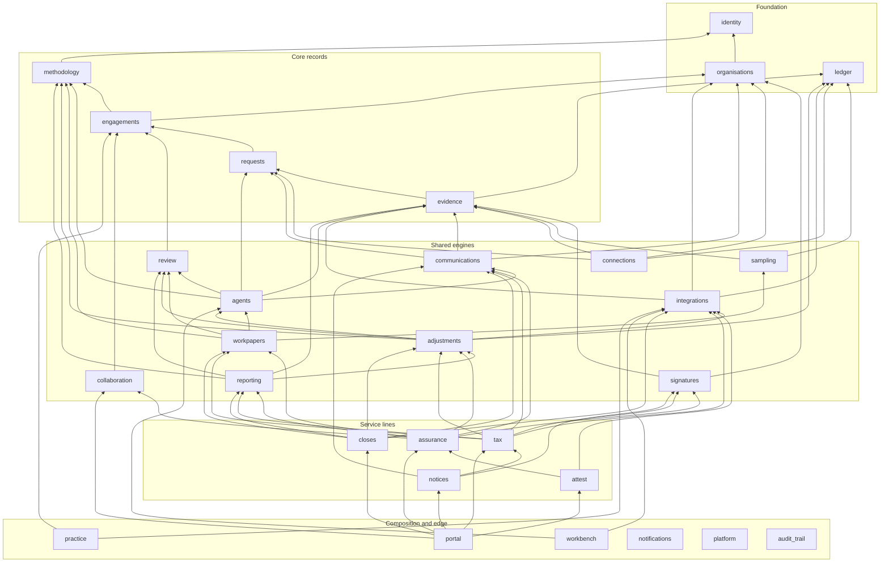
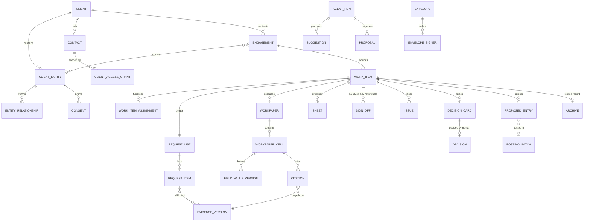
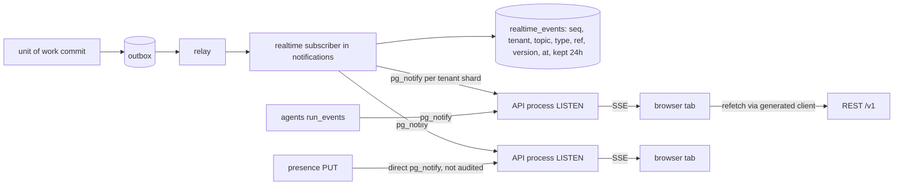
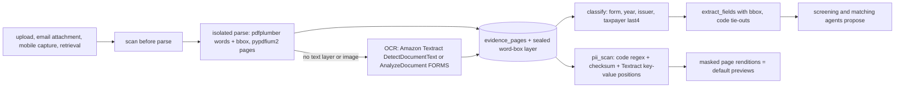
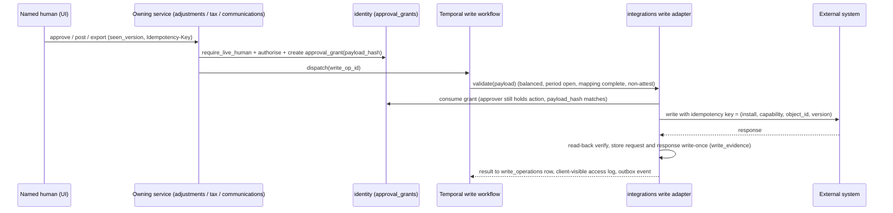

# 03 · Target backend & data architecture

**Chapter of:** Accrued engineering & build plan · **Prepared:** Saturday 2026-10-17 (first sprint starts Monday 2026-10-19)
**Readers:** both founders (ayushkbhatia, notanaskhan) and every Claude Code session that writes backend code in `github.com/notanaskhan/abacus`.
**Sources:** cross digests `domain-model`, `repo-backend-core`, `repo-backend-domain`, `engine-waves-5-8`, `repo-adrs`, `domain-compliance`, `ai-agents`, `repo-frontend-devex`, sections b/c of screen digests S01–S22, and spot checks of the repo at HEAD `a42034c` (`backend/src/abacus/api/app.py`, `kernel/errors.py`, `modules/evidence/service.py`, migration list `0001…0055`).

**How to read this chapter.** Each section ends in decisions, not options. Where a source does not state something, the text says **(inferred)**. Screen IDs (AUD-03, TAX-09 …) are catalogue IDs. ADR-nnn are accepted repo ADRs. P-nn are proposed ADRs: P-01…P-33 come from the repo-ADR digest, and P-34…P-45 are new in this chapter (§15). File paths are repo-relative. A path under `backend/src/abacus/` is shortened to `abacus/…` where unambiguous.

**What this chapter does not cover.** Frontend architecture, the design-system port, the agent runtime in depth (only its data and API seams appear here), infrastructure and Terraform, and sprint sequencing. Other chapters cover those. This chapter is the contract they build against.

---

## 0. Decisions at a glance

| # | Decision | Section | Blocks |
|---|---|---|---|
| D-01 | Keep the modular monolith, the stack and roughly 70 security, tenancy, evidence and AI-governance ADRs unchanged. Supersede or amend about a dozen ADRs (002, 004/034, 005, 024, 032, 040, 058, 065, 092, 102, 109, 111) through proposals P-04…P-31 and P-38…P-44. | §1 | everything |
| D-02 | Grow from 13 modules to **29**: the 13 existing plus `methodology`, `review`, `collaboration`, `workpapers`, `adjustments`, `signatures`, `integrations`, `reporting`, `assurance`, `attest`, `tax`, `closes`, `notices`, `workbench`, `practice`, `portal`. Shared engines sit below service lines. Service lines import each other only for `attest → assurance` and `notices → tax`. | §2 | first new table |
| D-03 | **Additive split of engagement and work item.** `engagements` stays the contract unit. A new `work_items` supertype (kinds `assurance · tax_return · close · notice · advisory_project`) has subtype tables owned by service-line modules. `engagement_id` stays on every row, so `visible()` and every existing foreign key keep working. Backfill one `assurance` work item per existing engagement. | §3.1 | every non-audit screen |
| D-04 | **One canonical status registry**, generated from blueprint §3.3.1 + addendum §3.2 into backend `StrEnum`s, OpenAPI enums and `packages/ui` `status.ts`. Never port the handoff's `lib/status.js`. | §3.2 | every list and pill |
| D-05 | **Migrate the request status enum** to `draft · requested · uploaded · received · returned · not_applicable`. The repo's `received` means Accrued's "Uploaded – needs review", and leaving that collision in code is too dangerous. | §3.4 | AUD-03, BND-*, POR-03/04 |
| D-06 | **The review grammar is one red-zone module.** `review` owns sign-offs L1–L5 with content hash, review notes, issues, decision cards and decisions, checkpoints, the `field_value_versions` provenance ledger and the HOME-02 human-gate projection. Citations v2 live in `evidence`. Suggestions and proposals live in `agents`. | §3.7 | ~60% of P0 screens |
| D-07 | **Human-only gates use five layers.** (1) The matrix denies the agent. (2) `require_live_human`. (3) A DB `CHECK actor_kind='human'`. (4) A static rule naming the only caller files. (5) A single-use approval grant for any write that executes after approval. The policy principal (P-08) is designed now and switched on later. Season 1 ships named-human batch approval. | §4.7 | AJE, return, release, send |
| D-08 | **Roles stay on two axes plus a function layer.** Firm role + engagement access role + work-item function (preparer · detail/manager reviewer · signer · EQR). Add firm role `security_admin`, engagement roles `eqr_reviewer`, `specialist` and `client_service`, and membership attributes `level`, `office_id`, `offshore`, `service_lines`. Client access moves to scoped `client_access_grants` with role union. | §4 | ADM-02, POR-* |
| D-09 | **API conventions:** REST under `/v1`. One list envelope `{items, next_cursor, total, counts, facets}`. Record projections carry server-computed `allowed_actions`. An `Idempotency-Key` header on every externally visible effect. Errors keep fixed codes plus identifier-only `facts`. Work is contract-first: a 501 stub, then `make generate`, then the screen against fixtures. | §5 | parallel work |
| D-10 | **Real time is SSE through `AbacusRouter`.** One multiplexed `GET /v1/events` stream per tab carries identifier-only invalidation events from the outbox. Clients refetch through the typed client. Presence uses an UNLOGGED heartbeat table. WebSockets stay banned. Polling is the fallback. | §7 | SHL-13, C-28, C-26 |
| D-11 | **Search uses Postgres.** A `search_documents` projection with `tsvector`, `pg_trgm` and `visible()`. It indexes metadata only, never Restricted content, and never returns "hidden by wall" counts. | §8 | SHL-02 |
| D-12 | **Document pipeline:** scan, isolated parse, word boxes, OCR (Amazon Textract, inside the AWS boundary), classification, code-only PII detection, masked page renditions, and a logged reveal. Deterministic generation runs in a `reporting` module: WeasyPrint for PDF and python-docx for DOCX, with pinned fonts and fixed metadata. Output must be byte-identical. | §9 | SHL-08, FIL-01, ENG-04 |
| D-13 | **Compute engines are pure code** with golden fixtures from the blueprint §9.8 seed and Hypothesis invariants. Outputs are stamped with `engine_version` + `inputs_hash`. Statutory parameter tables are versioned files in the repo. Firm thresholds and policies live in the database. | §10 | TXP-*, AUD-11, CLS-05 |
| D-14 | **External writes go only through a new red `integrations` module** of declared write adapters. Each adapter is human-gated, idempotent, stores request and response evidence write-once, and appears in a client-visible access log. `connections` stays read-only (CONN-001 intact). TAX-09 v1 is a file bridge (no external write). GL posting is the first true write (P-16), non-attest only. | §11 | TAX-09, CLS-07/11 |
| D-15 | **White-label portal** on `<slug>.portal.<accrued-domain>` or a firm custom domain. `/v1` is proxied same-origin, so no CORS. The host is a branding hint only and authorization comes from the membership or grant. Branded email goes through SES with per-firm DKIM domains. | §12 | POR-*, ADM-10 |
| D-16 | **Migrations:** one Alembic head (CI-checked), claim-next-number and renumber on rebase. Until the first non-synthetic firm is live, breaking changes are allowed in a single reversible migration (P-38). After go-live, expand/contract is strict (ADR-091). | §13 | two-founder work |

---

## 1. Architectural principles carried over, and the stack

### 1.1 ADRs that stay binding (adopt unchanged)

These are the backbone of Accrued's trust story. Claude Code sessions must treat them as hard constraints. "Accepted ADRs are binding; code that contradicts one must not be written" (repo ADR header).

| Area | ADRs (adopt as-is) | What it means for every Accrued table, route and workflow |
|---|---|---|
| Tenancy | 001, 014, 087 | `tenant_id uuid NOT NULL`, forced RLS with the `tenant_isolation` policy via `kernel/db/migration.py:tenant_table()`, and the four DB roles (`abacus_owner`, `abacus_app`, `abacus_relay`, `abacus_identity`). Every table is registered in `TABLE_OWNERS` (`abacus_tools/quality/schema_check.py`). Client records belong to one firm. |
| Authorization | 020, 023, 025, 026, 027, 028 | One `authorise(ctx, action, resource)` in `modules/identity/authz`. Every route declares exactly one matrix action (`AbacusRoute` turns an unchecked route into a 500). Walls apply before roles and a walled resource answers 404. An agent gets agent role ∩ initiator ∩ task scope. Platform staff have no standing access (break-glass only). |
| Write path | 007, 018, 095 | `async with uow(ctx) as tx:` refuses to commit without `tx.record(...)`. Domain events go through `tx.emit(...)` into the transactional outbox. Consumers are idempotent on `(tenant_id, event_id)`. Postgres holds the truth and Temporal holds only orchestration state. |
| Immutability | 004, 016, 034 (amended by P-31), 109 (amended by P-42) | Versions are insert-only with BEFORE UPDATE/DELETE/TRUNCATE triggers. Evidence is stored write-once in S3 Object Lock (GOVERNANCE). Corrections are new rows, never edits. |
| Encryption & classification | 031, 035, 104 | Every Pydantic field carries `classified("restricted\|confidential\|internal\|public")`. Restricted content is envelope-encrypted per tenant. Downloads are proxied by the API. TINs get an extra seal (P-12). |
| Modularity | 008 (module count amended by P-05), 101, 103, 106 | Modules expose `api.py` only. Layers are `routes → service → repository`. There is no cross-module table access. Edges live in `MODULE_DEPENDENCIES`. Downstream facts flow through `register_*` slots that fail closed. |
| API | 012, 013 (amended by P-36), 015 | FastAPI + Pydantic is the schema source of truth. REST lives under `/v1`. The generated client is `packages/api-client` (hey-api). The stack uses SQLAlchemy 2 async + Alembic with reversible migrations. |
| Orchestration | 017, 057, 062, 071, 090, 091 | Temporal is the only orchestrator. There are four work classes (`interactive`, `time_sensitive`, `background`, `batch`). Workflows start only via `kernel/dispatch.py`. Logic changes use `workflow.patched` with replay fixtures. Backfills run as throttled workflows. |
| AI governance | 019, 046–056, 059, 060, 061, 064, 066–070, 072–074, 113, 114, 115 | Every model call goes through `ai_gateway` with a registered prompt, schema, tier and budget. Code computes and models judge (ADR-050). Client content is hostile (ADR-052). Citations are verified by code (ADR-066). Client data goes only through Bedrock in-region with a current provider-terms entry (register currently `entries: []`). |
| Connectors | 037, 038, 039, 041–045, 107, 108 | One connector contract and the six-stage pipeline. File import is a first-class connector. Clients may always choose "Export instead" (ADR-108; POR-16 must add it). |
| Quality & ops | 076–085, 088, 089, 092, 093, 096, 097, 099 | Deterministic tests on a fake model, evals for real models, a separate test author for amber and red work, coverage floors, a security suite, synthetic data only, build-once-promote, ≤90-day flags, a Jan–Mar reduced-risk policy (timing amended by P-29), SLOs, backups/DR, kill switches. |

### 1.2 ADRs Accrued must supersede or amend

| ADR | Conflict with designed screens | Resolution (proposal → §15) |
|---|---|---|
| 002 | Client access is an engagement-scoped grant. Accrued grants are scoped to entity, request, K-1 package, governance room or component, with role union. | P-09: `client_access_grants` with scope kinds. Engagement scope becomes one kind among several. |
| 005 | Only humans decide. Blueprint adds a non-human policy principal. | P-08: enumerated exception, built later. Season 1 uses named-human batch approval (§4.6). |
| 024 | Admins see metadata only. Blueprint Firm Admin publishes binders and sends client messages. | P-10: keep ADR-024 and add an engagement role `client_service` (binders, invitations, envelopes, request status; no evidence content). |
| 040 | Connectors only read. CAS posts AJEs, TAX-09 exports, ATT-09 syncs GRC requests. | P-16/P-17/P-18: writes go only through declared adapters in `integrations`. `connections` stays read-only (§11). |
| 058 | One engagement agent with an audit goal. | P-22: generalise to a work-item agent and firm-configured instances of declared capabilities. |
| 065 | Plain-text agent output only. | P-24: typed block schemas rendered by design-system components. Models never emit markup. |
| 102 | `visible()` takes an engagement column. Home, Clients, Inbox, Files, Signatures and the portal list non-engagement resources. | P-06: scope kinds `engagement · work_item · client · client_entity · portal_scope` (§4.3). |
| 109 | Comments are request-anchored and append-only. SHL-18 anchors to any object and offers Resolve. | P-42: polymorphic anchors. Resolve and Reopen are append-only thread events. No edit or delete (the design's Edit/Delete is dropped). |
| 111 | No model text reaches clients, even after a human approves it. INB-03/04, SHL-20, NOT-03 send agent drafts. | P-25: allowed only when six conditions hold. Ships disabled. Deterministic templates first. |
| 004/034 | No deletion. POR-03 lets clients remove their own unaccepted uploads. FIL-02 destroys records after retention. | P-31 (client withdrawal = void + crypto-erase after a purge window) and P-14 (destruction = dual-approved, hold-aware, certificate). |
| 032 | Retention per engagement type, audit-only. | P-14: retention per record type × service line, with legal floors (§9.6). |
| 092 | Jan–Mar freeze tuned to audit, starting now. | P-29: the freeze applies from the first non-synthetic firm go-live, with windows Jan 1–Apr 20 and Sep 1–Oct 20. |
| SPEC-008 Q4/AC-5 | Methodology is pinned once (409 on re-pin). KNW-07/SHL-22 need gated template upgrades. | P-41: templates v2 with an engagement template link and an update workflow (§3.15). |
| SPEC-025 Q2 / non-goals | E-signature and in-app acceptance "recorded, not performed". | P-26: a `signatures` module. Acceptance and independence become performed workflows (CLI-07/08). |

### 1.3 Accrued architectural rules (new, binding once P-04/P-05 are accepted)

1. **Scope columns everywhere.** Every row at engagement scope carries `tenant_id, engagement_id`. Every row at work-item scope adds `work_item_id`. Client-scoped rows carry `client_id` (and `client_entity_id` where meaningful). Denormalisation is deliberate: it keeps `visible()`, walls and archive locks as single-column predicates.
2. **State machines live on the server as declarative transition tables.** Each object has a `transitions.py` in its module with a `(from, to, action, guard)` table. Illegal transitions raise `DomainConflict("illegal_transition")`. Every transition writes an audit event and emits `<object>.status_changed`. The UI and Board drags never infer or set state directly (P-04).
3. **Agents propose; named humans decide** (ADR-005, extended in §4.7). Agent output is always a `suggestion`, a `proposal`, a draft or a decision-card recommendation.
4. **Code computes; models judge** (ADR-050). Every number on a screen is computed by code or comes from a verified citation (§10).
5. **Content belongs in the database, not in a commit** (the user's standing rule). Methodology and engagement templates, threshold policies, firm standards, email templates, note and report templates, deadline-rule overrides, custom fields, library agents and saved prompts are rows edited through admin UIs (KNW-*, ADM-*, PLT-01). They are seeded by scenario loaders, never by migrations or constants. Code holds only the *schema*, the *engines* and statutory parameter tables that need golden tests (§10.3).
6. **Clients see by allowlist.** Client principals see only rows that a `scope_only` condition admits. Materiality, review notes, agent reasoning, draft K-1s, confirmations and other clients' data are never client-visible (§4.5).
7. **Everything time-based uses `kernel.clock`** (new, P-37). Today the repo has 51 direct `now()` call sites. They move to `abacus.kernel.clock.now()`, so the Brightwater Hale demo clock, golden-date tests (Oct 9 + 60 = Dec 8) and seed epochs E0–E2 work.
8. **Identifiers only cross boundaries.** Outbox payloads, SSE events, notifications, webhooks, search documents and audit `before/after` refs carry IDs, enums and hashes, never Restricted text. This continues the repo pattern from SPEC-013 AC-7 and `uow` `Ref`.
9. **Flags are for rollout. Entitlements are for plans.** Per-firm `feature_flag_states` (≤90-day expiry, ADR-089) gate unfinished features. Module entitlements (Attest, Internal audit, seats, agent-minutes) are rows in `platform` (P-28). The design's `ff.attest`/`ff.internal_audit` behave as entitlements.

### 1.4 Stack: unchanged, with justified additions

| Layer | Today (keep) | Accrued additions | Justification |
|---|---|---|---|
| Language/runtime | Python 3.12, uv, Pyright strict, Ruff, import-linter | none | ADR-009 |
| API | FastAPI, Pydantic v2, `AbacusRouter`, hey-api generated client | SSE route marker (P-15). Listing, idempotency and error-facts helpers (P-36). | §5, §7 |
| DB | Postgres 17 + pgvector 0.8.7, SQLAlchemy 2 async, Alembic | Extensions `pg_trgm` (search) and `btree_gin` (composite GIN). UNLOGGED tables for presence. Declarative partitioning for append-heavy tables once they pass ~50M rows. | §8, §14 |
| Orchestration | Temporal Cloud (Python SDK), 4 work classes, slots, admission | Temporal Schedules via a new `kernel.dispatch.schedule()` (DISPATCH-001 owns it). | §6.1 |
| Storage/crypto | S3 Object Lock (GOVERNANCE), per-tenant KMS envelope encryption (adapter TBD in TASK-014) | A separate seal-manifest prefix with COMPLIANCE mode (hashes only). Per-object data-key destruction for crypto-erase. | §9.6 |
| Documents | pdfplumber, pypdfium2, Pillow, openpyxl | **WeasyPrint** (PDF), **python-docx** (DOCX), **Amazon Textract** (OCR, via boto3 in `kernel.storage`-style adapter) | P-19, P-32 |
| AI | `ai_gateway` (direct + Bedrock routes; fake locally) | Tool-use and multi-turn `converse()` in the gateway (agent chapter) | P-22/P-23 |
| Identity | Generic OIDC verifier; WorkOS `pending` | WorkOS AuthKit (staff SSO, magic code, MFA). A JIT provisioning definer function. Refresh tokens through a BFF session (ADR-030 revisit). | §12, P-09 |
| E-sign | none | DocuSign adapter (embedded signing + ID verification) plus a "record" adapter | P-26 |
| Email | `LocalMailbox` only | Amazon SES (outbound, per-firm DKIM domains). M365 Graph adapter (inbound docs@ mailbox and send-as) | P-11, P-17 |

All additions go through `docs/architecture/dependency-allowlist.yaml` (protected) in **one batched dependency PR in Sprint 0**, approved by the other founder. No other library additions are recommended for the backend. Specifically: no Redis (Postgres LISTEN/NOTIFY and UNLOGGED tables cover v1), no search cluster, no CRDT/Yjs, no agent framework (ADR-057), no headless Chromium.

---

## 2. Target module map

### 2.1 Existing 13 modules → target

Zones: **red** = protected path, CODEOWNERS plus an approval file from the other founder. **amber** = written plan, separate test author (ADR-078), other-founder review. **green** = eligible for ADR-086 auto-merge once it is earned (not enabled today). Lead = the founder who implements by default. The other founder reviews and writes the independent AC tests (ADR-078), so every module has both.

| Module | Zone | Owns today | Absorbs for Accrued | Lead |
|---|---|---|---|---|
| `identity` | red | firms, users, memberships, engagement_members, ethical_walls, support_sessions, invitations, signup | offices, teams, team_members; membership attributes (`level`, `office_id`, `service_lines[]`, `offshore`, `initials`); firm role `security_admin`; engagement roles `eqr_reviewer`, `specialist`, `client_service`; `client_access_grants`; `approval_grants`; `firm_policy_overrides` (stricter-only matrix); API keys, webhooks, MCP grants (P2); `security_policies`; the `policy` actor kind (behind P-08) | notanaskhan |
| `organisations` | **red** (upgraded from amber, because it now holds sealed TINs and §7216 consents) | clients, client_entities | client attributes (`kind`, `primary_office_id`, `relationship_partner_id`, `risk_tier`, `is_attest_client`), entity attributes (`entity_type`, `tin_sealed`, `tin_last4`, FYE, plan number, date of death), `contacts`, `entity_relationships`, `consents` + `consent_signers`, `tax_authorizations` (2848/8821), `tax_elections`, `transcripts`, `conflict_checks` | notanaskhan |
| `engagements` | amber | engagements, methodology_* (5), engagement_acceptance, independence_confirmations, engagement_letters | engagement lifecycle (8 states), `engagement_entities`, **`work_items` supertype**, `work_item_assignments`, `engagement_contacts`, `milestones`, gate providers (G1–G9 computed) and `gate_policies`, `engagement_template_links` and `template_updates`, roll-forward v2, `season_manifests`, `intakes`, `advisory_projects`, `nas_evaluations`. It hands `methodology_*` to `methodology`. | notanaskhan (split), then ayushkbhatia |
| `requests` | amber | request_lists, request_items, fulfilments, comments* | binders (`request_lists` + work item, name, kind, status), `request_categories`, the migrated request status, `request_delegations`, `questionnaires`/`questions`/`answers`, `transaction_questions` (shared API), cross-engagement fulfilment (P-40). Comments move to `collaboration`. | ayushkbhatia (after notanaskhan lands the enum migration) |
| `evidence` | red | evidence_items/versions, inbox_files, review_decisions/assignments/reason codes, upload_* | client-scoped files (P-40), virtual splits, `document_classifications`, `extracted_fields`, `evidence_pages` (word-box layers), `pii_regions`, `pii_reveals`, `file_folders`, `evidence_withdrawals`, **`citations` (v2)**, `archives` + `archive_additions` + seal manifests, `retention_policies`, `legal_holds` + `hold_objects`, `destruction_batches` + certificates, `capture_sessions`, `firm_exports` | notanaskhan |
| `connections` | red | connections, connection_states/secrets, sync_runs, ledger_imports, gl_imports | real providers (QBO first), `category` with uniqueness per (entity, category), nullable `sync_runs.request_item_id` + `purpose`, datasets beyond `trial_balance`, `sync_schedules`. **Read-only forever** (CONN-001). | notanaskhan |
| `ledger` | red | ledger_snapshots, trial_balance_lines, gl_* | snapshot `label` and `source_kind`, `grouping_sets`, `account_mappings` + `mapping_sets`, `consolidations` + `consolidation_entities`, `change_events` (ADR-041), `tb_handoffs`, JSON read APIs. Stays dependency-free. | notanaskhan |
| `sampling` | amber | — (stub) | `populations`, `sample_sets` (seed, algorithm version, versions, override), `sample_completeness_ties`, `sample_items`, `je_test_criteria`/`je_scores`, `support_matches`; seeded sampler compute | notanaskhan |
| `agents` | red | agent_runs, screening_results, engagement_agents, agent_activity, reminders, knowledge_*, upload_reviews, inbox_match_*, guidance_* | extended run states; `agent_run_steps`, `agent_plans`, `agent_questions`, `run_events`, `run_artifacts`, `agent_feedback`, **`suggestions`**, **`proposals`** + `proposal_rows`, `review_packages`, `memory_items`, `corrections`, `daily_briefings`; tool registry (`register_tool`) | notanaskhan |
| `audit_trail` | red | (API only; `audit_events` owned by `kernel.uow`) | read API (ADM-07, AUD-29, TAX-07 activity) with actor grammar; `audit_checkpoints` (hash-chain roots, P-43); signed CSV export | notanaskhan (API), ayushkbhatia (screens) |
| `communications` | red | messages | `message_threads` + `thread_messages`, `inbound_messages` + `inbox_threads` + `inbox_attachments` (firm inbox), `drafts`, `follow_ups` (renamed from `reminders`), `email_templates` + versions, `sending_domains`, `secure_links`; transport registry (`register_transport`) | notanaskhan |
| `notifications` | amber | notifications | categories and `actionable`, `notification_preferences`, email/digest fan-out, **`realtime_events` + the SSE stream** (§7), `presence_heartbeats` | ayushkbhatia |
| `platform` | amber | (budgets via ai_gateway) | `entitlements`, `seat_assignments`, `custom_field_definitions`, `tags`, `tb_labels`, `search_documents` + indexer (§8), library release channel (`library_agents`, `library_templates`), tenant console (staff issuer) | ayushkbhatia |

### 2.2 New modules (16)

| Module | Zone | Owns (tables) | Screens served | Lead | Needed by |
|---|---|---|---|---|---|
| `methodology` | amber | `engagement_templates`, `template_versions` (re-owned `methodology_templates/versions/areas/request_items/account_rules`), `template_program_steps`, `template_sheet_definitions/columns/views`, `template_forms`, `template_requests`, `template_trigger_defaults`, `scoping_rules`, `template_rollouts`, `standards_sets`, `firm_standards` + versions, `threshold_policies` + versions, `frameworks`/`framework_versions`/`criteria`, `note_templates`, `report_templates` + versions, `content_packs` (D8 fictional), `agent_skills` + versions (content), `knowledge_items`, `methodology_imports` | KNW-01…12, ENG-11, SHL-22 | ayushkbhatia | Nov (programs, threshold policies) |
| `review` | **red** | `sign_offs`, `review_notes` + `review_note_events`, `issues` + `issue_events` + `issue_links`, `decision_cards`, `decisions`, `checkpoints` + `checkpoint_diffs` + `checkpoint_decisions`, `field_value_versions`, `human_gates` (projection) | SHL-09/10/11/12/15/16, HOME-02, AUD-15/17, TAX-06/07, TXP-10, CLS-06 | notanaskhan | Nov (trust engines first) |
| `collaboration` | amber | `comments`, `comment_mentions`, `comment_reads`, `comment_redactions`, `comment_thread_events` (moved from `requests`), `todos` + `todo_checklist_items`, board column configs | SHL-17, SHL-18, ENG-10 Board (read model), C-28 presence UI | ayushkbhatia | Wave 5 / Dec |
| `workpapers` | amber | `workpapers`, `workpaper_sections`, `workpaper_versions`, `workpaper_cells`, `sheets`, `sheet_columns`, `sheet_rows`, `sheet_cells`, `sheet_views`, `agent_columns`, `agent_column_runs`, `procedures`, `leadsheets` (read model), `tie_out_checks`, `test_attribute_results`, `workbook_formulas` | AUD-04/05/06/08/09/12, EBP-0x, SHT-01…04, TXP-11, CLS-04 | ayushkbhatia (sheets), notanaskhan (cells, formula DAG) | Nov–Dec |
| `adjustments` | **red** | `proposed_entries`, `proposed_entry_lines`, `proposed_entry_decisions`, `approval_batches`, `posting_batches`, `posting_results` | AUD-16, AUD-33 eliminations, CLS-07, TXP-02 layers, POR-08 | notanaskhan | Dec (CAS P0) |
| `signatures` | **red** | `envelopes`, `envelope_documents`, `envelope_signers`, `envelope_events`, `signature_evidence`, `envelope_policies`; provider adapters (DocuSign, record) | SIG-01/02, POR-06, ENG-04, AUD-21/22, TAX-12, NOT-03, ADM-05 | notanaskhan | Dec (8879 for TY2026) |
| `integrations` | **red** | `integration_catalogue` (platform rows), `integration_installs`, `integration_secrets` (sealed), `integration_mappings`, `write_operations` + `write_evidence`, `engine_sync_events`, `engine_import_diffs`, `engine_diagnostics`, `mailboxes`, `grc_syncs` | WB-10/11, ADM-08/09, TAX-09, CLS-11, INS-04, ATT-09, INB-01 | notanaskhan | Nov (catalogue, file bridge) |
| `reporting` | amber | `generated_documents` + `render_jobs`, `statement_documents`, `statement_versions`, `line_items`, `linked_values`, `tracked_changes`; renderer service | ENG-04 letter, FSP-01…06, AUD-20…23, TAX-11/12 packets, TXP-12 K-1 PDFs, CLS-08 package, POR-09 watermarked drafts | notanaskhan (renderer), ayushkbhatia (statements) | Nov (letters) |
| `assurance` | amber; red paths: `release.py`, `archive_gate.py` | `assurance_work_items`, `materiality_versions`, `risks` + `risk_linkages`, `control_activities`, `walkthroughs`, `service_organizations`, `soc_report_evaluations`, `cuecs`, `confirmations` + `confirmation_links`, `findings`, `misstatements`, `deficiencies`, `accounting_estimates`, `related_parties`, `parties_in_interest`, `eqr_reviews`, `completion_items`, `subsequent_events`, `legal_letters`, `going_concern_evaluations`, `governance_communications` + acknowledgements, `representation_letters`, `audit_reports`, `report_releases`, `consultations`, `post_issuance_events`, EBP tables, `components`, `component_auditors`, `component_instructions`, `component_deliverables` | AUD-01…38, EBP-01…09, POR-15/17/23, AUD-26 | notanaskhan | Nov–Dec (SAS 149 before Jan 1) |
| `attest` | amber | `attest_scopes`, `system_descriptions`, `control_sets`, `controls`, `control_mappings`, `control_tests`, `attest_exceptions`, `management_responses`, `attest_reports`, `readiness_items`, `auditable_units`, `ia_plans`/`ia_plan_items`, `ia_issues`, `action_plans` + updates, `committee_packs` | ATT-01…09, KNW-10, IAU-01…04, POR-21/22 | ayushkbhatia | Wave 7 (2027) |
| `tax` | amber; red paths: `approval.py`, `export.py`, `filing.py` | `tax_returns`, `return_worksheets`, `return_fields`, `return_leadsheets` (read model), `two_year_lines`, `document_approvals`, `k1_activities`, `k1_treatments`, `k1_packages`, `capital_account_lines`, `basis_schedules`, `allocation_structures`/`allocation_rungs`, `fixed_assets`, `book_tax_items`, `schedule_k_lines`, `state_apportionments`, `trust_profiles`, `instrument_determinations`, `fai_dni_computations`, `beneficiary_allocations`, `sixty_five_day_elections`, `estate_inventory_items`, `gift_history_items`, `filings`, `transmissions`, `efile_acks`, `extensions`, `estimate_schedules`, `amendments`, `standards_runs` + rows, `planning_opportunities`, `preparer_memos`, `delivery_packets`, `variance_explanations` | TAX-01…16, TXI-*, TXT-*, TXP-*, POR-13 | ayushkbhatia (workspace), notanaskhan (red paths, compute review) | Dec (TY2026 season) |
| `closes` | amber | `closes`, `close_plans` + versions + rows, `close_procedures`, `reconciliations` + `reconciling_items`, `close_schedules`, `arrangements`, `analytic_lines` (shared with assurance through its API), `close_deliverables`, `vendors_1099`, `w9_requests` | CLS-01…13, POR-08/11 | ayushkbhatia | Dec (CAS P0; posting is in `adjustments`) |
| `notices` | amber | `notices`, `notice_intakes`, `notice_analyses`, `notice_responses` | NOT-01…03 | ayushkbhatia | Jan |
| `workbench` | amber | `agent_definitions` + versions, `agent_installs`, `agent_schedules`, `triggers`, `workbench_sessions`, `session_items`, `saved_prompts` | WB-01…13, ENG-11 triggers | ayushkbhatia (definitions/UI), notanaskhan (runtime seams) | Nov–Dec |
| `practice` | green/amber | `due_date_rules` + holiday calendars, `filing_deadlines`, `budget_lines`, `staffing_allocations`, `resource_needs`, `time_suggestions`, `timesheet_weeks`, `wip_snapshots`, `invoice_refs`, `fee_proposals` (ENG-09; named to avoid colliding with agent `proposals`), `insight_snapshots` (read models), `qm_objectives`, `qm_risks`, `inspections` + findings | HOME-03/04, ENG-06/08/09, INS-01…05, ADM-11/12 | ayushkbhatia | Deadlines Nov; rest 2027 |
| `portal` | amber | `portal_branding`, `portal_domains`, `portal_preferences`; owns **no business truth** (a BFF over other modules' `api.py`) | POR shell, home to-dos, role-union switcher, deliverables registry | ayushkbhatia | Nov |

**Excluded on purpose** (D1–D10, X-01..X-08): no tables, enums or engagement types for PCAOB, ESG, forensics, FedRAMP, AIUC-1, fund accounting, the in-house workspace, peer benchmarks (D6: opt-in switch only), `single_audit` or `yellow_book` (D10 deferred), and no billing or payments (P-27). BSA/AML exists only as an internal-audit template (X-01b).

### 2.3 Dependency graph

The graph shows direct edges only. `kernel` and `ai_gateway` sit under everything (ADR-101). Every module may also depend on `identity` and `platform` (search projection, entitlements); those edges are omitted to keep the graph readable.



**Replacement `MODULE_DEPENDENCIES`** for `abacus_tools/quality/banned_patterns.py` (protected; one PR in Sprint 0; `+` marks new edges):

```python
MODULE_DEPENDENCIES = {
    "identity": frozenset(),
    "platform": frozenset({"identity"}),
    "notifications": frozenset({"identity", "platform"}),                        # + platform
    "audit_trail": frozenset({"identity"}),                                     # + (read API)
    "organisations": frozenset({"identity", "platform"}),                       # + identity, platform
    "ledger": frozenset(),
    "methodology": frozenset({"identity", "platform"}),                         # + new
    "engagements": frozenset({"identity", "platform", "organisations", "methodology"}),
    "requests": frozenset({"identity", "platform", "engagements"}),
    "evidence": frozenset({"identity", "platform", "engagements", "requests", "ledger"}),
    "review": frozenset({"identity", "platform", "engagements"}),               # + new
    "collaboration": frozenset({"identity", "platform", "engagements"}),        # + new
    "signatures": frozenset({"identity", "platform", "engagements", "organisations", "evidence"}),
    "sampling": frozenset({"identity", "platform", "engagements", "ledger", "evidence"}),
    "connections": frozenset({"identity", "platform", "engagements", "organisations", "ledger", "evidence", "requests"}),
    "communications": frozenset({"identity", "platform", "engagements", "organisations", "ledger", "evidence", "requests"}),
    "integrations": frozenset({"identity", "platform", "organisations", "engagements", "evidence", "ledger"}),
    "agents": frozenset({"identity", "platform", "engagements", "organisations", "evidence", "requests",
                         "ledger", "communications", "methodology", "review"}),
    "workpapers": frozenset({"identity", "platform", "engagements", "methodology", "evidence", "requests",
                             "ledger", "sampling", "review", "agents"}),
    "adjustments": frozenset({"identity", "platform", "engagements", "ledger", "methodology", "review",
                              "agents", "integrations"}),
    "reporting": frozenset({"identity", "platform", "engagements", "methodology", "evidence", "ledger",
                            "review", "adjustments"}),
    "assurance": frozenset({"identity", "platform", "organisations", "engagements", "methodology", "requests",
                            "evidence", "ledger", "sampling", "review", "collaboration", "workpapers",
                            "adjustments", "reporting", "signatures", "communications", "agents"}),
    "attest": frozenset({"identity", "platform", "organisations", "engagements", "methodology", "requests",
                         "evidence", "sampling", "review", "workpapers", "reporting", "signatures",
                         "communications", "agents", "integrations", "assurance"}),
    "tax": frozenset({"identity", "platform", "organisations", "engagements", "methodology", "requests",
                      "evidence", "ledger", "review", "workpapers", "adjustments", "reporting", "signatures",
                      "communications", "agents", "integrations"}),
    "closes": frozenset({"identity", "platform", "organisations", "engagements", "methodology", "requests",
                         "evidence", "ledger", "review", "workpapers", "adjustments", "reporting",
                         "communications", "agents", "integrations"}),
    "notices": frozenset({"identity", "platform", "organisations", "engagements", "requests", "evidence",
                          "review", "signatures", "communications", "agents", "tax"}),
    "workbench": frozenset({"identity", "platform", "organisations", "engagements", "methodology", "agents",
                            "integrations"}),
    "practice": frozenset({"identity", "platform", "organisations", "engagements", "integrations"}),
    "portal": frozenset({"identity", "platform", "organisations", "engagements", "requests", "evidence",
                         "signatures", "communications", "collaboration", "review", "assurance", "attest",
                         "tax", "closes", "notices"}),
}
```

**Rules that keep the graph acyclic.**
1. Nothing imports `portal`, `notifications`, `practice`, `workbench` or `audit_trail`.
2. Shared engines (`review`, `collaboration`, `workpapers`, `adjustments`, `signatures`, `reporting`) never import a service line. They learn about targets through registration slots (§2.4).
3. Upward state changes travel as outbox events. Example: `envelope.completed` is consumed by `engagements` (G3), `organisations` (consents), `tax` (8879) and `assurance` (rep letter).
4. Where a lower module needs a capability from a higher one, the higher one registers it. Two cases:
   - Engagement-letter rendering: the ENG-04 composer routes live in `reporting` and write back through `engagements.api.record_letter_draft`.
   - Firm-mailbox send-as: `integrations` registers a transport with `communications.register_transport("m365", …)`.

### 2.4 Registration slots (ADR-106 pattern; a missing registration fails closed)

| Slot (defined in) | Registered by | Contract | Fail-closed behaviour |
|---|---|---|---|
| `engagements.register_work_item_kind(kind, provider)` | assurance, tax, closes, notices, engagements (advisory) | `status(tenant, wi_id) -> StatusRef`, `tiles(...)`, `deep_link(...)`, `archive_ready(...)` | Unregistered kind cannot be created (409 `unknown_work_item_kind`). |
| `engagements.register_gate_provider(gate, provider)` | engagements (G1, G2), signatures (G3), assurance (G4–G9), attest (reuses G5–G9) | `provider(tenant, engagement_id) -> GateFact(met, blockers: list[ObjectRef])` | Unregistered gate = unmet. |
| `identity.register_scope_resolver(scope_kind, lookup)` | engagements (work_item, intake), requests (request_item), tax (k1_package), assurance (governance_room, component) | `lookup(tenant, scope_id) -> ScopeFacts(client_id, engagement_id?, work_item_id?)` | Unresolved scope = deny. |
| `identity.register_consent_check(purpose, lookup)` | organisations | `lookup(tenant, entity_id, purpose, at) -> bool` | Unregistered = deny for offshore users and for agents on tax-return information (TRI). |
| `review.register_reviewable(target_type, provider)` | workpapers, tax, closes, assurance, attest, adjustments, reporting, evidence | `ReviewableFacts(engagement_id, work_item_id, content_hash, version_no, preparer_user_ids, required_levels, label, locked)` | Sign-off on an unregistered target answers 503. |
| `review.register_decision_kind(kind, provider)` | assurance, engagements, tax, notices, attest | validates options and the reserved role; `apply(tx, decision)` runs in the owner on `decision.decided` | Card cannot be raised. |
| `review.register_gate_kind(kind, resolver)` | every module with a human gate | resolver gives the live state for the HOME-02 projection | Gate kind is not shown (and is logged). |
| `review.register_field_owner(target_type, provider)` | tax, workpapers, reporting, closes | validates `field_key`, gives the label and the classification | `record_value` refused. |
| `collaboration.register_anchor(anchor_type, provider)` | every module with commentable objects | `AnchorFacts(engagement_id, client_visible, label, locator_schema)` | Comment refused. |
| `evidence.register_citable(kind, verifier)` | workpapers (cells), methodology (program steps), tax (form lines, instrument clauses), ledger (lines), agents (artifact cells) | locator validation, verification, display title | Citation refused. |
| `evidence.register_retention_record_type(type, provider)` | tax, assurance, closes, signatures, organisations, communications | `clock_start(...)`, `legal_floor`, `default_years` | Record defaults to the longest floor. |
| `agents.register_tool(name, ToolSpec)` | each module whose data a tool touches (ADR-049) | typed args and result; class `read · compute · propose · write_after_approval` | Tool cannot be invoked. |
| `agents.register_suggestion_target(target_type, applier)` | workpapers, tax, closes, assurance, requests, adjustments, organisations | `applier(tx, ctx, suggestion)` runs in the owner on human accept | Accept answers 503. |
| `communications.register_transport(kind, transport)` | integrations (m365, gmail), kernel SES adapter | `send(message) -> ProviderRef` | Message `blocked` (`no_transport`). |
| `notifications.register_topic(kind, authorizer)` | every module that publishes SSE topics | `authorize(ctx, topic_id) -> bool` | Subscription refused. |
| `platform.register_search_projection(object_type, builder)` | each module with searchable objects | `builder(tenant, id) -> SearchDocument \| None` | Object is not indexed. |
| Existing (keep): `identity.register_engagement_client`, `register_independence`, `register_active_engagements`, `evidence.register_proposal_source`, `requests.register_roll_forward_items`, `kernel.dispatch.register_work_classes` | — | unchanged | — |

### 2.5 Registries and protected files: split per module (P-39)

Two founders will collide on single protected registries: `TABLE_OWNERS`/`INSERT_ONLY_TABLES`/`APP_INSERT_COLUMNS`/`DEFINER_FUNCTIONS` in `schema_check.py`, `MODULE_DEPENDENCIES`, `ROUTERS` in `abacus/api/app.py`, `MODULES` in `abacus/worker/__main__.py`, and `permission-matrix.yaml`/`feature-flags.yaml`. **Recommendation:**
- Each module gets `modules/<m>/registry.py` declaring its tables, insert-only tables, routers, workflows, subscriptions and matrix actions.
- The quality gate and app/worker boot *collect* these files. A static check verifies every module is listed once in a single sorted `MODULES` tuple.
- The matrix is split into `docs/architecture/permission-matrix/<module>.yaml`, compiled into one `_matrix.py`. It stays protected.
- The work is done in one pre-registration PR by notanaskhan in Sprint 0, which also creates empty packages for all 16 new modules, so later feature PRs rarely touch shared files.

---

## 3. Core domain model

### 3.0 Conventions used in every table below

- **Scope codes.** `P` platform (no tenant) · `F` firm · `C` client · `E` client entity · `G` engagement · `W` work item. Every tenant row has `tenant_id uuid NOT NULL` with forced RLS. G rows also carry `engagement_id`. W rows add `work_item_id`.
- **Markers.**
  - **IO** = insert-only for the app role (revoke UPDATE/DELETE and add the trigger).
  - **HASH** = the row stores the SHA-256 of what was approved.
  - **SEAL** = a Restricted text field envelope-encrypted per tenant, like `comments.body_sealed`.
  - **EV** = each state change is also a row in an `<object>_events` IO table (the object row keeps the current state for querying).
- **Status columns** are `status text NOT NULL` with a `CHECK (status IN (...))` generated from the status registry (§3.2). The repo uses CHECK constraints, not Postgres enums, and keeps doing so, because adding a value is then a constraint swap rather than an `ALTER TYPE`.
- **Money** is `numeric(20,2)` (or `numeric(20,6)` for rates). It travels as a decimal string in JSON. `float` is never used.
- **Display keys.** Run `#4127`, `AJE-06`, `BH-TAX-02` and `E1a` come from per-tenant counters (`kernel.sequences.next(tx, kind)` on a `tenant_counters(tenant_id, kind, value)` row; **inferred**). They are never the primary key.
- **`ObjectRef`** is `(type: str, id: UUID)`, a plain dataclass in `abacus.kernel.refs` so no module needs to import another to name a target. Its JSON form is `{"type": "workpaper_cell", "id": "…"}`.

### 3.1 Engagement vs work item: the split

**Problem.** In the repo, `engagements` is "one job for one client entity and one fiscal period". It holds contract facts (acceptance, independence, letter, team) and also work facts (request list, evidence, methodology pin). In Accrued, the engagement is the contract (one service, one period, one letter, one team, one budget), and work happens in work items. The seed needs 1:n: Copperleaf "2026 Close" has 12 monthly closes, and the Estate of Walter Thornbury has a 1040 for TY2025, a final 1040 for TY2026, a 1041 and a Form 706.

**Decision (P-04): additive supertype, no foreign-key rewrite.**

```text
engagements (G, existing; becomes the contract)
  + service_line ∈ {audit, tax, cas, advisory}
  + type (expanded, §3.1.2) ; status (8-state lifecycle, §3.1.3)
  + office_id, standards_set_id, auto_mode_default, fee_terms_ref
  + client_entity_id stays = "primary entity"; engagement_entities adds more (group audits, households)
work_items (W, NEW, owned by engagements)
  id, tenant_id, engagement_id, client_id, client_entity_id (nullable), kind, name,
  period_start, period_end, status (projection written by the subtype owner), office_id,
  due_on, archived_at, archive_locked_at, created_at, created_by
  CHECK kind IN ('assurance','tax_return','close','notice','advisory_project')
  UNIQUE (tenant_id, engagement_id) WHERE kind = 'assurance'      -- one audit per audit engagement
work_item_assignments (W, NEW) work_item_id, engagement_id, user_id, function, assigned_by/at, removed_at
  CHECK function IN ('preparer','first_level_reviewer','detail_reviewer','manager_reviewer','signer','eqr',
                     'close_preparer','close_reviewer','project_lead','specialist')
subtype tables share the PK (work_item_id) and repeat engagement_id:
  assurance.assurance_work_items · tax.tax_returns · closes.closes · notices.notices · engagements.advisory_projects
```

**Cardinality rules** (enforced in `engagements.create_work_item`):

| Engagement type | Work items |
|---|---|
| `fs_audit`, `ebp_audit`, `review`, `compilation`, `preparation`, `agreed_upon_procedures`, `soc1`, `soc2`, `readiness`, `internal_audit` | exactly 1 `assurance` |
| `tax_compliance` | ≥1 `tax_return`; each return carries its own `client_entity_id` (Thornbury: 4 returns, 2 entities) |
| `cas_monthly_close` | one `close` per period (`YYYY-MM`), created by the close plan |
| `notice_response` | ≥1 `notice` |
| `advisory` | ≥1 `advisory_project` |

Every work-item-scoped table carries `(tenant_id, engagement_id, work_item_id)`. `visible()` still filters on `engagement_id` (ADR-102 semantics, generalised in §4.3). Archive lock is per work item. The engagement reaches `archived` when all its work items are archived.

#### 3.1.1 What hangs where

| Object | Today keyed by | Target |
|---|---|---|
| Binder (`request_lists`) | `engagement_id` (one per engagement) | `work_item_id` (unique, 1:1) + `engagement_id` |
| Request items, fulfilments | `engagement_id` | + `work_item_id` (via binder) |
| Evidence items/versions | `engagement_id NOT NULL` | `client_id NOT NULL`, `engagement_id NULL` (client-scope files, P-40), `work_item_id NULL` |
| Methodology pin | `engagements.methodology_version_id` | `engagement_template_links` (engagement level), plus row-level pins on signed-off work (§3.15) |
| Agent runs | `engagement_id` | + `work_item_id`, `parent_run_id`, `trigger_id`, `definition_version_id` |
| Acceptance, independence, letter, team | engagement | engagement (unchanged) |
| Sign-offs, issues, review notes, checkpoints | — | `work_item_id` |
| Ledger snapshots | `client_entity_id` | unchanged. Snapshots are shared by audit, tax and close (AUD-38, CLS-12, TXP-02). |

#### 3.1.2 Engagement types (replaces `CHECK type IN ('audit','review','compilation','agreed_upon_procedures')`)

`fs_audit` · `ebp_audit` · `review` · `compilation` · `preparation` · `agreed_upon_procedures` · `soc1` · `soc2` · `readiness` · `internal_audit` · `tax_compliance` · `cas_monthly_close` · `notice_response` · `advisory`.
- A group audit is a flag on `fs_audit` (`assurance_work_items.is_group_audit`), not a type, so SAS 149 scoping rules work through the template (§3.15).
- The repo value `audit` is rewritten to `fs_audit` in the same migration (pre-launch policy P-38). No alias period is needed because no real data exists.
- ENG-03 cards map 1:1. The return form (`1040 · 1041 · 1065 · 1120s · 1120 · 990 · 706 · 709`) is on the work item, not the engagement type.

#### 3.1.3 Engagement lifecycle (canonical §3.3.1)

| State | Into it | Who | Guard |
|---|---|---|---|
| `prospect` | create | H [partner, manager; senior if firm setting] | — |
| `accepted` / `declined` | G1 acceptance decision | H [EP], fresh MFA; the agent may pre-screen (CLI-07 decision card) | conflict check run |
| `contracted` ("Letter signed") | `envelope.completed` for the letter | S | letter signed by client **and** firm (G3); firm setting allows `not_required_this_year` |
| `active` | first work item created and its binder published | S | G3 met (except `intake` binders, Q-16) |
| `on_hold` ↔ `active` | manual | H [EP, manager] | reason required |
| `delivered` | all work items delivered | S | — |
| `archived` | all work-item archives locked (G9) | S | after this, matrix `archived_write: deny` applies |

**Per-type gate policy** (`gate_policies`, platform defaults; firms may only make them stricter). This fixes repo risk §5.2: audit-shaped gates should not block tax or non-attest CAS portals.

| Type family | Gates that apply |
|---|---|
| Attest (audit, review, SOC, AUP, readiness, IA) | G1–G9 |
| Compilation, preparation | G1, G3, G5, G8, G9 |
| Tax | G1, G3, plus §7216 consents as a layer-4 attribute (not a gate) |
| CAS non-attest | G1, G3 |
| Notice | G3, plus a POA (2848/8821) attribute for agency correspondence |

The matrix flag `independence: required` becomes conditional on `attest_client` (§4.4).

#### 3.1.4 Migration path from today's schema (indicative numbering; claim at PR time, §13)

All steps assume the pre-launch policy (P-38): nothing is deployed and only synthetic data exists. The whole split can land in **one week of red/amber work by notanaskhan** without dual-write periods.

| Step | Migration | What it does | Code that changes |
|---|---|---|---|
| 1 | `0056_work_items` | Create `work_items`, `work_item_assignments`, `assurance_work_items` (minimal: `work_item_id, engagement_id, assurance_type, phase, standards_set_id, auto_mode, is_group_audit`), `engagement_entities`. Backfill one `assurance` work item per engagement (`assurance_type` from `type`, `phase='planning'`). Backfill `engagement_entities` from `client_entity_id`. | `engagements/models.py`, `repository.py`, `api.py` (`create_work_item`, `get_work_item`); `TABLE_OWNERS` |
| 2 | `0057_engagement_lifecycle` | Expand the `type` CHECK and rewrite `audit` → `fs_audit`. Add `service_line`, `office_id`, `standards_set_id`. Expand the `status` CHECK to 8 states (`active`/`archived` keep their meaning). Add `gate_policies`. | `engagements/service.py:91` (type literal), `setup.py` |
| 3 | `0058_binders` | `request_lists` gains `work_item_id` (unique), `name`, `kind`, `status`, `published_at/by`, `marked_done_at/by`, `prior_year_source_ref`. Backfill from the engagement's assurance work item. Drop the "one list per engagement" constraint. Add `request_categories` and backfill one category per distinct `audit_area`. | `requests/*` |
| 4 | `0059_request_status_v2` | Rewrite request statuses (§3.4) in place and swap the CHECK. Add `not_applicable` columns and the `incorporation_state` column. | `requests/*`, `evidence/review*.py` (REVIEW-001 paths), web `status` map |
| 5 | `0060_audit_event_scope` | `audit_events` gains nullable `engagement_id`, `work_item_id`, `on_behalf_of_user_id`, `policy_ref` + indexes `(tenant_id, engagement_id, seq)` and `(tenant_id, work_item_id, seq)`. The UoW fills them from the target's scope facts. | `kernel/uow` (protected) |
| 6 | `0061_evidence_scope` | `evidence_items.client_id NOT NULL` (backfilled), `engagement_id` nullable with `CHECK (scope='client') = (engagement_id IS NULL)`, `work_item_id` nullable. Fulfilment FKs relaxed to the same-client trigger (P-40). | `evidence/*` (red) |
| 7 | `0062_agent_run_scope` | `agent_runs` gains `work_item_id`, `parent_run_id`, `trigger_id`, `definition_version_id`, `run_number`, `state` (14 canonical values). `status` stays as a generated compatibility column until specialists migrate (ADR-090 versioning for the engagement-agent workflow). | `agents/*` (red) |
| 8 | `0063_methodology_reown` | Re-own `methodology_*` under `methodology`. Add `template_versions` columns (`label`, `status`, `effective_date`, `based_on_version_id`). Create `engagement_template_links` from `engagements.methodology_version_id`. The column stays as "current". | `engagements` → `methodology` move; import-linter contract |

**Seeds.** `abacus_tools/local/seed_dev.py` must create a work item for every engagement after step 1. The Brightwater Hale demo data is a **new scenario package** `abacus_tools/scenarios/brightwater_hale/`, built as a dated event timeline (epochs E0 Mon 14 Sep 2026 9:24 AM CT, E1, E2) and driven by `kernel.clock` (P-37). It covers:
- one `cas_monthly_close` engagement "2026 Close" for Copperleaf with 12 `close` work items;
- one `tax_compliance` engagement for the Thornbury estate with 4 `tax_return` work items across two entities (decedent and estate);
- Ridgeline 1065 with K-1 packages to the Feld household and Shah;
- the Northwind EBP audit;
- the Harlow & Pike `fs_audit` with `is_group_audit` and 5 `engagement_entities`.

The firm is marked `firms.synthetic = true` instead of suffixing names with "(Synthetic)" (AC-14 conflict, P-37 note). Seeds run through service APIs (so audit events and outbox rows are real), never through migrations, and never against a hosted database from a laptop.

### 3.2 Status registry (P-34)

- **Source of truth:** `docs/architecture/status-registry.yaml` (protected). It is hand-transcribed once from blueprint §3.3.1 + addendum §3.2 + gap §6.5 and reviewed by ayushkbhatia against the screens. Each object lists:
  - `code` (snake_case);
  - `label` (with optional context variants, e.g. `preparing: {default: "Preparing", tax_return.form in [1040,1041]: "Draft", entity: "Working"}`);
  - `variant` (pill/disc tone from the `lib/status.js` visual tables only);
  - `terminal: bool`;
  - `client_label` (portal words: `to_do · done · ignored`).
- **Codegen:** `abacus_tools/codegen/status_registry.py` produces `abacus/kernel/_statuses.py` (StrEnums + CHECK-constraint strings for migrations), OpenAPI enum names, and `packages/ui/src/status.generated.ts`. Drift fails `make check-fast`.
- **API rule:** responses carry `status: {code, context?}`, never display labels. The UI maps code and context to label and variant from the generated table. Server-built labels exist only in deterministic documents and emails.
- Status words the registry lacks (estimate schedule, planning opportunity, posting batch, `on_hold` on close, `rejected` entry) are proposed as addendum additions by ayushkbhatia before their screens are built (S12/S15 §i).

### 3.3 Client record: client, entity, household, contacts, relationships, consents

| Table (owner) | Key fields | Invariants |
|---|---|---|
| `clients` (organisations) | `name`, `normalised_name`, `kind ∈ {household, business, plan_sponsor, nonprofit, trust_family}`, `primary_office_id`, `relationship_partner_id`, `risk_tier ∈ {low, moderate, high}`, `is_attest_client` (derived: any active attest engagement, refreshed on `engagement.status_changed`), `portal_status`, `practice_mgmt_ref` | One record per client per firm (ADR-001). Walls attach here. |
| `client_entities` | `entity_type ∈ {individual, household_mfj, c_corp, s_corp, llc, partnership, trust, estate, ebp_plan, exempt_org}`, `tin_sealed` (SEAL), `tin_last4`, `tin_kind ∈ {ssn, ein, itin}`, `fye_month_day`, `state_of_formation`, `plan_number`, `date_of_death`, `grantor_status` | `UNIQUE(tenant_id, tin_fingerprint)`, where the HMAC fingerprint is computed with a per-tenant key (ADR-001 "uniqueness is (tenant, tax_id)") (**inferred**). The TIN never appears in logs, search, outbox payloads, model context or exports without fresh MFA. |
| `contacts` | `client_id`, `display_name`, `email`, `phone`, `title`, `organisation_name`, `contact_kind ∈ {client_person, third_party, k1_recipient, tcwg, component_auditor, prospect}`, `user_id` (nullable portal identity), `portal_state ∈ {not_invited, invited, active, locked}` | Email unique per client (**inferred**). Repo client users (`users` + `memberships(kind='client')`) are linked through `user_id`. |
| `entity_relationships` | `from_entity_id`, `to_entity_id`, `kind ∈ {spouse, owner_of, trustee_of, beneficiary_of, sponsor_of, upper_tier_of, executor_of, gp_of, lp_of}`, `percent numeric(9,6)`, `effective_from/to` | May span clients of the same firm (Jonah Feld ↔ Ridgeline). An edge into a walled client is hidden from the walled user (CLI-03). |
| `consents` + `consent_signers` (IO, EV) | `client_entity_id`, `purpose ∈ {use, ai_disclosure, offshore_disclosure, third_party_disclosure, other_services_use, firm_defined}`, `tax_years[]`, `scope jsonb`, `recipients jsonb` (generated from the provider-terms register version), `provider_terms_version`, `template_id/version`, `text_sha256`, `envelope_id`, `status`, `expires_at`, `declined_at`, `revoked_at`, `copy_delivered_at/channel` | **One purpose per signed document.** A joint return needs both spouses. A decline blocks re-solicitation (409 `consent_declined`). Revocation takes effect on the next request. |
| `tax_authorizations` | `form ∈ {2848, 8821}`, `caf_number`, `representative_user_id`, `tax_years[]`, `forms_covered[]`, `expires_at`, `status` | Required for transcripts (CLI-05) and agency responses (NOT-*). |
| `tax_elections`, `transcripts`, `conflict_checks` | per domain-model §1.2 | Transcripts are stored as evidence versions (`method='retrieved'`, source IRS). |

**Households.** A household is a `client` of kind `household` holding individual entities (Claire and Jonah Feld) plus an optional `household_mfj` entity used only as the filing unit of a joint 1040. The joint return's `tax_returns.client_entity_id` points to the `household_mfj` entity. Its signers come from `entity_relationships(kind='spouse')`.

### 3.4 Requests, binders, request lists

**Binder = `request_lists` (UI label "Binder")**, 1:1 with a work item.
- `kind ∈ {organizer, pbc, close_intake, intake, third_party}`.
- Status `draft → published ↔ unpublished → complete ("Marked done by …") → closed`. The locked end state is an `archive`, not a binder state.

**Request items: migrated status enum (Q-04, decision D-05).**

| Repo code today | Accrued code | Display (generated) | Note |
|---|---|---|---|
| `open` with `client_visible=false` | `draft` | "Draft" | Never client-visible. Template-update additions arrive here (SHL-22). |
| `open` | `requested` | "Requested {requested_at}" | Add `requested_at`, `sent_at`. |
| `received` | `uploaded` | "Uploaded – needs review" | `screening` sub-state is derived from `screening_results`: `not_screened`. |
| `ready_for_review` | `uploaded` | "Uploaded – needs review" | `screening = passed`. |
| `needs_revision` | `returned` | "Returned · {reason}" | Reason code from `review_decisions` (+ `wrong_document`, `wrong_year`). |
| `accepted` | `received` | "Received ✓" | **The collision.** Repo `accepted` = Accrued `received`. |
| — | `not_applicable` | "Not applicable" / client "Ignored" | Implements `request_item.waive`: `na_reason ∈ {not_applicable_this_year, already_sent, dont_have, firm_waived}`, `na_note`, `na_by/_at`. A client "Ignore" sets `client_ignored_at` and stays `requested` until the firm accepts it (**inferred**). |
| derived | `overdue` | "Overdue" | Never stored: `due_on < clock.today()` and status ∉ {received, not_applicable}. |

- Close binders add `incorporation_state ∈ {none, matched, pending_incorporation, incorporated}` (+ `incorporated_by/_at`, close procedure ref) rather than a second enum.
- Client words come from the registry: `to_do · done · ignored`.

**Other request tables:**
- `request_categories` (ordered rail groups).
- `request_delegations` (third-party contact, scope grant `request_item`; POR-14).
- `questionnaires`/`questions`/`answers` (BND-03, POR-05; `type ∈ {yes_no, amount, text, upload_if_yes, choice}`, `conditional_on`).
- `transaction_questions` (POR-11, may originate from an issue).

**Fulfilment** stays many-to-many (ADR-003). Agent fulfilments are proposals until a human confirms. Cross-engagement links within one client are allowed (SHL-21, P-40):
- The composite FK `(tenant_id, engagement_id, …)` is replaced by a trigger asserting `request.client_id = evidence.client_id`.
- The read path lets a team member read linked evidence if they can read the request's engagement.
- Walls hide the other engagement's name and show only a count.

### 3.5 Documents, evidence, files

| Table (evidence, red) | Purpose | Notes |
|---|---|---|
| `evidence_items` / `evidence_versions` (IO, Object Lock) | Stable item + immutable version | Add `client_id NOT NULL`, nullable `engagement_id`/`work_item_id`, `channel ∈ {portal, email, firm_upload, retrieval, import, mobile, internal_handoff, generated, confirmation_response}`, `supersedes_version_id`, `parent_version_id` + `page_range int4range` (virtual split), `document_class`, `classification_id`. |
| `evidence_pages` (IO) | Per page: `width`, `height`, `rotation`, `text_layer_key` (sealed S3 object holding word boxes), `ocr_used`, `extractor_version` | Feeds bbox citations and in-document search (§9). |
| `document_classifications` (IO) | `form` (W-2, 1099-DIV, K-1 1065…), `tax_year`, `issuer`, `taxpayer_tin_last4`, `confidence`, `proposed_by_kind`, `confirmed_by` | Agent or rule output is a proposal until filed (INB-02). |
| `extracted_fields` (IO) | `version_id`, `field_key` (form box), `value`, `page`, `bbox`, `confidence`, `extractor_version` | Code ties values out (ADR-050). They become citations when used. |
| `pii_regions` (IO) | `version_id`, `page`, `bbox`, `kind ∈ {ssn, ein, itin, bank_account, dob}`, `value_sealed`, `last4` | Code-only detection. Masks are burned into the default page renditions. |
| `pii_reveals` (IO) | `region_id`/field ref, `user_id`, `reason`, `at` | Audited `pii.revealed`. Offshore users are always denied. |
| `file_folders` | Client › permanent / year › engagement › work item › folder kind | FIL-01 tree. Client-scope files live under "permanent". |
| `evidence_withdrawals` (IO) | Client withdraws an *unaccepted* upload (P-31) | Hidden from firm and agents. Crypto-erased after 30 days unless held (**inferred** window). |
| `archives`, `archive_checklist_items`, `archive_additions` (IO) | One per work item: `release_date`, `completion_due = release + 60d`, `locked_at/by`, `seal_sha256`, `manifest_object_key`, `status ∈ {assembling, locked, post_lock_addition}` | G9. See §9.6 for the seal. Roll-forward references prior-year evidence; it never copies it. |
| `retention_policies`, `legal_holds`, `hold_objects`, `destruction_batches`, `destruction_approvals`, `destruction_certificates` | P-14 | §9.6. |
| `capture_sessions` | POR-19 multi-page camera capture → one PDF | Stitched server-side through the ADR-110 pipeline. |

The glossary bans "document" in code. The code name is `evidence_*`; the UI says "Document" in Files and "Evidence" on audit and attest screens (addendum §3.3).

### 3.6 Workpapers (designed) and Sheets (configurable): the D3 hybrid

**Designed workpapers** (AUD-04/05/06/09/12, EBP-0x, TXP-0x, CLS-04/05) are rendered by bespoke screens over a common cell store:
- `workpapers(code "EBP-04", title, audit_area, work_item_id, program_step_ids[], status, current_version_no, content_hash)`.
- `workpaper_sections`.
- `workpaper_versions` (IO snapshots).
- `workpaper_cells(workpaper_id, sheet_key, cell_key "C14", value jsonb, value_source ∈ {agent, human, formula, tb_linked, engine_import}, tickmarks[], formula_ref)`.

Cell addresses (`EBP-04!C14`, `04 Partner Txns!D59`) are stable keys for citations, review-note anchors and issue links.

**Sheets** (SHT-01…04; firm-built procedures, ATT-04/08, IAU-02, readiness):
- `sheets` (instantiated from `template_sheet_definitions`, with an origin version pin);
- `sheet_columns` with exactly 11 types (`text, number, currency, date, single_select, person, linked_evidence, linked_request, linked_risk, sign_off, agent_column`), `required`, `client_visible`, `validation`, `classification` (required), `origin ∈ {template, engagement}`;
- `sheet_rows` (`row_key`, `section_key`, `source_ref` = sample item, control or entity; `scoped_out_by_rule`, `locked`);
- `sheet_cells` (`value`, `value_state ∈ {empty, human, suggested, adopted, edited_after_suggestion}`, `suggestion_id`);
- `sheet_views`;
- `agent_columns` + `agent_column_runs`.

Every cell write in either family goes through `review.api.record_value` (§3.7), so the field history (SHL-09) and sign-off staleness work the same everywhere.

**Workbook formulas (TXP-11).** Formulas use a closed expression grammar (`I18 = F18+G18+H18`, SUM/ROUND/IF/MIN/MAX over cell refs), parsed by our own parser in `workpapers/compute/formula.py` and evaluated as a dependency DAG with dirty-set propagation. Nothing ever uses `eval`. ADR-110's "uploaded spreadsheet formulas are never evaluated" is untouched: these are firm cells, not client files (record in P-07).

**Program steps → procedures.** `procedures(program_step_id, work_item_id, status ∈ {not_started, in_progress, in_review, complete}, linked_work {kind: workpaper|sheet|screens, ref}, mandatory, tailored, level)`. The ENG-10 Board is a read model over `procedures.status` (audit), `control_tests` (attest) and `close_procedures` (CAS). "The Board is a view; nothing new is stored." A drop that would complete work returns `{result: "guarded", reason: "requires_sign_off"}` and the UI opens SHL-12.

### 3.7 The review grammar (owned by `review`, red)

This is the most reused backend in Accrued: about 60% of P0 module screens mount these engines (SHL-07…12). Freeze the contracts first (contract PRs in Sprint 1) so module screens can build against fixtures.

#### 3.7.1 Tables

| Table | Key fields | Markers |
|---|---|---|
| `field_value_versions` | `target_type`, `target_id`, `field_key`, `seq`, `value jsonb` (typed `{t: "decimal", v: "1231600.00"}`), `value_source ∈ {agent_suggested, human, formula, tb_linked, engine_import, policy}`, `cause ∈ {edit, suggestion_adopted, recompute, import, restore, template_update, relink}`, `actor_kind`, `actor_id`, `on_behalf_of_user_id`, `suggestion_id`, `checkpoint_id`, `citation_ids uuid[]`, `created_at` | IO. The provenance ledger behind SHL-09 "Edited by HL · was Properly included". |
| `sign_offs` | `target_type`, `target_id`, `level ∈ {L1_preparer, L2_reviewer, L3_manager, L4_partner, L5_eqr}`, `signer_user_id`, `initials`, `content_hash`, `version_no`, `adopted_run_id`, `statement_version`, `independence_checked_at`, `actor_kind CHECK = 'human'` | IO, HASH. Staleness is *computed*, never updated. |
| `review_notes` + `review_note_events` | `anchor_ref` (cell, section, document region, field), `body_sealed`, `raised_by`, `assignee`, `status ∈ {open, responded, cleared, closed, withdrawn}` | EV, SEAL. Open notes block L2+ sign-off. Comments never do. |
| `issues` + `issue_events` + `issue_links` | `work_item_id`, `kind ∈ {missing_information, action_required, review_point, waiting_on_client, exception, engine_diagnostic}`, `severity`, `status ∈ {open, in_progress, resolved, verified, reopened, not_applicable}` + audit route `under_evaluation, converted_to_misstatement, converted_to_deficiency`, `assignee_user_id` or `assignee_agent`, `fix_instructions_sealed`, `blocks ∈ {final_approval, export, release, sign_off}`, `source_ref` (check id, diagnostic code) | EV. Deduped by `(work_item_id, source_ref)`. |
| `decision_cards` | `kind`, `reserved_role ∈ {engagement_partner, manager, eqr}`, `reserved_user_id`, `options jsonb` (code-computed values), `recommendation_suggestion_id`, `factors jsonb`, `blocking_refs[]`, `status ∈ {awaiting_role, decided, superseded}`, `supersedes_id`, `raised_by_kind`, `run_id` | Options come from the owner's `register_decision_kind` provider. |
| `decisions` | `card_id`, `option_key`, `rationale_sealed` (required, 422 `rationale_required`), `factors`, `decided_by`, `decided_at`, `seen_card_version`, `actor_kind CHECK = 'human'` | IO. The owner applies it on `decision.decided`. |
| `checkpoints` + `checkpoint_diffs` + `checkpoint_decisions` | `target_ref` (return, workbook), `seq`, `name`, `starred`, `author_kind`, `cause ∈ {agent_run, engine_import, human_edit, restore, amendment}`, `status ∈ {proposed, approved, rejected, current}`, `content_hash`; diffs `(field_key, old, new, cause)` | IO. Restore creates a new checkpoint (SHL-16, TAX-07). |
| `human_gates` (projection) | `kind` (decision, sign_off_request, proposal, send, final_approval, export, release), `subject_ref`, `assignee_user_id`, `role`, `due_on`, `state`, `engagement_id`, `client_id` | Rebuilt from events and idempotent on `event_id`. **HOME-01 tiles, HOME-02 and HOME-05 read only this**, so "11 = 3 + 6 + 2" agrees everywhere. |

#### 3.7.2 Citations v2 (owned by `evidence`, red)

`citations(id, engagement_id, work_item_id, cited_from_ref, cited_from_locator jsonb, n, kind, source_type, source_id, source_version, locator jsonb, quote_sha256, value_text?, verified, verifier_version, state ∈ {valid, moved, broken}, created_by_kind, created_by_run_id)` (IO; state changes in `citation_events`).

There are ten kinds, each with a registered code verifier:
`document_text` (page, bbox, quote) · `sheet_cell` (uploaded spreadsheet) · `ledger_line` · `workpaper_cell` · `methodology_step` · `policy_rule` · `record_field` · `tax_form_line` · `artifact_cell` · `request_item`.

- Quotes are **not stored**. They are re-read from the extraction layer on display, and `quote_sha256` proves they are unchanged. This avoids a second copy of Restricted text.
- Supersession of the source (new evidence version, methodology vN+1, edited workpaper) marks citations `moved` through an outbox consumer. SHL-07 shows "Source moved — Re-link…".
- A number-provenance check runs on agent blocks: every numeric token must equal a verified citation value or a code-computed fact. Otherwise the block is repaired or flagged "Unsupported" (ai-agents §3.9).

#### 3.7.3 Suggestions and proposals (owned by `agents`, red)

| Table | Key fields | Notes |
|---|---|---|
| `suggestions` | One proposed value for one target: `target_ref`, `field_key`, `proposed_value jsonb`, `rationale` (AgentText), `citation_ids`, `confidence`, `agent_run_id`, `status ∈ {pending, adopted, edited, dismissed, superseded, expired}`, `decided_by/at`, `reason_code` | Adopting calls the owner's registered applier, which writes a `field_value_versions` row with `cause='suggestion_adopted'`. |
| `proposals` + `proposal_rows` | SHL-10 change set: `title`, `diff rows (field_ref, before, after, cause, citation_ns)`, `policy_eval {policy_id, version, result, attest}`, `routed_to`, `state ∈ {pending, approved, approved_with_edits, rejected, superseded}`, `batch_id`, `checkpoint_id` | — |

Server rules:
- `approve` is refused with 422 `uncited_change` if any row lacks a verified citation.
- `approve` returns 409 `proposal_changed` if the `seen_version` is stale.
- The design's 10-second Undo is a **compensating event** (`proposal.undone`) written within 10 s, never a deferred commit. It is unavailable once a posting or send has started.

The repo's typed proposal tables (`screening_results`, `upload_reviews`, `inbox_match_proposals`, `guidance_drafts`) stay and are projected into `human_gates`.

#### 3.7.4 Sign-off: content hash and invariants

- **Content hash.** The owner computes `content_hash = sha256(JCS(canonical_json({target_type, target_id, version_no, fields: sorted[(field_key, value_string)], citation_ids: sorted})))`, where JCS = RFC 8785 canonical JSON (**inferred**). The owner caches `content_hash` on the reviewable row and updates it in the same unit of work as any change.
- `POST /v1/sign-offs {target, level, seen_hash, statement_version}` answers 409 `content_changed` if `seen_hash` ≠ the current hash.
- Staleness is computed: a sign-off is stale when `sign_offs.content_hash ≠ target.content_hash`. A consumer of `<owner>.version_created` emits `sign_off.went_stale` (notification and SSE). The chip reads "Changed after sign-off".

**Invariants**, enforced in `review.service` plus a property-test suite (ADR-079 mutation testing on this module):

| ID | Rule | Error |
|---|---|---|
| R-SO-1 | Only a live human can sign (five-layer pattern, §4.7). | 403 |
| R-SO-2 | Level eligibility comes from the work-item function plus membership level. L4 needs `engagement_partner` on the engagement. L5 needs `eqr_reviewer`. | 403 `level_not_permitted` |
| R-SO-3 | Segregation: the same user cannot sign L1 and L2/L3 on one target. The EQR cannot sign L1–L4 on that engagement. The EP cannot be EQR on their own engagement. | 409 `segregation` |
| R-SO-4 | Open review notes on the target block L2 and above. | 409 `open_review_notes` |
| R-SO-5 | No current independence confirmation blocks the sign-off (G2 on attest work). | 409 `independence_pending` |
| R-SO-6 | Required fields are empty (sheets) or uncited values exist. | 409 `incomplete` / 422 `uncited_change` |
| R-SO-7 | Bulk sign-off is for reviewers only, on targets with zero open notes, and is recorded per item (atomic per item). | per-item results |
| R-SO-8 | An L1 sign-off on agent work records `adopted_run_id` and adopts that row's pending suggestions ("Performed by Agent run #4127 · adopted by MD"). | — |

### 3.8 Adjustments and AJEs (owned by `adjustments`, red)

- `proposed_entries(kind ∈ {aje, rje, paje, tje, elimination}, number, description, account_class, amount, threshold_policy_version_id, threshold_result ∈ {within_threshold, review_required}, source_ref (misstatement, flux line, run, consolidation), status, ledger_txn_ref)`.
- `proposed_entry_lines(account_code, debit, credit)` with a deferred constraint trigger: Σdebit = Σcredit per entry.
- `proposed_entry_decisions` (IO, human or policy).
- `approval_batches` ("Approved by RM under BH AJE thresholds v2").
- `posting_batches` + `posting_results` (IO, external refs).

Lifecycle: `proposed → within_threshold | review_required → approved → client_approved (attest only) → posted | failed_post → reversed`.

The threshold result is computed by `methodology.classify_amount(policy_version, account_class, amount, attest)` (pure code). Attest clients always hold.

**Layers are computed, never stored in snapshots.**
- `adjustments.adjusted_tb(work_item, layer ∈ {unadjusted, aje, rje, final, atb, tje, ttb})` = snapshot + approved entries.
- The SUM schedule (AU-C 450) is computed from `misstatements` + `proposed_entries`. Projections ("$2,140 in 25 → $35,300 over 412") come from `sampling.compute.projection`.

Posting is the first true external write (§11).

### 3.9 Envelopes and signatures (owned by `signatures`, red)

- `envelopes(purpose ∈ {engagement_letter, consent_7216, form_8879, form_8879_pe, form_8879_f, rep_letter, governance_letter, notice_response, confirmation_authorization, system_description_approval, other}, source_ref, provider ∈ {docusign, record}, provider_envelope_id, date_as_of, signer_order ∈ {sequential, parallel}, status ∈ {draft, sent, viewed, partially_signed, completed, declined, expired, voided})`.
- `envelope_documents(evidence_version_id, page_count)`.
- `envelope_signers(contact_id, order, role, verification_method ∈ {kba, email_code, in_person_id}, status, signed_at)`.
- `envelope_events` (IO; provider webhooks are hints and polling is truth, ADR-041 pattern).
- `signature_evidence` (IO, HASH, stored as an evidence version with `channel='generated'`).
- `envelope_policies` (per purpose).

**Policies encoded as data.**
- The 8879 family requires KBA and disallows SMS.
- **Three failed KBA attempts close remote signing for that form** and switch the signer to a wet-signature upload. This follows the IRS FAQ and fixes SIG-01 copy (compliance C-05).
- `date_as_of` on rep letters must equal the report date (G7).

**Gates.** `send` is human-only (`envelope.send`, §4.7). On `envelope.completed` the system files the signed copy (Files › Signed authorizations) and emits events consumed by G3 (`engagements`), consents (`organisations`), the TAX-12 transmission gate (`tax`) and G7 (`assurance`). **8879 drift:** a return amount change past the Pub 1345 tolerance (>$50 income/AGI, >$14 tax, withholding, refund or owed; verify each season) after signing sets `form_8879` envelopes `superseded_by_change` and re-locks the transmission gate (I-8879-DRIFT).

### 3.10 Notices (owned by `notices`)

- `notices(work_item_id, agency, notice_type 'CP2000', tax_year, received_on, respond_by, amount_proposed, authorization_id, related_return_id, status ∈ {received, classified, analyzing, response_drafted, approved, sent, awaiting_irs, closed, escalated})`.
- `notice_intakes` (from the inbox or a portal "Upload something else"; OCR fields with confidences; client/return match by name + TIN last4).
- `notice_analyses` (code comparison of IRS-proposed vs as-filed, line by line; agent narrative cites both).
- `notice_responses` (letter = generated document, enclosures, payment computation, channel, `follow_up_on = sent + 60d`).

The agree/disagree position is a decision card reserved to the EP. Sending is human-only, and model-drafted text to the agency is gated by P-25.

### 3.11 Tax return objects (owned by `tax`)

**`tax_returns`** (work item subtype): `form`, `tax_year`, `fiscal_year_end`, `jurisdictions[]`, `filing_status`, `engine ('cch_axcess')`, `engine_return_id ('2025I:FeldJ:V3')`, `status`, `review_level ∈ {detail, manager, partner}`, `sync_status`, `flags {extended_to, on_hold, superseded, amended}`, `approval_policy_version_id` (BH-TAX-02 = a `firm_standard`), `original_due_on`, `extended_due_on`, `prior_year_return_id`, `amends_return_id`. Preparer, reviewer and signer come from `work_item_assignments`.

**Return state machine** (server guards; Board drags included):

```text
not_started → gathering (binder published) → preparing → prepared (L1) → in_review(detail→manager→partner)
  ⇄ action_required (side state, derived from blocking issues)
in_review·partner → approved [H signer per BH-TAX-02; blocked by draft K-1, unmapped>0, blocking issues/diagnostics]
approved → ready (export synced) → awaiting_signature (8879 envelope sent) → filed (ERO transmission record)
filed → accepted | rejected → fixing → filed
sync chip: not_yet_exported → ready_for_export → exporting → synced | export_failed ; synced → out_of_sync ;
           import → import_pending_approval → synced (diff approved)
```

**Key tables:**
- `return_worksheets`/`return_fields` (`tsj ∈ {T,S,J}`, `value`, `estimate_flag`, provenance via `field_value_versions`, citations of `kind='document_text'` with bbox);
- `document_approvals` (TAX-04 "Approve Document", levels; insert-only with reversing records; distinct from the audit `review_decisions`, Q-09);
- `k1_activities`/`k1_treatments` (incoming, TXI-02);
- `k1_packages` (outgoing; `not_prepared → draft_pre_release → released → viewed → downloaded | bounced → superseded`; **a draft never reaches the portal**, and a draft blocks the receiving return's final approval);
- partnership schedules (`capital_account_lines`, `basis_schedules`, `allocation_structures/rungs`, `fixed_assets`, `book_tax_items`, `schedule_k_lines`, `state_apportionments`);
- trust and estate tables (`fai_dni_computations`, `beneficiary_allocations`, `sixty_five_day_elections`, `estate_inventory_items`, `gift_history_items`);
- `filings`, `transmissions` (human record of an engine action: ERO, method, transmitted_on), `efile_acks` (imported);
- `extensions`, `estimate_schedules`, `amendments`, `standards_runs`, `planning_opportunities` (§7216 consent filter), `preparer_memos`, `delivery_packets`.

**Engine of record boundary.** Accrued computes the deterministic workpapers in §10.2. CCH Axcess (or another engine) computes the return of record, underpayment interest and final diagnostics, and handles e-file. Accrued **never** transmits (not an ERO or transmitter; compliance R-04).

### 3.12 Close objects (owned by `closes`)

- `closes(work_item_id, period 'YYYY-MM', close_plan_version_id, status ∈ {not_started, in_progress, in_review, approved, delivered, locked}, run_no, is_attest_client)`. `past_due` and `% reconciled` are derived.
- `close_plans` + versions + rows (per account: procedure, method, evidence required, review level, frequency, threshold; industry templates are DB content).
- `close_procedures` (UI "close task"; "task" is reserved; states `queued, running, needs_attention, done, failed`).
- `reconciliations` + `reconciling_items` (two-sided bank rec; statement lines cited by bbox).
- `close_schedules`/`arrangements` (prepaids, fixed assets, accruals).
- `analytic_lines` (flux; dual threshold from the threshold policy).
- `close_deliverables` (FS package via `reporting`; SSARS routing: the AR-C 70 legend before 15 Dec 2026 unless SSARS 27 is early-adopted, a firm-standard switch).
- `vendors_1099`, `w9_requests`.

Entries and posting live in `adjustments`. Reads of the client ledger come through `connections`.

### 3.13 Assurance, group audit and statements

- Assurance tables are listed in §2.2. They follow domain-model §1.7 and the S08–S11 digests.
- Group audit (SAS 149, before 1 Jan 2027) splits across three modules: `ledger.consolidations` (structure, ownership %, per-entity snapshot refs), `adjustments` eliminations, and `assurance.components`/`component_auditors`/`component_instructions`/`component_deliverables`. The POR-23 portal role is `component_auditor` scoped to one component.
- **Fallback if the NetSuite OneWorld connector is late:** upload-only TBs per entity (existing `ledger_imports`) plus manual eliminations.
- Statements (FSP-01…06) live in `reporting`: `statement_documents`, `statement_versions` (IO), `line_items`, `linked_values(source ∈ {tb_linked, formula, override, stale_override}, override_reason)`, `tracked_changes` (versioned suggestions accepted by humans; no CRDT in v1, one editor at a time with presence).
- Release: `audit_reports` + `report_releases` (IO; G8; EP only; fresh MFA; requires G5–G7) starts the 60-day assembly clock and the AU-C 265 clock (+60 days).

### 3.14 Attest and internal-audit objects (owned by `attest`, wave 7)

- `attest_scopes`, `system_descriptions` (agent draft held until each sentence is cited; sent to the client for approval as an envelope of purpose `system_description_approval`), `control_sets` (per client), `controls` (TES-01…74), `control_mappings` (→ `methodology.criteria`; `suggested · adopted · dismissed`).
- `control_tests` (population from a read connection, e.g. Drata or BambooHR; sample via `sampling`; result `not_tested · no_exceptions_noted · exceptions_noted · not_applicable`).
- `attest_exceptions` + `management_responses`; `attest_reports` (release reuses the G-gates and `report.release` semantics).
- `readiness_items`; IA: `auditable_units`, `ia_plans`, `ia_issues`, `action_plans` + updates, `committee_packs` (generated via `reporting`).
- Deviation rate and the exact-binomial upper deviation limit come from `sampling.compute`.

### 3.15 Knowledge, templates and versions (owned by `methodology`)

**Template lifecycle.** `template_versions.status ∈ {draft, published, deprecated}` (+ display "Superseded"). Published versions are immutable (IO snapshot of all components). Drafts live in `template_drafts` (one JSON document per draft, validated on save and snapshotted to rows at publish; **inferred**). Publishing needs `template.publish` (QM owner = `quality_partner`) with fresh MFA and zero blocking check errors.

**Engagement link.** `engagement_template_links(engagement_id, template_version_id, state ∈ {current, update_available, updated, held}, held_reason)` replaces the set-once pin (P-41).

**Apply update** (`template.apply_update`, Manager+) runs `TemplateUpdateWorkflow` (resumable, idempotent per change, `workflow.patched`). Merge rules (SHL-22):
- Signed-off rows are never changed. Their citations stay on the old version through row-level `origin_template_version_id`.
- Team-edited values are kept.
- New steps, sheets and columns arrive empty.
- New requests arrive as `draft` and are never sent.
- Engagement triggers are kept; only defaults change.
- Removed items become read-only "Removed in vN" (never deleted).

**Rollout** (`template_rollouts`): `update_now · on_rollover · hold` (reason required). Nothing changes on an engagement until its manager applies the update.

**Other knowledge content:** `firm_standards` (tax checklists, BH-TAX-02 return-approval policy, review levels by risk tier, the SSARS 27 switch), `threshold_policies` (BH AJE thresholds v2; per-account-class amounts, variance thresholds, document-confidence threshold), `frameworks`/`criteria` (paraphrase unless licensed, ADR-056), `note_templates`, `report_templates`, `agent_skills` (firm-written; publish needs a passing eval of 18/20), `knowledge_items`, `content_packs` (fictional publishers only, D8).

All of this is **database content edited in KNW-* screens**, never a commit (rule §1.3-5).

### 3.16 Agents and Workbench objects (summary; the AI chapter owns detail)

| Module | Objects |
|---|---|
| `agents` | `agent_runs` (14 canonical states: `queued, planning, awaiting_plan_approval, dispatched, running, needs_input, blocked_on_decision, waiting_on_inputs, succeeded, failed, cancelled`; review outcome derived from proposals), `agent_run_steps`, `agent_plans` (IO versions), `agent_questions`, `run_events` (feeds SSE), `run_artifacts`, `agent_feedback`, `suggestions`, `proposals`, `review_packages` + items, `memory_items` (scope + `source_ref` NOT NULL, ADR-053), `corrections`, `daily_briefings` |
| `workbench` | `agent_definitions` + versions (firm instances that only *narrow* a declared capability spec, P-22), `agent_installs` (from platform `library_agents`), `agent_schedules` (Temporal Schedules), `triggers` (UNIQUE `(engagement_id, event, condition_value, agent_spec_id, target)`), `workbench_sessions` + `session_items` (IO), `saved_prompts` |

### 3.17 Lifecycle catalogue (condensed)

Authority: **H** human only (DB-enforced) · **A→H** agent proposes, human adopts · **A** agent performs (non-judgement) · **S** system/code · **C** client principal · **X** external party · **P** policy principal (off; P-08).

| Object | States (codes) | Human-only transitions |
|---|---|---|
| Engagement | prospect, accepted, declined, contracted, active, on_hold, delivered, archived | accept/decline [EP], on_hold [EP, manager] |
| Assurance work item | planning, fieldwork, in_review, completion, ready_to_release, released, archiving, archived (+ transient `processing`) | phase moves [manager, EP]; release [EP, G5–G7]; lock [manager, EP; 9 of 9 checklist] |
| Workpaper rail row | not_started, queued, waiting_on_inputs, ready, running, blocked_on_decision, draft_ready, prepared, reviewed, partner_approved, locked, failed, changed_after_sign_off | prepared/reviewed/partner_approved via `sign_off` |
| Return | §3.11 | prepared, review levels, approved [signer], export, send, transmitted record |
| Close | not_started, in_progress, in_review, approved, delivered, locked | approved [close_reviewer], delivered [manager, EP] |
| Notice | received, classified, analyzing, response_drafted, approved, sent, awaiting_irs, closed, escalated | position [EP], approve [EP], sent |
| Request | draft, requested, uploaded, received, returned, not_applicable (+ derived overdue) | received, returned, not_applicable |
| Binder | draft, published, unpublished, complete, closed | publish [senior+, client_service]; complete [C owner] |
| Document (projection) | uploading, processing, classified, matched, approved, rejected, superseded | approve/reject [Accrued: staff+ for tax `document.approve`; senior+ for audit `evidence.accept`] |
| Inbox item | new, waiting, filed, ignored, held | file/ignore |
| Issue | open, in_progress, resolved, verified, reopened, not_applicable (+ audit route) | resolve, verify, convert |
| Review note | open, responded, cleared, closed, withdrawn | clear [raiser or higher] |
| Decision card | awaiting_role, decided, superseded | decide [reserved role] |
| Sign-off | valid, stale (derived) | create |
| Suggestion / proposal | pending, adopted/approved, edited/approved_with_edits, dismissed/rejected, superseded | all resolutions |
| Checkpoint | proposed, approved, rejected, current | approve/reject [reviewer] |
| Proposed entry | proposed, within_threshold, review_required, approved, client_approved, posted, failed_post, reversed | approve, post |
| Envelope | draft, sent, viewed, partially_signed, completed, declined, expired, voided | send, void, remind |
| Consent | requested, signed, expiring (derived), expired, declined, revoked | request [firm]; sign/decline/revoke [C taxpayer] |
| K-1 package | not_prepared, draft_pre_release, released, viewed, downloaded, bounced, superseded | release [manager] |
| Template version | draft, published, deprecated (+ superseded) | publish [QM owner] |
| Agent run | §3.16 | plan approval, answers, run sign-off |
| Integration / connection | available, connecting, connected, degraded, needs_reauth, disconnected, coming_soon | enable [security_admin]; client connect [C owner, fresh MFA] |
| Archive | assembling, locked, post_lock_addition | lock; addition [EP approval] |

### 3.18 ER overview (condensed)



---

## 4. Authorization extension (identity, red; notanaskhan)

### 4.1 Principals (actor kinds)

| Actor kind | Context object | Today | Accrued change |
|---|---|---|---|
| `human` | `AuthContext` (firm or client user) | exists | adds membership facts (`level`, `office_id`, `offshore`, `service_lines`) and the client grants in scope |
| `agent` | `AgentContext(run, task_scope, initiator)` | exists | adds `work_item_id`, `definition_version_id`, `trigger_id`; attribution "‹initiator› via Agent" through `audit_events.on_behalf_of_user_id` |
| `system` | `SystemContext(on_behalf_of, run_id)` | exists | unchanged |
| `support` | break-glass staff | exists | adds an IT/Security approver; TRI-touching sessions are restricted to US-located staff (**inferred**, R-02) |
| `policy` | `PolicyContext(policy_version, enabling_user)` | — | **designed now, enabled by P-08 later** (§4.6) |
| `api_client` / `delegated_user` | key/MCP principal (scopes ∩ creator's live rights) | — | P-21, P2; the principal model is reserved now |
| `link_principal` | single-purpose signed link + email OTP (confirmation respondent POR-17, prospect intake POR-18) | — | P-09; reads or submits exactly one object; no session beyond the page |

### 4.2 Role catalogue

**Firm roles** (`memberships.firm_role`; oversight only, ADR-024 metadata vs content): `firm_admin`, `practice_leader`, `quality_partner` (QM owner), plus new **`security_admin`** (IT/Security, the Qualified Individual: SSO/MFA, API keys, MCP, audit log, consent registry admin, integration enablement; no client content). `firm.manage_settings` splits into `firm.manage_settings` (admin) and `security.manage` (security_admin).

**Membership attributes:** `level ∈ {partner, manager, senior, staff, seasonal, admin}` (eligibility, e.g. only `partner` may hold `engagement_partner`/`eqr_reviewer`), `office_id` (a filter, never an access boundary; Q-21), `service_lines[]`, `offshore bool`, `initials`.

**Engagement access roles** (`engagement_members.role`): `engagement_partner`, `manager`, `senior`, `staff`, `reviewer` (kept as a read-only QC role), plus new `eqr_reviewer` (read, comment, EQR checklist, G6 concurrence, L5 only), `specialist` (prepare in assigned areas), and **`client_service`**. `client_service` covers binders, invitations, envelopes, request status and file *names*. It cannot open evidence content. It resolves Q-07 and lets Grace Holloway (Firm Admin) work without superseding ADR-024.

**Work-item functions** (`work_item_assignments.function`): `preparer`, `first_level_reviewer`, `detail_reviewer`, `manager_reviewer`, `signer`, `eqr`, `close_preparer`, `close_reviewer`, `project_lead`, `specialist`. Tax Preparer and Tax Reviewer are **functions on returns, not roles**. That keeps the matrix small, and seasonal staff are simply `level=seasonal`.

**Client roles** (`client_access_grants.role`, scoped): `owner`, `contributor`, `plan_administrator`, `trustee`, `taxpayer`, `spouse`, `delegate`, `third_party`, `k1_recipient`, `tcwg`, `prospect`, `component_auditor`.
- Scope kinds: `client · client_entity · engagement · work_item · request_item · k1_package · governance_room · component · intake`.
- Optional `document_classes[]`, `expires_at`, `status ∈ {pending, active, revoked, expired}`.
- **Role union:** the shell is "full" if any active grant has a full-client role. K-1-only grants render as "My K-1s". Every request is evaluated against the grant for the *target's* scope only.
- Existing `engagement_members` rows with `client_admin`/`client_contributor` are migrated to grants (`scope=engagement`, roles `owner`/`contributor`). They are dual-read for one release and then dropped (contract step).

**Engagement contact designations** (`engagement_contacts`): `approver_of_record`, `ske_designee` (attest only), `signing_officer`, `plan_administrator`, `tcwg_member`, `primary_contact`. These are facts used by conditions, not roles.

**Platform staff** (staff issuer): `platform_support`, `platform_support_content` (break-glass, exists), plus `platform_admin` (tenant provisioning, entitlements, library release channel). Platform admins never get tenant content (ADR-028).

### 4.3 Resource model and `visible()` generalisation (P-06)

- `Resource` becomes `(kind, id, tenant_id, engagement_id?, work_item_id?, client_id?, client_entity_id?, archived, facts)`. Facts are typed per kind, e.g. `ItemFacts`, `ReviewableFacts`, `EntryFacts(amount, account_class, attest)`.
- `visible(ctx, action, scope)` accepts a declared **scope kind**: `engagement` (today), `work_item` (via its engagement), `client` (user can read content on ≥1 non-walled engagement of the client, or the action is metadata-only), `client_entity`, and `portal_scope` (grant match).
- Every kind evaluates walls on `client_id`. The repository list test (`LIST-001`) is extended to every kind. The "agrees with `authorise`" property stays a generated test.
- **`can()` for UI hints:** `identity.api.allowed_actions(ctx, resource, candidates) -> set[str]` evaluates the matrix without recording a check. It powers `allowed_actions` in record projections (§5.3) and `GET /v1/me/capabilities`. The route guard still requires the route's own action to be recorded.

### 4.4 New matrix condition types

These are added to the codegen in `abacus_tools/codegen/permission_matrix.py` and evaluated in `authorise` layer 4. Each gets generated allow and deny tests.

| Condition | Meaning | Example actions |
|---|---|---|
| `level_in(...)` | membership level | `engagement.create` (partner, manager; senior if `firm_setting(seniors_can_create)`) |
| `function_in(...)` | work-item function on the target's work item | `sign_off.l2`, `tax_return.approve` (`signer`) |
| `not_preparer_of_target` | actor ≠ any preparer recorded on the reviewable | `sign_off.l2/l3`, `review_note.clear` |
| `reserved_role` | actor holds the decision card's reserved role (or is the reserved user) | `decision.decide` |
| `scope_only` | client actor's grant covers the target's scope | every portal read and write |
| `consent(<purpose>)` | valid, unexpired consent for the target entity (via `register_consent_check`) | agent tools on TRI; offshore users on any content |
| `not_offshore` | membership `offshore = false` | `tin.reveal`, `pii.reveal` |
| `attest_client: deny\|only` | from `clients.is_attest_client` | `posting_batch.post` (deny), `proposed_entry.client_decide` (only), `independence: required` (only) |
| `within_policy(<policy_key>)` | computed threshold result is `within_threshold` under a published version | `proposed_entry.approve_within`, `approval_batch.create` |
| `gates_met(G…)` | engagement gate providers report met | `report.release` (G5–G7), `envelope.send` for portal requests (G3) |
| `in_scope` (exists, unmodelled) | implement it: practice_leader/quality_partner read content in their office or service-line scope | `audit_event.read`, QM dashboards |
| `firm_setting(<name>)` (exists, mostly unmodelled) | implement it generically against `firm_settings` rows | `seniors_can_accept`, `return_approval_policy` |

**Firm overrides are stricter-only** (`firm_policy_overrides(tenant_id, action, role, decision)`). They can only replace `allow` with a narrower value or `deny`. Codegen enforces the ceiling and a property test checks it. ADM-02 "role templates" write here.

### 4.5 Walls, offshore, need-to-know, independence, client visibility

- **Walls (ADR-026, unchanged semantics).** Person ↔ client. Walls override every role, apply to the human, the agent's initiator and the system run's `on_behalf_of`, and answer 404. Extended coverage:
  - client-scope files;
  - cross-engagement fulfilments (show a count only, no names);
  - relationship-graph edges into a walled client (hidden);
  - Home and Insights aggregates (walled clients excluded);
  - search;
  - the @mention picker (walled people absent);
  - Workbench sessions (each tool re-authorises per engagement; a session whose `client_scope` includes a walled client shows `locked: true` with no figures).
  - The SHL-02 "n hidden by wall" count is **dropped** because it leaks existence, which conflicts with SPEC-002.
- **Offshore / §7216 (R-02).** `memberships.offshore = true` → content actions require `consent(offshore_disclosure)` for the client's taxpayer entities. TIN fields are returned as `null`/`•••-••-1234` by the **API** (contract tests generated from a `pii_kind=tin` tag). `tin.reveal`/`pii.reveal` are always denied.
- **§7216 AI gate (R-01).** This is the sixth `ai_gateway` condition after ADR-115's five. A call whose context carries TRI requires active `use` + `ai_disclosure` consents for that taxpayer and tax year, and for both spouses on a joint return, whenever the firm switch `require_7216_ai_consent` is on (default on). A refusal names `consent_7216`, is audited and is never retried. Tax screens must work with agents off ("prepared without agents").
- **Need-to-know (ADR-024).** Firm admins see metadata (name, status, team, milestones, counts). Content needs an engagement role (including `client_service`, limited as above). An audited self-join stays available.
- **Independence (G2).** The repo's per-person `independence: required` stays, but is conditional on `attest_client`. SHL-12 blocks sign-off without a current confirmation.
- **Client-data gate.** The repo's `require_open` is refined by the per-type gate policy (§3.1.3). Tax and non-attest CAS portals open on G3, not on audit acceptance plus an independence conclusion.
- **Client visibility allowlist.** Clients see:
  - `client_visible` request items;
  - shared comments;
  - envelopes addressed to them;
  - released deliverables;
  - K-1 packages at `released` or later;
  - entries for approval (attest) or posted entries (non-attest, read-only);
  - governance letters (TCWG only);
  - their own uploads.

  They never see materiality, review notes, agent reasoning or citations, drafts, confirmations, or other clients. **I-CONFIRMATION-ISOLATION:** client principals can never read confirmation requests or responses.

### 4.6 Policy principal (P-08), recommended path

- **Season 1 (now):** no `policy` actor. "Within threshold" means a named human approves the batch: `approval_batches` records `policy_version_id`, and the UI line reads "Approved by RM under BH AJE thresholds v2". This satisfies ADR-005 unchanged.
- **Reserve now:** the `audit_events.policy_ref` column (migration 0060), the `PolicyContext` type, and the ADM-04 setting row (stored, locked off).
- **Enable after an accepted P-08, not before Q2 2027:**
  - `actor_kind IN ('human','policy')` only on `proposed_entry_decisions` and `document_approvals`, only for `within_threshold` results;
  - non-attest only;
  - the policy is published by a named human (QM owner);
  - every acceptance carries `policy_version` and the enabling human, and any human with the role can reverse it;
  - never for sign-offs, release, return approval, sends, posting or export.

### 4.7 Human-only gates: the enforcement pattern

Every action in the table below uses **all five layers**:

| Layer | Mechanism | Where |
|---|---|---|
| 1 Matrix | the `agent:` cell is `deny` (and `system: deny` unless named) | `permission-matrix/<module>.yaml` |
| 2 Live human | `identity.require_live_human(ctx)`: refuses AgentContext, SystemContext and support, and refuses anything outside a live API request | first line of the service function |
| 3 Database | `CHECK (actor_kind = 'human')` and the actor bound to the transaction GUCs (repo pattern from `review_decisions`, migration 0023) | the decision table |
| 4 Static rule | a banned-pattern rule per module (REVIEW-001 analogue) naming the only files allowed to call the decision function | `abacus_tools/quality/banned_patterns.py` |
| 5 Approval grant | a write that executes *after* approval (post to GL, export, send-as, envelope send) consumes a single-use `approval_grants(id, subject_ref, action, approver_user_id, payload_hash, expires_at, used_at)` row, re-checking that the approver still holds the action | `identity` (P-35) |

**Gates covered:** sign-off L1–L5 · `decision.decide` · proposal/suggestion resolution · `document.approve` / `evidence.accept|reject` · `proposed_entry.approve_*` · `posting_batch.post` · `tax_return.approve` · `tax_return.export` · `transmission.record` · `report.release` · `attest_report.release` · `archive.lock` · `envelope.send|void` · `message.send` (client-facing) · `consent.request` · `k1_package.release` · `checkpoint.approve` · `import.approve` · `learned_context.approve` · `template.publish` · `destruction.approve` · `firm_export.approve` · `plan.approve` (agent run plans) · `independence.conclude` · `acceptance.decide`.

The test catalogue invariant **I-AGENT-NEVER** is a generated test: for every action above, the agent and system principals are denied at layers 1–3.

### 4.8 New actions (summary)

There are about 150 new actions. They go into per-module matrix files in contract PRs (§5.8), so a module's actions land with its first stub. The authoritative lists are domain-model §3.6, engine digest §1.21 and ai-agents §3.17. Naming rule: `<object>.<verb>` in glossary terms. Read actions are split `read_metadata` vs `read` wherever ADR-024 applies (`engagement`, `work_item`, `insights.view_firm`).

---

## 5. API conventions (P-36)

### 5.1 Shape and versioning

- REST under `/v1`. Paths use plural glossary nouns: `/v1/engagements/{id}/work-items`, `/v1/work-items/{id}`, `/v1/tax-returns/{id}`, `/v1/closes/{id}`, `/v1/sign-offs`, `/v1/decisions/{id}/decide`.
  - Some screen digests used `/api/tax/...`. **Normalise to `/v1`.**
  - Nest under an engagement only when the child cannot exist without it and the list is engagement-scoped. Top-level resources (`/v1/work-items/{id}`, `/v1/issues/{id}`) carry their own scope facts.
- Every route declares one matrix action and a `response_model`. Every field is classified.
- `operationId` = route function name (existing convention). Tags = module.
- Pre-launch breaking changes inside `/v1` are allowed when the same PR regenerates the client (recorded exception to ADR-013 until the first real firm). After go-live, breaking changes need `/v2` routes side by side.

### 5.2 List + counts contract (one envelope for every index)

```http
GET /v1/{resource}?<filter>=<v>&<filter>=<v2>&tile=<status_code>&q=<text>&sort=<field>:<asc|desc>&cursor=<opaque>&limit=50
200 {
  "items": [Row],
  "next_cursor": "opaque|null",
  "total": 412, "total_capped": false,          // exact up to 10,000, then capped
  "counts": { "<status_code>": 12, ... },       // over the filters MINUS `tile` (drives tile strips)
  "facets": { "<chip>": [{"value": "...", "label": "...", "n": 3}] }   // only when ?facets=office,preparer
}
POST /v1/{resource}/bulk { "ids": [...], "action": "assign", "params": {...} }
200 { "results": [{"id": "...", "ok": true} | {"id": "...", "ok": false, "detail": "<code>"}] }
```

- **Filters:** repeated params mean OR within a filter and AND across filters. Ranges use `due_from`/`due_to`. Enums are validated against the registry.
- **Sort:** an allowlist per resource. Ties always break on `id`.
- **Pagination:** keyset on `(sort_key, id)`, implemented once in `abacus/kernel/listing.py` with a SQLAlchemy helper. Default `limit` 50, max 200.
- **Cursors are encrypted** (AES-GCM through `kernel.crypto`) because sort keys can be client names, and names must never sit readable in URLs or logs.
- **Counts:** one grouped query over the same `visible()` predicate. Counts are capped and cached 30 s per (user, query hash) for indexes larger than 10k rows (**inferred**).
- **`q`:** server-side `pg_trgm`/FTS on the resource's own columns. Global search is `POST /v1/search` with a body, so search text never lands in URLs (§8). CloudFront and ALB access logs are configured without query strings (**inferred**).
- **Bulk:** each row is authorised and audited individually. The response is partial-success. Bulk is never atomic across rows unless the action says so (bulk sign-off is atomic *per item*).

### 5.3 Record projections and `allowed_actions`

Screens read **projections**, not raw tables, so the UI never derives state from colour (S03 §c.2):

```http
GET /v1/work-items/{id}            → { work_item, subtype, status:{code,context}, gates:[{gate,met,blockers}],
                                       counts:{issues_open, requests_outstanding, notes_open}, assignments,
                                       allowed_actions:["sign_off.l1","issue.create",...], version }
GET /v1/engagements/{id}/rail      → { card, bands:[{id,title,rows:[{ref,kind,title,status,sub_line,action}]}] }
GET /v1/engagements/{id}/board?variant=audit|control|close|returns → { columns:[{status,count,accepts}], lanes:[...] }
GET /v1/home?office_id=            → { tiles[], waiting_on_you[], deadlines[], client_activity[], running_count }
GET /v1/me/capabilities            → { nav:{firm_settings:"write|read|none", ...}, flags:{...}, entitlements:{...} }
```

`allowed_actions` replaces the roughly 20 hard-coded role checks in `apps/web` and the "detect flags by catching 403" pattern. Every projection carries `version` (a monotonic per-row integer or the content hash) for optimistic concurrency and SSE invalidation.

### 5.4 Writes, concurrency and idempotency

- **Optimistic concurrency.** Mutations that act on what the user saw send `seen_version` (or `seen_hash` for sign-offs). Stale requests get 409 `stale_version` / `content_changed` / `proposal_changed` / `recommendation_changed`.
- **Idempotency.** An `Idempotency-Key: <uuid>` header is **required** on every POST with an external or client-visible effect:
  - uploads; sends; envelope send/remind; export; posting; consent requests; release; the bulk endpoints;
  - and every 202 workflow start.

  It is optional elsewhere. The table `idempotency_keys(tenant_id, key, actor_id, route, request_sha256, status, response_ref, created_at, expires_at = +24h)`, implemented by `abacus/kernel/idempotency.py`, behaves as follows:
  - a replay with the same hash returns the stored response;
  - a different hash returns 422 `idempotency_key_reused`;
  - a concurrent replay returns 409 `in_progress`.

  This generalises the evidence-version `idempotency_key` that exists today (`modules/evidence/service.py:144`).
- **Workflow starts** return `202 {run_id | operation_id, status_url}`. Progress comes over SSE or by polling `GET` on the status URL.

### 5.5 Error model

Keep the repo's fixed-code bodies (`abacus/api/app.py`: `{"detail": "<code>"}`, never echoing request or DB text) and add an **identifier-only `facts`** object:

```json
409 {"detail": "gate_unmet", "facts": {"gate": "G3", "blockers": [{"type": "engagement_letter", "id": "…"}]}}
409 {"detail": "open_review_notes", "facts": {"count": 2}}
403 {"detail": "forbidden"}                       // which layer denied is logged, never returned
403 {"detail": "mfa_required", "facts": {"max_age_s": 900}}
404 {"detail": "not found"}                       // also for walls (SPEC-002)
422 [{"loc": [...], "msg": "...", "type": "..."}] // validation; never the submitted value
422 {"detail": "uncited_change", "facts": {"rows": ["…"]}}
503 {"detail": "service unavailable"}
```

`facts` may contain only UUIDs, registry codes, integers and gate IDs. It is classified `internal` and validated by a unit test that fails on any `str` field other than registry codes. The code catalogue lives in `docs/architecture/error-codes.yaml` (generated into `DomainConflict` subclasses and the UI message map). Rate limits return 429 with `Retry-After`, enforced at the ALB/WAF plus per-token for API keys (P-21).

### 5.6 Data types on the wire

- Money: decimal string `"1231600.00"` (UI parses with bigint, `format.ts`).
- Dates: `YYYY-MM-DD`. Timestamps: RFC 3339 UTC. Firm time zone comes in `/v1/me`.
- IDs: UUID strings, plus `display_key` where the UI shows one (`AJE-06`).
- Enums: registry codes.
- `ObjectRef`: `{"type": "...", "id": "..."}`.
- Masked fields: `{masked: "•••-••-4417", revealable: true}`.

### 5.7 Contract-first stub workflow and the generated client

1. **Spec** names endpoints, models, action, flag, pagination, error codes, `allowed_actions`, SSE topics. The handoff artboards are the acceptance examples.
2. **Contract PR** (small, merges the same day, usually by the module lead): Pydantic models with classification tags + routes declaring the action that return `501 {"detail": "not_implemented"}` behind the flag + matrix and flag entries + `make generate`. The `contract-reviewer` agent checks glossary names, pagination, error codes and breaking changes.
3. **Frontend PR(s)** build against fixtures typed by the generated types, one scenario per artboard, merged behind the flag.
4. **Implementation PR(s)** fill in service, repository and migration. Independent AC tests are written by the *other* founder (ADR-078).
5. **Wire-up PR** turns the flag on for the dev and synthetic firms and adds the journey step.

Rules:
- `packages/api-client` is never hand-merged. On conflict, take either side and run `make generate`.
- Mark it `linguist-generated` in `.gitattributes`.
- Optionally stop committing `src/*.gen.ts` (the drift check then compares `openapi.json` only).
- Contracts batch into the release train like everything else (user rule: no deploy per fix).

---

## 6. Workflows (Temporal), outbox events and notification fan-out

### 6.1 Conventions (binding)

- Workflows are declared in `modules/<m>/workflows.py` as `WORKFLOWS = {Class: work_class}` and started only through `kernel.dispatch.dispatch` or `signal_with_start` (DISPATCH-001).
- IDs are tenant-qualified, `<name>:<tenant>:<object>[:<n>]`. Activities prove context from the database row (the `agent_context_for_run`/`system_context_for_run` pattern).
- Workflows never import repositories or HTTP (import-linter). Every logic change uses `workflow.patched` with a recorded replay history in `backend/tests/workflows/histories/` (ADR-090).
- **Schedules:** add `kernel.dispatch.schedule(spec) / pause / unpause / delete` over Temporal Schedules. `ScheduleSpec` calendars use `time_zone_name` = the firm time zone (DST-correct), overlap policy `SKIP` and a 1 h catch-up window (**inferred**). This replaces ad-hoc daily ticks for anything new; the engagement-agent tick stays.
- **Work classes:**
  - `interactive`: user is waiting; chat turns, previews, small renders, uploads under 20 pages.
  - `time_sensitive`: sends, envelope transitions, imports with a deadline.
  - `background`: schedules, triggers, syncs, OCR of large files.
  - `batch`: agent-column runs, standards runs, backfills, destruction, firm export, insights materialisation.

### 6.2 Workflow catalogue by module

| Module | Workflow (id prefix) | Class | Trigger → does |
|---|---|---|---|
| engagements | `TemplateUpdateWorkflow` (`template_update`) | background | Manager applies an update → per-change idempotent activities with progress ("Applying · 5 of 8"), resumable (§3.15) |
| engagements | `RollForwardWorkflow` (`roll_forward`) | background | ENG-13 carry/skip per component → new engagement and work items; evidence referenced, never copied |
| engagements | `SeasonManifestWorkflow` (`season_manifest`) | batch | Approved cohort (ENG-07) → bulk engagements, work items, binders, letters + consent envelopes as **drafts** (never sent automatically) |
| engagements | `DeadlineRecompute` (in `practice`) | background | Engagement, return, extension or notice events + nightly sweep → `filing_deadlines` |
| requests | `RequestPublishWorkflow` (`request_publish`) | time_sensitive | Binder published or close BD1 timer → requests created from templates; follow-up cadence |
| evidence | `UploadProcessing` (exists) + new patched steps `words`, `ocr`, `classify`, `extract_fields`, `pii_scan`, `masked_preview` | interactive / background (> 20 pages) | `evidence_version.created` → derived records (§9) |
| evidence | `ArchiveLockWorkflow` (`archive_lock`) | background | Human lock at 9 of 9 → manifest, Merkle seal, COMPLIANCE-mode seal object, DB lock flags, G9 |
| evidence | `RetentionClock` (`retention_clock:<tenant>`) daily · `DestructionAssemble` quarterly · `DestructionExecute` | batch | §9.6 |
| evidence | `FirmExportWorkflow` (`firm_export`) | batch | Two approvals → encrypted bundle + SHA-256 manifest, 7-day link |
| connections | `RetrievalWorkflow`, `GlImportWorkflow` (exist), `LedgerSyncWorkflow` (`ledger_sync`, scheduled hourly per active connection) | background | ADR-041 layered change detection → `ledger_snapshot.recorded`, `change_event.detected` |
| ledger | `TbMappingWorkflow` (`tb_mapping`) | interactive | "Trial balance pulled" → prior-year match + number range (code) + description suggestions (agent) |
| ledger | `ConsolidationPullAll` (`consolidation_pull`) | background | Child `RetrievalWorkflow` per entity × period |
| sampling | `SampleDrawWorkflow` (`sample_draw`) | interactive | Approve parameters → seeded selection (code), completeness tie, `sample_set.approved` → item requests drafted |
| agents | `AgentRunWorkflow` (`agent_run`), `WorkbenchSessionWorkflow` (`session`), `EngagementAgent` (exists; generalised to a work-item agent), specialists (exist: screening, upload review, inbox match, guidance), `TodayBriefWorkflow` | per run | Plan → approval wait → DAG dispatch (max 3 parallel) → questions/decisions as signals → proposals (ai-agents §3.8) |
| review | `HumanGateProjector` (outbox consumer, not a workflow) | — | Domain events → upsert `human_gates` (idempotent on `event_id`) |
| review | `StaleSignOffDetector` (consumer) | — | `*.version_created` → `sign_off.went_stale` |
| workpapers | `AgentColumnRunWorkflow` (`agent_column_run`) | batch | Mandatory 3-row preview → budget check → per-row runs; rows without evidence wait on `evidence_version.created` signals |
| workpapers | `RecomputeWorkflow` (`recompute`) | background | Edit or approval → dirty set → dependent engine steps → new checkpoint |
| adjustments | `PostingBatchWorkflow` (`posting:<tenant>:<batch>`) | time_sensitive | Approval grant → per-entry idempotent write → read-back verify → results → closing date (§11) |
| reporting | `RenderWorkflow` (`render`) | interactive (letter) / batch (packages) | Template + data snapshot → deterministic PDF/DOCX → evidence version + render hash |
| reporting | `TieOutWorkflow` (`tie_out`) | background | Statement version change → code checks ("214 checks · 212 passed") |
| signatures | `EnvelopeWorkflow` (`envelope`) | time_sensitive, long-running | Send → wait for provider signals (webhook = hint, poll = truth) → daily reminders → KBA lockout path → expiry → on completed: file the signed copy, emit `envelope.completed` |
| integrations | `EngineExportWorkflow`, `EngineImportWorkflow`, `EngineSyncScheduler` | time_sensitive / background | §11.3 |
| integrations | `MailboxSync` (`mailbox_sync`, continue-as-new) + `InboundMessage` + `OutboundMessage` | background / interactive | M365 Graph subscription renewal (≤3 days), delta catch-up, hostile MIME parse, scan, thread, sender match |
| communications | `AttachmentTriage` (`attachment_triage`) | interactive | Reuses `UploadProcessing` + classifier → destination suggestion (inbox item New → Waiting) |
| communications | `DraftReply`, `FollowUpCadence` | interactive / background | Drafts only. A human sends (P-25 gates model text). |
| tax | `ReturnDrafterWorkflow`, `TaxFormExtractionWorkflow`, `IssueFixWorkflow`, `WorkbookRunWorkflow` (DAG: import → map → {depreciation, bonus} → {706(d), capital/M-2} → apportionment → {K-1s, state K-1s}), `StandardsRunWorkflow`, `K1ReleaseWorkflow`, `DeliveryPacketWorkflow`, `AckIngest` | interactive / batch | §3 of S12–S14 digests; §7216 consent and data-boundary checks at start and on every model call |
| closes | `CloseRunWorkflow` (`close_run:<tenant>:<close>:<n>`), `ClosePlanDraftWorkflow`, `PackageAssemblyWorkflow`, `FluxExplainWorkflow`, `TaxHandoffWorkflow` | interactive / background | S15 §c.2 |
| assurance | `ProcedureSessionWorkflow`, `PreReviewWorkflow`, `EliminationProposal`, `StatementsRollForward`, `ConfirmationWorkflow` (link issue, OTP, response → evidence) | interactive / background | S09–S11 |
| notices | `NoticeIntake`, `NoticeAnalysis`, `NoticeResponse` (respond-by reminders; follow-up at +60 d) | interactive / background | S18 §c |
| workbench | Schedules (`agent-schedule:<tenant>:<id>`) → `AgentRunWorkflow`; `TriggerMatcher` (outbox consumer; engagement triggers are engagement-agent policy P-8) | background | Dedupe on `(trigger_id, source_event_id)` |
| practice | `InsightsRefresh` (daily 09:00 firm TZ + hourly incremental), `PracticeMgmtSync` (read), `ActivityTimeSuggest` | batch | Read models only. The time *push* is a write (deferred, §11). |
| notifications | Relay subscriber `NotificationFanOut` + `EmailDigest` (daily) + purge (exists, 180 days) | — / batch | §6.4 |
| platform | `SearchIndexer` (consumer), `TenantProvision` (staff) | — / background | §8, §12 |

### 6.3 Outbox domain events

The naming convention is `object.past_verb`; existing repo names win (`ledger_snapshot.recorded`, not `.created`; Q-13). Payloads carry identifiers and enums only. Existing events (27) are kept. New events are grouped by producer:

| Producer | Events |
|---|---|
| engagements | `engagement.status_changed` · `work_item.created` · `work_item.status_changed` · `engagement.template_updated` · `engagement.rolled_forward` · `milestone.changed` · `gate.met` (derived, emitted by the gate consumer) |
| requests | `request_list.published` · `request_list.marked_done` · `request_item.status_changed` · `request_item.delegated` · `questionnaire.answered` |
| evidence | `evidence_version.created` (exists) · `document.classified` · `archive.locked` · `archive.addition_logged` · `citation.moved` · `legal_hold.placed/lifted` · `pii.revealed` (audit only, not fanned out) |
| review | `sign_off.recorded` · `sign_off.went_stale` · `review_note.raised/cleared` · `issue.created/status_changed` · `decision_card.raised` · `decision.decided` · `checkpoint.created/approved` |
| agents | `agent_run.status_changed` · `agent_run.needs_input` · `agent_run.blocked_on_decision` · `suggestion.created/resolved` · `proposal.created/decided/undone` |
| adjustments | `proposed_entry.created/approved/client_decided` · `posting_batch.posted/failed` |
| signatures | `envelope.sent/viewed/signer_signed/completed/declined/expired/voided` |
| organisations | `consent.signed/expired/revoked/declined` · `contact.invited` |
| tax | `tax_return.status_changed` · `tax_return.approved` · `k1_package.draft_shared/released` · `filing.acknowledged` · `engine_sync.exported/failed/imported` |
| closes | `close.status_changed` · `close_deliverable.released` · `close_run.completed` |
| assurance | `materiality.decided` · `finding.recorded` · `misstatement.confirmed` · `deficiency.concluded` · `report.released` · `governance_communication.sent/acknowledged` · `confirmation.responded` · `sample_set.approved` (sampling) |
| methodology | `template_version.published` · `threshold_policy.published` · `firm_standard.published` |
| collaboration | `comment.created` · `comment.mentioned` (exists) · `comment.shared` · `todo.assigned/done` |
| integrations | `integration.health_changed` · `mailbox.message_received` · `write_operation.completed/failed` |
| identity | **`access.changed`** (membership, wall, grant or consent changed): closes SSE streams and invalidates caches |

The trigger catalogue (addendum §8.3) maps UI labels onto these events: "Request evidence uploaded" = `evidence_version.created` with a fulfilment; "Trial balance pulled" = `ledger_snapshot.recorded`; "Return status changes" = `tax_return.status_changed`.

### 6.4 Notification fan-out

- The `notifications` module (amber) consumes events through `SUBSCRIPTIONS`. It maps `event → kind → recipients` in `notifications/catalogue.py`, kept as *code* because recipients are logic. Text still comes from templates at read time and is never stored (SPEC-013 AC-7).
- **Kinds and categories** for the SHL-04 tabs All · Approvals · Mentions · Client activity: `decision_assigned`, `sign_off_requested`, `proposal_routed`, `mention`, `todo_assigned`, `client_uploaded`, `binder_marked_done`, `envelope_completed`, `run_finished`, `run_needs_input`, `template_update_available`, `trigger_run_finished`, `deadline_approaching`, `import_pending_approval`, `export_failed`, `connection_needs_reauth`, `consent_expiring`. Each kind declares `actionable` and its `inline_actions[]`.
- **Channels:** in-app rows (exists); email through `communications` (firm-branded templates, DB content, ADM-10/POR-20); a daily digest. Recipients set preferences per kind (`notification_preferences`). Agents and the system never email clients with model text (ADR-111 → P-25).
- **Fan-out guarantees:**
  - At least once, deduped by `UNIQUE(tenant_id, event_id, recipient_user_id)` (exists).
  - Each recipient is re-authorised at fan-out (walls, membership) and again at read.
  - Every notification also publishes an SSE nudge on topic `user:{id}`.

---

## 7. Real time via SSE (P-15)

**Why SSE.** `AbacusRouter` refuses WebSocket routes because they would bypass the per-route action check (`identity/routing.py`; banned-pattern rule). An SSE endpoint is an ordinary authenticated `GET` that declares an action, so it passes the guard. The need is server → client only, since every command is already a POST.

### 7.1 Event bus



- A `realtime` subscriber in `notifications` turns domain events into topic events using `register_topic` resolvers. Example: `request_item.status_changed` → topics `work_item:{wi}`, `engagement:{eng}`, `user:{client_assignee}`.
- It inserts each topic event into `realtime_events`, a logged table pruned after 24 h, so `Last-Event-ID` resume works. It then sends `pg_notify` on a sharded channel.
- **No Redis.** One LISTEN connection per API process. If NOTIFY is missed, a 1 s poll of `realtime_events` is the fallback.
- Agent run progress uses `run_events` directly (ai-agents §3.6). Presence bypasses the outbox and is not audited, a documented exception like work slots.

### 7.2 Endpoints and topics

| Endpoint | Action | Purpose |
|---|---|---|
| `GET /v1/events?topics=…` (one multiplexed stream per tab) | `events.subscribe` (OWN) | Invalidation events for subscribed topics |
| `POST /v1/events/{stream_id}/topics {add[], remove[]}` | `events.subscribe` | Change topics without reconnecting (the stream id comes in the first event) |
| `GET /v1/agent-runs/{id}/events`, `GET /v1/workbench/sessions/{id}/events` | `agent_run.read`, `session.read` | Run and session item streams (backfill from `run_events.seq`) |
| `PUT /v1/presence {object_ref, cell_key?}` · `GET /v1/presence?object_ref=` | `presence.write` / object read action | 15 s heartbeat into the UNLOGGED `presence_heartbeats` table (TTL 45 s) |

**Topic kinds and their authorisation** (checked at subscribe time, every 60 s, and on `access.changed`):
- `user:{me}` → self.
- `engagement:{id}` → `engagement.read` (ADR-024: firm admins get metadata topics only).
- `work_item:{id}` → read access to the work item.
- `run:{id}` → `agent_run.read`.
- `session:{id}` → session owner or sharing rules.
- `presence:{object_ref}` → the object's read action.
- `portal:{grant_scope}` → `scope_only`.
- `firm:home` → OWN projections only.

### 7.3 Payload, auth and transport

- **Event payload:** `event: <type>\nid: <seq>\ndata: {"type":"work_item.status_changed","ref":{"type":"work_item","id":"…"},"version":17,"at":"…"}`. Identifiers only, never Restricted data. The client invalidates the matching TanStack Query keys and refetches through REST, so **authorization of data stays in REST handlers**.
- **Auth:** the bearer token goes in the `Authorization` header using a `fetch()` streaming reader (no `EventSource`, no token in the URL, no new npm dependency). A stream closes itself 30 s before token expiry and the client reconnects with a fresh token. A revoked membership or a new wall sends `event: locked` and closes.
- **Heartbeat** `:hb` every 15 s keeps connections below the ALB idle timeout and the CloudFront 30 s origin read timeout (**inferred**).

### 7.4 Backpressure and limits

- Per-connection bounded queue of 500 events. On overflow the server drops the queue and sends `event: resync`, and the client refetches every active query.
- Coalesce identical `(type, ref)` within 250 ms.
- At most 6 concurrent streams per user (409 `too_many_streams`). At most 64 KB per event (larger content is fetched by id).
- Per-tenant ordering by `seq`. No cross-tenant ordering guarantee.
- **No model-token streaming.** Items are emitted only after schema validation and citation verification (ADR-066). The design's word-by-word reveal is client-side (`wordMs 20`).

### 7.5 Polling fallback

If the stream fails three times, or a proxy buffers it, the client falls back to TanStack Query `refetchInterval`: 5 s for an open run or record, 30 s for lists, 60 s for the bell. This is the repo's existing pattern. v1 screens must work with polling alone. SSE is a latency upgrade and never a correctness dependency.

---

## 8. Search (P-33): Postgres, permission-aware

- **Index:** `search_documents(tenant_id, object_type, object_id, engagement_id?, work_item_id?, client_id?, scope_kind, title, subtitle, identifiers text[] ("2025I:FeldJ:V3", "AJE-06", "BH-FS-430", "EBP-04"), status_code, due_on, tsv tsvector, updated_at)`. Owned by `platform`, maintained by `SearchIndexer` (an outbox consumer calling registered `register_search_projection` builders), and rebuildable from scratch by a batch workflow.
- **Indexes:** GIN on `tsv`; GIN `gin_trgm_ops` on `title` and on `array_to_string(identifiers,' ')`; btree on `(tenant_id, object_type, updated_at)`.
- **Content rules:**
  - Index metadata only: names, titles, numbers, statuses, identifiers.
  - **Never** TINs (not even last4), never document text, comment bodies, review-note bodies or amounts.
  - Restricted content stays sealed. Comment bodies are envelope-encrypted, so the database cannot search them anyway (repo note).
- **Query:** `POST /v1/search {q, types?, limit_per_group: 5}` (body, not URL), action `search.read`.

  ```sql
  WHERE tenant_id = current AND (tsv @@ websearch_to_tsquery('simple', :q)
         OR title % :q OR identifiers_text ILIKE :q || '%')
    AND <visible() predicate by scope_kind>   -- walls NOT EXISTS + membership/role/grant
  ORDER BY (ts_rank_cd(tsv, query) + similarity(title, :q)) DESC, updated_at DESC
  ```
  The response is grouped by type with `match_ranges` and a status `{code, context}`. It never returns counts of hidden results. Queries are not logged with their text.
- **Scoped searches** (index `q` parameters, inbox, files) use the same trigram and FTS columns on the owning table under `visible()`.
- **In-document search** (SHL-08): `GET /v1/evidence-versions/{v}/search?q=` scans that version's word-box layer server-side after `authorise`. There is no global content index in v1. A content index needs a new ADR covering tenant-keyed encryption (repo-backend-core G2).
- **Semantic recall:** pgvector stays for knowledge (`knowledge_chunks`, ADR-053). It is not used for record search.
- **Target:** p95 ≤ 250 ms for the first group at 1M documents per tenant cluster (§14).

---

## 9. Document pipeline

### 9.1 Ingest (extends `UploadProcessing`; ADR-110 stays binding)



- **Scan** with the real scanner chosen in TASK-014 (ClamAV sidecar or GuardDuty Malware Protection for S3). Until then the scanner fails closed outside synthetic environments (exists).
- **Word boxes:** pdfplumber `extract_words()` per page → JSON `{page, w, h, words: [{text, x0, y0, x1, y1}]}`, sealed per tenant and stored in S3. `evidence_pages.text_layer_key` points to it.
- **OCR (P-32): Amazon Textract**, called from the isolated worker. It stays inside the AWS trust boundary, is registered as a subprocessor (ADR-021), and gets an entry in the provider-terms register (ADR-114) before any real firm. Textract output is normalised into the same word-box layer, so citations do not care where words came from. A local fake OCR provider is used for tests.
- **Classification** combines rules (filename, keywords, layout) with the classifier agent (synthetic firms until the data boundary lifts). The result is a proposal in `document_classifications` until filed.
- **Field extraction** writes `extracted_fields` with bbox. Values are tied out by code (box totals, year, TIN last4 against the entity).
- **Password-protected PDFs:** `POST /v1/evidence-versions/{v}/unlock {password}` re-runs parse and preview into **derived records linked to the original version**. The original bytes are untouched (ADR-004). The password is never stored or logged.
- **Virtual splits:** agent-proposed page ranges, accepted by a human, become `evidence_versions` with `parent_version_id` + `page_range` and no new bytes.
- **Previews at scale:** move rendering into its own `background` worker pool for files over 20 pages. Raise page caps per document class (the 50-page cap stays the default). Serve pages through the API (sealed). Decrypted PNGs are never cached at the CDN in v1.
- **Uploads above 50 MB:** chunked upload through the API, keeping client-side envelope encryption (ADR-104). Presigned direct upload is rejected because it would require server-side encryption, a decision ADR-104 forbids.

### 9.2 PII masking and logged reveal

- `pii_regions` are found by code only: SSN/ITIN/EIN regexes with validity rules, bank account and routing checksums, and DOB patterns near labels. Textract key-value positions help locate them. **No model sees unmasked TINs.** The gateway rejects TIN patterns in model context, and agents receive masked forms or tokens (P-12).
- **Default renditions are masked** (black boxes burned into the PNG). Unmasked renditions are never generated or served.
- **Reveal:** `POST /v1/evidence-versions/{v}/pii-reveals {region_id, reason}` → `{value, expires_in: 10}`.
  - Action `pii.reveal` with conditions `not_offshore` and `mfa_recent` for `Restricted:TaxpayerId`.
  - It is audited (`pii.revealed`) and rate-limited to 20 per user per hour (**inferred**).
  - The UI re-masks after 10 s (FIL-01/CLI-05). Field-level `tin.reveal` on entities works the same way.

### 9.3 Citations to regions

`citations.kind='document_text'` stores `{evidence_version_id, page, bbox, quote_sha256}`. `GET /v1/evidence-versions/{v}/regions?match=…` returns geometry for the purple MatchProvider highlight. Verification re-reads the words inside the bbox from the layer and compares the hash. A version superseded by a newer upload marks the citation `moved`.

### 9.4 Deterministic generation (P-19): `reporting`

- **Engines:**
  - **WeasyPrint** for PDF (HTML/CSS templates, which reuse the handoff's paper CSS for Gelasio and Arimo documents);
  - **python-docx** for DOCX ("Open in Word", FSP-06);
  - **openpyxl** for XLSX (existing `evidence/render.py` pattern, ADR-042).
  - Rendering runs in the isolated child process (ADR-110 limits).
- **Byte-stability rules:**
  - pinned engine versions and pinned embedded fonts (Arimo, Gelasio, Geist Mono files in the repo);
  - fixed PDF `CreationDate`/`ModDate` = the snapshot's `as_of`;
  - fixed document IDs derived from `render_hash`;
  - sorted ZIP entries with fixed timestamps for DOCX and XLSX;
  - no randomness or locale dependence; numbers formatted by our own formatter.
- **Golden byte tests:** `backend/tests/golden/render/` re-renders fixtures and compares SHA-256. A **Sprint-1 spike** must prove WeasyPrint byte-stability on our templates. The fallback is Typst (**inferred**).
- **Data:** `RenderWorkflow` freezes a data snapshot (computed values with citations, ADR-050), stores `generated_documents(template_version_id, data_snapshot_hash, render_hash, engine_version, status ∈ {generating, generated, out_of_date})`, and writes the file as an evidence version (`channel='generated'`) with a provenance footer.
- **Out-of-date detection:** a consumer of upstream `*.version_created` events marks dependent documents stale.
- **Drafts** carry a "DRAFT" watermark and are never client-visible except in POR-09 watermarked review.
- **Templates** (letters, reports, rep letters, governance letters, notes, statement layouts) are **database content** (`methodology.report_templates`, versioned, firm-editable). The renderer resolves only whitelisted variables. The model never writes template markup (P-24).

### 9.5 Mobile capture and stitching

POR-19 photos are uploaded as images into a `capture_session`. The server stitches them with Pillow into a single PDF with fixed metadata, which then goes through the normal pipeline (scan, OCR). The phone hand-off QR session is a `link_principal` that lasts 10 minutes (P-09).

### 9.6 Retention, holds, destruction, archive seal (P-14, P-43)

- **`retention_policies`:** `record_type × service_line`, `legal_floor_years` (not editable), `firm_years` (≥ floor), `clock_start_event`, `lock`, `basis` (statute or standard; FTC Safeguards disposal rule). Defaults follow compliance R-23: 8879 for 3 years from the later of the due date or the received date (firm default 7); audit documentation for 5 years from release (firm 7, locked WORM); and so on.
- **Object Lock retain-until** is derived from the record's policy and clock event and extended at release and lock (the `_extend_retention` helper exists).
- **Legal holds:** scoped to client, engagement or work item. They are reference-counted in `hold_objects`, apply S3 legal hold to every version in scope, and are inherited by new uploads. Placing or lifting needs fresh MFA (partner and security_admin added to the matrix).
- **Destruction:**
  - batches are computed from eligibility (no holds);
  - **two approvals from different people in different roles**, plus a typed confirmation;
  - execution crypto-erases the per-object data keys (ADR-104) and tombstones rows, search documents, extraction layers and embeddings;
  - a certificate is generated deterministically;
  - post-destruction reads return 410 with the certificate reference;
  - the agent never initiates or approves.
- **Archive seal (G9):**
  - a Merkle root over (a) every evidence object's SHA-256 and (b) a deterministic JSON export of all work-item rows (workpapers, cells, sign-offs, notes, decisions, run records, audit events);
  - the manifest is stored under a **COMPLIANCE-mode** prefix (hashes only, so it never blocks offboarding);
  - a Postgres trigger refuses UPDATE/DELETE on rows whose work item has `archive_locked_at IS NOT NULL`, except inserts into `archive_additions`, `post_issuance_events` and `audit_events`;
  - evidence objects stay GOVERNANCE mode, with IAM denying `s3:BypassGovernanceRetention` to app roles;
  - decision-relevant agent run records are persisted at run completion, because raw traces are kept only about 30 days (compliance §0.8).
- **Audit hash chain (ADR-007, pulled forward):** a `AuditCheckpointJob` every 5 minutes per tenant computes a Merkle root over new `audit_events` by `seq` and chains it to the previous root in `audit_checkpoints` (IO; root also written to the seal prefix). This gives tamper evidence without serialising every audit insert (**inferred** design).

---

## 10. Deterministic compute engines (ADR-050) and golden tests

### 10.1 Rules for every engine

1. **Pure functions** over typed, frozen inputs (Pydantic or dataclasses with `Decimal`). No I/O, no clock (the date is passed in), no randomness except a seeded PRNG with a recorded seed and `algorithm_version`.
2. **Location:** `modules/<owner>/compute/*.py`. Compute packages may import only `abacus.kernel.numeric` and `abacus.kernel.calendar` (a new import-linter contract).
3. **Numeric:**
   - `Decimal` with context precision 28.
   - Quantisation by an explicit rounding rule per output: `ROUND_HALF_UP` (negative halves away from zero, matching the display rule).
   - Allocations use **largest-remainder rounding**, so splits foot exactly, with an optional per-partner half-up override (PTET). One helper, `kernel.numeric.allocate(total, weights, places)`, is property-tested.
4. **Every persisted output** carries `engine_name`, `engine_version`, `inputs_hash` and `computed_at`. Approved outputs are **never silently recomputed**. A new engine version marks dependent outputs `out_of_date` and proposes a recompute as a checkpoint, which a human approves.
5. **Models never compute.** They receive computed results and write sentences. The number-provenance check (§3.7.2) rejects free numbers in agent text.

### 10.2 Engine inventory

| Module | Engine | Golden source / invariant |
|---|---|---|
| sampling | seeded sampler (uniform without replacement; stratified threshold + random; MUS later), size tables (methodology lookup), statistical attribute size, exact-binomial upper deviation limit, misstatement projection, JE scoring (weekend/holiday, round-dollar, post-close, manual-by-role) | Same seed + version ⇒ byte-identical items (seed `0x5E2A91` → AUD-11 seed list). 0 of 25 at 90% ⇒ 8.8%; 2 of 25 ⇒ 19.9%. "$2,140 in 25 → $35,300 over 412". |
| assurance | materiality (benchmark × %, PM, clearly trivial), SUM aggregation (iron curtain + rollover), EBP calculators (VFCP lost earnings, §72(p) limits, QACA, remittance lag, eligibility) | 16,812,400 × 1.5% = 252,200; PM 189,150; CT 12,610 |
| ledger | TB layers, consolidation roll-up, elimination amounts, mapping rules (number range, prior-year match) | debits = credits per layer; consolidated = Σ entities − eliminations |
| adjustments | adjusted TB, threshold classification (with methodology), SUM | AJE batch totals; attest ⇒ always `review_required` |
| methodology | `classify_amount`, `evaluate_scoping_rules` (AND/OR groups, show/hide; conflicting rules block save) | FS v6 rules 1–7 against the Harlow & Pike and Granite Peak answers ("Shows 3 steps · 2 sheets · hides 1 · adds 6 requests") |
| workpapers | formula DAG (closed grammar), tie-out checks (foot, crossfoot, tie, off by n) | TXP-11 `I18 = F18+G18+H18`; FSP-05 "214 checks · 212 passed" |
| tax (TXP) | E1 TB pipeline (UTB → AJE → RJE → ATB → TJE → TTB), E2 mapping, E3 MACRS/bonus/§179 (bonus 100% after Jan 19 2025, 40% before), E4 M-1/M-3/M-2, E5 §706(d) + targeted waterfall back-solve, E6 Schedule K/K-1 (Σ K-1 = K), E7 capital (tax/704(b)/book), E8 §752 basis, E9 apportionment + PTET, E10 S-corp AAA/OAA, E11 ASC 740, E12 990, E13 workbook DAG | §9.8 seed: ATB 17,914,500 = 11,048,300 + 6,866,200; Feld PTET 16,025; capital 2,319,835 × 5/35 = 331,405; M-2 off by 6,200 until the fix |
| tax (TXI/TXT) | worksheet line arithmetic, §199A, K-1 treatments, state sourcing, IT-112-R credit, fiduciary FAI → DNI → IDD → K-1, 65-day window, estate tentative tax/DSUE, due dates | TAI 430,000 → DNI 400,000; Nora 66.7% → 160,000; 141,634 + 96,989 + 69,277 = 307,900 |
| closes | reconciliation (book ↔ bank), flux (dual threshold), schedules (prepaid amortisation, depreciation), 1099 thresholds | difference = 0 ⇒ reconciled; 9 of 21 reconciled |
| attest | deviation rate, coverage (38 of 38; 52 of 93 = 56%), CMMC score, readiness score, business days | per S22 §c.8 |
| practice / kernel | due-date rules (form × FYE → original/extended, weekend/holiday roll, disaster postponements), business days (US federal holidays), AU-C 230 (+60 d) and AU-C 265 (+60 d) clocks, FTC +30 d, consent expiry | Oct 9 + 60 = Dec 8; Sep 10 → Oct 10; 706 due Nov 2 2026, 4768 to May 3 2027 |

**Engine-of-record boundary.** Accrued does *not* compute federal or state tax of record, underpayment interest, final diagnostics or e-file payloads. Those are imported from the tax engine and compared. Differences become `issues` of kind `engine_diagnostic` (S12 §i).

### 10.3 Golden-test strategy

- **Fixtures** live in `backend/tests/golden/<engine>/<case>.yaml`. Each records `inputs`, `expected`, `source` (blueprint §9.8 line, screen ID and state) and `reviewed_by` (a CPA for tax engines, **inferred**). Tests assert exact `Decimal` equality.
- **Known source conflicts are resolved before encoding**, never "fixed" in a test. Example: §9.8 Schedule L L5/L18 vs TXP-02 L6/L19b. Each becomes a recorded issue for ayushkbhatia to decide.
- **Hypothesis property tests** per engine: footing (Σ parts = total), conservation (allocations sum to 100.000000%), idempotence (recompute with the same inputs gives the same hash), monotonicity where defined, round-trip (export → import diff empty).
- **Seeded sampler regression:** a frozen corpus of (seed, population hash, algorithm version) → item list. **An algorithm version is never edited.** New behaviour is a new version.
- **Parameter tables** (MACRS tables, bonus dates, §642(b) exemptions, compressed brackets, IRS plan limits, §6621 rates, holiday calendars) are **versioned files in the repo** (`modules/tax/compute/parameters/ty2025.yaml`, `kernel/calendar/us_federal_2026.yaml`). They are part of the computation contract, need golden tests and CPA review, and change once a year. This is the deliberate exception to "content belongs in the database". **Firm-level** thresholds, materiality ranges, review checklists and close plans are database content (KNW-04, CLS-09).
- **Mutation testing** (mutmut, already allowlisted but not wired) runs nightly on `*/compute/` and `review`, with a protected threshold (ADR-079).
- **Test authorship:** the founder who did *not* implement an engine writes its golden fixtures from the seed (ADR-078). This is the most valuable place in the plan to spend the two-founder cross-check.

---

## 11. External-write integrations vs read-only connections (P-16, P-17, P-18)

### 11.1 Two modules, two contracts

| | `connections` (red, exists) | `integrations` (red, new) |
|---|---|---|
| Whose system | client-authorised systems per client entity: QBO, Xero, NetSuite, Intacct, bank/card feeds, payroll, HRIS, GRC *read* | firm-owned or firm-installed apps (CCH Axcess Tax/Practice, M365/Google mailboxes, DocuSign account, Drata/Vanta via firm token, CRM, DMS), **plus declared write adapters** into client systems |
| Contract | ADR-037 `capabilities() · authorise_url() · exchange_code() · refresh() · pull() · changes_since() · fetch_attachment() · health()`; **no write methods** (CONN-001) | `IntegrationAdapter`: `capabilities() → {reads[], writes[]}`, `auth_mode ∈ {firm_token, acting_as_user, client_write_grant}`, `health()`, typed operations per category |
| Changes | `category` + uniqueness per (entity, category); datasets beyond TB; nullable `sync_runs.request_item_id` + `purpose`; real providers from Inc 3/4 (QBO first, ADR-045) | new: catalogue (platform rows; only built adapters show "Available"), installs, sealed secrets, mappings (return-ID convention, user/office mapping, GL posting rules, mailboxes, PM status mapping), health and incident events, the agent → integration dependency graph (WB-11 "5 agents paused") |

### 11.2 Write adapter pattern (applies to W1–W9)



**Invariants for every write adapter:**
1. Declared capability, enabled per firm by `security_admin`, and covered by its own ADR.
2. Triggered only by a human-approved action, consuming an `approval_grant`. **Never by an agent**, at any autonomy level.
3. Idempotent. A retry re-reads before re-writing.
4. Request and response evidence stored write-once.
5. Writes into a client system appear in the **client-visible access log** (the existing `connection.read_log` surface, extended with writes), and the consent copy names exactly what is written.
6. Egress allowlist per adapter host. Integration tests assert that writes happen only through the adapter and only for approved objects.
7. Reversal is a new write, never a delete.
8. Kill switch per adapter and per firm (ADR-097).

### 11.3 Adapter decisions

| # | Write | Screens | Decision | When |
|---|---|---|---|---|
| W1 | GL posting (AJE batches, closing date) to QBO | CLS-07/11, POR-16 | **Build, QBO first.** P-16. Separate client write grant in POR-16 (with "Export instead" beside it, ADR-108). **Never for attest clients** (P-13). | After the first live read connector; CAS P0 (Dec–Jan) |
| W2 | Tax-engine export (CCH Axcess) | TAX-09/12 | **v1 = file bridge**: Accrued generates a vendor-supported import file from the **approved checkpoint**, a human uploads it to CCH, and an import (diff → `import_pending_approval`) closes the loop. This is not an external write, so no write ADR is needed for v1. API export after the Wolters Kluwer partnership (P-18). | v1 by Dec 2026 |
| W3 | PM status mirror | ADM-08 | Defer | 2027 |
| W4 | Time-entry push to CCH Axcess Practice | INS-04 | Defer (D5 integrate-first; read first) | 2027 |
| W5 | Drata/Vanta request sync | ATT-09 | Defer to wave 7. Same pattern, scoped to client-visible requests only. | 2027 |
| W6 | Send mail from the firm mailbox (docs@ send-as) | INB-03/04 | Build with the M365 adapter (`communications.register_transport`). Every outbound passes the scope checker. | With INB-01 |
| W7 | DocuSign envelopes | SIG-02, POR-06 | Build inside `signatures` (its own provider adapter, P-26). Same evidence and idempotency rules. | Dec 2026 |
| W8 | Outbound customer webhooks | ADM-09 | P-21, P2. Payloads carry identifiers only, HMAC-signed, delivered from the outbox. | 2027 |
| W9 | Chat posts (Teams/Slack) | — | Defer | — |
| Out | E-file transmission, payments, invoices, IRIS 1099 e-file | TAX-12, POR-10, CLS-13 | Not built. Accrued is not an ERO or transmitter. CLS-13 exports an IRIS-ready file for the firm to submit. | — |

**Sprint-0 vendor clocks** (long lead, not code; owners in the program chapter): Intuit production keys, Xero certification, NetSuite SDN, Wolters Kluwer partner programme, DocuSign Go-Live, Microsoft publisher verification, KBA vendor contract, SES production access, Textract and Bedrock provider-terms entries.

---

## 12. Multi-tenancy and the white-label portal (P-11)

### 12.1 Tenancy (unchanged foundations)

- Shared-schema Postgres with forced RLS (ADR-014), four DB roles, per-tenant KMS keys (ADR-035/104), US region only (`firms.region` column reserved for later).
- Tenant resolution comes from a validated membership or grant, never from a header or host (ADR-002). `X-Abacus-Tenant` is only a *selector* among the caller's memberships (exists).
- **Synthetic tenants** (`firms.synthetic = true`) are the only tenants that may use direct-API models until the data boundary lifts (ADR-112/115). They host the Brightwater Hale scenario and design-partner sandboxes.
- **Tenant provisioning** (PLT-01) runs on the staff issuer: create the firm, the KMS key, entitlements, offices, the first security_admin invitation and a portal domain. JIT user provisioning needs a new SECURITY DEFINER function, because the app role cannot insert into `users`.
- **Firm settings** move from columns on `firms` to typed `firm_settings(section, key, value, version)` rows edited through the T12 settings contract (`GET/PUT /v1/firm/settings/{section}` with `version` and 409 on mismatch). Existing columns are migrated.

### 12.2 Portal hosting and custom domains

- **One SPA, two builds** (firm app and portal), as the frontend chapter recommends.
  - Default portal host: `<firm-slug>.portal.<accrued-domain>`.
  - Optional custom domain: `portal.brightwaterhale.com` through a CNAME to CloudFront, with an ACM certificate. `portal_domains(hostname, status ∈ {pending_dns, verifying, active, failed}, verification_token, cert_ref)` lives in `portal`. Verification uses a DNS TXT record.
- **Same-origin API proxy.** Each portal hostname routes `/v1/*` through CloudFront to the API, so there is no CORS and no third-party cookies. The API treats the host only as a **branding hint**. `GET /v1/portal/branding` (unauthenticated, Public-classified: logo, firm display name, accent locked to espresso, "Secured by Accrued" footer default off) needs an ADR exception to "no unauthenticated routes" (ROUTE-001). Use the same exception mechanism as `/healthz`.
- **Portal sign-in.** POR-01 is firm-branded: email → one-time code → MFA (TOTP or passkey). It goes through WorkOS AuthKit if AuthKit supports per-firm branding, or through a thin backend-for-frontend over WorkOS APIs otherwise (decision in the identity ADR, P-09).
  - Client MFA is **required** for scopes carrying tax-return information and for signers (Safeguards Rule 16 CFR 314.4(c)(5); compliance R-29). Otherwise the Qualified Individual's written approval is recorded.
  - Link principals cover confirmations and intake. A QR phone hand-off lasts 10 minutes.

### 12.3 Branded email

- **Outbound** goes through Amazon SES. Each firm verifies a sending domain (`sending_domains(domain, dkim_tokens, spf_ok, dmarc_ok, status)`). Until then, mail goes from an Accrued-owned domain with the firm's display name and a firm reply-to.
- Bounce and complaint webhooks update `contacts.portal_state` and notify the sender.
- **Templates** (Invitation, Reminder, Signature request, Deliverable ready, Confirmation request, Reconnect request) are **database content** (`communications.email_templates`, versioned, ADM-10/POR-20). Variables are whitelisted, rendering is deterministic, and links are short-lived opaque tokens carrying no data in query strings.
- **Inbound** firm mail (docs@) uses the M365 Graph adapter (§11). SES receiving is the fallback for firms without M365.

### 12.4 Entitlements, flags and plan

`platform.entitlements(module ∈ {attest, internal_audit, group_audit, statements_studio, office_addins, insights}, seats, agent_minutes_included, overage_policy)` gate whole modules; the design's `ff.attest`-style "flags" map here. Rollout flags in `feature-flags.yaml` stay ≤90 days. Calendar the renewal of the 9 existing flags that expire Jan 5–13 2027, inside the freeze window. Metering keeps USD per call (ADR-070) and adds **agent-minutes** = Σ `agent_run_steps.active_ms` (P-28).

---

## 13. Data migration and zero-downtime rules

### 13.1 Alembic protocol for two founders (red; enforced in CI)

1. **Single head.** Stage 1 runs `alembic heads | wc -l == 1`. Merge revisions are never used.
2. **Claim-next-number.** Before writing a migration: `git fetch && git rebase origin/main`, take `max+1`, and put `[mig 0064]` in the PR title. If `main` gains a migration first, rebase, rename the file, and fix `revision`/`down_revision`. The protected-path hook must change to freeze only migrations that already exist on `origin/main` (repo-frontend-devex §4.5).
3. **One migration per PR**, reviewed as SQL by the other founder (CODEOWNERS). Up/down/up runs against real Postgres in `schema_check` (exists).
4. **Every new table** in the same PR: `tenant_table()`, `TABLE_OWNERS` (or the module `registry.py` after P-39), insert-only grants and triggers where marked, column-level INSERT grants, classification tags on models.
5. **Never run migrations, seeds or `make check` against a hosted database from a laptop** (user rule; `guard_bash.py` already blocks psql to non-local hosts). `make check` uses its own testcontainer. Before a manual staging operation, check that no hosted build or deploy is in flight against the same database.

### 13.2 Pre-launch window vs post-launch (P-38)

- **Now until the first non-synthetic firm is live in production:**
  - destructive and renaming changes are allowed in **one reversible migration** (for example the request-status rewrite and `audit` → `fs_audit`), because only synthetic data exists;
  - the same PR updates seeds, the scenario loader and generated clients.
  - This saves weeks of dual-write work in Q4 2026.
- **After go-live, strict expand/contract (ADR-091):**
  - **Expand:** add nullable columns, new tables and new CHECK values (drop and re-add the CHECK `NOT VALID`, then `VALIDATE CONSTRAINT` in a later migration).
  - **Backfill:** a throttled, resumable Temporal workflow (batch class), never inside the migration.
  - **Switch:** code reads the new column and writes both, behind a flag where needed.
  - **Contract:** drop the old column or constraint in a *later release-train batch*, after the code that used it has shipped everywhere.
  - Indexes use `CREATE INDEX CONCURRENTLY` inside Alembic `autocommit_block()`.
  - `lock_timeout` 5 s and `statement_timeout` 60 s (exist in `env.py`). Migrations run as a pre-deploy job, never at startup.
  - No schema change during working hours in the busy-season windows (ADR-092 as amended by P-29: Jan 1–Apr 20 and Sep 1–Oct 20, from first go-live).

### 13.3 Data moves already planned

| Move | Mechanism |
|---|---|
| Engagement → work-item split (§3.1.4) | pre-launch single migrations 0056–0063 |
| `comments` → `collaboration` with `anchor_type`/`anchor_id` | table re-owned, not copied; `request_item_id` becomes nullable, backfill `anchor_type='request_item'` |
| `reminders`/`reminder_items` → `communications.follow_ups` | rename when `communications` is next touched (Q-11). No new code may say "reminder". |
| `engagement_members` client roles → `client_access_grants` | dual-read for one release, then contract |
| `firms.*` settings columns → `firm_settings` | expand plus backfill; columns dropped a release later |
| `agent_runs.status` → `state` (14 values) | `status` kept as a generated column until specialists are versioned (ADR-090) |

### 13.4 Release train

Merges batch into a release train (user rule; ADR-088: `main` auto-deploys to staging once TASK-014 lands). Migrations ride the train in order. Preview builds are opt-in. A migration PR is never merged alone for a "quick deploy" unless production is broken or it is a security fix.

---

## 14. Performance and scale targets for busy season

**Load model (inferred; validate against design-partner data).** The year-1 design point is **25 firms the size of Brightwater Hale**. Load tests run at **×4 (100 firms)** in December (ADR-075).

| Dimension | Per BH-size firm | Year-1 design point (×25) | Load-test (×100) |
|---|---|---|---|
| Firm users / portal users | 46 / ~400 | 1,150 / 10,000 | 4,600 / 40,000 |
| Returns per season | 224 | 5,600 | 22,400 |
| Audit/assurance work items | ~27 | ~700 | ~2,800 |
| CAS closes per month | ~15 | ~375 | ~1,500 |
| Evidence versions per year | ~25,000 | ~625,000 | 2.5M |
| Peak uploads (Mar 30–Apr 15) | ~60/h | ~1,600/h | ~6,500/h |
| Concurrent SSE streams | ~60 | ~1,500 | ~6,000 |

| SLO / target | Value | Source |
|---|---|---|
| API availability (monthly) | 99.9%; 99.95% target in busy-season windows | ADR-093 / inferred |
| Record projection read p95 / p99 | ≤ 300 ms / ≤ 1 s | inferred |
| List with counts p95 (≤ 10k visible rows) | ≤ 500 ms | inferred |
| Mutation p95 (sync part) | ≤ 400 ms; sign-off/decide ≤ 500 ms incl. hash | inferred |
| Search p95 | ≤ 250 ms first group | inferred |
| Commit → SSE delivery p95 | ≤ 2 s; polling fallback ≤ 5 s | inferred |
| Upload processing (scan + parse + preview, ≤ 20 pages) p95 | ≤ 60 s; OCR'd ≤ 3 min | inferred |
| Interactive screening | 95% < 30 s | ADR-093 |
| Approved follow-ups sent | < 15 min | ADR-093 |
| Letter render / FS package render | ≤ 10 s / ≤ 60 s | inferred |
| Outbox relay lag p95 | ≤ 5 s at 10³ events/s | repo-backend-core |
| Temporal schedule-to-start p95 | interactive ≤ 2 s; time_sensitive ≤ 30 s | inferred, `abacus.schedule_to_start` metric |
| RPO / regional RTO | 5 min / < 8 h | ADR-093/096 |

**Techniques (decided):**
- **Read models over joins:** `human_gates`, the `work_items.status` projection, `search_documents`, `insight_snapshots`, and board, rail and home projections are maintained from events.
- **Indexes:** every list endpoint has a composite index on `(tenant_id, <scope column>, status, <sort>)` plus partial indexes for open items. Query-count (N+1) assertions per route (ADR-077).
- **Partitioning trigger:** `audit_events`, `run_events`, `field_value_versions`, `realtime_events` and `notifications` move to monthly range partitions once a table passes ~50M rows. Use BRIN on `occurred_at` until then.
- **Connection management:** RDS Proxy or PgBouncer in **transaction mode** (safe because tenant GUCs are transaction-local, `set_config(..., true)`). App pool of 10 per task. Separate worker pools per work class.
- **Fairness:** existing per-firm and per-engagement caps and admission control (ADR-071/072). Batch work (agent columns, standards runs, insights) never starves interactive work. Per-firm fair queuing in the relay already exists (`per_tenant=10`).
- **Readiness gate:** a December load test against the scenario generator at ×100. Provider rate-limit increases (Bedrock, Textract, SES, QBO) requested in November.

---

## 15. Backend ADRs required, with recommended decisions

Number assignment: the next free number is **ADR-116**. Reserve numbers through GitHub issues (P-02 protocol). The **Needed by** column is the latest date the decision can land without blocking the slices that depend on it. **Zone** is the ADR's own risk zone. Both founders sign red ADRs.

| P | Title | Zone | Recommended decision (one line) | Supersedes / amends | Needed by | Drafts |
|---|---|---|---|---|---|---|
| P-01 | Product naming | amber | "Accrued" in all user-facing text; keep the `abacus` code namespace; one glossary PR adopting the addendum §3.3 bridge | AGENTS.md, glossary | Oct 23 | ayushkbhatia |
| P-02 | Two-founder governance | amber | "Founder" = either founder; the non-author approves amber/red work; decision rights split product vs architecture; branch protection + CODEOWNERS | ADR-086/088/100 premises | Oct 21 | both |
| P-04 | Engagement + work-item model, server-enforced gates | red | Additive `work_items` supertype (§3.1); declarative transition tables; per-type gate policy | ADR-058 goal, ADR-102 naming | Oct 23 | notanaskhan |
| P-05 | Module map (29 modules) | amber | §2.1–2.3 as written; `organisations` upgraded to red | ADR-008 "thirteen modules" | Oct 23 | notanaskhan |
| P-06 | Generalised `visible()` scope kinds | red | §4.3 scope kinds + `allowed_actions()` helper | ADR-102 | Oct 30 | notanaskhan |
| P-07 | Review grammar: sign-offs L1–L5, content hash, review notes, checkpoints, field history, workbook formulas | red | §3.7 + §3.6 formula grammar; `review` module | extends ADR-004/005 | Nov 6 | notanaskhan |
| P-08 | Policy principal | red | Design now, enable later (§4.6); season 1 = named-human batch approval | ADR-005, ADR-061 | design by Dec 11; enable ≥ Q2 2027 | notanaskhan |
| P-09 | Client identity, scoped grants, link principals, portal MFA | red | `client_access_grants` + role union + link principals; MFA required for TRI scopes and signers | ADR-002, ADR-030 | Nov 6 | notanaskhan |
| P-10 | Role catalogue, `client_service`, stricter-only overrides, per-module matrix files | red | §4.2/4.4 | ADR-024, ADR-027 | Nov 6 | notanaskhan |
| P-11 | White-label portal, domains, branded email | amber | §12 | — | Nov 13 | ayushkbhatia |
| P-12 | §7216 consents, TIN sealing and reveal, TRI data class, 6th gateway condition | red | §3.3, §4.5, §9.2 | ADR-031/115 extension | Nov 13 (before any real tax data) | notanaskhan |
| P-13 | Independence and attest-client rules | red | Attest-flagged clients: no GL writes, no policy principal, SKE designee required, G2 on sign-offs | ADR-026 follow-up | Nov 27 | notanaskhan |
| P-14 | Retention per record type, holds, destruction | red | §9.6 | ADR-032, ADR-034 | data model Nov 27; UI 2027 | notanaskhan |
| P-15 | Real time via SSE + presence | amber | §7 | ADR-013 | Nov 6 | notanaskhan |
| P-16 | Write-capable client connections (GL posting) | red | §11; separate write grant; non-attest only; adapter in `integrations` | ADR-040 (partial) | Nov 27 | notanaskhan |
| P-17 | Firm-side integrations contract | amber/red | `integrations` module and `IntegrationAdapter` | ADR-037 scope | Nov 6 | notanaskhan |
| P-18 | Tax-engine integration | red | Engine of record stays external; v1 file bridge from approved checkpoint; imports create checkpoints pending approval; never transmit | — | Nov 13 | ayushkbhatia + notanaskhan |
| P-19 | Deterministic document generation (`reporting`) | amber | WeasyPrint + python-docx + openpyxl, pinned fonts, byte-identical golden tests; Typst fallback | extends ADR-042 | Nov 6 (spike result) | notanaskhan |
| P-21 | Public API, webhooks, MCP principals | red | Reserve the principal model now; build in 2027 | ADR-013 | design Dec; build 2027 | notanaskhan |
| P-22 | Agent model: declared capabilities, firm instances | red | Instances only narrow capabilities | ADR-047/058 | Nov 6 | notanaskhan |
| P-23 | Workbench sessions | red | Conversation front-end to typed tool plans | ADR-063 | Nov 13 | notanaskhan |
| P-24 | Structured agent output blocks | red | Closed block schema; no model markup | ADR-065 | Nov 6 | notanaskhan |
| P-25 | Model-drafted text to clients | red | Six conditions; ships disabled; deterministic templates first | ADR-111 | Dec 11 | both |
| P-26 | E-signature | red | Buy: DocuSign adapter (embedded, ID verification) + record adapter; envelope policies as data; KBA-failure → wet-signature path | SPEC-025 Q2 | **Oct 30** (vendor clock) | notanaskhan |
| P-27 | Payments and billing boundary | amber | No payments, no PCI scope; read-only billing data | — | Dec | ayushkbhatia |
| P-28 | Entitlements and agent-minutes | amber | §12.4 | ADR-069/070 premise | Nov 13 | ayushkbhatia |
| P-29 | Busy-season policy | amber | Freeze from first go-live; windows Jan 1–Apr 20 and Sep 1–Oct 20 | ADR-075/092 | Nov 27 | both |
| P-31 | Client withdrawal of unaccepted uploads | red | Void + hide + crypto-erase after 30 d unless held | ADR-004/034 | Nov 13 | notanaskhan |
| P-32 | OCR service | amber | Amazon Textract inside AWS; provider-terms entry; derived record | ADR-110 | Nov 6 | notanaskhan |
| P-33 | Search in Postgres | amber | §8 | — | Nov 6 | ayushkbhatia |
| **P-34** | Canonical status registry + codegen | amber | §3.2; never port `lib/status.js` | — | **Oct 23** | ayushkbhatia |
| **P-35** | Generic suggestions/proposals + approval grants | red | §3.7.3, §4.7 layer 5; Undo = compensating event | ADR-005/025 amendment | Oct 30 | notanaskhan |
| **P-36** | API conventions: list envelope, encrypted cursors, `allowed_actions`, Idempotency-Key, error facts, pre-launch breaking-change rule | amber | §5 | ADR-013 | **Oct 23** | notanaskhan |
| **P-37** | `kernel.clock` and the demo clock; synthetic-firm flag instead of name suffix | amber | Replace 51 `now()` sites; scenario loader by epoch | SPEC AC-14 | Oct 30 | notanaskhan |
| **P-38** | Pre-launch migration policy | red | Single-migration breaking changes until first real go-live; strict ADR-091 afterwards | ADR-091 timing | **Oct 21** | notanaskhan |
| **P-39** | Per-module registries and matrix files | amber | §2.5; one pre-registration PR | ADR-103 file layout | Oct 23 | notanaskhan |
| **P-40** | Client-scoped files and cross-engagement fulfilments | red | Nullable `engagement_id` with a client-scope read rule; same-client fulfilment trigger | ADR-102, ADR-003 | Nov 6 | notanaskhan |
| **P-41** | Templates v2: pinned versions with gated upgrades | amber | §3.15; supersedes SPEC-008 Q4/AC-5 and its non-goals | SPEC-008 | Nov 13 | ayushkbhatia |
| **P-42** | Generalised comments | red | Polymorphic anchors in `collaboration`; Resolve/Reopen as events; no edit/delete | ADR-109 | Nov 27 | ayushkbhatia |
| **P-43** | Archive seal, DB immutability for locked work items, audit hash-chain checkpoints | red | §9.6 | ADR-007 deferral, ADR-016 | Dec 11 (before first audit release in Accrued) | notanaskhan |
| **P-44** | Request status enum migration | red | §3.4 (Q-04); pre-launch single migration | glossary `received` | **Oct 30** | notanaskhan |
| **P-45** | `/healthz` and public branding routes outside `AbacusRouter` | red | Two allowlisted unauthenticated routes, ROUTE-001 exception list | ADR-013/ROUTE-001 | with TASK-014 | notanaskhan |

**Also record as specs, not ADRs:**
- the archive checklist;
- offices and teams;
- the relationships graph;
- inbound email intake;
- time zones and schedules;
- collaborative editing v1 (optimistic per section/row version tokens, presence, tracked changes as versioned suggestions; no CRDT);
- the Board as a read model;
- the error-code catalogue.

**Founder questions this chapter decides by default.** If a founder disagrees, the item needs an explicit counter-decision by **Oct 23**:
- Q-01 work items: supertype;
- Q-02 status contract: §3.3.1;
- Q-04 request enum: migrate;
- Q-05 policy principal: defer;
- Q-07 Firm Admin: `client_service` role;
- Q-08 client files: client scope;
- Q-09 document approval: split `document.approve` (tax, staff+) from `evidence.accept` (audit, senior+);
- Q-10 comments: generalise;
- Q-12 run states: extend;
- Q-14 firm agents: narrow declared capabilities;
- Q-15 mappings and consolidation: in `ledger`;
- Q-16 G3: strict, with an intake exception;
- Q-19 writes: umbrella pattern + one ADR per adapter;
- Q-20 TIN: sealed + last4;
- Q-21 offices: filter only;
- Q-22 tax engagements: per relationship/letter, with entity on the work item;
- Q-23 K-1 cross-client: a reference visible only with access to both engagements.
