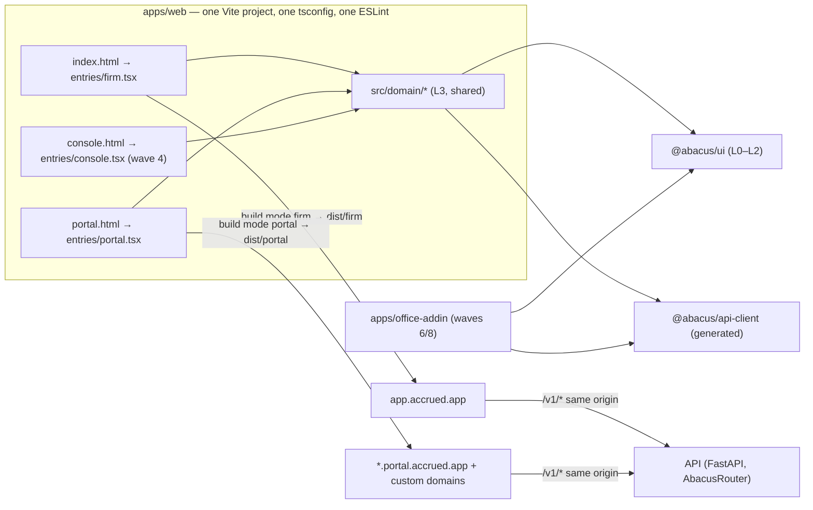
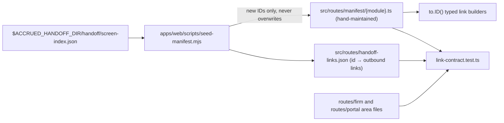
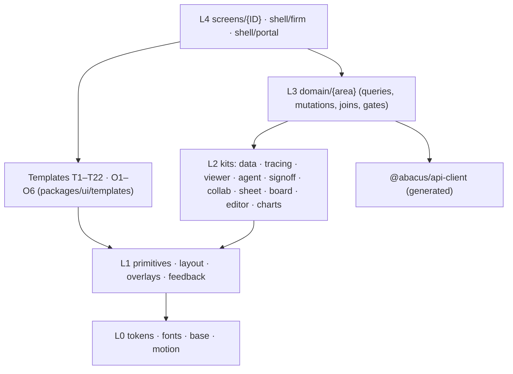
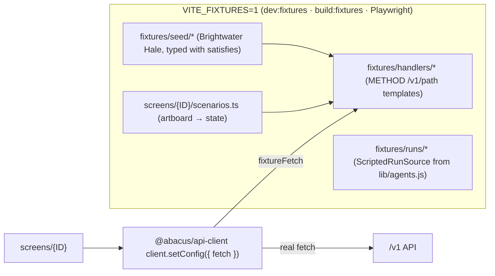

# 04 · Target frontend architecture & design system

> **Chapter of the Accrued engineering & build plan.** Written Saturday 17 Oct 2026, for both founders and for the Claude Code sessions that will build the frontend. The first sprint starts Monday 19 Oct 2026.
>
> **Sources** (all read-only): the digests `design-foundations`, `component-kits`, `repo-frontend-devex`, `handoff-conventions-gaps` (with `handoff-link-graph.json`), `S03-templates`, `S04-specimens`, `catalog-waves` §3, `ai-agents` §3.7 and §3.17, and `repo-adrs` (P-03, P-11, P-15, P-20, P-24, P-28); the repo clone (`apps/web`, `packages/ui`, `packages/api-client`, `docs/architecture/dependency-allowlist.yaml`); and sample handoff screen folders (`CLS-01`).
>
> **Conventions.** "(inferred)" marks a recommendation or deduction that no source states. Paths are relative to the repo root unless absolute. **A** = ayushkbhatia (product/design founder), **N** = notanaskhan (technical founder, owner of the red-zone backend). Screen IDs, ADR numbers (ADR-0xx accepted; P-xx proposed in `repo-adrs.md`) and template IDs (T1–T22, O1–O6) are used exactly as in the sources.

---

## 0. Summary: what this chapter decides

1. **The Accrued design system replaces the repo's "Atelier" theme in one cut.** A new SPEC supersedes SPEC-016 §4 and an ADR (proposed P-03) supersedes the "shadcn as the base" clause of ADR-011. Tokens, fonts and the shell change in weeks 1–3, behind a codemod, so the product never runs two visual systems.
2. **One Vite project, two builds, two origins.** `apps/web` gets a second HTML entry. The **firm app** is built to `app.accrued.app` and the **white-label portal** to `<slug>.portal.accrued.app` and firm custom domains (inferred host names; the design uses `*.portal.accrued.app`). The **platform console** (PLT-01) is a third entry later. **Office add-ins** are a separate app, `apps/office-addin` (P-20).
3. **Routing uses code-based TanStack Router area subtrees with one lazy chunk per screen ID.** Overlays (O2–O6) open through a typed `?ov=` search parameter, and record keys such as `AJE-06` get deep-link routes. A **screen manifest** is seeded from the handoff link graph (1,480 links, of which 1,379 are tooltip-only, pointing at 226 targets), and a link-contract test keeps it honest.
4. **Tokens map into a Tailwind v4 `@theme static` block** that resets Tailwind's default namespaces and sets `--spacing: 1px`. Geist, Geist Mono, Arimo and Gelasio are self-hosted. One `Icon` registry sits on `lucide-react@1.52.0`. The status registry is **generated from blueprint §3.3.1 + addendum §3.2** (via a YAML file), not ported from `lib/status.js`. `format.ts` parses API decimal strings exactly with `bigint`.
5. **Accessibility: ship an AA-adjusted ink ladder.** Text uses ink-2 at .70 and ink-3 at .66; the focus outline is .55. A `data-contrast="reference"` mode keeps pixel parity with the handoff. The product is light-only, with forced-colors support.
6. **Components live in five layers (L0 tokens → L4 screens) and ship in tiers T0–T5.** The **seven shared engines** come first: MatchProvider, popover host, overlay stack + toasts/Undo, DataTable grammars, SourceViewer, agent run store, human gates. Then Sheet, Board and Document editor. The group-audit pieces (EntityTree, Milestone, consolidation grids) are pulled ahead of 1 Jan 2027.
7. **Templates T1–T22 and overlays O1–O6 are typed layout components** with one shared `ViewState`. 213 of the handoff's 278 screen boards (S03 count) declare one of these templates, so building the templates once removes most of the per-screen layout work.
8. **Data flows only through the generated client.** Capabilities are computed on the server (`/v1/me` plus per-record `allowed_actions`, read through `useCan`, `useFlag` and `useEntitlement`). A **fixture mode**, built on the existing fetch-swap test harness and the Brightwater Hale seed, lets the frontend run ahead of the backend, with a **demo clock** fixed at Mon 14 Sep 2026, 9:24 AM CT.
9. **Real-time: poll now, add SSE (P-15) next.** No WebSockets and no CRDT co-editing in v1. Human gates are **never optimistic**: they use a deferred-commit Undo window of 10 s.
10. **Copy and voice:** each screen gets a copy module, enforced by lint and test rules L1–L12. Firm-editable text (email templates, checklists, methodology) lives in the database behind admin screens, never in a commit.
11. **Tests:** Vitest, an in-app `/components` gallery (not Storybook), Playwright regression, a visual-parity harness against the handoff PNGs with tiered thresholds (A–D), axe on every specimen and state, and journey E2E for J01–J28.
12. **Claude Code:** a `build-screen-from-handoff` skill plus companion skills, reviewer agents and hooks. Each screen gets a **screen contract** in `docs/screens/<ID>.md`, and every revision acceptance checklist becomes tests.
13. **Budgets:** firm initial JS ≤ 250 KB gzip, portal ≤ 150 KB gzip, each screen chunk ≤ 135 KB gzip (120 KB until DEC-1682, 2026-11-01). `vite build` for both entries and a budget check join CI stage 1.
14. **The repo's 51 screen files** get the codemod and the new shell now, so nothing looks like Atelier. They are then *replaced* by Accrued screens epic by epic, with their logic extracted into `domain/*`. A full restyle pass on screens about to be replaced would be wasted work.

**Where the repo starts** (verified on the clone): React 19.3, Vite 8, TanStack Router 1.170 (code-based, one 346-line eager `router.tsx`), TanStack Query 5, Tailwind 4.3, `@hey-api/openapi-ts` 0.99 (139 paths, 158 operations), Radix Dialog, Label and Slot, `lucide-react` 1.52, Fontsource Source Sans 3 and Newsreader. `apps/web/src/screens` holds 51 `.tsx` screens and 8 `.ts` message and helper modules. `packages/ui` is 452 lines with 17 exports. The CSP is `default-src 'self'` with no remote fonts. Tests: 291 Vitest cases and one Playwright journey, which has been red since 8 Oct. CI never runs `vite build`.

---

## 1. App topology

### 1.1 Surfaces

| Surface | Who uses it | Shell | Widths | Entry / build | Host (inferred) | When |
|---|---|---|---|---|---|---|
| **Firm app** | The 13 firm roles (blueprint §2.2), including Firm Admin and IT/Security | SHL-01 toolbar (46 px), 13-item nav, record headers, O1–O6 overlays | Designed at 1400 × 860; min width 1280 with horizontal scroll below; at ≤ 1280 the third column becomes a drawer | `apps/web/index.html` → `src/entries/firm.tsx` | `app.accrued.app` | Week 1 onward |
| **Client portal** (white-label) | 11 client roles plus third parties, K-1 recipients, TCWG, prospects and component auditors (P-09) | PortalShell (T7); reduced shells (POR-13/14/15/18/23); no-shell pages (POR-01 sign-in, POR-17 respondent) | **1400 / 720 / 390** (T7, reduced, T7-M) | `apps/web/portal.html` → `src/entries/portal.tsx` | `<slug>.portal.accrued.app` plus firm custom domains | Week 3 onward |
| **Platform console** PLT-01 | Accrued staff (tenant A) | T1 platform variant; the only product chrome that shows the Accrued mark | 1400 | `apps/web/console.html` → `src/entries/console.tsx` (later) | `console.accrued.app` behind SSO and an IP allowlist | Wave 4 (P2) |
| **Office add-ins** XLA-01/02 | Firm staff in Excel and Word | T22 task pane, 350 px | 350 | `apps/office-addin` (separate Vite app, P-20) | Same CDN; Office manifest | Waves 6 and 8 (P1, P2) |
| **Gallery and screen catalog** | Founders, CI, reviewers | `/components/*` | Any | Firm entry, compiled only when `VITE_UI_GALLERY=1` | Dev and private previews only | Week 1 onward |

### 1.2 One project, two builds (decision FE-03)

| Option | Verdict |
|---|---|
| A. One app with two route trees (today's `/client/*` inside the firm bundle) | **Reject.** It ships firm code and the "Accrued" name to white-label hosts, and makes 390 px phone clients download the firm bundle. |
| **B. One Vite project with two HTML entries, built twice** | **Recommended.** One tsconfig, one ESLint, one Vitest. Domain components (requests, comments, viewer, uploads) are shared from `src/domain/*` with **no new `package.json`** (a protected path). Each build has its own CSP and its own `outDir`, so the portal origin never serves firm chunks. |
| C. Two Vite apps plus a shared `packages/domain` | **Reject for now.** It adds protected manifests and moves domain code into a package for no benefit at two founders. Use it only for the Office add-in, which needs a different host runtime and CSP. |



**Build mechanics.** In `apps/web/package.json` (protected), `build:firm` = `vite build --mode firm` and `build:portal` = `vite build --mode portal`. `vite.config.ts` reads the mode, sets `build.rollupOptions.input` to the single HTML entry for that mode (Vite 8 runs on Rolldown, so check whether the option is now `build.rolldownOptions`), sets `outDir` to `dist/<mode>`, and configures the existing `abacus-csp` plugin per mode (§1.4). `vite build --mode fixtures` produces a self-contained firm+portal demo build with fixture data and the gallery (§6.5), and never touches a database. That keeps it compatible with the working agreement not to run a local production build while a hosted build is using the same database.

### 1.3 Hosts, custom domains and the API origin

- **The API is same-origin on every host.** The CDN routes `/v1/*` on each host to the API, and `apps/web/src/api.ts` keeps `baseUrl = window.location.origin`. That keeps `connect-src 'self'`, avoids CORS, and makes the generated client work unchanged.
- **Branding comes from the host.** `GET /v1/portal/branding` is unauthenticated and resolves the tenant from `Host`. Its payload is classified Public: `{firm_name, portal_name, logo_url, secured_footer, support_contact, sign_in: {methods, mfa_required_for}}`. The portal root `loader` fetches it before POR-01 renders and sets `document.title` and the favicon. The logo is **re-encoded and served same-origin** (`/v1/portal/branding/logo`), because the CSP says `img-src 'self'`.
- **Tenant pinning.** The host is only a *branding hint*; authorisation still comes from the user's grants (P-11, ADR-002). The API should additionally reject a session whose tenant differs from the host's tenant on portal hosts (inferred).
- **Custom domains** follow the ADM-10 lifecycle: *Pending DNS* → *Verified* via a CNAME to `<slug>.portal.accrued.app`, with managed TLS at the CDN (the infra chapter owns this). Emails (POR-20) always link to the firm's verified portal host. The firm app is never served on a custom domain.
- **Previews.** Fixture-mode builds are deployed per PR only when the PR carries a `preview` label, to a private static host. This follows the working agreement: preview builds are opt-in.

### 1.4 CSP per build

The existing `abacus-csp` plugin (`apps/web/vite.config.ts`) is kept and parameterised per mode. The CDN must send the same policy as a header (TASK-014).

| Directive | Firm | Portal | Console | Office add-in |
|---|---|---|---|---|
| `default-src` | `'self'` | `'self'` | `'self'` | `'self'` |
| `script-src` | `'self'` | `'self'` | `'self'` | `'self' https://appsforoffice.microsoft.com` (Office.js must load from Microsoft's CDN) |
| `style-src` | `'self'` | `'self'` | `'self'` | `'self'` |
| `img-src` | `'self' data: blob:` † | `'self' data: blob:` † | `'self' data:` | `'self' data:` |
| `connect-src` | `'self'` (+ IdP authority while hosted sign-in is used) | `'self'` | `'self'` | `'self'` |
| `frame-ancestors` | `'none'` | `'none'` | `'none'` | Office host origins (verify) |
| `worker-src`, `object-src`, `base-uri` | `'none'` | `'none'` | `'none'` | `'none'` |

† Add `blob:` only if page previews keep using `URL.createObjectURL` (`screens/EvidencePreview.tsx` does today; verify in a production build). React inline `style` props are set through the CSSOM and are allowed under `style-src 'self'`. Two libraries inject `<style>` tags: Radix's scroll-lock helper (verify) and TipTap (set `injectCSS: false`). The ADM-10 "live preview" renders portal domain components *inside* the firm app with the firm's branding, not in an iframe, because of `frame-ancestors 'none'`.

### 1.5 Authentication surfaces (decision FE-15)

| Surface | Design | Recommendation |
|---|---|---|
| Firm sign-in SHL-06 (T15) | Email → 6-digit code → TOTP/passkey; SSO buttons; SSO-enforced, locked and expired states | **Weeks 1–6:** keep the existing hosted OIDC/PKCE flow (`apps/web/src/auth/session.ts`, `pkce.ts`, loop guard, `forceLogin` step-up). **Later:** build the in-product T15 card once WorkOS (ADR-029, pending) is decided. |
| Portal sign-in POR-01 (T15) | Firm-branded passwordless + MFA; invite acceptance; 14-day expiry | **In-product T15 card from the start**, calling backend `/v1/auth/*` endpoints that wrap the vendor's user-management API (a BFF). Hosted vendor pages cannot be white-labelled per custom domain at reasonable cost. This is red-zone identity work owned by N. |
| POR-17 confirmation respondent | Single 720 page, email code, no portal identity | Link-only principal (P-09); its own route with no shell. |
| Session storage | Today: access token in `sessionStorage`, no refresh tokens | Access token in memory plus an httpOnly, `SameSite=Strict` refresh cookie per host, rotated as ADR-030 requires. This needs a backend ADR from N. |

### 1.6 Source layout of `apps/web/src`

```
apps/web/
  index.html  portal.html  (console.html later)
  scripts/                       node scripts, no new deps: seed-manifest.mjs, bundle-budget.mjs
  src/
    entries/firm.tsx  portal.tsx           createRouter(tree) + providers (Query, Clock, Session, Overlay, Toast, Match)
    app-core/                              shared plumbing, the only place allowed to touch session/env
      api.ts               client config (Bearer, X-Abacus-Tenant, 401 handler) — kept from today
      auth/                pkce.ts, session.ts (kept), bff.ts (portal auth)
      query.ts             QueryClient defaults (retry rules, staleTime 10s), key helpers
      session.ts           useSession(): me, tenant, capabilities, flags, entitlements, portal scopes
      can.ts  flags.ts     useCan / <Can> / useFlag / useEntitlement / <FeatureGate>
      errors.ts            errorMessage() + registry of per-domain code→words maps
      realtime.ts          SSE client → query invalidation; polling fallback
      clock.ts             clock source (scenario | ?clock= | server_now offset) feeding @abacus/ui ClockProvider
      overlays.ts          ?ov= codec, overlay registry, payload store
      fixture-mode.ts      installs fixtureFetch when VITE_FIXTURES=1 (dead code otherwise)
    routes/
      firm/root.tsx + one file per nav area (home, engagements, tax-returns, files, knowledge, workbench,
           inbox, clients, binders, notices, audits, closes, signatures, settings) + index.ts (lists subtrees once)
      portal/root.tsx + home, documents, questions, approvals, sign, messages, deliverables, account, reduced, public
      manifest/<module>.ts       screen manifest, one file per module (§2.6)
      handoff-links.json         link graph extract (regenerated only when the handoff version changes)
    shell/firm/      FirmShell, Toolbar data (SHL-01), FirmMenu (SHL-03), NotificationsDrawer (SHL-04),
                     SupportPanel (SHL-05), CommandPaletteData (SHL-02), AgentDockHost (SHL-13), OverlayHost
    shell/portal/    PortalShell, PortalToolbarData, MobileTabBar (T7-M), EntitySwitcher, ReducedShell
    domain/<area>/   L3: queries.ts, mutations.ts, joins.ts, realtime.ts, messages.ts, components (API-aware)
    screens/<ID>/    L4: index.tsx, scenarios.ts, copy.ts, <ID>.test.tsx   (e.g. screens/CLS-01/)
    copy/common.ts   shared product copy (verbs, empty states, errors)
    fixtures/        seed/, handlers/, personas.ts, runs/ (scripted agent runs) — fixture builds and tests only
    gallery/         /components routes (gallery index, family pages, templates, specimens, screens, parity)
    legacy/          existing screens during migration (§12), deleted as Accrued screens land
    testing/support.tsx   mockApi fetch-swap harness — kept and generalised
```

### 1.7 Import boundaries (ESLint `no-restricted-imports`, no new plugin)

| Rule | Why |
|---|---|
| `screens/*` may import `domain/*` (public `index.ts` only), `app-core/*`, `@abacus/ui`, `@abacus/api-client`, but never another `screens/*` | Screens are leaves; shared logic goes to `domain/*` |
| `domain/<a>` imports `domain/<b>` only through `domain/<b>/index.ts` | Keeps the module boundaries the backend enforces (ADR-008) |
| `routes/portal/**`, `shell/portal/**` and `entries/portal.tsx` may not import `shell/firm/**`, `routes/firm/**` or firm-only screens | Keeps the portal bundle and white-label clean |
| `packages/ui/**` may not import `@abacus/api-client` or `@tanstack/react-router` | L0–L2 stay presentational and router-agnostic (the TASK-031 precedent) |
| `fixtures/**` is importable only from `app-core/fixture-mode.ts`, `gallery/**` and tests | Fixtures stay out of production. CI greps `dist/firm` and `dist/portal` for seed strings such as "Brightwater" |
| No `fetch`/`XMLHttpRequest` outside `app-core/auth` (existing) | ADR-011: every backend call goes through the generated client |

---

## 2. Routing

### 2.1 Principles

1. **Path vs search param vs overlay.** Use a *path segment* when the template or the record changes. Use a *search param* when the same template is filtered or segmented (`?segment=`, `?view=list|board`, `?period=2026-08`). Use **`?ov=`** when an O2–O6 overlay opens over the current page. Keep O1 popovers and hover in *local state*.
2. **One route component per screen ID**, loaded with `lazyRouteComponent(() => import("../../screens/AUD-03"))`. Routes are grouped into **area subtrees** (`routes/firm/audits.tsx`). The root `routes/firm/index.ts` lists the 14 firm subtrees once and is then rarely touched, which removes today's `router.tsx` hot file.
3. **Record params use opaque UUIDs.** Human record keys appear only for firm-scoped sub-records with stable keys (`AJE-06`, `SURL-03`, `BH-EBP-140`). Names, emails and TINs never go in a URL (ADR-031; A6 "never show an internal database ID" applies to UI text).
4. **Nothing ships orphaned or dead-linked.** Every screen ID has a manifest entry (§2.6). A `planned` target renders its control and, in dev or fixture builds, routes to a "Not built yet" page. In production the control is hidden behind a flag or entitlement.
5. **Record sub-navigation comes from data.** Audit rails, close tabs and return tabs depend on methodology version, work-item subtype and form family. The route validates the slug against the record in `beforeLoad` and redirects to the record's default tab when the slug is not valid for it.

### 2.2 Firm route tree (13-item bar, D4 segments)

Nav order is a contract repeated in every prompt: **Home · Engagements · Tax Returns · Files · Knowledge · Workbench · Inbox · Clients · Binders · Notices · Audits · Closes · Signatures**. It is rendered from one constant, with **no 14th item** (D4) and **no badges** on nav items. Addendum areas hang under existing items: Insights under Home; SOC & IT, Internal audit, group audit, statements and sheets under Audits; saved prompts and learned context under Workbench; frameworks, skills and packs under Knowledge; Board as a view toggle. Settings is reached from the firm pill (SHL-03), not from the nav.

```
/                                   → /home
/home                               HOME-01 (segmented: My work · Approvals · Deadlines · Capacity · Insights)
/home?brief=1                       HOME-05 (SHL-23 Today pane 470 left)          [ff.today_brief]
/home/approvals                     HOME-02 (T9)
/home/deadlines                     HOME-03 (T13; ?view=month|week|list)
/home/capacity                      HOME-04 (T6)
/home/insights/:tab                 INS-01…05 (T21; tab = performance|ai-adoption|efficiency|my-week|responsiveness)  [entitlement insights]

/engagements                        ENG-01 (T1; ?line=all|tax|audit|cas|advisory)
/engagements/new                    ENG-03 (O6 modal route over ENG-01)    /engagements/new/ai  ENG-14 (T4)
/engagements/proposals              ENG-09     /engagements/season   ENG-07 (T6)
/engagements/$engagementId          ENG-02 Overview; tabs: /dashboard ENG-12 · /board ENG-10 · /work-items · /team ENG-05
                                    · /letter ENG-04 · /budget ENG-06 · /budget/billing ENG-08 · /activity
                                    · /settings ENG-11 (gear) · /roll-forward ENG-13 (O6) · /projects/$projectId PRJ-01

/tax-returns                        TAX-01 (T1; status tiles filter; ?view=list|board)
/tax-returns/$returnId              TAX-02 (1040/1041) | TXP-00 Agent tab (entity) — dispatched by form family
  /intake TAX-03 · /issues TAX-06|TXP-10 · /activity TAX-07 · /delivery TAX-12 · /preview TAX-11 (T17)
  /review/:section  1040: documents TAX-04|TAX-05 · worksheets TXI-01 · leadsheets · two-year TAX-10
                    1041: + instrument TXT-01 · trust-calculation TXT-02 · 706/709: estate TXT-04
                    1065/1120-S/1120/990: summary TXP-01 · financials TXP-02 · fixed-assets TXP-03 · m1-m3 TXP-04
                    · schedule-k TXP-05 · capital TXP-07 · basis TXP-08 · states TXP-09 (1120-S: aaa-basis; 1120: provision)
  /workpaper TXP-11 · /k1 TXP-12 · /k1-resolver TXI-02 · /residency TXI-03 · /beneficiaries TXT-03 · /other-workpapers TXP-13
  /amendments TAX-16
  overlays: ?ov=assistant (TAX-08) · ?ov=engine-sync (TAX-09) · ?ov=allocation (TXP-06)
/tax-returns/extensions TAX-13 · /tax-returns/planning TAX-15 · /tax-returns/standards-runs TAX-14

/files                              FIL-01 (T2 tree · list; ?node=)      /files/retention   FIL-02 (T1)
/knowledge                          KNW-01 (T5; ?category=…)
  /methodology/$versionId KNW-02 · /programs/$programId KNW-03 · /standards KNW-04 · /templates KNW-05
  /engagement-templates/$templateId KNW-06 · /engagement-templates/$templateId/versions KNW-07 · /packs KNW-08
  /frameworks KNW-09 · /frameworks/$frameworkId/cross-map KNW-10 · /skills/$skillId KNW-11 · /notes/$noteId KNW-12
/workbench                          WB-01 (T4; segmented Sessions · Agents · Connect)
  /sessions/new WB-02 · /sessions/$sessionId WB-03
  /agents WB-04 (Library) · /agents?view=mine WB-06 list · /agents/prompts WB-12 · /agents/$agentId WB-06
  /agents/$agentId/runs WB-08 · /agents/$agentId/learned-context WB-13 · /connect WB-10
  overlays: ?ov=agent:<key> WB-05 · ?ov=edit-agent:<id|new> WB-07 · ?ov=run-trace:<runId> WB-09 · ?ov=connection:<id> WB-11
/inbox                              INB-01 (T8) · /inbox/$threadId · /inbox/client-messages INB-04
  overlays: ?ov=triage:<attachmentId> INB-02 · ?ov=compose[:<threadId>] INB-03
/clients                            CLI-01 (T1) · /clients/new CLI-06 (O6)
/clients/$clientId                  CLI-02 Overview; tabs /engagements · /relationships CLI-03 (T14; no board → TPL-14)
                                    · /contacts CLI-04 · /tax-profile/:sub CLI-05 · /files · /messages (INB-04 filtered) · /activity
                                    · /acceptance/$engagementId CLI-07 · /independence/$engagementId CLI-08
/binders                            BND-01 (T1; segmented Binders · Requests) · /binders/requests BND-04
                                    · /binders/$binderId BND-02 · /binders/questionnaires/$id BND-03
/notices                            NOT-01 (T1 tiles) · /notices/$noticeId NOT-02 · /response NOT-03 · /activity
/audits                             AUD-01 (T1; ?segment=all|fs|ebp|review|soc|ia&view=list|board)
/audits/$auditId                    cockpit dispatched by work-item subtype: AUD-02 (FS/EBP) · AUD-26 (SSARS) · ATT-01 (SOC)
                                    · IAU-01 (internal audit); ?layout=rail|focus|board&dock=agent|viewer|notes
  designed workpapers: /source-documents AUD-03 · /program/$wpRef AUD-04 · /narrative/$wpRef AUD-05 · /trial-balance AUD-06
    · /materiality AUD-07 · /risks AUD-08 · /controls AUD-09 · /service-orgs AUD-10 · /sampling AUD-11 · /testing AUD-12
    · /analytics AUD-13 · /confirmations AUD-14 · /findings AUD-15 · /misstatements AUD-16 · /review-notes AUD-17 · /eqr AUD-18
    · /completion AUD-19 · /fs-disclosure AUD-20 · /rep-letter AUD-21 · /governance AUD-22 · /report AUD-23 · /issuance AUD-24
    · /archive AUD-25 · /estimates AUD-27 · /consultations AUD-28 · /activity AUD-29 · /post-issuance AUD-30
    · /procedures/$sessionId AUD-36 · /pre-review AUD-37 · ?ov=tax-handoff AUD-38
  group (SAS 149):  /group/mapping AUD-31 · /group/consolidated-tb AUD-33 · /group/scoping AUD-34 · /group/components AUD-35
                    · ?ov=consolidation-setup AUD-32 (O6)
  EBP:     /ebp/plan EBP-01 · provisions EBP-02 · eligibility EBP-03 · contributions EBP-04 · distributions EBP-05
           · investments EBP-06 · form-5500 EBP-07 · participants EBP-08 · admin-expenses EBP-09
  sheets:  /sheets/$sheetId SHT-01 (T18) · ?ov=column:<id> SHT-02 · ?ov=scoping-rules SHT-03 · ?ov=agent-column:<id> SHT-04
           · ?ov=row:<rowKey> (T18 row drawer)
  statements: /statements FSP-01 (T20; ?dock=assistant|comments|lineage|disclosure → FSP-04) · /statements/line-items FSP-02
           · /statements/tie-out FSP-05 · /statements/templates FSP-06 · ?ov=fs-rollforward FSP-03
  attest (D1): /attest/scoping ATT-02 · /attest/system-description ATT-03 · /attest/controls ATT-04
           · /attest/controls/$controlId ATT-05 · /attest/exceptions ATT-06 · /attest/report ATT-07
           · /attest/readiness ATT-08 · /attest/grc-sync ATT-09
  internal audit (D2): /internal-audit/plan IAU-01 · /rcm IAU-02 · /issues IAU-03 · /committee IAU-04
/closes                             CLS-01 (T1; ?period=2026-08&view=list|board)
/closes/$closeId                    CLS-02; tabs /intake CLS-03 · /accounts CLS-04 · /accounts/$accountId CLS-05 · /review CLS-06
                                    · /deliverables CLS-08; /adjustments CLS-07 (/adjustments/:ajeKey e.g. AJE-06) · /plan CLS-09
                                    · /flux CLS-10 · /gl-sync CLS-11 · /1099 CLS-13 · ?ov=tax-handoff CLS-12   (placement of CLS-11/13 inferred)
/signatures                         SIG-01 (T1; ?tab=to-send|out|completed|expired) · ?ov=envelope:<id|new> SIG-02 (O4)
/settings/:section                  ADM-01…14 (T12 frame; sections general · people · offices · plan · security · ai-policy
                                    · consents · developer · integrations · portal · data-model · quality · monitoring · audit-log)
/components/*                       gallery and screen catalog (VITE_UI_GALLERY=1 only, §9.2)
```

Legacy redirects stay in place during migration: `/admin/*` → `/settings/*`, `/engagements/$id/requests` → the AUD-03 route once it lands, and `/client/*` on the firm host → the portal host.

### 2.3 Portal route tree (blueprint §4.2, role union §2.3)

```
/sign-in                POR-01 (T15; email → code → two-step; invite d; expired e; wrong f; locked g)
/accept                 POR-01 d, invitation acceptance (fragment token; keep ClientAccept.tsx logic)
/                       POR-02 Home
/documents              POR-03 (T7; ?binder= | ?period= for close requests → POR-11)
/documents/requests/$requestId   POR-04 (O3 modal route over /documents; full-screen sheet at 390)
/questions POR-05 · /approvals POR-08 (entity clients only) · /sign · /sign/$envelopeId POR-06 (T16)
/messages POR-07 (T8) · /deliverables POR-09 (+ "My K-1s" section for role union, POR-13 content)
/account POR-12 · /account/connections POR-16 · /account/billing POR-10 (/account/billing/:invoiceKey, e.g. BH-26-0958)
reduced shells (720):  /requests POR-14 (third party) · /k1s POR-13 · /governance POR-15 (TCWG) · /intake POR-18
                       · /component-room POR-23 · SOC POR-21 and IA POR-22 as engagement-type variants of /documents
no shell:  /confirm/$token POR-17 (T15 720) · /capture POR-19 (T7-M camera, ≤ 480 px)
```

The **shell to render comes from the server**: `/v1/me` → `portal: {shell: "full" | "third_party" | "k1" | "tcwg" | "intake" | "component", scopes: [{kind, id, label, role_label}]}`. The entity switcher in the user menu lists every scope with its role chip (for example "Feld Household · Taxpayer").

### 2.4 Overlays through the URL (`?ov=`)

93% of the 1,480 design links are tooltip-only, and the most-linked targets are overlays: SHL-08 Source viewer has 58 inbound links, SHL-12 Sign-off 31 and SHL-14 Request composer 18. Overlays therefore have to deep-link, survive a reload and close on Back.

- **Grammar:** `?ov=<key>[:<arg>]*`, repeatable at most twice (one drawer plus one modal on top). This matches the O-grammar rules "never more than one drawer" and "Escape closes the topmost layer". The shell root's `validateSearch` decodes it into `OverlayRef[]`; `OverlayHost` renders from the registry.
- **Payloads that do not fit in a URL** (for example a request composer prefilled with 25 sample items) live in an in-memory `overlayPayloadStore` under a nonce: `?ov=request:new:n_8f2a`. After a reload the overlay opens from the server-side draft, or empty.
- **History:** opening pushes a history entry, so Back closes the overlay. Escape and the ✕ close via `navigate({replace: true})`. A dirty overlay asks "Discard changes?" (C-22).
- **Typed service API** (L3, `app-core/overlays.ts`): `openSourceViewer(region)`, `openSignOff(target)`, `openApproval(proposalId)`, `openDecision(id)`, `openRequestComposer(prefill)`, `openIssueComposer(context)`, `openToDo(id)`, `openComments(anchor)`, `openRunTrace(runId)`.

| Key | Screen | Overlay | Args | Notes |
|---|---|---|---|---|
| `viewer` | SHL-08 | O2 drawer (or the T2 dock "Viewer") | `<evidenceVersionId>[:<matchId>]` | Opens at the lit region |
| `approve` | SHL-10 | O3 | `<proposalId>` | Deferred-commit Undo (§7.5) |
| `decision` | SHL-11 | O3 or inline dock | `<decisionId>` | Role-reserved |
| `signoff` | SHL-12 | O3 | `<objectKind>:<objectId>[:<level>]` | The only place sign-offs are added or removed |
| `request` | SHL-14 | O2 | `new\|<requestItemId>[:<nonce>]` | |
| `issue` | SHL-15 | O3 | `new:<recordRef>\|<issueId>` | |
| `checkpoints` | SHL-16 | O2 | `<returnId>` | |
| `todos` | SHL-17 | O2 480 | `mine\|<todoId>` | |
| `review-package` | SHL-19 | O4 | `<runId>` | |
| `link-requests` | SHL-21 | O3 | `<evidenceId>` | |
| `template-update` | SHL-22 | O3 | `<engagementId>` | |
| `notifications`, `support` | SHL-04, SHL-05 | O2 | — | The bell also toggles `?ov=notifications` |
| `agent`, `edit-agent`, `run-trace`, `connection` | WB-05, WB-07, WB-09, WB-11 | O2 / O3 | id | WB-05 has no board; compose it from the C-11 Details dialog + the O2 grammar (G-A01) |
| `column`, `scoping-rules`, `agent-column`, `row` | SHT-02/03/04, T18 drawer | O2 / O3 | id or row key | `row:SURL-03` |
| `triage`, `compose` | INB-02, INB-03 | O3 / O2 | id | |
| `envelope` | SIG-02 | O4 | `<id>\|new` | |
| `assistant`, `engine-sync`, `allocation` | TAX-08, TAX-09, TXP-06 | O2 dock / O1 / O4 | — | |
| `tax-handoff`, `fs-rollforward`, `consolidation-setup` | AUD-38/CLS-12, FSP-03, AUD-32 | O3 / O3 / O6 | — | |

These stay **local state, not in the URL**: SHL-03 firm menu, SHL-07 citation popover, SHL-09 field provenance, the SHL-18 comment popover (its dock tab uses `?dock=comments`), the SHL-20 screening card, and SHL-02 command palette (⌘K).

### 2.5 Record keys and deep links

| Key in the design | Source link | Route |
|---|---|---|
| `AJE-06` (draft AJE) | CLS-05 | `/closes/$closeId/adjustments/AJE-06` |
| `BH-26-0958` (invoice; "BH-26" in the index) | POR-10 | portal `/account/billing/BH-26-0958` |
| `SURL-03` (sample row) | SHL-18 | `/audits/$auditId/sheets/$sheetId?ov=row:SURL-03` |
| `TES-38`, `ITGC-01`, `RN-12`, `JE-26`, … (in-text keys) | various | the parent record route with a `?focus=<key>` param that scrolls to and lights the row (inferred) |

Notification deep links (SHL-04) are built through the manifest builders (§2.6), replacing today's `shell/notifications.ts` kind→href map. The notification API keeps returning identifiers only (SPEC-013 AC-7).

### 2.6 The screen manifest, generated from the handoff link graph



```ts
// apps/web/src/routes/manifest/types.ts
export interface ScreenEntry {
  id: ScreenId;                                    // "AUD-03"
  kind: "page" | "tab" | "segment" | "overlay" | "pane" | "record-key" | "no-shell";
  surface: "firm" | "portal" | "console" | "addin";
  path?: string;                                   // "/audits/$auditId/source-documents"
  overlay?: OverlayKey;                            // "signoff"
  host?: ScreenId;                                 // overlay or tab host, e.g. "AUD-02"
  template: TemplateId;                            // "T2" | "O3" | …
  wave: number; priority: "P0" | "P1" | "P2";
  status: "planned" | "fixture" | "live";          // fixture = renders from fixtures; live = real API
  flag?: FlagKey; entitlement?: ModuleKey;         // ff.board, insights, …
  owner: "ayushkbhatia" | "notanaskhan";
  entry?: string;                                  // required when no link targets this screen (51 screens)
}
```

The manifest is **split per module** (`manifest/aud.ts`, `manifest/tax.ts`, …) so the two founders do not collide on one file. `to.AUD03({auditId})` returns TanStack `LinkProps`, and `<Link {...to.AUD03({auditId})} preload="intent">` is the only way to link to a screen (an ESLint rule bans string `to=` literals in `screens/**`, inferred).

**Tests (`apps/web/src/routes/link-contract.test.ts`):**

1. Every link in `handoff-links.json` whose **two** ends are `fixture` or `live` has a builder used somewhere in the source screen's folder. Fails with "CLS-01 → CLS-09 (Opens CLS-09 · close plan editor) is not wired".
2. Every `path` resolves in the router tree, and every `live` entry has a route component.
3. The 51 screens that are never a link target (for example SHL-23, CLS-08, ATT-07, ADM-14) declare `entry`.
4. Record keys (AJE-06, BH-26, SURL-03) map to record routes, not screen IDs.

The script runs again only when `docs/design/HANDOFF_VERSION` changes. That file records the handoff date and a hash of `screen-index.json`, so both founders' sessions can confirm they are reading the same handoff (inferred).

### 2.7 Guards, loaders and pending states

- **Router context** = `{queryClient, session}`. The shell root's `beforeLoad` redirects unauthenticated users to sign-in, which removes the splash flash of today's `Layout.tsx`.
- Area and screen `beforeLoad` checks flags and entitlements. Off renders the designed **flag-off state** (the T21e grammar, 11 screens), never a 404.
- `loader: ({context, params}) => context.queryClient.ensureQueryData(xxxOptions(...))` prefetches. `defaultPreload: "intent"` warms record routes on hover.
- `pendingComponent` is the template skeleton (`ViewState` loading, §5.1), `errorComponent` is the C-20 `ErrorRow`, and each shell has its own `notFoundComponent`.
- **Walled records** come back 404 from the API (SPEC-002) and render as not-found. The UI never reveals that a walled record exists.

---

## 3. Design system implementation

### 3.1 Precedence (what wins when sources disagree)

| Concern | Winner → loser |
|---|---|
| Screen layout, behaviour and copy | Built canvas (screenshots + README "Build detail") → `revision.md` delta (wins for what it lists) → `spec.md`. Ignore `spec-alt.md`: all 19 copies are byte-identical to `spec.md`. |
| Token values | Handoff `tokens/*.css` **plus** the blueprint A2 extras (`--cta-press`, `--amber-line`, `--match-mark/-soft/-i9`, `--e-note`, `--e-sheet`, `--e-fab`, scrims, easings, z-index). Add Geist Mono and the hover shades, which exist only as literals. |
| Component metrics | C-00/C-01 values over brief 00-A. **Kits vs `02-design-system.md` A8** is undecided in the sources (G-D01). Recommendation: the built kits win and A8 fills gaps. Record each conflicting value once in `packages/ui/src/tokens/DECISIONS.md`. |
| Status vocabulary | Blueprint §3.3.1 + addendum §3.2 + gap §6.5 → `02-design-system.md` → `lib/status.js` (a self-declared draft) |
| Seed data | Shared context block → addendum block → blueprint/addendum §9 → kit sample data (never ported) |
| Stack | The repo's stack (ADR-011: TanStack, Tailwind v4, Radix for behaviour) wins over prompt 00-B's React Router and CSS Modules |

### 3.2 File layout in `packages/ui`

```
packages/ui/
  package.json      (protected) add "exports": { ".": "./src/index.ts", "./styles.css": "./src/styles/index.css",
                    "./specimens": "./src/specimens.ts" } — one approval file, DS-02
  src/
    tokens/
      tokens.ts         typed single source of truth (every value in design-foundations §1) — feeds gallery and tests
      theme.css         @theme static { … } — Tailwind-generating tokens (replaces today's Atelier theme.css)
      root.css          :root { layout sizes, scrims, focus outline, z-index, solid ink aliases }
      contrast.css      [data-contrast="reference"] { handoff ink ladder } — parity mode (§3.8)
      DECISIONS.md      token and kit conflict log (G-D01) — one line per decided value
    styles/
      index.css         @import fonts.css, ../tokens/theme.css, ../tokens/root.css, ../tokens/contrast.css,
                        base.css, motion.css, utilities.css
      fonts.css         Geist 400/500 + Geist Mono 400/500 (eager)
      fonts-doc.css     Arimo 400/600/700 + Gelasio 400/500/700 (imported only by document-render chunks)
      base.css          @layer base (body 13/1.2 Geist, tabular nums, links, focus, reduced motion, forced colors)
      motion.css        @keyframes spin/pulse/reveal/typing/collapse
      utilities.css     @utility hairline-b, hairline-t, ring-inset, pane, pane-header, well, tabular, sep, doc-scope
    lib/       format.ts · status.ts · status.data.gen.ts (generated) · clock.tsx (ClockProvider/useNow) ·
               motion.ts (useReducedMotion) · keyboard.ts · stores.ts (useSyncExternalStore helpers) · cn.ts
    icons/     Icon.tsx · icon-names.ts · icons.test.ts
    brand/     Wordmark · Monogram · AgentAvatar · FirmMark · Person
    primitives/ layout/ overlays/ feedback/ rows/ record/ templates/     (L1, §4.1)
    data/ tracing/ viewer/ agent/ signoff/ collab/ issues/ files/ requests/ connect/ forms/
    sheet/ board/ editor/ charts/ calendar/ graph/ forms-gov/ signing/ entity/ rules/ milestones/ addin/   (L2)
    agent-text.tsx     (kept unchanged; restyled to text-para ink-2)
    index.ts  specimens.ts
```

`apps/web/src/index.css` becomes `@import "tailwindcss"; @import "@abacus/ui/styles.css"; @source "../../../packages/ui/src";`.

### 3.3 Tokens → Tailwind v4 `@theme`

`@theme static` emits every variable even when unused, so TypeScript code can read them (charts, canvas drawing, `getComputedStyle` tests). Resetting each namespace with `initial` removes Tailwind's defaults, so a stray `bg-red-500`, `text-sm` or `shadow-lg` **compiles to nothing** instead of merely failing lint. Excerpt of `packages/ui/src/tokens/theme.css` (the full value list is in `design-foundations.md` §1 and §3.3; `tokens.test.ts` asserts exact equality with `tokens.ts`):

```css
@theme static {
  --color-*: initial;
  /* surfaces (warm greige) */
  --color-card:#FFFFFF; --color-band-hd:#FBFBFA; --color-shell:#F8F8F6; --color-nav-fill:#F2F1EF; --color-nested:#EFEEEB;
  --color-sel-bg:#E8E6E0; --color-chip:#E1DFD9; --color-surface:#D7D5CE; --color-presentation:#E9E3DD;
  /* dark fills */
  --color-espresso:#2B1F17; --color-cta-hover:#3B2A1F; --color-cta-press:#22180F; --color-on-dark:#FEFEFE; --color-tonal-hover:#D9D6CF;
  /* ink ladder — AA text values (FE-02); contrast.css restores the handoff ladder for parity */
  --color-ink:rgba(43,31,23,.95); --color-ink-2:rgba(43,31,23,.70); --color-ink-3:rgba(43,31,23,.66); --color-ink-4:rgba(43,31,23,.30);
  --color-icon-2:rgba(43,31,23,.62); --color-icon-3:rgba(43,31,23,.54);           /* non-text: 3:1 is enough */
  --color-hair:rgba(43,31,23,.10); --color-rule:rgba(43,31,23,.14); --color-stroke:rgba(43,31,23,.22);
  /* status families: olive (done) · ochre (in progress) · brick (issue) */
  --color-green:#5C6B2E; --color-green-ink:#47521F; --color-green-tint:#E6EBD8; --color-green-hover:#525F29; --color-green-tint-hover:#DCE3CA;
  --color-amber:#BA8F45; --color-amber-ink:#7C5718; --color-amber-tint:#F6EEDF; --color-amber-tint-hover:#F0E4CF; --color-amber-line:rgba(124,87,24,.22);
  --color-red:#B13327; --color-red-ink:#8E2418; --color-red-tint:#F7E4E1; --color-red-tint-hover:#F0D5D0; --color-negative:#B13327;
  --color-clay:#A45F3D;
  /* source match — tracing only, never a status, never in charts */
  --color-match-bg:#ECD9F0; --color-match-bg-2:#E4D1E9; --color-match-line:#BF99C8; --color-match-ink:#7E4590;   /* AA; reference #9253A2 */
  --color-match-mark:#DACFEB; --color-match-soft:rgba(204,189,229,.62); --color-match-i9:#E9E3F2; --color-match-hover:#F8F2F9;
  /* data viz */
  --color-viz-p1:#D4C0B4; --color-viz-p2:#C0C89F; --color-viz-p3:#E1BF8D; --color-viz-p4:#F3B5A8;
  --color-viz-d1:#8A6C58; --color-viz-d2:#687933; --color-viz-d3:#936B1C; --color-viz-d4:#B55545;
  /* document-only (allowed only inside [data-doc]) */
  --color-doc-typed:#6A98E8; --color-doc-ink:#111111; --color-doc-black:#000000; --color-doc-check:#8A97A8; --color-doc-zebra:#FBFAF8;

  --font-*: initial;
  --font-ui:"Geist","Inter Tight",-apple-system,"Helvetica Neue",Arial,sans-serif;
  --font-mono:"Geist Mono",ui-monospace,"SF Mono",Menlo,monospace;
  --font-doc:"Arimo","Helvetica Neue",Arial,sans-serif;
  --font-legal:"Gelasio",Georgia,serif;
  --font-statement:ui-monospace,"SF Mono",Menlo,Consolas,monospace;
  --font-weight-*: initial; --font-weight-regular:400; --font-weight-medium:500;

  /* type roles: one class sets size + line-height + tracking + weight (22 roles; excerpt) */
  --text-*: initial;
  --text-dashboard:20px;  --text-dashboard--line-height:1.2; --text-dashboard--letter-spacing:-0.015em; --text-dashboard--font-weight:500;
  --text-title:15px;      --text-title--line-height:1.2;     --text-title--letter-spacing:-0.012em;     --text-title--font-weight:500;
  --text-pane:14.5px;     --text-pane--line-height:1.2;      --text-pane--letter-spacing:-0.012em;      --text-pane--font-weight:500;
  --text-nav:13.5px;      --text-nav--line-height:1.2;       --text-nav--letter-spacing:-0.005em;
  --text-body:13px;       --text-body--line-height:1.2;      --text-body--letter-spacing:-0.005em;
  --text-dense:12.5px;    --text-dense--line-height:1.3;     --text-para:12.5px; --text-para--line-height:1.55;
  --text-cell:12px;       --text-th:11.5px;  --text-meta:11.5px;  --text-pill:12px; --text-pill-sm:11px; --text-micro:10.5px;
  --text-group-row:10px;  --text-group-row--letter-spacing:0.07em; --text-kpi-label:9.5px; --text-kpi-label--letter-spacing:0.07em;
  /* … tab, section, chat, count, pill-card, band-dark, outline-hd, kpi, btn-lg/btn/btn-sm as in design-foundations §3.3 */

  --radius-*: initial;
  --radius-pill:999px; --radius-pane:12px; --radius-nested:10px; --radius-tile:8px; --radius-tile-lg:9px; --radius-sheet:6px;
  --radius-prop:5px; --radius-value:4px; --radius-dialog:14px; --radius-menu:15px; --radius-menu-inner:11px; --radius-window:16px; --radius-phone:28px;

  --shadow-*: initial;   /* every shadow starts with a 0.5px ink ring — that ring IS the border; cards never use CSS borders */
  --shadow-e1:0 0 0 .5px rgba(43,31,23,.07),0 1px 2px rgba(43,31,23,.05);
  --shadow-e2:0 0 0 .5px rgba(43,31,23,.06),0 1px 2px rgba(43,31,23,.04),0 4px 10px rgba(43,31,23,.05);
  --shadow-e3:0 0 0 .5px rgba(43,31,23,.05),0 2px 4px rgba(43,31,23,.04),0 14px 30px rgba(43,31,23,.10);
  --shadow-pop:0 0 0 .5px rgba(43,31,23,.10),0 2px 6px rgba(43,31,23,.06),0 18px 40px rgba(43,31,23,.18);
  --shadow-menu:0 0 0 .5px rgba(43,31,23,.10),0 2px 6px rgba(43,31,23,.07),0 22px 48px rgba(43,31,23,.20);
  --shadow-modal:0 0 0 .5px rgba(43,31,23,.10),0 2px 6px rgba(43,31,23,.06),0 26px 60px rgba(43,31,23,.22);
  /* … note, sheet, ask, fab, cta, lift, page as in design-foundations §1.9 */
  --inset-shadow-*: initial;
  --inset-shadow-hair:inset 0 0 0 .5px rgba(43,31,23,.10); --inset-shadow-sel:inset 0 0 0 1px rgba(43,31,23,.22);
  --inset-shadow-match:inset 0 0 0 1px #BF99C8;

  --ease-*: initial; --ease-out:cubic-bezier(.25,1,.5,1); --ease-in-out:cubic-bezier(.65,0,.35,1); --ease-fly:cubic-bezier(.32,.72,.32,1);
  --animate-*: initial; --animate-spin:spin 820ms linear infinite; --animate-pulse:ac-pulse 1.2s ease-in-out infinite;
  --animate-reveal:ac-reveal 260ms var(--ease-out) both;

  --spacing: 1px;            /* design px read literally: h-46, px-12, gap-10, w-330 (FE-10) */
  --breakpoint-*: initial; --breakpoint-sm:390px; --breakpoint-md:768px; --breakpoint-lg:1100px; --breakpoint-xl:1280px; --breakpoint-2xl:1440px;
}
```

**`root.css`** holds tokens that have no Tailwind namespace. Utilities read them with the variable shorthand (`h-(--toolbar-h)`, `w-(--rail-w)`, `z-(--z-modal)`, `bg-(--scrim)`). Geometry: `--toolbar-h:46px`, `--subbar-h:42px`, `--auditbar-h:59px`, `--tabs-h:50px`, `--tabs-h-compact:44px`, `--tabs-h-workbench:60px`, `--pane-hd-h:46px`, `--rail-w:330px`, `--rail-w-wide:358px`, `--rail-w-list:320px`, `--rail-w-portal:336px`, `--rail-w-inbox:392px`, `--tree-w:214px`, `--wp-w:536px`, `--ev-w:490px`, `--queue-w:262px`, `--queue-w-close:310px`, `--queue-w-entity:470px`, `--dock-w:330px`, `--dock-w-doc:360px`, `--nav-w-board:280px`, `--drawer-w:480px`, `--sheet-w:500px`, `--dialog-w:560px`, `--palette-w:640px`. Z-index: `--z-pop:30`, `--z-menu:40`, `--z-drawer:50`, `--z-modal:60`, `--z-toast:70`. Scrims: `--scrim:rgba(43,31,23,.22)`, `--scrim-agent:.28`, `--scrim-sheet:.30`. Plus `--focus-outline:rgba(43,31,23,.55)` and `--hairline:.5px solid var(--color-hair)`.

**Codemod first (DS-06, owner N).** The repo's `bg-surface` (54 uses) means `#FFFDFA`; in Accrued, `surface` is the darkest greige `#D7D5CE`. The codemod must therefore run **before** the theme swap:

- `bg-surface` → `bg-card`, `text-muted` → `text-ink-2`, `border border-line` → `shadow-e1` / `hairline-b`
- `rounded-[var(--radius-control)]` → `rounded-pill`, `text-sm` → `text-body`, `text-xs` → `text-meta`, `font-semibold` → `font-medium`
- all numeric spacing utilities ×4, because the spacing unit changes to 1px

Two more rules: type-role names and colour names must never coincide, because Tailwind derives `text-*` from both namespaces (the list above is collision-free). And 600/700 weights and Arimo/Gelasio are allowed only inside `[data-doc]` (`<RenderedDocument>`), enforced by lint and a compiled-CSS test.

### 3.4 Fonts (self-hosted; the CSP blocks Google Fonts)

| Family | Package (confirm the exact published name at approval) | Weights | Licence | Loading |
|---|---|---|---|---|
| Geist | Fontsource Geist (`@fontsource/geist` or `@fontsource/geist-sans`), or Vercel's `geist` package | 400, 500 (Latin) | SIL OFL 1.1 | Eager; `<link rel=preload>` for both woff2 files |
| Geist Mono | Fontsource Geist Mono | 400, 500 | SIL OFL 1.1 | Eager (IDs such as `BH-FS-430`, the T18 key column, card IDs) |
| Arimo | `@fontsource/arimo` | 400, 600, 700 | Apache 2.0 (verify) | Lazy, in document-render chunks only (T10, T17, T20, letters) |
| Gelasio | `@fontsource/gelasio` | 400, 500, 700 | SIL OFL 1.1 | Lazy, document chunks only |
| Inter Tight, Archivo | not shipped | — | — | Inter Tight is a fallback name only; Archivo is marketing only |

Remove `@fontsource/source-sans-3` and `@fontsource/newsreader` (and their allowlist rows) in DS-32. Never port `tokens/fonts.css` or the canvas `@import` URLs. Visual tests wait for `document.fonts.ready`. Two allowlist mechanics apply: the pnpm `minimumReleaseAge` guard in `pnpm-workspace.yaml` means the chosen versions must be old enough, and **a founder runs the install by hand**, because `guard_bash.py` blocks `pnpm add` for agents.

### 3.5 Icon registry on `lucide-react`

- **`packages/ui/src/icons/icon-names.ts`** maps the handoff's **kebab names** (212 present + 22 referenced-but-missing = 234) to `lucide-react@1.52.0` components, with aliases for renames (`gantt-chart` → `ChartGantt`; A4 PascalCase names such as `AlertTriangle` → `TriangleAlert`). There is no `import * as icons`, so the bundle stays tree-shaken.
- **`<Icon name size stroke filled label />`**: default size 14, stroke 1.5 **in viewBox units** (no `absoluteStrokeWidth`; FE-09), so 14 px renders a ≈ 0.875 px stroke as the PNGs show. Allowed sizes: 12 · 13 · 14 · 15 · 17 · 20 · 22. Special strokes: pill checks 2.2–2.8, disc glyphs 1.9, warn triangle 2. `aria-hidden` unless `label` is given.
- **`icons.test.ts`** fails if any mapped name resolves to `undefined`, which catches renames on a lucide upgrade. The gallery has an "all icons used" page.
- **Custom glyphs** that are not Lucide: the Accrued Agent monogram (16 px espresso tile, radius 28%, white "a", olive posted dot), the `atom` agent mark (C-31), the half-filled disc, filled variants (Support bubble, portal user glyph, flag body), and vendor **monogram tiles** (no logos or brand colours, C-14).
- Expect sub-pixel parity diffs: glyph paths changed between lucide-static 0.469 and lucide-react 1.52, and the 22 missing icons render blank in the PNGs. Mask those positions in parity runs.

### 3.6 Status registry, generated from blueprint §3.3.1

`lib/status.js` was drafted without §3.3.1 (handoff readme, C-06). It disagrees on 17 of its 21 objects and lacks about 34 objects. For example, a close ends *Delivered → Locked*, not *Closed*. A Document "Approved" is an ink `✓ 1` micro-pill, never green. Agent "Running" is an ink-2 spinner, never amber. Only its **visual tables** (pill VARIANTS, SIZES, DISCS) are kept.

**Pipeline (owners: A for the data, N for the codegen):**

1. **Source of truth:** `docs/product/status-vocabulary.yaml`, transcribed from blueprint §3.3.1 + addendum §3.2 + gap §6.5. Add it to `protected-paths.md`, because backend enums derive from it and both founders review it.
2. **Codegen:** `abacus_tools.codegen.status_vocabulary`, the same pattern as the existing `permission_matrix` and `feature_flags` generators, emits:
   - `packages/ui/src/lib/status.data.gen.ts` for the UI;
   - Python `StrEnum`s for the owning modules, which flow into OpenAPI and the generated client.
3. **Runtime:** `status(object, code, {context, vars})` → `{label, variant, size, disc, glyph, check, spin, bold, struck}`. Components: `<StatusPill object code context vars/>`, `<StatusDisc/>`, `<SubLine/>`, `<SyncChip/>`, `<Tick/>`, `<TallyPill/>`.

```yaml
# docs/product/status-vocabulary.yaml (excerpt)
return:
  source: "01§3.3.1"
  states:
    - code: preparing
      label: { default: Preparing, subbar_1040: Draft, subbar_entity: Working }
      variant: state
    - code: action_required
      label: { default: Action required, tile: Issues }
      variant: red-tint
    - code: filed
      label: { default: Filed }
      variant: green-tint
request:
  source: "01§3.3.1"
  states:
    - { code: draft, label: { default: Draft }, variant: outline, client_visible: false }
    - { code: received, label: { default: "Received ✓", portal: "✓ You uploaded {date}" }, variant: green }
    - { code: overdue, label: { default: Overdue }, variant: red-tint, derived: true }
```

**Tests:**

- Every §3.3.1 row has an entry.
- Each of the 144 `status.js` words maps to an entry, or appears in a `RETIRED` table with its replacement.
- The `match` variant never appears on a status.
- Every disc has an `aria-label`.
- Pill text is sentence case (allow-list for proper nouns and form IDs).
- A type test asserts that every OpenAPI enum literal on a status field has a YAML entry (`satisfies Record<Enum, …>`), so a new backend state breaks the build.
- ESLint bans string-literal status comparisons (`status === "In review"`).

The backend request enum migration (`open/received/ready_for_review/needs_revision` → §3.3.1, domain-model Q-04) and the snake_case codes are a joint decision (FE-06). The UI ships the map in `design-foundations` §2.2.4 until it lands.

### 3.7 `format.ts` (bigint decimals)

`packages/ui/src/lib/format.ts` is the **only** formatter. ESLint bans `toLocaleString`, `toLocaleDateString`, `toFixed(` and `new Intl.` in `screens/**` and `domain/**`, replacing today's 23 ad-hoc call sites.

- **Input:** `string | number | bigint | null | undefined`. The repo API returns money as **decimal strings** (`balance: string`, ADR-050), so values are parsed exactly into a scaled `bigint`, never through `Number()`.
- **API:** `amount(v, 'whole'|'money'|'cents', {zero})` → `{text, tone: 'pos'|'neg'|'zero'|'blank'}`; `prose`; `pct(ratio, {decimals:'auto'})`; `ratio`; `progress`; `date`/`dateTime`/`time`/`relative`/`since` (all take `{now, tz}` from `useNow()`); `period`; `accountMask`/`ssnMask`/`einMask` (they **accept last-4 only**, so full identifiers never reach the client); `cellRef`; `viaAgent`; `bytes`; `SEP`.
- **Rules:**
  - `$` and 2 decimals on every workpaper, ledger or TB cell.
  - Statements: whole dollars, no `$`.
  - Negatives in parentheses, in `#B13327`, in every table.
  - **Zero** renders `—` in ink-4 by default, with an `explicit` option for `$0.00` (FE-07, D-DS-4).
  - **Percent** drops a trailing `.0` (`6%`, `2.5%`).
  - **Round half away from zero** (`-2.5 → (3)`).
  - Never truncate a number.
  - Dates `Aug 7` / `Jul 5, 2026` (due dates always carry the year). Relative dates are Title Case (`Yesterday`, `2 Days Ago`). Time-zone labels come from `Intl` `shortGeneric` (`9:00 AM ET`).
- **Components:** `<Amount value style/>` and `<DateText/>`. Tables pick colour from `tone`; screens never choose colours for numbers.
- **Tests:** at least 60 golden cases citing their source, including `"-0.004"` → `—`, `"0.005"` → `$0.01`, `"-1234567.885"` → `($1,234,567.89)`, 15-digit values, the DST change, and "Yesterday" across midnight, all with `now = 2026-09-14T09:24:00-05:00` and `tz = America/Chicago`.

### 3.8 Accessibility decision (FE-02: AA-adjusted ink ladder)

The repo already gates on axe (SPEC-016 AC-10, "no WCAG 2.2 AA violations"; `e2e/journey.spec.ts` fails on serious and critical findings). The handoff's ladder fails it almost everywhere:

| Pair (handoff values) | Ratio | WCAG 2.2 AA |
|---|---|---|
| ink-3 `.54` meta text on card / shell / chip (≈ 7,365 literal uses) | 3.58 / 3.52 / 3.30 | **Fail** (needs 4.5) |
| ink-2 `.62` on nested / sel-bg / chip | 4.32 / 4.19 / 4.10 | **Fail** |
| match-ink `#9253A2` on match-bg | 3.96 | **Fail** |
| Focus ring `.28` | 1.81 | **Fail** (SC 1.4.11) |
| ink on any surface; olive/ochre/brick ink on their tints | 9.7–13.9; 5.6–7.1 | Pass |

**Recommendation (option B): adjust the text ladder; keep the look.**

- **Text tokens:** `ink-2` text **.70** (card 5.95 · shell 5.79 · nested 5.54 · sel-bg 5.32 · chip 5.14); `ink-3` text **.66** (card 5.22 … chip 4.61). It fails only on `#D7D5CE`, which never holds meta text.
- **Kept at handoff values:** the non-text `icon-2 .62` / `icon-3 .54`, rings and separators (non-text needs only 3:1).
- **Other text:** the "soon" pill text moves to ink-3 .66; match text becomes `#7E4590` (5.01 / 4.65).
- **Focus** is an **outline**, `2px solid rgba(43,31,23,.55)` (3.44–3.69), with `outline-offset:-2px` on full-bleed rows. Outlines survive forced-colors mode and do not clobber the e1/e2 ring shadows.
- **Parity mode:** `data-contrast="reference"` on `<html>` (set by `?contrast=reference` and by the parity harness) restores the exact handoff values, so parity compares like with like.
- **Visual cost:** secondary text gets about 8 alpha points darker. A signs off on this as product owner; N accepts the AC-10 policy.

**The rest of the baseline (every component, enforced in the gallery):**

- **Keyboard:**
  - Roving tabindex with wrap-around arrows on Segmented (`role=tablist`).
  - ↑↓ Home End on lists and trees; grid semantics (`role=grid`, `aria-rowindex`) on DataTable and Sheet.
  - **Escape closes the topmost layer** (an open citation popover closes first).
  - Focus is trapped in O3, O4, O6 and modal O2; the peek drawer is `role=complementary` with no trap. Focus returns to the trigger.
  - ⌘K opens the palette, with G-chords (`G H`, `G T`, `G A`, `G C`, `G W`) and `?` for help.
  - Decision cards take 1–9 / Enter / Esc.
- **Status is never colour alone:** pills carry words, discs carry `aria-label`, toasts use `role=status` (errors `role=alert`), and run state uses `aria-live=polite`.
- **Headings:** the product has no visible H1, so each page renders a visually hidden `h1` (record or list title) and uses real `h2` for pane titles (SPEC-016 AC-4 already asserts the first `h2`).
- **Target size (SC 2.5.8):** any control under 24 px gets a pseudo-element hit area. This covers 21 px micro-pills, 13 px issue radios and 18–19 px tick pills. Portal mobile targets are ≥ 44 px.
- **Reduced motion:** a CSS block cuts transitions and animations to 1 ms, **plus `useReducedMotion()`** for the handoff's Web Animations API animations (spinner, pulse, reveal, typing, drag flight), which a media query does not stop. Word-by-word reveal shows the text at once.
- **Forced colors:** panes, cards, pills and dialogs get `1px solid CanvasText` borders; discs keep their colours.
- **Reflow:** the firm app is designed for ≥ 1280 and scrolls horizontally below that. Data grids qualify for the 2D exception; the shell does not, so this is a **known, documented risk**. The portal reflows to 390.

### 3.9 Dark mode

**Light only** (FE-18). No source designs a dark palette, and SPEC-016 already defers dark mode. Set `color-scheme: light` and `<meta name="theme-color" content="#F8F8F6">`. To keep a future dark theme a token swap, components use the semantic aliases (`--surface-pane`, `--text-muted`, `--status-done`, …) wherever practical. Rendered documents always stay light. No dark-mode work is scheduled.

### 3.10 White-label theming

Branding is **slots only**: firm logo, portal name, custom domain, email sender, and the "Secured by Accrued" footer toggle (**default off**, ADM-10). **The accent is locked to espresso.** The brand type has no colour fields, and firms cannot override CSS variables. `PortalBrandProvider` supplies `{displayName, logo?, securedFooter, supportContact}`; with no logo, a neutral 20 px `Box` glyph or an initials tile appears. Never in the portal: the Accrued name or mark (unless the footer toggle is on), firm internals (materiality, review notes, agent reasoning), or red for missing items. The Accrued mark appears only on SHL-06 (pre-auth firm sign-in), the palette footer ("accrued·"), PLT-01, favicons and Accrued system emails.

### 3.11 Layout system

- **Geometry.** In the browser the app fills the viewport. The framed 1400 × 860 window (r16, on `#E9E3DD` at 20,20) exists only in `?frame=1`. The vertical stack is toolbar 46 → record bar 42 (audit 59; close 42 + 50) → tabsbar 44/50/60 → `cols` (padding `10 12 12`, gap 10). **The page never scrolls; pane bodies do.**
- **Nav overflow** (`packages/ui/src/layout/nav-overflow.ts`). A `ResizeObserver` measures widths; the nav never wraps and its type never shrinks. When the clusters collide, apply in order:
  1. The firm pill truncates to "Brightwater" at 140 px, with a tooltip.
  2. "Home" becomes a 30 px house pill.
  3. Signatures moves into "More ⌄".
  4. Signatures · Closes · Audits move into "More ⌄".
  
  SHL-01's 1400/1440/1280 width strips are the acceptance test.
- **`SplitLayout` presets as data:**

  | Preset | Widths |
  |---|---|
  | `audit` | 330 \| 536 \| 490 |
  | `audit-chat` | 330 \| 696 \| 330 |
  | `taxReview` | 214 \| 571 \| 571 |
  | `review` | 452 × 3 |
  | `issues-individual` | 546 (262 + flex) \| 433 \| 377 |
  | `close-review` | 790 = 310 + 480 \| 576 |
  | `issues-entity` | 470 \| 896 |
  | `workbench` | 358 \| flex |
  | `agents` | 320 \| flex |
  | `library` | 358 \| flex |
  | `inbox` | 392 \| flex |
  | `portal` | 336 \| flex |

  Gutters have a 10 px hit area and a 2 × 36 pill. Widths clamp between 280 and 60%, move in 16 px keyboard steps, and Enter resets. Widths persist per preset in `localStorage`, with try/catch so a failed read or write is harmless.
- **Responsive.** Firm app: minimum width **1280**, horizontal scroll below that, no firm mobile layout (FE-19). At **≤ 1280** the third column of the `audit`, `issues-individual` and `taxReview` presets becomes a right drawer, toggled from the tabsbar ViewToggle. Portal: **≥ 1280** T7 (336 rail + flex); **768–1279** the reduced 720 single pane with icon nav plus More; **< 768** T7-M (390 design width, 56 px header, **64 px bottom tab bar** Home · Documents · Sign · Messages + More sheet, D-DS-8). POR-21/22/23 are desktop-only (addendum). POR-13, POR-14, POR-16 and POR-23 use the single 720 pane at every desktop width; POR-15 and POR-18 keep the 336 rail with reduced nav.

### 3.12 Design-system lint (`apps/web/eslint.config.js`, `packages/ui/eslint.config.js`)

| Rule | Change from today |
|---|---|
| Tailwind palette ban | The current regex would ban Accrued's own `bg-green-tint` and `text-red-ink`. Replace it with a pattern that bans only Tailwind palette shades (`-(slate\|gray\|…\|rose)-(50\|[1-9]00\|950)`) plus `-(white\|black)`. Update `eslint-rules.test.ts` without weakening it, and add an "allows `bg-green-tint`" case. |
| Hex / `rgba(` / `hsl(` literal ban | Extend to `packages/ui/src/**` except `tokens/**` and `brand/**` |
| Banned utilities | `font-(semibold\|bold\|…)`, `font-[6-9]00`, `text-(xs\|sm\|base\|lg\|…xl)`, `shadow-(sm\|md\|lg\|xl)`, `rounded-(sm\|md\|lg\|xl)`, `font-display`, `font-sans`, and any `border` utility on `.pane`/`.card` (inferred) |
| Old token set | After DS-S4: `bg-ground`, `text-muted`, `border-line`, `bg-accent`, `text-info` and `text-ai` are banned |
| Compiled-CSS check | After `vite build`, scan `dist/*/assets/*.css`: fail on 600/700 outside `[data-doc]` and on any colour literal not in `tokens.ts` |

---

## 4. Component architecture

### 4.1 Layers

| Layer | Lives in | Knows about | Examples | Rule |
|---|---|---|---|---|
| **L0 Tokens and base** | `packages/ui/src/tokens`, `styles` | nothing | `theme.css`, `root.css`, fonts, base, motion | The only place colours, radii, shadows, type and motion are defined |
| **L1 Primitives** | `packages/ui/src/{primitives,layout,overlays,feedback,rows,record,templates}` | DOM, Radix behaviour, tokens | Button, Icon, Pill, StatusDisc, Toggle, SearchField, FilterChip, Menu, Tooltip, AppShell, Toolbar, Pane, Segmented, SplitLayout, Dialog, Sheet, Drawer, Toast, EmptyState, Skeleton, ErrorRow; **template layouts T1–T22** | Radix for behaviour only, styled 100% with tokens. No domain words. Every interactive component accepts `forceState` for specimens. |
| **L2 Composite kits** | `packages/ui/src/{data,tracing,viewer,agent,signoff,collab,issues,files,requests,connect,forms,sheet,board,editor,charts,…}` | Generic data shapes in each component's own `types.ts` (not API types) | DataTable, CitationPopover, SourceViewer, ChatThread, DecisionCard, ApprovalCard, SignOffSlots, AgentFilledCell, CommentThread, BoardCanvas, SheetGrid, DocumentEditor, ChartCard | Presentational plus local interaction state; data in through props, intents out through callbacks; renders from fixtures with no backend |
| **L3 Domain** | `apps/web/src/domain/<area>/` | `@abacus/api-client` types and query options, router, overlays, capabilities | `EvidenceViewer({evidenceVersionId})`, `SignOffDialogContainer`, `useGate()`, `useRail(auditId)`, `useBoard(...)` | The **only** layer that calls the API (ADR-011). Maps DTOs to L2 props and owns mutations, optimistic updates and Undo. |
| **L4 Screens and shells** | `apps/web/src/screens/<ID>/`, `shell/` | everything | `screens/AUD-03/index.tsx`, `FirmShell` | One route component per screen ID, composed from a template plus L2/L3 |



Why no third package such as `packages/kits`: every `package.json` and `pnpm-workspace.yaml` is protected, while folders inside `packages/ui` and `apps/web` are not. L1 and L2 are exported from `packages/ui/src/index.ts`; specimens come from the separate `@abacus/ui/specimens` entry, so production never bundles fixtures. To avoid a hot barrel file, add **one export line per component, sorted**, and add one only when the component has a merged specimen.

### 4.2 Build tiers T0–T5 (calendar from Monday 19 Oct 2026)

The integrated release plan owns final dates. These are the earliest sensible windows for the frontend, sized for A with Claude Code, with N reviewing and owning the backend contracts. Week numbers count from W1 = the week of Mon 19 Oct 2026 (W5 = 16 Nov, W9 = 14 Dec). **Rule: a screen is unblocked only when every component it needs has a merged specimen.**

| Tier | Window | Components (C-codes) | Engines | Unblocks | Exit criteria |
|---|---|---|---|---|---|
| **T0 Foundations** | W1–W2 (Oct 19 – Oct 30) | Tokens, fonts, base, motion; `format.ts`, `status.ts`, Icon; Button/IconButton (E), Pill/Count/Tick/Tag/TallyPill/DoneCount/CheckPill/StatusDisc (C-06), Spinner/Pulse/Reveal/TypingDots, inputs (F: SearchField, FilterChip, Picker, ValueRow, Toggle, Radio, Checkbox), Menu, Tooltip, Popover base, Person/Initials/Monogram/AgentAvatar | status and format libraries | Nothing visible yet; everything after | `/components` + `/components/tokens` live; screenshot and axe harness green on the gallery; lint updated; FE-02 contrast recorded |
| **T1 Shell, layout, overlays, states** | W2–W4 (Oct 26 – Nov 13) | C-00 (AppShell, Toolbar + overflow, PortalToolbar, RecordHeader + SyncChip, Tabsbar, Pane), C-05, C-09 SplitLayout, C-22 dialogs/sheets, C-23 drawer, C-21 toast, C-20 states, C-19 progress, rows (C-03/C-04), RecordRail, Timeline (V), O5 palette, O6 wizard, T15 auth card, **T7 + T7-M portal shells** | **E3** overlay stack + toast/Undo | T1 index screens (CLI-01, ENG-01, AUD-01, CLS-01, TAX-01, BND-01, NOT-01, SIG-01, WB-08, KNW-07, TXP-12, CLI-04); the T2 frame; T11 (HOME-01/05); the T12 frame (ADM-01/02, ENG-11); T15 (SHL-06, POR-01); SHL-01…04; O6 (ENG-03, CLI-06) | TPL-01/02/11/12/15/18 and T7-M frames at parity Tier B; the shell renders all 13 nav items with fallbacks at 1280/1400/1440 |
| **T2 Tracing, tables, viewer, work-object kits** | W4–W8 (Nov 9 – Dec 11) | C-07 Cite, C-01 DataTable (statement, ledger, evidence first; grid and leadsheet second) + AccountTree + TallyStrip + variance cells, C-02 workpaper, C-08 SourceViewer, C-15/C-18 file and inbox, C-16 request + DropZone, C-17 issues, SHL-09 provenance, C-27 LinkedRecordChip; **pulled forward for SAS 149: C-35 EntityTree, C-38 Milestone, MappingTable, ConsolidationWorksheet** | **E1** MatchProvider, **E2** popover host, **E4** DataTable, **E5** SourceViewer | T2 canvases (AUD-04…, EBP-*, TAX-02/03, CLS-02/04), T3 (AUD-20/31, CLS-05, TAX-04/05, TXI-01, TXT-01, NOT-02, KNW-02, EBP-02), T6 (AUD-08/16/33, CLS-07/09, TXP-02/05/07/11, TXT-02, EBP-04, FSP-02), T7 (POR-02/03/05/08/09/11/13/14/23), T8 (INB-01), T9 (AUD-15/17/35, CLS-03/06, HOME-02, TAX-06, TXP-10), T10 (AUD-21/22/23, CLS-08, ENG-04, NOT-03, TXP-01); SHL-07/08/14/15/21; **group audit AUD-31…35 before 1 Jan 2027** | TPL-03/06/07/08/09/10 at Tier B; C-07·05 and C-08·01 tracing works across panes |
| **T3 Human gates, agents, forms, collaboration** | W5–W10 (Nov 16 – Dec 23) | C-12 Run (RunCard, RunStepGroup/Row, ApprovalCard, ProposedEntryList), C-10 chat, SHL-11 DecisionCard, SHL-12 SignOffDialog, C-25 SignOffSlots, C-26 AgentProgress, C-31 AgentFilled, C-11 agent catalogue, C-14 connect, C-13 forms (Fieldset, ValueRow, ScheduleEditor, light RichText), C-34 screening, C-30 to-dos, C-29 comments, C-28 presence stack + menu, C-33 TriggerRow, T16 signing UI (POR-06) | **E6** agent run store, **E7** human gates | T4 (WB-01/02/03/06, AUD-36, ENG-14); T5 (KNW-01, WB-04, WB-10); full T12; SHL-10/11/12/13/16/17/18/19/20/22/23; T16 POR-06; SIG-01/02 | TPL-04/05/16 at Tier B; every `lib/agents.js` script replays; no gate signs without SHL-12 |
| **T4 Engine surfaces (waves 5–6)** | Board W9–W11 (Dec); Sheet Jan–Feb 2027; Document editor Feb–Mar 2027; all behind flags | T19 BoardCanvas + C-24 (ENG-10), T18 SheetGrid + C-32 RuleRow (SHT-01…04, ATT-04/08, IAU-02), T20 DocumentEditor + C-37 LinkedValue/Lineage (FSP-01, ATT-03), live cursors (C-28 full, after SSE), ProcedureSession (AUD-36) | Board DnD + drop guard; sheet editing; ProseMirror schema + track changes | T18, T19, T20 consumers | TPL-20/21/22 at Tier B for every `st` state |
| **T5 Analytics and long tail** | Feb–Apr 2027 | C-36 charts + T21 (INS-01…05, IAU-04, ENG-12), T13 MonthGrid + DatePicker (HOME-03), T14 GraphCanvas (CLI-03), T17 form renderer (TAX-11), C-39 + `apps/office-addin` (XLA-01/02), POR-19 camera capture, HeatMap, CapacityGrid (HOME-04), TimesheetGrid (INS-04), CrossMapMatrix (KNW-10) | charts; Office host | T21, T13, T14, T17, T22, POR-19 | TPL-13/14/17/19/23/24 at parity |

**Busy-season note.** ADR-092's Jan–Mar freeze starts only once a real firm is live (P-29). T4/T5 work in Q1 2027 ships behind per-firm flags and entitlements, so it does not change behaviour for a live firm. The **group-audit pieces in T2** are on the SAS 149 critical path: AUD-31…35 and POR-23 must be live before 1 Jan 2027 or slip to the 2028 season, with a go/no-go around 20 Nov.

### 4.3 The seven shared engines (build once, before the screens that need them)

Endpoint shapes below are proposals for N's contract PRs (inferred unless the repo already has them). Each engine ships as `types.ts` + `X.specimens.tsx` + `X.test.tsx` in L2, plus a thin L3 binding.

#### E1 · MatchProvider: source tracing (purple match lighting) — Tier T2, 103 screens

- **Contract (from `lib/match.js`):**
  - One active match per scope. Match IDs are opaque strings in `data-match`: `Workbook.xlsx!D8`, ranges `D6:D7` (the anchor falls back from range to sheet), `wp:<row>.<col>`, `rq:<request>`, `iss:<ref>`, region IDs.
  - Hover intent: 120 ms for regions and rows, 150 ms for markers. Release after 140 ms unless the match is pinned. Click toggles the pin. Escape clears and refocuses the origin.
  - Lighting is one 360 ms transition on every element carrying that ID. The viewer scrolls a lit region to 30% from the top, and only when the match came from outside the viewer.
  - Anchor resolution prefers elements inside the origin's `[data-match-scope]`.
- **React:**
  - `MatchStore`, an external store with the API of `AccruedMatch`: `hover/leave/open/toggle/step/light/close/openDialog/setMatch/clear/intent/release/togglePin/bind/anchorFor`.
  - `<MatchScope>` provides one store per scope.
  - `useMatch(id) → {lit, bind}` uses `useSyncExternalStore(store.subscribe, () => store.get().id === id)`, so only the two affected cells re-render per change. No DOM class mutation.
- **Backend:** citations carry a stable `match_id` plus a typed locator, for example `{kind:'pdf', evidence_version_id, page, rects:[[x0,y0,x1,y1]]}`, `{kind:'xlsx', evidence_version_id, sheet, cell_range}`, `{kind:'wp', workpaper_id, section_id, row_id, field}` or `{kind:'ledger', ledger_snapshot_id, account, txn_id}`. The client derives `data-match` from locators, **never from model text** (ADR-066).
- **Tests:** the store state machine with fake timers (120/140/150/200 ms), scope anchoring, Escape refocus, and the C-07·05 "wired" specimen.

#### E2 · Anchored popover host: citations, provenance, lineage — Tier T2

- **Contract:**
  - The popover anchors 8 px beside the **lit cell**, not the trigger. It flips left when there is no room. It enters with opacity and a 4 px rise over 260 ms.
  - A multi-source stepper ("1 of 3") re-lights each source. The footer always shows the source location.
  - "Open citation" opens a 1140 dialog with a reference card and a workbook grid or excerpt.
  - Variants: CitationPopover (C-07, 372 px), methodology-guidance (SHL-07, no footer), ProvenancePopover (SHL-09), LineagePopover (C-37, pop or dock), AdoptionTooltip (C-31), MentionPicker (C-29).
- **React:** one `AnchoredPopoverHost` per page = Radix `Popover` with `Popover.Anchor virtualRef` pointing at `MatchStore.anchorFor()`. No direct `@floating-ui` dependency. Quotes render through `AgentText`.
- **Backend:**
  - `GET /v1/citations/{id}` → `{n, title, quote, loc, match_id, kind, retrieved_at, used_in, locator}`
  - `GET /v1/fields/{field_ref}/provenance` → `{current:{value, set_by, at, estimate, citations[]}, previous[], sign_offs[]}`
  - `GET /v1/statement-values/{id}/lineage`, plus `POST …/relink` and `POST …/keep-override {reason}`

#### E3 · Overlay stack O1–O6, toasts and Undo — Tier T1

- **Contract:**
  - **O1** anchored popover, 266–462 px.
  - **O2** right drawer, 420–480 px, floating 10 px from the edges. Modal and peek variants; **never two drawers at once**.
  - **O3** sheet, 500 px, top 52, scrim .28.
  - **O4** full sheet, inset 14, top 60, scrim .30.
  - **O5** palette, 640 px at top 88.
  - **O6** wizard (O4 geometry + a 220 px step list + sticky footer).
  - Escape closes the topmost layer. Dirty overlays ignore outside clicks and ask "Discard changes?". Focus returns to the trigger.
- **Toasts (`lib/toast.js` semantics, exact):** bottom-centre at 24 px, 36 px espresso pill. Auto-dismiss after 4 s, or 8 s with an action. Error and running toasts persist. Hover pauses (resume keeps at least 600 ms). At most 3 live (a 4th dismisses the oldest). Leave animation 180 ms. Copy past tense, under 60 characters. Never used for blocking errors.
- **React:**
  - `OverlayStack`, an app-level store of `{kind, modal, dirty, onRequestClose}` that every Radix `onEscapeKeyDown`/`onInteractOutside` consults.
  - `OverlayHost`, driven by `?ov=` (§2.4).
  - `ToastStore`, `ToastHost` and `useToast()`, plus `toast.undoable({text, commit, undo, windowMs: 10_000})` and `toast.running(id)`, which updates in place to success or error.
- **Undo semantics:** deferred commit for gates, compensating commands for reversible objects (§7.5).

#### E4 · DataTable with five grammars — Tier T2, 36 T6 screens plus T2/T3/T9

- **Contract (A8.11–A8.13, C-01/C-02):**

  | Grammar | Shape |
  |---|---|
  | **statement** | th 30 px band, td 26 px, uppercase 10 px group rows, no `$`, whole dollars, `—` zero, totals at 500 with a stroke rule, grand total double rule |
  | **ledger** | 30 px rows at 12.5 px, `$` with cents, −.01em tracking, AccountTree rows 37 px |
  | **evidence** | block cards on a well, money cells with a pinned tickmark |
  | **grid** | Excel preview: column letters, 34 px row numbers, hairlined cells, cited cell purple, amber comment corner, `B4` refs |
  | **leadsheet/fields** | 42 px field rows with a 96 px value box |

  The variance cell has five states: within, unexplained ("Explain…"), explained, exception, and "Ties once posted". ↑↓ selects; Enter opens. **Never truncate numbers. No zebra rows** (except rendered Excel previews).
- **React:** one headless model on `@tanstack/react-table`, plus five renderers sharing cell components (`MoneyCell`, `VarianceCell`, `TickCell`, `PropChip`, `CommentCorner`, `CitedCell` via `useMatch`). **Totals come from the server**, because code computes (ADR-050, R3); the table never sums. Virtualise with `@tanstack/react-virtual` above about 200 rows (GL detail, ledger snapshots, AUD-33, ADM-07), keeping header and group bands sticky.
- **Backend:** table payloads carry `rows[{id, kind:item|group|total|grand, label, indent, cells:{col:{value:"1234.56"|null, style, tick?, variance?:{amount,pct,threshold,state,explanation?}, match_id?, comment?}}}]` with decimal strings. List endpoints return `{items, next_cursor, total, counts, facets}` (the S03 list contract).

#### E5 · SourceViewer with highlight regions — Tier T2, 116 screens reference SHL-08

- **Contract:**
  - Full variant toolbar: `[− Fit + ⟳] [˄ 1 / n ˅] [● ⌄] [⌕]`. **No Download in the bar** (it lives in ⋯).
  - Evidence variant: a left-aligned bar.
  - Pages are white on `#F8F8F6` with the e-page shadow. Regions are invisible until lit. A linked-figure tag with a dashed leader shows the value.
  - Masked PII offers "Reveal (logged)". Password-locked, loading-page and multi-source stack states. Sheets render as tables.
- **React:** keep the repo's **server-rendered page-image path** (`screens/EvidencePreview.tsx`; SPEC-029 AC-12 "the raw file is never rendered here"; ADR-110 previews; ADR-052 hostile content) and add a `RegionLayer` that positions rectangles from extracted coordinates, scaled by rendered width over page width in points and aware of rotation. Zoom = CSS scale, requesting a higher-DPI page above 150%. **No pdf.js, no SheetJS.**
- **Backend** (extends `uploadPreviewPage`/`inboxPreviewPage`):
  - `GET …/preview` → `{pages:[{n, width_pt, height_pt}]}`
  - `GET …/regions?match_ids=` → `[{match_id, page, rects[], linked_figure}]`
  - `GET …/search?q=`
  - `POST …/annotations`
  - `POST …/reveal {field}` (logged)
  
  The region extraction is red-zone `evidence` work for N, using pdfplumber word boxes.

#### E6 · Agent run store: chat, dock, run cards, agent columns — Tier T3, 108 screens

- **Wire format.** Adopt the `lib/agents.js` step schema:

  | Step kind | Fields |
  |---|---|
  | `user` | `{text}` |
  | `line` | `{text}` |
  | `answer` | `{label, skipped}` |
  | `tool` | `{cmd, inputs[], outputs[], status run\|done\|fail, held, retry_outputs}` |
  | `block` | `{parts:[{kind:'text', text, citations:[{n, start, end}]} \| table \| file], badge}` |
  | `progress` | `{title, steps:[{label, n, st, at}]}` |
  | `error` | `{title, text, fix}` |
  | `decision` | `{steps:[{q, options:[{key, title, detail}], other, preselect}], skip_text}` |
  | `typing` | `{ms}` |

  Agent prose arrives as **segments with citation offsets** (P-24), never markdown. The client never parses `[n]` out of model text.
- **Behaviour:**
  - Word reveal at 20 ms per word, **client-side over already-verified items** (ADR-066; no token streaming); at once under reduced motion.
  - A decision **blocks** the run, but messages typed meanwhile are answered first.
  - A failed tool shows Retry.
  - The thread sticks to the bottom unless the user scrolled up. JumpFab. Keys 1–9 / Enter / Esc.
- **React:** `RunStore` per run or session, with a pluggable `RunSource`:
  - `ScriptedRunSource`, ported from `lib/agents.js`/`lib/chat.js` for the gallery, fixtures and `?static=1` (freezes mid-run);
  - `PollingRunSource`, using `refetchInterval` 1–2 s while running or waiting, with an `after_seq` cursor;
  - `SseRunSource` (§7.3).
  
  Consumers: `ChatThread`, `SessionList`, `AgentDock` (SHL-13), `RunCard`, `AgentProgress`, `AgentFilledCell`.
- **Backend** (ai-agents §3.17): `GET /v1/agent-runs/{id}` · `/events` (SSE) · `POST /v1/agent-runs/{id}/questions/{qid}/answer|skip` · `/plan/approve` · `/steps/{sid}/retry` · `POST /v1/workbench/sessions` · `/messages` · `GET …/sessions/{id}/events`.

#### E7 · Human gates — Tier T3, 73 screens open SHL-12

- **SignOffDialog (SHL-12, O3):**
  - Shows the target and version, a level picker (Preparer · Reviewer · Manager · Partner · EQR, limited by rights), a checklist (open review notes must be 0), the content-hash note, the adoption statement ("Performed by Agent run #4127 · adopted by MD") and the independence badge.
  - States: allowed / **blocked** (`open_review_notes`, `independence_unconfirmed`, `same_preparer`, `order_required`) / **stale after change**.
- **SignOffSlots (C-25):** P before R. **A click opens SHL-12; it never signs.** The agent never has a slot.
- **DecisionCard:** a chat-ask variant (C-10) and a gate variant (SHL-11: role-reserved, recommendation tag, citations, rationale required before "Decide", read-only decided state, superseded state).
- **ApprovalCard / SHL-10:** Reasoning with CiteMarkers → Changes table (from struck → to) → Sources → footer **Reject…** (reason required) · **Edit…** · **Approve** (espresso, never green). An uncited value blocks with "Unsupported". Within-threshold batch approval is a named human ("Approve 4 under BH AJE thresholds v2").
- **Adoption (C-31):** Adopt · Edit · Discard; ink-2 → ink; the atom glyph turns from ink-3 to olive.
- **React:** visual L2 components plus one L3 `useGate()` hook. It wraps the mutation with deferred-commit Undo, maps `409 {blockers}` to the blocked state, never writes optimistically, and routes step-up MFA through the existing `shell/mfa.tsx` `ConfirmItsYou`.
- **Backend:**
  - `POST /v1/sign-offs {object_ref, level, content_hash}` → `201` or `409 {blockers[]}`
  - `GET /v1/sign-offs?object_ref=` → `[{level, user, at, stale}]` (P-07)
  - `POST /v1/decisions/{id}/decide {option_key, rationale}`
  - `POST /v1/proposals/{id}/approve|reject`
  - `POST /v1/proposals/batch-approve {ids, policy_id, policy_version}`
  - `POST /v1/suggestions/{id}/adopt`
  
  All are human-only via matrix `agent: deny` and a database CHECK (ADR-005 pattern).
- **Tests:**
  - Every blocked state renders its reason in words.
  - **No code path signs, approves, releases or sends without the dialog's explicit human click.**
  - E2E: `getByRole('button', {name: /approve|sign off|release|send/i})` never appears on an agent-owned element.

### 4.4 Engine surfaces for waves 5–8

| Engine | Template / screens | Design (recommended) | Backend contract (inferred) | Libraries | Size |
|---|---|---|---|---|---|
| **SheetGrid** | T18: SHT-01 (P0), SHT-02/03/04, ATT-04, ATT-08, IAU-02; TPL-20 states a–g | The E4 model plus an editable cell layer:<br>• 11 typed columns (Text, Number, Currency, Date, Single select, Person, Linked evidence/request/risk, Sign-off P/R, Agent column) with per-type editors<br>• Enter/F2 edits, Esc cancels, Tab/Enter commits<br>• 96 px Geist Mono key column, frozen select and key columns<br>• rows ≥ 34 px, dark SectionBands, status bar 30 px, row drawer O2 480<br>• agent columns render `AgentFilledCell` and **never mark "adopted" without a person**; locked rows after reviewer sign-off<br>• views stored on the server and addressable by URL<br>• range selection is copy-only in v1 | `GET /v1/sheets/{id}` (columns, views, groups); `GET …/rows?view=&cursor=`; `PATCH …/rows/{row_id} {cells, version}` → 412 on conflict; `POST …/agent-columns/{col}/runs {scope, preview_rows:3}` (budget estimate first) | react-table, react-virtual, `@dnd-kit/sortable` (column reorder) | XL |
| **BoardCanvas** | T19: ENG-10 (P0), TPL-21, AUD-02 Rail·Board, ATT-01, TAX-01/CLS-01 List·Board | dnd-kit (`DndContext`, a `SortableContext` per column, keyboard sensor, `DragOverlay` ghost rotated 1.5°). **Moves are intents**: optimistic placement; the server returns `moved` / `dispatched` / `guarded`. **Guarded** = spring back + toast "Moving to Complete needs a reviewer sign-off. Open sign-off…" → SHL-12. **A drop never signs off, approves, releases or posts** (R2). Column counts must sum to the header tiles. | `GET /v1/engagements/{id}/board?variant=audit\|control\|close\|returns` → `{columns, lanes, cards}`; `POST /v1/board/moves {card_id, to_column, expected_version, run_agent}` → `200` or `409 {requires:'sign_off'\|'decision'}` | `@dnd-kit/core`, `/sortable`, `/utilities` | L |
| **DocumentEditor** | T20: FSP-01 (P0), ATT-03, TPL-22; light editors in C-13, SHL-15, INB-03, KNW-11/12 | ProseMirror via TipTap with a custom schema:<br>• `linkedValue` inline **atom** node (value text from the server; never typed over; an override needs a reason; stale → "↺ Relink")<br>• `commentAnchor` mark<br>• `trackInsert`/`trackDelete` marks with author, `via_agent` and time — **custom**, because TipTap's track changes is a paid Pro extension<br>• statement tables as read-only node views; paper 612 × 792 at 0.82<br>• **v1 concurrency: one editor at a time, with presence** ("Hannah Leclerc is editing Note 5"); no CRDT<br>• agent drafts arrive as structured insert operations and enter as tracked changes for a person to accept<br>• `injectCSS:false` | `GET /v1/statement-documents/{id}` → `{doc, version, toc, linked_values}`; `POST …/steps {version, steps}` → 409; `POST …/tracked-changes/{id}/accept\|reject`; `GET …/render?format=pdf\|docx` (P-19, deterministic) | `@tiptap/react`, `@tiptap/pm`, `@tiptap/starter-kit`, `@tiptap/extension-underline`, `@tiptap/extension-text-align` (Lexical is the alternative; FE-14) | XL |
| ChartKit | T21: INS-01…05, IAU-04, ENG-12, TPL-23 | Hand-rolled SVG for donut, bar, stacked, line, box plot, KPI and sparkline. Plain-math scales. `comparisonBasis` is a **required prop** (R8). "View as table" reuses the statement grammar; CSV is built client-side. Never purple; no peer benchmarks (D6). | Read models `{series, unit, comparison_basis, as_of, scope, restricted}` | none (optional `d3-scale`/`d3-shape`) | L |
| MonthGrid / DatePicker | T13: HOME-03; pickers in C-38, SHT-02, to-dos, SHL-14 | One `MonthGrid` serving both the calendar and the picker; risk tints by clock; due-date rules computed on the server | `GET /v1/deadlines?from&to&office&service&person` | none | M |
| GraphCanvas | T14: CLI-03 (no board → use TPL-14) | SVG with computed layered layout and pan/zoom; the List view is the accessible alternative | `GET /v1/clients/{id}/relationships` | optional `@dagrejs/dagre` | M–L |
| Form renderer | T17: TAX-11 | **Server-rendered form pages** shown through the SourceViewer page pipeline and thumbnails. Do not draw IRS faces in HTML (fidelity, yearly maintenance, liability). | Tax-engine or renderer output (P-18/P-19) | none | M (client) |
| Signing ceremony | T16: POR-06, SIG-01/02 | `SigningSteps` (wizard variant: Verify identity · Review · Sign · Done), sign fields on the RegionLayer, a `SignaturePad` producing an SVG path (no cursive fonts), `AdoptSignatureCard`. KBA questions come from the vendor through the backend (P-26). | `GET /v1/envelopes/{id}`, `POST …/kba/start\|answer`, `POST …/sign` | none | L |
| AddinChrome | T22: XLA-01/02 | Separate `apps/office-addin`; offline, signed-out and locked states; narrow-scope token (P-20) | link, tickmark, sign-off and linked-value APIs | `@types/office-js` (dev) | XL |

### 4.5 Component API conventions

1. **Props are the contract.** Every L2 component ships `types.ts`, `X.specimens.tsx` and `X.test.tsx`. Names follow the design's C-xx parts unless the glossary forbids them (§4.8).
2. **Controlled by default**, with `value`/`onChange` and a `defaultValue` fallback. L4 can lift selection, open state and the active tab into the URL.
3. **`forceState?: 'hover'|'focus'|'pressed'|'open'|'loading'`** on every interactive component, so the gallery and screenshot tests render each state without simulating a pointer.
4. **Tracing attributes are public API.** Anything that can be lit renders `data-match={id}`; scopes render `data-match-scope`.
5. **Slots over booleans for chrome:** `Pane` takes `left`, `right`, `title`, `footer` and `well`; `RecordHeader` takes `left`, `title`, `context`, `state` and `right`.
6. **Agent strings are never plain `string` children.** Components take a branded `AgentTextValue` or `AgentProse` segments and render them through `AgentText` (ADR-065).
7. **Status goes through object + code** (`<StatusPill object="agent_run" code={run.status}/>`). Raw `variant` props exist only inside L1.
8. **Numbers go through `format.ts`** (`<Amount>`, `<Pct>`). Tables never format inline.
9. **Human-only verbs** (Approve, Sign off, Release, Send, Post, Decide) appear only on `<HumanAction verb>`, which refuses to render when the pending actor is an agent. The label of a control that opens a dialog **must** end in "…" (`opensDialog` prop, asserted in dev and in tests).

### 4.6 State patterns

| State kind | Mechanism | Examples |
|---|---|---|
| Server state | TanStack Query with the generated `…Options()`/`…Mutation()` | records, rows, pages, regions, comments |
| URL state | TanStack Router `validateSearch` per route | filters, tiles, tab, `?ov=`, `?dock=`, `?period=`, dev `?st=`/`?frame=`/`?static=`/`?clock=`/`?as=` |
| Page-scoped interaction stores | Small external stores + `useSyncExternalStore`, provided per scope (no Zustand, no Redux) | `MatchStore`, `OverlayStack`, `ToastStore`, `RunStore`, `PresenceStore`, Sheet and Board `SelectionStore` |
| Form state | `useReducer` + `useDirty()`; overlays read `dirty` | WB-07 sheet, SHT-02 column drawer, SHL-14, T12 sections |
| Time | `ClockProvider` / `useNow()` (§6.7) | every relative date |
| Capabilities | `useCan`, `useFlag`, `useEntitlement` (§6.3) | 104 role-restricted and 11 flag-off artboards |

### 4.7 Libraries: already allowed vs needing approval

All allowlist, `package.json` and `pnpm-lock.yaml` edits are protected, and a founder runs the installs. **Put every request below into one batched dependency PR in week 1** (owner N, approver A), so later feature PRs never touch these files.

| Status | Packages | Used for |
|---|---|---|
| **Already allowed** (`dependency-allowlist.yaml` → `typescript.runtime/dev`) | `react`, `react-dom` 19 · `@tanstack/react-router` · `@tanstack/react-query` · `tailwindcss` + `@tailwindcss/vite` · `@radix-ui/*` (wildcard) · `class-variance-authority`, `clsx`, `tailwind-merge` · `lucide-react` · dev: `vitest`, `@testing-library/react`, `/dom`, `jsdom`, `@playwright/test`, `@axe-core/playwright`, `@hey-api/openapi-ts`, `eslint`, `typescript-eslint`, `prettier`, `vite`, `@vitejs/plugin-react` · Python: `pillow`, `openpyxl`, `pypdfium2`, `pdfplumber` | everything in T0–T3 except the items below |
| Allowed, but `package.json` edits still need approval | `@radix-ui/react-popover`, `-dropdown-menu`, `-tooltip`, `-hover-card`, `-alert-dialog`, `-context-menu`, `-toggle-group`, `-switch`, `-checkbox`, `-radio-group`, `-collapsible`, `-scroll-area`, `-visually-hidden` | overlays, menus, inputs |
| **Needs approval: request now** | Fontsource **Geist**, **Geist Mono**, **Arimo**, **Gelasio** (exact names checked at approval) | T0 typography |
| | `@tanstack/react-table`, `@tanstack/react-virtual` | E4 DataTable, SheetGrid, long lists |
| | `@dnd-kit/core`, `@dnd-kit/sortable`, `@dnd-kit/utilities` | Board, EntityTree re-parent, column reorder, KNW-06 builder |
| | `@tiptap/react`, `@tiptap/pm`, `@tiptap/starter-kit`, `@tiptap/extension-underline`, `@tiptap/extension-text-align` (approve now; install in T3 for the light editor) | T20, C-13 instructions, SHL-15, notes |
| Needs approval: later, with its ADR | `@types/office-js` (dev; with P-20) · `@workos-inc/authkit-react` (already *pending*; with the ADR-029 decision) | add-in; firm hosted sign-in |
| **Optional: do not request unless the hand-built path stalls** | `d3-scale`/`d3-shape` · `cmdk` · `date-fns`/`react-day-picker` · `@dagrejs/dagre` · `signature_pad` · `zod` | charts, palette, dates, graph, signing, validation |
| **Rejected** | Storybook (duplicates `/components`, 8+ dev packages) · MSW (needs a service worker and `worker-src`; the fetch swap already covers it) · pdf.js / react-pdf / SheetJS (would render hostile raw files in the browser) · AG Grid / Handsontable (licence, style injection, look) · Recharts / Chart.js / ECharts (style injection) · Yjs / Liveblocks (co-editing is a non-goal) · Zustand / Redux · react-hook-form (for now) · `@floating-ui/react` directly · any markdown or HTML renderer (banned by the ADR-065 lint) · `pixelmatch`/`pngjs` (Playwright's comparator is enough, §9.3) | — |

### 4.8 Naming map: design names → code names (the glossary is binding)

| Design / kit name | Code name | Glossary change needed |
|---|---|---|
| IntegrationTile, "Integrations" | `ConnectionTile`, `ConnectionLibrary`; the UI label stays "Integrations" | A rule allowing that UI label (`integration` is banned in code) |
| TaskGroup / TaskRow (Run Kit), close "tasks" | `RunStepGroup`, `RunStepRow`; close step → `close_step` | Yes. The UI label "task" in closes is a product decision (G-F01); "to-do", never "task", for assignable work (R6) |
| DocViewer | `SourceViewer` (L2), `EvidenceViewer` (L3) | No |
| Sign-off, SignOffSlots | `sign_off` (L1–L5 attestation), **distinct from** `review_decision` (evidence accept/reject) | Yes: the glossary currently lists `sign_off` as a banned synonym |
| To-do, Citation, Session, Board, Sheet | `todo`, `citation`, `workbench_session`, `board_view`, `sheet`/`sheet_column`/`sheet_view` | Yes (one glossary PR) |
| "Board" today (`screens/Board.tsx`, `board/*`) | Rename to `domain/requests/RequestBoard` **before ENG-10 lands**; `board/` is reserved for T19 | — |
| "Document", "Documents" (portal nav, Files) | UI label allowed; identifiers stay `evidence_item`/`evidence_version`; `document` only for Files (G-F02) | Yes (G-F02) |
| Activity, Reminder, Deadlines | UI labels; code `audit_event`, `follow_up`, `milestone`/`due_date` | Label rule only |

---

## 5. Templates T1–T22 and overlays O1–O6 as typed layout components

Templates are **L1 layout components in `packages/ui/src/templates/`** with typed props. They take data through props and never fetch. Each has a paired L3 data hook in `apps/web/src/domain/*` (for example `useIndexQuery(resource, urlState)`, `useRail(auditId)`, `useRun(runId)`, `useBoard(...)`, `useSheet(...)`, `useSettingsSection(...)`). Each template's TPL specimen is its **first integration test** and is rendered in the gallery at `/components/specimens/tpl-NN?st=<letter>`.

### 5.1 Shared view state

```ts
// packages/ui/src/templates/view-state.ts
export type ViewState =
  | { kind: "loading" }                         // real headers/columns, skeleton body (9px bars 62/38/74%, 200ms delay)
  | { kind: "empty"; action?: Action }          // 34px nested tile, 14/500 title, 12.5 ink-2 copy, one secondary button
  | { kind: "filtered-empty"; query?: string }  // "No results for '…'." + Clear filters
  | { kind: "ready" }
  | { kind: "error"; retry(): void }            // C-20 ErrorRow (red ✕ disc, red-ink title, ink-2 cause, Retry)
  | { kind: "restricted"; reason: ReadOnlyReason }  // ADR-024 metadata-only, walls, role read-only (T12c, T21f)
  | { kind: "flag-off"; flag: FlagKey | ModuleKey }; // T21e grammar: designed state, never a 404
```

Every template keeps header and row heights identical in every mode (C-20). Routes map `pendingComponent` to `{kind:"loading"}` and `errorComponent` to `{kind:"error"}`.

### 5.2 Template catalogue: component, geometry, consumers

Consumers are the product screens whose primary template is the one shown, taken from the plan catalog (`catalog.tsv`). **Bold** = P0. Counts differ slightly from S03's README-based counts because some screens embed a second template.

| ID | Component (`packages/ui/src/templates/…`) | Geometry (product px) | Consumers | Specimen | Tier |
|---|---|---|---|---|---|
| **T1** Index list | `IndexList` | Toolbar 46 · [subbar 42] · filter bar 50 (split chips, amber when active) · [status tiles 120×72 that filter] · one pane: header 46 (search 220 · count · centred title · "+ New …") · rows 38/44 | **CLI-01, CLI-04, BND-01, ENG-01, AUD-01, TAX-01, TXP-12, CLS-01, WB-08, KNW-07, SIG-01, NOT-01**, CLI-08, BND-04, PLT-01, ENG-05, AUD-14, TAX-14, CLS-11, CLS-13, KNW-09, FIL-02, ADM-05, ADM-07, ADM-12, ATT-09 (26) | TPL-01 | T1 |
| **T2** Record cockpit | `RecordCockpit` | Audit bar 59 (or record bar 42) · rail 330 · canvas flex (696 with dock) · dock 330 (Agent · Viewer · Notes); layout chip Rail · Focus · Board | **SHL-13 (dock pane), CLI-02, BND-02, ENG-02, AUD-02…07, AUD-09, AUD-11, EBP-01, EBP-03, EBP-06, AUD-18, AUD-19, AUD-24, AUD-25, AUD-34, TAX-02, TAX-03, TAX-07, TAX-12, TXP-00, CLS-02, CLS-04, KNW-03, KNW-06, FIL-01**, CLI-05, CLI-07, BND-03, PRJ-01, AUD-10, AUD-12, AUD-26, AUD-27, AUD-29, AUD-30, WB-13, ATT-01 (+ SHL-01 chrome) | TPL-02 | T1 frame / T2 canvases |
| **T3** Evidence triad | `EvidenceTriad` (inside `<MatchScope>`) | Subbar 42 · tabsbar 44 + ViewToggle · presets Review 452×3 / Prepare 214·571·571 / two-pane flex·490; tree footer "Approve Document" 34 | **EBP-02, AUD-20, AUD-31, TAX-04, TAX-05, TXI-01, TXT-01, CLS-05, KNW-02, NOT-02**, EBP-07, TXI-02, ATT-05 (13) | TPL-03 | T2 |
| **T4** Workbench chat | `WorkbenchLayout` | Tabsbar 60 (−10) · list 358 (or 320) · chat flex; composer 50 | **WB-01, WB-02, WB-03, WB-06**, ENG-14, AUD-36 (6) | TPL-04 | T3 |
| **T5** Catalog grid | `CatalogLayout` | Tabsbar 50 · [sub-row 44] · side 358 · grid 1008 (three 319×210 cards; 212 for integrations) | **WB-04, WB-10, KNW-01**, WB-12, KNW-08, FSP-06 (6) | TPL-05 | T3 |
| **T6** Workbook / schedule grid | `WorkbookLayout` | Subbar 42 · tabsbar 50 · control bar 44 · tally strip 52 · pane(s); DataTable `statement`/`grid`/calc-tree | **AUD-08, EBP-04, AUD-16, AUD-33, FSP-02, TXP-02, TXP-05, TXP-07, TXP-11, TXT-02, CLS-07, CLS-09**, HOME-04, INS-04, ENG-06/07/08, AUD-13, EBP-05/08/09, TAX-10/13/16, TXP-03/04/08/09/13, TXI-03, TXT-03/04, CLS-10, KNW-10, IAU-01 (35) | TPL-06 | T2 |
| **T7** Client portal | `PortalLayout variant="split"\|"reduced"\|"mobile"` | Portal toolbar 46 · rail 336 + main 1030; reduced: single 720 pane; mobile: T7-M | **POR-02, POR-03, POR-05, POR-08, POR-09, POR-11, POR-13, POR-14, POR-23**, POR-10, POR-15, POR-16, POR-18, POR-21, POR-22 (15) | TPL-07 | T1 shell / T2 kits |
| **T7-M** Portal mobile | `PortalLayout variant="mobile"` + `MobileTabBar` | 390 × 844: header 56 · single column · cards 56 rows · bottom tab bar 64 · More sheet · camera sheet | POR-19 + the 390 rendering of every full-shell POR screen | TPL-19 (no lettered artboards; target the canvas) | T1 shell; POR-19 in T5 |
| **T8** Inbox master-detail | `InboxLayout` | Filter bar 50 (−10) · rail 392 · reading pane flex | **INB-01**, INB-04, POR-07 (3) | TPL-08 | T2 |
| **T9** Queue · detail · evidence | `QueueDetailLayout preset="issues-individual"\|"close-review"\|"issues-entity"` | 546 (262 + flex) · 433 · 377 / 790 (310 + 480) · 576 / 470 · 896 | **HOME-02, AUD-15, AUD-17, AUD-35, TAX-06, TXP-10, CLS-03, CLS-06**, AUD-28, AUD-37, FSP-05, TAX-15, ATT-06, IAU-03 (14) | TPL-09 | T2 |
| **T10** Document on well | `DocumentOnWell` | Tabsbar 50 · structure 470 · paper pane 896 with a 600 paper card; variants paper · letter · email | **ENG-04, AUD-21, AUD-22, AUD-23, TXP-01, CLS-08, NOT-03**, ENG-09, KNW-05, KNW-11, KNW-12, POR-20, ATT-07 (13) | TPL-10 | T2 |
| **T11** Dashboard | `DashboardLayout` | Subbar 42 (greeting, office chip, running pill) · tile row 99 · queue flex + right column 420 | **HOME-01, HOME-05**, ADM-11 (3) | TPL-11 | T1 |
| **T12** Settings form | `SettingsLayout` | Toolbar (firm pill pressed) · subbar 42 · section list 240 (FIRM · SECURITY & AI · CLIENTS · QUALITY) · form pane, fieldsets ≤ 760; **no boxed inputs** (ValueRow 34) | **ENG-11, ADM-01, ADM-02**, KNW-04, POR-12, ADM-03, ADM-04, ADM-06, ADM-08, ADM-09, ADM-10, ADM-13, ADM-14, ATT-02 (14) | TPL-12 | T1 frame / T3 forms |
| **T13** Calendar | `CalendarLayout` | Subbar 42 (month stepper, Month · Week · List, chips) · 7-column grid, cells ≥ 110, 22 px due chips | HOME-03 | TPL-13 | T5 |
| **T14** Graph canvas | `GraphCanvasLayout` | Canvas · 36 px amber banner · inspector 330; nodes 180×56 | CLI-03 (**no board**: build from TPL-14) | TPL-14 | T5 |
| **T15** Auth card | `AuthCard width={400\|720}` | No toolbar; centred 400 card (r14, 34 px mark, 44×52 code boxes); 720 single-page variant | **SHL-06, POR-01**, POR-17 (3) | TPL-15 | T1 |
| **T16** Signing ceremony | `SigningCeremony` | Portal toolbar · envelope header 46 · documents 240 · page well · steps 300 | **POR-06** | TPL-16 | T3 |
| **T17** Form renderer | `FormRendererLayout` | Thumbnails 120 (96×124 pages) · form page · schedules/diagnostics 330 | TAX-11 | TPL-17 | T5 |
| **T18** Sheet | `SheetLayout variant="full"\|"cockpit"` | Sheet toolbar 44 · header 32 · bands 31/28 · rows ≥ 34 · status bar 30 · row drawer O2 480 | **SHT-01**, ATT-04, ATT-08, IAU-02 (4) | TPL-20 | T4 |
| **T19** Board | `BoardLayout` | Board toolbar 44 · navigator 280 (44 rail on control variant) · columns 262 (196 in six-column sets) · sticky 40 headers · lanes 34 | **ENG-10** (+ board views on AUD-02, TAX-01, CLS-01, ATT-01) | TPL-21 | T4 (W9–W11) |
| **T20** Document editor | `DocumentEditorLayout` | Record bar 59/42 · editor toolbar 44 · TOC 260 · paper well (612×792 @ 0.82) · dock 360 (Assistant · Comments · Lineage) | **FSP-01**, FSP-04 (dock tab), ATT-03 (3) | TPL-22 | T4 |
| **T21** Analytics dashboard | `AnalyticsLayout variant="home"\|"record"` | Subbar 42 · tabs 44 · KPI tiles 72 · 12-column card grid (44 header, 28 basis footer) | INS-01, INS-02, INS-03, INS-05, ENG-12, IAU-04 (6) | TPL-23 | T5 |
| **T22** Office add-in pane | `AddinPane` (in `apps/office-addin`) | Host chrome drawn in specimens only · pane 350: header 48 · segmented · cards · footer 40 | XLA-01, XLA-02 | TPL-24 | T5 |

### 5.3 Overlay grammar O1–O6 and its consumers

| Overlay | Component | Geometry | Consumers (**P0**) |
|---|---|---|---|
| O1 anchored popover | `Popover` (card or `#EFEEEB` tray with white sections) | 266–462 px, 8 px from the trigger, 180 ms | **SHL-03, SHL-07, SHL-09, SHL-18, SHL-20, TAX-09** |
| O2 right drawer | `Drawer modal\|peek` | 420–480 px, floats 10 px, r14, `#F8F8F6`, 46 px header, ✕ left | **SHL-04, SHL-08, SHL-14, SHL-16, SHL-17, TAX-08, WB-05, WB-09, WB-11, SHT-02**, SHL-05, INB-03 |
| O3 sheet modal | `SheetModal` | 500 wide, top 52, runs 40 px past the bottom, r16 16 0 0, scrim .28, 56 px header (✕ · title · dark Save) | **SHL-10, SHL-11, SHL-12, SHL-15, SHL-22, FSP-03, WB-07, SHT-04, INB-02, POR-04**, SHL-21, AUD-38, CLS-12, SHT-03 |
| O4 full modal sheet | `FullSheet` | Inset 14, top 60, r14, scrim .30, 46 px header, 3-column cards | **SHL-19, TXP-06, SIG-02** |
| O5 command palette | `CommandPalette` (Radix Dialog + listbox; no `cmdk`) | 640 wide at top 88; 46 px search; 40 px rows; footer with key hints and "accrued·" | **SHL-02** |
| O6 stepper wizard | `Wizard` | O4 geometry + 220 px step list (discs) + 56 px sticky footer Back · Next · Create | **ENG-03, AUD-32**, CLI-06, ENG-13 |
| Pane (no overlay) | — | 470 px left of Home | **SHL-23** (HOME-05) |

### 5.4 Host frames to build first

Several canvases build screens *on top of another screen's frame* (G-B14). Build these frames before their dependants and assign each family to one founder:

- the AUD-02/AUD-06 audit bar + rail (all of Wave 2–3 audit fieldwork);
- the ENG-02 record (Engagements and Projects);
- TAX-05 (Tax returns), TXP-02 (Entities and trusts);
- the CLS `RecordHeader variant="close"` (all Closes);
- the ADM-01 settings frame (ADM-01…14);
- the WB-01 workbench frame.

---

## 6. Data layer

### 6.1 The generated client is the only data path

- `make generate` exports `openapi.json` and runs `@hey-api/openapi-ts` into `packages/api-client` (`…Options`, `…Mutation`, `…QueryKey`; ADR-011/013). On a conflict in generated files, **regenerate; never hand-merge**. Mark them `linguist-generated` in `.gitattributes`, and add a hook that blocks direct edits (§10.5).
- `QueryClient` defaults stay as today: one retry, never on 4xx (`shouldRetry`), `staleTime: 10_000`. Use `queryClient.invalidateQueries()` on firm switch and `clear()` on sign-out.
- **Each domain wraps its queries** in `domain/<area>/queries.ts` (for example `useAudit(auditId)` and `useRail(auditId)`) so screens never assemble keys. Mutations invalidate by generated keys; other users' changes arrive as SSE hints (§7).
- **Contract-first, in five steps (with N).**
  1. A spec names the endpoints a screen needs.
  2. A **contract PR** adds Pydantic models and thin routes that declare a matrix action and return `501 {"detail":"not_implemented"}`, plus the matrix entry, the flag and `make generate`.
  3. A frontend PR builds the screen against fixtures typed by the generated types.
  4. An implementation PR fills in the backend.
  5. A wire-up PR flips the manifest status from `fixture` to `live`.

### 6.2 Read models instead of browser joins

Keep pure, tested join functions (`domain/*/joins.ts`, the existing `board/join.ts` pattern) for small fan-in. Dashboards and cockpits need **projection endpoints**, because module boundaries forbid cross-module reads (ADR-008) and a 6–8-query fan-out per screen is slow:

| Read model | Shape (S03 contracts) |
|---|---|
| Lists | `GET /v1/{resource}?<chips>&tile=&q=&sort=&cursor=&limit=50` → `{items, next_cursor, total, counts:{status:n}, facets}` (`useInfiniteQuery`; counts exclude the tile filter) plus `POST /v1/{resource}/bulk` |
| Home | `GET /v1/home?office_id=` → `{tiles, waiting_on_you, deadlines, client_activity, running_count}`. The "11 = 3 + 6 + 2" counts must match HOME-01/02/05 exactly, so they are computed once on the server |
| Record rail | `GET /v1/engagements/{id}/rail` → `{card, bands:[{id, title, rows:[{id, kind, title, state, sub_line, disc, action}]}]}`, template-driven by methodology version |
| Board | `GET /v1/engagements/{id}/board?variant=` (§4.4) |
| Schedules | `GET /v1/returns/{id}/schedules/{key}` → `{tallies, groups, rows, totals}` (code computes) |
| Issues | `GET /v1/{record}/issues?severity=&status=` → `{bands:[{title, count, issues}]}` |

### 6.3 Capabilities, flags and entitlements (server-computed)

Today the repo has about 20 hard-coded role checks (`Board.tsx:54`, `ItemDetail.tsx:43`, `People.tsx:55`, `router.tsx:238`, …) and detects flags by catching 403/404. Neither scales to about 13 firm roles, 11 client roles, an offshore modifier and a policy principal.

```ts
// GET /v1/me (extended; backend contract owned by N)
interface Me {
  user: { id: string; display_name: string; initials: string };
  active_tenant_id: string | null; memberships: Membership[];
  roles: { code: string; label: string; scope?: ScopeRef }[];        // labels from the API, never hard-coded
  capabilities: Action[];                                            // firm-scoped actions held (from the matrix)
  flags: Record<FlagKey, boolean | string>;                          // ADR-089 per-firm flags (expire ≤ 90 days)
  entitlements: { modules: ModuleKey[]; seats: { used: number; total: number };
                  agent_minutes?: { used: number; included: number } };   // P-28: long-lived ff.* modules live here
  office_id: string | null; tz: string; mfa_recent_until: string | null;
  server_now: string;                                                // demo-clock alignment (§6.7)
  portal?: { shell: PortalShell; scopes: PortalScope[] };            // client users only
}
// Every record payload with actions adds:
interface Actionable { allowed_actions: Action[]; read_only_reason?: "archived" | "walled" | "gate_g2" | "role" | "mfa_required" | "flag_off" | "entitlement" }
```

- `Action` is a **generated union** (`actions.gen.ts`), emitted by the existing `abacus_tools.codegen.permission_matrix` alongside `_matrix.py`. A typo in an action name is a type error.
- Hooks: `useCan(action, record?)`, `<Can action record fallback>`, `useFlag(key)`, `useEntitlement(module)`, and `<FeatureGate flag|entitlement>`, which renders the designed flag-off state.
- **Role-reserved actions are shown but disabled, with a reason** (for example "Reserved to Engagement Partner", SHL-11). Things a role never sees (Firm settings sections, ADR-024 metadata-only views) are **hidden**.
- An ESLint rule bans string-literal role comparisons (`=== "engagement_partner"`) outside `app-core/`, and a codemod replaces the existing checks.
- **Authority stays on the server** (ADR-020/027). The client list only drives affordances, and every mutation is re-authorised.
- Firm-configurable "stricter-only" role templates (P-10) need no frontend change: they surface through `capabilities`.

### 6.4 Errors and refusals in plain words

- Keep `errorMessage()`: show only `detail` strings of 200 characters or fewer, never raw server text. Extend the contract to `{detail: <code>, params?}` and **register per-domain code→words maps** in `domain/<area>/messages.ts`. This replaces growing the central `GATE_REASONS` hot file.
- **Gate refusals** (G1–G9, walls, archived, MFA) render the C-20 "not allowed" pane state with the reason and the unblocking action (for example "Ana Cruz must confirm independence" → CLI-08).
- `{"detail":"forbidden"}` from a step-up action opens `ConfirmItsYou` (existing). `409 {blockers}` maps to gate states (E7). `409`/`412` version conflicts show "Changed by Simone Baptiste — reload" (inferred copy).

### 6.5 Fixture mode: the frontend runs ahead of the backend



- **Mechanism (no new dependency):** when `import.meta.env.VITE_FIXTURES === "1"`, `app-core/fixture-mode.ts` installs `client.setConfig({fetch: fixtureFetch})`. This generalises today's `testing/support.tsx` `mockApi` route table to `openapi.json` path templates. It is **complete by construction**, because ADR-011 forces every call through the generated client. It supports latency (`?latency=600`) and never-resolving handlers (the existing `never()` helper, for loading states). It is dead code in production; CI fails if the production `dist/` contains fixture strings such as "Brightwater", "Northwind" or "scenario".
- **Auth bypass:** a fixture session `?as=<persona>` replaces PKCE. Personas come from blueprint §9.2, each with a role and capability set: `margaret-okonkwo` (Managing Partner, QM owner), `daniel-reyes` (Tax Partner), `priya-raman` (CAS partner), `thomas-whitcombe` (EQR), `hannah-leclerc` (Audit Senior Manager), `samuel-ito`, `olivia-brandt`, `marcus-delaney`, `ana-cruz`, `kevin-osei`, `lena-park` (walled from Ashford), `raj-malhotra`, `grace-holloway` (Firm Admin), `felix-andersen` (IT/Security), and client personas `claire-feld`, `dana-kowalski`, `luis-ferrante`, `meera-shah` (role union), `sam-ortiz` (third party).
- **Scenarios = artboards.** Each screen folder exports `scenarios.ts`:

```ts
// apps/web/src/screens/CLS-01/scenarios.ts
export const scenarios = defineScenarios("CLS-01", {
  a: { label: "Default · Priya Raman", persona: "priya-raman", clock: "2026-09-14T09:24:00-05:00", snapshot: "E0" },
  b: { label: "In progress", search: { tile: "in_progress" } },
  c: { label: "Past due", search: { status: "past_due" } },
  d: { label: "Attest clients · empty", search: { attest: true } },
  e: { label: "Loading", override: { "GET /v1/closes": never() } },
  g: { label: "Board", search: { view: "board" } },
  h: { label: "Dragging · start run", interact: dragCard("C12", "in_progress") },   // interaction script for Playwright
  i: { label: "Board · In progress", search: { view: "board", tile: "in_progress" } },
});
```

  `/components/screens/CLS-01?st=g&frame=1&static=1` reproduces artboard CLS-01g. Scenarios whose state is hover or open-menu (CLS-01f) use an `interact` script and are excluded from pixel parity unless the artboard defines that state.
- **Conformance:** fixtures are typed with generated API types (`satisfies EngagementOut[]`). Where no contract exists yet, they use draft types in `fixtures/contracts/*.ts`, which are deleted when the contract PR lands, so any drift shows up as a compile error.

### 6.6 The Brightwater Hale seed

- **Content:**
  - Brightwater Hale LLP: offices Chicago HQ (22 seats), Denver (14), New York (10) = 46 seats; 14 named staff plus a 32-name generator list.
  - 16 named clients (+ Tessellate #17 and Harlow & Pike #18 from the addendum) and the 66 roster clients from §9.7. Filler is generated deterministically to reach **224 TY2025 returns, 214 tax engagements, 27 → 33 audits and 22 August closes**.
  - 53 → 55 integrations; 28 library agents (14 installed).
  - Every figure book must foot (Northwind 16,861,000 / 14,228,500; Ridgeline capital 5,960,000 → 6,866,200; Copperleaf Square 73,166.90 − 1,684.54 = 71,482.36; …). The footing arithmetic becomes **seed tests**, not just on-screen checks.
- **Precedence and contamination.** The shared context block wins. **Never port kit sample data**: Elena Ruiz, "the Whitcombes' Schedule E / Ridgeview Partners", `brightwater-hale@inbox.accrued.app`, "17% (4 / 24)", "86 of the 119 returns", 21 integrations, the 13-task close run, closes ending "Closed". Canonical names are constants (`FELD = "Jonah & Claire Feld"`, `RIDGELINE = "Ridgeline Property Partners, LP"`), and a test scans fixtures for the variant spellings in gaps.md §4.
- **Timeline, not snapshot.** Artboards span **Mon 5 Jan 2026 → Tue 26 Jan 2027**, with 1,412 of them on 14 Sep. The seed is a dated event list. Named snapshots: `E0` (Mon 14 Sep 2026, 9:24 AM CT), Sep 24, Oct 1, Oct 6 11:20 AM, Oct 21 2:10 PM, Oct 26 4:15 PM, Oct 27, Nov 9, Nov 13, Nov 16, and 11 Jan 2027. Each screen contract names its snapshot. For parity on waves 0–4, the `E0` view hides Tessellate and Harlow & Pike (G-C02); the product itself has one truth per instant.
- **Open blocker (G-C01):** the firm's total client count (16 / 18 / 22 / 58 / 184 all appear). A decides; N generates filler to match.
- **Source of truth over time (FE-11).**
  - Weeks 1–6: A authors the seed as **typed TS modules** under `apps/web/src/fixtures/seed/`, verbatim from blueprint §9 and the addendum §9, so screens are not blocked.
  - Once N's backend scenario package `abacus_tools/synthetic/scenarios/brightwater_hale/` lands (with the `SPEC-001` AC-14 "(Synthetic)" suffix exemption decided by ADR), the TS seed is **exported from it** (`make fixtures` → `apps/web/src/fixtures/seed/*.json`), and a parity test asserts that `make seed-demo` and fixture mode show identical data. This satisfies ADR-085 ("the generator is the only source of fixtures") once the export exists; until then the TS seed is recorded as an interim exception in the DS SPEC (inferred).

### 6.7 Demo clock

- **`ClockProvider` / `useNow()`** live in `packages/ui/src/lib/clock.tsx` (pure context). The clock **source** lives in `app-core/clock.ts`, in priority order:
  1. the scenario's `clock` (fixture mode);
  2. `?clock=<ISO>` (dev, fixture and preview builds only);
  3. `server_now` from `/v1/me`, applied as an offset, so a demo tenant on staging running `ABACUS_DEMO_CLOCK` shows the same instant;
  4. `Date.now()`.
- The default demo instant is **Mon 14 Sep 2026, 9:24 AM CT** (CDT, UTC−5); AUD-02 renders at 9:41 AM. Snapshots after **Sun 1 Nov 2026** are CST (UTC−6), and `format.ts` tests cover the change.
- **Every relative date** ("2 Days Ago", "4 days past due", "Archive in 47 days") reads `useNow()`. ESLint bans `Date.now()` and argument-less `new Date()` in `screens/**`, `domain/**` and `packages/ui/src/**` outside `clock.tsx`.
- Playwright uses `page.clock.setFixedTime(new Date("2026-09-14T09:24:00-05:00"))`. The backend needs `abacus.kernel.clock` to replace its 51 direct `now()` call sites (G-E01; owner N).

---

## 7. Real-time client and optimistic updates

### 7.1 Transport phases (decision FE-12)

| Phase | When | What | Notes |
|---|---|---|---|
| **R0 Polling** | Now | TanStack Query `refetchInterval` (the repo pattern, 11 sites): notifications 60 s plus refetch on focus; run steps 1–2 s only while a run is running or waiting **and the tab is visible** (`refetchIntervalInBackground: false`) | Works with no backend change; the fallback forever |
| **R1 SSE invalidation** | With the P-15 ADR; target W5–W6 | `GET /v1/events` (matrix action `events.subscribe`) carries **IDs and topics only, never content**; the client invalidates queries and refetches through REST, so authorisation stays in the REST handlers | WebSockets stay banned: `identity/routing.py` raises "websocket routes are not supported: they would bypass the action check"; SSE is an ordinary action-checked GET |
| **R2 Run and session streams** | With E6; W6–W8 | `GET /v1/agent-runs/{id}/events`, `GET /v1/workbench/sessions/{id}/events`, `GET /v1/me/agent-events` | Verified items only; `Last-Event-ID` = `run_events.seq` |
| **R3 Presence** | T4 window (Dec–Feb) | `PUT /v1/presence {object_ref, activity, where}` heartbeat every 15 s (TTL 30 s) plus SSE fan-out | Stack, menu and edit markers first; live cursors (< 300 ms) only if a later ADR justifies them |
| **Not in v1** | — | WebSockets, CRDT/Yjs co-editing | T20 v1 = one editor plus presence (SPEC-031 non-goal stands) |

### 7.2 Event contract and client wiring

```
GET /v1/events                         (text/event-stream; Authorization: Bearer …; Last-Event-ID)
event: invalidate   data: {"topic":"engagement:9f2…","kind":"request_item.updated","ids":["…"],"v":12}
event: notice       data: {"kind":"notification.created"}          → bell dot (SHL-04), no content
event: locked       data: {"reason":"wall"|"membership"}           → clear caches, show not-allowed / sign-in
:hb                                                                  (every 15 s, under the ALB idle timeout)
```

- **`app-core/realtime.ts`** opens **one stream per tab** using the generated client's fetch-based SSE runtime (`packages/api-client/src/core/serverSentEvents.gen.ts`; native `EventSource` cannot send the bearer header). It reconnects with backoff and `Last-Event-ID`.
- **Topic registry per domain.** Each `domain/<area>/realtime.ts` registers `kind` patterns to query keys, for example `"request_item.*" → listRequestItemsQueryKey({path:{engagement_id}})`, so no central file grows.
- **Infra assumptions** (verify with the infra chapter): HTTP/2 at the CDN, so streams do not consume the 6-connection HTTP/1.1 limit per origin; long-lived responses allowed through CloudFront and the ALB; Postgres `LISTEN/NOTIFY` from the outbox relay for fan-out (no Redis).
- Polling is the fallback whenever the stream errors three times; the UI never depends on SSE for correctness.

### 7.3 Agent run streams

`SseRunSource` implements the same `RunSource` interface as the scripted and polling sources (E6), so screens built against `ScriptedRunSource` in fixture mode work unchanged when the backend lands. Events: `item.appended`, `step.state`, `run.state`, `plan.proposed`, `question.opened` and `proposal.created`, patching the `['run', id]` and `['session', id]` caches. Items are emitted only after schema validation and citation verification (ADR-066), and the word-by-word reveal is client-side. A revoked membership or a new wall closes the stream (`event: locked`).

### 7.4 Presence

`PresenceStore` per object holds `[{user, initials, tint_index, activity, where, since, idle}]`. It shows a stack of at most 3 plus "+n", with `--viz-p1…p4` tints paired with `--viz-d1…d4` strokes in join order. The viewer never appears in their own stack. Idle over 5 min renders at 60% opacity. **Presence never locks anything.**

### 7.5 Optimistic update policy and Undo (decision FE-13)

| Class | Examples | Policy |
|---|---|---|
| **Reversible toggles and edits** | To-do done, pin, filter, saved view, column width, comment resolve, filing, Ignore | **Optimistic** (`onMutate` snapshot, rollback on error). Undo calls a **compensating command** (`POST /v1/todos/{id}/reopen`, unfile, un-ignore). |
| **Guarded moves** | Board drop, rail "Begin…", status dropdown pills | **Optimistic placement, then snap back** on `409 {requires}` with the guard UI (toast plus open SHL-12, CLS-08 or the Start-run confirm) |
| **Cell and field edits** | T18 cells, T12 values, T20 steps | Optimistic, sending `version`; `409`/`412` → ErrorRow or toast "Changed by … — reload" |
| **Human gates (irreversible)** | Approve, Reject, Decide, Sign off, Send, Release, Post, Adopt, Approve Document, batch approve | **Never optimistic.** **Deferred commit**: the UI shows the decided line plus "Undo" for **10 s**; the mutation fires when the window ends, when another commit on the same object happens, or on `pagehide` (`fetch` with `keepalive: true`). Undo inside the window makes **no server call**, so the append-only audit trail (ADR-007) and the insert-only decision tables (ADR-005) never record a reversal. If the commit fails (for example `409 open_review_notes`), show an ErrorRow and restore the undecided state. |

Deferred commit replaces the `POST /v1/proposals/{id}/undo` endpoint proposed in `ai-agents` §3.17: no server-side undo is needed. The trade-off is that colleagues and notifications see a decision up to 10 s later. Recorded `decided_at` is the commit time.

### 7.6 Concurrency

Records carry `version` (or an ETag). Writes send `expected_version` and the API answers `409`/`412` on mismatch. Sheet rows and T20 sections use row- or section-level versions (P-07 snapshots). There are no silent last-write-wins paths on gated or signed-off content: signed-off rows are locked, and sign-offs go stale by content hash.

---

## 8. Copy and voice

### 8.1 Where copy lives

| Kind | Location | Rule |
|---|---|---|
| Screen copy (labels, headings, empty states, toasts, confirmations) | `apps/web/src/screens/<ID>/copy.ts` via `defineCopy("<ID>", {...} as const)` | **Verbatim from the handoff** (README "Build detail", spec, revision). Casing is never auto-transformed (G-D06). |
| Shared product copy (verbs, generic errors, empty states) | `apps/web/src/copy/common.ts` | Plain words: "Couldn't load sessions." (firm) and the portal-safe variant without "Accrued" |
| Component a11y strings (disc labels "Running", "Done", …) | `packages/ui` (status data, component defaults) | From §3.3.1 and C-06 `DISC_LABEL` |
| **Firm-editable content** | **Database, behind admin screens** | Email templates and reminder cadence (POR-20/ADM-10), review checklists and thresholds (KNW-04), engagement templates (KNW-06/07), report and letter templates (KNW-05, FSP-06), methodology and programs (KNW-02/03), content packs (KNW-08), agent instructions and saved prompts (WB-07/12), portal branding (ADM-10). **Never constants or seed files in code.** Under the working agreement, a content change then costs no build, deploy or cold cache. Fixture mode seeds these as data. |

There is no i18n framework (US-only product), but copy modules keep i18n possible later.

### 8.2 Voice rules (from the context block, A1.1, readme, AVOID lists)

- **Name:** Accrued. **Never** "Accrual", "Arc" or "ACME" ("Accrual" is allowed only as the accounting term, through the `ACCOUNTING_METHOD` constant).
- **One agent: "Accrued Agent", no personas** (D7). Attribution is "Hannah Leclerc via Agent", built from `AgentContext.initiator`. Policy acceptances read "Policy: BH AJE thresholds v2" (needs the `policy` actor kind, P-08). **Never "Approved by Accrued Agent".**
- **Human-only verbs**, never on an agent control and never done by a drag, trigger or column: Approve, Sign off, Release, Send, Publish, Post, Decide, Accept/Return a file, Incorporate, Adopt, Clear a review note, Lock the archive. The agent may pre-select a recommendation; deciding stays a human click with a written rationale.
- **Labels that open a dialog end in "…"** (U+2026): "Sign off…", "Issue…", "Explain…", "Upload…". Progress text uses "…" too ("Running…").
- **Casing:** content and pills are sentence case. For labels, copy the handoff verbatim; for *new* copy, the recommended rule (FE-08) is the blueprint's Title Case for nav, tab and button labels, while established gate labels keep their built form ("Sign off…", 188 uses).
- **Tone:** agent voice is first person, past tense for done work, one decision at a time. **No "!" and no emoji, ever.** Address the user as "you". No filler, no lorem ipsum. Uppercase is allowed only in the four tracked roles. Priority is written in words, never stars.
- **White label:** portal and client email code never contains "Accrued" except the optional footer, rendered from branding.

### 8.3 Enforcement (L1–L12)

| ID | Rule | Mechanism | Where | Protected? |
|---|---|---|---|---|
| L1 | Banned brand strings (`\bAccrual\b` outside `ACCOUNTING_METHOD`, `\bArc\b` as product, `ACME`, "Approved by Accrued Agent") | ESLint `no-restricted-syntax` on `Literal`/`JSXText`/`TemplateElement` + a CI text scan of `.md` and email templates | `apps/web/eslint.config.js`, `src/lint/eslint-rules.test.ts`; backend `banned_patterns.py` | ESLint no; `banned_patterns.py` yes |
| L2 | Copy registry checks: no emoji (`\p{Extended_Pictographic}`), no "!" in agent-voice keys, `opensDialog` labels end in U+2026 (never "..."), "task" only in allow-listed close keys, "To-do" hyphenated, no "Accrued" in portal namespaces | `copy-registry.test.ts` over `import.meta.glob('../screens/*/copy.ts', {eager:true})` | `apps/web/src/copy/` | no |
| L3 | Dialog ellipsis at the component level | `<Button opensDialog>`, `<MenuItem opensDialog>` dev assert + unit test | `packages/ui` | no |
| L4 | Agent text only through `AgentText`/`AgentProse` | Existing rule on `.rationale`/`.quote`, extended to `reasoning`, `recommendation`, `draft`, `message`, `detail`, `narration`, `suggested_value`, `fix_instructions`; later type-level via `x-agent-text` in Pydantic → `agentTextFields.gen.ts` | ESLint | no |
| L5 | Human-only verbs on the server | Matrix `agent: deny` for every approve/sign_off/release/send/publish/post/decide/accept/adopt/lock action, with the generated permission tests | `permission-matrix.yaml` | **yes** |
| L6 | Human-only verbs in the client + attribution | `<HumanAction verb>` refuses agent actors; `formatActor(actor)` is the only way to print an actor (human → name; agent → "X via Agent"; policy → "Policy: name vN"); a test asserts no approval or sign-off row renders "Accrued Agent" | `packages/ui`, `domain/*` | no |
| L7 | White-label crawler | Playwright walks every portal route and email-template preview with the seed tenant; asserts no `/accrued/i` text or wordmark unless `secured_footer` is on | `apps/web/e2e/white-label.spec.ts` | no |
| L8 | No blue; weights 400/500 only | Palette/hex lint (§3.12), theme resets, compiled-CSS test; 600/700 only in `[data-doc]` | ESLint, Vitest | no |
| L9 | Number and date formatting | `format.ts` golden tests; ESLint ban on `toLocale*`, `toFixed`, `Intl.*` outside `format.ts` | `packages/ui`, ESLint | no |
| L10 | Seed names | Canonical constants; fixture scan for variant spellings | `fixtures/` tests | no |
| L11 | Status words | Generated from the YAML (§3.6); ban string-literal status comparisons | codegen + ESLint | YAML yes |
| L12 | Glossary in code identifiers | `banned_patterns.py` identifier checks for `task` (product code), `reminder`, `chaser`, `recommendation`, `pbc_item`, generated from the glossary "Don't use" column | `abacus_tools/quality` | **yes** |

### 8.4 Agent output rendering (ADR-065, P-24)

- `<AgentText>` (plain text, hidden characters stripped, 2,000-character cap) is **kept unchanged** and is mandatory for every agent-authored string: chat lines, tool outputs, reasoning, decision option details, citation quotes, AgentFilled values and fix instructions. Workbench chat passes a larger `limit` or chunks per message.
- **`<AgentProse segments>`** renders `[{kind:"text", text} | {kind:"cite", citation_id, n}]`, putting `CiteMarker`s between `AgentText` runs. The API never sends markdown or HTML.
- **`<AgentBlocks>`** renders P-24's closed block set: paragraph, key/value table, metric, citation list, option set, entity reference, file artifact. Numbers in blocks are code-computed references (ADR-050).
- Rich editors (T20) **never ingest agent HTML**. Agent drafts arrive as structured insert operations and become tracked changes for a person to accept.
- Agent-filled values render in ink-2 with the atom glyph until a named person adopts them (C-31).

---

## 9. Testing

### 9.1 Test layers

| Layer | Tool | Scope | Gate |
|---|---|---|---|
| Unit | Vitest | `format.ts` (≥ 60 golden cases), `status.ts` exhaustiveness, stores (Match, Overlay, Toast, Run, Presence) with fake timers, keyboard models (Segmented wrap, DecisionCard 1–9/Enter/Esc, grid navigation, mention picker), `?ov=` codec, joins, manifest/link contract, copy registry (L2) | PR (blocking) |
| Component | Vitest + Testing Library on L1/L2 **specimens** | Every specimen renders, with `forceState` variants | PR (blocking) |
| Screen states | Vitest + fixture scenarios (`mockApi`) | One test per artboard (`<ID>a`, `<ID>b`, …) plus the loading, empty, error and not-allowed states; revision acceptance bullets as named tests | PR (blocking) |
| Gallery regression | Playwright `toHaveScreenshot` over `/components/**` at DPR 2, `animations:'disabled'`, `caret:'hide'`, reduced motion, `document.fonts.ready` | ≈ 400 specimens (C-00…C-39, T1–T22, O1–O6, TPL-01…24) | PR (blocking) when `packages/ui/**` changes |
| **Design parity** | Playwright vs cropped handoff PNGs (§9.3) | Tiers A–D | A and D blocking; B blocking once a template is "parity-locked"; C advisory |
| Accessibility | `@axe-core/playwright` | Every specimen, every open-overlay state, every scenario of every implemented screen; forced-colors emulation; reduced motion (`document.getAnimations().length === 0`) | Blocking (serious/critical = 0) once FE-02 lands |
| Screen smoke | Playwright against `vite --mode fixtures` (no backend, no Docker) | `/components/screens/<ID>?st=*` for touched screens: no console errors, axe clean | PR (paths-filtered) |
| Journeys | Playwright `e2e/journeys/J01…J28.spec.ts` | Fixture-mode version per journey (PR-gated for touched areas); full-stack version nightly | PR / nightly |
| White label | Playwright crawler (L7) | Every portal route and email preview | PR when portal code changes |
| Build hygiene | Node scripts | `vite build` (firm and portal), bundle budgets, compiled-CSS rules, no fixture strings in production `dist/`, CSP meta present | Stage 1 (blocking) |

### 9.2 The `/components` gallery (blueprint Part C; not Storybook)

| Route | Content |
|---|---|
| `/components` | Index of Component Sheet families A–X and kits C-00…C-39 |
| `/components/tokens` | Swatches (hex, effective solid, contrast on card/shell/nested under both ladders), type roles, radii, elevation, motion demos |
| `/components/c/:kit` | One page per kit; specimens numbered like the sheet ("C-24 · 01 BoardCard and column header") |
| `/components/templates/:t` · `/components/overlays/:o` | T1…T22, T7-M, O1…O6 geometry specimens (`?st=a…`) |
| `/components/specimens/:tpl` | TPL-01…TPL-24 with their lettered states |
| `/components/screens/:id` | **The real L4 screen** under fixture mode: `?st=&as=&clock=&frame=1&static=1&contrast=reference&latency=` |
| `/components/parity` | Dev-only side-by-side and diff overlay with the handoff PNG, served from `$ACCRUED_HANDOFF_DIR` by a dev-only Vite middleware |

- **Registry:** each L1/L2 folder exports `X.specimens.tsx`: `export const specimens: Specimen[] = [{id:"C-24.b", family:"C-24", title:"Agent running", viewport:{w:320,h:180}, render: () => <BoardCard …/>}]`. They are re-exported from `@abacus/ui/specimens`.
- **Gating:** the whole tree is lazy and compiled only when `VITE_UI_GALLERY=1` (dev, fixture builds, previews). It never calls the API and never ships to production; CI greps `dist/` to confirm.
- **Deterministic modes:** `?frame=1` (the 1400 × 860 window at 20,20 on `#E9E3DD`), `?static=1` (ScriptedRunSource frozen mid-run, reveal off), `?clock=`, `?as=`, `?st=`, `?contrast=reference`.

### 9.3 Visual-parity harness against the handoff PNGs

- **References.**
  - Screen artboards: `handoff/screens/<ID …>/screenshots/<board>.png`, 1,967 PNGs at 2880 × 1800 (a 1440 × 900 artboard at 2×).
  - **Crop window** `x 40…2840, y 40…1760` = the 1400 × 860 product window at DPR 2. Mask the four 32 px corners (window radius 16).
  - Narrow boards have their own crop rules in `crop_handoff.py`: T7-M, TPL-07-M, POR-02-M and POR-03-M are 940 × 1800, with the 390 × 844 phone inside.
  - Kits and galleries have **no PNGs**. For them, re-capture locally from `Component Sheet.dc.html#c-NN` and `Kits.dc.html` (served with `python3 -m http.server`; needs network for unpkg and Google Fonts; dev only), and record the font versions in the baseline manifest.
- **Crop tool:** `tools/parity/crop_handoff.py` (Pillow, approved; run as `python3 -I tools/parity/crop_handoff.py "$ACCRUED_HANDOFF_DIR" <out>`). It writes `<ID>-<letter>.png` into the parity snapshot directory.
- **App render:**
  - Viewport 1440 × 900 at `deviceScaleFactor: 2`, with `?frame=1&static=1&st=<letter>&contrast=reference`.
  - Clock fixed with `page.clock.setFixedTime(...)`.
  - Fixtures through fixture mode, or `page.route('/v1/**')` (no MSW).
  - Wait for `document.fonts.ready`.
  - Screenshot the window element.
  - Masks: spinners (frozen at one frame in the PNG), presence avatars, upload bars, and positions of the 22 icons missing from the handoff.
- **Comparator: Playwright's own** (`expect(buffer).toMatchSnapshot(name, {threshold, maxDiffPixelRatio})`), with the cropped handoff PNG as the expected snapshot. No `pixelmatch`/`pngjs` dependency.
- **Tolerance tiers** (starting values from `design-foundations` §7.6; calibrate in week 2 by running the harness against the handoff itself in two engines):

| Tier | Applies to | `threshold` | `maxDiffPixelRatio` | Gate |
|---|---|---|---|---|
| **A** | Tokens, primitives, chrome strips (the 13 SHL-01a toolbar strips, Status Kit variants and sizes, discs, buttons, segmented) | 0.10 | 0.5% | **Blocking** |
| **B** | Template frames T1–T22, T7-M, O1–O6 with fixture data | 0.15 | 2% | Blocking once the template is marked `parity-locked` in the manifest; report-only before |
| **C** | Feature screens | 0.20 | 3% | Report-only; each epic decides when to lock a screen |
| **D** | Computed-style assertions from `getComputedStyle` (toolbar 46, subbar 42, audit bar 59, pane header 46 with a 14.5/500 title, nav item 32, pills 21/19/18, radius 12, gutter 10, edge 12, body 13/15.6 Geist) | exact | — | **Blocking**, and robust to rasterisation |

- **Storage and runs:**
  - The full reference set (≈ 1.1 GB) lives in a **private bucket keyed by handoff version** and is fetched by `pnpm visual:baselines`. Never commit it to git (D-DS-12).
  - Element-level regression baselines of our own specimens are small and are committed. Full-frame baselines live in the bucket.
  - Baselines are generated inside the pinned Playwright container image (digest-pinned, per the allowlist's container rule), so fonts and anti-aliasing match CI.
  - The parity job runs **nightly**, and on PRs labelled `parity`. It publishes the Playwright HTML report (expected, actual, diff) and a `parity.json` table (artboard → diff % → tier). The PR template asks for the parity % of every touched screen.
- **Out of scope for pixels:** hover, open-menu and mid-animation states, unless the artboard is defined in that state (CLS-01f is). Interaction tests cover these instead.

### 9.4 Accessibility testing

Run axe on every specimen and every scenario. Emulate forced colors: pane edges and the focus outline must remain. Keyboard suites cover: Escape closes the topmost layer (popover inside dialog inside drawer); focus traps and focus return; peek drawers do not trap; Segmented wraps; arrow and PageUp/PageDown navigation in MonthGrid; keyboard drag in BoardCanvas. Reduced motion: no Web Animations API animations run. Target size: hit-area assertions on micro-pills. Until FE-02 lands, axe runs in report-only mode; it must not be weakened afterwards.

### 9.5 Journey E2E (J01–J28)

- **Fix the red nightly first** (Sprint 0, owner N). `e2e/journey.spec.ts:42` fails because the journey predates the SPEC-025 Setup-first flow. Update it, then supersede it with fixture-mode versions of J02 and J12.
- Each journey from the `journeys` digest becomes `e2e/journeys/Jnn-<slug>.spec.ts` with its Given/When/Then steps and an axe check on each step.
- Every journey asserts **five invariants** through a shared helper `assertInvariants(page)`:
  1. the agent never decides;
  2. citations shown are verified;
  3. walls hold (walled records answer 404 and are not listed);
  4. portal scopes are isolated (role union, third parties);
  5. attribution is correct ("X via Agent", "Policy: …", never "Accrued Agent" as an approver).
- **Two modes.** Fixture mode, gated on PRs touching the journey's areas. Full-stack (`make dev` + `make seed-demo` + the injected clock + fakes for CCH, QBO, NetSuite, KBA, M365, Drata, BambooHR, Office), nightly and before releases.
- Walkability order follows `catalog-waves` §4.2 (J11 and J13 first; J02–J08, J10, J16 next). **J20 (group audit) is due before 1 Jan 2027.**

### 9.6 CI wiring (protected files; one "two-founder setup" PR owned by N)

| Job | Today | Add |
|---|---|---|
| Stage 1 `make check-fast` (~1–1.6 min) | `tsc`, ESLint, Prettier | `vite build --mode firm` and `--mode portal`; `scripts/bundle-budget.mjs`; compiled-CSS test; production-`dist` fixture-string grep |
| `frontend` (new; PR and `merge_group`) | — | Vitest; Playwright fixture-mode smoke + axe for changed screens; gallery regression when `packages/ui/**` changes. Target **≤ 6 min** for frontend-only PRs. Skip backend shards when the diff touches only `apps/web/**`, `packages/ui/**`, `docs/**`. |
| Nightly | e2e (red), evals (green) | Fixed e2e; full journeys (fixture + full stack); full gallery regression; parity report |
| Caches | none | pnpm store, Playwright browsers, uv |

Merges follow the working agreement. PRs carry `hold-for-batch` unless production is broken, it is a security fix, or a founder asks for an immediate ship. Gallery and component PRs merge in one batch per half-sprint. Preview builds are **opt-in** through the `preview` label. Fixture builds need no database, so they never compete with a hosted build for Postgres connections.

---

## 10. The per-screen Claude Code workflow

### 10.1 Preconditions (checked by the skill; it stops if one fails)

1. The screen has a manifest entry (§2.6).
2. Its template and every kit listed in its README "Kits and components" have merged specimens. **A kit is never built inside a screen task**; a missing kit becomes a `ui-kit-component` task.
3. The endpoints it needs exist, or a contract stub is merged (§6.1). Otherwise use draft fixture types and record the gap.
4. The seed covers its records and every lettered state's data condition.
5. `docs/design/HANDOFF_VERSION` matches the local handoff.

### 10.2 Skill draft: `.claude/skills/build-screen-from-handoff/SKILL.md`

```markdown
---
name: build-screen-from-handoff
description: Build or revise one Accrued screen by screen ID (e.g. AUD-03, POR-03) from the Claude Design handoff — screen contract, route and manifest entry, fixture scenario per artboard, L4/L3 code on existing templates and kits, tests from the revision acceptance checklist, axe and visual parity. Use for any task that implements or revises a screen ID.
---
# Build a screen from the handoff

Input: SCREEN_ID. Env: $ACCRUED_HANDOFF_DIR, $ACCRUED_BLUEPRINT_DIR (from .claude/settings.local.json).
The handoff is read-only and stays outside git. Copy only text you quote into contract and copy files.

## 0. Preconditions — stop and report if one fails
- apps/web/src/routes/manifest/<module>.ts has SCREEN_ID (else run `node apps/web/scripts/seed-manifest.mjs`).
- The template (T1–T22, O1–O6) and every kit in the README "Kits and components" have merged specimens in
  packages/ui (check /components). Missing → stop and propose a `ui-kit-component` task.
- Endpoints exist in @abacus/api-client or a contract stub is merged; otherwise draft types in
  apps/web/src/fixtures/contracts/ and note the gap (`api-contract` skill).
- The seed covers every lettered state's data (`fixture-scenario` skill). HANDOFF_VERSION matches.

## 1. Load, in this order (token-aware)
1. handoff/README.md lines 1–100 (once per session).
2. uploads/04-shared-context-block.md (+ 04b-addendum-context-block.md for wave ≥ 5 or later epochs).
3. handoff/screens/"<ID> <name>"/README.md — artboards (state, viewer, rendered), kits, links, deviations.
4. spec.md — measurements, copy, STATES, AVOID.
5. revision.md if present — CHANGES, NEW STATES, AVOID, Acceptance checklist. Revision wins for what it lists.
   Ignore spec-alt.md (identical to spec.md).
6. Only this screen's section of handoff/canvases/<canvas>.md (grep "## <ID>") — host frame, time notes.
7. kits.md sections of mounted kits; design-tokens.md only for values missing from tokens.ts.
8. Status words from docs/product/status-vocabulary.yaml (blueprint §3.3.1) — never lib/status.js.
9. Screenshots: <ID>a.png and only states the text leaves ambiguous; downscale first
   (`sips -Z 1440 in.png --out "$TMPDIR/x.png"`).
10. Only if behaviour is still unclear: the screen kit or the canvas method's renderVals() (grep), not the template.
Query screen-index.json with `python3 -I` one-liners; never print it whole.

## 2. Screen contract → docs/screens/<ID>.md (copy docs/screens/_TEMPLATE.md)
Route and params; template and host frame; persona and snapshot per artboard; each lettered state →
the DATA condition that produces it (never an `st` prop); API reads/writes with shapes and matrix actions;
allowed_actions and read-only reasons per role; status objects and codes; every copy string verbatim;
every outbound link → manifest builder (planned targets allowed); AVOID; acceptance bullets; figures that
must foot; accepted deviations. A contradiction between sources goes under "Open gaps" — never resolve it
silently; stop if it changes the data model or copy (AGENTS.md rule 8).

## 3. Fixtures
screens/<ID>/scenarios.ts — one scenario per artboard letter: persona = viewer, clock = the state label's
time (it wins over `rendered`), snapshot. Names and numbers verbatim from the context block; never kit
sample data. Loading = never(); error = 5xx handler; empty = data condition, not a flag.

## 4. Build
- Route: lazy entry in routes/<surface>/<area>.tsx or an overlay registry entry; manifest status → fixture.
- screens/<ID>/index.tsx (L4) composes the template; data only via domain/<area> hooks (L3, add them there).
- copy.ts verbatim; <StatusPill object code>; format.ts for every number and date; AgentText/AgentProse
  for agent text; useGate + ?ov= overlays for human gates; useCan/allowed_actions; FeatureGate; to.<ID>() links.
- Tokens only; Geist 400/500; no card borders; no literals. Portal: no "Accrued"; render at 1400, 720, 390.

## 5. Tests
- <ID>.test.tsx: one test per artboard ("<ID>a default", …) + loading/empty/error/not-allowed.
- Each revision.md acceptance bullet → a test named "<ID> acceptance: <bullet>"; footing → a seed test.
- No agent-owned element exposes Approve/Sign off/Release/Send/Post; Reject… needs a reason; dialog openers end in "…".
- e2e/screens/<ID>.spec.ts: every scenario at 1440×900 DPR 2 in fixture mode; axe 0 serious/critical;
  parity vs the handoff PNG — record diff % per artboard in the contract.

## 6. Finish
make check-fast, then make check. Update contract deviations and manifest status. Append to the TASK log.
Run the design-fidelity-reviewer agent; paste its table into the PR. Label the PR `hold-for-batch`.

## Never
Invent data, states or screens; port kit sample data; edit generated files (packages/api-client/src/**,
*.gen.ts, _matrix.py, _flags.py) or protected paths without an approval file; import firm shell code into
portal code; render agent text raw; let a click, drag, trigger or column sign off, approve, release, send or
post; add a 14th nav item, a persona, a peer benchmark or licensed publisher content (D1–D10, X-01..X-08).
```

### 10.3 Screen contract template (`docs/screens/_TEMPLATE.md`)

```markdown
---
id: CLS-01
name: Closes index — August 2026
template: T1            host: —           surface: firm        route: /closes
priority: P0            wave: 1 (R2 board revision: wave 5)   flag: ff.board (board view only)
status: fixture         owner: ayushkbhatia                   handoff_version: 2026-10-16/<12-char hash>
---
## States        artboard → data condition → persona → clock/snapshot → parity tier
## API           reads · writes · matrix actions · allowed_actions · errors (codes → words)
## Status        objects and codes used (status-vocabulary.yaml)
## Copy          keys in screens/CLS-01/copy.ts (verbatim)
## Links         outbound → builder (planned/fixture/live); entry point if never a link target
## Acceptance    revision.md checklist → test names
## Figures       arithmetic that must foot (→ seed tests), e.g. 3 + 11 + 5 + 3 = 22 closes
## AVOID         from spec/revision
## Deviations    accepted (with reason) · open gaps (with owner)
## Parity        artboard → diff % → tier → locked?
```

### 10.4 Definition of done for a screen

1. Every lettered artboard state exists as a scenario and passes its Vitest test. Missing letters (for example HOME-01 b–e) are checked against spec STATES and either built or recorded.
2. Every revision acceptance bullet is a passing test, and every footing figure is a seed test.
3. axe reports 0 serious/critical findings in every state. The keyboard path works.
4. Parity is reported for every artboard at Tier C (or better if locked), and every Tier D computed style for the template holds.
5. Copy matches the handoff verbatim (L2 green); no brand, emoji or "!" violations.
6. Every outbound link is wired or registered as planned; the link-contract test is green.
7. Human gates go through overlays and `useGate`; no optimistic gate writes.
8. Portal screens pass the white-label crawler at 1400, 720 and 390.
9. `make check` passes, the manifest status is updated, and the design-fidelity reviewer has signed off.

### 10.5 Companion skills, reviewer agents and hooks (protected `.claude/**`; one setup PR)

| Kind | Name | Purpose |
|---|---|---|
| Skill | `ui-kit-component` | Port one kit, template or overlay into `packages/ui`: read the `kits.md` section and `.dc.html` props; L1/L2 rules (§4.5); specimens for every state with `forceState`; gallery page; tests; no API imports |
| Skill | `api-contract` | Contract-first stub (§6.1): Pydantic models with classification tags, one matrix action per route, 501 stub, matrix and flag entries, `make generate`, a typed fixture handler |
| Skill | `fixture-scenario` | Seed and per-artboard scenarios: §9 sources only, `satisfies` generated types, clock and persona per artboard, footing tests |
| Skill | `portal-screen` | Portal rules: branding from `/v1/portal/branding`, reduced shells from `/v1/me.portal.shell`, 1400/720/390, no "Accrued", emails are backend |
| Skill | `journey-e2e` | Turn J01–J28 into Playwright specs (fixture first, then full stack) with `assertInvariants` |
| Skill (update) | `frontend-feature` | Replace the Atelier primitives list with the L0–L4 rules, `useCan`/`useFlag`, `AgentProse`, `?ov=`, lazy routes, scenarios, status from `status.ts`, and the UI-label rule |
| Agent | `design-fidelity-reviewer` | Screen vs README/spec/revision/screenshots: geometry, token use, 400/500 weights, hairlines, §3.3.1 words and variants, verbatim copy and voice, every state present, white label, 390 layout |
| Agent | `contract-reviewer` | OpenAPI diff: glossary names, breaking changes, matrix action per route, pagination, error codes, `allowed_actions`, agent-text fields marked |
| Hook | `protect_generated.py` (PreToolUse) | Block edits to `packages/api-client/src/**`, `openapi.json`, `*.gen.ts`, `_matrix.py`, `_flags.py`, and name the regenerating command |
| Hook | `_protected.py` (fix) | Accept either founder's handle in approval files; treat a path as immutable only if it exists on `origin/main` |
| Hook | `session_context.py` (SessionStart) | Print branch, TASK, commits behind `origin/main`, worktree port offset, and the handoff-version check |
| Settings | `.claude/settings.local.json` (per founder) | `additionalDirectories` for the handoff and blueprint; `env` `ACCRUED_HANDOFF_DIR`, `ACCRUED_BLUEPRINT_DIR` |

**Handoff text in the repo (FE-21).** Once the repo is **private**, commit a text-only mirror under `docs/design/handoff/` (README, `screens/*/{README,spec,revision}.md`, `canvases/*.md`, `kits.md`, `design-tokens.md`, `gaps.md`, `screen-index.json`, `tokens/*.css`, `lib/*.js`; ≈ 25 MB), so both founders' sessions and CI read identical text. The PNGs never go in git.

### 10.6 Sizing heuristic for screens (inferred; calibrate on the first 10 screens)

The catalog grades frontend complexity for the 256 product screens as S 3 · M 111 · L 116 · XL 25. **P0 alone is S 1 · M 54 · L 69 · XL 17.** With templates and kits already merged, assume M ≈ 0.5, L ≈ 1 and XL ≈ 3 founder-days per screen, including scenarios, tests and parity. That puts **the 141 P0 screens at roughly 150 frontend founder-days, on top of the T0–T4 engine work**. Screen throughput, not backend, may be the binding constraint for P0. Three levers follow:

1. Invest in templates and kits first, so screens reduce to composition plus data.
2. Have **both** founders build screens wherever the backend lane allows.
3. Ship the MVP-1 cut (63 screens, `catalog-waves` §6.2) before the remaining P0 bundles.

The release-plan chapter should replace these numbers with throughput measured in weeks 4–5.

---

## 11. Performance budgets and code splitting

| Budget | Target | Enforced by |
|---|---|---|
| Firm initial JS (entry + vendor, gzip) | **≤ 250 KB** | `scripts/bundle-budget.mjs` (reads `.vite/manifest.json`, gzips with `zlib`; no dependency) in stage 1 |
| Portal initial JS (gzip) | **≤ 150 KB** (phones on cellular) | same |
| Route chunk per screen (gzip, excluding engines) | **≤ 135 KB** (120 KB until DEC-1682) | same |
| Engine chunks (gzip, inferred) | grid (react-table + virtual) ≤ 60 KB · dnd ≤ 40 KB · editor (TipTap/ProseMirror) ≤ 180 KB · charts ≤ 30 KB · viewer ≤ 40 KB | same |
| CSS (gzip) | ≤ 60 KB; `fonts-doc.css` only in document chunks | same |
| Fonts | Preload only Geist 400/500 Latin woff2; Geist Mono eager but not preloaded; Arimo and Gelasio lazy | review + Playwright request log |
| Portal LCP | ≤ 2.5 s on a mid-range phone, throttled 4G (inferred) | nightly throttled Playwright run on POR-02/03 |
| Interaction | INP ≤ 200 ms on T6/T18 with 1,000 fixture rows; route switch with cached data paints the new pane in ≤ 100 ms (inferred) | nightly Playwright traces |
| Lists | Virtualise at ≥ 200 rows (TB, GL detail, ADM-07 audit log, BND-04, INB-01) | review + test |
| Network | One SSE stream per tab; polling only while visible and running; one prefetch per hovered record link | review |

**Splitting.**

- **Separate entries** (§1.2), so the portal never loads firm code.
- **Vendor chunks:** `react`, `tanstack` (router + query), `radix`, `ui-core` (L0/L1 + templates in use). Icons use named imports only.
- **One lazy chunk per screen** (`lazyRouteComponent`).
- **Engine chunks load only from their routes:** T18 grid, T19 DnD, T20 editor, T21 charts, T16 signing, T17 thumbnails, T14 graph, T13 calendar. The SourceViewer chunk loads when SHL-08 opens.
- The gallery, fixtures and scripted runs are **excluded** from production builds (`VITE_UI_GALLERY`, `VITE_FIXTURES`).
- `<Link preload="intent">` plus loaders that call `ensureQueryData` warm records on hover.

---

## 12. Migrating the existing screens

**Strategy (recommended).** Do *not* restyle 51 screens one by one into a pixel-faithful Accrued look that would be thrown away when their Accrued replacements land. Instead:

1. **M0 (week 1):** run the codemod (§3.3) before the theme swap.
2. **M1 (week 3):** swap the shell (rail → toolbar). Move the existing screens into `apps/web/src/legacy/`, still under their current routes, which are now mounted in the new area subtrees. They look broadly Accrued thanks to tokens and the shell, and their behaviour and tests stay green.
3. **M2 (per epic):** replace each legacy screen with its Accrued screen ID, extracting its logic into `domain/*`.
4. **M3:** delete `legacy/`, the Atelier exports (`Rail`, `Panel`, `StatusPill`, `AiTag`, boxed `Input`), the old tokens, and Source Sans 3 / Newsreader.

| Existing files | Accrued target | Verdict | Keep (move to `domain/*` or `app-core/*`) | When |
|---|---|---|---|---|
| `Layout.tsx`, `App.tsx`, `shell/Tabs.tsx`, `shell/NotificationPanel.tsx`, `shell/notifications.ts`, `shell/mfa.tsx` | SHL-01 toolbar, SHL-03 menu, SHL-04 drawer, C-05 Segmented | **Replace UI** (DS-30) | Guard logic (`accessToken`, NoFirm, client-only redirect, firm chooser + `invalidateQueries`), `useUnreadCount`, read mutations, kind→text map (kind→href becomes manifest builders), `ConfirmItsYou` | W3 |
| `shell/ClientBell.tsx` | — (the portal has no bell) | **Retire** | Unread query for POR-02 to-dos | W3 |
| `auth/*`, `SignInCallback.tsx`, `Join.tsx`, `ClientAccept.tsx` | SHL-06, POR-01 (T15) | **Keep logic**, new T15 UI | PKCE, session, loop guard, fragment tokens | W3–W4 |
| `Signup.tsx`, `Onboarding.tsx`, `AcknowledgeStep.tsx` | PLT-01 provisioning; ADM-01 health lines | **Retire** (keep Signup behind a flag for design partners) | NoFirm copy; acknowledge mutations | W4 |
| `Engagements.tsx`, `RollForward.tsx`, `MyConfirmations.tsx`, `Setup.tsx`, `EngagementRecords.tsx`, `engagementLabels.ts`, `engagementTypes.ts` | ENG-01, ENG-03 (O6), ENG-13, ENG-07, CLI-07, CLI-08, gates G1–G3 on ENG-02/AUD-02 | **Replace** | `createEngagementMutation`, template latest-version logic, setup gate model, `GATE_REASONS` (→ domain messages), acceptance/letter/independence mutations with MFA | Engagements epic |
| `EngagementLayout.tsx`, `Overview.tsx`, `MapView.tsx`, `AgentActivity.tsx` | ENG-02, AUD-02 cockpit (T2), AUD-06/08, AUD-29, SHL-13 | **Replace** (MapView folds into AUD-06/AUD-08) | `engagementGraphOptions` consumers, area-progress computation, pause/resume | Audit epic |
| `Board.tsx`, `board/join.ts`, `board/filters.ts`, `ImportRequestList.tsx`, `DueDates.tsx` | AUD-03, BND-02, BND-04, SHL-14, T1 filter chips | **Replace UI, keep logic**; **rename to `domain/requests/`** before ENG-10 | `join.ts` + tests, URL filter model, tiers A–E, retrieval start/poll loop with cap, client visibility, `effectiveDue`/`isOverdue`, import normalisation | Audit evidence epic (MVP-1) |
| `ItemDetail.tsx`, `EvidencePreview.tsx`, `Review.tsx`, `DecisionActions.tsx`, `AIReviewPanel.tsx`, `CheckResults.tsx`, `CommentThread.tsx`, `DocumentKindSelect.tsx` | SHL-08 (E5 data path), SHL-10, SHL-14, SHL-18 (C-29), SHL-20 (C-34), HOME-02 | **Replace UI, keep logic** | Server-rendered page path, version history, upload on behalf, ask-once decisions + reason codes, SPEC-032 comments (internal/shared, mentions, read, redact), screening polling | MVP-1 |
| `InboxPanel.tsx`, `InboxAIMatch.tsx`, `GuidanceDrafts.tsx`, `ClientGuidance.tsx`, `ReminderDrafts.tsx`, `matchingMessages.ts`, `checkMessages.ts` | INB-01/02, POR-03 drop, SHL-14, POR-04, BND-04 follow-ups, WB-06 | **Replace** | Assign/discard, matcher proposals with verified quotes, draft/approve/discard (ADR-005), send/dismiss | Inbox / binders epics |
| `AdminLayout.tsx`, `Autonomy.tsx`, `Budget.tsx`, `Walls.tsx`, `SupportAccess.tsx`, `FirmPeople.tsx` | T12 frame: ADM-01/02/03/04/06/14 | **Replace** (as T12 sections) | Queries and mutations, MFA-first prompts, emergency banner rule | Settings epic |
| `Methodology.tsx`, `MethodologyVersion.tsx`, `TemplateGuidanceDrafts.tsx`, `methodologyUpload.ts`, `Knowledge.tsx`, `KnowledgeDocuments.tsx` | KNW-01/02/05/06/07, SHL-22 | **Replace** | Upload with row problems + MFA, version model, publish-as-new-version, document add/withdraw/poll | Knowledge epic |
| `People.tsx`, `Contacts.tsx` | ENG-05, CLI-04 | **Replace** | Team mutations (manager-may rules → capabilities), invitation lifecycle | Engagements / clients |
| `ClientHome.tsx`, `ClientEngagement.tsx`, `ConnectionPanel.tsx`, `ConnectCallback.tsx`, `LedgerExport.tsx`, `GlExport.tsx`, `importMessages.ts`, `glMessages.ts`, `clientHubMessages.ts` | POR-02/03/04/11/16 (portal entry), CLS-11, AUD-06 | **Replace UI, keep flows**; move to the portal entry | Uploads + instant checks + history, assign to contributor, provider start/complete/revoke, ADR-108 "Export instead" path, import outcome messages | Portal epic (MVP-1) |

**Tests during migration.** Keep the AC-named tests and move them with the logic into `domain/*`. Three tests assert visible "AI" text (`spec016.test.tsx` ac3, `spec021.test.tsx:142`, `spec035templates.test.tsx:61`); they are superseded by new SPEC ACs **when their screen is replaced**, never weakened silently (AGENTS.md rule 13). `spec016` ac4 ("first `h2` is Gaps") stays valid, because pane titles remain real `h2`s. Rename `index.html` and `App.tsx` from "Abacus" to the Accrued wordmark on the firm entry; the portal uses the firm brand. The code namespace stays `abacus` (P-01).

---

## 13. Frontend decisions needing founder sign-off

"Needed by" is the latest date that does not block the tiers in §4.2. **A** = ayushkbhatia, **N** = notanaskhan.

| ID | Decision | Recommendation | Needed by | Decides → approves |
|---|---|---|---|---|
| FE-01 | Replace SPEC-016 "Atelier" | Yes, wholesale: new DS SPEC + ADR P-03 (supersedes ADR-011's shadcn clause only) | Mon 19 Oct | A → N |
| FE-02 | WCAG 2.2 AA vs the handoff ink ladder | **AA-adjusted ladder** (ink-2 .70, ink-3 .66, match text `#7E4590`, focus outline .55) + `data-contrast="reference"` for parity | W1 | A (look) → N (AC-10 policy) |
| FE-03 | App topology | One Vite project, **two builds/origins**; console as a third entry later; `apps/office-addin` separate (P-20); ADR amending ADR-011 + P-11 | W2 | N → A |
| FE-04 | Routing style | Code-based area subtrees + `lazyRouteComponent`; no router plugin | W1 | N → A |
| FE-05 | Overlay URL contract | `?ov=<key>[:<arg>]*`, at most two layers, payload store for prefills (§2.4) | W2 | A → N |
| FE-06 | Status source and codes | `docs/product/status-vocabulary.yaml` from §3.3.1 + addendum §3.2 + gap §6.5 → codegen; snake_case codes shared with the backend; request enum migration (Q-04) | YAML W2; enum before the AUD-03 rebuild | A (data) → N (codegen, migration) |
| FE-07 | Number formatting conflicts | Zero `—` default with `explicit`; percent auto-decimals; half away from zero | W2 | A → N |
| FE-08 | Label casing for new copy | Verbatim for designed copy; blueprint Title Case for new nav/tab/button labels; established gate labels keep their built form | W2 | A |
| FE-09 | Icon stroke | ViewBox units (no `absoluteStrokeWidth`) | W1 | A |
| FE-10 | Tailwind spacing unit | `--spacing: 1px` + codemod | W1 | N → A |
| FE-11 | Fixtures and seed | Fetch-swap fixture mode; TS seed now, exported from the Python `brightwater_hale` scenario later (interim ADR-085 exception); SPEC-001 AC-14 exemption via ADR; **firm client count (G-C01)** | Mechanism W1; client count W3 | A (count) → N (ADR-085/SPEC-001) |
| FE-12 | Real-time transport | Polling now; **SSE ADR (P-15) by W5**; no WebSockets or CRDT in v1 | W4 | N → A |
| FE-13 | Undo vs immutable decisions | Deferred commit (10 s) for gates; compensating commands for reversible objects; drop the server-side undo endpoint | Before E7 (W5) | A + N |
| FE-14 | Rich-text engine | TipTap with custom track changes and a LinkedValue atom (Lexical is the alternative); approve packages now | Before T4 doc editor (Jan 2027) | N → A |
| FE-15 | Auth UI and session | Portal: in-product T15 via BFF; firm: hosted first, T15 later; refresh tokens in an httpOnly cookie (ADR-030) | W3 | N → A |
| FE-16 | Portal responsive scope (G-A04) | Responsive to 390 for full-shell POR screens with the bottom tab bar; POR-21/22/23 desktop-only; POR-19 capture in T5 | W3 | A → N |
| FE-17 | Gallery and parity gating | Tiers A + D blocking; B blocking once locked; C advisory; baselines in a private bucket | W2 | A + N |
| FE-18 | Dark mode | Light only; forced-colors support | W1 | A |
| FE-19 | Firm minimum width | 1280, horizontal scroll below; no firm mobile layout | W1 | A |
| FE-20 | Library batch | The §4.7 list in one dependency PR (fonts, react-table, react-virtual, dnd-kit, TipTap, Radix packages) | W1 | A approves → N installs |
| FE-21 | Handoff in the repo | Make the repo private, then commit a text-only mirror under `docs/design/handoff/`; PNGs never | W1 (after private) | A + N |
| FE-22 | Glossary change set | One PR: `sign_off` ≠ `review_decision`, `todo`, `citation`, `workbench_session`, `board_view`, `sheet*`, `close_step`, `document` (Files only), UI-label rules (Integrations, Documents, Reminder, Deadlines, Activity); rename the repo's Board | W2 | A drafts → N approves |
| FE-23 | Flags vs entitlements | `ff.*` service-line modules are **entitlements** (P-28, `useEntitlement`); ADR-089 flags only for in-progress work (≤ 90 days) | W3 | N → A |
| FE-24 | Agent prose and citations | Segments with citation offsets (P-24); no client-side `[n]` parsing | Before E6 (W6) | N → A |
| FE-25 | Brand placement | "Secured by Accrued" default off; mark on SHL-06, palette footer and PLT-01 only (G-D11) | W3 | A |
| FE-26 | Kits vs A8 precedence (G-D01) | Built kits win; A8 fills gaps; decisions logged in `tokens/DECISIONS.md` | W1 | A |

### 13.1 Backend contracts the frontend waits on (owner N)

| Contract | Unblocks | Needed by |
|---|---|---|
| Status codegen (`abacus_tools.codegen.status_vocabulary`) + `actions.gen.ts` from the permission matrix | `status.ts`, `useCan` typing | W2–W3 |
| `GET /v1/me` with capabilities, roles, flags, entitlements, `server_now`, portal shell and scopes; `allowed_actions` + `read_only_reason` on record payloads | Shells, gates, read-only states | W4 |
| List contract (cursor, counts, facets, bulk) | Every T1 screen live | W4–W5 |
| `GET /v1/portal/branding` + same-origin logo | POR-01/02/03 live | W5 |
| `GET /v1/events` SSE (P-15) | Bell, invalidation | W5–W6 |
| Regions/search/reveal on previews | E5 SourceViewer, E1 tracing | W6–W7 |
| Run steps/events, questions, plans, proposals (ai-agents §3.17) | E6, SHL-13, WB-01/03 | W6–W8 |
| Sign-offs (P-07), decisions, suggestions/proposals approve/reject/batch | E7, SHL-10/11/12 | W7–W8 |
| Rail, home and board read models | AUD-02, HOME-01, ENG-10 | W6–W10 |
| Sheets, statement documents (`workpapers`, `reporting` ADRs) | T18, T20 | Jan–Feb 2027 |

---

## Appendix A · Ownership, hot files and the first four weeks

**Ownership (inferred; this deliberately departs from the `component-kits` split).** N's red-zone backend load (identity, work items, tax, agents runtime, SSE) is the scarcer resource, so **A owns `apps/web` and `packages/ui` end to end**: tokens, primitives, templates, gallery, the seven engines' frontend halves, screens, copy, status data and the TS seed. All of it is built with Claude Code, and N reviews engine PRs for architecture. **N owns** the frontend items that sit on security or infrastructure boundaries: CSP and build modes, CI jobs and budgets, ESLint security rules, the realtime client (paired with the SSE backend), auth/BFF and session storage, the capabilities and actions codegen, the parity bucket, and every protected-file install or approval.

| Hot file | Rule |
|---|---|
| `routes/firm/index.ts`, `routes/portal/index.ts` | Written once in W3; area files own their screens |
| `routes/manifest/<module>.ts` | One file per module; each founder edits their modules |
| `packages/ui/src/index.ts` | One sorted export line per component, added with its specimen |
| `tokens/theme.css`, `tokens.ts`, `DECISIONS.md` | A only; N reviews |
| `docs/product/status-vocabulary.yaml` | A only (protected); N reviews and regenerates |
| `apps/web/eslint.config.js`, `vite.config.ts` | N only; A requests changes |
| `package.json`s, lockfile, allowlist | Batched dependency PRs only |
| `packages/api-client/**` | Regenerate; never hand-merge |
| `copy/common.ts`, `fixtures/seed/*` | Append-only; seed split per area |

**First four weeks (frontend).**

- **W1 (Oct 19–23):**
  - Record FE-01/02/04/09/10/18/19/20/26; draft the DS SPEC and the P-03 ADR.
  - Dependency batch PR (N installs); codemod with `bg-surface` first.
  - `theme.css`/`root.css`/`contrast.css`/`tokens.ts`, fonts, base, lint rules.
  - `/components` + `/components/tokens`.
  - Fixture-mode skeleton and personas; `seed-manifest.mjs` and the manifest skeleton; `HANDOFF_VERSION`.
  - N fixes the red `journey.spec.ts`.
- **W2 (Oct 26–30):**
  - `format.ts` + golden tests; status YAML + codegen + `status.ts`; Icon registry.
  - T0 primitives; OverlayStack, ToastStore and deferred Undo.
  - Parity crop tool + Tier A strips; `vite build` and the bundle budget in stage 1.
- **W3 (Nov 2–6):**
  - AppShell/Toolbar with measured overflow, RecordHeader, Tabsbar, Pane, SplitLayout.
  - Portal shells (T7, T7-M, reduced, T15); area route subtrees; legacy move (M1); OverlayHost.
  - `useCan`/`useFlag` against fixture `/v1/me`.
  - T1/T2/T11/T12 frames at Tier B.
- **W4 (Nov 9–13):**
  - First P0 screens in fixture mode from MVP-1 (HOME-01, ENG-01, CLI-01, AUD-01, ADM-01, POR-01/02/03).
  - E1/E2 and the DataTable model start; SHL-08 viewer data path.
  - **Measure screen throughput** to replace the §10.6 heuristic.
  - Group-audit components (EntityTree, MappingTable, ConsolidationWorksheet, Milestone) scheduled ahead of the 20 Nov SAS 149 go/no-go.
