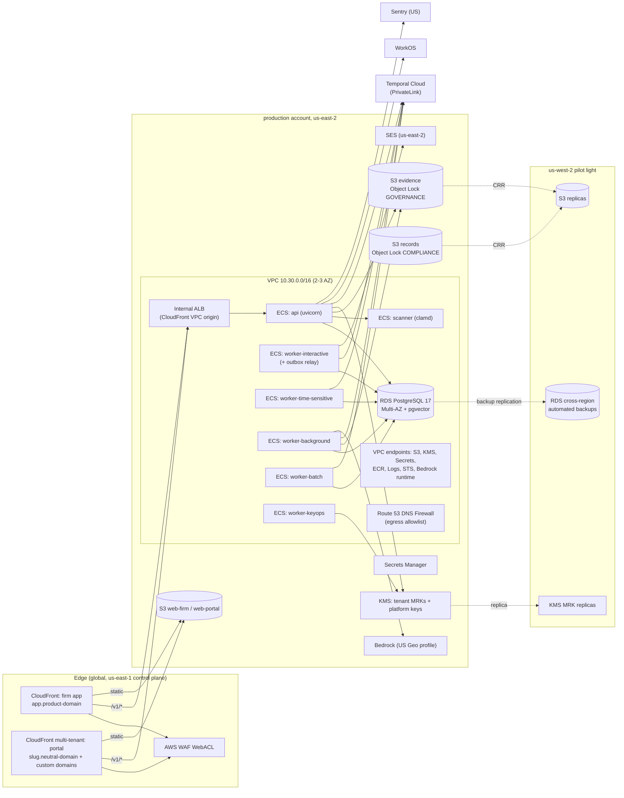
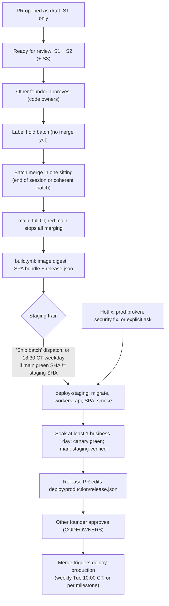
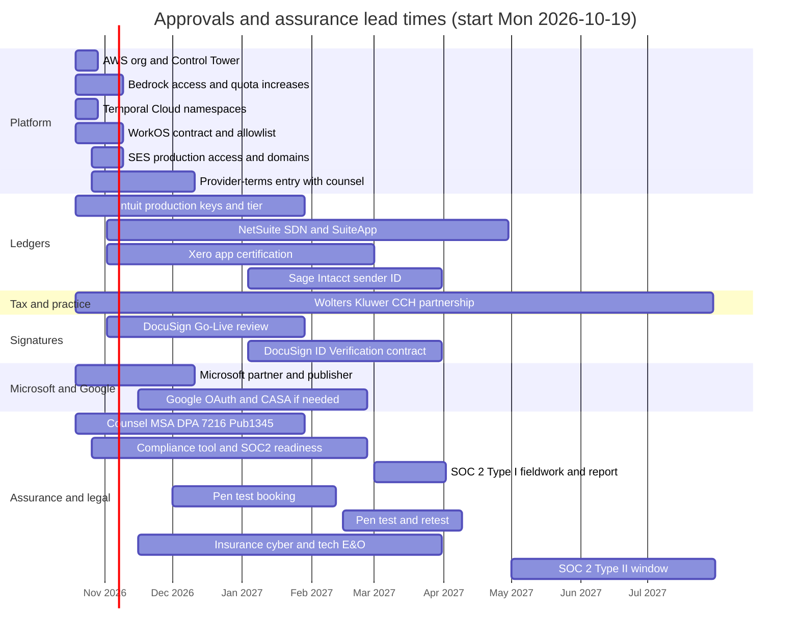

# 6 · Platform, infrastructure, security, compliance and integrations

> Chapter of the Accrued engineering and build plan. Written Saturday 2026-10-17; the first sprint starts Monday 2026-10-19.
>
> **Readers.** Both founders and their Claude Code sessions.
>
> **Lanes.**
> - **notanaskhan** owns the red-zone backend, `infra/`, security operations and production approvals.
> - **ayushkbhatia** owns vendor, partner and counsel paperwork, domains, consent and email copy, the status-page content and the ADM-*/PLT-01 screens, and reviews every platform PR.
> - Every protected-path change needs the *other* founder's code-owner review.
>
> **Labels.**
> - **(inferred)**: this chapter's own reasoning, not stated in a source.
> - **[verify]**: a vendor, pricing or legal fact to confirm before code or a contract depends on it.
>
> **ID conventions.**
> - Screen IDs follow `catalog.tsv`.
> - `ADR-nnn` are accepted repo ADRs.
> - `P-nn` are the proposed ADRs in `digests/cross/repo-adrs.md`.
> - `R-nn` and `CMP-nn` come from `digests/cross/domain-compliance.md`.
> - `W1`–`W11` are the write classes in `digests/cross/integrations.md`.
> - `D-OPS-nn`, `OPS-nn` and `P-34`… are new in this chapter.
>
> **Sprint calendar (assumed).** Two-week sprints from Mon Oct 19:
>
> | Sprint | Dates |
> |---|---|
> | S0 | Oct 19–30 |
> | S1 | Nov 2–13 |
> | S2 | Nov 16–27 |
> | S3 | Nov 30–Dec 11 |
> | S4 | Dec 14–24 |
> | (holiday) | — |
> | S5 | Jan 4–15 |
> | S6 | Jan 18–29 |
> | S7 | Feb 1–12 |
> | S8 | Feb 15–26 |
> | S9 | Mar 1–12 |
> | S10 | Mar 15–26 |
> | S11 | Mar 29–Apr 9 |
> | S12 | Apr 12–23 |
>
> Where the master plan's calendar differs, it wins.

---

## 0. What this chapter decides

### 0.1 The calendar fact that reshapes the plan

The repo's own build plan (`docs/product/build-plan.md` §7, the Phase 3 entry gate) allows **no client data at all** until all of these are true:
- a penetration test is done and its findings resolved;
- a SOC 2 Type I report is in hand;
- DPAs are signed;
- SLO alerting, a canary firm and a status page are live;
- a second model route is configured;
- a restore drill has passed within the last quarter.

Today nothing is deployed. There is no `infra/`, and `TASK-014` is `status: blocked`. Even run hard, the earliest believable dates are:
- **production stood up with a synthetic canary:** Fri **Dec 11, 2026**;
- **pen test:** Feb 15 – Mar 5, 2027;
- **SOC 2 Type I:** as of Mon Mar 1, 2027, with the report in early April 2027.

So the first real firm's data cannot enter Accrued before mid-April 2027. Jan 1 – Apr 20 is the firms' own peak, and onboarding inside it is unrealistic. **Recommended first real-firm onboarding (shadow mode): Mon May 3, 2027** (D-OPS-01).

That changes four things the other chapters assume (inferred):

1. **No freeze in January–March 2027.** P-29 proposes that the ADR-092 freeze applies only once a real firm is live. With no real firm before May, the build runs at full speed through Q1 2027 on staging.
2. **The "before Jan 1, 2027" deadlines become demo deadlines.** This covers the SAS 149 group-audit screens, the 8879 e-signature path and the tax-season integrations. They matter for design-partner previews on staging, not for real use.
   - First real **tax** use: the extension season (1065 and 1120-S on Sep 15, 1040 on Oct 15, 2027).
   - First real **calendar-year audit and 1040 season** on Accrued: Jan–Apr 2028 (TY2027), which includes SAS 149 group audits of December 2027 year-ends.
3. **The first real workloads (May–Aug 2027)** are the ones that do not peak in January–April:
   - CAS monthly closes;
   - audits with June or September year ends (build plan §9 says the same);
   - EBP and Form 5500 work (Oct 15 deadline);
   - notices.
4. **SOC 2 Type II observation runs May–Jul 2027**, so the report arrives around September 2027. That is in time for firms' vendor diligence and their SQMS 1 technological-resource evaluations before the 2028 season.

The compressed alternative is in §8.4: a pen test in December 2026, Type I as of mid-January 2027, and a February 2027 shadow pilot. It is **not recommended**. It switches on the freeze for the whole build in Q1 and asks design partners to adopt new software at their busiest time.

### 0.2 Decision register

| ID | Decision | Recommendation | Why | Owner |
|---|---|---|---|---|
| D-OPS-01 | When does "production" (real data) start? | Production with only the canary by **Dec 11, 2026** (R1). Real-data gate (R2) review **Fri Apr 16, 2027**. First firm in shadow mode **Mon May 3, 2027**. | Build-plan Phase 3 gate, SOC 2 and pen-test lead times, and the firms' peak. See §0.1 and §8 | both |
| D-OPS-02 | AWS region | **us-east-2 (Ohio) primary, us-west-2 (Oregon) DR.** us-east-1 only for global edge services (CloudFront, ACM certificates for CloudFront, WAF) and as a Bedrock US-Geo destination | Matches the designed copy on ADM-06 and PLT-01 ("storage Ohio, backup Oregon; inference US") and resolves conflict C-16. ADR-021 says only "a US region". Ohio avoids us-east-1's shared-blast-radius history (inferred) | notanaskhan |
| D-OPS-03 | Account topology | AWS Organizations + Control Tower: `management`, `log-archive`, `audit`, `shared`, `staging`, `production` (+ an optional `sandbox`, which never holds data) | ADR-021/087 separation; Control Tower provides log archive, audit, guardrails and Identity Center in a day | notanaskhan |
| D-OPS-04 | Compute | **ECS Fargate**: one backend image, one service per Temporal work class, a ClamAV service, one-off migrate and bootstrap tasks | ADR-021. Long-lived workers and SSE rule out Lambda. Two founders cannot run EKS (§1.6) | notanaskhan |
| D-OPS-05 | Database | **RDS for PostgreSQL 17, Multi-AZ**, pgvector and pg_trgm, 35-day PITR, cross-region automated backups to us-west-2, plus a Vault-Locked copy in the `audit` account. No RDS Proxy and no Aurora at first | Meets ADR-096 (RPO 5 min, automatic failover) at the lowest fixed cost; GUCs are transaction-local, so pooling can be added later | notanaskhan |
| D-OPS-06 | S3 Object Lock mode | **GOVERNANCE** for evidence and documents, with bypass denied to every role except a dual-control break-glass role. **COMPLIANCE** for archive seal manifests (AUD-25) and signature and consent evidence packages, set to the legal floor | ADR-034 offboarding and P-31 withdrawal need deletability; Pub 1345 and AU-C 230 need records that are provably tamper-proof (C-09) | notanaskhan |
| D-OPS-07 | Tenant keys | One KMS **multi-Region** key per firm (us-east-2 primary, us-west-2 replica), created by a dedicated `worker-keyops` service; deletion under dual control | ADR-035/104/096; keeps `kms:CreateKey` out of the app's role | notanaskhan |
| D-OPS-08 | Temporal | **Temporal Cloud** (not self-hosted), namespaces per environment in AWS us-east-2 [verify], PrivateLink in production | ADR-017; the code already requires TLS and an API key outside local; payloads are encrypted by our codec | notanaskhan |
| D-OPS-09 | Malware scanning | **ClamAV (`clamd`) as an internal ECS service**, called synchronously on plaintext. Not GuardDuty S3 Malware Protection | Objects are sealed client-side before they reach S3 (ADR-104), so an S3-side scanner sees only ciphertext | notanaskhan |
| D-OPS-10 | Edge and domains | CloudFront + WAF. The firm app at `app.<product-domain>`. The portal at `<slug>.<neutral-portal-domain>` plus firm custom domains on a multi-tenant distribution. `/v1/*` goes same-origin to an **internal** ALB through a CloudFront VPC origin | White-label rule (the portal never shows Accrued); same-origin keeps CSP `connect-src 'self'` and avoids CORS | ayushkbhatia (domains), notanaskhan (edge) |
| D-OPS-11 | Email | **SES (us-east-2) outbound** with per-firm verified domains (DKIM, custom MAIL FROM). Firm-mailbox intake through **Microsoft Graph**, not SES inbound | P3 blocker; INB-01 is designed around the firm's own `docs@` mailbox | notanaskhan |
| D-OPS-12 | Release cadence | **Batch merges + a staging train + a weekly production release** (per milestone once firms are live), plus a hotfix lane. Amend ADR-088's "main auto-deploys to staging" to "main deploys to staging once per batch" | The user's working agreement: one deploy per batch, never per fix | both |
| D-OPS-13 | Previews | **Fixture-mode static previews only**, opt-in with a `preview` label. No full-stack ephemeral environments | The user's rule (opt-in previews); cost; no Temporal, Postgres or S3 per PR | ayushkbhatia |
| D-OPS-14 | Observability | CloudWatch (logs, metrics, alarms) + X-Ray through ADOT + Sentry (US, scrubbed) + Better Stack (status page, uptime, on-call) [verify] | Client data stays in our AWS account; one cheap vendor for paging and status | notanaskhan |
| D-OPS-15 | GitHub | Move the repo to an **organization on the Team plan**, make it **private on day 1**, add rulesets, a CODEOWNERS catch-all, Secret Protection + Code Security, Dependabot and CodeQL. Production approval through a **release-manifest PR** | The repo is public with no protection. On Team, environment required-reviewers and merge queue are not available for private repos [verify], hence the release PR | notanaskhan (owns the repo) |
| D-OPS-16 | SOC 2 | Compliance tool chosen by Oct 30 (**Drata** recommended [verify price], because ATT-09 also syncs with Drata first). Type I as of **Mar 1, 2027**; Type II window **May 1 – Jul 31, 2027** | Build-plan gate; the Type II report lands before firms' 2028 diligence | notanaskhan (controls), ayushkbhatia (vendor/legal) |
| D-OPS-17 | E-signature stance | **Record mode first** (import the evidence package from the firm's existing provider). Then **DocuSign embedded signing with DocuSign ID Verification (KBA)**. Native T16 KBA deferred to 2028 | Domain-compliance C-06: provider-hosted KBA carries a much lighter Pub 1345 load; SPEC-025's "record, don't rebuild" works for season 1 | both |
| D-OPS-18 | E-file | **Never transmit.** No MeF and no IRIS TCC; IRIS 1099s become a file export (CLS-13) | R-04. Being a transmitter means an IRS application, ETIN, annual ATS and a calculation engine | both |
| D-OPS-19 | Writes to external systems | **One framework ADR (P-39)** that supersedes ADR-040 in part, plus a protected `write-capabilities.yaml` registry. Dedicated ADRs only for W1 (client GL posting), W2 (tax engine, = P-18), W5 (GRC sync; addendum §8.2 asks for it) and W8 (customer webhooks) | Nine write classes would otherwise mean nine ADRs; four of them cross genuinely new trust boundaries | notanaskhan |
| D-OPS-20 | Flags vs entitlements vs content | Flags (ADR-089) **only for rollout**. Modules and plans become **DB entitlements** (P-28); the addendum's `ff.*` names become module entitlements. Firm content and platform reference data live in the DB, never in commits | ADR-089's 90-day expiry; the user's "content belongs in the database" rule | both |
| D-OPS-21 | Accrued staff access to tax return information from outside the US | Until counsel answers, content-level support sessions (`platform_support_content`) on tenants holding tax return information (TRI) are opened only by US-located staff | §7216 offshore-disclosure rules (R-02). Repo commit timestamps carry a +04:00 offset, so some work happens outside the US (inferred) | both, with counsel |

### 0.3 The first ten working days (S0, Oct 19–30), platform track only

| # | Item | Owner | Done when |
|---|---|---|---|
| 1 | Create the GitHub org, transfer `abacus`, **make it private**, Team plan, rulesets, Secret Protection + Code Security, Dependabot (§5.1) | notanaskhan | Ruleset active on `main`; push protection on |
| 2 | Restore green CI: fix the stale integration assertions (`test_engagements.py:897`, `test_board_reads_api.py:230`, `test_schema_check_db.py:1083`), run stage 2 on `push: main`, refresh `backend/tests/durations.json` (86 of 156 files today), fix the nightly e2e (`apps/web/e2e/journey.spec.ts`) | notanaskhan | 5 green `main` runs; the e2e is green 3 nights running |
| 3 | AWS Organization + Control Tower + Identity Center + SCPs; accounts per D-OPS-03; Organizations AI-services opt-out policy at the root (§5.4) | notanaskhan | `infra/README.md` records the one-time console steps |
| 4 | Buy the product domain and a **neutral** portal/mail domain; delegate to Route 53 in `shared` | ayushkbhatia | NS records live |
| 5 | Start every long-lead vendor application in §7.6 (Intuit, Microsoft publisher verification, Wolters Kluwer, DocuSign, WorkOS, Temporal Cloud, SES production, Bedrock access and quotas) | ayushkbhatia (forms, commercial), notanaskhan (security questionnaires) | Each row in §7.6 has a ticket and a submitted date |
| 6 | Engage counsel: MSA and DPA, §7216 consent templates, Pub 1345 and KBA review, offshore question D-OPS-21, provider-terms second approver | ayushkbhatia | Engagement letter signed |
| 7 | Write the TASK-014 plan (red), now titled "Staging and production on AWS through Terraform", and get cross-founder approval | notanaskhan writes, ayushkbhatia approves | Plan box checked in the task file |
| 8 | Draft P-34…P-41 (Appendix B) and reserve their ADR numbers (next free **ADR-116**) | notanaskhan | Numbers reserved in `docs/adr/README.md` |
| 9 | Choose the compliance tool (Drata) and shortlist auditors (not a design-partner firm, for independence) | notanaskhan | Tool contract signed |
| 10 | Create `docs/ops/slos.md`, `docs/runbooks/README.md`, `docs/architecture/ai-threat-model.md` and `docs/architecture/e2e-journeys.md` as skeletons. All four are missing today, though ADR-093/098/064/077 require them | notanaskhan (ops), ayushkbhatia (journeys, threat-model draft) | Files merged |

---

## 1. Infrastructure target on AWS (ADR-021, ADR-087, ADR-104)

### 1.1 Principles

1. **Everything is Terraform** in `infra/`, which is protected and has CODEOWNERS.
   - Humans make console changes only for the one-time landing-zone steps, and record them in `infra/README.md`.
   - Agents never apply. `.claude/settings.json` denies `terraform apply/destroy`, and `guard_bash.py` blocks `terraform state` and `aws --profile *prod`.
2. **Production data never leaves production** (ADR-087). Restore drills run inside the production account.
3. **Client data is encrypted twice.**
   - Client-side envelope encryption under the firm's KMS key (ADR-104).
   - Service-side encryption under platform keys, as defence in depth.
   - No AWS service that has to read plaintext sits in the evidence path. That is why malware scanning runs in our own process (D-OPS-09).
4. **No public data plane.** The ALB is internal behind a CloudFront VPC origin. RDS sits in isolated subnets. Every bucket blocks public access.
5. **Egress is allow-listed** (ADR-040 worker egress, P-17). Each integration adds its hosts through the write- and read-capability registry, not ad hoc.
6. **US only** (ADR-021/113, R-35). An SCP denies every other region.
7. **One trust boundary for sub-processors.** Wherever possible, a capability is an AWS service in our own account: SES, Bedrock, KMS, Textract (P-32, later). That keeps the sub-processor list short for SOC 2 and for the §7216 AI-disclosure recipients (C-03).

### 1.2 Accounts

| Account | Contents | Who has access |
|---|---|---|
| `management` | Organizations, Control Tower, Identity Center, billing, SCPs | both founders (MFA, hardware key); used rarely |
| `log-archive` | Organization CloudTrail, Config, CloudFront/ALB/WAF/VPC flow logs, S3 with Object Lock (≥ 1 year, ADR-032 security logs) | read-only for both; nobody can delete |
| `audit` | GuardDuty and Security Hub delegated admin, IAM Access Analyzer, Inspector admin, AWS Backup vault with Vault Lock (D-OPS-05) | both (read and triage) |
| `shared` | ECR (images), Terraform state, `abacus-shared-artifacts` (SPA bundles by SHA), `abacus-shared-previews` (PR previews), `abacus-shared-design-baselines` (handoff parity baselines; never in git, G-E05), Route 53 public zones, GitHub OIDC deploy roles | CI roles; founders read-only |
| `staging` | The staging environment (synthetic only, ADR-087) | founders: Operator permission set; CI deploy role |
| `production` | Production in us-east-2 plus the DR pilot light in us-west-2 | founders: ReadOnly by default; Operator via time-boxed assignment; no human data-plane access (ADR-028) |
| `sandbox` (optional) | Founders' Terraform experiments; nuked weekly; never any data | founders |

### 1.3 Environments

| Environment | Where | Data | Deploy trigger | Model route | Identity | Email |
|---|---|---|---|---|---|---|
| `local` | laptop, `docker-compose.yml` (Postgres 17 + pgvector 0.8.7, Versity S3 with Object Lock, Temporal dev server) | synthetic (`make seed`; later `make seed-demo`) | — | `fake` (direct only with `allow_real_model_locally`) | fake OIDC on :9000 | `LocalMailbox` |
| `test` (CI) | GitHub Actions + testcontainers | synthetic fixtures | every PR | `fake` | fake | fake |
| `evaluation` | GitHub Actions nightly (`evals.yml`), `evaluation` secrets environment | synthetic eval cases (ADR-085) | nightly + path-triggered | direct API (`ANTHROPIC_EVAL_KEY`), plus Bedrock parity in staging | n/a | n/a |
| `preview` | `shared` account, S3 + CloudFront, private | fixture mode only (Brightwater Hale seed compiled into the bundle) | `preview` label on a PR (opt-in) | none | none (gate cookie) | none |
| `staging` | `staging` account, us-east-2 | **synthetic only**: the canary tenant and the Brightwater Hale demo tenant | staging train (§2.4) | Bedrock (US Geo) on synthetic data; direct for evaluations | WorkOS staging environment | SES (sandbox → production access) |
| `production` | `production` account, us-east-2 (+ us-west-2 DR) | canary only until R2; then real firms | release-manifest PR (§2.4) | Bedrock only for client data (ADR-113); `fake` excluded | WorkOS production | SES production |

The **demo tenant** lives in staging; there is no separate demo environment (inferred). The demo clock (G-E01: `abacus.kernel.clock`, `ABACUS_DEMO_CLOCK`) is refused in production by settings validation. In staging it is honoured only for tenants with `firms.synthetic = true` and a `demo_clock` setting. If a pinned clock fights Temporal timers, the demo tenant moves to its own small stack (`envs/demo`), built from the same modules, by M2.

### 1.4 Region and residency (D-OPS-02)

- **Primary: us-east-2. DR: us-west-2.** Change the deploy-time settings `ABACUS_S3_REGION`, `ABACUS_BEDROCK_REGION` and the SES region for staging and production. The code defaults stay as they are; they only matter locally.
- **Bedrock.**
  - Use the **US Geo cross-region inference profiles** for the pinned tier models. ADR-113 allows In-Region or US Geo and rejects Global.
  - The profile may route to us-east-1, us-east-2 or us-west-2, so the region SCP and IAM must allow `bedrock:InvokeModel*` in all three [verify which profiles exist for the pinned models].
  - Record it in the first `docs/operations/provider-terms.yaml` entry as `region: us-east-2` with a note "US Geo profile: us-east-1/us-east-2/us-west-2". Update the commented example, which says `us-east-1`.
- **Global services that must sit in us-east-1:** ACM certificates for CloudFront, the WAF WebACL with `CLOUDFRONT` scope, and CloudFront itself. The SCP allows exactly these.
- **Tenant region pin:** add `firms.region text NOT NULL DEFAULT 'us'` now (R-35, PLT-01 "Changing region requires a new tenant"). Settings validation refuses non-US regions.

### 1.5 Topology



### 1.6 Compute: ECS Fargate (D-OPS-04)

**Why Fargate** (ADR-021 already chose it; the reasons still hold for two founders):

| Option | Verdict | Reason |
|---|---|---|
| **ECS Fargate** | **chosen** | No cluster to patch. Long-running Temporal workers per work class. SSE needs long-lived HTTP. Linux enforces the `kernel/isolation.py` child-process limits (the 1 GB address-space limit is *not* enforced on macOS). Per-service IAM task roles. Rolling deploys with a circuit breaker and alarm-based rollback (ADR-088) |
| EKS | rejected | A control-plane fee plus ongoing Kubernetes operation that neither founder should carry (ADR-100) |
| Lambda | rejected | Temporal workers and SSE connections are long-lived; parsing needs process isolation and up to 50 MB uploads; runtime limits |
| App Runner / PaaS | rejected | Weaker network and egress control; ADR-021 rejected PaaS on compliance grounds |
| EC2 + ASG | rejected for now | Patching burden. Revisit only if Fargate prices dominate at scale |

**One backend image, many services.**
- `backend/Dockerfile`: multi-stage; `uv sync --locked --no-dev`; Python 3.12 slim pinned by digest; non-root; read-only root filesystem with a tmpfs `/tmp` for isolated parsers.
- The base image is rebuilt weekly (ADR-099).
- The SPA is built separately (§2.3).
- Approval: the Dockerfile and any new base image are protected allowlist entries (`containers:` in `docs/architecture/dependency-allowlist.yaml`).

| ECS service / task | Command | Purpose | Staging | Production (initial) | Scaling signal |
|---|---|---|---|---|---|
| `abacus-api` | `uvicorn --factory abacus.api.app:create_app --host 0.0.0.0 --port 8000 --proxy-headers` | REST `/v1`, uploads (≤ 50 MB `MAX_CONTENT_BYTES`), preview proxying, SSE `GET /v1/events` (P-15) | 1 × 0.5 vCPU / 1 GB | 2 × 1 vCPU / 2 GB across AZs | ALB requests per target; CPU |
| `abacus-worker-interactive` | `python -m abacus.worker --classes interactive` | the `abacus-interactive` queue; **outbox relay**; today also the hourly spend-anomaly and daily notification-purge loops | 1 × 0.5/1 | 2 × 1/2 | `abacus.schedule_to_start` p90 (target 5 s) |
| `abacus-worker-time-sensitive` | `… --classes time_sensitive` | `abacus-time-sensitive` | 1 × 0.5/1 | 2 × 1/2 | schedule-to-start p90 (target 30 s) |
| `abacus-worker-background` | `… --classes background` | previews, parsing, extraction, embeddings | 1 × 1/2 | 2 × 2/4 | schedule-to-start p90 (target 60 s) |
| `abacus-worker-batch` | `… --classes batch` | exports, renders (P-19), backfills, roll-forwards | 1 × 1/2 (Fargate Spot) | 1–4 × 2/4 | backlog > 0 → scale out; idle → 1 |
| `abacus-worker-keyops` (new) | `… --classes keyops` (a fifth queue, `abacus-keyops`; needs a `WorkClass` addition in protected `kernel/config.py`) | `TenantProvisioningWorkflow` key creation, replication and aliasing only (§1.9) | 1 × 0.25/0.5 | 1 × 0.25/0.5 | none |
| `abacus-scanner` (new) | ClamAV `clamd` (official image, digest-pinned) with `freshclam` | synchronous `INSTREAM` scanning (§1.15) | 1 × 1/3 | 2 × 1/3 | CPU; scan latency |
| `abacus-migrate` (one-off task) | `alembic upgrade head` with `ABACUS_MIGRATIONS_DATABASE_URL` (role `abacus_owner`) | pre-deploy migrations (ADR-091) | per deploy | per deploy | — |
| `abacus-bootstrap` (one-off task) | runs `backend/migrations/bootstrap.sql` as the RDS master | creates `abacus_owner`, `abacus_app`, `abacus_relay`, `abacus_identity`, the vector extension and grants; **never** `bootstrap-local.sql` | once per environment | once | — |

Notes (inferred unless stated):
- **Duplicate side jobs.** Two interactive workers mean two relays, which is safe because the relay claims with `FOR UPDATE SKIP LOCKED`. They also mean duplicate hourly and daily side jobs. Move both into **Temporal Schedules** through a new `kernel.dispatch.schedule(...)` (G10, owned by DISPATCH-001) before production runs more than one interactive task (OPS-10, S2).
- **Shutdown.** Graceful shutdown is 60 s (`GRACEFUL_SHUTDOWN`); set the ECS `stopTimeout` to 120 s.
- **Legacy queue.** Turn `ABACUS_SERVE_LEGACY_QUEUE=false` off once no workflow remains on `abacus` (P14 in repo-backend-core §7.3).
- **Later services, from the same modules:**
  - `abacus-renderer`, if P-19 picks headless Chromium; WeasyPrint or Typst would run inside `worker-batch`;
  - `abacus-mcp` (P-21; P2–P3);
  - the Office add-in static host (P-20; P3).

### 1.7 Database: RDS for PostgreSQL 17 (D-OPS-05)

| Setting | Staging | Production | Why |
|---|---|---|---|
| Engine | PostgreSQL 17.x (same major version as local) | same | `schema_check` runs against pg17 |
| Instance | `db.t4g.medium`, single-AZ | `db.m7g.large` **Multi-AZ** (2 vCPU / 8 GB) | ADR-096: automatic failover across data centres |
| Storage | gp3 50 GB, autoscaling | gp3 100 GB, autoscaling to 1 TB | — |
| Extensions | `vector` (pgvector; RDS-supported version [verify ≥ 0.8]; local is 0.8.7), `pg_trgm` (P-33), `pg_stat_statements` | same | knowledge retrieval (SPEC-009), search |
| Encryption | KMS `alias/abacus/platform/rds` | same; a **multi-Region** key so cross-region backups can be encrypted in us-west-2 | — |
| Backups | 7 days | **35 days PITR** + **cross-region automated backup replication to us-west-2 (35 days)** + daily AWS Backup copy to the `audit` account vault (Vault Lock, 35 days) | ADR-096; the second copy protects against a compromised production account |
| Parameters | `rds.force_ssl=1`, `log_min_duration_statement=500`, **`log_parameter_max_length=0`**, **`log_parameter_max_length_on_error=0`**, `idle_in_transaction_session_timeout=60000` | same | Restricted values must never reach logs (ADR-031). The app already sets `hide_parameters=True` and a 30 s `statement_timeout` |
| Maintenance | Sun 08:00–09:00 UTC | same (02:00–03:00 CT) | outside US working hours |
| Monitoring | Performance Insights (7 days) | + Enhanced Monitoring 60 s | — |
| Network | isolated subnets, SG from app SGs only, no public access | same | — |

**Connection budget.** The app uses four engines: app, relay, identity and migrations. With 2 API tasks × a pool of 10, 7 worker tasks × a pool of 5, and one SSE `LISTEN` connection per API task, the total is about 60 connections. A `db.m7g.large` allows several hundred.
- **RDS Proxy is not needed yet.** If it is added later, it is compatible: `kernel/db/session.py` sets GUCs with `set_config(…, true)` (transaction-local).
- **Pinning [verify].** Check RDS Proxy's session-pinning behaviour for `set_config` before turning it on.

**Not Aurora (yet).**
- RDS Multi-AZ already meets RPO 5 min and automatic failover, at about half the fixed cost (inferred).
- Revisit Aurora (Global Database) when regional recovery under one hour is needed, or storage I/O dominates.
- The migration path is snapshot → Aurora restore.

**User rule: never share a hosted database between a local run and a hosted build.**
- CI and every `make` target use testcontainers or the local compose database only.
- Only the deploy pipeline's `abacus-migrate` task touches a hosted database, serialized by the deploy lock (§2.5).
- `guard_bash.py` already blocks `psql`/`pg_dump` against non-local hosts.
- Restore drills and backfills first check that no deploy is running (§2.10).

### 1.8 Object storage and the Object Lock decision (D-OPS-06)

| Bucket (per environment unless noted) | Contents | Object Lock | Lifecycle | Replication |
|---|---|---|---|---|
| `abacus-<env>-evidence` (settings key `evidence_bucket`) | sealed evidence and document versions; raw connector payloads (ADR-038); sealed preview pages under `previews/` with no retention, because they are derived and rebuildable | **GOVERNANCE**, per object; retain-until from the record's retention policy (CMP-07) | expiry handled only by the destruction workflow (R-25) | CRR to `abacus-<env>-evidence-usw2` (Object Lock on; retention replicated) |
| `abacus-<env>-records` (new) | AUD-25 archive **seal manifests**, signature **evidence packages** (8879 family and others), consent evidence (ADM-05), destruction certificates (FIL-02) | **COMPLIANCE**, per object, retain-until = the **legal floor** | — | CRR |
| `abacus-<env>-exports` (new) | encrypted engagement and firm export bundles (ADR-036, ADM-06) | none | delete after 7 days (ADM-06 link expiry) | none |
| `abacus-<env>-branding` (new) | firm logos (Public-classified) | none | versioned | none |
| `abacus-<env>-web-firm`, `abacus-<env>-web-portal` | SPA assets by content hash, `index.html` / `portal.html`, `runtime-config.json` | none | keep the last 20 releases | none |
| `abacus-shared-artifacts`, `abacus-shared-previews`, `abacus-shared-design-baselines`, `abacus-shared-tfstate` | release bundles, PR previews (14-day expiry), parity baselines, Terraform state | none | as noted | none |

Every bucket gets:
- account-level Block Public Access;
- a TLS-only bucket policy;
- versioning;
- SSE-KMS with a platform key and S3 Bucket Keys (defence in depth beneath the client-side tenant envelope);
- server access logs to `log-archive`.

**Decision and rationale (C-09).**

- **Evidence stays in GOVERNANCE mode**, as today in `evidence/storage.py`.
  - ADR-034 offboarding ("dual-control delete via storage override + key destruction") and P-31 client withdrawal of unaccepted uploads both need the possibility of early deletion.
  - The "Locked · WORM" claim on AUD-25 and FIL-01 is made true by controls, not by the mode:
    - an **SCP denies `s3:BypassGovernanceRetention`, `s3:PutBucketObjectLockConfiguration` and `s3:DeleteObjectVersion`** to every principal except the `abacus-retention-override` role;
    - that role is assumable only through an Identity Center permission set that the *other* founder assigns for at most 4 hours;
    - every assumption fires a CloudTrail → EventBridge → page alert;
    - the archive seal (next bullet) is the second layer.
- **Records use COMPLIANCE mode** at the legal floor, because nobody, including us, can shorten it:
  - **seal manifest:** release date + 5 years (AU-C 230);
  - **8879-family evidence package:** due date + 3 years at signing, extended to the IRS received date + 3 years when the acknowledgement arrives (Pub 1345: 3 years from the later of the two). Extension is always allowed; shortening never is;
  - **§7216 consent evidence:** signature + 3 years (inferred; confirm with counsel);
  - **destruction certificates:** 7 years (inferred).

  The firm's longer policy (for example 7 years) is enforced by the retention-policy workflow, not by the lock.
- **Retain-until is computed** from `retention_policies` (record type × service line, R-23) plus the clock event (filing, release, period end). It is extended with `put_object_retention`; the helper `_extend_retention` already exists. Upload-time retention of `now + evidence_retention_days` (2,555) remains only as the minimum default until a clock event arrives.
- **Legal holds** use `put_object_legal_hold`, reference-counted in `hold_objects`. New uploads into a held scope inherit the hold (R-24).
- **Crypto-shred and COMPLIANCE.** Destroying a firm's key (ADR-035) makes COMPLIANCE ciphertext unreadable, but the bytes persist until the floor date. The offboarding certificate must say so (R-25).

### 1.9 Keys (D-OPS-07)

**Per-tenant keys.**
- One symmetric **multi-Region primary** KMS key per firm in us-east-2, replicated to us-west-2 (ADR-096: "keys exist in both regions").
- Alias: `alias/abacus/tenant/<tenant_id>`. Tags: `abacus:env`, `abacus:tenant`.
- Store the key ARN on `firms` (new column `kms_key_arn`). `KeyService.key_id(tenant)` reads it, and `open_sealed` keeps checking that the key ID matches.

**`KmsKeyService` (P1, red, `kernel/crypto/`).**
- `wrap` calls `kms:Encrypt` (or `GenerateDataKey`) with the encryption context `{"abacus:tenant": "<tenant_id>", "abacus:purpose": "dek"}`, so:
  - CloudTrail attributes every decrypt to a tenant;
  - a wrong-tenant unwrap fails at KMS, not just in our AAD check (inferred).
- AAD stays `abacus-evidence-v1|tenant|fingerprint|key_id`.

**Who may do what.**

| Principal | KMS rights |
|---|---|
| API and worker task roles | `Encrypt`, `Decrypt` and `GenerateDataKey` on keys tagged with their `abacus:env` |
| `abacus-worker-keyops` task role (the only role that can create keys) | `kms:CreateKey` (condition: request tag `abacus:env` = its env); `kms:ReplicateKey` to us-west-2; `kms:CreateAlias` on `alias/abacus/tenant/*`; `kms:TagResource`; a constrained `PutKeyPolicy`; no data-plane rights |
| Everyone except `abacus-key-custodian` (break-glass, dual control, ADR-035) | denied `ScheduleKeyDeletion`, `DisableKey` and `PutKeyPolicy` by SCP |

The key deletion window is 30 days.

**Platform keys.**
- `alias/abacus/platform/{rds,s3-sse,logs,secrets,backup}`, multi-Region where a cross-region copy needs them.
- The Temporal payload codec keyring (`ABACUS_TEMPORAL_PAYLOAD_KEY`) is a Secrets Manager secret holding ≥ 32 random bytes per key ID.
- `SEALING_ID="platform-v1"` is hard-coded in `kernel/crypto/payload_codec.py`. Making it configurable for rotation is a P2 item.

**Quotas and latency.**
- Every seal costs one KMS call, and every open (each preview page) costs one more.
- Measure decrypt p95 and throttles at the December 2027 load test (ADR-075). If needed, add an in-process LRU of unwrapped data keys (≤ 5 minutes, memory only), which is a red-zone change.
- Check the cryptographic request quota for us-east-2 [verify].
- Cost: about $2 per firm per month (primary + replica) [verify].

**Crypto-shred runbook (RB-13).** Export → grace period → delete DB rows → both founders approve → `ScheduleKeyDeletion` on the primary and the replica → certificate. The certificate states the key deletion date and the date backups age out (+35 days).

### 1.10 Temporal (D-OPS-08)

**Recommendation: Temporal Cloud.** Self-hosting means running the Temporal server, its persistence and its visibility store, history-shard sizing, upgrades and on-call. That is at least a person-month plus a permanent pager item for two founders, against a few hundred dollars a month [verify pricing]. ADR-017 already names Temporal Cloud, and `kernel/temporal.py` requires TLS and an API key outside local and test. Temporal Cloud sees only metadata and **payloads encrypted by our codec** (AES-256-GCM), so it is a low-sensitivity sub-processor.

| Item | Setting |
|---|---|
| Namespaces | `abacus-staging.<acct>`, `abacus-prod.<acct>` in **aws-us-east-2** [verify region] |
| Auth | API keys per service identity (worker vs API); stored in Secrets Manager; rotate every 90 days |
| Network | AWS **PrivateLink** endpoint in the production VPC [verify plan tier]; public endpoint with the egress allowlist in staging |
| Retention | 30 days of closed-workflow history (ADR-032 keeps raw traces about 30 days; Postgres is the truth, ADR-095) |
| Task queues | `abacus-interactive`, `abacus-time-sensitive`, `abacus-background`, `abacus-batch`, `abacus-keyops` (new); drain and remove `abacus` |
| Versioning | `workflow.patched` + replay tests (ADR-090, WF-001) gate every deploy. Evaluate Temporal worker-deployment versioning later [verify GA] |
| Schedules | `kernel.dispatch.schedule()` (G10): the engagement-agent daily tick stays, plus moved side jobs, saved-agent schedules (WB), reminder cadences (ADM-10), consent expiry, retention clocks |
| DR | Regional failure: create or attach a us-west-2 namespace and rebuild long-lived workflows from Postgres. That needs an ADR-095 terminate-and-rebuild test per long-lived workflow. HA namespaces (multi-region replication) are deferred until there are real firms [verify] |

### 1.11 Email (D-OPS-11, P3)

**Outbound: SES v2 in us-east-2.**
- **Production access:** request in S0. It needs a verified domain and a use-case description; expect 1–3 days [verify].
- **Platform identity:** `mail.<product-domain>`, used for firm-side system mail such as staff invitations.
- **Per-firm identity** (ADM-10, POR-20):
  - The firm verifies `brightwaterhale.com`-style domains through **Easy DKIM** (three CNAMEs) and a **custom MAIL FROM** (`bounce.<firm-domain>`: MX + SPF).
  - ADM-10 shows the DMARC guidance.
  - Until the firm verifies: send from `<slug>@<neutral-mail-domain>` with the firm's display name and `Reply-To` set to the firm address. The default sender therefore never says "Accrued" (white-label).
- **One configuration set per environment.** Delivery, bounce, complaint and reject events go to EventBridge → SQS → a `communications` consumer, which records delivery status and a per-firm suppression list.
  - Alarm on bounce rate > 2% and complaint rate > 0.05%. SES enforces around 5% and 0.1% [verify].
  - Evaluate SES per-tenant reputation isolation [verify feature].
- **Adapter.** `communications/transport.py` gets an SES adapter (it raises outside synthetic environments today). It stays the single way out (COMM-001), with the scope checker and the mechanical "no SSN, TIN, account number or tax amount in the body" check (the POR-20 rule).

**Inbound.**
- The MVP intake (INB-01/02/03) reads the firm's own mailbox through **Microsoft Graph**: app-only, one mailbox, scoped with an application access policy (C1, W6).
- If a design partner has no Microsoft 365, add SES receiving on a per-firm `intake.<neutral-domain>` address → S3 (SSE) → immediate scan and seal in `worker-background`. SES receiving exists only in some regions, us-west-2 among them [verify]. Deferred until needed.

### 1.12 Edge, domains and the white-label portal (D-OPS-10, P-11)

| Host | Serves | Origin(s) | Certificate |
|---|---|---|---|
| `app.<product-domain>` (the design uses `accrued.app`, e.g. `brightwaterhale.accrued.app/mcp`) | firm app (`index.html`) | S3 `web-firm`; `/v1/*` → internal ALB (VPC origin) | ACM us-east-1 |
| `app.staging.<product-domain>` | staging firm app | staging | ACM |
| `<slug>.<neutral-portal-domain>` | portal default host per firm | S3 `web-portal`; `/v1/*` → ALB; `/assets/brand/*` → `branding` bucket | wildcard ACM |
| `portal.<firm-domain>` (ADM-10 "Pending DNS → Verified") | portal custom domain | same as above, as a **distribution tenant** of the CloudFront multi-tenant (SaaS Manager) distribution [verify limits and pricing]; fallback: one distribution per custom domain | CloudFront-managed per tenant |
| `auth.<neutral-portal-domain>` | the auth hop, if WorkOS cannot hold a redirect URI per portal host [verify] | API | wildcard |
| `status.<product-domain>` | status page (firm-facing only, §3.5) | vendor | vendor |
| `<slug>.<product-domain>/mcp` | MCP server (ADM-09; P2–P3) | API | ACM |

Rules:
- **The host is a branding hint only.** `GET /v1/portal/branding` (unauthenticated; P-35) resolves `{firm_name, portal_name, logo_url, secured_footer, sign_in{mfa_required_for, sso}, maintenance_banner?}` from `Host`. Authorization still comes from the membership or grant (ADR-002, P-09).
- **Same-origin API.** Every host routes `/v1/*` to the ALB, so `apps/web/src/api.ts` keeps `baseUrl = window.location.origin`.
- **Cache behaviours.**
  - `/v1/*`: `CachingDisabled`; forward `Authorization`, `X-Abacus-Tenant`, `X-Support-Session`, `Last-Event-ID` and `X-Forwarded-Host`.
  - `/assets/*`: immutable for 1 year.
  - HTML and `runtime-config.json`: `no-cache`.
  - `/healthz` and `/readyz` are blocked at the edge (403); only the ALB uses them.
- **SSE through CloudFront and the ALB.**
  - CloudFront's response timeout also applies between packets, so the stream sends a heartbeat comment every 15 s.
  - ALB idle timeout: 120 s. ALB deregistration delay: 30 s.
  - The client reconnects with `Last-Event-ID`.
  - Verify streaming through VPC origins in staging (S2) before P-15 depends on it.
- **Response headers policy** (replaces the build-time CSP `<meta>` from `vite.config.ts`; keep the meta locally):
  - HSTS: 2 years, `includeSubDomains`; add `preload` once stable.
  - `X-Content-Type-Options: nosniff`.
  - `Referrer-Policy: strict-origin-when-cross-origin` (portal: `no-referrer`).
  - `Permissions-Policy`: `camera=(self)` on the portal only (POR-19); `microphone=()` and `geolocation=()` everywhere.
  - Minimum TLS: `TLSv1.2_2021`.
  - CSP (firm): `default-src 'self'; script-src 'self'; style-src 'self'; img-src 'self' data: blob:; font-src 'self'; connect-src 'self'; frame-ancestors 'none'; object-src 'none'; base-uri 'none'; form-action 'self'`.
    - Fonts are self-hosted through Fontsource; the handoff's Google Fonts are not allowed.
    - `blob:` is for viewer object URLs.
  - CSP (portal): the same, plus `frame-src https://*.docusign.net` once D-OPS-17 step 2 ships [verify the DocuSign embed host], and `media-src 'self' blob:` for capture.
- **Neutral domain (D-OPS-10).** The portal must never show "Accrued", and a default host like `brightwaterhale.portal.accrued.app` would. Buy a neutral domain for default portal hosts and default senders. This is a product decision for ayushkbhatia; the recommendation is to buy one.

### 1.13 WAF (WebACL in us-east-1, attached to both distributions)

| # | Rule | Action | Notes |
|---|---|---|---|
| 1 | `AWSManagedRulesAmazonIpReputationList` | block | — |
| 2 | `AWSManagedRulesCommonRuleSet` | block, with **`SizeRestrictions_BODY` set to count** on upload routes (`/v1/**/uploads*`, portal upload and capture routes) | Otherwise the body-size rule blocks evidence uploads (50 MB app limit). Run the whole set in count mode for 2 weeks in staging first; expect XSS false positives on comment bodies |
| 3 | `AWSManagedRulesKnownBadInputsRuleSet` | block | — |
| 4 | `AWSManagedRulesAnonymousIpList` | **count** | Offshore staff and VPN users are legitimate (ADM-03) |
| 5 | Rate limit, general | 2,000 requests / 5 min / IP → block | SSE excluded |
| 6 | Rate limit, auth and codes | 30 / 5 min / IP on `/v1/auth/*`, the POR-01 code entry and POR-17 respondent code verification | The app also locks after 5 failed codes (ADM-06) |
| 7 | Logging | Firehose → `log-archive`, **redacting `authorization` and `cookie`** | — |

Bot Control and Shield Advanced are deferred (cost).

### 1.14 Secrets and configuration

| Secret (Secrets Manager, `abacus/<env>/…`) | Settings field (`ABACUS_*`) | Used by | Rotation |
|---|---|---|---|
| `db/app`, `db/relay`, `db/identity`, `db/owner` | `DATABASE_URL`, `RELAY_DATABASE_URL`, `IDENTITY_DATABASE_URL`, `MIGRATIONS_DATABASE_URL` | api/workers, relay, sign-in, migrate | quarterly (runbook first, rotation Lambda by R2) |
| RDS master | — | bootstrap only | RDS-managed (`manage_master_user_password`) |
| `temporal/api-key-{api,worker}` | `TEMPORAL_API_KEY` | api, workers | 90 days |
| `temporal/payload-keyring` | `TEMPORAL_PAYLOAD_KEY` | api, workers | add a key yearly; never remove one while histories still use it |
| `sentry/dsn` | `SENTRY_DSN` | all | on compromise |
| `workos/api-key`, `workos/client-id` (non-secret) | identity settings (new) | api | yearly |
| `integrations/<provider>/client-secret` | integration settings (new) | workers | per vendor policy |
| `anthropic/eval-key` | `ANTHROPIC_API_KEY` | **staging and evaluation only**; absent in production (ADR-113) | 90 days |

- Non-secret configuration (`ABACUS_ENVIRONMENT`, `ABACUS_EVIDENCE_BUCKET`, `ABACUS_S3_REGION`, `ABACUS_BEDROCK_REGION`, `ABACUS_TEMPORAL_TARGET`/`NAMESPACE`/`TLS=true`, `ABACUS_OTLP_ENDPOINT`, `ABACUS_RELEASE=<git sha>`, `ABACUS_APP_BASE_URL`, `ABACUS_MODEL_ROUTES`) goes in the task definitions, rendered by Terraform.
- New settings: `kms_alias_prefix`, `scanner_endpoint`, `ses_configuration_set`, `ses_region`, `portal_base_domain`, `platform_controls_cache_seconds` (all inferred).
- The Settings `extra="forbid"` model needs them added in `kernel/config.py` (protected).
- GitHub holds no long-lived cloud secrets. It deploys through OIDC roles, and its one secret, `ANTHROPIC_EVAL_KEY`, lives in the `evaluation` environment.

### 1.15 Malware scanning (D-OPS-09, P4, ADR-110)

- **Why not GuardDuty S3 Malware Protection.**
  - `evidence/uploads.py:218` calls `scan(content)` on the **plaintext bytes in the API**, before sealing.
  - Everything that reaches S3 is ciphertext (ADR-104), so an S3-side scanner can never see the content.
  - Writing plaintext to a quarantine bucket would break ADR-104.
- **Design.**
  - `abacus-scanner` runs `clamd`, reachable only from the API and worker security groups (ECS Service Connect `scanner.abacus.internal:3310`).
  - `kernel/scanning.py` gets a `ClamdScanner` that speaks the `INSTREAM` protocol over a socket. That is about 60 lines in the red-zone kernel and avoids a new Python dependency.
  - Set `StreamMaxLength 60M` (the default 25 MB is below the 50 MB upload cap). Timeouts: 30 s.
  - `LocalScanner`'s archive-bomb checks still run first.
  - Any scanner error raises "unscannable", which fails closed. The UI shows a retryable state.
- **Freshness.** `freshclam` reaches `database.clamav.net` through the egress allowlist, scoped to the scanner's own security group only. An alarm fires when the signature age passes 24 h, and the runbook RB-24 covers a scanner outage.
- **The same path for everything.** Email attachments (INB-02), synced files from Box, Drata and others, and POR-19 captures all go through it (R9).

### 1.16 Network

- **VPCs:** staging `10.20.0.0/16` (2 AZs, 1 NAT); production `10.30.0.0/16` (2 AZs at R1, a third before busy-season scale; 1 NAT per AZ); DR `10.31.0.0/16` in us-west-2 (pilot light, no NAT until failover).
- **Subnets per AZ:** `public` (NAT only; the ALB is internal), `app` /20 (ECS), `data` /24 (RDS, no route out), `drill` /24 (isolated restore-drill subnet, §4.4).
- **VPC endpoints:** S3 (gateway); interface endpoints for KMS, Secrets Manager, ECR (api, dkr), CloudWatch Logs, STS, `bedrock-runtime`, SQS and EventBridge, so most AWS traffic never touches the NAT. Temporal Cloud uses PrivateLink in production.
- **Egress control:**
  - Security groups allow egress on 443 only, plus the scanner's port.
  - **Route 53 Resolver DNS Firewall** in allow-list mode on the `app` subnets: block every domain not on the list.
  - Each integration adds its hosts through a reviewed Terraform change tied to its capability declaration (§7.4).
  - The initial allowlist: Temporal Cloud, WorkOS, the Sentry US ingest, `database.clamav.net` (scanner only), and `api.anthropic.com` (**staging only**; denied in production).
  - AWS Network Firewall is deferred (cost) [verify the DNS Firewall allow-list mode].
- **Customer webhooks (W8, P2)** leave through a separate egress-proxy service in its own subnet. It blocks private and link-local ranges (SSRF), resolves and pins IPs, and is the only path to arbitrary hosts.

### 1.17 Terraform layout and workflow

```
infra/                         # PROTECTED (CODEOWNERS, protected-paths.md, hook)
  README.md                    # landing-zone console steps, account IDs, break-glass procedure
  bootstrap/                   # state bucket + GitHub OIDC providers; applied once, locally, by notanaskhan
  modules/
    network/ dns-firewall/ ecs-cluster/ ecs-service/ rds-postgres/ s3-evidence/ s3-records/
    s3-web/ kms-platform/ cloudfront-firm/ cloudfront-portal/ waf/ ses/ scanner/
    observability/ backup/ github-oidc/ scp/
  envs/
    shared/  staging/  production/  production-dr/
  policies/                    # trivy/checkov config; SCP JSON documents
```

- **State:** S3 in `shared`, one key per environment, versioned and encrypted. Use native S3 locking (`use_lockfile = true`, Terraform ≥ 1.10 [verify]; otherwise a DynamoDB lock table). Pin `required_version` and the providers, and commit `.terraform.lock.hcl`.
- **Pull requests** touching `infra/**` run `fmt -check`, `validate`, `tflint` and `trivy config`. That is the ADR-021 policy check against public buckets, unencrypted storage and broad IAM. Then `plan` runs per environment with a read-only plan role and posts a summary comment.
- **Apply:** staging applies on merge to `main`. Production applies only through the release-manifest PR (§2.4) with the other founder's approval. A nightly `plan -detailed-exitcode` reports drift as a ticket.

### 1.18 Cost envelope (monthly, inferred, verify before budgeting)

| Item | Staging | Production (pre-scale) | Notes |
|---|---|---|---|
| Fargate (all services) | $150–250 | $500–900 | batch on Spot in staging |
| RDS | $60–90 | $300–420 (Multi-AZ m7g.large + storage + backup copies) | — |
| NAT + VPC endpoints | $60–100 | $180–280 | interface endpoints × AZs |
| ALB, CloudFront, WAF | $40–70 | $80–150 | — |
| CloudWatch, X-Ray, logs | $40–80 | $120–250 | log retention drives it |
| KMS, Secrets, SES, S3 | $20–40 | $40–100 + $2 per firm | — |
| **AWS subtotal** | **≈ $400–650** | **≈ $1,250–2,100** | DR pilot light included |
| Temporal Cloud, WorkOS, Sentry, Better Stack | | $300–900 total [verify] | WorkOS charges per SSO connection [verify] |
| GitHub Team + Secret Protection + Code Security (2 committers) + Actions overage | | ≈ $110 + $150–350 | §2.9 |
| Compliance tool, SOC 2 Type I and II audits, pen test, insurance | | ≈ $45k–90k in year one | §5.6–5.7 [verify quotes] |

---

## 2. CI/CD and release engineering

### 2.1 Restore enforcement before anything else (S0)

The gates in the repo are well designed but are not enforced:
- No PR has passed stage 2 since 2026-10-07.
- 104 PRs merged with a median of 5 s from open to merge.
- `main` runs only stage 1.
- The nightly e2e has failed every night since at least 2026-10-10.
- 53 task files defer their independent tests.
- `backend/tests/security/` is empty.

Every later recommendation assumes this list is done first. Owner: notanaskhan; reviewer: ayushkbhatia.

1. Fix the stale assertions and get `main` green (§0.3 #2).
2. Edit `.github/workflows/ci.yml` (protected):
   - run `unit`, `integration`, `contracts`, `coverage` and the `stage-2` aggregate on `push` to `main` too, not just `pull_request`;
   - add `pull_request` types `[opened, synchronize, reopened, ready_for_review]`, and skip stage 2 for drafts;
   - add caches (`setup-uv` cache, pnpm store, Playwright browsers).
3. Turn on the ruleset (§5.1) with required checks `stage 1 (make check-fast)` and `stages 1 and 2 (make check)`.
4. Add a single-head Alembic check and `vite build` (both entries, once the portal entry exists) to stage 1 (`make check-fast`, protected Makefile).
5. Triage the deferred AC tests by risk: identity, invitations and notifications first. Reserve 20–25% of each sprint for this backlog (as the repo-specs digest also recommends).

### 2.2 The five CI stages (ADR-083), today and target

| Stage | Trigger | Today | Target (add) | Required for merge |
|---|---|---|---|---|
| **S1** `make check-fast` | every push and PR | ruff, pyright, import-linter, banned patterns (40 rules), `validate_docs`, flag-expiry check, `secrets_scan`, dependency allowlist, tsc/eslint/prettier (web, ui) | single Alembic head; `vite build` + bundle-budget script (firm ≤ 250 KB gzip, portal ≤ 150 KB initial JS; inferred targets); grep for fixture strings ("Brightwater") in non-fixture `dist/`; glossary and status-vocabulary lint; `terraform fmt/validate` when `infra/**` changes | yes |
| **S2** `make check` sharded | PR (ready for review) **and push to main** | unit ×2, integration ×5 (includes `tests/security`), contracts (schema_check up/down/up, api-client drift, vitest), coverage ≥ 95% | path filter: skip backend shards (report success) when only `apps/web/**`, `packages/ui/**` or `docs/**` changed; frontend job: vitest + Playwright fixture-mode smoke + axe on changed screens; populated `tests/security` (§5.6) | yes (`stages 1 and 2 (make check)`) |
| **S3** path-triggered | PR | `evals-fast` on agent paths (fake model) | **security job**: CodeQL (python, js-ts), `actions/dependency-review-action` (licences + CVEs), `pip-audit`, `pnpm audit --prod`, `bandit` (already allowlisted), Trivy (filesystem, IaC, image); cost-regression gate once `evals/baselines.yaml` exists (ADR-070); `terraform plan` on infra changes | yes when triggered (jobs must report success when skipped) |
| **S4** review | amber/red PRs | reviewer agents run locally only (`.claude/agents/{architecture,security,test,ai}-reviewer.md`); results pasted into the PR | a `review-record` check: amber/red PRs (label or path-derived zone) must carry the reviewer-agent table and the reviewer model, which must differ from the authoring model (ADR-084), plus code-owner approval. Running the reviewers in CI comes later (it needs an API key in CI; code only, never client data) | yes for amber/red |
| **S5** nightly | cron | e2e journey (red), full evals (fake model, green) | e2e fixed; fixture-mode journey suite (28 journeys as they land); **mutation testing** (`mutmut`, allowlisted, not wired) on red modules weekly (ADR-079); connector sandbox contract tests (ADR-044) once connectors exist; visual parity report (non-blocking, baselines from `abacus-shared-design-baselines`); Terraform drift; dependency audit; full real-model evals in `evaluation` (budgeted) | no (red nightly → ticket; red twice → the next batch fixes it) |

### 2.3 Build once, promote (ADR-088)

- **Backend image.** Built once per `main` SHA by `build.yml`. Pushed to ECR in `shared` (tag `git-<sha>`, always deployed by **digest**). Replicated to the production account and to us-west-2.
  - Attach an SBOM and provenance with BuildKit (`--sbom=true --provenance=true`).
  - Amazon Inspector enhanced scanning runs on push and continuously. A critical or high finding with a fix available blocks promotion. Exceptions are recorded in the release PR.
- **SPA bundles.** `vite build` once per SHA for both entries (`index.html` → firm, `portal.html` → portal), stored at `s3://abacus-shared-artifacts/web/<sha>/` with a SHA-256 manifest.
  - Environment-specific, non-secret values (WorkOS client ID, Sentry public DSN, environment name) go into `/runtime-config.json`, uploaded per environment at deploy time, so the same bundle is promoted.
  - Fixture code is excluded unless `VITE_FIXTURES=1`.
- **Release record.** `release.json` = `{git_sha, image_digest, spa_manifest_sha256, alembic_head, openapi_sha256, infra_sha}`. It is written to SSM `/abacus/<env>/release/current`. `ABACUS_RELEASE=<git_sha>` tags Sentry and logs.

### 2.4 Release train with batched merges (D-OPS-12)



| Rule | Detail |
|---|---|
| **Merges are batched** | Approved PRs wait with the `hold:batch` label and are merged together at the end of a work session, or when a coherent batch is ready. Say so in the PR: "holding this until the batch". Prefer one PR with several coherent commits over several small PRs that touch the same area |
| **Staging deploys per batch, never per merge** | `deploy-staging.yml` runs on `workflow_dispatch` ("Ship batch", either founder) and on one evening schedule (18:30 CT, Mon–Fri) only if the last green `main` SHA differs from staging's. At most about one or two staging deploys a day. This **amends ADR-088** ("main auto-deploys to staging") through P-36 |
| **Production per release PR** | On the Team plan, environment required-reviewers are not available for private repos [verify]. A PR that changes `deploy/production/release.json` (owned in CODEOWNERS by both founders) *is* the approval: GitHub forbids self-approval, so the other founder approves (ADR-088 "founder approval", P-02 cross-founder). Merging it triggers `deploy-production.yml`. That gives SOC 2 a clean change-management record |
| **Cadence** | Before R2 (canary only): weekly, Tuesday 10:00 CT, plus milestone releases. After R2: weekly releases, plus the P-29 windows: **Jan 1 – Apr 20 and Sep 1 – Oct 20** for tax-enabled firms allow only fixes and already-flagged features. No schema change during US working hours (deploy at 21:00 CT); model or prompt upgrades need a full eval plus a shadow run (ADR-092) |
| **Hotfix lane** | Only when production is broken, for a security fix, or when a founder explicitly asks. A `hotfix/*` branch gets an expedited review and goes straight to a staging deploy, then a release PR the same day. Never skips staging |
| **Infrastructure** | Staging applies on merge. Production applies when the release PR's `infra_sha` changes (same approval) |
| **Previews** | Opt-in only (§2.7). A push never builds a preview by itself |

### 2.5 Deploy sequence, rollback and the deploy lock

`deploy-<env>.yml`. GitHub `concurrency: deploy-<env>` (never cancel in progress) plus the SSM parameter `/abacus/<env>/deploy-lock`.

1. **Pre-flight.**
   - The release is `staging-verified` (production only).
   - Replay tests for this SHA passed (ADR-090).
   - Print `alembic heads` current → target.
   - No restore drill or backfill holds the lock.
2. **Migrate.** `aws ecs run-task abacus-migrate` with the target digest: `alembic upgrade head` as `abacus_owner`, `lock_timeout=5s`, statement timeouts per ADR-091.
   - **Expand-only** in the same release; contract steps ship in a *later* batch, after the code that stopped using the column is live.
   - Failure stops the deploy. The old code still runs against the expanded schema.
3. **Workers.** Update all `abacus-worker-*` services to the digest (rolling, `minimumHealthyPercent=100`, `maximumPercent=200`, `stopTimeout=120`).
4. **API.** Rolling update with ALB health check `/readyz`. The ECS deployment circuit breaker is on, with **alarm-based rollback** on the 5xx rate and p95 latency.
5. **SPA.** Upload the hashed assets first, then `index.html` and `portal.html`, then `runtime-config.json`. Invalidate only those three paths.
6. **Smoke.**
   - Playwright smoke against the canary tenant: sign-in, list, upload, scan, preview, SSE event.
   - Start a canary workflow.
   - Send an SES simulator email (`success@simulator.amazonses.com`).
7. **Record.** Write `release.json` to SSM, create a GitHub deployment, finalize the Sentry release, update the status-page maintenance note if one was posted.

**Rollback.**
- Re-point ECS to the previous digest and the HTML to the previous bundle. The database stays: expand/contract keeps the old code compatible.
- **Never downgrade a migration in staging or production** (`guard_bash.py` already blocks it); fix forward.
- A Temporal workflow change that misbehaves rolls forward with a new `workflow.patched` branch, never by deleting one.

**New unauthenticated operational routes (P-35).**
- `GET /healthz` (process liveness, no DB).
- `GET /readyz` (both DB roles ping, Temporal reachable, scanner reachable, KMS reachable for the platform key).
- `GET /v1/portal/branding` (§1.12).

These live outside `AbacusRouter`. They need an explicit exception list in `banned_patterns.py` ROUTE-001 (protected) and an ADR, because today `app.py` deliberately exposes no unauthenticated route. `create_app()` also has **no middleware**. P-35 adds:
- a body-size limit;
- `TrustedHost` for the known host patterns;
- proxy headers;
- per-token rate limits (G16).

CORS stays off: everything is same-origin until the Office add-in (P-20) and MCP (P-21) arrive.

### 2.6 Migrations with two founders (ADR-015, ADR-091)

- **Claim the number in the PR title** (`[mig 0057]`). One migration per PR. Rebase onto `origin/main` before writing one.
- **Fix the hook** (`.claude/hooks/_protected.py`, protected): treat a migration or draft ADR as immutable only if it **exists on `origin/main`** (`git cat-file -e origin/main:<path>`), so a founder can renumber their own unmerged file after a rebase. The same PR lets `approved_by:` accept either founder handle.
- **Gates:** the S1 single-head check and the S2 `schema_check` up → down → up.
- **Backfills** run as throttled, resumable Temporal workflows on the `batch` class (ADR-091), never inside the migration.
- **Rehearsal on production-sized synthetic data** in staging requires `make seed-staging` to work. Today it calls the non-existent `abacus_tools.synthetic.seed`, and `make loadtest` calls an empty `abacus_tools.loadtest` (OPS-16).

### 2.7 Preview builds: opt-in, fixture mode only (D-OPS-13)

- **Trigger:** a `preview` label on a PR → `vite build --mode fixtures` → `s3://abacus-shared-previews/pr-<n>/` behind CloudFront. The URL is posted as a PR comment. The preview is deleted when the PR closes, and the lifecycle expires it after 14 days.
- **Access:** private. A CloudFront Function checks a cookie set from a founder-only link (inferred). Even synthetic Brightwater Hale content is unreleased design.
- **Not built:** per-PR full-stack environments (Postgres + Temporal + S3 per PR). They cost too much before product–market fit, and staging is the integration environment.

### 2.8 Flags, entitlements, settings, content and reference data (D-OPS-20)

| Concern | Mechanism | Storage | Changed by | Deploy needed? |
|---|---|---|---|---|
| Rolling out unfinished or risky behaviour | Feature flag (ADR-089) | `docs/architecture/feature-flags.yaml` registry (protected, ≤ 90-day expiry) + `feature_flag_states` | founders (`make flag`, audited) | registry: yes · state: no |
| Model or prompt version per firm | Variant flag (ADR-074) | same | founders | state: no |
| Plan, modules, seats, agent-minutes (PLT-01, ADM-02 "46 of 46", ADM-14). The addendum's `ff.attest`, `ff.office_addins`, `ff.insights`, `ff.group_audit` and others are **entitlements**, not flags | Entitlements (P-28) | new `plans`, `tenant_entitlements(tenant_id, module, enabled, seats, agent_minutes_allowance, valid_from, valid_to)`; enforced server-side (`require_entitlement(module)` in the route layer plus `/v1/me` capabilities) | operator CLI `make entitlement` (new, audited) → PLT-01 (wave 4) | no |
| Firm configuration (autonomy, MFA policy, retention policies, branding, §7216 switch) | Firm settings | typed tables (`firm_settings`, `firm_policies`, `retention_policies`, `portal_brands`) | ADM-* screens | no |
| Firm content (methodology, engagement templates, email templates POR-20, consent templates, skills, saved prompts) | Versioned content | DB (KNW/ADM/WB screens) | firm users | no |
| Platform reference data (due dates and holidays, disaster postponements, 8879 form sets, Pub 1345 tolerances, 1099 thresholds, retention legal minimums, state breach and retention matrices, standards sets: CMP-10) | Versioned reference tables with `effective_from` | DB (global tables via SECURITY DEFINER readers) | operator CLI `make refdata-publish` (new, audited, dual approval in Jan–Mar) → PLT-01 later | no |
| Platform policy (permission-matrix ceiling, provider-terms register, agent specs, prompts, write-capability registry) | Code (protected) | repo | PR + other founder | yes |

**Flag expiry calendar.**
- The repo's registry (`docs/architecture/feature-flags.yaml`) has **nine** flags: `prompt.evidence.screener`, `upload_review.enabled`, `guidance.drafting`, `ledger.gl_import`, `matching.enabled`, `uploads.processing`, `ledger.import`, `engagement_agent.enabled` and `retrieval.auto`.
- They all expire **2027-01-05 → 2027-01-13**, after which `make check-fast` fails.
- Renew or retire them in **one batch, Dec 14–18** (S4), and change `owner: founder` to handles.
- From then on, each flag's owner renews it in the monthly "flag hygiene" batch.

### 2.9 What going private costs in GitHub Actions (inferred, verify pricing)

- Public repos get free hosted minutes; private repos on Team get **3,000 minutes a month**.
- A full PR run today is about 60–65 job-minutes: 10 jobs, each paying `make setup`.
- At about 12 PRs a day across both founders with 2–3 pushes each, that is about 35–45k minutes a month. At current per-minute rates [verify] that is roughly **$250–350 a month**.

Mitigations, which bring it to about $100–200:
- stage 2 only on ready-for-review;
- backend shards skipped for frontend-only diffs;
- caches;
- `cancel-in-progress` (already on).

Self-hosted runners are not worth the security exposure.

### 2.10 Guardrails for Claude Code sessions (both founders)

- Never connect to a hosted database (`guard_bash.py` enforces this); `make` targets use testcontainers or the local compose database only. This is the user's rule: never share a database between a local run and a hosted build.
- Never run `terraform apply`, use `aws --profile *prod`, or deploy from a laptop. Deploys happen only through workflows.
- Before any operation that touches staging (a backfill, a seed refresh or a drill), check for a deploy in flight (`gh run list --workflow deploy-staging --status in_progress`) and take the deploy lock.
- Never read `.env*` or `**/secrets/**` (already denied in `.claude/settings.json`).
- Regenerate generated files after a rebase (`make generate`, matrix and flags codegen); never hand-merge them.
- Platform tasks are **red zone**: plan in the task file → the other founder approves → separate test-author session (ADR-078) → line-by-line review.

---

## 3. Observability, SLOs, status page, on-call and runbooks

### 3.1 Telemetry stack (D-OPS-14; implements ADR-022/094)

| Signal | Source in code | Backend | Retention |
|---|---|---|---|
| Logs | `kernel/logging.py` (structlog JSON; Restricted fields refused) | CloudWatch Logs; security logs (CloudTrail, WAF, ALB, CloudFront) in `log-archive` | app 30 days; security ≥ 1 year (ADR-032) |
| Metrics | `kernel/metrics.py` (OTel, allowlisted attributes) → ADOT collector sidecar | CloudWatch (EMF) | 15 months |
| Traces | `kernel/telemetry.py` (`ScrubbingExporter`) → ADOT | AWS X-Ray | 30 days |
| Errors (backend) | `kernel/error_tracking.py` (Sentry rebuilt from an allowlist) | Sentry, **US region**, data scrubbing on, IP storage off | 90 days |
| Errors (frontend) | Sentry browser SDK through a **tunnel** `POST /v1/telemetry/errors`, which keeps CSP `connect-src 'self'` (inferred; new allowlist entry) | Sentry | 90 days |
| LLM traces | `usage_records`, `agent_runs`, and later `agent_run_steps`/`run_events` (A1) **in our Postgres**. This is ADR-022's "self-hosted LLM tracing in our AWS"; no third-party LLM-observability vendor | Postgres | raw traces 30 days; decision-relevant `agent_run_record` follows engagement retention (C-12) |
| Uptime, status, paging | external HTTP checks; synthetic canary results | Better Stack [verify] | — |

Two kinds of event never leave the AWS account:
- Restricted data;
- TRI.

Sentry gets only allowlisted tags (`route`, `tenant_id`, `error_type`, `activity`). Add a test that seeds a TRI/SSN pattern into an exception and asserts the Sentry payload carries none of it (R-35).

### 3.2 Dashboards (CloudWatch; ADR-094 plus Accrued additions)

1. **Platform health:** golden signals per service, RDS (CPU, connections, replica lag, free storage), Temporal schedule-to-start per class, outbox lag (oldest unpublished `outbox.seq` age), scanner latency and signature age.
2. **Busy-season operations:** queue depth per work class, admission-control rejections (ADR-072), uploads per hour, previews backlog, SES send and bounce rates, sync freshness.
3. **Per-firm health:** request rates, error rates, agent runs, budget burn, connection states (tenant UUID as the dimension; no names).
4. **AI:** cost per hour (ADR-070), calls by route and model, refusals by condition (ADR-115 conditions 1–5 and the new 6, `consent_7216`), cache hits, escalations, override rate (ADR-082, the 8% tolerance on ADM-11).
5. **Integrations** (new): per catalogue item, connected / needs reauth / failing, last sync, write-capability executions and failures.
6. **Security** (new): GuardDuty findings, WAF blocks, auth failures and lockouts, break-glass sessions, `tin.reveal` volume, `s3:BypassGovernanceRetention` attempts.
7. **Compliance clocks** (new, from a nightly read-model job): consents expiring in 30 days, open legal holds, archives inside the 60-day assembly window, open incidents and their FTC 30-day clocks. Counts only.

### 3.3 SLOs (`docs/ops/slos.md`, SLOs as code with burn-rate alarms; ADR-093)

| SLI | Objective | Window | Alert |
|---|---|---|---|
| API availability: non-5xx share of authenticated `/v1/*` (excluding SSE and 4xx) | **99.9%** (ADR-093) | 30 days | page on fast burn (2% of budget in 1 h) or slow burn (5% in 6 h) |
| Interactive read latency p95, GET `/v1/*` excluding previews and SSE | < 400 ms (inferred) | 30 days | ticket |
| Upload → scanned → preview ready, p95, files ≤ 10 MB | < 2 min (inferred) | 7 days | page via canary failure |
| Interactive screening | 95% < 30 s (ADR-093) | 30 days | ticket; page if the canary fails |
| Agent-run schedule-to-start, interactive | p95 < 10 s; hard ceiling 120 s (work-class `max_wait`) | 7 days | page at ceiling breach > 5 min |
| SSE event delivery, outbox commit → client | p95 < 5 s (inferred) | 7 days | ticket (the polling fallback covers it) |
| Approved follow-ups and emails handed to SES | 99% < 15 min (ADR-093); delivered ≥ 98% (SES events) | 30 days | page on a stalled queue |
| Ledger initial pull | < 1 h for a typical company (ADR-093) | per run | ticket |
| Sync freshness | active closes hourly ± 15 min; active engagements at least daily (ADR-093) | rolling | ticket; page if more than 20% of connections are stale |
| Canary end-to-end flow | ≥ 99% of 15-minute runs pass | 24 h | **page** on 2 consecutive failures (ADR-094) |
| Durability | RPO **5 min**; single-AZ failure recovers automatically; regional recovery **< 8 h** (ADR-093) | — | drills (§4.4) |

**Error-budget policy (ADR-093).** If a budget is exhausted, the next batch contains **only** reliability work. With two founders that is the whole team's next batch, so the rule is meant to bite.

### 3.4 Synthetic canary firm

A tenant named "Canary & Co (Synthetic)" (`firms.synthetic = true`) exists in staging and production. Every 15 minutes a `CanaryWorkflow` (Temporal Schedule, `time_sensitive`) runs these steps as a canary staff user:
- sign in (service identity through WorkOS M2M or a canary user [verify]);
- create a request item;
- upload a synthetic PDF;
- wait for scan, extraction and preview;
- run the screener on the Bedrock route with synthetic data (allowed: synthetic tenant);
- read the SSE event;
- send a reminder to the SES simulator;
- pull a QBO sandbox trial balance once the first ledger connector exists;
- later, create and void a DocuSign demo envelope.

Results go to CloudWatch and Better Stack heartbeats. Two failures in a row page.

### 3.5 Status page

- **Firm-facing only**, at `status.<product-domain>`. The portal is white-label, so it never links there.
- **Portal maintenance banner.** Portal users see a firm-branded banner instead, served through `/v1/portal/branding.maintenance_banner`.
- **Components**, taken from the SHL-05 support panel's rows: Firm app · Client portal · Accrued Agent · Signature & identity verification · Email delivery · CCH Axcess Tax export · QuickBooks Online sync · Microsoft 365 mail ingest. Integration components appear only once their connector exists (catalogue honesty).
- **Updates.** Incident templates are drafted in advance (§5.10). They never name a firm or a client.

### 3.6 On-call for two founders (ADR-100)

| Item | Rule |
|---|---|
| Rotation | Weekly, primary and secondary, handing over Monday 10:00 CT. The secondary is the other founder |
| Pages | Only SEV1 and SEV2, plus customer-impacting SLO burn, canary failure, high-severity GuardDuty findings, integrity-sweep mismatch, backup or replication failure and deploy rollback. Everything else is a ticket |
| Acknowledgement | Primary within 15 min, or it escalates to the secondary; SEV1 always pages both |
| Before R2 | Business hours plus best effort, since there is only the canary |
| From R2 | 24×7 for SEV1. Inside P-29 windows, extended coverage with a named backup for any planned absence |
| Time zones | Commit timestamps show +04:00 work hours for at least one founder (inferred). US business hours (09:00–18:00 CT) fall in the evening there, so use the offset as partial follow-the-sun cover, and agree quiet hours in writing |
| Knowledge | Both founders run every runbook once (a second-person walkthrough, ADR-100). ayushkbhatia must be able to roll back, flip every kill switch and post status updates without help |
| Help | A fractional SRE or a managed partner before the second busy season (ADR-100). Target **Nov 2027**, ahead of the Jan 2028 season |
| Tool | Better Stack on-call, or PagerDuty. **Not Opsgenie**, whose end of life has been announced [verify] |

### 3.7 Runbooks (`docs/runbooks/`, ADR-098: each linked from its alerts, rehearsed, with a last-rehearsed date)

| ID | Scenario | Source | Owner | Rehearse by |
|---|---|---|---|---|
| RB-01 | Deploy and rollback | ADR-098 | notanaskhan | R0 (Nov 13) |
| RB-02 | Failed migration | ADR-098 | notanaskhan | R0 |
| RB-03 | Model provider outage (Bedrock throttling or outage; degrade per ADR-072/113, no reroute of client data) | ADR-098 | notanaskhan | R1 |
| RB-04 | Connector provider outage | ADR-098 | notanaskhan | first live connector |
| RB-05 | Expiring-connections wave (reconnect requests through POR-20) | ADR-098 | ayushkbhatia | first live connector |
| RB-06 | Queue backlog per work class | ADR-098 | notanaskhan | R1 |
| RB-07 | AI cost spike (anomaly job, budgets) | ADR-098 | notanaskhan | R1 |
| RB-08 | **Suspected cross-firm exposure (SEV1)** | ADR-098/097 | notanaskhan | R1 (tabletop) |
| RB-09 | Key compromise and rotation (KMS, payload keyring, Temporal and WorkOS keys) | ADR-098 | notanaskhan | R1 |
| RB-10 | Restore from backup | ADR-098 | notanaskhan | R1 (drill) |
| RB-11 | Regional failover | ADR-098 | notanaskhan | R2 (tabletop), then yearly |
| RB-12 | Break-glass access (support sessions, retention override, key custodian) | ADR-098 | both | R1 |
| RB-13 | Firm offboarding and crypto-shred | ADR-098 | notanaskhan | R2 (on the canary) |
| RB-14 | Legal hold | ADR-098 | ayushkbhatia | R2 |
| RB-15 | DR drill procedure | ADR-098 | notanaskhan | R1 |
| RB-16 | Busy-season readiness | ADR-098 | both | Aug 2027 |
| RB-17 | §7216 consent expiry or revocation wave (agents pause per taxpayer; agents-off workflow) | R-01 | ayushkbhatia | R2 if tax |
| RB-18 | E-signature or KBA vendor outage (record mode; wet-signature path for the 8879 family) | R-05 | ayushkbhatia | R3 |
| RB-19 | Tax-engine bridge failure near a filing deadline (file fallback) | P-18 | notanaskhan | Aug 2027 |
| RB-20 | Email deliverability incident (bounce or complaint spike; a firm's DKIM breaks) | P-11 | notanaskhan | R1 |
| RB-21 | Portal custom domain or TLS failure | P-11 | notanaskhan | R3 |
| RB-22 | Identity provider (WorkOS) outage: break-glass admin sign-in through the staff issuer | ADR-029 | notanaskhan | R1 |
| RB-23 | Temporal Cloud outage or worker disconnection | ADR-017 | notanaskhan | R1 |
| RB-24 | Malware scanner down (fail-closed backlog; signature staleness) | ADR-110 | notanaskhan | R0 |
| RB-25 | Provider-terms register entry nearing `review_by` (AI refused for real firms) | ADR-114 | notanaskhan | R2 |
| RB-26 | Feature-flag expiry wave (`check-fast` red) | ADR-089 | both | Dec 2026 |
| RB-27 | **Accrued-originated incident touching firm data:** notify the firm within 72 h and create the ADM-06 register entry so the firm's FTC 30-day clock starts with facts | R-27/R-32 | both | R2 (tabletop) |
| RB-28 | Real-time degraded (SSE down; clients fall back to polling) | P-15 | notanaskhan | when P-15 ships |
| RB-29 | Integrity alert (evidence fingerprint mismatch, seal mismatch, broken audit hash chain) | ADR-096, R-10 | notanaskhan | R1 |
| RB-30 | Write-capability incident (wrong posting or export; reversal as a new write) | P-16, D-OPS-19 | notanaskhan | before W1 goes live |

### 3.8 Kill switches (ADR-097): inventory and gaps

| Switch | Scope | Today | Target mechanism | Who flips | Latency |
|---|---|---|---|---|---|
| Platform-wide AI pause | all firms | **missing** | `platform_controls` row (non-tenant, read through a SECURITY DEFINER function) checked by `ai_gateway` before any network call; operator CLI `make platform-control` (audited) | either founder | ≤ 10 s (cache) |
| Per-firm agent pause | firm | **exists** (`firms.agents_paused_at`, `identity/firm_settings.py:set_firm_agents_paused`) | — | firm admin; founder through a support session | next run |
| Per-engagement agent pause | engagement | exists (SPEC-027 pause switches) | extend to work items (P-04) | EP / manager | next run |
| Model route disable | route | partial (`outage_block_seconds` auto-block) | manual route block in `platform_controls` | founders | ≤ 10 s |
| Integration provider disable | provider, all firms | missing | `integration_catalog.status = 'disabled'` checked in every pull and write path | founders | next call |
| Write-capability disable | per capability, per firm | missing | `write-capabilities.yaml` `enabled` + per-firm override (D-OPS-19) | founders; firm admin (own firm) | next call |
| Outbound email pause | platform / firm | missing | a `communications.transport` switch; SES configuration-set sending pause as a second line | founders | ≤ 10 s |
| Feature flags | firm | exists (`make flag`) | — | founders | 30 s cache |
| Read-only mode | platform / firm | missing | `AbacusRoute` refuses non-GET with 503 `read_only` (sign-in and support excepted) | founders | ≤ 10 s |
| Portal sign-in disable | firm | missing (inferred need) | branding endpoint flag + auth check | founders | ≤ 10 s |

Exercise every implemented switch in a **game day before R1** and quarterly after that (ADR-097 enforcement).

---

## 4. Backups, disaster recovery and the restore drill

### 4.1 Targets (ADR-093, ADR-096)

| Target | Value | How it is met |
|---|---|---|
| RPO | **5 minutes** | RDS PITR (transaction logs shipped about every 5 min); S3 versioning plus CRR (replication-time metrics alarmed) |
| AZ failure | automatic | RDS Multi-AZ failover; ECS tasks spread across AZs; ALB across AZs |
| Regional recovery | **< 8 hours** | us-west-2 pilot light (§4.3) |
| Integrity | provable | quarterly drills plus continuous sweeps (§4.5) |

### 4.2 What is protected, where

| Data | Primary | Backup or replica | Retention | Verified by |
|---|---|---|---|---|
| Postgres (all tenant rows, `audit_events`, `outbox`, sealed columns) | RDS Multi-AZ us-east-2 | PITR 35 days; **cross-region automated backups** in us-west-2 (35 days); daily AWS Backup copy to the `audit` account vault with **Vault Lock** (35 days) | 35 days everywhere, so the "backups age out in 35 days" statement on destruction and offboarding certificates stays true (R-25) | quarterly restore drill (control totals) |
| Evidence and documents | S3 `evidence` (versioned, GOVERNANCE) | CRR → us-west-2 (retention replicated) | per record policy | fingerprint sweep |
| Records (seals, signature and consent evidence, certificates) | S3 `records` (COMPLIANCE) | CRR → us-west-2 | legal floor | seal recomputation |
| Tenant keys | KMS MRK us-east-2 | MRK replica us-west-2 | until crypto-shred | drill decrypts samples in the DR region |
| Secrets | Secrets Manager | replica secrets in us-west-2 | — | DR tabletop |
| Workflows | Temporal Cloud | none needed: rebuilt from Postgres (ADR-095) | 30 days of history | terminate-and-rebuild test per long-lived workflow |
| Images and SPA bundles | ECR + `shared-artifacts` | ECR replication to production and us-west-2 | last 50 | DR tabletop |
| Terraform state | S3 (versioned) | — | all versions | — |
| Security logs | `log-archive` (Object Lock) | — | ≥ 1 year | Config rule |
| Source code | GitHub | weekly `git bundle` to `shared` (inferred; protects against loss of the GitHub account) | 12 weeks | — |

### 4.3 Regional failover: us-west-2 pilot light

1. **Always on** (`infra/envs/production-dr`): VPC, subnets, endpoints, security groups, ECR replicas, replica secrets, KMS MRK replicas, S3 replica buckets, the ECS cluster and task definitions with services at **0 tasks**, an ACM certificate, and an ALB with a CloudFront VPC origin defined but unused.
2. **Declare** (SEV1; both founders). Post a status-page update. Pause the train.
3. **Database:** restore the latest restorable time from the cross-region automated backups into a new instance in us-west-2. Estimate 30–90 minutes at pilot scale (inferred).
4. **Temporal:** if the us-east-2 Temporal region is affected, create or attach a us-west-2 namespace and point `ABACUS_TEMPORAL_TARGET` at it. Run the reconcile job that re-creates long-lived workflows (engagement or work-item agents) from Postgres (ADR-095).
5. **Scale up** the DR services, run the `migrate` task (no-op expected) and the smoke tests.
6. **Edge:** switch the CloudFront origins to the DR ALB. Update SES to us-west-2 identities: pre-verify the platform domain there, and accept that per-firm domains need their DKIM CNAMEs re-checked [verify cross-region DKIM].
7. **Fail back** after a full PITR-consistent copy returns to us-east-2 (planned window).

Rough budget: about 4 hours with the runbook, well inside the 8-hour target. Rehearse as a tabletop before R2 and as a live game day on staging once a year.

### 4.4 The restore drill (quarterly; first one before R1, Dec 11, 2026)

**Where.** An isolated `drill` subnet inside the **production** account, because production data never leaves production (ADR-087). Until R2 only canary data exists, so the first drills are cheap rehearsals.

**Procedure** (`RB-15`, recorded in `docs/ops/drills/<YYYY>-Q<n>.md` with results only, never data):
1. Take the deploy lock. Restore RDS to a random PITR timestamp from the last 7 days as `abacus-drill-<date>`.
2. Run `abacus_tools.drill.verify` (new, inferred):
   - per-tenant **control totals**: row counts per table, TB sums, `audit_events.seq` continuity;
   - **audit hash-chain verification** once CMP-01 lands;
   - for a 1% sample (minimum 50) of evidence versions: fetch from the **replica** bucket, unwrap through the **replica** KMS key, decrypt, and compare SHA-256 to `version.sha256` (the ADR-096 example);
   - recompute every **seal manifest** for archived binders.
3. Record the times (restore start → verified) against the RPO and RTO, then delete the drill instance.
4. A failed drill becomes a SEV2 and blocks the next production release.

**Gate dates.**
- First drill: S3 (by Dec 11, 2026), as part of R1.
- **Q1 2027 drill** by Mar 26, 2027, so a drill falls "within the last quarter" at R2 (build-plan gate).
- Quarterly after that.

### 4.5 Continuous integrity sweeps

- **Re-fingerprint evidence** (ADR-096): a background Temporal Schedule covers 1% of objects a day, so every object is checked about every quarter. A mismatch pages (RB-29).
- **Audit hash chain:** verify the per-tenant chain nightly (ADR-007's deferred chain is pulled forward into CMP-01, conflict C-13).
- **Object Lock configuration check:** a nightly AWS Config custom rule confirms both buckets keep Object Lock on, with no bypass grants.
- **Backup checks:** alarms when replication lag passes 15 minutes or a backup job fails.

### 4.6 Crypto-shred and backups (R-25, ADR-035)

Offboarding destroys the firm's KMS key (primary and replica) after a 30-day deletion window. From then on, every object and sealed column wrapped by that key, in every backup, replica or COMPLIANCE-locked object, is unreadable. **Unsealed rows** (metadata, names, TB lines) remain in RDS backups for up to 35 days after deletion. Both facts and both dates appear on the certificate.

---

## 5. Security program

### 5.1 Repository and GitHub (S0, day 1–2; D-OPS-15)

1. **Create an organization** (name to be decided). Both founders become owners. Transfer `notanaskhan/abacus`; GitHub keeps redirects.
2. **Make it private immediately.** It has been public since 2026-10-04, with the full security architecture visible.
   - Run `gitleaks detect` over the full history.
   - CI uses no secrets and the local passwords in `bootstrap-local.sql` are local-only, so no rotation is expected. Record the scan result anyway.
3. **Plan: GitHub Team**, needed for rulesets and branch protection on private repos. Add **Secret Protection** and **Code Security** for the 2 committers (push protection, CodeQL, dependency review on private repos) [verify current pricing: about $19 + $30 per committer per month].
4. **Ruleset on `main`:**
   - PR required, 1 approval, **code-owner review**;
   - dismiss stale approvals; **require approval of the most recent push**;
   - required checks `stage 1 (make check-fast)`, `stages 1 and 2 (make check)`, `security` (S3), `review-record` (S4, amber/red);
   - linear history; no force push; no deletion; **no bypass actors**.
   - Do not require branches to be up to date. Merge queue is not available for private repos below Enterprise Cloud [verify]. Full CI on `main` plus "deploy only green SHAs" covers the gap.
5. **Ruleset on tags `release/*`:** creation restricted to the deploy workflow.
6. **Actions settings:**
   - only actions pinned to a full SHA (already the practice) from an allowlist;
   - default `GITHUB_TOKEN` read-only (already);
   - OIDC trust to AWS roles conditioned on `repo:<org>/abacus:ref:refs/heads/main` (deploy) or `environment:evaluation`.
7. **Dependabot:** alerts, security updates, and grouped weekly version updates for `uv`, `pnpm`, `github-actions`, `docker` and `terraform`. These PRs touch protected lockfiles and the allowlist, so they ride the normal review and batch (ADR-099).

### 5.2 CODEOWNERS and the protected-path hook (two-founder fixes)

- **CODEOWNERS:**
  - add a catch-all `* @notanaskhan @ayushkbhatia`;
  - add `/evals/`, `/docs/operations/provider-terms.yaml`, `**/package.json`, `/pnpm-workspace.yaml`, `**/.gitignore`, `/deploy/` (release manifests) and the new red modules (`consents`, `signatures`, `tax` TIN paths, `integrations` writers, close posting);
  - **remove the stale `/backend/quality/`**.
- **`.claude/hooks/_protected.py`:**
  - accept `approved_by:` either handle;
  - immutability only when the file exists on `origin/main`;
  - add `docs/operations/provider-terms.yaml`, which is missing from the hook list even though `protected-paths.md` names it.
- **Moving in step.** `docs/architecture/protected-paths.md`, CODEOWNERS and `_protected.py` change together, in one PR per wave.

### 5.3 Supply chain

- Dependencies stay behind `docs/architecture/dependency-allowlist.yaml` and `check_dependencies.py`.
- New platform entries go into **one batched allowlist PR**:
  - `aws` provider and Terraform versions (infra);
  - the ClamAV image (containers);
  - the Sentry browser SDK;
  - `workos` / `@workos-inc/authkit-react` (pending today);
  - the ADOT collector image.
- Images are pinned by digest and rebuilt weekly (ADR-099). Inspector scanning is continuous.
- SBOMs are attached to every image. Licences are checked by dependency review.
- Third-party GitHub Actions are pinned by SHA (already); Dependabot updates them.

### 5.4 AWS security baseline (ADR-099)

| Control | Implementation |
|---|---|
| Human access | IAM Identity Center only; MFA with passkeys or hardware keys; **no IAM users** (an SCP denies `iam:CreateUser` and `CreateAccessKey`) |
| Permission sets | `ReadOnly` (default); `Operator` (ECS, CloudWatch, Temporal, no data plane); `BreakGlassAdmin`, `abacus-retention-override`, `abacus-key-custodian`, each assigned for ≤ 4 h by the *other* founder and alarmed |
| SCPs | deny regions other than us-east-2 and us-west-2 (us-east-1 allowed only for CloudFront, ACM, WAF, IAM, Organizations, Bedrock US-Geo); deny disabling CloudTrail, Config, GuardDuty or Security Hub; deny leaving the org; deny public S3 and public RDS; deny `s3:BypassGovernanceRetention`, `kms:ScheduleKeyDeletion` and `DisableKey` except the break-glass roles; deny `iam:CreateUser` |
| AI data use | **Organizations AI-services opt-out policy at the root**: stops AWS AI services (Textract later, among others) from using content for service improvement. Bedrock does not train on inputs anyway. **Bedrock model-invocation logging off** in production; if ever needed for debugging, send it only to an encrypted bucket with ≤ 30-day expiry (the ADR-114 exception limit) |
| Detection | GuardDuty (including ECS runtime monitoring), Security Hub (AWS Foundational + CIS), Config, IAM Access Analyzer, Inspector (ECR + Lambda) |
| Logging | Organization CloudTrail (management + S3 data events on `evidence` and `records`) → `log-archive` with Object Lock; VPC flow logs; ALB, CloudFront and WAF logs |
| Network | §1.16 (DNS Firewall allowlist, no public data plane) |
| Production data access | **None for humans** (ADR-028). The only content path is an app-level break-glass support session (SPEC-012), firm-approved and time-boxed. TRI-bearing tenants require US-located staff (D-OPS-21). Database console access only under `BreakGlassAdmin`, through SSM port forwarding, read-only role, alarmed |
| Access review | quarterly `make access-review QUARTER=…` (SPEC-012) plus an Identity Center assignment export into the compliance tool |

### 5.5 Application security test suite (`backend/tests/security/`, empty today; required in S2)

| File (new) | Invariant | Source |
|---|---|---|
| `test_tenant_isolation.py` | Every repository read and write under tenant A cannot see tenant B (matrix of tables from `TABLE_OWNERS`) | ADR-014/080 |
| `test_route_introspection.py` | Every route declares one matrix action and response model; no unauthenticated route outside the P-35 list | ADR-027, ROUTE-001 |
| `test_permission_matrix_generated.py` | Allow and deny for every role × action, generated from `permission-matrix.yaml` | ADR-027 |
| `test_agent_never.py` | **I-AGENT-NEVER**: the agent principal holds none of `sign_off.*`, `report.release`, `communication.send_final`, `return.approve_final`, `return.export`, `return.mark_transmitted`, `gl.post`, `independence.conclude`, `acceptance.decide`, `materiality.decide`, `archive.lock`, `destruction.approve`, `envelope.send/void`, `consent.*`, nor any `write_capability.execute` | R-08, R-36, compliance §4.2 |
| `test_walls_and_need_to_know.py` | Walls answer 404; admins see metadata only (ADR-024 as amended by P-10) | ADR-024/026 |
| `test_portal_scope_isolation.py` | Role union: no cross-scope leakage (K-1 recipient, third party, TCWG, component auditor) | P-09, R-21 |
| `test_confirmation_isolation.py` | **I-CONFIRMATION-ISOLATION**: a client token gets 404 on any confirmation request or response | R-17 |
| `test_tri_and_offshore.py` | **I-7216 / I-OFFSHORE**: TRI never reaches the gateway without the consent set; offshore users never get TIN plaintext from any endpoint (generated from field tags) | R-01/R-02 |
| `test_output_controls.py` | Seeded violations: links stripped; out-of-scope clients blocked; model text to clients refused unless P-25 conditions hold | ADR-065/111 |
| `test_citations.py` | Seeded wrong page, cell or number → unverified | ADR-066 |
| `test_connector_write_interception.py` | Any non-declared outbound write fails the test; declared writes only through `Writer` with an approval reference | ADR-040, D-OPS-19 |
| `test_classification_scrubbing.py` | No Restricted or TRI value in logs, Sentry or metric attributes | ADR-031 |
| `test_immutability.py` | **I-IMMUTABLE**: UPDATE and DELETE are refused on evidence versions, sign-offs, decisions, audit events, signed consent and envelope evidence, and archived-engagement rows (DB triggers + a route-table test) | ADR-004, R-10 |
| `test_sse_payloads.py` | Events carry identifiers only; a wall or membership change closes the stream | P-15 |
| `test_portal_host_pinning.py` | The `Host` header changes branding only, never the authorization tenant | P-11 |
| `test_upload_hostile_files.py` | EICAR, zip bombs, polyglots, PDF with JavaScript, oversize → refused or isolated | ADR-110 |
| `test_webhook_ssrf.py` (P2) | The egress proxy refuses private, link-local and metadata IPs | W8 |

Mutation testing runs weekly on `identity/authz`, `kernel/db`, `kernel/uow`, `kernel/crypto`, `evidence` and `ai_gateway` (ADR-079), with a floor agreed in the protected thresholds file.

### 5.6 Penetration test

- **When:** **Feb 15 – Mar 5, 2027**, against **production** (canary and synthetic tenants only) plus staging for destructive tests. Book the vendor by **Dec 4, 2026**; good testers book 6–8 weeks out [verify].
- **Scope:**
  - firm app and portal, including a custom-domain portal host;
  - REST API, auth flows (WorkOS sign-in, portal code + MFA, POR-17 link principals);
  - upload pipeline;
  - tenant isolation and role union;
  - SSE;
  - AWS configuration review (read-only role);
  - a source-assisted review of `identity/authz`, `kernel/crypto` and `ai_gateway` (prompt injection through hostile documents, ADR-052/064).
- **Vendor:** CREST- or OSCP-staffed, with multi-tenant SaaS experience; **not** a design-partner firm.
- **Exit:** all critical and high findings fixed and retested by **Apr 9, 2027**; mediums ticketed with dates. Then annually, and before any larger deal (ADR-099).
- **Budget:** about $15–35k [verify quotes].

### 5.7 SOC 2: Type I, then Type II (R-33, D-OPS-16)

| When | Step | Owner |
|---|---|---|
| Oct 19–30, 2026 | Choose the compliance tool (Drata recommended: ATT-09 targets Drata first, so the team learns its model; Vanta and Secureframe are equivalent alternatives [verify pricing]); choose criteria: **Security + Availability + Confidentiality** (Privacy and Processing Integrity only if customers ask) | notanaskhan |
| Nov 2–27 | Connect the tool to AWS (all accounts), GitHub, Identity Center, Google Workspace or the email provider, and the HR roster; device agents on both founders' laptops; policies adapted from tool templates and **mapped to ADRs** (`docs/ops/soc2-control-map.md`, inferred); risk assessment (includes `ai-threat-model.md`); vendor register (§6.9) | notanaskhan (controls), ayushkbhatia (policies, vendor register, HR) |
| By Dec 11 | Engagement letter with the auditor (not a design-partner firm); control owners assigned; first access review, restore drill, incident tabletop and security training completed (evidence) | notanaskhan |
| Jan 4 – Feb 26, 2027 | Readiness assessment in the tool; gap fixes; pen test booked for Feb 15 | notanaskhan |
| **Mar 1, 2027** | **Type I "as of" date**; auditor fieldwork in March; report expected about Apr 2 [verify auditor timing] | auditor |
| May 1 – Jul 31, 2027 | **Type II observation window** (3 months) | both |
| Aug–Sep 2027 | Type II fieldwork; report about September 2027 | auditor |
| From Aug 2027 | 12-month windows; annual pen test; yearly report | — |

Change management with two founders and Claude Code is the control auditors will test most:
- every change to `main` goes through a PR approved by the *non-author* founder (ruleset);
- production changes go through the release-manifest PR;
- Claude Code sessions are **tools, not reviewers**: the PR records the authoring and reviewer models (ADR-084), and a human approves every merge (ADR-086).

### 5.8 FTC Safeguards Rule and IRS Pub 4557: Accrued's own controls as a service provider (R-27, R-28)

Firms are GLBA "financial institutions". Accrued is their service provider (16 CFR 314.4(f)), so the firm's diligence will map onto this table (inferred mapping):

| 16 CFR 314.4 element | Accrued control | Evidence |
|---|---|---|
| (a) Qualified Individual | **notanaskhan** designated QI; ayushkbhatia deputy | Board resolution in the compliance tool |
| (b) Written risk assessment | Annual and on major change; includes the AI threat model (ADR-064) and the §7216 analysis | Risk register |
| (c)(1) Access controls | RLS + `authorise`/`visible` + walls + need-to-know (ADR-014/023/024/026); Identity Center for AWS; quarterly access reviews | `make access-review` exports |
| (c)(2) Data inventory | Field classification on every DTO (ADR-031) plus the new `tri`/`phi`/`pii_kind` flags (C-02) | Generated data map (`sensitive_paths()`) |
| (c)(3) Encryption | TLS ≥ 1.2 at the edge (1.3 preferred); AES-256-GCM envelope encryption per tenant key; RDS and S3 encryption | Config rules; ADR-104 tests |
| (c)(4) Secure development | ADR-078/083/084 gates; SAST; dependency review; pen test | CI history; pen-test report |
| (c)(5) **MFA for any individual accessing information systems** | Firm users mandatory (ADR-030); **portal users with TRI, deliverable or signing scope mandatory** (C-08; otherwise a written QI exception); every Accrued human account (AWS, GitHub, WorkOS, Temporal, Sentry, registrar, email) | IdP reports; screenshots |
| (c)(6) Secure disposal | Retention policies with a recorded basis; destruction workflow; crypto-shred; certificates (R-23/R-25) | Certificates |
| (c)(7) Change management | Rulesets, release PRs, Terraform PRs | GitHub audit log |
| (c)(8) Monitoring of user activity | `audit_events` (ADR-007) + `access_events` for TRI reads (CMP-01) + CloudTrail | Audit-log exports |
| (d) Testing | Continuous Inspector scanning; vulnerability scans at least every 6 months; annual pen test | Reports |
| (e) Training | Annual security and phishing training for both founders; secure-coding module | Tool records |
| (f) Service-provider oversight | Sub-processor register with DPAs and SOC reports, reviewed yearly (§6.9) | Register |
| (g) Adjust the program | Quarterly security review; post-incident actions become tests or ADRs (ADR-097) | Minutes |
| (h) Incident response plan | §5.10 + RB-08/RB-27 | Plan + tabletop |
| (i) Annual report to the board | QI report each December | Report |
| (j) FTC notification (≥ 500 consumers, 30 days) | The firm's obligation. Accrued notifies the firm **within 72 h of confirmation** (DPA SLA) and auto-creates the ADM-06 incident entry so the firm's clock starts with facts | DPA; RB-27 |

**IRS Pub 4557 / Pub 5708.** ADM-06 ships a **prefilled "Accrued controls" section** in Pub 5708 WISP format for each firm's WISP, plus the Pub 4557 checklist evidence (R-28).

**Pub 1075** does not apply to Accrued's use (inferred, confirm with counsel).

**Massachusetts 201 CMR 17.00** requires Accrued's own WISP (R-34). Write one WISP that satisfies both.

### 5.9 Founder workstations and Claude Code

- Disk encryption, screen lock and automatic OS updates, verified by the compliance tool's device agent.
- A password manager (inferred: 1Password) for every shared credential; no secrets in shell history.
- Separate browser profiles for production consoles.
- Claude Code runs with the repo's hooks (`protect_paths.py`, `guard_bash.py`), never with production credentials, and never with real client documents in the working tree.
- The 1.2 GB design handoff stays outside git (G-E05, `ACCRUED_HANDOFF_DIR`). Parity baselines live in `abacus-shared-design-baselines`.

### 5.10 Incident response (ADR-097, R-32)

| Severity | Definition (ADR-097 + Accrued) | Response |
|---|---|---|
| SEV1 | Suspected cross-firm exposure; TRI or Restricted data to a wrong party; full outage during a P-29 window; integrity mismatch on locked records | Page both; contain (kill switches, read-only mode) → preserve (snapshots, logs) → assess → notify per DPA (72 h to affected firms) with counsel templates; status page within 30 min |
| SEV2 | Major feature or provider outage (Bedrock, WorkOS, Temporal, SES); a write-capability error | Page primary; status page; runbook |
| SEV3 | Degraded or single-firm issue | Ticket; fix in the next batch |

Every SEV1 and SEV2 gets a blameless review within 5 business days. Its actions become tests, lint rules, alerts or ADRs (ADR-097).

**Prepare before R2:**
- counsel-drafted notification templates for firms, consumers (via the firm) and state regulators;
- a **state breach-law matrix** (CMP-10 reference data);
- the incident → firm-register propagation (ADM-06).

---

## 6. Compliance requirements that constrain engineering, mapped to epics

Sources: `digests/cross/domain-compliance.md`, which has R-01…R-38, the CMP-01…12 epics, the risks and conflicts C-01…C-17. This section turns them into **platform constraints with owners and dates under the D-OPS-01 calendar**. Wherever the UI is P1 or P2 in the catalog but the backend invariant must exist before real data, the invariant wins (compliance conclusion 12).

### 6.1 Master mapping

Columns:
- **Constraint**: what the system must make impossible, or guarantee.
- **Enforcement point**: where it is enforced (module or file).
- **Test**: the invariant ID from compliance §4.2.
- **Must exist by**: the readiness level from §8.

| R | Obligation | Constraint | Enforcement point | Test | Epic | Must exist by |
|---|---|---|---|---|---|---|
| R-01 | §7216 use + **AI disclosure, per taxpayer and tax year** | The gateway refuses any call whose context carries TRI for a taxpayer without active `use` and `ai_disclosure` consents (both spouses on a joint return). Recipients are generated from the provider-terms register. Every tax screen works with agents off | `ai_gateway` **condition 6** (`consent_7216`); new red `consents` module; `tri` field tag | I-7216 | CMP-02 (+01) | R2 if any tax data is in shadow; otherwise before the first TRI reaches a model |
| R-02 | Offshore preparers, SSN masking | Offshore users see only consented clients; the server never returns a TIN to them; reveal is impossible; Accrued staff rule (D-OPS-21) | identity attributes; serializer masking by `pii_kind=tin`; `reveal_events` | I-OFFSHORE | CMP-01/02 | R2 |
| R-04 | Not an ERO or transmitter | No code path transmits; `*.irs.gov` is not on the egress allowlist; `return.mark_transmitted` is an ERO-only human record | `tax` module; permission matrix; DNS Firewall | I-AGENT-NEVER + gate test | CMP-04 | R3 (TAX-12 live) |
| R-05 | 8879 family: KBA, five evidence items, 3-year tamper-proof retention | SMS-only identity refused; 3 failed KBA → wet-signature path; amount drift past the Pub 1345 tolerance re-locks transmission; evidence stored COMPLIANCE ≥ 3 years from the later of the due date and the IRS received date | red `signatures` module; `records` bucket (§1.8); CMP-10 tolerance and form-set tables | I-8879-DRIFT | CMP-03 | record mode R3; DocuSign KBA by **Aug 2, 2027** |
| R-06 | ESIGN/UETA (letters, rep letters, consents, 2848/8821) | Hash of the exact rendered bytes (ADR-042 determinism); ERSD acceptance recorded; date rules G1 < letter < first sign-off; rep letter dated as of the report date | `signatures`, `reporting` (P-19) | hash-mismatch test | CMP-03 | R3 |
| R-07 | IRS authorizations and transcripts | No automation of IRS e-Services logins; CAF numbers masked | `organisations`, `notices` | masking test | CMP-01 | with CLI-05/NOT-* |
| R-08 | Circular 230, preparer duties | The agent principal holds no approve, export, send, transmit, sign-off, release or post action | permission matrix codegen | I-AGENT-NEVER | — | continuous (S2) |
| R-09 | AU-C 230 sign-offs | Insert-only `sign_off` with a content hash; staleness computed, never updated; separation of duties (preparer ≠ reviewer; EQR not L1–L4; EP ≠ EQR) | `workpapers` (P-07) | I-SEGREGATION, I-IMMUTABLE | CMP-05 | before the first audit report released on Accrued |
| R-10 | 60-day assembly, archive lock | Clock starts at G8. Lock only at 9/9 by Manager or Partner. **Seal** = Merkle root → manifest in `records` (COMPLIANCE, release + 5 years). **Postgres triggers** refuse UPDATE and DELETE on archived-engagement rows, except the post-lock append tables | `audit` module; a new `kernel.db.migration.archived_guard()` helper; `records` bucket | seal recompute; route-table 409 test | CMP-07 | before the first audit release on Accrued |
| R-11 | Gates G1–G9 | One gates service; configurable upward only | `engagements` (P-04) | I-GATES | CMP-05 | with the work-item model |
| R-12 | SQMS 2 EQR | Read and comment only; concur preconditions | `audit` | 403/409 tests | CMP-05 | with AUD-18 |
| R-13 | SQMS 1 (technological resources) | Durable draft → adopted diffs with reason codes (override rate); a **Technology Resource Pack** per agent | `agents` corrections; `eval_runs`; deterministic export | override-rate fixture (412/37 = 9.0%) | CMP-09 | Pack by **Sep 2027** (firms' Dec 15, 2027 evaluation) |
| R-14 | Independence (ET 1.200 / 1.295 / 1.230 / 1.275.005) | **Attest flag** derived per client; W1 posting and policy-principal acceptance refused on attest-flagged clients; G2 blocks sign-off; conflict search runs as a system principal, metadata only, across walls | `engagements`; `integrations` write gate | I-POLICY-NOT-ATTEST; write-refusal test | CMP-06 | before **any** W1 posting |
| R-17 | Confirmation integrity | POR-17 tokens are a separate audience; the response ACL excludes every client principal; address verification required before "Sent" | identity link-only principals (P-09) | I-CONFIRMATION-ISOLATION | CMP-12 | before AUD-14/POR-17 go live |
| R-18 | Agent runs as audit evidence | A decision-relevant `agent_run_record` is persisted at completion under engagement retention (raw traces stay about 30 days) | `agents` | 90-day-old run still exportable | CMP-07 | before the first audit release |
| R-19 | SSARS, CAS nonattest | AR-C 70 legend on every page; attest clients post only client-approved entries | `close`; W1 | legend test | CMP-06 | before CAS deliverables |
| R-21 | SAS 149 component isolation | Component auditors scoped to one component | P-09 scope kind `component` | cross-component 404 | CMP-12 | wave 6 (real use: Dec 2027 year-ends) |
| R-23 | Retention minimums per record type | `retention_policies` (legal floor, firm policy, clock event, basis); Object Lock retain-until computed and extended | `files`/`evidence`; `kernel/storage.py` | I-RETENTION-FLOOR | CMP-07 | floors at **R2** |
| R-24 | Legal hold | Reference-counted S3 legal holds; inherited by new uploads; Partner and IT/Security may place them (C-10) | `files`; matrix | I-HOLD | CMP-07 | R2 |
| R-25 | Destruction | Two approvers in distinct roles; typed confirmation; certificate; covers derived stores, indexes, embeddings and caches | `files` | I-SEGREGATION | CMP-07 | before the first eligible destruction (UI P2) |
| R-26 | Export, offboarding | Dual-approval firm export, 7-day links; crypto-shred offboarding (RB-13) | `platform`/`files` | approver tests | CMP-07 | R2 |
| R-27/28 | FTC Safeguards; IRS Pub 4557/5708 | §5.8 | compliance tool; ADM-06 | — | CMP-08/11 | R2 |
| R-29 | MFA | Firm users mandatory. **Portal identities with TRI, deliverable or signing scope: mandatory** (resolves C-08 against ADR-030), or a written QI exception. Fresh MFA for walls, autonomy, exports, holds, the independence conclusion and the data-boundary opt-in | identity (WorkOS + `mfa_recent`) | 401 `mfa_recent` tests | CMP-08 | firm users R2; portal R3 (first invite) |
| R-30 | Audit log and tamper evidence | Actor kinds `human \| agent_on_behalf \| policy \| system` (+ `support`); `access_events` for TRI and evidence reads; per-tenant **hash chain** | `kernel.uow`, `audit_trail` | chain-verify job; DB check that no approval has `actor=agent` | CMP-01 | R2 |
| R-31 | Encryption | Field-level encryption for TIN, SSN, bank and IP PIN columns under the tenant key, with blind-index hashing for matching | `kernel.crypto`; `organisations`/`tax` | — | CMP-01 | before any TIN is stored |
| R-32 | Incident response and notification | §5.10; ADM-06 register; state breach matrix (CMP-10) | ops + `platform` | propagation test | CMP-08 | R2 |
| R-33 | SOC 2 for Accrued | §5.7 | — | — | CMP-11 | Type I by R2 |
| R-34 | State privacy, HIPAA | **No PHI-bearing engagement types** (EBP health and welfare, health-tech SOC evidence) until the BAA chain exists (AWS BAA; Bedrock and Temporal eligibility [verify]); `phi` flag; CCPA service-provider terms in the DPA | entitlements; DPA | entitlement test | CMP-11 | R2 (contract) |
| R-35 | Residency | US only; non-US regions and Global inference profiles refused by settings validation; sub-processor list generated (§6.9) | `kernel/config.py`; register | config tests | — | continuous |
| R-36 | AI governance | Autonomy levels 0–1 at launch; ADR-111 until P-25 is accepted; per-engagement kill switch | `ai_gateway`, `agents` | autonomy test | — | continuous |
| R-37/38 | Walls; support access | Walls override every role; support sessions approved by the firm, time-boxed and audited; TRI tenants handled by US staff only | `identity/support.py` | wall tests | — | R2 |

### 6.2 The §7216 gate in platform terms (R-01, R-02, C-01, C-02, C-03)

- **Data class.** Add an orthogonal field flag, `tri: bool`, next to ADR-031's four levels, plus `pii_kind ∈ {tin, bank, ip_pin, dob}`. Where it is set:
  - every Pydantic DTO field and DB column holding return information;
  - `ContextBuilder` derives `context.tri_subjects = {(taxpayer_contact_id, tax_year)}` from what it loads;
  - every tool read tags its result.
- **Gateway order** (red, `ai_gateway`):
  1. ADR-115's five conditions.
  2. **Condition 6:** each TRI subject has an active `use` **and** `ai_disclosure` consent covering that tax year, signed by every required signer.
     - The consent's `provider_terms_version` must still cover the current register entry (a material register change → "re-consent required").
     - Refusal reason `consent_7216` is audited, counted on the AI dashboard, and **never retried or rerouted**.
- **Consents are content.**
  - Rev. Proc. 2013-14 templates are versioned DB rows (text SHA-256), approved by counsel and published by a firm partner (ADM-05). They are never constants in code (the user's rule).
  - The recipient list is rendered from `docs/operations/provider-terms.yaml`: "Amazon Web Services (Bedrock) · model inference · US". **Not "Anthropic"**, which fixes the ADM-04 seed copy (C-03).
- **Reads are logged.** The tool layer writes `access_events (tenant, taxpayer_contact_id, tax_year, run_id, tool, record_ref)`, which feeds ADM-05c "agent reads since signature" and the R-30 monitoring.
- **External surfaces honour it too.** The MCP server, the public API and webhooks withhold TRI fields without AI-use consent (ADM-09). Webhooks carry metadata only.
- **Offshore.** `memberships.offshore` (and the ADM-03 offshore group) apply serializer masking by tag (`•••-••-1234` or null) on every endpoint, from a generated contract test. A support session's operator location counts as well (D-OPS-21).

### 6.3 E-signature, KBA and 8879 evidence (R-05, R-06, C-05, C-06; D-OPS-17)

| Step | What ships | When (staging → real) | Notes |
|---|---|---|---|
| 1 · Record mode | `envelopes.provider = 'external'`: the firm uploads the completed document plus the provider's certificate and evidence (DocuSign, SafeSend…); Accrued stores them under COMPLIANCE, links them to gates (TAX-12 transmission gate, G3, ADM-05), and runs amount binding and the drift check | S5–S6 → R3 (Jul 2027) | SPEC-025 "record, don't rebuild"; zero Pub 1345 software burden on Accrued |
| 2 · DocuSign embedded signing (W7) | SIG-02 builder → DocuSign envelope → embedded signing inside POR-06 (iframe) → Connect webhook as a hint + polling as truth (ADR-041) → completed PDF + certificate into `records` | S8–S11 → letters and consents at R3 | DocuSign Go-Live review (§7.6); CSP `frame-src` |
| 3 · 8879 with DocuSign ID Verification (KBA) | Form-set rules (CMP-10); SMS refused; **3 failures → "Identity check failed: wet signature required"** (fix the SIG-01 copy, C-05); ERO countersign after the taxpayer; "No SSNs visible in the signer packet" check | build Q2 2027 → **live by Aug 2, 2027** (before the P-29 window starting Sep 1) | Counsel confirms the current Pub 1345 text and the tolerances (> $50 income/AGI, > $14 tax/withholding/refund/balance) [verify each season] |
| 4 · Native T16 KBA | A direct KBA data provider; Accrued becomes the "e-signature software" for Pub 1345 | 2028, only if a design partner requires it | Heavier compliance load (C-06) |

The five IRS evidence items (signed image, date and time, IP and login ID for remote signing, identity-verification result, method) go into one evidence package per signer, with a SHA-256 manifest. "Download evidence" is logged (SIG-01).

### 6.4 E-file stance (R-04; D-OPS-18)

- Accrued **never transmits**. There is no MeF code and no IRIS A2A, and Accrued never applies for an EFIN as a transmitter, an ETIN or a TCC. Record this in P-18's decision text.
- TAX-12 "Mark transmitted in CCH Axcess" is a human record by an ERO-designated user. Acknowledgements are imported from the engine (API or file) or entered by hand with an evidence upload.
- **IRIS 1099s (CLS-13):** Accrued generates the IRIS CSV for the firm to upload in the IRIS Taxpayer Portal, then records "Filed · IRIS" and the acceptance by hand. **TIN Matching:** results are recorded manually.
- **IRS Direct Pay, EFTPS and NY Online Services** are link-outs: client-side navigation only, with no data passed and no egress entry.

### 6.5 AU-C 230 assembly and archive lock (R-10, R-18, C-09, C-12, C-13)

1. **G8 release** starts two clocks: `documentation_completion_date = release + 60 days`, and the AU-C 265 communication clock.
2. **Lock** requires 9/9 checklist items, a Manager or Partner (never the agent), and the "Assembly is complete" attestation.
3. **Seal**, computed in `worker-batch`:
   - a Merkle root over every evidence SHA-256, plus a deterministic JSON export of all engagement rows (workpapers, cells, sign-offs, review notes, decisions, communications, `agent_run_record`s, audit events);
   - the manifest is written to `records` (COMPLIANCE, release + 5 years);
   - evidence objects get their GOVERNANCE retain-until extended to release + firm policy (default 7 years).
4. **DB immutability.** `archived_guard()` triggers on every engagement-scoped table (added through `tenant_table()` for new tables) refuse UPDATE and DELETE after `archived_at`. The exceptions are `post_lock_additions`, `post_issuance_cases` and `audit_events`.
   - Reconcile with the matrix's global `archived_write: deny` (S10 conflict) through explicit post-lock actions that need EP approval.
5. **Verification.** Seals are recomputed in every restore drill (§4.4) and audit hash chains are verified nightly (§4.5).

### 6.6 SQMS 1 and SQMS 2 (R-12, R-13)

- **No design partner uses Accrued for its Dec 15, 2026 evaluation** (D-OPS-01), so nothing ships for 2026. The platform's SQMS 1 obligations target the **2027 cycle**.
- **Technology Resource Pack** by Sep 2027: a deterministic export per agent covering:
  - its description;
  - evaluation evidence (`eval_runs`, `eval_case_results`);
  - its change log (ADR-074 model and prompt versions, flag variants);
  - known limitations;
  - the data boundary and sub-processors (from the register).
- **Durable correction capture** (draft → adopted diff + reason code) has to exist **before** the first real outputs in May 2027. Otherwise the override rate (ADM-11; 8% tolerance; minimum 25 outputs) cannot be computed for the 2027 evaluation.

### 6.7 Retention and legal hold per record type (R-23, R-24; extends ADR-032 through P-14)

| Record type | Legal minimum (source) | Firm default | Clock starts | Storage mode |
|---|---|---|---|---|
| 8879-family signed authorizations | 3 years from the later of the due date and the IRS received date (Pub 1345) | 7 years | due date → extended at acknowledgement | `records`, COMPLIANCE at floor |
| Copies of returns prepared | 3 years after the close of the return period (§6107(b)) | 7 years | filing date | `evidence`, GOVERNANCE |
| Tax source documents and workpapers | 3 years (§6501(a)); 6 years for substantial omission (§6501(e)) | 7 years | filing date | GOVERNANCE |
| Form 8867 / due diligence | 3 years | 7 years | filing date | GOVERNANCE |
| **Audit documentation** | **5 years from report release** (AU-C 230); assembled ≤ 60 days | 7 years (e.g. California B&P §5097 [verify]) | release date | GOVERNANCE + seal in COMPLIANCE |
| CAS workpapers and FS packages | state board rules (CMP-10 table) | 7 years | period end | GOVERNANCE |
| Engagement letters and §7216 consents | contract and consent evidence | relationship + 7 years | relationship end | consent evidence COMPLIANCE at a 3-year floor (inferred, confirm) |
| Permanent file | needed for future years | while active + 7 years | client inactive | GOVERNANCE |
| Email and portal messages | firm policy | 7 years | message date | DB (sealed) + GOVERNANCE attachments |
| Platform floors (ADR-032) | raw model traces about 30 days; security logs ≥ 1 year; notifications about 90 days; backups 35 days | — | — | — |

Each policy row carries a **basis**: the statute, standard or firm-risk reason. That justifies long retention against the Safeguards two-year disposal rule (inferred).

Saving a policy below its floor fails. Clock events recompute retain-until. Holds are reference-counted and override everything.

### 6.8 Independence across service lines (R-14, R-19, P-13)

- **The `attest` flag** is derived in `engagements`: the client, or an affiliate under the firm's definition, has an active audit, review, SOC/AUP or configured internal-audit engagement. It is recomputed on every engagement state transition through the outbox.
- **Consumers of the flag:**
  - W1 posting (refused);
  - P-08 policy principal (refused);
  - CAS deliverables (SKE designee required);
  - CLS-07 (client-approved AJEs only);
  - POR-08 footnotes;
  - ADM-08 "posting off" locks.
- **Conflict search** reads across walls as a system principal and returns "match exists in a walled client" with no content (ADR-024/026).

### 6.9 Data residency and the sub-processor register (R-35)

| Party | Role | Client data it can see | Region | Contract | Needed by |
|---|---|---|---|---|---|
| Amazon Web Services (incl. Bedrock, SES, KMS, S3, RDS; Textract later, P-32) | hosting, storage, inference, email | all, encrypted; Bedrock processes prompts in-region / US Geo with no training (ADR-113/114) | us-east-2, us-west-2 (+ us-east-1 edge and Bedrock US Geo routing) | AWS Customer Agreement, Service Terms, DPA; BAA if PHI is ever allowed | R0 |
| Temporal Technologies (Temporal Cloud) | orchestration | workflow metadata; **payloads encrypted with our codec** | AWS us-east-2 [verify] | DPA; their SOC 2 report | R0 |
| WorkOS | authentication | staff and client identities (name, email), SSO metadata | US [verify] | DPA | R0 |
| Functional Software (Sentry) | error tracking | scrubbed events (route, tenant UUID, error type) | US | DPA | R0 |
| Better Stack (or the chosen vendor) | uptime, status, paging | none (synthetic checks, alert metadata) | [verify] | DPA | R1 |
| DocuSign | e-signature + ID Verification | signed documents, signer evidence | US account | DPA | R3 |
| Microsoft (Graph), Intuit, Oracle NetSuite, Xero, Sage, Wolters Kluwer | **customer-authorised integrations**, not sub-processors: data flows from the customer's own systems at their instruction | as authorised | vendor | customer's own agreement; our app terms | per integration |
| Anthropic (direct API) | evaluation only | **none** (synthetic data only, ADR-113) | US | API terms | — |
| GitHub, Drata (own compliance), the password manager | Accrued's own operations | none | — | standard | R0 |

ADM-04's sub-processor table and the §7216 AI-disclosure recipients are **generated** from this register plus `provider-terms.yaml`, never typed into copy (C-03).

### 6.10 Compliance epics on the D-OPS-01 calendar

| Epic | Backend invariant by | UI by | Owner |
|---|---|---|---|
| CMP-11 Accrued compliance program (SOC 2, pen test, DPA, WISP, provider-terms entry, counsel second approver) | start S0; Type I by R2 | trust page (ADM-04/06 sub-processor rendering) R2 | notanaskhan (controls), ayushkbhatia (legal, vendors) |
| CMP-01 Compliance kernel (TRI/PHI/pii_kind tags, masking + reveal logging, `access_events`, hash chain, actor kinds, `firms.region`) | **S2–S5 (by Jan 15, 2027)** | SHL-08 reveal, ADM-07 with the screens | notanaskhan |
| CMP-08 Security center (MFA enforcement firm and portal, session policy, incident register + FTC clock, audit-log read API, support toggle) | MFA + audit-log read by R2; portal MFA by R3 | ADM-06/07 P1 by R2 (minimal) | notanaskhan (authn), ayushkbhatia (screens, WISP content) |
| CMP-07 Archive and records (retention policies, Object Lock modes, holds, seal, triggers, exports, destruction) | floors, holds, Object Lock, export by **R2**; seal and lock before the first audit release | FIL-02 P2; AUD-25 with the audit modules | notanaskhan |
| CMP-02 §7216 consents and gate | gate by R2 if tax data is in the shadow scope; otherwise by the first tax AI use | ADM-05, CLI-05 | notanaskhan (gate), ayushkbhatia (templates with counsel, UI) |
| CMP-10 Rules and reference tables (due dates, form sets, tolerances, state matrices, standards sets) | service S4; TY2027 data by Aug 2027 | operator CLI → PLT-01 | ayushkbhatia (content), notanaskhan (service) |
| CMP-03 Signatures (record mode → DocuSign → 8879 KBA) | record mode R3; KBA Aug 2, 2027 | SIG-01/02, POR-06 | notanaskhan (service), ayushkbhatia (UX) |
| CMP-04 Tax-engine sync (file bridge; API later) | Aug 2027 | TAX-09/12 | notanaskhan |
| CMP-05/06 Gates, sign-offs, independence | before the first audit release / CAS posting on Accrued | per audit/CAS chapters | split |
| CMP-09 Quality management (Resource Pack; override metrics) | capture by May 2027; Pack by Sep 2027 | ADM-11/12 for the 2027 cycle | ayushkbhatia |
| CMP-12 External-party isolation (POR-17, POR-23, POR-15) | with AUD-14 / wave 6 | — | notanaskhan |

---

## 7. Integration roadmap

### 7.1 Binding rules (condensed from integrations §1)

1. Read-only by default. Every write is declared, gated by a human and logged (D-OPS-19).
2. **The client authorizes its own systems in the portal** (POR-16). The firm never connects a client's ledger. Writes use a **separate consent scope** with will / won't copy.
3. Credential fields never appear; OAuth only (keys a client generates are the exception).
4. **Connecting is never required.** Every request can be met by export or upload (ADR-107/108). POR-16 must show "Export instead".
5. The first live ledger is chosen from **discovery data** (ADR-045), recorded in `docs/product/discovery/`. A file import comes first; one exists for QBO, Xero, QBD, NetSuite and Intacct.
6. Synced content is hostile (ADR-052/064). Every synced file goes through scan → isolate → screen.
7. Accrued never e-files, takes payments or creates invoices. The agent never exports, posts, sends, signs or files.
8. **Catalogue honesty:** production shows only built connectors as Available; everything else is "Coming soon" with "Notify me" (`integration_interest`).
9. No vendor logos in the product UI (WB-10, POR-16, ATT-09 AVOID).
10. Integrations used in a P-29 window must be stable **before** that window opens (Sep 1, 2027 and Jan 1, 2028 for real use).

### 7.2 Ownership modes and the `integrations` module (P-17)

| Mode | Example | Repo today | New |
|---|---|---|---|
| **A · Firm connection** (IT/Security or Firm Admin; firm token) | CCH Axcess Tax and Practice, DocuSign, the docs@ mailbox | none | `firm_integrations` |
| **B · Firm app, client-authorized** (the client connects in POR-16) | QBO, NetSuite, Intacct, Xero, Drata, BambooHR, Jira | `connections` per `client_entity_id` (SPEC-020); DB CHECKs limit `provider` to `('fake','import')` and `dataset` to `('trial_balance')`; `sync_runs.request_item_id NOT NULL` | widen both CHECKs; entity-scoped routes; `connection_engagement_settings(read_only \| posting, posting_enabled, approver_of_record)`; a `trigger` column on sync runs (`request_item \| schedule \| on_demand \| export`) |
| **C · Personal "acting as you"** | Box, Microsoft 365 personal, Google, Salesforce | none | `user_integrations` (revoked when the membership ends) |
| **D · Platform-provided** | WorkOS, SES, ClamAV, Bedrock, status page | stubs (fake OIDC, `LocalMailbox`, `LocalScanner`) | §1 |
| **E · Inbound surfaces** | API keys, webhooks, MCP, Office add-ins | none | P-21, P-20 |

**Shared tables** (new `integrations` module, red for writers):
- `integration_catalog` (platform, data-driven, 55 rows);
- `integration_secrets` (sealed under the tenant key);
- `integration_events` (health timeline, test results with `http_status` and `latency_ms`);
- `integration_mappings` (ADM-08: return-ID convention `{Tax year}{Type}:{Client code}:V{n}`, user and office maps, export rules, mailbox rules, GL posting rules);
- `integration_interest`.

Agent specs gain **`requires_integrations`**, so "Needs reauth" pauses dependent agents (WB-11 "5 agents paused").

**Endpoints** (integrations §7, abbreviated):
- `GET /v1/integrations/catalog`
- `POST /v1/integrations/{id}/enable|test|disconnect`
- `GET|PUT /v1/integrations/{id}/settings`
- `POST /v1/me/integrations/{id}/connect`
- `GET /v1/client/entities/{eid}/connections`
- `POST /v1/client/entities/{eid}/connections/{catalog_id}/start`
- `POST /v1/client-entities/{eid}/connections/{cid}/reconnect-request|sync`
- `GET /v1/engagements/{id}/ledger-sync`
- `POST /v1/engagements/{id}/posting-batches/{batch}/post` (`Idempotency-Key` required)
- `GET /v1/returns/{id}/engine-sync`
- `POST /v1/returns/{id}/engine-sync/export|imports`
- `POST /v1/returns/{id}/transmission` (ERO only)

### 7.3 Condensed inventory: build, buy or defer

| Category | Systems (seed state) | Direction | Mode | Decision | Phase |
|---|---|---|---|---|---|
| Platform services | WorkOS (+ Entra SSO through WorkOS), SES, ClamAV, Bedrock, KMS, Temporal Cloud, Sentry, Better Stack | — | D | **Buy / AWS** | P0 (S0–S1) |
| Tax engines | **CCH Axcess Tax** (Connected; 47 screens), Workstream; UltraTax, Lacerte, ProConnect, GoSystem, Drake, ProSeries, ProSystem fx | R + W2 (export), W3 | A | **CCH: build a file bridge** behind the TAX-09 chip states now; API through the Wolters Kluwer partnership when granted. Others: defer (file export only if a design partner uses them) | bridge: staging demo S8, real use Aug 2027; API: P2 |
| Practice management | **CCH Axcess Practice** (Connected, hourly); Karbon, TaxDome, Canopy, Practice CS | R; W4 time push | A | CSV/XLSX import of WIP, time and invoices first (ENG-06/08 state d); Practice API read P2; time push P3 (W4, D5 integrate-first) | P1 import; P2 read |
| Client ledgers | **QBO, NetSuite, Sage Intacct, Xero** (Connected); BC, Acumatica, FreshBooks, BILL, QBD, Sage 100 | R; **W1 posting** | B | **First live ledger read** by discovery (QBO for CAS vs NetSuite for audit, ADR-045). File import already exists for 5 ledgers. W1 posting under its own ADR. Long tail through a unified accounting API (P2+) | read: real use May 2027; W1 after R3 |
| Client operational feeds | bank (through the ledger), card aggregator, Square, Shopify, payroll (ADP, Gusto, Paychex), BambooHR, Jira | R | B | Uploads (designed defaults); bank through the ledger; Square P2; BambooHR and Jira P3 (wave 7); aggregators deferred | P1 upload |
| Spend | Stripe (read only; **the kit copy implying payment collection is wrong**), Expensify, Ramp, Brex | R | B | Defer | D |
| GRC | Drata, Vanta | R + **W5** | B | Read first, then sync after its ADR | P3 (`attest` entitlement) |
| Document management | **Box** (personal, Connected), Dropbox, Google Drive, SharePoint/OneDrive, SmartVault, ShareFile, Egnyte, SafeSend, Acrobat Sign, Liscio, Suralink, Hubdoc | R (W10) | C/A | Box + OneDrive (personal mode) P2; others deferred | P2 |
| E-signature and identity | **DocuSign** (Connected, firm); native T16 + KBA vendor; SMS | W7 | A/D | D-OPS-17: record mode → DocuSign embedded + ID Verification → native in 2028 | R3 / Aug 2027 |
| Email, calendar, chat | **M365 docs@ mailbox** (firm), M365 personal, Teams, Slack, Google Workspace, Zoom, RingCentral, Front, Calendly; SES | R; W6; W9 | A/C/D | SES P0; **M365 mailbox ingest + send-as** P1; personal M365 and Google P2; chat apps P3 | P1 |
| Productivity and CRM | Notion, Asana, monday, Smartsheet, Zapier, Salesforce, HubSpot | mixed | A/C | Defer; Zapier later through webhooks | D |
| Identity | Entra SSO, SCIM, client passwordless, Office add-in SSO, custom portal domain | in | D | SSO and passwordless P0/P1; custom domains P1–P2; SCIM P2; add-in SSO P3 | — |
| Banking and confirmations | confirmation network (Confirmation.com class); **Accrued confirmation link POR-17** | W/R | — | Build POR-17 (audit wedge); network deferred (log manually) | P1–P2 |
| IRS touchpoints | TDS transcripts, TIN Matching, IRIS, Direct Pay, EFTPS, MeF via the engine, EFAST2 | manual | F | **Never automate IRS logins**; upload and compare; link-outs; IRIS as a file export | P1 |
| Office add-ins | Excel (XLA-01), Word (XLA-02) | in | E | Separate `apps/office-addin` with the P-20 ADR | P3 (waves 6/8) |
| Developer platform | REST API keys, webhooks (W8), MCP, external assistants (Claude, Copilot, Gemini, ChatGPT) | in / W8 | E | Read-only MCP first; webhooks after the W8 ADR | P2 (ADM-09 is wave 4, P2) |

### 7.4 The ADR-040 successor: declared write capabilities (P-39, D-OPS-19)

**Title:** "Declared write capabilities for external systems". **Zone:** red.

**Supersedes in part:** ADR-040's "connector clients implement read operations only; no write methods exist".

**Keeps:**
- read-only as the default;
- CONN-001 for `Connector`;
- the egress allowlist;
- the client-visible access log;
- honest consent copy.

**Decision:**
1. **Two interfaces.** `Connector` (read; unchanged, still lint-checked to have no write-shaped methods) and `Writer`. A `Writer` lives in `abacus/modules/integrations/writers/<provider>.py` (red, CODEOWNERS) and may only be called through `execute_write()`.
2. **Registry.** `docs/architecture/write-capabilities.yaml` (protected; founder-edited like the provider-terms register) is compiled into `integrations/_capabilities.py`, with a drift test. A capability that is not in the registry cannot run.
3. **Preconditions,** checked in one place, `authorise_write(ctx, capability, target, approval_ref)`:
   - a human actor (or `policy` only where P-08 enumerates it);
   - an approval record whose **content hash** matches the payload;
   - the write consent scope on the connection (client systems);
   - the firm setting enabled;
   - the engagement's `posting_enabled` (W1);
   - **not attest-flagged** (W1, P-13);
   - kill switch clear.

   The agent principal never holds `write_capability.execute` (I-AGENT-NEVER).
4. **Execution.** A Temporal activity on `time_sensitive`, in this order:
   - idempotency key;
   - **pre-flight validation** (balanced entry, open period, mapped and active accounts, closing-date lock);
   - write;
   - **read-back verification**;
   - `write_events` row (client-visible for client systems) + audit event.

   Reversal is always a new write; nothing is deleted.
5. **Egress.** Each capability lists its hosts, and the DNS Firewall allowlist is generated from the registry. Customer-defined hosts (W8) go only through the SSRF-hardened egress proxy.
6. **Testing.**
   - The write-interception harness fails on any undeclared outbound non-GET request.
   - Nightly sandbox contract tests (ADR-044) run per writer.
   - Recorded fixtures are synthetic only.
7. **Dedicated ADRs** where a new trust boundary appears:
   - **W1** client GL posting (with P-13 attest rules and the POR-16 consent copy v2);
   - **W2** tax engine (P-18);
   - **W5** GRC sync (the addendum §8.2 asks for it);
   - **W8** customer webhooks.

   Everything else is a reviewed registry entry.

```yaml
# docs/architecture/write-capabilities.yaml (PROTECTED) — illustrative entry (inferred)
capabilities:
  - id: ledger.post_journal_entries          # W1
    system: quickbooks_online
    target: client                            # client | firm | customer_endpoint
    operations: [create_journal_entry, attach_file, set_closing_date]
    egress_hosts: [quickbooks.api.intuit.com] # [verify host]
    consent_copy: por16.qbo.post_entries.v1   # will / won't list shown in POR-16
    human_gate: ledger.post_batch             # matrix action; agent never holds it
    policy_principal: within_threshold_non_attest   # P-08; firm switch off by default
    attest_clients: refused                   # P-13
    idempotency: "{posting_batch_id}:{line_no}"
    preflight: [balanced, open_period, mapped_accounts, active_accounts, closing_date_unlocked]
    verify_after: read_back
    reversal: new_write
    kill_switch: write.ledger.post_journal_entries
    adr: ADR-1xx                              # W1 dedicated ADR
    approved_by: [notanaskhan, ayushkbhatia]
    approved_on: 2027-01-xx
```

| W | Write | System | Instrument | Real-use target (staging earlier) |
|---|---|---|---|---|
| W1 | Post approved journal entries, recategorizations, attachments, closing date | QBO first, then Xero, Intacct, NetSuite | **dedicated ADR** + registry | after R3 for a **non-attest** CAS firm (≈ Jul–Aug 2027); staging S6–S9 |
| W2 | Export to the tax engine (file mode first: Accrued generates the engine import file and a person uploads it); import with checkpoint | CCH Axcess Tax | **dedicated ADR (P-18)** + registry | file mode Aug 2027; API P2 if WK grants it |
| W3 | Workflow status mirror | CCH Axcess Workstream | registry | P2 / defer |
| W4 | Submit the person's own time entries | CCH Axcess Practice | registry | P3 |
| W5 | GRC request sync (never deletes evidence) | Drata, Vanta | **dedicated ADR** + registry | P3 (wave 7) |
| W6 | Send as the firm mailbox (human Send) | Microsoft Graph | registry + mailbox spec (extends the SPEC-015 transport) | with INB-03 (R3) |
| W7 | Create e-signature envelopes | DocuSign | registry | D-OPS-17 step 2 |
| W8 | Outbound webhooks to customer URLs | customer endpoints | **dedicated ADR** (egress proxy, SSRF, HMAC `whsec_`, metadata-only payloads) | P2 |
| W9 | Chat posts | Slack, Teams | registry | P3 |
| W10 | DMS write-back | SmartVault, ShareFile, Box | — | deferred |
| W11 | IRIS 1099 transmission | IRS | **never** (file export, §6.4) | — |
| — | **Never:** MeF e-file; changing a return's status in the engine; payments; invoice creation | — | out of scope by design | — |

### 7.5 Sequencing

| # | Integration | Build (staging) | Real use | Depends on | Build owner / approvals owner |
|---|---|---|---|---|---|
| 1 | Platform services: WorkOS, SES, ClamAV, KMS, Bedrock, Temporal Cloud (P1–P6 of repo-backend-core §7.3) | S0–S1 (R0 Nov 13) | R1/R2 | TASK-014 | notanaskhan / notanaskhan |
| 2 | Integration framework v1 + WB-10/WB-11/ADM-08 shells against contracts | S1–S3 | R2 | P-17 + P-39 | notanaskhan (BE) + ayushkbhatia (FE) |
| 3 | **First live ledger read** (discovery decision due **Fri Nov 6**) | sandbox S2–S5; production keys by Feb 2027 | **May 2027** (CAS shadow) | Intuit or NetSuite approval | notanaskhan / ayushkbhatia |
| 4 | **M365 docs@ mailbox ingest + send-as** (W6) | S4–S7 | May–Jul 2027 | Microsoft publisher verification; scanner | notanaskhan / ayushkbhatia |
| 5 | Transactional email polish: per-firm domains, POR-20 templates, reconnect request | S3–S6 | R3 | SES | notanaskhan / ayushkbhatia (copy) |
| 6 | **E-signature** record mode → DocuSign embedded → 8879 KBA | S5–S11 | R3 (Jul) → Aug 2, 2027 | DocuSign Go-Live; counsel (Pub 1345) | notanaskhan / ayushkbhatia |
| 7 | **CCH Axcess Tax file bridge** (W2 file mode) | S5–S8 | Aug 2027 | P-18 | notanaskhan / ayushkbhatia (WK) |
| 8 | IRS link-outs, transcript upload and compare | with CLI-05/TAX | R3 | — | product chapters |
| 9 | **CAS posting W1** on the first ledger | S6–S9 | after R3, non-attest only | W1 ADR; consent copy v2 | notanaskhan |
| 10 | Status page | S2 | R1 | vendor | notanaskhan |
| 11 | P2 (Apr–Sep 2027): second ledger (then freeze the connector contract), CCH Axcess Practice read, SCIM, custom portal domains (multi-tenant distribution), Box/OneDrive personal, API keys + webhooks (W8) + read-only MCP (Claude first), unified accounting API for the long tail, IRIS file export | Q2–Q3 2027 | before Jan 1, 2028 for anything the 2028 season needs | — | split |
| 12 | P3 (waves 5–8): **NetSuite OneWorld multi-subsidiary** (AUD-31/32, SAS 149 for Dec 2027 year-ends), Drata then Vanta (W5), BambooHR, Jira, Excel then Word add-ins, time push (W4), Workstream mirror (W3), external assistants, Slack/Teams | H2 2027 | before Jan 1, 2028 | — | split |

### 7.6 Vendor, partner and assurance approvals: start in S0



| Vendor / program | Needed for | Lead (ayushkbhatia) / support (notanaskhan) | Start | Typical lead time [verify] | Needed by | Fallback if late |
|---|---|---|---|---|---|---|
| AWS Organizations, Control Tower, service quotas | everything | notanaskhan | Oct 19 | days | Oct 30 | — |
| **Bedrock** model access + TPM/RPM quota increases (US Geo profiles, pinned models) | all agent features; staging route parity (`make route-parity ROUTE=bedrock`) | notanaskhan | Oct 19 | days–weeks | Nov 13 | direct API on synthetic data only |
| **Provider-terms register entry** (ADR-114) + counsel as the second approver (ADR-114 Q3) | any real-firm AI | notanaskhan (entry) / ayushkbhatia (counsel) | Oct 26 | 2–6 weeks | draft by Dec 11; current at R2 | agents off for real firms (shadow without AI) |
| **SES** production access, platform and neutral domains, DKIM | every invite and email | notanaskhan | Oct 26 | 1–3 days after DKIM | Nov 13 | none (blocks the portal) |
| **WorkOS** commercial check + allowlist (`workos`, `@workos-inc/authkit-react` are `pending`) | sign-in (SHL-06, POR-01) | notanaskhan | Oct 19 | 1–3 weeks | Nov 13 | fake OIDC (synthetic staging only) |
| **Temporal Cloud** account, namespaces, PrivateLink tier | everything | notanaskhan | Oct 19 | days | Nov 6 | — |
| Domains (product + neutral portal and mail) | edge, email | ayushkbhatia | Oct 19 | days | Oct 30 | — |
| **Microsoft AI Cloud Partner Program + publisher verification** of the multi-tenant Entra app (Graph Mail, app-only + application access policy; admin consent) | INB-01/02/03, W6 | ayushkbhatia / notanaskhan | Oct 19 | 1–4 weeks | Dec 11 | the firm forwards mail into the portal or uploads it |
| **Intuit** developer → production keys (app assessment, security questionnaire) + App Partner Program tier (metered read calls [verify]) | CLS-*, POR-16, CLS-11, W1 | ayushkbhatia / notanaskhan | Oct 19 | 2–8 weeks | Jan 29, 2027 | QBO CSV/GL import (exists) |
| **NetSuite** SuiteCloud Developer Network + SuiteApp / "Built for NetSuite" | audit wedge, AUD-31/32 group audits | ayushkbhatia | Nov 2 | 2–6 months | Apr 30, 2027 (non-calendar audits) | NetSuite CSV TB/GL import (exists) |
| **Xero** app + certification (new pricing tiers [verify]) | second ledger | ayushkbhatia | Nov 2 | 4–10 weeks | Mar 2027 | XLSX import (exists) |
| **Sage Intacct** Marketplace partner + Web Services sender ID | P2 ledger | ayushkbhatia | Jan 4, 2027 | 4–8 weeks | Jun 2027 | CSV import (exists) |
| **Wolters Kluwer** CCH partner program (Axcess Open Integration APIs; Practice; Workstream) | TAX-09/12, ENG-06/08, INS-04 | ayushkbhatia | Oct 19 | 3–9 months, uncertain | Jul 30, 2027 (API); file bridge needs none | **CCH file bridge** (record mode) |
| Thomson Reuters partner (GoSystem, UltraTax) | only if design partners use them | ayushkbhatia | after discovery (Q1 2027) | months | 2028 | file export |
| **DocuSign** developer → Go-Live review | SIG-01/02, POR-06, ENG-04, ADM-05 | notanaskhan / ayushkbhatia | Nov 2 | 1–3 weeks after build | Jan 29, 2027 | record mode |
| **DocuSign ID Verification (KBA)** contract | 8879 family | ayushkbhatia | Jan 4, 2027 | 4–8 weeks | Mar 31, 2027 (build), live Aug 2, 2027 | wet signature (ERO collects) + record mode |
| Direct KBA data vendor (LexisNexis/Experian class) | native T16 only | ayushkbhatia | Q2 2027 RFP | months | 2028 | DocuSign ID Verification |
| **Google** OAuth verification + CASA Tier 2 | only if a design partner runs Google Workspace (decide by **Nov 13**) | ayushkbhatia / notanaskhan | Nov 16 | 6–12 weeks + assessor fee | Feb 26, 2027 | manual forwarding |
| **Compliance tool** (Drata) | SOC 2 | notanaskhan | Oct 26 | 1–2 weeks | Nov 13 | — |
| **SOC 2 auditor** (not a design-partner firm) | Type I and II | notanaskhan | Nov 2 | 2–4 weeks | Dec 11 (engagement letter) | — |
| **Pen-test vendor** | R2 gate | notanaskhan | Dec 1 | 6–8 weeks booking | Feb 15, 2027 | — |
| **Counsel**: MSA, DPA (CCPA service provider, Safeguards flow-down, 72 h SLA), §7216 templates (Rev. Proc. 2013-14), AI-disclosure wording, Pub 1345 + KBA, offshore question (D-OPS-21), state privacy, BAA posture, Pub 1075 confirmation | R2 | ayushkbhatia | Oct 19 | 4–12 weeks | Jan 29, 2027 (drafts); R2 (final) | — |
| Insurance: cyber + tech E&O | R2 | ayushkbhatia | Nov 16 | 2–6 weeks | Mar 31, 2027 | — |
| GitHub Team + Secret Protection + Code Security | §5.1 | notanaskhan | Oct 19 | immediate | Oct 20 | — |
| **IRS** (EFIN as transmitter, ETIN, TCC) | — | — | **do not apply** (D-OPS-18) | — | — | — |

---

## 8. Production readiness

### 8.1 Definition of "production"

**Production is any environment that holds a non-synthetic firm's data** (`firms.synthetic = false`). The production AWS account can exist before that (R1) with only the canary tenant in it. The real-data line is **R2**, and it is crossed only through the checklist in §8.3, signed by both founders.

| Level | Meaning | Target date | Gate owner |
|---|---|---|---|
| **R0 · Staging live** | Production-shaped staging, synthetic only; CI enforced; train deploys | **Fri Nov 13, 2026** (end of S1) | notanaskhan |
| **R1 · Production stood up** | Production account running with only the canary; DR, alarms, status page, on-call, first restore drill | **Fri Dec 11, 2026** (end of S3) | notanaskhan |
| **R2 · Real-data ready** ("production") | The build-plan Phase 3 entry gate plus the compliance invariants; shadow pilot allowed (autonomy 0, nothing client-facing) | review **Fri Apr 16, 2027**; first firm **Mon May 3, 2027** | both |
| **R3 · Client-facing live pilot** | Portal invites to the firm's real clients; email; e-signature; autonomy level 1 | after the shadow exit criteria; target **Jul 2027** | both |
| **R4 · Season-ready** | Before each P-29 window: **Aug 20, 2027** for Sep 1; **Dec 10, 2027** for Jan 1, 2028 (with the ADR-075 load test) | per window | both |

### 8.2 Gate criteria

**R0 · Staging live (Nov 13, 2026)**
- [ ] `infra/envs/shared` and `infra/envs/staging` applied from CI. Landing zone, SCPs and the AI-services opt-out policy in place.
- [ ] One backend image built once; `deploy-staging.yml` (train) and `abacus-migrate` work; `/healthz` and `/readyz` (P-35) live.
- [ ] P1–P5 production adapters done (repo-backend-core §7.3), with fail-closed tests: `KmsKeyService`, payload keyring from Secrets Manager, SES transport, `ClamdScanner`, WorkOS.
- [ ] Temporal Cloud staging namespace; Bedrock route parity recorded in `docs/operations/route-parity/bedrock-<date>.json`.
- [ ] Canary tenant + a staging-safe Brightwater Hale demo loader; `make seed-staging` works.
- [ ] Stage 2 green on `main` for 5 consecutive days; nightly e2e green; ruleset enforced; repo private.

**R1 · Production stood up (Dec 11, 2026)**
- [ ] Everything in R0, in the production account: RDS Multi-AZ, CRR, cross-region backups, the audit-account vault, WAF, CloudFront, SES production domains, the us-west-2 pilot light.
- [ ] Canary every 15 min; dashboards (§3.2); SLO alarms; status page; on-call rotation with tested paging.
- [ ] **First restore drill passed** and recorded (`docs/ops/drills/2026-Q4.md`).
- [ ] Runbooks RB-01…RB-16, RB-20, RB-22…RB-24 and RB-29 drafted; game day held for the kill switches (platform AI pause and read-only mode implemented per P-40).
- [ ] Side jobs moved to Temporal Schedules; legacy queue drained.
- [ ] `backend/tests/security/` populated and required; CodeQL, dependency review and secret-scanning push protection enforced; Inspector on.
- [ ] Production release through the release PR rehearsed, including a rollback.
- [ ] Flag-renewal batch merged (Dec 14–18).

**R2 · Real-data ready (review Apr 16, 2027): the definition of "production"**
- [ ] **Pen test** done (Feb 15 – Mar 5); criticals and highs fixed and retested by Apr 9.
- [ ] **SOC 2 Type I report** in hand (as of Mar 1).
- [ ] **Restore drill within the last quarter** (Q1 2027 drill by Mar 26); regional-failover tabletop done.
- [ ] SLO alerting live for at least 30 days on the production canary; status page live.
- [ ] Second model route per ADR-073 as constrained by ADR-113: for client data, Bedrock through a second profile or region; the direct API for synthetic data only (inferred interpretation).
- [ ] MSA and DPA template final (sub-processors §6.9; 72 h notification; CCPA; Safeguards flow-down); insurance bound; Accrued WISP approved by the QI.
- [ ] **Provider-terms Bedrock entry current**, with the counsel second approver, if any agent will touch real data in shadow.
- [ ] CMP-01 complete:
  - TRI and PII tags;
  - masking and reveal logging;
  - `access_events`;
  - the hash chain;
  - actor kinds.
- [ ] CMP-07 parts in place:
  - retention floors and policies;
  - Object Lock modes (`records` bucket);
  - legal holds;
  - dual-approval export.
- [ ] CMP-08 parts in place:
  - firm-user MFA enforced;
  - audit-log read API;
  - incident register + Accrued → firm propagation.
- [ ] CMP-02 gate live **if** tax data is in the shadow scope.
- [ ] `TenantProvisioningWorkflow` (KMS MRK + replica, region pin, entitlements, first admins) run successfully ≥ 3 times in staging and once on the production canary.
- [ ] Break-glass support tested; the D-OPS-21 rule written into SPEC-012's successor.
- [ ] **P-29 accepted.** Change windows published; the release cadence switches to the windowed rules on the go-live date.

**R3 · Client-facing live pilot (target Jul 2027)**
- [ ] Shadow exit criteria met (build plan §7: thresholds across ≥ 2 engagements, no open SEV1 or SEV2, champion confirms).
- [ ] Portal white-label for the firm: custom domain or neutral default host; SES firm domain verified (DKIM, MAIL FROM); POR-20 templates published from the DB.
- [ ] **Portal MFA mandatory** for TRI, deliverable and signing scopes (R-29).
- [ ] E-signature: record mode at least; for 8879s, DocuSign ID Verification with the wet-signature fallback (§6.3).
- [ ] Autonomy level 1; client-facing model text stays off unless P-25 is accepted and its six conditions hold.
- [ ] Only ADR-approved write capabilities enabled per firm; **W1 refused for attest-flagged clients** (test passing).

**R4 · Season-ready (Aug 20, 2027; Dec 10, 2027)**
- [ ] ADR-075 peak load test (December, before the 2028 season), with provider rate-limit increases requested (Bedrock, Intuit, Graph).
- [ ] CMP-10 reference data published for the season (due dates, form sets, tolerances); feature flags renewed.
- [ ] Runbooks RB-16 (readiness), RB-18 and RB-19 rehearsed; extended on-call plan; fractional SRE contracted (by Nov 2027, ADR-100).

### 8.3 Go-live checklist for the first real firm (shadow, target May 3, 2027)

Recorded in `docs/ops/go-live/<firm-slug>.md` (no client data). Both founders sign.

**Contract and legal**
- [ ] MSA, DPA and pilot terms signed: shadow mode, autonomy 0, no client-facing messages, US-only processing, 72 h incident notification, data return and deletion on exit.
- [ ] The firm's AI opt-in recorded against the current disclosure (SPEC-036 / TASK-076), only if agents will process real data.
- [ ] Tax data in scope? §7216 templates approved by counsel; per-taxpayer consents collected, or those taxpayers set to agents-off.
- [ ] No PHI-bearing engagement types enabled (entitlement off until the BAA chain exists).
- [ ] The firm received: the SOC 2 Type I report (NDA), the pen-test attestation letter, the sub-processor list, and the Pub 5708 "Accrued controls" section.

**Tenant and identity**
- [ ] Tenant provisioned through `TenantProvisioningWorkflow`: `firms.region = 'us'`, `synthetic = false`, KMS MRK + replica verified by a decrypt test in us-west-2, entitlements set, flags set.
- [ ] SSO (Entra through WorkOS) configured and **enforced**; MFA for 100% of staff; one break-glass admin with a hardware key (ADM-06).
- [ ] Roles mapped (P-10); walls configured (ADM-03); offshore group consent-gated if the firm uses offshore staff.
- [ ] Support-session toggle set by the firm (ADM-06); TRI support restricted to US-located Accrued staff.

**Data protection**
- [ ] Retention policies for every record type in scope, with floors and bases; legal-hold place and lift tested on the canary.
- [ ] Audit-log read works; hash-chain verification green for 7 days.
- [ ] TIN/SSN field encryption and masking in place, if tax or EBP data is in scope.
- [ ] Engagement export (dual approval) tested on the canary; the offboarding runbook (RB-13) rehearsed on the canary.

**AI**
- [ ] Provider-terms entry current (`review_by` ≥ go-live + 90 days).
- [ ] Every agent in scope is `client_data: cleared` (passing Bedrock evals + route parity), at stage `shadow`.
- [ ] Platform AI pause and per-firm pause tested in production; condition 6 live if tax data is present.

**Integrations**
- [ ] Only built connectors shown as Available; POR-16 shows "Export instead".
- [ ] Production keys and approvals in place for the connectors this firm uses; reconnect flow tested.
- [ ] **No write capability enabled** in shadow (W1 off; W2 file mode only if tax).

**Communications**
- [ ] No client-facing emails in shadow. Staff emails go from the verified platform domain; the firm's sender domain is verified ahead of R3.

**Operations**
- [ ] On-call 24×7 for SEV1, with both founders trained on RB-01, RB-08, RB-10, RB-12, RB-22 and RB-27; firm incident contact (their QI) recorded.
- [ ] Per-firm dashboard live; Sentry release markers; status-page subscribers for the firm's admins.
- [ ] Restore drill within the quarter; game day within the quarter.
- [ ] **P-29 switched on:** windows published; production releases follow the windowed rules from this date.

### 8.4 The compressed alternative (not recommended)

The other path:
- pen test in December 2026 against the R1 production;
- SOC 2 Type I as of Jan 15, 2027;
- a CAS-only shadow pilot in February 2027.

**What it costs:**
- About four weeks of both founders' time diverted in Nov–Dec, the most valuable build window.
- P-29 freezes the whole build from the go-live date, in the middle of Q1.
- A design partner in tax and audit busy season has little time to co-design.
- The Type I covers a control set that is only weeks old, which an auditor may qualify.

Choose it only if a paying design partner makes a CAS-only pilot in February a condition of the deal. Record the decision as a year-one exception, as `build-plan.md` §9 instructs.

---

## Appendix A · Platform epics (OPS) and sprint placement

| ID | Epic | Sprints | Lead / reviewer | Exit |
|---|---|---|---|---|
| OPS-01 | GitHub org, private repo, rulesets, CODEOWNERS and hook fixes, CI enforcement (stage 2 on `main`, caches, path filters, single head, `vite build`) | S0 | notanaskhan / ayushkbhatia | §2.1 done; 5 green `main` days |
| OPS-02 | Landing zone: Control Tower, Identity Center, SCPs, accounts, AI opt-out, log archive | S0 | notanaskhan | `infra/README.md` |
| OPS-03 | Terraform foundation for staging (network, DNS Firewall, ECS, RDS, S3 evidence/records/web, platform KMS, CloudFront firm + portal, WAF, SES) | S0–S1 | notanaskhan | R0 |
| OPS-04 | Production adapters P1–P5 (KMS key service, payload keyring, SES transport, ClamAV, WorkOS) + P-35 operational routes and middleware | S0–S1 | notanaskhan / ayushkbhatia (ADR review) | fail-closed tests green |
| OPS-05 | Build-once pipeline, staging train, release-manifest PR, rollback | S1 | notanaskhan | R0; rollback rehearsed |
| OPS-06 | Observability: ADOT, CloudWatch dashboards, Sentry backend + frontend tunnel, `docs/ops/slos.md`, burn-rate alarms, canary workflow | S1–S2 | notanaskhan | §3 dashboards and SLOs live |
| OPS-07 | Production environment + us-west-2 pilot light + backups, vault, CRR | S2–S3 | notanaskhan | R1 |
| OPS-08 | Kill switches (P-40), runbooks RB-01…30 (staged), game day | S2–S3 (+ ongoing) | notanaskhan / ayushkbhatia (status-page and incident templates) | R1 |
| OPS-09 | Restore drill tooling (`abacus_tools.drill.verify`) + first drill | S3 | notanaskhan | drill record |
| OPS-10 | Temporal Schedules (`kernel.dispatch.schedule`), side-job migration, legacy queue drain | S2 | notanaskhan | > 1 interactive worker safe |
| OPS-11 | Security suite `backend/tests/security/` (§5.5), CodeQL, dependency review, pip-audit, Trivy, mutation testing | S1–S4 | notanaskhan (red) + ayushkbhatia (test-author sessions for amber) | required checks |
| OPS-12 | SOC 2 program, pen test, WISP, vendor register, policies | S0 → Apr 2027 | notanaskhan / ayushkbhatia | Type I report |
| OPS-13 | Tenant provisioning (`TenantProvisioningWorkflow`, `worker-keyops`, P-38), entitlements store (P-28) + `make entitlement` | S2–S4 | notanaskhan | 3 staging provisions |
| OPS-14 | Portal edge: multi-tenant distribution, custom domains, `/v1/portal/branding`, per-firm SES domains, ADM-10 DNS states | S3–S6 | notanaskhan (edge) / ayushkbhatia (ADM-10, POR-20) | custom domain verified on the canary |
| OPS-15 | Integrations framework v1 + write-capability registry (P-17, P-39) | S1–S3 | notanaskhan / ayushkbhatia (WB-10/11 FE) | catalogue live from data |
| OPS-16 | Staging seed and load tooling (`make seed-staging`, `make loadtest`, demo loader) | S2–S4; load test Dec 2027 | notanaskhan / ayushkbhatia (scenario content) | migrations rehearsed on production-sized data |

Budget **20–25% of each sprint** for hardening and test back-fill (the deferred AC tests), as the repo-specs digest recommends. Platform epics are red zone: plan approval, a separate test-author session and a line-by-line review by the other founder.

## Appendix B · ADRs this chapter needs (reserve numbers from ADR-116 using the reservation protocol)

| Proposal | Title | Zone | Supersedes / amends | Needed by |
|---|---|---|---|---|
| **P-34** | Region, account topology and residency (us-east-2 / us-west-2; Control Tower; region SCP; `firms.region`) | amber | records the implementation of ADR-021/087; fixes the ADR-114 example region | S0 |
| **P-35** | Unauthenticated operational routes and HTTP middleware (`/healthz`, `/readyz`, `/v1/portal/branding`, telemetry tunnel; body limit, TrustedHost, proxy headers, rate limits) | red | an exception to ROUTE-001; extends ADR-012/013 | S1 |
| **P-36** | Release train: batch staging deploys; production through the release-manifest PR | amber | amends ADR-088 ("main auto-deploys to staging") | S1 |
| **P-37** | Malware scanning service (ClamAV `INSTREAM`, fail closed, signature freshness) | red | follows ADR-110 / SPEC-020 Q7 | S1 |
| **P-38** | Tenant key provisioning (MRKs, `worker-keyops`, encryption context, dual-control deletion) | red | implements ADR-035/104/096 | S1–S2 |
| **P-39** | Declared write capabilities for external systems (framework + registry) | red | supersedes ADR-040 in part; umbrella for P-16/P-17 | S2 (before any writer) |
| **P-40** | Platform controls and kill switches (platform AI pause, read-only mode, outbound email pause, integration and write disable) | red | implements ADR-097 | S2 |
| **P-41** | Observability and on-call vendors; sub-processor register as a generated artefact | amber | implements ADR-022/094; updates the ADR-021 sub-processor list | S1 |
| P-14 (extended) | Retention across service lines + **Object Lock modes per record class** (`records` bucket, COMPLIANCE at the legal floor) | red | ADR-016/032 | S3 |
| P-29 (adopt) | Busy-season policy starts at the first real firm; windows Jan 1 – Apr 20 and Sep 1 – Oct 20 | amber | ADR-075/092 | before R2 |
| P-02, P-11, P-12, P-15, P-18, P-25, P-26, P-28 | (from repo-adrs.md) the governance, portal domains, §7216, SSE, tax engine, client-facing model text, e-signature and entitlements decisions this chapter relies on | — | — | see the repo-adrs digest |

Plus dedicated write ADRs for **W1, W2 (= P-18), W5 and W8** under P-39.

## Appendix C · Facts to verify before they become code or contract

1. Temporal Cloud availability in **aws-us-east-2**; the PrivateLink plan tier; pricing.
2. Bedrock **US Geo** inference profiles for the pinned tier models, and the regions they route to; quota increase lead times.
3. RDS PostgreSQL 17 **pgvector** version (local 0.8.7); RDS Proxy pinning behaviour with `set_config(…, true)`.
4. CloudFront **multi-tenant distributions (SaaS Manager)**: custom-domain limits, managed certificates, pricing; SSE streaming through **VPC origins**.
5. GitHub plan features for private repos on Team: **environment required reviewers** (assumed unavailable), **merge queue** (assumed unavailable), Secret Protection and Code Security pricing.
6. SES: production-access process; receiving regions; per-tenant reputation features; bounce and complaint thresholds; cross-region DKIM.
7. ClamAV official image licence and update channel; `StreamMaxLength` sizing.
8. WorkOS: per-host redirect URIs for portal custom domains, SSO connection pricing, data region.
9. DocuSign: embedded-signing frame host for CSP, the Go-Live process, ID Verification (KBA) suitability for **Pub 1345**, and the 3-failure handling (C-05).
10. Intuit App Partner Program read-call metering and tier pricing; whether the QBO `BookCloseDate` write is allowed.
11. Wolters Kluwer partner program access and terms for the Axcess APIs.
12. Counsel:
    - whether Bedrock is a §301.7216-2(d) auxiliary provider;
    - consent-evidence retention floors;
    - D-OPS-21 (offshore staff access);
    - Pub 1075 non-applicability;
    - the California B&P §5097 retention;
    - the Pub 1345 tolerances for this season.
13. Cost figures in §1.18, §2.9 and §5.6–5.7 against current quotes.
