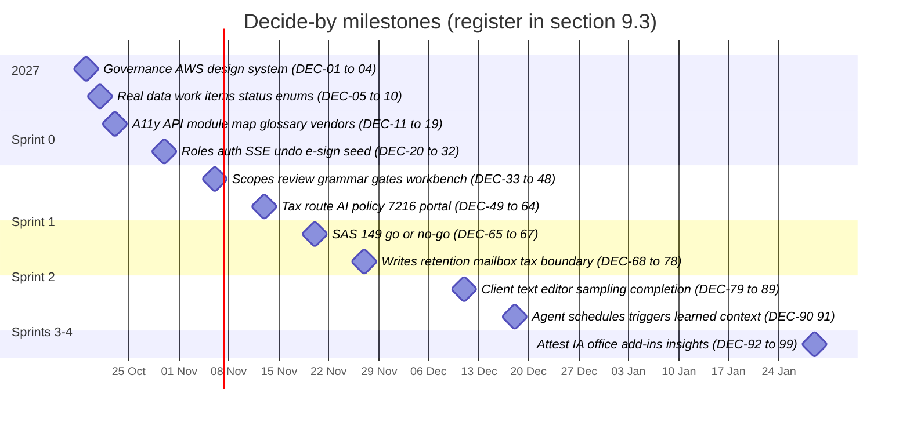
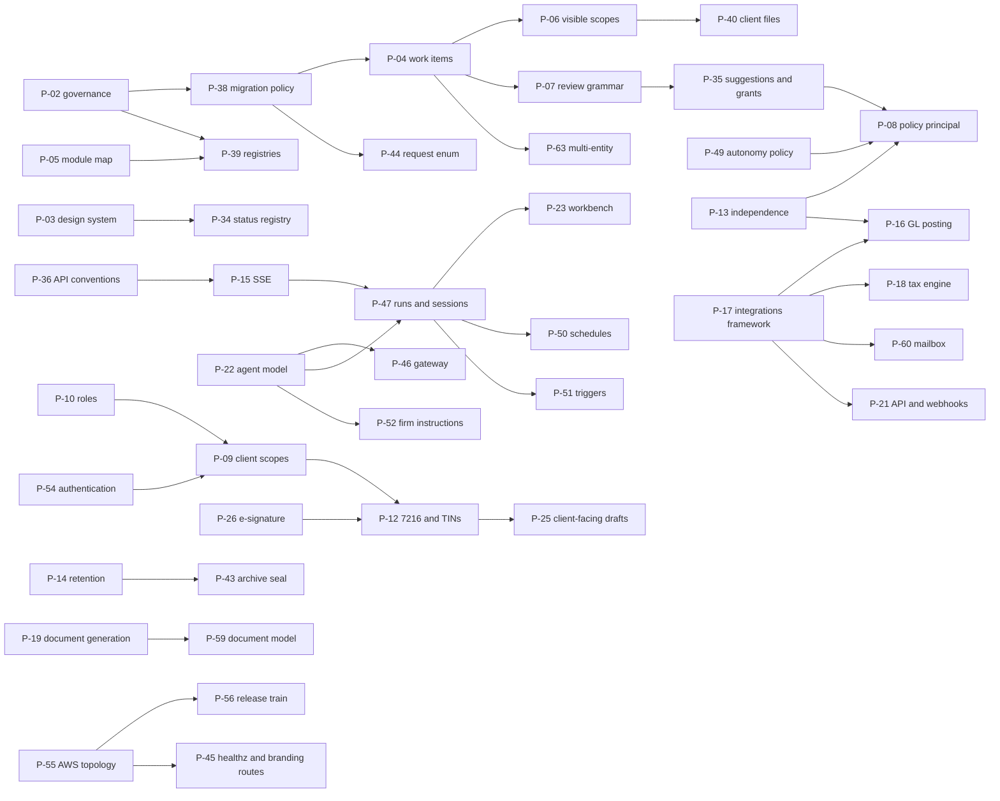

> **Solo edition (2026-10-20).** One builder, repo public, no approvals, reviews, rulesets, release-train windows or worktree cadence. `AMENDMENT-solo.md` and chapter 08 win over any other chapter on process. Ten governance-only F-01 tasks are removed from `backlog.csv`; its `lead` column is gone and a `status` column is added.

# 9 · Decisions, ADRs, glossary and design gaps

> **Chapter of the Accrued engineering & build plan.** Written Saturday 17 Oct 2026. Sprint 0 starts Monday 19 Oct 2026.
>
> **What this chapter is.** One de-duplicated register of everything the two founders must decide before or while Accrued is built on the `abacus` repo. Every other chapter and digest raised decisions under its own IDs:
> - ch. 02 `D-01…D-17`; ch. 03 `D-01…D-16` and proposals `P-34…P-45`; ch. 04 `FE-01…FE-26`; ch. 05 `AG-01…AG-17` and `Q1…Q16`; ch. 06 `D-OPS-01…21`;
> - the digests' `Q-01…Q-25` (domain model), `P-01…P-33` (repo ADRs), `D-DS-1…12` (design foundations), `C-01…C-17` (compliance), `E1…E15` (journeys), engine conflicts `#1…#18`, the 58-item gap register `G-A01…G-F06`, and section i of all 22 screen digests (S01…S22).
>
> Each item is mapped here to **one canonical ID**: `DEC-nn` for a decision, `P-nn` for an ADR, `DF-nn` for a design follow-up. Where chapters disagree, §9.2 settles it, and **this chapter wins**. The other chapters should be edited to match (the "Who edits" column says which).
>
> **Readers.** Both founders, and every Claude Code session. A session whose task touches an **open** decision stops and asks (§9.1.2).
>
> **Conventions.**
> - **PF** = product/design founder (ayushkbhatia). **TF** = technical founder (notanaskhan, red-zone owner). **Both** = both must sign. **Counsel** = outside lawyer; the named founder runs it.
> - ★ = blocks Sprint 0 or Sprint 1. **(inferred)** = this chapter's reasoning, not stated in any source. **[verify]** = a vendor, legal or pricing fact to confirm before a contract or code depends on it.
> - Paths are repo-relative to `github.com/notanaskhan/abacus` (HEAD `a42034c`). `ADR-nnn` = an accepted repo ADR. Screen IDs follow `catalog.tsv`.

---

## 9.0 The chapter in one screen

**Totals.** 101 decisions (`DEC-01…DEC-101`; DEC-100 and DEC-101 are added from ch. 01 §1.9), of which **12 are ★** (they block Sprint 0–1). 69 ADRs in the backlog (`P-01…P-69`; P-64…P-69 are added from the backlog tasks that draft them), 40 of them needed by Fri 13 Nov. One glossary pull request with 24 amendments, three reserved-word changes and 105 addition rows. 42 design follow-ups (`DF-01…DF-42`) for the product founder. 4 blockers and 16 majors from the handoff gap register, plus 8 majors found in the screen digests, each now assigned.

**The five decisions that reshape the plan.**
1. **DEC-05 real-data posture.** No real client data before the Phase-3 gate (SOC 2 Type I + pen test). The first real firm goes live in shadow mode on Tue 1 Jun 2027 (client-facing from Tue 13 Jul 2027). So there is no Jan–Mar 2027 change freeze, and every "before 1 Jan 2027" date becomes a design-partner demo date.
2. **DEC-07 engagement → work items.** An additive `work_items` supertype. Every non-audit screen depends on it.
3. **DEC-08 / DEC-09 status contract and request enum.** One generated status registry from blueprint §3.3.1. The repo's request codes are migrated, because repo `received` means Accrued "Uploaded – needs review".
4. **DEC-04 / DEC-11 design system.** "Atelier" is replaced in one cut, with an AA-adjusted ink ladder.
5. **DEC-46 integrations and write capabilities.** One framework ADR plus three adapter ADRs. `connections` stays read-only.

**Default-on-silence rule (recommended).** For engineering and product decisions, if no founder records a counter-decision by the decide-by date, the recommended answer stands and its ADR is drafted as written. Three kinds of decision never default:
- anything that spends money or signs a contract (vendors, auditor, pen tester);
- anything counsel must approve (§7216 consent text, Pub 1345 flows, offshore access, retention floors, DPA);
- red-zone ADRs. These need both founders' explicit approval (P-02).

**The 12 ★ decisions:** DEC-02 governance · DEC-03 AWS · DEC-04 design system · DEC-05 real-data posture · DEC-07 work items · DEC-08 status contract · DEC-09 request enum · DEC-11 accessibility · DEC-12 API conventions · DEC-13 module map · DEC-14 glossary · DEC-17 vendor applications.

---

## 9.1 How to use this register

### 9.1.1 Where each decision lands

A decision is finished only when it is written into the artefact that binds code. A row in this chapter does not bind code.

| Outcome | Artefact | Path | Enforced by |
|---|---|---|---|
| Architectural rule | ADR (template `docs/adr/_TEMPLATE.md`; `deciders:` lists GitHub handles; red zone needs both) | `docs/adr/ADR-1NN-<slug>.md`. Reserve the number by opening issue `ADR-1NN: <title>`; numbers are never reused | ADR header ("Accepted ADRs are binding"), reviewer agents, CODEOWNERS |
| Behaviour change to an approved spec | New SPEC that supersedes the clause | `docs/specs/SPEC-0NN-*.md` (next free SPEC-037) | Acceptance tests |
| Vocabulary | Glossary pull request (protected) | `docs/product/glossary.md` | `banned_patterns.py` (L12), ESLint copy rules (L1–L11) |
| Status words | Status registry → codegen | `docs/product/status-vocabulary.yaml` → `StrEnum`s, OpenAPI enums, `packages/ui/src/status.ts` | Exhaustiveness tests (L11) |
| Permissions | Matrix rows, split into per-module files after P-39 (protected) | `docs/architecture/permission-matrix.yaml` | Generated allow/deny tests |
| Firm content and defaults | Database rows through an admin screen or the scenario loader, never constants or migrations | `scenarios/brightwater_hale` (local and staging only) | User working agreement: "content belongs in the database" |
| Design change | Handoff revision by PF, plus the screen contract's Deviations section | Claude Design project; `docs/screens/<ID>.md` | Parity tests; revision checklist turned into tests |
| The decision record itself | GitHub issue titled `DEC-nn: …`, labelled `decision`, with the recommended answer pasted in. Close it with a link to the artefact **(inferred)** | GitHub issues | — |

### 9.1.2 Rules for Claude Code sessions

1. Before starting a screen or task, search this chapter and the `decision` issues for its screen IDs. If a matching `DEC-nn` is still open, **stop and ask**. Never pick an option yourself.
2. Never write code against a superseded ADR clause. The §9.4 table lists what each P-ADR supersedes.
3. Code identifiers come from §9.5. UI words come from the screen's copy registry, verbatim. If a concept has no glossary term, stop and propose one. This is the repo rule.
4. When a decision lands, update `docs/screens/<ID>.md` → *Deviations* for every screen in its "Blocks" column.
5. Never edit an accepted ADR. Write a superseding one.

### 9.1.3 Calendar and epic keys

Two-week sprints, as in ch. 06. Ch. 02's "Sprint 0 checklist" (Mon 19 – Fri 23 Oct) is **week 1 of S0**.

| Sprint | S0 | S1 | S2 | S3 | S4 | S5 | S6 | S7 | S8 | S9 | S10 | S11 | S12 |
|---|---|---|---|---|---|---|---|---|---|---|---|---|---|
| Dates | Oct 19–30 | Nov 2–13 | Nov 16–27 | Nov 30–Dec 11 | Dec 14–24 (train Fri Dec 18) | Jan 4–15 | Jan 18–29 | Feb 1–12 | Feb 15–26 | Mar 1–12 | Mar 15–26 | Mar 29–Apr 9 | Apr 12–23 |

The "Blocks" columns use the roadmap chapter's draft epic keys. Screen IDs are authoritative if the roadmap renumbers.

| Key | Epic (screens) |
|---|---|
| EP-01 | Foundations: repo hygiene, CI, infra, design-system tokens; no screens **(inferred)** |
| EP-02 | Templates and overlays: O1–O6, T1/T2/T7/T10/T11/T12/T15/T16, TPL specimens |
| EP-03 | Sign-in, firm switcher, settings frame, people: SHL-03/06, ADM-01/02 |
| EP-04 | Shell, palette, notifications, Home: SHL-01/02/04, HOME-01 |
| EP-05 | Clients and engagements core: CLI-01/02/04, ENG-01…04 |
| EP-06 | Binders and requests: BND-01…03, SHL-14, POR-20 |
| EP-07 | Client portal core: POR-01…05/09/12/14 |
| EP-08 | Signatures: SIG-01/02, POR-06 |
| EP-09 | Tax core: TAX-01/02/03/09/12 |
| EP-10 | Audit evidence wedge: AUD-01…03, SHL-08, SHL-20 |
| EP-11 | Security, consents, audit log: ADM-03/05/06/07 |
| EP-12 | Review grammar and human gates: SHL-07/09/10/11/12/15/16/18, HOME-02, T9 |
| EP-13 | Tax return workspace: TAX-04…07/10/13, TXI-01, CLI-05, T3, T6 |
| EP-14 | Inbox and Files: INB-01/02, FIL-01, T8 |
| EP-15 | Entity tax: TXP-00…13, POR-13, TAX-11/14, TXI-02/03, T17 |
| EP-16 | Trusts, estates, amended returns: TXT-01…04, TAX-16, POR-18 |
| EP-17 | Agent runs, integrations, AI policy: SHL-13, WB-09/10/11, TAX-08, ADM-04/08, T5 |
| EP-18 | CAS closes: CLS-01…13, POR-08/11/16, KNW-04 |
| EP-19 | Notices and client communications: NOT-01…03, INB-03/04, POR-07/10/19, ADM-10 |
| EP-20 | Practice depth: HOME-03, ENG-05/07/09, CLI-03/06/07/08, TAX-15, PRJ-01, KNW-05, T13/T14 |
| EP-21 | Workbench: WB-01…08, T4 |
| EP-22 | Audit planning and fieldwork: KNW-01…03, AUD-04…14/27/29, POR-17 |
| EP-23 | Audit completion and QM: AUD-15…26/28/30, POR-15, FIL-02, ADM-11/12 |
| EP-24 | EBP modules: EBP-01…09 |
| EP-25 | Engine (templates v2, Sheets, Board, triggers, Today): KNW-06/07, SHL-17/19/21/22/23, HOME-05, SHT-01…04, ENG-10…12, WB-12, T18/T19/T21 |
| EP-26 | Group audit and statements: AUD-31…38, FSP-01…06, ENG-13/14, POR-23, XLA-01, T20/T22 |
| EP-27 | Attest and internal audit: KNW-09/10, ATT-01…09, IAU-01…04, POR-21/22, BND-04 |
| EP-28 | Insights, practice economics, platform, developer: INS-01…05, WB-13, KNW-08/11/12, XLA-02, ADM-09/13/14, HOME-04, ENG-06/08, SHL-05, PLT-01 |

---

## 9.2 Conflicts between chapters, settled here

The chapters were written in parallel, so they disagree in places. Each row below picks one answer. The "Who edits" column says which chapter must change to match.

| # | Conflict | Positions | Settled as | Who edits |
|---|---|---|---|---|
| X-1 | **ADR proposal numbering.** Ch. 03 defines `P-34…P-45`. Ch. 06 drafts different proposals, also as `P-34…P-40`. Ch. 05 uses `AG-01…AG-17`. | Three overlapping schemes | Ch. 03's `P-34…P-45` keep their numbers. AG-only ADRs become `P-46…P-53`. This chapter's new ADRs are `P-54…P-63` (§9.4.1). Ch. 06's Appendix B proposals map to P-55 (AWS topology), P-56 (release train), P-62 (reference data) and parts of P-17, P-28 and P-43. Any further ops ADR takes the next free number after P-63 | ch. 06 Appendix B; ch. 05 §5.8.1 adds a P column |
| X-2 | **The 10-second Undo.** | Ch. 04 FE-13: deferred commit in the browser, no server undo endpoint. Ch. 03 §3.7.3 and ch. 05 AG-08: compensating event | **Compensating event plus effect hold** (DEC-24). The decision is written at once and is visible to others. External effects wait for `not_before = +10 s` on an approval grant. Undo writes `*.undone`. With a browser-side deferred commit, a decision is lost if the tab closes, and other viewers see stale state | ch. 04 FE-13, §7.5 |
| X-3 | **E-signature path.** | Ch. 02 D-12: native envelopes plus a bought KBA vendor. Ch. 03 P-26 and ch. 06 D-OPS-17: record mode, then DocuSign embedded with ID verification | **Record mode, then DocuSign embedded with provider-hosted KBA.** A native ceremony waits until 2028 (DEC-25). This carries a lighter Pub 1345 burden (C-06) and fits the first real tax season, the Sep/Oct 2027 extensions | ch. 02 D-12 |
| X-4 | **Sprint calendar.** | Ch. 02: Sprint 0 = Oct 19–23. Ch. 06: two-week S0 = Oct 19–30 | Two-week sprints. Ch. 02's checklist is S0 week 1 | ch. 02 §2.3.2 wording |
| X-5 | **Code name for close steps.** | Ch. 02 and ch. 03: `close_procedure` / `close_procedures`. Ch. 04 FE-22 and §4.8: `close_step` | `close_procedures`. The UI label "task" is allowed only on close-run surfaces. The component is `RunStepRow` | ch. 04 FE-22, naming map |
| X-6 | **IT/Security and tax roles.** | repo-adrs P-10: roles `it_security`, `tax_preparer`, `tax_reviewer`. Ch. 03 §4.2: firm role `security_admin`; tax preparer and reviewer as work-item functions | **Ch. 03.** This keeps the matrix small, and seasonal staff are just `level=seasonal` | digests only |
| X-7 | **§7216 gateway check count.** | Compliance digest and ch. 03: a "6th condition". Ch. 05: a "7th boundary reason" | One new boundary reason, `consent_7216`. It is the 6th *condition* beyond ADR-115's five. Ch. 05 counts *reason codes* | wording only |
| X-8 | **Statutory parameters.** | Ch. 03 D-13: versioned files in the repo. Ch. 06 D-OPS-20: platform reference data in the DB, never in commits | **Split** (DEC-76, P-62). Calendars that change often (due dates, holidays, postponements, 8879 tolerances, thresholds) live in DB reference sets published through PLT-01. Engine parameters pinned by golden tests (MACRS, brackets, §199A, PTET rates, plan limits) are repo files reviewed yearly with a CPA | ch. 03 §10, ch. 06 |
| X-9 | **The Jan–Mar 2027 freeze.** | Ch. 02 D-15: a schema-heavy cut-off on Dec 31 regardless. Ch. 05: everything lands by the Dec 18 train "before the freeze". Ch. 06: no freeze until a real firm is live | **No ADR-092 freeze until the first real firm goes live** (DEC-05, DEC-68). The Dec 18 train is a stability milestone for design-partner demos, not a freeze | ch. 02 D-15, ch. 05 §5.0 row 12 |
| X-10 | **SAS 149 urgency.** | Ch. 02 D-16 and the addendum: group audit before 1 Jan 2027. Ch. 06: a demo deadline only | At plan velocity the first real SAS 149 season is Dec-2028 year-ends (DEC-65). AUD-31 single-entity mapping lands in A-03 (S20–S23, Jul–Sep 2027), not by Dec 18. Dec-2027 year-ends stay the M8 alternative, or with the M12 hires | ch. 02 D-16 |
| X-11 | **Invitation expiry.** | Client invites: SPEC-015 says 7 days, design POR-01e says 14. Staff invites: repo says 14 days, design ADM-02 says 7 | **14 days, single-use, for both** (DEC-35). ADM-02 copy changes (DF-24) | ch. 02 D-17 (consistent) |
| X-12 | **Portal domain.** | Ch. 04: `<slug>.portal.accrued.app` (inferred). Ch. 06: a neutral portal domain | **Neutral domain.** A portal URL containing "accrued" breaks white-labelling (DEC-59) | ch. 04 §1.3 |
| X-13 | **"Decision" objects.** | Ch. 03: `decision_cards` + `decisions` (owned by `review`). Ch. 05 and the ai-agents digest: `decision_requests` (owned by `agents`) | **One object.** Runs raise `decision_cards` through `review.api.raise_decision_card()`, and a run's "Blocked on decision" points at one. There is no `decision_requests` table **(inferred)** | ch. 05 §5.3.11 and glossary |
| X-14 | **`proposal` in the glossary.** | Repo glossary bans "proposal" as a synonym of suggestion. Ch. 03/05: `proposals` = an agent change set. ENG-09: a commercial proposal | `proposal` = an agent change set (glossary amended). The ENG-09 commercial proposal is `fee_proposals`. The repo's `RollForwardProposal*` classes are left as they are | §9.5 |
| X-15 | **Who drafts P-26.** | Ch. 02: needed Fri 6 Nov. Ch. 03: needed Oct 30 | **Fri 30 Oct.** The vendor clock (DocuSign Go-Live, ID verification) sets the date | ch. 02 D-12 |
| X-16 | **Evidence acceptance by staff.** | Design: Ana Cruz (Staff) approves on AUD-03. Q-09 and ch. 03: `evidence.accept` is senior+ | Senior+ by default. Firm setting `staff_can_accept_evidence`, seeded **on** for Brightwater Hale so the AUD-03 design holds (DEC-37) **(inferred)** | ch. 03 §4 |
| X-17 | **Binder cardinality.** | Ch. 03 §3.4: a binder (`request_lists`) is 1:1 with a work item (blueprint ER). BND-01 shows "2025 Binder pt 2" and 17 second-part binders | **1:n per work item** (DEC-31). `request_lists.part` orders them | ch. 03 §3.4 |

---

## 9.3 Decision register

Rows are ordered by decide-by date. "Blocks" names epics and screens that cannot be contract-frozen until the decision lands. "Aliases" lists every ID the same question had elsewhere, so a reader of any chapter can find it.

### 9.3.1 Sprint 0, week 1 (Mon 19 – Fri 23 Oct)

| ID | By | Decision needed | Options | Recommended answer, and why | Blocks | Owner | Aliases |
|---|---|---|---|---|---|---|---|
| DEC-01 | Mon 19 Oct | Product name vs code namespace | (a) "Accrued" product, `abacus` code; (b) rename the code to `accrued` | **(a).** A rename touches about 120k lines, every protected-path list and both founders' branches, for no user value. "Accrued" appears in all UI, docs and `AGENTS.md`. The portal and client emails never show it. Add a glossary entry: "Abacus: internal code namespace; never user-facing" | `AGENTS.md` rewrite (S0-17), glossary, all copy; EP-01 | Both (PF drafts) | P-01, ch02 D-01 |
| DEC-02 ★ | Mon 19 Oct | Two-founder governance and decision rights | (a) keep the solo-founder rules; (b) cross-founder review with split rights | **n/a, solo edition (2026-10-20): `AMENDMENT-solo.md` items 1 to 4 void two-founder governance.** Original recommendation, kept for the record: **(b).** "Founder" means either founder. The non-author approves every PR (CODEOWNERS `*`). Red-zone ADRs need both. PF owns scope, screens, copy, UI vocabulary and flag enablement for design partners. TF owns architecture, security, red-zone code, infra, migrations, the provider-terms register and production approval. Move the repo to an org on the Team plan, private from day 1, with a ruleset (code-owner review, stale-approval dismissal, linear history). `_protected.py` accepts both handles. ADR, SPEC and TASK numbers are reserved by issue | Every PR; S0-02…S0-05, S0-11 | Both | P-02, ch02 D-02, D-OPS-15, D-FE-10 |
| DEC-03 ★ | Mon 19 Oct | AWS foundation for TASK-014 | Region: us-east-1 (repo examples) or us-east-2/us-west-2 (design copy). Account layout. Where Terraform state lives | AWS Organizations + Control Tower, with accounts `management`, `log-archive`, `audit`, `shared`, `staging`, `production`. **us-east-2 primary, us-west-2 DR.** This matches the ADM-06/PLT-01 copy and resolves C-16. Terraform state in S3 with a lock table in `shared`. Budget alarms. It unblocks staging, KMS, SES, Bedrock and WorkOS | TASK-014, S0-15/16; EP-01, EP-03, EP-17 | TF | ch02 D-03, D-OPS-02/03, C-16, S06 Q8 |
| DEC-04 ★ | Mon 19 Oct | Replace the repo's "Atelier" UI (SPEC-016) | (a) wholesale, in one cut; (b) a theme switch during migration | **(a).** One cut behind a codemod in DS-S1, weeks 1–3. A new design-system spec supersedes SPEC-016 §4, and P-03 supersedes only ADR-011's "shadcn as the base" clause. Keep `AgentText`, `cn`, cva, Radix behaviour, the CSP plugin and the lint rules. Two visual systems in production is the worst outcome | Every screen; DS-S1…S4; EP-02 | PF → TF | P-03, FE-01, D-DS-1, S03 Q1, S04 Q1 |
| DEC-05 ★ | Wed 21 Oct | Real-data posture and the 2027 service-line sequence | (a) compressed: pen test in Dec, Type I in Jan, real pilot in Feb, freeze all Q1; (b) respect the Phase-3 gate | **(b).** Production with a synthetic canary on Fri 11 Dec. SOC 2 Type I as of Mon 1 Mar 2027. **First internal shadow Tue 1 Jun 2027; client-facing Tue 13 Jul 2027; the Fri 16 Apr 2027 real-data gate is unchanged, with no exception path** (decided 2026-10-20; ch. 01 §1.9 dates). The consequences:  • no ADR-092 freeze in Jan–Mar 2027;  • the "before 1 Jan" dates become demo dates;  • the first real workloads (Jun–Aug 2027) are CAS closes, June and September year-end audits, EBP/5500 work and notices;  • the first real tax work is the 2027 extension season;  • the first real calendar-year audit, 1040 season and SAS 149 group audits are Jan–Apr 2028.  Sequence: MVP-1 spine and audit wedge first. Tax core and Workbench are pulled ahead of repo Phase 5 and built on synthetic data from Nov to Feb. CAS posting ships before May | Roadmap and every epic's priority; DEC-65, DEC-68 | Both | D-OPS-01, ch02 D-15/16, S07 Q9/Q10, S12 Q1, S13 Q7, S15 Q1 |
| DEC-06 | Wed 21 Oct | Migration policy before go-live | (a) strict expand/contract now (ADR-091); (b) single-migration breaking changes until the first real firm | **(b).** One reversible migration per breaking change until the first non-synthetic firm is live; strict ADR-091 afterwards. CI checks for a single Alembic head. Put `[mig NNNN]` in the PR title; whoever merges second renumbers. This lets work items, the request enum and the `audit`→`fs_audit` rewrite each land in one step | First migration (0056+); DEC-07, DEC-09 | TF | P-38, ch02 S0-11 |
| DEC-07 ★ | Wed 21 Oct | Engagement vs work item | (a) a `work_items` supertype under engagements; (b) one engagement per return, close or notice; (c) a new parent contract table | **(a), additive.** `engagements` becomes the contract: an 8-state lifecycle, `service_line`, and a new `type` enum (`audit` is rewritten to `fs_audit`; add `preparation`; keep AUP). `work_items` has kinds `assurance · tax_return · close · notice · advisory_project`, with subtype tables owned by the service-line modules. `engagement_id` stays on every row, so `visible()` and the foreign keys keep working. A tax engagement is per relationship or letter, and the entity lives on the work item (Q-22). The seed needs 1:n: Copperleaf has 12 closes and Thornbury has 4 returns | Every non-audit screen; ENG-01…03, AUD-02, TAX-02, CLS-02, NOT-02; EP-05, EP-09, EP-10, EP-13, EP-18, EP-19 | TF (PF reviews) | P-04, Q-01, Q-03, Q-22, ch02 D-04, ch03 D-03, G-F05, E13, S07 Q1 |
| DEC-08 ★ | Wed 21 Oct | Which status vocabulary is the contract | (a) blueprint §3.3.1 + addendum §3.2 + gap §6.5; (b) handoff `lib/status.js`; (c) repo enums | **(a).** Authored once in `docs/product/status-vocabulary.yaml`, then generated into backend `StrEnum`s, OpenAPI enums and `packages/ui/src/status.ts`. Keep only the visual tables from `status.js`. Support context labels ("Draft" on 1040/1041, "Working" on entity returns). `lib/status.js` was drafted without §3.3.1 and conflicts on 17 objects | Every pill, tile, filter and enum; DS-S2; EP-02 | PF (data) → TF (codegen) | P-34, Q-02, D-DS-3, FE-06, G-D02 |
| DEC-09 ★ | Wed 21 Oct | Request status enum | (a) migrate the stored codes; (b) a mapping layer | **(a).** Codes become `draft · requested · uploaded · received · returned · not_applicable`, with `overdue` derived, plus the close and client label sets. Repo `received` means Accrued "Uploaded – needs review", and leaving that inversion in code is a correctness hazard. One pre-launch migration (P-44) through the REVIEW-001 paths, also adding reason code `wrong_document` | AUD-03, BND-01…03, POR-03/04, SHL-14, SHL-20; EP-06, EP-07, EP-10 | TF | P-44, Q-04, ch02 D-06, S08 #9/#10, S20 #14 |
| DEC-10 | Wed 21 Oct | Coverage floor if `main` is below 95 % | (a) back-fill first; (b) a dated exception | **(a).** Back-fill first. Use a dated exception, with a ratchet back to 95 % by 1 Dec, only if back-fill costs more than 2 founder-days | The S0-06 required check | TF | ch02 D-08 |
| DEC-11 ★ | Fri 23 Oct | WCAG 2.2 AA vs the handoff ink ladder | (a) axe exceptions; (b) an AA-adjusted ladder | **(b).** Text ink-2 at .70, ink-3 at .66, match text `#7E4590`, focus outline at .55. `data-contrast="reference"` only for parity runs. The SPEC-016 AC-10 axe gate stays. Today ink-3 measures 3.18–3.58:1 and the focus ring 1.81:1 | The first Accrued screen; DS-S1 tokens | PF (look) → TF (policy) | D-DS-2, FE-02, ch02 D-07, D-FE-4, component-kits UI-3 |
| DEC-12 ★ | Fri 23 Oct | API conventions for parallel work | (a) decide per PR; (b) one convention ADR | **(b) P-36.** REST under `/v1`. One list envelope `{items, next_cursor, total, counts, facets}`. Record projections carry server-computed `allowed_actions`. `Idempotency-Key` on every external effect. Fixed error codes with identifier-only `facts`. Contract-first: a 501 stub + matrix action + flag + `make generate` PR merges the same day | Every FE/BE pair from S1; EP-04, EP-05 | TF | P-36, D-FE-6, D-FE-12, ch03 D-09 |
| DEC-13 ★ | Fri 23 Oct | Module map and protected registries | (a) 13 modules and ad hoc growth; (b) the 29-module map with per-module registry files | **(b).** P-05 adds 16 modules: methodology, review, collaboration, workpapers, adjustments, signatures, integrations, reporting, assurance, attest, tax, closes, notices, workbench, practice, portal. P-39 splits the registries and the matrix per module. One S1 pre-registration PR covers `ROUTERS`, `TABLE_OWNERS`, `MODULE_DEPENDENCIES`, import-linter, worker `MODULES`, matrix sections and flags | The first new table; the S1 pre-registration PR; EP-01 | TF | P-05, P-39, ch03 D-02, S22 Q1, engine #3 |
| DEC-14 ★ | Fri 23 Oct (merge Fri 30 Oct) | Glossary change set | (a) many small edits; (b) one protected PR | **(b), as specified in §9.5.** UI labels follow Accrued; code identifiers follow the amended glossary. Without it, every Claude Code session refuses Accrued words or invents synonyms | The first Accrued backend PR; EP-01 | PF drafts → TF approves | ch02 D-10, FE-22, P-01, engine #13, E11 |
| DEC-15 | Fri 23 Oct | Design-system details | As D-DS-3…12 | **Adopt as recommended:**  • casing: Title Case for nav, tab and button labels; sentence case for content; designed copy verbatim from the copy registry;  • numbers: zero shows "—" by default, with an `explicit` `$0.00` option; percent drops a trailing ".0"; halves round away from zero;  • icon stroke in viewBox units; `--spacing: 1px` plus a ×4 codemod, renaming `bg-surface` → `bg-card` first;  • portal mobile uses a bottom tab bar; the firm app's minimum width is 1280; light theme only, with forced-colors support;  • "Secured by Accrued" is off by default;  • baselines live in a private bucket, with about 15 smoke baselines committed;  • built kits win over A8;  • no blur; scrim tokens at .22, .28 and .30 | DS-S1/S2; EP-02 | PF | D-DS-3…12, FE-07…10/18/19/25/26, G-D01/06/08/09 |
| DEC-16 | Fri 23 Oct (fonts) · Fri 30 Oct (rest) | Dependency batch (the allowlist is protected) | (a) piecemeal; (b) one batch | **(b).**  • FE: `@fontsource/geist`, `geist-mono`, `arimo`, `gelasio`, `@tanstack/react-table`, `@tanstack/react-virtual`, `@dnd-kit/*`, `@tiptap/*`, `cmdk`, `date-fns`, `react-day-picker`.  • BE: WeasyPrint, python-docx, boto3 (Textract), `pillow-heif`, the `pg_trgm` and `btree_gin` extensions.  • Not: Storybook, MSW, pdf.js, SheetJS, AG Grid, Recharts, Yjs, Redis, agent frameworks | DS-S1 fonts; T18/T19/T20; P-19, P-32 | PF approves FE → TF installs; TF owns BE | FE-20, D-FE-8, component-kits §4 |
| DEC-17 ★ | Fri 23 Oct | Long-lead vendor and partner applications | (a) apply when needed; (b) apply now | **(b), start in S0.** PF handles forms and commercial terms; TF answers security questionnaires.  • Apply now: Wolters Kluwer CCH partner programme, DocuSign developer → Go-Live with ID Verification, WorkOS contract, Microsoft publisher verification (Graph mail), SES production access, Bedrock access and quotas, Temporal Cloud, Intuit production keys and App Partner tier, the compliance tool, SOC 2 auditor and pen tester shortlists, counsel engagement.  • Apply only on discovery evidence: Xero, NetSuite SDN, Google CASA.  These approvals, not code, set the critical path | EP-08, EP-09, EP-14, EP-17, EP-18; SOC 2 | PF (+TF) | integrations §0.7, D-OPS-16, ch02 §2.3.2, S19 risk |
| DEC-18 | Fri 23 Oct | Handoff material in git | (a) out-of-repo paths only; (b) a text mirror | **(b), once the repo is private.** Add a text-only mirror under `docs/design/handoff/` (spec, revision and README files, `screen-index.json`) and `docs/design/HANDOFF_VERSION`. PNGs never go in git (1.1 GB). Sessions find the images through `ACCRUED_HANDOFF_DIR` | The `build-screen-from-handoff` skill | Both | FE-21, D-FE-9, G-E05 |
| DEC-19 | Fri 23 Oct | Scope guardrails as code rules | — | **Adopt D1–D10 and X-01…X-08 as build rules.**  • No tables, enums, engagement types, seed rows or new "Coming soon" cards for excluded areas. Single audit stays "Coming soon" (D10). BSA/AML exists only as an IA template (X-01b).  • 13 nav items, enforced by a test (D4). One agent; library agents may have functional names ("Request Chaser"), always attributed "‹person› via Agent" (D7).  • No peer benchmarks (D6) and no licensed publisher text (D8). | All epics | PF | Q-25, D1–D10, X-01…08, R4/R5/R12, S15 (Close Planner naming) |

### 9.3.2 Sprint 0, week 2 (by Fri 30 Oct)

| ID | By | Decision needed | Options | Recommended answer, and why | Blocks | Owner | Aliases |
|---|---|---|---|---|---|---|---|
| DEC-20 | Fri 30 Oct | Firm Admin access to client content (Grace Holloway runs intake, binders and envelopes) | (a) firm admins self-join engagements; (b) an engagement role `client_service`; (c) supersede ADR-024 | **(b).** ADR-024 is unchanged. `client_service` covers binders, invitations, envelopes, request status and file *names*, plus a firm-level intake scope. Under that scope it may read inbound messages and attachments **until they are filed**. It cannot open filed evidence or workpapers **(inferred boundary)** | BND-01…03, INB-01…03, SIG-01/02, POR-20, ADM-02, TAX-12 packet; EP-06, EP-08, EP-14 | TF (PF reviews) | Q-07, P-10, ch02 D-09, S18 #3/Q4, S19 #10 |
| DEC-21 | Fri 30 Oct | Role catalogue | (a) blueprint job roles as matrix roles; (b) two axes plus work-item functions | **(b), as in ch. 03 §4.2.**  • Firm roles: add `security_admin`.  • Engagement roles: add `eqr_reviewer`, `specialist` and `client_service`. Repo `reviewer` stays a read-only QC role (Q-06).  • Membership attributes: `level` (partner, manager, senior, staff, seasonal, admin), `office_id`, `offshore`, `service_lines`.  • Tax Preparer and Tax Reviewer are work-item **functions**, not roles.  • Firm overrides may only make the matrix stricter; the ADM-02 role templates write those overrides | ADM-02, SHL-03d, SHL-06f, SHL-16 approval, all matrix work; EP-03, EP-11, EP-12 | TF | P-10, Q-06, C-14, E12, S01 #4, S12 Q7, S14 Q10, S21 #2 |
| DEC-22 | Fri 30 Oct | Staff and client authentication | (a) hosted WorkOS pages; (b) in-product T15 on WorkOS APIs; (c) keep ADR-030's password option | **P-54: WorkOS AuthKit**, committed commercially in S0.  • Staff: SSO, or a passwordless email code plus mandatory MFA (TOTP or passkey). The password option is dropped. Firm sign-in starts on hosted pages; T15 comes later.  • Portal: in-product T15 through a BFF session.  • Refresh tokens live in an httpOnly cookie behind the BFF.  • Lockout, IT/Security unlock and 30-day trusted devices live in `identity` | SHL-06, POR-01, ADM-06; TASK-014 P5; EP-03, EP-07 | TF (PF commercial) | FE-15, D-FE-3, S01 #5, S03 Q2, S21 Q8, ADR-029/030 |
| DEC-23 | Fri 30 Oct | Real-time transport | (a) polling only; (b) SSE; (c) WebSockets | **(b), polling first.** `GET /v1/events` runs through `AbacusRouter` with action `events.subscribe`. It carries identifier-only invalidation events from the outbox, filtered by `visible()`. Presence uses `POST /v1/presence` and an UNLOGGED heartbeat table. Polling is the fallback. No WebSockets and no CRDT in v1 | SHL-04, SHL-13, WB-01/03, C-28 presence, BND-02 live status; EP-04, EP-17, EP-21, EP-25 | TF | P-15, AG-06, ch02 D-11, FE-12, D-FE-5, engine #11 |
| DEC-24 | Fri 30 Oct | 10-second Undo vs insert-only decisions | (a) deferred commit in the browser; (b) server compensating event plus effect hold | **(b).** The decision row is written at once, so it survives a closed tab and others see it. Any external effect (post, send, export, envelope, file save) runs through an approval grant with `not_before = +10 s`. Undo inside the window writes `*.undone` and voids the grant. Undo is unavailable once an effect has started. Human gates are never optimistic in the UI | Overlay/toast store (E3), SHL-04/10, TAX-08, WB-03e, CLS-07; EP-12 | Both | P-35, AG-08, FE-13 (amended), ai-agents Q8, S01 #7, S12 #10, X-2 |
| DEC-25 | Fri 30 Oct | E-signature strategy (the vendor clock sets the date) | (a) native ceremony + bought KBA; (b) DocuSign embedded + ID Verification; (c) record mode only | **Record mode first, then (b)** behind an `EnvelopeProvider` port.  • Record mode imports the evidence package from the firm's own provider (SPEC-025's philosophy).  • (b) is live before the 2027 extension season. A native T16 ceremony with its own KBA vendor waits until 2028.  • 8879 family: KBA required, SMS refused. Three failed KBA attempts route to a handwritten signature, **not** a 24-hour lockout.  • Store the ESIGN/ERSD consent.  • Supersedes SPEC-025 Q2 | SIG-01/02, POR-06, ENG-04, TAX-12, AUD-21, ADM-05; EP-08 | Both + counsel | P-26, ch02 D-12, D-OPS-17, C-05/06, E1, S03 Q4, S18 Q1, S19 Q9, X-3 |
| DEC-26 | Fri 30 Oct | SOC 2 and pen-test programme | (a) defer; (b) start now | **(b).** Compliance tool (Drata recommended [verify price]). The auditor must not be a design-partner firm. Type I as of Mon 1 Mar 2027. Pen test 15 Feb – 5 Mar 2027. Type II window May–Jul 2027 | The Phase-3 gate; DEC-05 | TF (controls) + PF (vendor, legal) | ch02 D-14, D-OPS-16, CMP-11 |
| DEC-27 | Fri 30 Oct | Demo clock, seed scenario and the synthetic marker | (a) keep `now()` and the "(Synthetic)" suffix; (b) a clock abstraction plus a firm flag | **(b) P-37.**  • `abacus.kernel.clock` replaces the 51 direct `now()` calls. The demo clock defaults to Mon 14 Sep 2026, 9:24 AM CT.  • `scenarios/brightwater_hale` replays a dated event timeline (epochs E0/E1/E2) through the service APIs, on local and staging only.  • The firm carries `firms.synthetic = true` instead of name suffixes (amends SPEC-001 AC-14).  • Fixtures: a TypeScript seed now, the Python scenario later, served in the existing fetch-swap fixture mode (no MSW) | Seed, parity, journey E2E and fixtures; every epic | TF (PF fixtures) | P-37, FE-11, D-FE-7, G-E01/E02/E03, G-B05/B06 |
| DEC-28 | Fri 30 Oct | Generic suggestions, proposals and approval grants | (a) per-feature tables; (b) generic tables | **(b) P-35.**  • Atomic `suggestions`, grouped into `proposals` + `proposal_rows` change sets.  • Single-use `approval_grants` for writes that run after approval.  • The repo's typed tables (`screening_results`, `upload_reviews`, `inbox_match_proposals`, `guidance_drafts`) stay and project into `human_gates`.  • Actor kind `policy` is added but dormant | SHL-10, SHL-19, SHT-04, TAX-08, CLS-07; EP-12, EP-17, EP-25 | TF | P-35, AG-08, ch05 Q4, engine #8, S04 risk |
| DEC-29 | Fri 30 Oct | Comments: ADR-109 append-only vs SHL-18's Edit/Delete/Resolve | (a) supersede ADR-109 and allow edit/delete; (b) stay append-only | **(b), with P-42.** Resolve and Reopen are thread events. Anchors are polymorphic (`anchor_kind`, `anchor_id`) and still version-pinned. "Edit" becomes "Correct…", a follow-up comment marked as a correction. "Delete…" becomes an admin "Redact…", using the existing `comment_redactions`. Comments move to `collaboration`. Component auditors and clients join threads through scoped grants | SHL-18, POR-04, FSP-01, SHT-01 row drawer, AUD-17; EP-12, EP-25 | PF (design) + TF | P-42, Q-10, engine #4–6, S02 Q1/Q2, S22 #9 |
| DEC-30 | Fri 30 Oct | Offices | (a) a filter only; (b) an access boundary | **(a).** First-class `offices` in `organisations`, with `office_id` on memberships, engagements and work items. Walls and teams remain the only ways to exclude people | HOME-01/04, INS-*, TAX-01, ADM-02, chips on T1/T11/T13/T21 | TF | Q-21, S03 Q8, S05 #22, S08 Q8 |
| DEC-31 | Fri 30 Oct | Binder cardinality | (a) 1:1 per work item (blueprint ER); (b) 1:n | **(b).** `request_lists` gains `work_item_id`, `kind`, `name` and `part`. Drop the one-list-per-engagement rule, because BND-01 shows "pt 2" binders. Lands with P-44 | BND-01…03, TAX-02, POR-03, CLS-03; EP-06 | TF | S06 #7/Q2, S12 Q6 |
| DEC-32 | Fri 30 Oct | How to fill the two undesigned screens (CLI-03, WB-05) | (a) new Claude Design boards; (b) engineering composes them from existing kits, with a PF review | **(b) for both.** WB-05 is composed from the C-11 "Details…" dialog, the T4f agent detail and the O2 drawer grammar (DF-01). CLI-03 promotes the TPL-14 specimen (DF-02). Each gets a one-day PF review instead of a full design pass | WB-04/06/07, PRJ-01, ENG-11, WB-13 (EP-21); CLI-02, TAX-02, TXP-12 (EP-20) | PF | G-A01/A02, E8, S06 Q9, S16 Q13 |

### 9.3.3 Sprint 1 (by Fri 6 Nov and Fri 13 Nov)

| ID | By | Decision needed | Options | Recommended answer, and why | Blocks | Owner | Aliases |
|---|---|---|---|---|---|---|---|
| DEC-33 | Fri 6 Nov | `visible()` beyond engagements; client-level files; cross-engagement links | (a) a "permanent file" pseudo-engagement; (b) declared scope kinds | **(b).**  • P-06 scope kinds: `engagement · work_item · client · client_entity · portal_scope`.  • P-40 client-scoped evidence: `client_id NOT NULL`, nullable `engagement_id`. A user may read it if they can read content on at least one non-walled engagement of that client.  • Cross-engagement fulfilment within one client is allowed, guarded by a trigger. Reuse is a reference, never a copy (SHL-21, ATT-08) | HOME-01, CLI-01, INB-01, FIL-01, SIG-01, POR-02, SHL-21, ATT-08; EP-04, EP-05, EP-14 | TF | P-06, P-40, Q-08, S02 #5/Q3, S22 #4 |
| DEC-34 | Fri 6 Nov | Client identity, scopes and portal MFA | (a) engagement-scoped grants (ADR-002); (b) scoped grants plus link principals | **(b) P-09.**  • `client_access_grants`: 12 roles × 9 scope kinds, `document_classes[]` and role union.  • Link principals (signed link + email OTP, one object) for POR-17 respondents and POR-18 intake. The POR-19 QR hand-off is a 10-minute capture session.  • **MFA is required** for TRI-bearing, signing and approving scopes (amends ADR-030; Safeguards 314.4(c)(5)).  • A third-party grant names a person; the organisation is an attribute | POR-01…23, CLI-04, ADM-06; EP-07, EP-19, EP-26 | TF | P-09, C-08, R-29, S19 Q3, S20 #15/20/22, D-FE-1 |
| DEC-35 | Fri 6 Nov | Invitations, sign-in codes and lockout | (a) SPEC-015: 7 days, 10 failures per hour; (b) the design: 14 days, 3 codes then a 15-minute lock (CLI-04 says 5) | **Reconciled:** 14-day single-use invitation links for clients and staff, with resend. A sign-in code expires in 10 minutes and allows 5 attempts. Three failed codes trigger a 15-minute lock. Unlock by waiting or by a firm admin. Trusted devices last 30 days **(inferred)** | POR-01, CLI-04, ADM-02, SHL-06; EP-03, EP-07 | PF → TF | ch02 D-17, S04 #12, S06 #17, S19 #7/Q4, X-11 |
| DEC-36 | Fri 6 Nov | Review grammar: sign-offs, notes, issues, decisions, checkpoints | (a) generalise `review_decisions`; (b) a new red `review` module | **(b) P-07.**  • `sign_offs` L1–L5 with a content hash; staleness is computed, never updated.  • `review_notes` block L2 and above.  • One cross-module `issues` service. `decision_cards` + `decisions`, `checkpoints` and `field_value_versions`, all feeding a `human_gates` projection.  • Level names are fixed; the *required* levels per object come from firm standards (Q-18).  • One sign-off target model covers workpapers, TB lines, sheet rows, statements and return sections.  • Designed workpapers get deterministic cell addresses that mirror the Open-in-Excel layout (`EBP-04!C14`) | SHL-07…12/15/16, HOME-02, AUD-17, TAX-05/07, TXP-10, CLS-06, SHT-01; about 60 % of P0 screens; EP-12 | TF | P-07, Q-18, engine #7, S01 #6, S08 Q5, S09 #8/Q3, S10 #2/Q2, S13 risk, S03 Q10 |
| DEC-37 | Fri 6 Nov | Who approves source documents | (a) staff (design); (b) senior+ (repo) | **Split the action.** `document.approve` (tax preparation) goes to the preparer function and above, staff included. `evidence.accept` (audit) is senior+ by default; staff may accept when the firm setting `staff_can_accept_evidence` is on. Seed it on for Brightwater so AUD-03 matches the design **(inferred setting)** | AUD-03, TAX-03/04, SHL-08; EP-10, EP-13 | Both | Q-09, S08 #11, X-16 |
| DEC-38 | Fri 6 Nov | Rights to create, publish and approve | Design vs the repo matrix |  • `request_item.create/send`: staff and above, inside a published binder (SHL-14).  • `request_list.publish`: manager and above; senior and `client_service` by firm setting.  • `engagement.create`: `level_in(partner, manager)`, plus `firm_setting(seniors_can_create)`. Agents only suggest, via the season manifest.  • `methodology.read`: extended to engagement members for the steps pinned to their engagement.  • TAX-12 delivery packet: approved by the signer or a manager; `client_service` prepares and sends it after approval | SHL-14, BND-01, ENG-03/07/14, TAX-12, SHL-07; EP-05, EP-06, EP-09 | Both | S02 Q6, S07 #7/Q4, S08 #14, S12 TAX-12 note, domain-model §3.4 |
| DEC-39 | Fri 6 Nov | Engagement lifecycle, acceptance order and gates G1–G3 | (a) the repo order: acceptance after creation, letter optional, G2 hides all client data; (b) the design | **(b).**  • Prospect engagements exist before acceptance. G1 is decided per client or entity before "Next" on ENG-03.  • G2: an unconfirmed member may *view*, but cannot be assigned work, sign off or act client-facing. A firm setting may make G2 stricter, never looser.  • G3 is strict: the letter must be signed by both parties before portal requests (except `intake` binders) and billing. A firm setting `not_required_this_year` covers exceptions.  • Gates may only become stricter | ENG-02…05, CLI-07/08, SHL-12, POR-18; EP-05, EP-20 | Both | Q-16, C-07, S06 #11, S07 #4/#5/Q3, J02 |
| DEC-40 | Fri 6 Nov | Workbench before repo Phase 5 | (a) keep the plan (command bar in Phase 5); (b) amend it | **(b) P-23.** Amend `build-plan.md` and ADR-063. Sessions are a conversational front end to typed tool plans. Three loop agents meet ADR-057's trigger: the session assistant, the engagement planner and the procedure session. The first runnable library agents are Request Chaser, TB Tie-Out and Season Progress Reporter, on the synthetic seed. Model features stay synthetic-only until each is cleared | WB-01…09, SHL-13, HOME-05; EP-17, EP-21 | Both | P-23, AG-04, ai-agents C-1, S16 Q1/Q3 |
| DEC-41 | Fri 6 Nov | Agent model, structured output, gateway | — |  • **P-22:** capability specs live in code (ADR-047). Firm agent definitions can only narrow them. Engagement-bound agents ("Evidence screening", "Unrecorded liabilities tester") are system templates in a WB-06 "Engagement agents" segment.  • **P-24:** a closed `AgentBlocks` schema. No model markup; numbers come by reference.  • **P-46:** `ai_gateway.converse()` with tool use. No token streaming to browsers | WB-*, SHL-13, TAX-08, SHT-04, KNW-11; EP-17, EP-21, EP-25 | TF | P-22, P-24, P-46, AG-01/02/05, ch05 Q9, ai-agents C-5/C-6, E6, S16 #2/Q2 |
| DEC-42 | Fri 6 Nov | OCR and search | — |  • **P-32:** Amazon Textract inside the AWS boundary, with a provider-terms entry. Output is a derived record, and its word boxes feed bbox citations.  • **P-33:** Postgres search (`tsvector`, `pg_trgm`, pgvector) under RLS and `visible()`. It indexes metadata only, never Restricted content | SHL-02, SHL-08, TAX-03, POR-19, INB-02, TXT-01, CLS-05; EP-04, EP-13, EP-14 | TF | P-32, P-33, S14 Q4, S15 #7 |
| DEC-43 | Fri 6 Nov | Disclosing ethical walls | (a) show "n hidden by an ethical wall" (SHL-02e, ADM-03, SHL-21, J25); (b) 404 semantics | **(b) everywhere.** SPEC-002 AC-4 stands, and nobody sees hidden counts, admins included, because a count leaks existence. The design copy is removed (DF-14) | SHL-02, ADM-03, SHL-21; EP-04, EP-11 | PF accepts → TF | S01 #3, S21 #8/Q4 |
| DEC-44 | Fri 6 Nov | Deterministic document generation | WeasyPrint, Typst or headless Chromium | **P-19.** A `reporting` module using WeasyPrint (PDF), python-docx (DOCX) and openpyxl, with pinned fonts (Arimo, Gelasio, Geist Mono) and byte-identical golden tests. The spike result is due 6 Nov. Typst is the fallback. No headless Chromium | ENG-04, AUD-20…23, TAX-11/12, CLS-09, POR-09, FSP-06; EP-05, EP-08, EP-23 | TF | P-19, S10 Q8 |
| DEC-45 | Fri 6 Nov | Portal responsive scope | (a) desktop only; (b) responsive to 390 px | **(b).** All full-shell POR screens are responsive to 390 px with the 64 px bottom tab bar (Home · Documents · Sign · Messages · More). POR-21/22/23 stay desktop-only. POR-19 v1 uses the native file-input camera with server-side stitching; the custom camera and SMS hand-off come later (DEC-97) | All POR screens; EP-07, EP-19 | PF → TF | FE-16, G-A03/A04, D-DS-8, E9, S20 #1/Q25 |
| DEC-46 | Fri 6 Nov | Integrations and write capabilities | (a) one ADR per write class (about 8); (b) a framework plus a few adapter ADRs | **(b) P-17.**  • A new red `integrations` module: data-driven catalogue, three ownership modes (firm, personal, client-authorised), health, `integration_interest`. A protected `write-capabilities.yaml` lists every write.  • A write runs only from a human-approved action through a declared adapter, with an idempotency key, a dry run, request/response evidence stored write-once and a client-visible log.  • `connections` stays read-only; CONN-001 is intact.  • Adapter ADRs only for W1 GL posting (P-16), W2 tax engine (P-18), W6 mailbox (P-60) and W8 webhooks (inside P-21).  • Only connectors that really exist show as "Available" | WB-10/11, ADM-08, TAX-09, CLS-07/11, INB-01/03, POR-16, ATT-09; EP-14, EP-17, EP-18 | TF | P-17, Q-19, C-04, D-OPS-19, E2/E5, integrations §6, S21 #12 |
| DEC-47 | Fri 6 Nov | The firm's total client count and seed totals | 16 · 18 · 22 · 58 · 184 all appear in the boards | **184 clients at E0 (Mon 14 Sep 2026) (inferred).** It is the only figure that can back 224 returns, 214 tax engagements, 27 audits and 22 closes. The 16 named §9.3 clients plus the 66 §9.7 roster clients are named; the remaining ~102 are generated filler. CLI-01's count reads "184 clients"; its first page is sorted to show the 16 featured clients. Every other board uses data-derived counts (DF-33) | Seed, CLI-01, ADM-13, FIL-02, TAX-15, HOME tiles, INS-*; EP-05, all fixtures | PF | G-C01, FE-11, E15, S21 (ADM-13) |
| DEC-48 | Fri 6 Nov | Evidence screening model | (a) the repo's single `action` + confidence; (b) two named checks + file flags | **(b) inside `screening_results`.** Store named checks (`right_document`, `right_period`) plus file flags, and keep the confidence value. The UI label is "Evidence screening"; the backend name is `screening_result` | SHL-20, AUD-03, POR-03; EP-10 | TF | engine #16, S02 SHL-20 |
| DEC-49 | Fri 13 Nov | Tax-engine route | (a) API partnership first; (b) file bridge first | **(b) P-18.**  • A CCH Axcess file bridge sits behind the same sync-chip states. It exports a workbook from an approved checkpoint and imports engine exports and diagnostics as a checkpoint in "Import pending approval". "Mark exported" and "Mark transmitted" are manual; acknowledgements are imported.  • Pursue the WK partnership in parallel. Other engines show "Coming soon".  • Only a named reviewer, manager or partner exports, after final approval; never an agent.  • **Never transmit:** no MeF, no ERO role, no IRIS TCC. CLS-13 1099s become a file export | TAX-09/12, WB-11, ADM-08, CLS-13, TXP-12; EP-09, EP-17 | Both | P-18, R-04, D-OPS-18, W2/W11, E5, S12 #2/Q3/Q4, S15 Q10 |
| DEC-50 | Fri 13 Nov | Autonomy policy and Auto mode | (a) firm-wide level 0–3; (b) a versioned policy per engagement type | **(b) P-49.**  • `autonomy_policy_versions` ("BH AI policy vN") supersede ADR-061's single level, with a stricter-only matrix per engagement type. Auto mode = standing plan approval for that type.  • The QM owner (`quality_partner`) publishes, and a second partner approves. Firm admin is read-only; `security_admin` co-edits the data settings.  • Managers and above toggle Auto mode per engagement, within the policy.  • "Auto mode on" for tax and closes is accepted as level 2 for that type, but forced off for real firms until the capability is live | ADM-04, AUD-02, ATT-01, SHL-13, ENG-11; EP-17 | Both | P-49, AG-09, engine #17, ch05 Q6, S08 Q2, S21 #3/#5/Q9, S22 Q14 |
| DEC-51 | Fri 13 Nov | What an agent-minute is | (a) wall-clock; (b) model time; (c) converted from USD | **P-28: measured active step time.** Parallel steps are summed and every wait is excluded; one integer per run. USD stays an internal safety layer, never shown to customers. At 100 % of the allowance, scheduled runs pause unless the firm chose "keep running · overage", which still stays inside the USD safety caps. Open sessions are never stopped. The usage month follows the contract | ADM-14, INS-01/02, ENG-06, SHT-04, WB-07; EP-28 | Both | P-28, AG-15, ai-agents C-8/Q1, ch05 Q1/Q15, S05 #12, S07 Q5, S21 #6 |
| DEC-52 | Fri 13 Nov | §7216 per-taxpayer consent and taxpayer IDs | (a) firm-level opt-in only (SPEC-036 Q6); (b) per-taxpayer gating | **(b) P-12.**  • New data class TRI, plus `phi` and `pii_kind` flags.  • A valid consent for the right purpose is a matrix condition, `consent(purpose)`. Gateway boundary reason `consent_7216` is backed by a tool-layer refusal. Taxpayers who decline get an agents-off path.  • Offshore users need an offshore consent; SSNs stay masked for them and they cannot reveal.  • TINs are sealed, plus `tin_last4`. `tin.reveal` is logged with a reason and requires `not_offshore`.  • Consent recipients are generated from the provider register (AWS Bedrock, not "Anthropic"). Counsel approves the consent text.  • Backend gate by 18 Dec; UI in 2027 | ADM-03/04/05, CLI-02/05, TAX-*, TXP-*, TXT-*, SIG-02; EP-11, EP-13 | Both + counsel | P-12, AG-16, Q-20, C-01/02/03/15, R-01/02, S12 #6, S14 #8 |
| DEC-53 | Fri 13 Nov | Policy principal (threshold auto-acceptance) | (a) build it now; (b) design now, enable later | **(b) P-08.** Design the dormant `policy` actor kind and the threshold policies now. Season 1 ships named-human batch approval ("Approved by RM under BH AJE thresholds v2"). Enabling it later needs a partner and `security_admin`. It never applies to attest clients, L2–L5 sign-offs, release, return approval, sends or GL posts. Enable no earlier than Q2 2027. Remove SHL-15's propose-only checkbox (DF-13) | ADM-04, KNW-04, CLS-07/08, TAX-03, ADM-07, SHL-15; EP-17, EP-18 | Both | P-08, AG-10, Q-05, G-E04, S02 SHL-15, S21 #4/Q5 |
| DEC-54 | Fri 13 Nov | Release cadence and previews | (a) ADR-088 as written (every merge deploys to staging); (b) a batch train | **n/a, solo edition (2026-10-20): batch merges and one staging deploy per sprint close instead (`AMENDMENT-solo.md` items 4 and 9).** Original recommendation, kept for the record: **(b) P-56.** Batch merges with the `hold-for-batch` label. Staging deploys once per batch. A weekly production release once production exists. The hotfix lane is only for broken production, security fixes or an explicit request. Previews are opt-in (the `preview` label builds a fixture-mode static site). Never run a local production build while a hosted build uses the same database. Amends ADR-088 | Every PR after TASK-014; EP-01 | Both | D-OPS-12/13, ch02 §2.3.4, user working agreements |
| DEC-55 | Fri 13 Nov | Feature flags vs plan entitlements | (a) `ff.*` as ADR-089 flags; (b) entitlements | **(b) for modules.** `ff.attest`, `ff.internal_audit`, `ff.insights`, `ff.office_addins` and the like become DB entitlements (P-28). ADR-089 flags are used only for in-progress rollout, live at most 90 days and are named `area.feature`. Renew or retire the 9 flags that expire 5–13 Jan 2027 on the 18 Dec train | ADM-14, PLT-01, every flag-off state; EP-25…28 | Both | P-28, FE-23, D-OPS-20, engine #12, S04 Q8, S05 #15, S17 #5, S22 #7 |
| DEC-56 | Fri 13 Nov | Templates v2 and the methodology lifecycle | (a) keep pin-once (SPEC-008); (b) gated upgrades | **(b) P-41.**  • `engagement_template_links` with states current, update_available, updated and held (plus a reason). Rollout modes: update now, on rollover, or hold.  • A manager applies an update as a resumable Temporal workflow. It never touches signed-off rows or the citations on signed work; a dry run must equal the apply.  • A methodology version is a *component* of a template version: one publish flow (KNW-07), one effective date. KNW-02 "approve" becomes import review of a draft.  • Template content lives in the DB | KNW-02/03/06/07, SHL-22, ENG-11/12, J24; EP-22, EP-25 | PF (TF reviews) | P-41, engine #1/#2, S02 #6/Q4, S08 Q7, S17 #4/Q1 |
| DEC-57 | Fri 13 Nov | Engagement run before the LLM planner | (a) build the ADR-060 planner now; (b) a code projection | **(b).** The v1 run is a code-computed projection over program-step levels; agents draft workpapers. The ADR-060 planner comes later and only *proposes* plans, which code validates against the policy. SHL-13 phase A ships read-only over the deterministic policies | AUD-02, SHL-13, ENG-14, CLS-02; EP-10, EP-17 | Both | ai-agents C-2, S02 #9/Q5, S08 #2 |
| DEC-58 | Fri 13 Nov | Portal behaviours | — |  (a) POR-03 drop-anywhere: a code-rule provisional fulfilment, shown as "Suggested — Brightwater Hale will confirm"; staff confirm (ADR-005 kept).  (b) Withdrawal of unaccepted uploads (P-31): the version is voided and hidden, then crypto-erased after 30 days unless held. Copy changes (DF-15).  (c) Uploads up to 50 MB: PDF, JPG, PNG, HEIC, XLSX, DOCX, CSV. HEIC is converted on the server.  (d) No portal bell; email plus the Home "your part" list (amends SPEC-032 Q2).  (e) Mechanical pre-checks appear inside the POR-04 sheet in fixed words.  (f) Connected-source requests read "Provided from your accounting system" (SPEC-031 AC-4).  (g) Duplicate uploads are accepted and flagged for a person, not refused | POR-02/03/04/11, INB-02; EP-07 | PF → TF | P-31, Q-17, S12 Q10, S19 #2/3/6/8, S19 Q1/5/6/7/12/13, S03 #14 |
| DEC-59 | Fri 13 Nov | Portal hosting, domains and branding | (a) `*.portal.accrued.app`; (b) a neutral domain | **(b) P-11.**  • Two builds on two origins. The portal lives at `<slug>.<neutral-portal-domain>`, which never contains "accrued"; firm custom domains come in P1.  • `/v1` is proxied same-origin. The host is only a branding hint.  • `GET /v1/portal/branding` and `/healthz` are the only unauthenticated routes (P-45).  • Portal routes sit at the origin root, with no `/client` prefix.  • Per-firm SES DKIM sender domains. The "Secured by Accrued" footer is off | POR-*, ADM-10, POR-20, SHL-06; EP-02, EP-07, EP-19 | Both (PF domains) | P-11, P-45, FE-03, D-OPS-10/11, D-FE-1, S19 Q11, S20 #18/Q27, X-12 |
| DEC-60 | Fri 13 Nov | Audit-log content and who reads it | (a) store values; (b) resolve values at read time | **(b).** Restricted values are never stored in `audit_events` (ADR-007/031 stand). ADM-07 and AUD-29 resolve values at read time, masked. An `audit_trail` projection adds `engagement_id`, `on_behalf_of` and the actor grammar ("via Agent", "Policy: …"). Capture IP, device and session. Readers: `security_admin` and `firm_admin` (metadata), partners and QM `in_scope`, the engagement team for AUD-29. A CSV download counts as `export.create` and needs fresh MFA. The hash chain comes from P-43 | ADM-07, AUD-29, TAX-07 activity, WB-09; EP-11, EP-22 | TF | S11 Q4, S21 #7/Q7, CMP-01 |
| DEC-61 | Fri 13 Nov | Notification rows that quote client content | (a) store the text; (b) resolve facts at read time | **(b).** SPEC-013 AC-7 stands: notifications store identifiers only. A read-time facts resolver re-checks need-to-know. Retention is 180 days, with a 30-day default view. Email notifications start once SES is live | SHL-04, SHL-18 mentions; EP-04 | TF | S01 #8 |
| DEC-62 | Fri 13 Nov | Client record shape | — |  • A client's display name is its own field and never follows an entity: client "Walter Thornbury", entity "Estate of Walter Thornbury".  • Client status: Prospect · Active · Inactive · Former **(inferred)**.  • The CLI-02 team is derived from the engagements' teams, not stored.  • Households and individuals are clients. Relationships are `entity_relationships` | CLI-01/02/06, CLI-03, TAX-02; EP-05, EP-20 | PF | S06 #3/Q3/Q4 |
| DEC-63 | Fri 13 Nov | Third parties and the approver of record | — | Third-party delegation is granted to a named person, with the organisation stored as an attribute. "Approver of record" and "SKE designee" are `engagement_contacts` designations (letter variables), mirrored onto grants. On POR-08 either the owner or the approver of record may approve | POR-08/12/14, ENG-04; EP-07, EP-18 | PF | S19 Q8, S20 Q22, E10 |
| DEC-64 | Fri 13 Nov | Acceptance, independence and conflicts: SPEC-025's "record, don't rebuild" | (a) keep recording only; (b) supersede and perform them in-app | **(b), staged.** First, CLI-07 runs as a human-only questionnaire (S5a). The AI pre-screen comes later, behind the data boundary. Conflict checks run in-app; a match on a walled client is shown redacted (no name). NAS evaluation is a decision card reserved to the EP. Keep "record an externally signed letter" alongside the ENG-04 composer. CLI-08 adds "Declined with a note" (DF-06) | CLI-06/07/08, ENG-04/05; EP-20 | Both | S06 #14/Q1/Q11, S07 #3/Q2, CMP-06 |

### 9.3.4 Sprint 2 (by Fri 20 Nov and Fri 27 Nov)

| ID | By | Decision needed | Options | Recommended answer, and why | Blocks | Owner | Aliases |
|---|---|---|---|---|---|---|---|
| DEC-65 | Fri 20 Nov | SAS 149 group audit: go or no-go | (a) ship AUD-31…35 + POR-23 before 1 Jan; (b) defer | **Decided 2026-10-20 (ch. 01 §1.9 wins on dates): no-go for December 2026 year-ends; Jun-2027 and Dec-2027 year-ends are no-go at plan velocity; the target is Dec-2028 year-ends.**  • AUD-31 single-entity mapping and the group data model (`engagement_entities`; consolidation in `ledger`; eliminations as `proposed_entries(kind='elimination')`; one OneWorld connection serving N subsidiaries, relaxing `connections_one_live`) land in A-03 (S20–S23, Jul–Sep 2027) on synthetic data.  • Dec-2027 year-ends stay available only as the M8 alternative to the tax pilot, or with the M12 hires.  • Recorded at M3 (Fri 20 Nov 2026). The fallback at any time is upload-only TBs plus manual eliminations | AUD-31…35, POR-23, ENG-14, AUD-02h, AUD-06g; EP-26 | Both | ch02 D-16, E7, S07 Q10, S08 #8, S11 #1/Q2/Q3/Q10, X-10 |
| DEC-66 | Fri 20 Nov | Who owns the grouping and FS-line taxonomy | Methodology, ADM-13 or `reporting` | **`ledger` owns** account mappings and consolidation structures, and stays dependency-free (Q-15). The grouping/FS-line catalogue is versioned content in the engagement template, edited in the admin UI, not in code. AUD-32/33 must not depend on the wave-8 ADM-13 screen; seed the labels through the template | AUD-31/33, FSP-02, AUD-38, CLS-12; EP-26 | Both | Q-15, S11 Q1/Q6 |
| DEC-67 | Fri 20 Nov | Component auditors | (a) a client-user variant; (b) a new external principal | **(a).** A `client_access_grants` role, `component_auditor`, at `component` scope. Threads are shared through scoped comment visibility. No seat is consumed | POR-23, AUD-35; EP-26 | TF | S11 #6/Q7 |
| DEC-68 | Fri 27 Nov | Busy-season change policy | (a) ADR-092 Jan–Mar from now; (b) from the first real go-live | **(b) P-29.** The freeze starts when the first non-synthetic firm goes live. Windows are Jan 1 – Apr 20 and Sep 1 – Oct 20 for tax-enabled firms, each preceded by a readiness test. Until go-live, the 18 Dec train is a stability milestone, not a freeze | Release plan; DEC-05 | Both | P-29, ch02 D-15, D-OPS-01, X-9 |
| DEC-69 | Fri 27 Nov | CAS ledger writes and attest independence | (a) no writes; (b) declared writes for non-attest clients only | **(b).**  • **P-16 (W1 GL posting):** a separately consented write capability, QBO first. Human-approved batches only; a single "Post AJE" on CLS-04 is a batch of one. Idempotent, with a dry run (inactive account, closing-date lock), read-back verification, and reversal as a new posting. A client-visible posting log. POR-16 adds "Export instead" (ADR-108).  • **P-13 (attest clients):** the firm never posts to their GL (the client approves and records), no policy principal, an SKE designee is required, and G2 applies on sign-offs. Readiness work for an attest client needs a NAS evaluation.  • GRC request sync (W5) follows the same pattern in wave 7 | CLS-04/07/11, POR-08/16, ADM-08, ATT-08/09; EP-18, EP-27 | Both | P-16, P-13, E2, W1/W5, S15 #1/#4/Q7, S19 #5, S20 #11/#12, S21 #1, S22 #1/Q10 |
| DEC-70 | Fri 27 Nov | First live ledger connector | QBO, NetSuite or Xero (ADR-045 says choose from data) | **Discovery first, default QBO.** Record five or more interviews in `docs/product/discovery/`. Default to QBO: CAS is the first real workload (May 2027) and Intuit has the longest lead time. NetSuite is second (audit, OneWorld). File import ships first for all five ledgers | CLS-03/11, AUD-06, AUD-31, POR-16; EP-10, EP-18 | Both | ADR-045, integrations §10.2, S15 #2 |
| DEC-71 | Fri 27 Nov | Retention, holds, destruction and the archive seal | — |  • **P-14:** retention per record type × service line, with legal floors set with counsel and longer firm values allowed. Legal holds are reference-counted at client, year, work-item and folder scope, and may be placed by partners, `security_admin` and `firm_admin` (C-10). Destruction happens only in dual-approved batches: hold re-check, crypto-shred of per-object keys, tombstones and a certificate. FIL-01 "Delete…" becomes "Void…". POR-18 intake documents live in a pre-engagement store with their own retention.  • **P-43:** evidence objects use GOVERNANCE mode, with bypass denied to app roles. Seal manifests and signature/consent packages use COMPLIANCE mode. A Postgres trigger makes locked work items immutable, except `archive_additions`, `post_issuance_events` and `audit_events`. A scoped `archived_write` exception. Per-tenant hash-chain checkpoints. Decision-relevant run records are persisted | FIL-01/02, AUD-25/30, ADM-06, POR-18; EP-14, EP-23 | TF + counsel | P-14, P-43, D-OPS-06, C-09/10/12/13, R-10/18/23–25, S10 #3–5/Q6, S18 #2/4/5/Q5/Q6, S20 #17 |
| DEC-72 | Fri 27 Nov | Firm export and support sessions | — |  • **Firm export (ADM-06):** two people (`security_admin` + a partner) approve the *schedule* once, and each run notifies them. An on-demand export needs a second approver, a 7-day link and fresh MFA.  • **Support sessions:** approved by `firm_admin` or `security_admin`, scoped per return or work item, up to 2 hours. The SPEC-012 emergency path (a second staff member approves) stays only for platform security incidents: metadata only, up to 60 minutes, firm notified at once, and never approvable from PLT-01. Content sessions on tenants holding TRI are run only by US-located staff until counsel answers | ADM-06, SHL-05, PLT-01; EP-11, EP-28 | Both + counsel | C-11, D-OPS-21, S01 #9, S06 #19/Q7, S21 #9/Q6 |
| DEC-73 | Fri 27 Nov | Administering walls | (a) `firm_admin` alone; (b) partner approval | **A wall takes effect immediately** when a firm admin or partner creates it, because it only restricts access. **Lifting** a wall needs partner approval and fresh MFA. Walls stay stored per user ↔ client **(inferred)** | ADM-03; EP-11 | Both | S21 #8/Q4 |
| DEC-74 | Fri 27 Nov | Follow-ups and reminder cadence | (a) repo P-4: the agent auto-sends at Routine; (b) the design | **(b).** Agent-drafted follow-ups are always sent by a person (amends SPEC-027). Reminders built from a human-approved template may go out on a system schedule: POR-20's cadence (every 7 days, at most 4, weekdays 9:00 in the recipient's time zone) is a firm setting with per-binder overrides. Agent-authored text never goes out this way. Request Chaser runs at 9:30 AM CT. Rename the repo's `reminders` and `reminder_items` to `follow_up_schedules` and `follow_up_items` in the P-44 migration | BND-02/04, SIG-01, CLS-03, POR-20, WB-06/07, TAX-12/13; EP-06, EP-19 | Both | S06 #9/#18/Q6, S12 Q12, S16 #6, S18 #10, S20 Q28, S21 #11, Q-11 |
| DEC-75 | Fri 27 Nov | Firm intake mailbox | (a) an Accrued-hosted alias; (b) the firm's own mailbox | **(b) P-60.** The firm's own `docs@` mailbox through Microsoft Graph (ingest and send-as), M365 only at launch. An Accrued forwarding alias is the fallback and is never shown to clients. Unmatched mail is visible to the intake scope (`client_service`) by sender and subject. The body becomes visible to engagement users only after a match that passes the walls. Hostile-content handling per ADR-052/110. Agents may *propose* filing an inbox attachment, never file it (Q-17). Teams transcripts come later | INB-01…04, NOT-01, ADM-08; EP-14, EP-19 | Both | W6, G-C10, D-OPS-11, Q-17, S04 Q6, S18 #9/Q2/Q3, S08 Q3 |
| DEC-76 | Fri 27 Nov | Platform reference data (due dates, holidays, statutory tables) | (a) repo files (ch. 03); (b) DB rows (ch. 06) | **Split, P-62.**  • **DB reference sets** (versioned, effective-dated, two-person publish in PLT-01, no deploy needed) for data that changes often: due-date rules, holidays, disaster postponements, the 8879 form set and amount tolerances, 1099 thresholds, retention minimums, the state breach matrix.  • **Repo files reviewed with a CPA once a year** for engine parameters pinned by golden tests: MACRS/bonus, brackets, §199A, PTET rates, estate BEA, IRS plan limits, §6621 rates.  • TY2026 sets by 18 Dec | HOME-03, TAX-13, SIG-02, FIL-02, TXP-*, EBP-*; EP-13, EP-15, EP-20, EP-24 | PF (content) + TF (service) | X-8, ch03 D-13, D-OPS-20, CMP-10, S05 #25, S09 #11/Q7, S14 Q9 |
| DEC-77 | Fri 27 Nov | Tax computation boundary | (a) Accrued computes tax; (b) the engine computes it | **(b).** The engine of record computes tax liability, credits and filed forms. Accrued computes only workpaper figures, in code, with golden tests from blueprint §9.8 and a CPA review: TB→TTB; M-1, M-2 and M-3; allocations including §706(d) and the waterfall; capital; §752 basis; PTET; AAA; DNI; sourcing; the §199A worksheet. NY and NYC tax, 1040-X tax and the 706 tentative tax appear only as engine imports or as a labelled "Accrued tie-out (shadow)". Rounding: largest remainder, so every split foots | TAX-04/05/06/16, TXI-01, TXP-02…09/13, TXT-02/04; EP-13, EP-15, EP-16 | Both + CPA | S12 #3/Q2, S13 risk/Q3, S14 #4/Q2 |
| DEC-78 | Fri 27 Nov | Where filed forms and K-1 PDFs come from | (a) the Accrued renderer; (b) the engine | **(b) for filed forms and final K-1/K-3 PDFs**, imported through the file bridge. Accrued's T17 renderer shows review previews from an approved checkpoint, watermarked "Draft — not for filing". Draft K-1s never reach the portal | TAX-11, TXP-12, POR-13; EP-15 | Both | S03 Q5, S12 #7/Q9, S13 Q1, component-kits R-14 |

### 9.3.5 Sprints 3–4 (by Fri 11 Dec and Fri 18 Dec)

| ID | By | Decision needed | Options | Recommended answer, and why | Blocks | Owner | Aliases |
|---|---|---|---|---|---|---|---|
| DEC-79 | Fri 11 Dec | Model-drafted text to clients and agencies | (a) keep ADR-111's blanket ban; (b) allow it under conditions | **(b) P-25.** Allowed only when all of these hold:  • ADR-115's conditions pass;  • the firm's AI policy enables drafted client communications (fresh MFA);  • a named person with send rights edits and personally sends;  • the outbound scope check passes;  • the draft, its model and prompt version and the human edit diff are stored;  • a per-firm flag is on.  Ships disabled; deterministic templates and firm-written text come first. Notice responses also need partner approval | INB-03/04, SHL-20, NOT-03, POR-04/07, ATT-03, IAU-04; EP-19, EP-27 | Both | P-25, AG-17, E3, S19 #1/Q2, S20 #16, S22 #5 |
| DEC-80 | Fri 11 Dec | Rich text and the document model | TipTap or Lexical; CRDT or not | **P-59.** TipTap/ProseMirror with a custom schema: a `linkedValue` atom, comment anchors and custom track-change marks. One editor at a time, with presence; no CRDT. One canonical `statement_documents` model shared by FSP-01, FSP-06, ATT-03, ENG-04 and XLA-02, rendered by P-19. Agent drafts arrive as tracked changes | FSP-01/04/06, ATT-03, ENG-04, AUD-20/21, INB-03; EP-26 | Both | FE-14, component-kits R-8, S11 #2/Q9, S22 Q8, S17 Q5 |
| DEC-81 | Fri 11 Dec | Sampling | (a) import samples (repo Inc 10); (b) an in-product sampler | **(b) P-57**, keeping import as a path. A seeded, versioned, frozen algorithm with golden fixtures (`0x5E2A91`: 25 Northwind names; `0x7C31B4`: 40 SURL items), using only the stdlib RNG. Several sample sets per engagement (AUD-11 needs a picker, DF-05). MUS arrives in wave 6. UDL and size tables are firm content; licensed tables only under ADR-056 | AUD-11, EBP-05, AUD-36, ATT-05; EP-22, EP-24, EP-27 | Both | S09 #1–3/Q1, S22 Q4 |
| DEC-82 | Fri 11 Dec | EBP TB from trust reports; JE test fields | — | **P-58.**  • `ledger_snapshots.source = 'document_extraction'`: code foots and ties the figures, citations are verified, and the provenance is recorded as different.  • `gl_entries` gains `posted_by`, `entered_at`, `source` (manual or system) and `approver` where exports carry them (protected `gl_formats.py`, `general_ledger.py`). Otherwise the JE criteria show "Not available from this ledger" | AUD-06 (EBP), AUD-12; EP-22, EP-24 | TF | S08 #4/Q9, S09 #4/Q10 |
| DEC-83 | Fri 11 Dec | Audit completion model | — |  • One `finding` root with `misstatement` and `deficiency` children. Proposed entries gain a `client_declined` state.  • One gate service for G1–G9, computed live with an immutable snapshot at release and lock. Attest uses the G5–G8 numbering.  • Archive lock by a manager or partner, with fresh MFA.  • The EQR records L5 per workpaper on AUD-17, and G6 concurrence on AUD-18 (DF-26).  • Decisions reserved to the EP, each as a decision card: materiality, significant risks, rebutting the revenue presumption, service-org reliance, deficiency severity, opinion.  • A minimal consultation record ships with S10-1. POR-15 is the AU-C 260/265 channel; the MVP uses a SIG-02 acknowledgement envelope | AUD-10, AUD-15…25, AUD-28/30, POR-15, ATT-06/07; EP-22, EP-23, EP-27 | Both | S08 Q4, S10 #12/Q1/Q3/Q4/Q5/Q10/Q11/Q12, S22 #2/Q7 |
| DEC-84 | Fri 11 Dec | Workbook engine, reviewer edits and re-approval | (a) a library; (b) an in-house DAG | **(b).** A typed-cell DAG (references, + − × ÷, SUM); engines emit their formulas as provenance. Partial re-runs never overwrite human-edited cells. Edits carry `expected_version` and conflict with 409. Reviewers propose changes; preparers edit. When an approved input changes, the approval goes stale automatically and offers "Re-approve…". Only a change across work items (K-1 release) raises an Issue | TXP-11, TXI-02, TXT-01/02; EP-15, EP-16 | Both | ADR-052 (no formula eval in evidence), S13 risk/Q4/Q9, S14 Q5/Q6 |
| DEC-85 | Fri 11 Dec | Signed 8879s when amounts change | (a) ignore; (b) relock | **(b).** A checkpoint or engine import that moves total income or AGI by more than $50, or tax, withholding, refund or balance due by more than $14 (verify the Pub 1345 figures each season), voids the signed 8879 envelope and relocks the TAX-12 transmission gate | TAX-09/12, SIG-02; EP-09 | Both + counsel | R-05, compliance §0.7 |
| DEC-86 | Fri 11 Dec | Public API, webhooks, MCP | (a) build now; (b) reserve the model now | **(b) P-21.** Reserve the principals `api_client` and `delegated_user` now; build in 2027. Webhooks carry metadata only, are HMAC-signed and go out through a separate egress proxy with SSRF protection (W8). MCP offers read-only tools plus approval of *existing* drafts. Nothing is revealed over the API or MCP | ADM-09, J11 MCP; EP-28 | TF | P-21, W8, S21 #13 |
| DEC-87 | Fri 11 Dec | Session visibility, traces and model disclosure | — |  • WB-01 lists my sessions, sessions I initiated or own, and my teams' engagements. Walled rows are omitted.  • Traces: `security_admin` sees metadata; EQR and inspectors read content on their assigned engagements.  • WB-09 shows "Accrued Agent runtime" plus the region. The model family appears only in ADM-04, from the register.  • Run and trace exports are rendered deterministically with a signed manifest | WB-01/08/09, ADM-04; EP-17, EP-21 | Both | ch05 Q7/Q8/Q12/Q14, ai-agents Q6/Q12, S16 #risk/Q6/Q7 |
| DEC-88 | Fri 11 Dec | K-1 hand-off across clients | (a) copy values; (b) a reference | **(b).** `k1_activity.source_package_id` is visible only to users who can read both engagements. Values are copied at release. Drafts never reach the portal. A wall on either side hides the link | TXP-12, TXI-02, POR-13; EP-15 | TF | Q-23 |
| DEC-89 | Fri 11 Dec | Payments and billing boundary | — | **P-27.** No payments, no stored payment instruments, no PCI scope. Invoices and pay links come from the firm's billing integration. Tax payment confirmations are client uploads. Fix the kit's Stripe copy (DF-36) | POR-10, ENG-08; EP-19, EP-28 | PF | P-27, R8, integrations §10.10 |
| DEC-90 | Fri 18 Dec | Learned context, skills, schedules, triggers | — |  • **P-53:** an approved learned-context item becomes a retrievable example at once. Promotion to a skill rule or firm behaviour passes the KNW-11 eval gate (18 of 20). WB-13 reason codes are DB content.  • **P-52:** firm instructions are delimited, semi-trusted context placed after the registered system prompt.  • **P-50:** schedules use Temporal Schedules, IANA time zones, business-day rules in code, and pause on budget.  • **P-51:** agent and engagement triggers are deduplicated and have a kill switch. Run-as goes saver → engagement manager → engagement partner, re-validated when the trigger fires | WB-06/07/12/13, KNW-11, ENG-11, SHT-04; EP-21, EP-25, EP-28 | Both | AG-11…14, ai-agents C-7/C-10, ch05 Q2/Q13/Q15, engine #9/#10, S16 #11/Q5/Q9 |
| DEC-91 | Fri 18 Dec | Independence before assignment (HOME-04 picker, CLI-08) | (a) pre-clearance per engagement; (b) an annual firm-wide confirmation | **(b) plus a per-engagement confirmation on assignment.** The annual confirmation is collected in a new ADM-02 section (DF-07). The picker lists people with a current annual confirmation | HOME-04, CLI-08, ENG-05; EP-20, EP-28 | Both | S05 #19, S06 Q10 |

### 9.3.6 2027 and deferred

| ID | By | Decision needed | Recommended answer, and why | Blocks | Owner | Aliases |
|---|---|---|---|---|---|---|
| DEC-92 | Fri 29 Jan (S6) | Attest taxonomy, controls and internal-audit structure |  • Engagement types: `soc1`, `soc2` (each with `type_1` or `type_2`), SOC 3 as an add-on rather than a type, `agreed_upon_procedures`, `readiness` (non-attest advisory) and `internal_audit`.  • `controls` are a first-class table that sheet rows reference.  • One IA engagement holds one `assurance` work item per planned audit. This amends ch. 03's "exactly 1" rule for `internal_audit` **(inferred)**.  • OFAC procedures live only inside the BSA/AML IA template; there is no OFAC framework (X-01b).  • Holiday calendar: US federal, overridable per engagement | ATT-*, IAU-*, KNW-09/10, POR-21/22; EP-27 | PF (TF reviews) | S17 Q3, S22 #13/#14/Q1/Q2/Q3/Q4 |
| DEC-93 | Fri 29 Jan | TCWG privacy and governance bodies | One `governance_body` model shared by POR-15 and POR-22. Privacy is evaluated per role and per scope, not per person: the chair who is also CFO sees management requests only through the management grant | POR-15/22, AUD-22, IAU-04; EP-23, EP-27 | PF | S20 #21 |
| DEC-94 | Fri 29 Jan | Research corpus and licensed content | Public IRC, regulations and rulings only. KNW-05 research memos show "Available · Notify me" until a licence exists. Licence expiry hides text in live templates (ADR-056, D8) | KNW-05/08/11/12, TAX-15; EP-20, EP-28 | PF | ch05 Q11, S17 #6/Q6 |
| DEC-95 | Fri 12 Feb (S7) | Office add-ins | **P-20.** A separate `apps/office-addin` in the monorepo, built after SHT-01 and FSP-01 land. Auth through the Office dialog to the same IdP, with a narrow short-lived token. No offline writes. Centralised M365 deployment first, AppSource later | XLA-01/02; EP-26, EP-28 | Both | P-20, S04 Q10, S16 Q12 |
| DEC-96 | Fri 26 Feb (S8) | Insights metric definitions |  • Hours saved = a standard-hours table per adopted output type (firm content in the DB), minus review time.  • Override rate comes from one `agent_feedback`/`corrections` projection shared with ADM-11.  • Activity-derived time needs per-user consent for M365 calendar and mail. Managers never see another person's derived week.  • Capacity allocations are owned by Accrued, with no write-back.  • Season and quarter definitions are a firm setting | INS-01…05, ADM-11, HOME-04; EP-28 | PF | S05 #13/#14/#20/#23/#24 |
| DEC-97 | Fri 26 Feb | Mobile capture beyond v1 | A custom camera (auto-capture, edge detection) only if pilots show demand. "Text me a link" waits for an SMS vendor through provider-terms review; email and QR first | POR-19; EP-19 | PF | S20 Q25 |
| DEC-98 | Revisit Apr 2027 | Practice-management writes (W3 status mirror, W4 time push) | **Deferred, P-61.** INS-04 pushes time only after D5's weekly review, by the person themselves | INS-04, ADM-08 B, ENG-06/08; EP-28 | Both | W3/W4, D5, S05 #11 |
| DEC-99 | Deferred | Peer benchmark network | **P-30, deferred.** The ADM-04 opt-in switch records consent only. A future ADR must define aggregate-only metrics, a minimum cohort set with counsel, and no cross-tenant reads | INS-02, ADM-04 | PF | P-30, D6 |
| DEC-100 | M4 (Fri 11 Dec 2026) | Pricing and founding-partner terms | **Decided 2026-10-20: the packaging and price hypothesis in ch. 01 §1.6.7, tested in discovery; founding terms from the first client-facing month (Tue 13 Jul 2027). Amounts are set in the vault, not in the repo.** | F-09; RK-04 | Builder | ch. 01 §1.9 |
| DEC-101 | M12 (Fri 20 Aug 2027) | Hiring trigger | **Decided 2026-10-20: two engineers if at least 2 of 3 design partners sign paid season-2 agreements by Fri 20 Aug 2027; backend first.** | RK-04, RK-56, RK-61 | Builder | ch. 01 §1.9 |

---

## 9.4 ADR backlog

### 9.4.1 Numbering, reservation and drafting load

- **Canonical proposal IDs.** `P-01…P-33` come from the repo-ADR digest. `P-34…P-45` come from ch. 03 §15. `P-46…P-53` are the agent ADRs ch. 05 calls `AG-02/03/07/09/11/12/13/14`. The remaining AG IDs map onto existing proposals: AG-01 = P-22, AG-04 = P-23, AG-05 = P-24, AG-06 = P-15, AG-08 = P-35, AG-10 = P-08, AG-15 = P-28, AG-16 = P-12, AG-17 = P-25. `P-54…P-63` are new in this chapter.
- **Repo numbers.** The next free number is ADR-116. Reserve a number by opening issue `ADR-1NN: <title>` when drafting starts (ch. 02 S0-11); numbers are never reused. Suggested reservations for the Sprint 0 set, in needed-by order: ADR-116 P-02 · 117 P-38 · 118 P-01 · 119 P-03 · 120 P-04 · 121 P-05 · 122 P-34 · 123 P-36 · 124 P-39 · 125 P-26 · 126 P-35 · 127 P-37 · 128 P-44 · 129 P-54 · 130 P-55. Everything after that is reserved at drafting time.
- **Drafting load (inferred).** 40 ADRs are needed by Fri 13 Nov. That is about 2.5 per working day, and review is the bottleneck, not writing.
  - Claude Code drafts each ADR from the text that already exists in ch. 03 §15, ch. 05 §5.8 and the digests, at two pages or less.
  - PF drafts the product-facing ones (P-01, P-03, P-11, P-28, P-33, P-34, P-41, P-42, P-62, and the text of P-02).
  - TF drafts the rest.
  - Each founder runs one batched review session a day. Red-zone ADRs need both founders' `deciders:`.

### 9.4.2 Backlog (ordered by needed-by date)

| P | Title | Zone | Problem | Recommended decision | Supersedes / amends | Needed by | Author → approver | Aliases |
|---|---|---|---|---|---|---|---|---|
| P-02 | Two-founder governance and decision rights | amber | All 115 ADRs name "Founder" as the decider. `_protected.py` accepts only `approved_by: founder`. GitHub forbids self-approval | **n/a, solo edition (2026-10-20).** Superseded by `AMENDMENT-solo.md`. Original: "Founder" means either founder. The non-author approves every PR; red-zone ADRs need both. Decision rights split as in DEC-02. Ruleset, CODEOWNERS catch-all, numbering by issue | Premises of ADR-086/088/100; `AGENTS.md`, `protected-paths.md`, `_protected.py` | Wed 21 Oct | PF (text) + TF (hook) → Both | DEC-02, ch02 D-02 |
| P-38 | Pre-launch migration policy | red | ADR-091 expand/contract is costly with no real data, and linear numbering collides between two founders | Single reversible migration per breaking change until the first real go-live. Single-head CI check. Renumber on rebase | ADR-091 (timing only) | Wed 21 Oct | TF → PF | DEC-06 |
| P-01 | Product naming | amber | `AGENTS.md` describes "an AI-native evidence platform"; the glossary differs from the blueprint | "Accrued" in all UI and docs, `abacus` in code. Add an "Abacus" glossary entry | `AGENTS.md`, glossary | Fri 23 Oct | PF → TF | DEC-01 |
| P-03 | Accrued design system in `packages/ui` | amber | ADR-011's "shadcn as the base" and SPEC-016's Atelier contradict the handoff | `packages/ui` *is* the Accrued design system. Tokens map to a Tailwind v4 `@theme`. Geist, Arimo and Gelasio are self-hosted. Radix behaviour is kept. Light theme only. Parity harness | ADR-011 (shadcn clause only); SPEC-016 §4 via a new spec | Fri 23 Oct | PF → TF | DEC-04/11/15, FE-01 |
| P-04 | Engagement + work items + server-enforced gates | red | The repo engagement is one audit job | Additive `work_items` supertype (DEC-07). Declarative transition tables. G1–G9 as guard predicates. Per-type gate policy | ADR-058 goal; ADR-102 naming | Fri 23 Oct | TF → PF | DEC-07/39, Q-01 |
| P-05 | Module map (29 modules) | amber (red for consents and tax PII) | ADR-008 fixes 13 modules | 16 new modules, a one-way dependency graph, registration slots | ADR-008 "thirteen modules" | Fri 23 Oct | TF → PF | DEC-13 |
| P-34 | Status registry and codegen | amber | `lib/status.js` is a mock that conflicts with §3.3.1 | `status-vocabulary.yaml` → `StrEnum`s, OpenAPI enums, `status.ts`. Context labels | — | Fri 23 Oct | PF → TF | DEC-08 |
| P-36 | API conventions | amber | 158 operations designed ad hoc; parallel work needs one contract | List envelope, encrypted cursors, `allowed_actions`, `Idempotency-Key`, error facts, contract-first stubs | Extends ADR-013 | Fri 23 Oct | TF → PF | DEC-12 |
| P-39 | Per-module registries and matrix files | amber | Single protected files are the main merge hotspot | Split `TABLE_OWNERS`, `MODULE_DEPENDENCIES`, the matrix and flags per module, compiled into one artefact. One pre-registration PR per wave | ADR-103 and ADR-027 file layout | Fri 23 Oct | TF → PF | DEC-13 |
| P-26 | E-signature | red | SPEC-025 Q2 says "no e-signature", but 14 journeys need SIG-02/POR-06 | Record mode, then DocuSign embedded with ID Verification behind an `EnvelopeProvider` port. 8879 KBA, no SMS. Handwritten fallback. Send is human-only. Envelope policies are data | SPEC-025 Q2 | Fri 30 Oct (vendor clock) | TF (+PF, counsel) → Both | DEC-25 |
| P-35 | Suggestions, proposals, approval grants, Undo; dormant policy actor | red | No generic suggestion store. Writes that run after approval have no authority model. The 10 s Undo clashes with insert-only tables | Atomic `suggestions` → `proposals` change sets. Single-use `approval_grants` with `not_before`. Undo = compensating `*.undone`. `actor_kind` += `policy` (dormant) | Amends ADR-005/025/007/054 | Fri 30 Oct | TF → PF | DEC-24/28, AG-08 |
| P-37 | Clock, scenario loader, synthetic marker | amber | 51 direct `now()` calls; SPEC-001 AC-14's "(Synthetic)" suffix breaks canonical names | `kernel.clock` and a demo clock. `scenarios/brightwater_hale` loads through service APIs. `firms.synthetic=true`. An interim TypeScript seed | SPEC-001 AC-14; interim ADR-085 note | Fri 30 Oct | TF → PF | DEC-27 |
| P-44 | Request status enum migration | red | Repo `received` means Accrued "Uploaded – needs review" | Migrate the codes (§9.5.6). Add `wrong_document`. Rename `reminders` → `follow_up_schedules` in the same window | Glossary `received`; request specs | Fri 30 Oct | TF → PF | DEC-09/74, Q-04 |
| P-54 | Authentication and sessions | red | ADR-029's vendor is still pending. ADR-030 allows staff passwords and optional client MFA. No refresh tokens | WorkOS AuthKit. Staff use SSO or a passwordless code + mandatory MFA. Portal T15 through a BFF. httpOnly refresh cookie. Lockout and unlock rules from DEC-35. MFA scopes from DEC-34 | Amends ADR-029, ADR-030 | Fri 30 Oct | TF → PF | DEC-22/34/35, FE-15 |
| P-55 | AWS production topology and regions | red | Nothing is deployed; ADR-021 says only "a US region" | us-east-2 primary, us-west-2 DR. Control Tower accounts. ECS Fargate. RDS PG17 Multi-AZ. Temporal Cloud. A ClamAV service. CloudFront + WAF. SES in us-east-2. Multi-Region KMS keys per firm | Extends ADR-021/087/096 | Fri 30 Oct | TF → PF | DEC-03, D-OPS-02…11, ch06 App. B |
| P-06 | Generalised `visible()` | red | ADR-102 binds visibility to an engagement column | Scope kinds `engagement · work_item · client · client_entity · portal_scope`, plus an `allowed_actions()` helper | ADR-102 | Fri 6 Nov | TF → PF | DEC-33 |
| P-07 | Review grammar | red | No sign-off, review-note, issue, decision or checkpoint model. The glossary bans `sign_off` | A new red `review` module (DEC-36). Content hash, computed staleness, segregation invariants R-SO-1…8, `human_gates` projection, cell addresses | Extends ADR-004/005; glossary | Fri 6 Nov | TF → PF | DEC-36 |
| P-09 | Client identity, scoped grants, link principals, portal MFA | red | Grants are engagement-scoped. There are only two client roles. MFA is optional | `client_access_grants` (12 roles, 9 scope kinds, role union). Link principals. MFA required for TRI, signing and approving scopes | ADR-002 wording; amends ADR-030 | Fri 6 Nov | TF → PF | DEC-34/63/67 |
| P-10 | Role catalogue and need-to-know | red | The repo roles do not cover IT/Security, EQR, tax functions or Firm Admin content duties | `security_admin`, `eqr_reviewer`, `specialist`, `client_service`; `level`; work-item functions; stricter-only overrides | Amends ADR-024 (assignment grants content); ADR-027 | Fri 6 Nov | TF → PF | DEC-20/21 |
| P-15 | Real time via SSE, plus presence | amber | WebSocket routes are refused by `AbacusRouter`; the design is live | `GET /v1/events` with an action; identifier-only events; UNLOGGED presence; polling fallback; no WebSockets or CRDT | Extends ADR-013 | Fri 6 Nov | TF → PF | DEC-23, AG-06 |
| P-17 | `integrations` module and the write-capability framework | red | ADR-040 forbids every write; firm, personal and client systems are not distinguished | Catalogue and three ownership modes. `write-capabilities.yaml`. Human-approved, idempotent, logged adapters. `connections` stays read-only | ADR-040 in part; sibling of ADR-037 | Fri 6 Nov | TF → PF | DEC-46, Q-19, D-OPS-19 |
| P-19 | Deterministic document generation | amber | No PDF/DOCX library on the allowlist; ADR-042 covers evidence only | `reporting` with WeasyPrint, python-docx, pinned fonts and byte-identical golden tests | Extends ADR-042 | Fri 6 Nov | TF → PF | DEC-44 |
| P-22 | Agent model: capabilities vs firm definitions | red | ADR-047 requires repo-declared agents; Workbench lets firms make agents | Capability specs in code; definitions only narrow them; library templates are content; one principal | Parts of ADR-047/058; amends 046/061 | Fri 6 Nov | TF → PF | DEC-41, AG-01, Q-14/Q-24 |
| P-24 | Structured agent output | red | ADR-065 allows plain text only | A closed `AgentBlocks` schema; numbers by reference; still no model markup | Amends ADR-065 | Fri 6 Nov | TF → PF | DEC-41, AG-05 |
| P-32 | OCR and document understanding | amber | ADR-110 marks scanned PDFs unreadable | Amazon Textract inside AWS; provider-terms entry; derived record; word boxes | ADR-110 follow-up | Fri 6 Nov | TF → PF | DEC-42 |
| P-33 | Search in Postgres | amber | Nothing in the ADRs covers search | `tsvector`, `pg_trgm` and pgvector under RLS and `visible()`; metadata only; no hidden-by-wall counts | — | Fri 6 Nov | PF → TF | DEC-42/43 |
| P-40 | Client-scoped files and cross-engagement fulfilment | red | Fulfilment FKs force same-engagement evidence; there are no permanent client files | Nullable `engagement_id` with a client-scope read rule; a same-client fulfilment trigger; references, never copies | ADR-102, ADR-003 | Fri 6 Nov | TF → PF | DEC-33, Q-08 |
| P-46 | Gateway conversations and tool use | red | `ModelRequest` is a single system+user turn | `ai_gateway.converse()`; tool descriptions as registry prompts; layer order for caching; no token streaming to browsers | Amends ADR-019/049/051/055 | Fri 6 Nov | TF → PF | DEC-41, AG-02 |
| P-47 | Runs, steps, sessions, canonical run states, run records | red | `agent_runs` has 4 statuses; raw traces expire after about 30 days | 14 canonical states. `agent_plans`, `agent_run_steps`, `run_events`, `workbench_sessions`, `session_items`, `run_artifacts`. Durable run records kept for engagement retention. Legacy map: `completed`→`succeeded`, `escalated`→`needs_input` | Amends ADR-007/032/062/063 | Fri 6 Nov | TF → PF | AG-03, Q-12, C-12 |
| P-11 | White-label portal, domains, branded email | amber | No ADR covers firm branding | A neutral portal domain plus custom domains; same-origin `/v1`; per-firm DKIM; host as a branding hint only | — (ADR-011 entry points) | Fri 13 Nov | PF → TF | DEC-59 |
| P-12 | §7216 consents, TRI, TIN sealing, gateway condition | red | The opt-in is firm-level only; no consent registry; no TRI class | Per-purpose consents as a matrix condition; `consent_7216` boundary reason; agents-off path; offshore masking; sealed TINs; recipients from the register | Extends ADR-031/115 | Fri 13 Nov | TF (+counsel) → Both | DEC-52, AG-16, C-01…03 |
| P-18 | Tax-engine integration; never transmit | red | CCH Axcess appears on 47 screens but has no public API; an export is a write | A file bridge first; imports land as pending checkpoints; human export after approval; no MeF, ERO role or IRIS TCC | — | Fri 13 Nov | Both | DEC-49, W2/W11 |
| P-23 | Workbench sessions | red | ADR-063 says the command bar is "not a free-form chatbot"; the build plan puts it in Phase 5 | A conversation front end over typed tool plans; writes need approval; artifacts are firm documents | Amends ADR-063; amends `build-plan.md` | Fri 13 Nov | TF → PF | DEC-40, AG-04 |
| P-28 | Entitlements, agent-minutes, two-layer budgets | amber | ADR-069/070 assume per-engagement pricing; `ff.*` names behave like plans | Plans, seats and modules as DB entitlements. Agent-minute = active step time. USD is the internal safety layer | Premise of ADR-069/070; scope of ADR-089 | Fri 13 Nov | PF → TF | DEC-51/55, AG-15 |
| P-31 | Client withdrawal of unaccepted uploads | red | ADR-004/034: no deletion inside engagements | Void, hide, crypto-erase after 30 days unless held. Accepted evidence can never be withdrawn | Enumerated exception to ADR-004/034 | Fri 13 Nov | TF → PF | DEC-58 |
| P-41 | Templates v2 | amber | SPEC-008 pins a version once and builds versions by import | `engagement_template_links`; update, on-rollover or hold; signed rows untouched; one publish flow | SPEC-008 Q4/AC-5 and its non-goal | Fri 13 Nov | PF → TF | DEC-56 |
| P-45 | Unauthenticated `/healthz` and portal branding routes | red | `AbacusRouter` refuses any route without an action | Two allowlisted routes on the ROUTE-001 exception list | ADR-013 / ROUTE-001 | Fri 13 Nov (with TASK-014) | TF → PF | DEC-59 |
| P-48 | Citation v2 and number provenance | red | Citations are page + quote only, with no bbox and no moved state | 10 source kinds, including bbox and cells; verified before display; `moved` and `broken` states; number-provenance check | Extends ADR-054/066 | Fri 13 Nov | TF → PF | AG-07 |
| P-49 | Autonomy policy versions and Auto mode | red | One firm-wide level, 0–1 in practice | Versioned per-type policy; Auto mode = standing plan approval; QM owner publishes, a second partner approves | Supersedes ADR-061's single level | Fri 13 Nov | Both | DEC-50, AG-09 |
| P-56 | Release train and previews | amber | ADR-088 auto-deploys every merge; the user's working agreement says batch | **n/a, solo edition (2026-10-20): batch merges and one staging deploy per sprint close.** Original: Batch merges; staging per batch; weekly production; hotfix lane; opt-in previews | Amends ADR-088 | Fri 13 Nov | Both | DEC-54, D-OPS-12/13 |
| P-63 | Multi-entity engagements and consolidation | red | `engagements.client_entity_id` holds one entity; only one live connection per entity | `engagement_entities`; consolidation in `ledger`; eliminations as `proposed_entries`; one OneWorld connection for N subsidiaries | Extends P-04; amends the 0029 unique index and ADR-006's single-entity UI | Fri 20 Nov | TF → PF | DEC-65/66 |
| P-13 | Independence and attest-client rules | red | ADR-026 defers inter-service-line rules to "the CAS product" | An attest flag derived across engagements: no GL posting, no policy principal, SKE designee, G2 on sign-offs, NAS decision card | ADR-026 follow-up | Fri 27 Nov | TF → PF | DEC-69 |
| P-14 | Retention, holds, destruction | red | ADR-032 covers audit types only; one global retention setting; ADR-034 forbids destruction | Per record type × service line; reference-counted holds; dual-approved crypto-shred batches with certificates | ADR-032, ADR-033, ADR-034 | Fri 27 Nov (data model) | TF (+counsel) → PF | DEC-71 |
| P-16 | Client-ledger writes (W1) and GRC request sync (W5) | red | ADR-040 and CONN-001 forbid writes | Separately consented write capability; non-attest only; approved batches; idempotent; read-back; client-visible log; "Export instead" stays | ADR-040 in part; CONN-001 exception for the adapter module | Fri 27 Nov | TF → PF | DEC-69, E2 |
| P-29 | Busy-season change policy | amber | ADR-092 is tuned to audit and starts now | The freeze starts at the first real go-live; windows Jan 1 – Apr 20 and Sep 1 – Oct 20 | ADR-075, ADR-092 | Fri 27 Nov | Both | DEC-68 |
| P-42 | Generalised comments | red | Comments are anchored to request items only; no resolve | Polymorphic anchors in `collaboration`; Resolve/Reopen events; no edit or delete; Correct and Redact | ADR-109; SPEC-032 Q7 | Fri 27 Nov | PF → TF | DEC-29 |
| P-60 | Firm mailbox integration (W6) | red | Only `LocalMailbox` exists; there is no inbound mail | Graph ingest + send-as for the firm's `docs@`; intake scope; hostile-content pipeline | Extends SPEC-015 transport and COMM-001 | Fri 27 Nov | TF → PF | DEC-75 |
| P-62 | Platform reference data | amber | Ch. 03 and ch. 06 disagree on repo files vs DB for statutory tables | Split as DEC-76: frequently changing calendars in DB sets published through PLT-01; golden-tested engine parameters in repo files | — | Fri 27 Nov | Both | DEC-76, X-8 |
| P-08 | Policy principal (dormant) | red | ADR-005 is human-only, but the blueprint adds threshold acceptance | Enumerated non-human acceptances; off by default; never for attest clients; reversible | ADR-005 (enumerated exception); ADR-061 | Fri 11 Dec (design); enable ≥ Q2 2027 | Both | DEC-53, AG-10, Q-05 |
| P-21 | Public API, webhooks, MCP | red | ADR-013 names MCP as a revisit trigger; webhooks break the egress allowlist | Reserve the principals now; build in 2027; webhooks metadata-only through an SSRF-safe proxy; MCP read-only plus approval of existing drafts | ADR-013 | Fri 11 Dec | TF → PF | DEC-86, W8 |
| P-25 | Model-drafted text to clients | red | ADR-111 bans it even after a human approves | Six conditions; ships disabled; templates first | Supersedes ADR-111's blanket clause (the pre-check clause stands) | Fri 11 Dec | Both | DEC-79, AG-17 |
| P-27 | Payments and billing boundary | amber | Nothing in the ADRs covers payments | No payments and no PCI scope; billing data read-only; pay links are external | — | Fri 11 Dec | PF → TF | DEC-89 |
| P-43 | Archive seal, DB immutability, hash chain, Object Lock modes | red | ADR-007's hash chain is deferred; locked rows are still mutable; "WORM" is shown on GOVERNANCE storage | Seal manifests in COMPLIANCE mode; immutability triggers; hash-chain checkpoints; persisted run records | ADR-007 (deferral), ADR-016 (modes) | Fri 11 Dec | TF → PF | DEC-71, D-OPS-06 |
| P-57 | Sampling engine | red | Build plan Inc 10 assumes imported samples; the design draws samples | A seeded, versioned, frozen in-product sampler; import kept; golden fixtures | Extends ADR-050; amends the Inc 10 assumption | Fri 11 Dec | Both | DEC-81 |
| P-58 | Document-extracted ledger snapshots; GL JE fields | red | The EBP TB comes from a PDF; `gl_entries` lacks user, source and approver fields | `source='document_extraction'` with code footing; JE fields added where exports carry them | Extends ADR-037/050; protected `gl_formats.py` | Fri 11 Dec | TF → PF | DEC-82 |
| P-59 | Structured document model and editor | amber | FSP, ATT-03 and ENG-04 need rich text with linked values and tracked changes | TipTap with a custom schema; one editor at a time; one `statement_documents` model; P-19 rendering | Extends ADR-042/065 | Fri 11 Dec | Both | DEC-80, FE-14 |
| P-50 | Agent schedules | amber | No general scheduling primitive exists | `kernel.dispatch.schedule()` on Temporal Schedules; IANA time zones; business-day rules; budget pause | Amends ADR-017/062/071 | Fri 18 Dec | TF → PF | DEC-90, AG-11 |
| P-51 | Triggers and run-as | red | The engagement agent acts as the earliest partner; nothing defines trigger semantics | Agent vs engagement triggers; dedupe; kill switch; saver → EM → EP | Amends ADR-058/059/018/025 | Fri 18 Dec | TF → PF | DEC-90, AG-12 |
| P-52 | Firm-authored instructions as context | red | ContextBuilder refuses unregistered instruction layers | A delimited, semi-trusted firm layer after the registered system prompt, bounded by tools | Amends ADR-047/052; PROMPT-001 | Fri 18 Dec | TF → PF | DEC-90, AG-13 |
| P-53 | Learned-context tiers and the skill publish gate | amber | ADR-068 (immediate reuse) vs WB-13 (reuse only after approval) | Approved item = retrievable example; rules and skills need a firm-scoped eval pass | Amends ADR-053/068/081 | Fri 18 Dec | Both | DEC-90, AG-14 |
| P-20 | Office add-ins | amber | A new client surface outside the SPA | `apps/office-addin`; narrow tokens; no offline writes | ADR-011 | Q2 2027 | Both | DEC-95 |
| P-61 | Practice-management writes (W3, W4) | amber | INS-04 time push and the ADM-08 status mirror are writes | Person-submitted only; declared adapters | — | When scheduled (P3) | Both | DEC-98 |
| P-30 | Peer benchmark network | red | ADR-053/067 forbid cross-firm learning | Deferred; consent switch only | ADR-053/067 | Deferred | PF → TF | DEC-99 |
| P-64 | Malware scanning service | red | Uploads need a scanner before they become evidence; the ClamAV adapter is built under Q-01 | Drafted under Q-01-T10; the ADR text is the record | — | Fri 13 Nov (draft open Fri 30 Oct) | Builder (solo) | Q-01-T10, Q-01-T12 |
| P-65 | Tenant key provisioning | red | Per-tenant keys need a defined provisioning path (ADR-035) | Drafted under Q-01-T22; the keyops worker creates multi-Region keys per tenant | Extends ADR-035 | Fri 27 Nov | Builder (solo) | Q-01-T22, Q-01-T27 |
| P-66 | Platform controls and kill switches | red | No platform-wide AI pause, outbound-email pause or read-only mode exists | Drafted under Q-01-T22; platform and per-firm switches checked before network calls and in `AbacusRoute` | — | Fri 27 Nov | Builder (solo) | Q-01-T22, Q-01-T36, Q-01-T37 |
| P-67 | Observability and on-call vendors | red | ADR-022 names no on-call or status vendors; the sub-processor register needs them | Drafted under Q-01-T10; sub-processor register in `docs/operations/sub-processors.yaml` | Amends ADR-022 | Fri 13 Nov (draft open Fri 30 Oct) | Builder (solo) | Q-01-T10, Q-01-T25, Q-01-T51 |
| P-68 | Tax computation boundary | amber | Where tax is computed and what Accrued may display | CCH Axcess computes tax, credits and filed forms; Accrued shows engine values only from approved imports (DEC-77) | — | Fri 28 May 2027 (draft S14) | Builder (solo) | DEC-77, T-02-T36 |
| P-69 | Workbook formula engine and the ADR-052 exception for tax workbooks | red | Tax workbooks need formulas without `eval` | Closed grammar over firm-authored cells only; Open in Excel writes formulas while client strings stay text (DEC-84) | Amends ADR-052 | Fri 18 Feb 2028 (draft S33) | Builder (solo) | DEC-84, T-05-T02 |

### 9.4.3 Dependency graph (which ADR must land first)

### 9.4.4 Record as specs, not ADRs

Each of these binds behaviour inside an ADR above:
- archive checklist and the 60-day clock (P-43);
- offices and teams (P-10);
- the relationships graph (P-63/CLI-03);
- inbound email intake rules (P-60);
- time zones and business-day rules (P-50);
- collaborative editing v1, with per-section version tokens and presence (P-59);
- the Board as a read model (P-07);
- the error-code catalogue (P-36);
- the screening checks (DEC-48);
- reminder cadence (DEC-74);
- the cell-address scheme (P-07);
- the rounding policy (DEC-77);
- 8879 drift tolerances (DEC-85);
- the Today brief (SHL-23/HOME-05; SPEC-027 follow-on);
- the evidence-screening UI copy.

### 9.4.5 ADRs deliberately not written

| Not writing | Why |
|---|---|
| WebSocket transport | SSE through `AbacusRouter` satisfies the per-route action check. Revisit only if real-time co-editing becomes a requirement (P-59 says one editor at a time) |
| CRDT co-editing | One editor at a time with presence covers FSP-01, ATT-03 and T20 v1 |
| Becoming an IRS e-file transmitter or ERO | Out of scope by binding decision; P-18 records "never transmit" |
| Payment processing | P-27 records the boundary instead |
| Per-write-class ADRs for W3/W4/W7/W9/W10 | Covered by the P-17 framework, with a declaration in `write-capabilities.yaml`. Only W1, W2, W6 and W8 cross a new trust boundary |
| A code-namespace rename | DEC-01 |

---

## 9.5 Glossary change set (one protected PR: `docs/product/glossary.md`)

**Owner:** PF drafts, TF approves the code-name side. **Merge by Fri 30 Oct**, before the first Accrued backend PR (DEC-14).

### 9.5.1 Rules the PR adds to the glossary header

1. **UI labels follow Accrued; code identifiers follow this glossary.** A screen may say "Binder", "Document", "Reminder", "Activity", "Deadlines", "Approvals" or "Integrations". Python, TypeScript, SQL, API paths and specs use the code names below. This is the addendum §3.3 vocabulary bridge, made binding.
2. **The copy registry is the only place UI words live** (`apps/web/src/screens/<ID>/copy.ts`, keyed by screen ID). Lint rules L1–L11 check it. Firm-editable text (email templates, checklists, methodology) lives in the database.
3. **The "Don't use" columns generate the identifier ban list** in `backend/src/abacus_tools/quality/banned_patterns.py` (rule L12), so the glossary and the linter cannot drift apart.
4. A concept that is not here means: stop and propose an addition. This repo rule is unchanged.

### 9.5.2 Amendments to existing entries (24)

| Existing term | Today (repo glossary) | Amended meaning | Code name | Change to "Don't use" |
|---|---|---|---|---|
| Client | A firm's relationship with a *company* | A firm's relationship with a business, household, plan sponsor, nonprofit or family (trust) group. It owns entities, contacts and relationships. Walls attach here | `client` (`clients.kind`) | unchanged |
| Client entity | One legal *company* within a client | One legal or tax person within a client: individual, joint-filing household unit, C or S corp, LLC, partnership, trust, estate, benefit plan or exempt organisation. Carries a sealed TIN | `client_entity` (`entity_type`, `tin_sealed`, `tin_last4`) | unchanged |
| Contact | A person at a client the firm communicates with | Unchanged, plus "may hold scoped portal access through a client access grant". Kinds: client person, third party, K-1 recipient, TCWG, component auditor, prospect | `contact` (`contact_kind`) | add `client_user` → use `contact` + `client_access_grant` |
| Actor | `human`, `agent` or `system` | Adds `support` (already in code), `policy` (dormant, P-08) and the reserved `api_client`, `delegated_user`, `link_principal`. Agent work is attributed "‹person› via Agent"; policy work "Policy: ‹name vN›" | `actor.kind` | add "Accrued Agent" as the *actor of an approval* (banned phrase) |
| Engagement | One job for one client and one fiscal period; type `audit`, later `tax`, `cas` | The contract for one service and one period: letter, team, budget and gates G1–G3. Holds one or more **work items**. `service_line` + `type` (`fs_audit`, `ebp_audit`, `review`, `compilation`, `preparation`, `agreed_upon_procedures`, `soc1`, `soc2`, `readiness`, `internal_audit`, `tax_compliance`, `cas_monthly_close`, `notice_response`, `advisory`) | `engagement` | unchanged (`project`, `job`, `audit` as an entity name) |
| Engagement member | A user's role on an engagement | Unchanged, plus roles `eqr_reviewer`, `specialist` and `client_service`. Distinct from a **work-item assignment**, which records a function | `engagement_member` | unchanged |
| Membership | A user's belonging to a firm, with roles | Adds `level`, `office_id`, `offshore` and `service_lines` | `membership` | "seat" stays banned in code; UI "46 of 46 seats" reads `plan_entitlements.seats` |
| Milestone | A key date, e.g. fieldwork start | Unchanged. **Not** a phase and **not** a statutory due date; both are now separate terms | `milestone` | keep `deadline` and `phase` banned *as synonyms of milestone* |
| Archived | Locked state after completion | The engagement's end state. Work items lock separately (`archive_locked_at`; UI "Locked"). `closed` is allowed as a status of binders, notices and review notes, never to mean archived | `archived` | unchanged for the archived meaning |
| Request list | The full set of items requested; UI "PBC list" | One or more per work item; UI label **"Binder"** (firm) or "PBC list". Kinds: organizer, PBC, close intake, intake, third party | `request_list` | unchanged |
| Request item | One thing asked for; UI "PBC request" | Unchanged; UI label "Request". Status codes per §9.5.6 | `request_item` | unchanged (`request` alone, `task`, `pbc_item`) |
| Fulfilment | The link between a request item and evidence | Unchanged, plus `confidence` and `created_by_kind`. Agent fulfilments stay proposals until a person confirms. May cross engagements within one client (P-40). UI may say "Matched" or "Linked" | `fulfilment` | unchanged (`match`, `link`, `mapping`) |
| Evidence item | The stable concept of a piece of evidence | Unchanged, plus client-scoped files (`engagement_id` nullable). UI says **"Document"** in Files and the portal, and **"Evidence"** on audit and attest screens | `evidence_item` | `document` stays banned as a bare entity name (§9.5.3) |
| Screening result | Output of a mechanical or AI check | Unchanged, plus two named checks and file flags (DEC-48). UI label "Evidence screening", never "Evidence check" | `screening_result` | unchanged |
| Review decision | A human's judgement on an evidence version or request item | Unchanged in scope (evidence and requests only). Explicitly **distinct from `sign_off`** (L1–L5 approval of reviewable content) and from `decision` (a role-reserved judgement on a decision card) | `review_decision` | `approval` and `sign_off` stay banned *as synonyms of review decision*; `sign_off` becomes its own term |
| Suggestion | An agent proposal for a human to accept or reject | Unchanged: one proposed value for one target. UI may say "Agent recommendation" on decision cards and "Recommendations" on INS-03 | `suggestion` | `proposal` removed from the list (it is now its own term); `recommendation` stays banned in code |
| Follow-up | A message asking a contact for missing evidence | Unchanged. UI may keep "Remind…", "Reminder" (POR-20 template name) and "Request Chaser" (library agent). Repo tables `reminders` and `reminder_items` are renamed (§9.5.5) | `follow_up` | unchanged (`reminder`, `chaser`, `nudge`) |
| Connection | A scoped, read-only, expiring link to a client entity's system | Unchanged and **still read-only**. Client-authorised; several per entity are allowed. Firm-installed apps are **integrations**; writes happen only through declared integration adapters | `connection` | `integration` removed from the list (it is now its own term); `link` and `sync` stay |
| Sync run | One pull through a connection | Unchanged. A tax-engine export or import is an `engine_sync_event`, not a sync run | `sync_run` | unchanged |
| Prompt | A versioned registry template `name@vN` | Unchanged. A user's saved request text is a **saved prompt**. Compounds such as `engagement_template`, `email_template`, `report_template` and `note_template` are allowed | `prompt` | `template` is banned only as a synonym of prompt |
| Autonomy policy | Firm rules for which agent actions run automatically | Now versioned per engagement type (`autonomy_policy_version`), with Auto mode. UI label "AI policy" | `autonomy_policy` | unchanged (`ai_settings`) |
| Audit event | An append-only record of an action | Unchanged. UI may say "Activity" (tabs) and "Audit log" (ADM-07) | `audit_event` | unchanged in code (`log`, `history`, `activity`); legacy `agent_activity` frozen (§9.5.5) |
| Message | A communication to or from a contact | Outbound only. Adds `message_thread` (portal thread) and `inbound_message` (firm mailbox) | `message` | unchanged (`email`, `chat`) |
| Kernel | The shared technical foundation | Unchanged. **New sibling entry "Abacus":** the internal code namespace; never user-facing (P-01) | `abacus.kernel` | unchanged |

### 9.5.3 Reserved words

| Word | Rule today | New rule |
|---|---|---|
| **Task** | Development tasks in `work/tasks/` only | **Unchanged in code.** The UI label "task" is allowed only on close-run surfaces (CLS-02, CLS-09 "Task groups", "3 tasks running at once"). The code names are `close_procedures` and `agent_run_steps`; the component is `RunStepRow`. Assignable work is a **to-do** (`todo`). PRJ-01 "Tasks" becomes "To-dos" (DF-22) |
| **Audit** | The engagement type or the profession | Unchanged. Engagement types `fs_audit` and `ebp_audit`; work-item kind `assurance`; table `assurance_work_items`. The "Audits" nav item is unaffected |
| **Document** | "Not a domain term" | A UI label in Files and the portal. In code it may appear **only in compounds**: `document_class`, `document_classifications`, `document_approvals` (tax, Q-09), `statement_documents`, `generated_document`. Never as a bare `document` entity |

### 9.5.4 Additions (grouped by owning module; table names follow ch. 03)

None of these terms has an entry in the repo glossary today. Where an Accrued word collides with an existing repo identifier, the last column says so: Board vs `Board.tsx`, Inbox vs `inbox_files`, Integration vs the banned synonym of connection, Session vs `support_session`, Saved prompt vs `prompt`. Identifiers marked in ch. 03 are authoritative. The others are **(inferred)** names, to confirm in the glossary PR.

| UI label | Code identifier(s) | Module | Meaning / rule |
|---|---|---|---|
| **Organisations and identity** | | | |
| Office | `offices`, `office_id` | organisations | A filter, never an access boundary (DEC-30) |
| Team | `teams` | organisations | Firm grouping; offshore teams are allowed |
| Service line | `service_line` ∈ {audit, tax, cas, advisory} | engagements | UI "Departments" is never used |
| Level | `memberships.level` | identity | Eligibility (partner, manager, senior, staff, seasonal, admin) |
| IT / Security | firm role `security_admin` | identity | The Qualified Individual; no client content without a break-glass session |
| Client service | engagement role `client_service` | identity | Binders, invitations, envelopes, request status, intake triage (DEC-20) |
| EQR reviewer | engagement role `eqr_reviewer` | identity | L5 and G6 only; never L1–L4 on that engagement |
| Work-item function | `work_item_assignments.function` | engagements | preparer · first_level_reviewer · detail_reviewer · manager_reviewer · signer · eqr · close_preparer · close_reviewer · project_lead · specialist |
| Client access / role / scope | `client_access_grants` (`role`, `scope_kind`, `document_classes`) | identity | Portal rights; role union is evaluated per target scope |
| Relationship | `entity_relationships` | organisations | spouse, owner_of %, trustee_of, beneficiary_of, sponsor_of, upper_tier_of, executor_of, gp_of, lp_of |
| Engagement contact | `engagement_contacts` (approver_of_record, ske_designee, signing_officer, …) | engagements | Facts used by conditions, not roles |
| Ethical wall | `ethical_walls` (exists) | identity | Added as a term at last (long-requested) |
| TIN | `tin_sealed`, `tin_last4`, action `tin.reveal` | organisations | Masked everywhere; reveal is logged |
| Consent (§7216) | `consents`, `consent_signers`; purposes `use`, `ai_disclosure`, `offshore_disclosure`, `third_party_disclosure`, `other_services_use`, `firm_defined` | organisations | One purpose per signed document |
| Authorization (2848/8821) | `tax_authorizations` | organisations | UI "On file / Not on file" |
| TRI | data-class tag `tri` (plus `phi`, `pii_kind`) | kernel classification | Tax return information; gated by `consent_7216` |
| **Engagements and work** | | | |
| Work item | `work_items` (kind ∈ assurance, tax_return, close, notice, advisory_project) | engagements | The unit of work under an engagement |
| Return | `tax_returns` | tax | `return` is a Python keyword |
| Audit (record) | `assurance_work_items` | assurance | Kind `assurance` |
| Close | `closes` (`period` 'YYYY-MM') | closes | Never "closed" for archived |
| Notice | `notices` | notices | Distinct from `notification` |
| Project (advisory) | `advisory_projects` | engagements | Never bare `project` in code |
| Phase | `assurance_work_items.phase` | assurance | Planning · Fieldwork · In review · Completion; not a milestone |
| Deadlines | `filing_deadlines`, `due_date_rules` | practice | Statutory due dates; rules are platform reference data (DEC-76) |
| Gate | gate providers G1–G9 (`gates_met(...)`) | engagements | Computed live, snapshot at transition |
| Multi-entity scope | `engagement_entities` | engagements | Group audits and households (P-63) |
| Engagement template / template version | `engagement_templates`, `template_versions`, `engagement_template_links`, `template_rollouts` | methodology | Replaces the set-once methodology pin |
| Program / step / procedure | `programs`, `program_steps`, `procedures` | methodology / workpapers | A step is template content; a procedure is the engagement instance |
| Close task (UI) | `close_procedures` | closes | See "Task" in §9.5.3 |
| Close plan | `close_plans` (+ versions, rows) | closes | Industry templates are DB content |
| To-do | `todos` | collaboration | Never "task"; never assigned to the agent; never client-visible |
| Board | `board` (a T19 view; a read model over `procedures`, `control_tests`, `close_procedures`) | workpapers | Nothing new is stored; the repo's evidence board is renamed (§9.5.5) |
| Fee proposal (ENG-09) | `fee_proposals` | practice | Not `proposal` (X-14) |
| **Requests, evidence and files** | | | |
| Binder | `request_lists` (`kind`, `part`, `work_item_id`) | requests | One or more per work item (DEC-31) |
| Request category | `request_categories` | requests | The binder rail grouping; "category" allowed only in this compound |
| Delegation | `request_delegations` | requests | Third-party request scope (POR-14) |
| Questionnaire / question / answer | `questionnaires`, `questions`, `answers`, `transaction_questions` | requests | Organizers, POR-05, POR-11 |
| Citation | `citations` (v2), `citation_events` | evidence | Ten kinds; quotes re-read from the extraction layer |
| Virtual document | `evidence_versions.parent_version_id` + `page_range` | evidence | Splits of combined PDFs |
| Document class / classification | `document_class`, `document_classifications`, `extracted_fields`, `evidence_pages` | evidence | OCR and classification outputs |
| PII region / reveal | `pii_regions`, `pii_reveals` | evidence | Server-masked renditions; logged reveal |
| Annotation | `annotations` | evidence | SHL-08 viewer marks; the evidence itself is unchanged |
| Withdrawal | `evidence_withdrawals` | evidence | P-31 |
| File folder | `file_folders` | evidence | Files tree |
| Archive / addition | `archives`, `archive_additions`, `audit_checkpoints` | evidence / audit_trail | Seal manifests; post-lock additions |
| Retention policy / legal hold / destruction batch | `retention_policies`, `legal_holds`, `hold_objects`, `destruction_batches` | evidence | P-14 |
| Capture session | `capture_sessions` | evidence | POR-19 mobile capture |
| Firm export | `firm_exports` | evidence | Dual control (DEC-72) |
| Inbox (firm mailbox) | `mailboxes`, `inbox_threads`, `inbound_messages`, `inbox_attachments`, `triage_decisions` | communications | Distinct from the engagement drop zone `inbox_files` |
| Portal thread | `message_threads` | communications | POR-07 |
| Envelope / signer | `envelopes`, `envelope_documents`, `envelope_signers`, `envelope_events`, `signature_evidence`, `envelope_policies` | signatures | Provider `docusign` or `record` |
| **Review grammar** | | | |
| Sign-off (L1–L5) | `sign_offs` (`level`, `content_hash`) | review | Insert-only; staleness computed |
| Review note | `review_notes`, `review_note_events` | review | Blocks L2+; a comment never does |
| Issue | `issues`, `issue_events`, `issue_links` | review | One service for tax, close, audit and attest |
| Decision card / decision | `decision_cards`, `decisions` | review | Reserved roles; rationale required; agents raise cards (X-13) |
| Checkpoint | `checkpoints`, `checkpoint_diffs`, `checkpoint_decisions` | review | Returns and workbooks |
| Field history | `field_value_versions` | review | SHL-09 provenance |
| Approvals (Home queue) | `human_gates` (projection; `kind`) | review | "Approvals" is a UI label only |
| Comment / mention / thread | `comments`, `comment_mentions` (exist; polymorphic anchors), thread events `resolved`/`reopened` | collaboration | Append-only (P-42) |
| Presence | `presence_heartbeats` (UNLOGGED) | collaboration | P-15 |
| **Service-line objects** | | | |
| Workpaper | `workpapers`, `workpaper_sections`, `workpaper_versions`, `workpaper_cells` | workpapers | Cell keys such as `EBP-04!C14` are stable citation targets |
| Sheet / column / row / cell / view | `sheets`, `sheet_columns`, `sheet_rows`, `sheet_cells`, `sheet_views` | workpapers | 11 column types |
| Scoping rule | `scoping_rules` | methodology | Evaluated by code |
| Agent column | `agent_columns`, `agent_column_runs` | workpapers | Cells hold suggestions until adopted |
| Proposed entry (AJE, RJE, PAJE, TJE, elimination) | `proposed_entries`, `proposed_entry_lines`, `proposed_entry_decisions` | adjustments | `client_declined` added (DEC-83) |
| Approval batch | `approval_batches` | adjustments | "Approved by RM under BH AJE thresholds v2" |
| Posting batch | `posting_batches`, `posting_results` | adjustments | The first true external write |
| Materiality | `materiality_versions` | assurance | A decision card reserved to the EP |
| Finding / misstatement / deficiency | `findings`, `misstatements`, `deficiencies` | assurance | One root, two children (DEC-83) |
| Confirmation | `confirmations` | assurance | Link-principal responses (POR-17) |
| Sample set | `sample_sets` (exists in glossary) + `seed`, `algorithm_version` | sampling | Re-performable (P-57) |
| Consolidation / elimination | `consolidations`, `consolidation_entities`; eliminations are `proposed_entries(kind='elimination')` | ledger / adjustments | Q-15 |
| Component / component auditor | `components`, `component_auditors`, `component_instructions`, `component_deliverables` | assurance | POR-23 |
| Statement document / line item / linked value | `statement_documents`, `statement_versions`, `line_items`, `linked_values`, `tracked_changes` | reporting | TB-linked · Formula · Override · Stale override |
| Report / representation letter / governance communication | `audit_reports`, `report_releases`, `representation_letters`, `governance_communications` | assurance | G7 and G8 |
| Return worksheet / field | `return_worksheets`, `return_fields` | tax | Field-level provenance |
| Document approval (tax) | `document_approvals` | tax | Distinct from `review_decision` (Q-09) |
| K-1 package / activity | `k1_packages`, `k1_activities`, `k1_treatments` | tax | Drafts never reach the portal |
| Engine sync | `engine_sync_events` | integrations | Sync-chip states |
| Transmission record | `transmissions`, `efile_acks` | tax | A human record; Accrued never transmits |
| Reconciliation | `reconciliations`, `reconciling_items` | closes | Two-sided bank reconciliation |
| Framework / criterion / control / mapping | `frameworks`, `criteria`, `control_sets`, `controls`, `control_mappings`, `control_tests` | methodology / attest | Paraphrase unless licensed |
| Attest exception / management response | `attest_exceptions`, `management_responses` | attest | ATT-06 |
| Action plan / IA issue | `action_plans`, `ia_issues`, `auditable_units`, `ia_plans` | attest | Overdue is derived |
| Firm standard / threshold policy | `firm_standards`, `threshold_policies` (+ versions) | methodology | DB content (BH-TAX-02, BH AJE thresholds v2) |
| Reference set | `reference_sets` (+ versions) | platform | Platform-published calendars (P-62) |
| **Agents and Workbench** | | | |
| Agent (capability) | agent spec (exists: `modules/agents/specs/*.yaml`) | agents | Code-declared (ADR-047) |
| Library agent | `library_agents` (platform rows), `agent_installs` | workbench | Published through PLT-01 |
| Agent (firm-made) | `agent_definitions` (+ versions) | workbench | Only narrows a capability |
| Run step | `agent_run_steps` | agents | Never "task" |
| Plan / question / artifact / event | `agent_plans`, `agent_questions`, `run_artifacts`, `run_events` | agents | P-47 |
| Proposal (agent change set) | `proposals`, `proposal_rows` | agents | Groups suggestions (X-14) |
| Approval grant | `approval_grants` | identity | Single-use authority for a write after approval |
| Session | `workbench_sessions`, `session_items` | workbench | Distinct from `support_session` |
| Saved prompt | `saved_prompts` | workbench | Never bare `prompt` |
| Skill | `agent_skills` | methodology | Firm-written; eval-gated |
| Learned context | `memory_items`, `corrections`, `agent_feedback` | agents | No "memory", "trained" or "learned" in copy |
| Schedule / trigger | `agent_schedules`, `triggers` | workbench | P-50, P-51 |
| Review package | `review_packages` | agents | SHL-19 |
| Today | `daily_briefings` | agents | UI "Today" |
| Insight | `insight_metrics` | practice | Metadata and counts only (R9) |
| Agent-minute | metering unit `agent_minute`; `plan_entitlements` | platform | P-28 |
| Policy principal | `actor_kind='policy'` (dormant) | identity | P-08 |
| **Integrations** | | | |
| Integration (firm, personal) | `integration_catalog`, `firm_integrations`, `user_integrations`, `integration_events`, `integration_interest` | integrations | May write only through a declared capability |
| Write capability | `write-capabilities.yaml` entry | integrations | Protected registry (P-17) |

### 9.5.5 Legacy identifiers: rename or freeze

| Identifier | Problem | Action | When |
|---|---|---|---|
| `reminders`, `reminder_items` (migration 0040), `/reminders` routes, `reminders.py` | Violate the glossary's own `follow_up` rule | Rename to `follow_up_schedules` and `follow_up_items`; routes become `/follow-ups` | In the P-44 migration window (S1) |
| `request_items.status` codes | The `received` inversion | Migrate (§9.5.6) | P-44 (S1) |
| `engagements.type = 'audit'` | Collides with the reserved word and the new taxonomy | Rewrite to `fs_audit`, with no alias | P-04 migration (S1) |
| `agent_runs.status` (`running`, `completed`, `escalated`, `failed`) | Four states vs 14 canonical ones | Migrate per §9.5.6 | P-47 (S1–S2) |
| `connections.status` (`active`, `needs_attention`, `revoked`) | Display words differ | Keep the codes; map them in the registry (§9.5.6) | S2 |
| `agent_activity` table, `activity.read` action | Use "activity" in code | **Freeze**: no new uses; a later rename to `run_events` | When P-47 lands |
| `apps/web/src/screens/Board.tsx` (the SPEC-022 evidence board) | Collides with the ENG-10 Board | Move to `apps/web/src/domain/requests/RequestBoard.tsx`; UI label "Requests" | DS-S4 |
| `RollForwardProposal*` classes | "proposal" | Leave as they are (internal); rename to `RollForwardPlan*` when next touched | Opportunistic |
| `connections.provider` CHECK (`'fake','import'`), `sync_runs.dataset` CHECK (`'trial_balance'`), `sync_runs.request_item_id NOT NULL`, the `connections_one_live` index | Block real connectors, scheduled syncs and OneWorld | Widen the CHECKs; make `request_item_id` nullable; make the index unique per (entity, provider, external company) | P-17/P-63 (S2) |
| Repo `reviewer` engagement role | Semantics undocumented | Keep as the read-only QC role; document it (Q-06) | Glossary PR |
| `inbox_files` | Two different "inboxes" | Keep: the engagement drop zone. The firm mailbox uses `inbox_threads` | Glossary PR |

### 9.5.6 Status code bridge for the four enums that exist today

| Object | Repo code today | Accrued code (§3.3.1) | Display |
|---|---|---|---|
| Request item | `open` (not client-visible) | `draft` | "Draft" (firm only) |
| | `open` | `requested` | "Requested Sep 1" |
| | `received` | `uploaded` | "Uploaded – needs review" (screening sub-state `not_screened`) |
| | `ready_for_review` | `uploaded` | "Uploaded – needs review" (screening `passed`) |
| | `needs_revision` | `returned` | "Returned · ‹reason›" |
| | `accepted` | `received` | "Received ✓" |
| | — | `not_applicable` | "Not applicable"; client words "Ignored" |
| | — (derived) | `overdue` | "Overdue" (never stored) |
| Engagement | `active` | `active` | "Active" |
| | `archived` | `archived` | "Archived" + lock |
| | — | `prospect`, `accepted`, `declined`, `contracted`, `on_hold`, `delivered` | "Letter signed" is the display for `contracted` |
| Connection | `active` | `connected` | "Connected" |
| | `needs_attention` | `needs_attention` or `needs_reauth` (split on failure code `token_expired` / `invalid_grant`) | "Needs attention" / "Needs reauth" |
| | `revoked` | `disconnected` | "Disconnected" (neutral, not red) |
| | — | catalogue-level `available`, `connecting`, `coming_soon`; `paused` (DF-31) | — |
| Agent run | `running` | `running` | Spinner in ink-2, never amber |
| | `completed` | `succeeded` | "Ready for review" |
| | `escalated` | `needs_input` (reason `escalated`) | "Needs your answer" |
| | `failed` | `failed` | "Failed — see run" |
| | — | `queued`, `planning`, `awaiting_plan_approval`, `dispatched`, `blocked_on_decision`, `waiting_on_inputs`, `cancelled`; outcomes `approved`, `partially_approved`, `rejected` (derived) | per §3.3.1 |

### 9.5.7 Copy-level bans (UI strings; lint rules L1–L12)

| Never write | Instead | Rule |
|---|---|---|
| "Accrual" (as the product), "Arc", "ACME", "Accrual Agent", "Published by Accrual" | "Accrued". Exception: "Accrual" as an accounting method or close term, via the constant `ACCOUNTING_METHOD` | L1 |
| "Approved by Accrued Agent", or any approval, sign-off, release, send or post attributed to the agent | "‹person› via Agent" for agent-authored work; "Policy: ‹name vN›" for policy acceptances | L5/L6 |
| Persona names for the agent; Fieldguide terms (Field Board, AI Actions/✦, Prompt Library, Agent Knowledge, Today's Focus, Field Financials, Request Analysis, Tax Export, Departments) | Board, Agent column / Draft with agent, Saved prompts, Learned context, Today, Statements studio, Evidence screening, Hand off to tax, Service lines | D7, guardrails ch. 5 |
| "task" for assignable work | "To-do" (hyphenated) | R6, L2 |
| "memory", "trained", "learned" for learned context; "overwrite" for template updates; sparkle or wand glyphs | "Learned context"; "Update"; the atom glyph | AVOID lists |
| "Evidence check" | "Evidence screening" | decision record naming map |
| "n hidden by an ethical wall" | nothing (404 semantics) | DEC-43 |
| "Accrued" in the portal or client emails (except the optional footer) | The firm's name | L7 white-label crawler |
| Emoji, "!" in agent or product voice, "..." | "…" (U+2026) on dialog openers | L2/L3 |
| Font weights 600/700 outside document renderers; blue; zebra rows | Geist 400/500; tokens only | L8 |

---

## 9.6 Design follow-ups for the product founder

These are changes to the handoff (new boards, states or copy) or to the seed. Each one names the epic it blocks. "Needed by" is the last date that does not delay that epic's contract freeze. Engineering may compose a missing state from existing kits when PF signs off in the screen contract.

### 9.6.1 The two undesigned catalogue screens

**WB-05 · Agent details drawer** (P0; no board; O2 right drawer, 480 px, over WB-04; install confirmation as O3, 500 px). Compose it from:
- the C-11 "Details…" dialog;
- the T4f agent detail;
- the O2 drawer grammar.

| Region | Content (from the catalogue row and WB-04/06/07 specs) |
|---|---|
| Header | Agent name (functional, never a persona), category, status (Available · Installed · Update available · Coming soon), "Install…" / "Uninstall…" / "Notify me" |
| Tabs | **Overview** · **Learned context** (WB-04 R2). Run history is a link to WB-08 filtered to this agent, not a third tab (resolves WB-13d) **(inferred)** |
| Overview | Description; instructions preview (read-only); inputs with defaults; tools and data scopes ("reads", "proposes", "writes after approval"); integrations required; human gates ("Never sends, approves or files"); version and changelog; accuracy (eval pass rate, e.g. "Passed 18 of 20 cases") |
| States | default (installed) · not installed · install confirmation (O3) · **requires integration** (state b: CCH Axcess not connected → "Connect in Workbench › Connect") · update available (summary of changes; no merge UI in v1) · learned context (pending/approved items) · flag-off · AI unavailable for real client data (DF-04) |
| Entry points | WB-04 card "Details…", WB-06 row, WB-07 header, PRJ-01 "agents scoped to this project", ENG-11 trigger rows, WB-13 |

**CLI-03 · Relationships & household map** (P1, T14; no board). Promote the **TPL-14 specimen** (6 artboards, Ridgeline relationships) to CLI-03:
- a graph/list toggle and a 330 px inspector;
- edges labelled with kind and percentage ("38% LP", "Trustee", "Plan sponsor", "Spouse", "Upper tier");
- "Add relationship…" (O3), which writes `entity_relationships`;
- a dependency banner ("Ridgeline 1065 → 2 K-1s at risk");
- walled nodes omitted entirely, with no placeholder (DEC-43);
- viewer Olivia Brandt, per the spec. The specimen shows Jonah Feld, which is wrong.

Until CLI-03 ships, the CLI-02 "Relationships" tab is a list. Graph layout uses a fixed layered layout; add `dagre` to the allowlist only if that proves insufficient **(inferred)**.

### 9.6.2 Follow-up register

| ID | Item | Recommended fix | Blocks (epic · screens) | Needed by | Owner |
|---|---|---|---|---|---|
| DF-01 | WB-05 Agent details drawer | Compose as in §9.6.1; one-day PF review | EP-21 · WB-04/06/07/13, PRJ-01, ENG-11; J01, J11 | Fri 11 Dec | PF reviews; eng composes |
| DF-02 | CLI-03 Relationships map | Promote TPL-14 as in §9.6.1 | EP-20 · CLI-02, TAX-02, TXP-12; J08 | Fri 29 Jan 2027 | PF reviews; eng composes |
| DF-03 | Portal mobile (390 px) | Capture TPL-19's nine phone frames as lettered states with screenshots, including frames 3, 4 and 8 and the "camera permission off" frame. Specify 390 layouts from the spec text for POR-01, POR-04…14, POR-15…18 and the POR-20 previews; POR-21/22/23 stay desktop-only (DEC-45). The bottom tab bar replaces the T7-M top pills | EP-07, EP-19 · all POR | Fri 27 Nov (desktop builds proceed meanwhile) | PF |
| DF-04 | States for when AI is unavailable | Add two states to every agent surface (WB-01/02, SHL-13, TAX-08, SHT-04, INB-02, the AUD-02 dock, HOME-05):  • "AI isn't available for real client data yet" (data boundary);  • "Agents are off for this taxpayer — §7216 consent isn't on file", with "Request consent…" for permitted roles | EP-13, EP-17, EP-21 | Fri 13 Nov | PF |
| DF-05 | Undesigned audit states |  • AUD-11: a sample-set list and picker (EBP-05's second sample `0x7B13C4`; the Rail G-06 AR sample) and a MUS variant (wave 6).  • AUD-13: the "Substantive" tab.  • AUD-12: accept the criteria table + footer as final (no basket).  • AUD-23: a "Request EQR…" action.  • AUD-14: statuses move into §3.3.1.  • AUD-01: a "Completion" phase tile.  • J05: SSARS reuse of AUD-13 | EP-22, EP-23 | Fri 15 Jan 2027 | PF |
| DF-06 | Undesigned client and engagement states |  • CLI-08: "Declined with a note".  • CLI-07: acceptance-record states (Draft · Pre-screening · Awaiting partner · Decided · Declined).  • SHL-21: the staff-disabled state.  • ENG-03 / TPL-18: a data-driven type catalogue (SOC 1, SOC 2 and AUP selectable; Single audit "Coming soon").  • INS-01: an "Engagements" tab.  • HOME-01: role variants b–e (from TPL-11) | EP-05, EP-20, EP-25, EP-28 | Fri 27 Nov | PF |
| DF-07 | Undesigned admin and Workbench states |  • ADM-02: an annual independence-confirmation section (DEC-91).  • ADM-08: the "Signatures & files" segment.  • WB-08: run history across all agents.  • WB-13's firm view lives under Knowledge › Learned context **(inferred)** | EP-03, EP-17, EP-21, EP-28 | Fri 11 Dec | PF |
| DF-08 | Undesigned tax states |  • TAX-09: an "Import pending approval" artboard.  • TAX-13: the "Payments" tab.  • TAX-16: amended 1120-S/1120, the 1065-X/BBA path and the TAX-07 "Amend…" entry.  • TXT-04: a partner "Approve values…" control.  • Form 709: reuse the TXT-04 Gifts tab with a gift-ledger section **(inferred)**.  • TXP-02: a provenance-banner state for the CLS-12/AUD-38 hand-off.  • TXP-13: states for its per-frame toggles | EP-09, EP-13, EP-15, EP-16 | Fri 11 Dec | PF |
| DF-09 | Undesigned attest variants |  • SOC 1 (client-defined control objectives, Larkfield A30).  • SOC 2 Type 1 (as-of date, no operating-effectiveness testing, Brightline A31).  • Readiness (non-attest) variants of ATT-01/02/04/07.  • Define the "✓ MS" tick in ATT-05.  • An IA plan holding six audits (DEC-92) | EP-27 | Fri 29 Jan 2027 | PF |
| DF-10 | Managing deadline rules | HOME-03's footer cites a rules table that no screen manages. Add a KNW-01 "Firm standards › Deadline rules" view over the platform reference set (DEC-76), with firm overrides and holiday and postponement lists. Platform rows are read-only there | EP-20 · HOME-03, TAX-13 | Fri 11 Dec | PF |
| DF-11 | **Form 8879 KBA lockout fix** | SIG-01, ADM-05 and POR-06 say "3 failed KBA → 24-hour lockout · Send new link at unlock" and "1 try left today". That contradicts the IRS FAQ.  • After three failed KBA attempts, remote signing closes for that form. SIG-01 shows "Needs a handwritten signature" with "Upload signed 8879…". POR-06 tells the signer the firm will send a paper form.  • Identity per envelope type: 8879 family = KBA; letters, consents and rep letters = email code; SMS never for the 8879 family.  • Signer counts follow the built "1 of 2 signed"; the blueprint's "2 of 3 / KBA 4 questions" is superseded.  • Counsel confirms the current Pub 1345 text | EP-08 · SIG-01/02, POR-06, ADM-05, T16/TPL-16 | Fri 13 Nov | PF + counsel |
| DF-12 | Ceremony inside the provider's embedded view (DEC-25) |  • POR-06 keeps the firm-branded document list, review and consent steps.  • Identity verification and the signature run in the provider's embedded view (CSP `frame-src` for the provider host [verify]). A return page confirms completion.  • SIG-02 places fields with provider tagging.  • SIG-01 adds the record-mode "Import signed package…" flow | EP-08 | Fri 27 Nov | PF (+TF) |
| DF-13 | SHL-15's propose-only checkbox | Remove "Propose changes for my approval (don't edit values directly)". Every fix ends in a proposal that a person accepts (ADR-005, DEC-53) | EP-12 · SHL-15 | Fri 13 Nov | PF |
| DF-14 | Ethical-wall counts | Remove "n results hidden by an ethical wall" from SHL-02e, the ADM-03 helper text, SHL-21 ("1 engagement hidden…") and J25 (DEC-43). Ch. 03 §3.4's "walls … show only a count" on cross-engagement links changes to show nothing | EP-04, EP-11, EP-25 | Fri 6 Nov | PF |
| DF-15 | Client withdrawal copy |  • POR-03/04: "Remove this file? Brightwater Hale will no longer see it." becomes "Withdraw this file? Brightwater Hale's team won't use it. It's kept securely for 30 days, then erased." **(inferred wording; P-31)**. Accepted files show no withdraw control.  • POR-18's "deleted in 30 days" matches the intake-store retention (DEC-71) | EP-07, EP-16 | Fri 13 Nov | PF |
| DF-16 | ADM-04 sub-processors and consent recipients | Replace "Anthropic · model inference · US · zero data retention" with a list generated from the provider-terms register ("Amazon Web Services (Bedrock) · model inference · US"; the model family is named as a model, not a processor). The §7216 AI-disclosure consent uses the same source (counsel approves). ADM-05's "Use for other services" stays as `other_services_use` and joins the §3.3.1 purpose list | EP-11, EP-17 · ADM-04, ADM-05, CLI-05 | Fri 13 Nov | PF + counsel |
| DF-17 | MFA settings and states | ADM-06 "Require MFA for owners and signers" becomes "…for owners, signers, approvers and anyone who can see tax return information" (DEC-34). POR-01 shows MFA enrolment and the 30-day trusted-device state | EP-07, EP-11 | Fri 13 Nov | PF |
| DF-18 | The comments ··· menu | SHL-18: remove "Edit" and "Delete…". Add "Correct…" (author) and "Redact…" (firm admin, reason required). Resolve and Reopen stay (DEC-29) | EP-12 · SHL-18 | Fri 27 Nov | PF |
| DF-19 | Ledger connect and posting copy |  • POR-16: add "Export instead" beside every Connect (ADR-108). The "post entries you approve" scope and copy appear only when the firm holds the GL write capability for a non-attest client; attest clients see read-only copy.  • POR-08: "Posted · QBO 48213" refs appear only for non-attest clients; the attest variant shows "Recorded by ‹client›" | EP-18 · POR-08, POR-16, CLS-11 | Fri 27 Nov | PF |
| DF-20 | Files, destruction and archive wording |  • FIL-01: "Delete…" becomes "Void…".  • FIL-02: destruction batches show two approvers, the hold re-check and a certificate ID. Holds can be placed by partners (seed: Victor Hammond, Neil Ashcroft) and IT/Security.  • AUD-25: "Locked · WORM" becomes "Locked · sealed", unless the SOC 2 auditor accepts "WORM" for GOVERNANCE-mode objects with bypass denied **(inferred)** | EP-14, EP-23 · FIL-01/02, AUD-25 | Fri 11 Dec | PF |
| DF-21 | TAX-12 roles and reminders | The Firm Admin (Grace) prepares and sends the delivery packet only after the signer approves (DEC-38). TAX-12d "2026 estimate reminders scheduled" and TAX-13 "go out only when Samuel clicks Send" are reconciled: reminders are scheduled from a template a person approved (DEC-74) | EP-09, EP-13 | Fri 13 Nov | PF |
| DF-22 | Engagement chrome and projects |  • ENG-14 d/e: remove "A28", because ENG-02 forbids internal codes in chrome.  • Confirm ENG-02's final tab set (Overview · Dashboard · Board · Work items · Team · Letter & terms · Budget · Activity + gear) and update blueprint §4.3.  • PRJ-01: "Tasks" / "+ Task" become "To-dos" / "+ To-do". Project "Closed" becomes a §3.3.1 Project status | EP-05, EP-20, EP-26 | Fri 6 Nov (ENG-02 tabs) · Fri 29 Jan (PRJ-01) | PF |
| DF-23 | Close statuses and posting |  • CLS-08 shows "Approved" before "Delivered".  • The CLS-01 board shows all six canonical statuses.  • Remove "Closed" from the Record Kit enum.  • CLS-02 "On hold…" becomes a side flag in §3.3.1 Close.  • CLS-04's single "Post AJE" is a batch of one through CLS-07.  • Add a "Rejected" entry state to CLS-07 | EP-18 | Fri 15 Jan 2027 | PF |
| DF-24 | Sign-in and invitation copy | ADM-02 invitation expiry 7 → 14 days; POR-01e keeps 14. Lockout copy: "3 codes → 15 minutes". SHL-06 shows no password field (DEC-22), and "ask Felix Andersen (IT / Security) to unlock" maps to `security_admin` | EP-03, EP-07 | Fri 6 Nov | PF |
| DF-25 | Home queue and counts |  • One `human_gates.kind` taxonomy. HOME-02 keeps its built groups (Decisions · Sign-offs · Approvals & sends, plus Agent outputs for managers); journey 7.13's "2 exports" sits under Approvals & sends.  • One badge rule on the Home segmented control (Approvals only).  • Today brief, Margaret variant: HOME-05d is canonical and SHL-23 frame 4 follows it **(inferred)**.  • Drill-in to-do: "Approve the M-2 fix — Ridgeline Capital Accounts", due Sep 15 | EP-04, EP-12, EP-25 · HOME-01/02/05, SHL-23 | Fri 13 Nov | PF |
| DF-26 | EQR L5 sign-off | AUD-18 gets "L5 sign off…" for the EQR on EQR-required workpapers; L1–L4 affordances stay absent. AUD-17's L5 column shows the results. G6 concurrence stays on AUD-18 (DEC-83) | EP-23 | Fri 11 Dec | PF |
| DF-27 | Rep-letter and governance counts |  • AUD-21: map the 9 general-representation toggles to paragraphs 1–11, and the specific toggles to 12–15.  • AUD-24/25 "Governance communications 2 of 3" vs AUD-22's 5 rows: count required communications only, labelled "2 of 3 required sent" | EP-23 | Fri 11 Dec | PF |
| DF-28 | Client decisions on AJEs | AUD-16 "Declined by Dana Kowalski · Sep 25" becomes proposed-entry state `client_declined`; the EP then marks it "Passed on SUM". Add firm-side `rejected` to §3.3.1 | EP-18, EP-23 | Fri 11 Dec | PF |
| DF-29 | Attest and audit references | ATT-07 gate labels G1–G4 become G5–G8 (blueprint §3.3.2). AUD-01 tooltips: "A30" → "A29" (Tessellate), "A33" → "A32" (Ashford). The ATT-02 picker shows SOC 3 as an add-on | EP-10, EP-27 | Fri 29 Jan 2027 | PF |
| DF-30 | Office add-in copy | XLA-02's signed-out button reads "Sign in with Brightwater Hale SSO", as on XLA-01. Remove the "task pane" wording | EP-28 | Q2 2027 | PF |
| DF-31 | **Status vocabulary additions** | Add these to `status-vocabulary.yaml`, with display words and pill variants, before each epic starts:  • support session (Awaiting firm approval · Granted until … · Declined · Revoked); sign-in (Locked); invitation (Invite pending · Deactivated);  • acceptance record; authorization (On file · Not on file); consent (Not requested); letter; fee proposal; season cohort; deliverable;  • generated document (Drafting · Draft · Approved · Locked); statement document (Draft · In review · Final · Signed off); sign-off slot (signed · stale);  • risk; materiality version; workpaper header pills; service organisation; fraud minutes; report; representation letter; governance communication; EQR review; consultation; post-issuance case; FS approval; confirmation;  • estimate and planning (Scheduled · Confirmation requested · Not confirmed · Not required; Open · Raised · Declined · Not screened);  • posting batch (Proposed · Posted · Failed post); proposed entry (Rejected · Client declined); close (On hold flag);  • portal thread; legal hold; destruction batch; incident (Investigating · Closed); webhook (Healthy · Failing); domain verification (Verified · Pending DNS);  • inspection (Planned · In progress · Concluded); QM finding (Open · In progress · Remediated); annual evaluation (Not started · Concluded); template draft ("Draft changes · vN"); estate asset (Valued · Gathering); connection (Paused); export (Waiting for approval); On track · At risk | All epics | Fri 13 Nov for EP-02…EP-12 objects; the rest before each epic | PF (TF codegen) |
| DF-32 | Workbench rosters and pickers |  • WB-06h is canonical over WB-13d.  • "Unrecorded liabilities tester" and "Evidence screening" become system templates in a WB-06 "Engagement agents" segment (DEC-41).  • One saved-prompt picker contract: "Suggested · All · Mine" plus a category filter **(inferred)**.  • Request Chaser runs at 9:30 AM CT everywhere, and the KNW-01 change log reads "Request Chaser v3" | EP-21, EP-25 | Fri 11 Dec | PF |
| DF-33 | Client total across boards | Apply DEC-47 (184 clients at E0).  • CLI-01: the header count.  • ADM-13: "18 clients" becomes a data-derived count.  • FIL-02: the "22 · 184" retention counts are derived.  • TAX-15: "71 opportunities across 58 clients" must hold against the filler set | EP-05, EP-14, EP-20, EP-28 | Fri 27 Nov | PF |
| DF-34 | Seed contradictions (fix in the scenario, not on screens) |  • Counts: Ridgeline open issues = 11 (the issue badge decrements to 9 after TXP-09e and TXP-10d); Northwind PBC = 11 of 24; TY2025 returns = 224; TAX-05 Review count goes 37 → 36.  • Timeline: Granite Peak materiality decided 10:12 AM Sep 14 (pending at 9:24); Northwind materiality decided 11:12 AM (TB adopted at 10:02); skill BH-SK-430 v2 published at 9:34 (before FS v6 at 9:38).  • Content: scoping rules follow SHT-03 (four act on steps); Schedule L follows pack 08 (1200 → L5, mortgage → L18, split 2000/2050; fix blueprint §9.8); the late remittance shows its basis (9 business days from pay date vs 10 calendar days from expected date); EBP-08 vesting covers the 6 participants terminated in 2025; AUD-37 shows "9 citations checked", then "10 verified" on re-run; CLS-10 Aug 2025 stays "—"; SHL-19 "item 14" becomes "item 5".  • Inferred choices: CCH connection date Jan 14 (WB-11) everywhere; Harlow & Pike = client #17 (E1) and Tessellate = #18 (E2), per the epochs.  • Canonical name constants ("Jonah & Claire Feld"; "Ridgeline Property Partners, LP") | Seed (all epics) | Fri 30 Oct (scenario skeleton), then per epic | PF approves; eng implements |
| DF-35 | Kit sample data | Never port kit sample people or figures into fixtures: Elena Ruiz; the Whitcombes' Schedule E; Ridgeview Partners; `brightwater-hale@inbox.accrued.app`; 119 returns; 21 integrations; "17% (4 / 24)"; the Austin office; 126 engagements. Lint L10 enforces it | All | Continuous | Eng |
| DF-36 | WB-10 catalogue hygiene | Reconcile the canvas and kit tile lists (6 differ each way). Add the POR-16 client feeds to the catalogue data. Remove the kit's Stripe "collect payment" copy (DEC-89). Production shows only built connectors as Available; everything else is "Coming soon · Notify me" | EP-17 · WB-10/11 | Fri 13 Nov | PF |
| DF-37 | Missing icons | Map the 22 handoff icons missing from `accrued-ui.js`, plus `ticket`, `link-2-off`, `layout-template`, `git-branch` and `network`, to `lucide-react@1.52.0` names (e.g. `gantt-chart` → `chart-gantt`). Add a CI test that every name resolves. Expect parity diffs where the PNGs show blanks | EP-02 | Fri 6 Nov (DS-S2) | Eng (PF confirms substitutes) |
| DF-38 | Visual rule clean-up | Chart fill `#DCE5F7` → `--p1…--p4`. Weights 600/700 only inside the Arimo/Gelasio document renderers. No blur (the C-13 sheet). Hover intent 120 ms for highlight and 150 ms to open a popover (SHL-07's 250 ms → 150, **inferred**). Drawer widths per template, as built | EP-02 | Fri 6 Nov | PF |
| DF-39 | Navigation consistency | Measured nav overflow order: Signatures moves to "More" first at ≤1440, then Closes and Audits below 1280. The Home segmented control has five options, with Insights behind its entitlement. Unify the TAX-10 and TAX-04/05 review sub-navigation (recommend SheetTabs inside the sheets pane). Confirm AUD-09's audit bar is a variant of one component | EP-04, EP-13, EP-22 | Fri 13 Nov | PF |
| DF-40 | Missing email templates | Add POR-20 templates for: the governance letter (POR-15); POR-21/22/23 invitations and requests; the POR-18 resume-intake link. All are firm-editable DB content in ADM-10, never code | EP-19, EP-23, EP-27 | Fri 15 Jan 2027 | PF |
| DF-41 | Copy rules to confirm | Title Case labels for new copy (DEC-15). "Task" only in close runs. "Accrual" allowed as an accounting term through the constant (G-C07). The Accrued mark appears only on SHL-06, PLT-01 and the optional portal footer (G-D11) | EP-02 | Fri 23 Oct | PF |
| DF-42 | Journey stills | Treat the journeys canvas as narrative only. J2/J5 say the emails "aren't drawn yet", but POR-20e–h exist. Re-take the stills before sharing them externally | — | Before any external demo | PF |

---

## 9.7 Handoff gap register, condensed (blockers and majors only)

The 58-item register in `digests/cross/handoff-conventions-gaps.md` §4 has 4 blockers and 16 majors. Eight more majors surfaced in the screen digests (rows N-01…N-08). The minor items (G-A05…A09, G-B01/02/04–14, G-C03…C11, G-D04/05/07…11, G-E06, G-F03/04/06) are resolved inside DF-34…DF-41 or by the "built board wins" rule (G-B07/B08/B09).

| Gap | Severity | Gap in one line | Resolution | Owner | Resolved by |
|---|---|---|---|---|---|
| G-C01 | blocker (seed) | The firm's client count reads 16 · 18 · 22 · 58 · 184 | 184 at E0; boards derive their counts | PF → eng | DEC-47, DF-33 |
| G-D02 | blocker (status enums) | `lib/status.js` is a draft, not canonical | Generate from §3.3.1 + addendum §3.2 + gap §6.5 | eng → PF review | DEC-08, P-34, DF-31 |
| G-D12 | blocker (UI) | The repo's design system (Source Sans/Newsreader, SPEC-016) vs the Accrued tokens | Replace in one cut (DS-S1…S4) | PF → TF | DEC-04, P-03 |
| G-F05 | blocker (data model) | Work items vs the repo's "engagement" (which bans "project" and "audit") | The `work_items` supertype plus glossary additions | Both | DEC-07, P-04, §9.5 |
| G-A01 | major | WB-05 has no board | Compose from kits (§9.6.1) | PF | DEC-32, DF-01 |
| G-A02 | major | CLI-03 has no board | Promote TPL-14 | PF | DEC-32, DF-02 |
| G-A03 | major | TPL-19 has no lettered states or screenshots | Capture its frames as states | PF | DF-03 |
| G-A04 | major | Portal responsive scope is unstated | Responsive to 390 px except POR-21/22/23 | PF | DEC-45 |
| G-B03 | major | 1,379 tooltip-only links do not navigate | A screen manifest generated from `handoff-link-graph.json` (ch. 04 §2.6); the `?ov=` overlay contract; record-key deep links (AJE-06 → CLS-07 with AJE-06 selected; BH-26-0958 → the POR-10 invoice detail; SURL-03 → the SHT-01 row drawer); a link-contract test | Eng (PF confirms targets) | ch. 04 §2.4–2.6 |
| G-C02 | major | Epoch counts (E0/E1/E2) coexist only in the design | One timeline; counts derived at the clock instant; wave 0–4 parity runs against an E0 snapshot (Tessellate and Harlow & Pike hidden) | PF approves; eng | DEC-27 |
| G-D01 | major | Kits were built without the A8 specs | Built kits win; A8 fills gaps; log each decision in `packages/ui/src/tokens/DECISIONS.md` | PF | DEC-15 |
| G-D03 | major | Close terminal states: "Closed" vs Approved → Delivered → Locked | The blueprint wins | Eng | DF-23 |
| G-D06 | major | The label-casing rule contradicts itself | Designed copy verbatim; Title Case for new labels | PF | DEC-15, DF-41 |
| G-E01 | major | No clock abstraction (51 `now()` calls) | `kernel.clock` plus a demo clock | TF | DEC-27, P-37 |
| G-E02 | major | SPEC-001 AC-14's "(Synthetic)" suffix vs canonical names | `firms.synthetic = true` | TF | DEC-27, P-37 |
| G-E03 | major | Generator phase-2 items are needed early | New SPEC for `scenarios/brightwater_hale`: books constrained to the canonical TBs, intercompany, documents, named populations, a dated timeline (S1–S3) | TF | DEC-27 |
| G-E04 | major | No `policy` actor kind | Add it dormant; use named-human batch approval in season 1 | TF | DEC-28, DEC-53 |
| G-E05 | major | 1.1 GB of screenshots vs a shared git repo | Handoff stays outside git; a text mirror only | Both | DEC-18 |
| G-F01 | major | "Task" collides three ways | `close_procedures`; "task" only on close-run surfaces; `todo` for assignable work | Both | §9.5.3 |
| G-F02 | major | "Document" is a first-class Accrued object but not a repo domain term | A UI label only; code uses compounds only | Both | §9.5.3 |
| N-01 | major (compliance) | The 8879 KBA lockout copy contradicts the IRS FAQ | Handwritten-signature path | PF + counsel | DF-11 |
| N-02 | major (compliance) | ADM-04 names Anthropic as a client-data sub-processor | Generate the list from the register (Bedrock) | PF + counsel | DF-16 |
| N-03 | major (ADR) | SHL-18 Edit/Delete vs ADR-109 append-only | Correct… and Redact… | PF | DEC-29, DF-18 |
| N-04 | major (ADR) | POR-16 lacks "Export instead" (ADR-108) and promises writes (ADR-040) | Add Export instead; write copy only under P-16 | PF | DF-19 |
| N-05 | major (security) | Hidden-by-wall counts vs SPEC-002's 404 | Remove the counts | PF | DEC-43, DF-14 |
| N-06 | major | About 40 objects use status words that are not in §3.3.1 | Vocabulary additions | PF | DF-31 |
| N-07 | major | The Today brief variant conflicts (SHL-23 vs HOME-05d) | HOME-05d is canonical | PF | DF-25 |
| N-08 | major | 390 px frames are missing for most portal screens | Specify them from the spec text | PF | DF-03 |

---

## 9.8 Monday 19 October: turning this chapter into work

1. **PF** opens issues `DEC-01…DEC-19` (label `decision`), each with its recommended answer pasted in. The default-on-silence dates are the "By" column.
2. **TF** reserves ADR-116…130 by issue (§9.4.1) and drafts P-02 and P-38 first. PF drafts P-01, P-03 and P-34.
3. **PF** opens the glossary PR from §9.5 (merge by Fri 30 Oct) and starts `docs/product/status-vocabulary.yaml` (DEC-08).
4. **Both** start the DEC-17 vendor and partner applications this week. They set the critical path.
5. Every Claude Code session gets one instruction in `AGENTS.md` (S0-17): *"Before building, check `sections/09-decisions-adrs.md` and the open `decision` issues for your screen IDs. If a decision is open, stop."*

---

### Sources

All read-only.
- **Summary:** `plan/wf1_summary.txt`.
- **Cross digests:** `repo-adrs.md` (§2 ADR constraints, §3 P-01…P-33, §4 process); `domain-model.md` (§3 roles and matrix, §4 vocabulary bridge, §6 Q-01…Q-25); `design-foundations.md` (§1.16, §2.2.2, §7.0 D-DS-1…12, App. B); `handoff-conventions-gaps.md` (§0, §2 voice rules L1–L12, §4 gap register, §5.3); `journeys.md` (§C, §E E1…E15); `engine-waves-5-8.md` (§1.25 conflicts #1…#18, §2 D1–D10/X-01…08/R1–R12, §4.5); `integrations.md` (§0, §1, §2, §6 W1…W11, §9, §10); `domain-compliance.md` (§0, §5, §6 C-01…C-17, §7 CMP-01…12); `ai-agents.md` (§2.12, §3.2 C-1…C-13, §7, §8); `repo-frontend-devex.md` (§6 D-FE-1…12); `component-kits.md` (§7).
- **Screen digests:** section i of `digests/screens/S01…S22-*.md`.
- **Sibling chapters, for consistency:** `sections/02-current-state.md` (§2.2.8, §2.2.9, §2.3, §2.6); `sections/03-backend-architecture.md` (§0, §1.2, §3, §4, §15); `sections/04-frontend-architecture.md` (§0, §13); `sections/05-agent-architecture.md` (§5.0, §5.8, §5.9); the ch. 06 draft (§0.1, §0.2 D-OPS-01…21); the roadmap draft epic list (`strategy/work-B/epics.txt`).
- **Catalogue:** `plan/catalog.tsv` (rows CLI-03, WB-05, TPL-19, SIG-01/02, POR-06, POR-19, AUD-18/21, ADM-04, SHL-18).
- **Repo clone at `a42034c`**, verified for this chapter: `docs/product/glossary.md` (full text); ADR titles and zones (`docs/adr/ADR-002…115`); `docs/adr/_TEMPLATE.md`; status CHECK constraints in `backend/migrations/versions/0005`, `0009`, `0010`, `0015`, `0029`; the table list across all 55 migrations.
