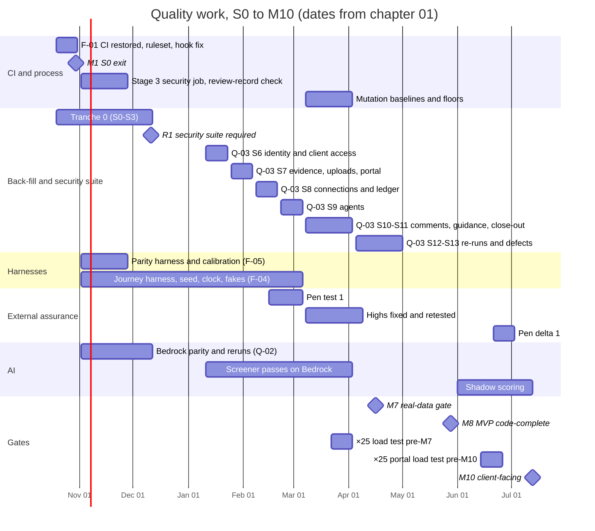
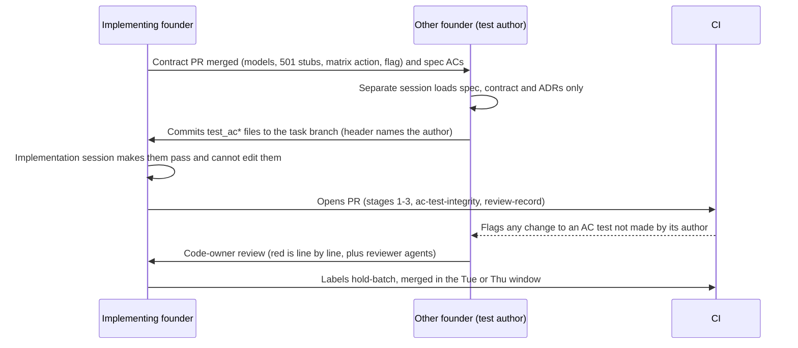

# 10 · Quality, testing and evaluation strategy

> Chapter of the Accrued engineering and build plan. Written Saturday 2026-10-17; Sprint 0 starts Monday 2026-10-19.
>
> **Readers.** Both founders and their Claude Code sessions. This chapter decides how Accrued proves that what it ships is correct, safe and faithful to the design: the test layers and their targets, who writes which tests, the CI gates, the parity, journey, contract, evaluation, golden, security, performance and accessibility suites, and the quality bar at every milestone.
>
> **Precedence.** Chapter 01 is the plan of record for dates, owners, epics and scope, and every date here comes from it. Chapter 09 is the register of record for decision IDs (DEC-nn) and proposed ADR IDs (written "ADR P-nn"). Where chapters 02–06 disagree with either, this chapter follows 01 and 09 and says so in §10.15.
>
> **Founders.** **N** = notanaskhan, the technical co-founder who built the repo and owns the red-zone backend, infrastructure and CI. **AY** = ayushkbhatia, the product and design founder, who codes through Claude Code and owns the design system, frontend, amber compute libraries and read models.
>
> **Units.** A *task* is one Claude Code session of about 1,130 hand-written lines including tests. An *FW* is 14 tasks. **Sn** is a two-week sprint starting Oct 19, 2026 + 14n days (S6 = Jan 11, 2027; S16 = May 31, 2027; S30 = Dec 13, 2027). "(inferred)" marks a figure or rule that no source states.
>
> **ID forms used here.** Epics are **F-01**, **Q-03** and so on (chapter 01 §1.4). Contracts are C1–C21. Journeys are J01–J28; journey invariants are INV-1…INV-5. Compliance invariants are I-AGENT-NEVER, I-GATES and so on (domain-compliance digest §4.2). Dangerous-error classes for AI evaluation are **DE-1…DE-8** (§10.8). Parity tiers are A–D. Quality decisions this chapter asks for are **QD-1…QD-10** (§10.15); chapter 09 numbers them.

---

## 10.0 The chapter on one page

### What is true today (checked against the repo at `a42034c`)

| Fact | Evidence |
|---|---|
| The gates are designed well and not enforced | No PR has passed stage 2 since 2026-10-07. 104 PRs merged with a median of 5 s from open to merge. `main` runs only stage 1. The nightly e2e has failed 8 of 8 nights. No branch protection is visible |
| The backend suite is large and lopsided | 3,267 test functions: unit 1,916 · integration 1,268 · workflow replay 74 · property 9 · **security 0** |
| The frontend suite is thin | 42 Vitest files with 291 cases; one Playwright spec (`apps/web/e2e/journey.spec.ts`), red since the SPEC-025 Setup-first flow |
| 55 tasks have no independent tests | 53 task files in TASK-020…075 carry "independent tests deferred by the founder" (all except TASK-029, -031 and -067). TASK-019 and TASK-029 have unchecked DoD boxes with 38 and 0 test lines. That makes 55, chapter 01's figure (§10.3.1) |
| Tools are allowlisted but not wired | `mutmut`, `pip-audit` and `bandit` are approved and unused. `make loadtest` calls an empty module. `evals/baselines.yaml` does not exist |
| AI quality is measured, on the wrong route | Four eval suites. Passing real-model runs exist for the upload reviewer, the matcher and the guidance drafter, all on the direct route with synthetic data. **The screener has no passing real run** (SPEC-030), and nothing has run on Bedrock |
| Coverage is unknown | `fail_under = 95` is protected and "only ever raised", but stage 2 has not run on `main`, so nobody knows if it holds (DEC-10) |

### The decisions in this chapter

| # | Decision | § |
|---|---|---|
| 1 | **CI is the quality bar.** Stages 1 and 2 are required on every PR and on `main` from S0. A red `main` stops all merging. Stage budgets follow ADR-083: stage 1 ≤ 5 min, stage 2 ≤ 15 min, frontend-only PRs ≤ 6 min | 10.4 |
| 2 | **ADR-078 for two founders.** Amber and red AC tests are written in the *other* founder's Claude session, from the spec and the contract PR, before the implementation is reviewed. A hook and a CI check keep the implementing session from editing them. A measured trigger rebalances the load if AY's lane carries too much | 10.2 |
| 3 | **Back-fill.** 44 of the 55 tasks are back-filled, black-box, by AY's sessions. 11 are superseded by the epics that replace their code. A small tranche 0 runs in S0–S3; the rest runs in **Q-03** in S6–S11 and closes by Apr 30, 2027 | 10.3 |
| 4 | **Security suite.** The ADR-080 core is required by R1 (Dec 11, 2026). The pen-test scope is covered by Feb 12, 2027. Every pen-test finding becomes a test before it closes | 10.3, 10.10 |
| 5 | **Visual parity** uses Playwright's own comparator against cropped handoff PNGs, in tiers A–D. AY owns the baselines and the lock list | 10.5 |
| 6 | **Journeys.** 28 Playwright specs run in four modes (fixture, compose, staging, production canary). Every scenario asserts INV-1…5 in the browser *and* in the database | 10.6 |
| 7 | **Contracts.** The founder who did not build a contract's provider writes its tests, and they run in the provider's CI. An OpenAPI compatibility gate blocks unannounced breaking changes | 10.7 |
| 8 | **Evaluations gate every capability flag.** DE-3…DE-7 (fabrication, scope breach, reserved action, injection, policy violation) must score 1.0. Real data needs a passing Bedrock suite. In production, override rate stays ≤ 8% or prompt rollouts freeze | 10.8 |
| 9 | **Golden tests.** The non-implementer transcribes the expected figures. A CPA signs the review before the engine's first real use | 10.9 |
| 10 | **Load tests** use an in-house harness on `httpx`, so no new dependency. Runs are ×25 before M7 and M10, and ×100 in November 2027 and November 2028 (ADR-075), in an ephemeral perf stack, never against a database a hosted build is using | 10.11 |
| 11 | **Accessibility** is WCAG 2.2 AA through DEC-11's adjusted ink ladder. axe is blocking. An external audit of the portal happens before M10 | 10.12 |
| 12 | **Release gates** are cumulative checklists per milestone, signed by both founders | 10.13 |

### Quality calendar to the first client-facing pilot

---

## 10.1 The test pyramid, layer by layer

**Rule.** Put each check at the lowest layer that can catch the defect. Journeys and parity prove integration and fidelity; they do not carry logic checks that a unit, property or integration test can make. Every layer below already has its tool in the repo or on the dependency allowlist. Nothing in this chapter needs a new runtime dependency. The one optional addition, a DAST container (§10.10.4), goes through the protected allowlist PR.

### 10.1.1 Layers, tools and targets

| # | Layer | Tool (status in repo) | Location | Today | Target | Gate |
|---|---|---|---|---|---|---|
| 1 | **Static and structural** | ruff, pyright `--strict`, import-linter, `banned_patterns.py` (40 rules), `validate_docs`, `secrets_scan`, `check_dependencies`, classification-tag check, flag codegen `--check`; tsc, ESLint, Prettier (all wired) | `abacus_tools/quality`, `apps/web/eslint.config.js`, `packages/ui/eslint.config.js` | Stage 1 in 1 m 04 s | Add: single Alembic head; `vite build` for the firm and portal entries; bundle budgets; compiled-CSS rules; fixture-string grep on production `dist/`; copy lints L1–L12; scope guards (§10.12); OpenAPI compatibility (§10.7) | Stage 1, blocking |
| 2 | **Backend unit** | pytest, pytest-asyncio, pytest-cov, pytest-xdist workers (DEC-335) (wired) | `backend/tests/unit` | 1,916 functions | Every service and repository branch. Coverage floor 95% overall (protected, DEC-10); **97% line and 90% branch on red modules from S13**; **100% line and branch on `*/compute/`** from day 1 (inferred floors) | Stage 2 |
| 3 | **Property** | Hypothesis (wired, barely used) | `backend/tests/property` | 9 functions in 1 file | ≥ 5 properties per compute engine (§10.9); `kernel.numeric.allocate()`; `visible()` agrees with `authorise()`; stricter-only firm overrides stay inside the matrix ceiling; status codegen round-trip; seed footing; import-parser round-trip | Stage 2; fuzz budget nightly |
| 4 | **Integration** | pytest + testcontainers, one set per pytest-xdist worker (DEC-335): `pgvector/pgvector` PG17 with forced RLS, `versitygw` with Object Lock, Temporal dev server (wired) | `backend/tests/integration` | 1,268 functions; 5 shards | Every route has an allow test, a deny test and a cross-tenant test (ADR-080: "an isolation test for every new repository method"), and every list route has a query-count assertion (ADR-077) | Stage 2 |
| 5 | **Security** | pytest (directory exists, empty) | `backend/tests/security` | **0 files** | 9 of chapter 06's 17 files by R1 (Dec 11, 2026), 13 by the pen test (Feb 15, 2027), all 17 by **G-03** (§10.3.4, §10.10) | Stage 2, required (ADR-080) |
| 6 | **Workflow replay and time-skipping** | `temporalio.testing`, recorded histories, 8 recorders (wired) | `backend/tests/workflows` | 74 replay tests | One recorded history per workflow version; replay runs on every PR and again as a deploy pre-flight (ADR-090) | Stage 2 + deploy |
| 7 | **Contract** | pytest against stubs; TypeScript fixture assertions (`satisfies` generated types) | `backend/tests/contracts/c<NN>_<name>/`, `apps/web/src/fixtures/contracts/` | Only the api-client drift gate | One consumer suite per contract C1–C21, run in the provider's CI (§10.7) | Stage 2 |
| 8 | **Golden** | pytest + YAML fixtures, exact `Decimal` equality | `backend/tests/golden/<engine>/` | none | Every deterministic engine (§10.9), CPA-reviewed before first real use | Stage 2; mutation nightly |
| 9 | **Frontend unit and component** | Vitest, Testing Library, jsdom (wired) | `apps/web/src/**`, `packages/ui/src/**` | 42 files, 291 cases | `format.ts` ≥ 60 golden cases; `status.ts` exhaustiveness; stores (Match, Overlay, Toast, Run, Presence) on fake timers; keyboard models; `?ov=` codec; copy registry (L2); every specimen renders in each `forceState` | `frontend` job |
| 10 | **Screen states** | Vitest + fixture scenarios (`mockApi`, no MSW) | `apps/web/src/screens/<ID>/` | none on the Accrued design | One test per lettered artboard, plus loading, empty, error and not-allowed. Each `revision.md` acceptance bullet is a named test. Each footing figure is a seed test | `frontend` job |
| 11 | **Gallery regression** | Playwright `toHaveScreenshot` (wired) | `/components/**` | none | About 400 specimens (C-00…C-39, T1–T22, O1–O6, TPL-01…24) | `frontend` job when `packages/ui/**` changes |
| 12 | **Design parity** | Playwright comparator against cropped handoff PNGs; Pillow crop tool | `apps/web/e2e/parity/`, `tools/parity/crop_handoff.py` | none | Tiers A–D (§10.5) | A and D blocking; B once locked; C reported |
| 13 | **Accessibility** | `@axe-core/playwright` (wired, one spec) | every Playwright project | one journey | 0 serious or critical findings on every specimen, open-overlay state, artboard scenario and journey step; keyboard, forced-colours and reduced-motion suites (§10.12) | Blocking |
| 14 | **Journey E2E** | Playwright | `apps/web/e2e/journeys/jNN-<slug>.spec.ts` | 1 spec, red | 28 journeys, four modes, INV-1…5 asserted in every scenario (§10.6) | PR (fixture, path-filtered); nightly; staging; production canary |
| 15 | **Evaluations** | `abacus_tools.evals` runner, HMAC-signed reports (wired) | `evals/<capability>/suite.yaml` (protected) | 4 suites; fake model nightly | One suite per capability before any firm sees it (§10.8) | Stage 3 fast subset; nightly; before rollout |
| 16 | **Performance and load** | query-count assertions (pytest); bundle budget script (Node, no dependency); `abacus_tools.loadtest` on `httpx` (to build) | `abacus_tools/loadtest` | empty module | Targets in §10.11 | Stage 1 budgets; stage 2 query counts; scheduled load runs |
| 17 | **Mutation** | `mutmut` (allowlisted, not wired) | red modules and `*/compute/` | none | Floors in a protected thresholds file (§10.4.4) | Stage 5 |

**Frontend coverage.** No coverage provider for Vitest is on the allowlist, and none is needed. Coverage comes **by construction**: a registry test enumerates every specimen in `@abacus/ui/specimens`, every scenario in `screens/*/scenarios.ts` and every `copy.ts` module, and fails if any of them has no test. That is stronger than a line percentage for scenario-driven UI.

### 10.1.2 Test environments and the shared-database rule

| Environment | Database | Used by | Rule |
|---|---|---|---|
| Local worktree | compose Postgres per worktree (`COMPOSE_PROJECT_NAME`, port offset) | `make dev`, `make seed`, ad hoc runs | Never pointed at a hosted database (`guard_bash.py` blocks `psql` to non-local hosts) |
| CI | testcontainers per job | stages 2–5 | Isolated by construction |
| Fixture mode | none (`VITE_FIXTURES=1`, fetch-swap on the generated client) | screen states, gallery, parity, fixture journeys, previews | Needs no Docker and no database, so it never competes with a hosted build |
| Staging | shared, synthetic only | journey runs after each batch deploy, nightly staging journeys, migration rehearsal | Before any run that writes to staging, check that no deploy is in flight (`gh run list --workflow deploy-staging --status in_progress`) and take the deploy lock |
| Perf (ephemeral) | its own RDS at production size | ×25 and ×100 load tests (§10.11) | Created for the window, destroyed after |
| Evaluation account | throwaway containers | real-model eval runs (§10.8) | Synthetic data only; never the staging database while a deploy runs |
| Production | real | only the synthetic canary tenant ("Canary & Co (Synthetic)") and the journey canary runs | No demo clock, no fakes; real firm data is never used as test data |

This is the working agreement in force: a local `make check`, seed or production build never runs against a database that a hosted build or deploy is using, because on pooled Postgres the second client fails with a connection error that looks like a code failure.

### 10.1.3 Test data

- **Synthetic only** (ADR-085). Fixtures reference a generator seed. `secrets_scan` blocks identifier patterns. Real client data never enters the repo, a fixture or an eval case. Firm-scoped eval cases (from A5 onward in chapter 05's terms) live in the firm's environment and never leave it.
- **One seed universe.** Brightwater Hale (184 clients at E0, DEC-47) is loaded by `scenarios/brightwater_hale` through the service APIs, never by migrations (ADR P-37, DEC-27). Until N's Python loader lands, AY's typed TypeScript seed is the interim source, and a parity test asserts that `make seed-demo` and fixture mode show the same data once both exist.
- **Content is loaded the way a firm loads it.** PBC templates, programs, organizers, letter and email templates and rules tables enter the seed through the admin import endpoints, so every journey run also tests the import path. No test may depend on firm content held as a constant in code.
- **Canonical names are constants.** A fixture scan (L10) rejects the variant spellings in `gaps.md` §4 and kit sample data (Elena Ruiz, "86 of the 119 returns", 21 integrations).

### 10.1.4 Test hygiene (ADR-079, binding)

- **Never weaken a test.** The coverage floor is only raised. Deleting a test needs the other founder's approval in the PR. A `skip` or `xfail` without an issue reference fails lint.
- **Flaky tests** are quarantined (marker plus issue, owner and a deadline of ≤ 10 working days). More than five in quarantine, or any older than its deadline, makes the next batch test-fix only (inferred threshold).
- **Generated test inputs are regenerated, never hand-merged:** replay histories, `durations.json`, `_matrix.py`, `_flags.py`, `openapi.json` and the api-client (chapter 01 §1.3.3).

---

## 10.2 The separate test author (ADR-078) with two founders

ADR-078 says amber and red tests are "written from the spec's acceptance criteria in a separate session before or independently of the implementation", and the implementation session "must make them pass without editing them except with approval". In practice it lapsed after TASK-018, the last task delivered with independent tests. With two founders the rule gets stronger and cheaper: the separate session can belong to a different person.

### 10.2.1 The rule

1. **Scope.** Amber and red tasks. Green work (docs, pure UI) is exempt from the separate author, but not from the screen definition of done (§10.5.6).
2. **Author.** The AC tests are written in **the other founder's Claude Code session**. This matches chapter 01 §1.3.3 ("AC tests written in the other founder's session").
3. **Inputs.** That session loads the spec's acceptance criteria, the contract PR (Pydantic models with classification tags, route stubs returning 501, the matrix action, the flag) and the relevant ADRs. It **never loads the implementation's source files**. The session-start hook prints the allowed context, and the task file records it.
4. **What "AC tests" means.** They are black-box tests at the service or HTTP boundary, one or more per acceptance criterion, named `test_ac<N>_<behaviour>` after the spec's AC number. The implementer still writes unit tests in their own session. The independent suite is the specification; the unit suite is the scaffolding.
5. **Timing.** The tests are committed to the task branch before the implementation is opened for review. For contract-first work they can be written against the 501 stubs, where they fail until the implementation lands.
6. **Changes.** The implementing session never edits an AC test. A test that is wrong is changed by its author, or with the author's written approval in the PR.

### 10.2.2 Who writes which tests

| Work | Implementer | Independent test author | Notes |
|---|---|---|---|
| Red-zone code (identity, kernel, evidence, connections, ledger, ai_gateway, agents, audit_trail, review, signatures, adjustments, integrations, consents, tax red paths, infra, migrations) | N | **AY** | Plus N's own unit tests. Review by AY, line by line, with the security reviewer agent and a different reviewing model (ADR-084) |
| Red-zone service tickets for Track 3 | N | **AY**, who files the ticket with spec and AC tests (chapter 01 §1.3.1) | The ticket arrives test-first by design |
| AY's amber backend (sampler, materiality, SUM, EBP, JE scoring, flux, tax compute, read models, notices, quality, attest, practice) | AY | **N** | For compute engines, N's contribution is the golden fixtures (§10.9) |
| N's amber work (requests, engagements, portal backend and similar) | N | **AY** by default; see the trigger in §10.2.4 | — |
| Green UI (screens, kits) | AY (N for admin screens on the T1/T12 kits) | Same founder | The screen DoD applies: scenarios, revision bullets, parity, axe. The other founder reviews; the `design-fidelity-reviewer` agent runs |
| Contract tests C1–C21 | Provider | The founder who did **not** build the provider (§10.7) | Run in the provider's CI |
| Golden fixtures | Engine implementer | Non-implementer transcribes from blueprint §9.8 and the seed | A CPA signs (§10.9) |
| Eval suites | N (harness, graders) | AY (cases, expert labels with a practitioner) | Thresholds are fixed in the protected `suite.yaml` before prompt work starts |
| Journey specs J01–J28 | F-04 harness (AY); each epic lead adds steps | The Given/When/Then text in the journeys digest is the spec | The other founder reviews each new step |
| Security invariant tests | — | AY for N's red code; N builds the generators that derive tests from the matrix and `TABLE_OWNERS` | Generated tests read the protected YAML, which is itself the spec |
| The 55 back-filled tasks | N (all of them) | **AY** | §10.3 |

### 10.2.3 Enforcement

| Control | Mechanism | Lands in |
|---|---|---|
| Recorded authorship | Task frontmatter gains `owner`, `test_author`, `test_session` and `impl_session`. `validate_docs` fails an amber or red task whose `test_author` equals its `owner` (ADR-078's enforcement already requires the two sessions to be recorded) | F-01 setup PR (protected) |
| Session guard | Each `test_ac*` file starts with `# ac-test-author: <handle>`. A new PreToolUse hook, `protect_ac_tests.py`, blocks a session whose git user is not that handle from editing the file, unless `work/approvals/<TASK>.yaml` carries `ac_test_change_approved_by: <author>` | F-01 setup PR (`.claude/**`, protected) |
| CI check `ac-test-integrity` (stage 4) | Lists every `test_ac*` function added, changed or deleted in commits not authored by its header author. It passes only if that author has approved the PR and the PR body names the change. Deleting an AC test also needs the ADR-079 approval | S1, with the review-record check |
| Reviewer agents (ADR-084) | The test reviewer and security reviewer run in the reviewing founder's session; the reviewing model differs from the authoring model; the result table goes in the PR | Stage 4, from S0 |
| Count never falls | A stage-1 rule (TEST-001, inferred name) fails when the count of `test_ac*` functions referencing a task falls without an approval line | S1 |

### 10.2.4 Capacity, and the trigger that keeps it fair

Chapter 01's plan rate of 14 tasks per FW already deducts about 25% for independent tests and cross-review, applied equally to both founders. The cross-authoring load is not equal. N implements about 1,190 tasks, mostly red; AY implements about 900, of which about 330 are amber backend and most of the rest is green UI.

At about 0.12 task of black-box AC tests per amber or red task (inferred), AY writes tests worth about **1.9 tasks a sprint** for N's work and N writes about **0.7** for AY's. That is roughly 1.2 tasks a sprint against AY's lane, which is already the binding lane in PH1 (114%).

**Trigger (recommended as part of QD-1, recorded in ADR P-02).** At M3 (Nov 20, 2026) and at every phase exit, read AY's cross-authoring time from the velocity log. If it exceeds 12% of AY's coding time for two consecutive sprints, **N's amber tasks switch to the clean-session form**: N runs a separate session from the spec and contract only, and AY reviews the AC tests before the implementation PR. This form is still ADR-078-compliant, and red tasks keep the other-founder rule. It removes about a third of AY's cross load (inferred). N also builds every *generated* test (matrix, tenant isolation, route introspection, status exhaustiveness) and all golden fixtures for AY's engines.

---

## 10.3 The back-fill programme: 55 tasks and the empty security suite

### 10.3.1 What exactly is owed

Two digests give different counts, 53 and 55. Both are right about different things:

- **53** task files in TASK-020…075 carry the DoD note "independent tests deferred by the founder". That is every task in the range except TASK-029, TASK-031 and TASK-067. TASK-014 also carries the note, but it is blocked and has no code.
- **TASK-019** (review queues, red; 1,642 backend lines, 38 test lines) and **TASK-029** (firm-level reads, red; 79 lines, no tests) have unchecked DoD boxes and no independent tests, though they lack the note.
- TASK-031 (the Atelier UI foundation) is retired by **F-05**. TASK-067 (cell references) has same-session tests and no deferral. TASK-018 was delivered with independent tests (018a/b/c).

**55 tasks** owe ADR-078 tests, which is chapter 01's figure: 34 red and 21 amber. N wrote all of them, so **AY's sessions write every back-filled suite** and N fixes what they find.

### 10.3.2 Principles

1. **Risk first.** Red before amber. Code on the real-data path before code that stays synthetic-only. Pen-test scope before everything else in S6–S8.
2. **Black-box, from the spec.** Tests sit at the HTTP or service boundary and are written from SPEC-0xx acceptance criteria. Tests at that level survive the internal refactors that **F-03** brings in S0–S4.
3. **After the contract moves, not before.** Where F-03 changes the contract (work items and gates under ADR P-04, the request enum under ADR P-44, client grants under ADR P-09, roles under ADR P-10, `visible()` under ADR P-06), the suite is written against the migrated contract. That is why those tranches start in S6, after F-03 closes on Dec 25, 2026.
4. **Don't back-fill code that a planned epic replaces.** Eleven tasks are frontend on the retiring Atelier screens, or backend that an epic rebuilds before real data. Their behaviour is covered by the replacing epic's own AC tests, which the other founder writes as part of that epic's definition of done. Each task file records "superseded by <epic>", and the item counts as closed only when that epic's AC suite has merged.
5. **Defects are fixed in the sprint they are found.** A red defect is fixed before the next batch. A security defect takes the hotfix lane (chapter 01 §1.3.3). Every defect found goes into the escaped-defect log, because it escaped the original process.
6. **The reserve pays, and features never borrow it first.** This follows chapter 01 §1.8.6 rule 1: each sprint's back-fill commitment is met before the reserve absorbs any overrun.

### 10.3.3 The ordered list

**Tranche 0 is pulled forward** (recommendation QD-2). Chapter 01 dates Q-03 at S6 onward. Nine suites, plus the hand-written half of the ADR-080 security core, cannot wait that long:
- R1 on Dec 11, 2026 requires `backend/tests/security/` populated and required (chapter 06 §8.2).
- The Bedrock clearance work in Q-02 relies on the data-boundary, route, output-control and eval-runner code.
- None of this code is refactored by F-03.

Tranche 0 is paid from AY's 22.5% reserve in S0–S3, about 12 tasks. Chapter 01 does not otherwise commit that money: the reserve-funded F-01 and Q-01 work is N's, and N's S0–S2 planned slack covers the part N's reserve cannot (inferred reading of chapter 01 §1.8.3).

| Order | Sprint (dates) | TASK (zone) | Area and spec | Contract basis | Why now |
|---|---|---|---|---|---|
| 1 | **T0** · S0–S3 (Oct 19 – Dec 11, 2026) | 075 (red), 049 (red), 025 (red) | Data boundary 5-part check; real model behind the boundary; model routes (SPEC-036, -026, -010) | Kept as is | Bedrock route parity and `client_data: cleared` depend on them |
| 2 | T0 | 021 (red), 022 (red) | Output controls and outbound scope checker; budget hierarchy and denial-of-wallet (SPEC-006, -007) | Kept | ADR-080 seeded-violation tests; agent cost safety |
| 3 | T0 | 019 (red), 029 (red) | Review queues and human-only evidence decisions; firm-level reads (SPEC-004, -014) | Kept; 029 re-run after ADR P-06 | INV-1 at the data layer; authz reads were never tested |
| 4 | T0 | 027 (red), 020 (amber) | Break-glass support; eval runner, graders and calibration (SPEC-012, -005) | Kept | SOC 2 control and pen-test scope; the runner gates every clearance |
| 5 | **S6** (Jan 11–22, 2027) | 041, 045, 030, 040, 032, 044 (all red) | People and firm roles; per-person independence gate; client invitations; sign-up and engagement types; team management; acceptance, letter and gate (SPEC-024, -025, -015, -017) | Post-F-03: roles (P-10), client grants (P-09), work items with G1–G3 (C1) | Identity and client access are the pen test's first targets (Feb 15) |
| 6 | **S7** (Jan 25 – Feb 5) | 035, 054, 055, 056 (red); 033, 037, 039, 060 (amber) | Portal item visibility and client uploads; upload processing parts 1–3; request-list import; request item detail; uploads on behalf and inbox matching; client hub backend (SPEC-020, -029, -018, -021, -023, -031) | Post-F-03: request enum (P-44), portal scopes (C5, frozen S3) | Upload pipeline and portal are in pen-test scope; the build is pinned Feb 12 |
| 7 | **S8** (Feb 8–19) | 036, 052, 069, 048 (red); 038, 068, 070, 071 (amber) | Client connection flow and access log; ledger file import; GL detail; roll-forward; classification and retrieval; ledger and GL formats (SPEC-020, -028, -034, -025, -022) | Kept; roll-forward on work items | Ledger evidence is on the MVP-1 real-data path (AUD-06) |
| 8 | **S9** (Feb 22 – Mar 5) | 050, 051, 058, 059, 065, 066, 024 (red); 064 (amber) | Engagement agent parts 1–2; upload reviewer parts 1–2; matcher agent and Suggest with AI; knowledge retrieval; content-matching code rules (SPEC-027, -030, -033, -009) | Kept; follow-ups renamed by the P-44 migration | Per-agent Bedrock evals and the M7 opt-in rules |
| 9 | **S10** (Mar 8–19) | 062, 072, 073, 074 (red) | Comments backend; drafted guidance parts 1–3 (SPEC-032, -035) | Kept until **P-05** in 2028 | The guidance drafter must refuse client-visible model text for real firms (ADR-111 until ADR P-25's conditions hold) |
| 10 | **S11** (Mar 22 – Apr 2) | 026 (amber) | Feature-flag registry (SPEC-011) | Kept | Flags carry rollout only (DEC-55); completes the list |
| — | **S12–S13** (Apr 5–30) | all 44 | Re-run every back-filled suite against the final MVP contracts; triage mutation survivors; close the superseded list | — | M8 exit criterion (chapter 01 §1.2.1) |

**Superseded rather than back-filled (11 tasks, 1 red and 10 amber; QD-3).** Each is closed when the named epic's AC suite merges:

| TASK | What it built | Superseded by | Epic window |
|---|---|---|---|
| 023 | Engagement graph and methodology v1 | **K-01** methodology module | S10–S26 |
| 028 | In-app notifications | **P-01** notifications v2 | S2–S7 |
| 034 | Knowledge, budget, support and walls screens (frontend) | **G-01**, **G-02**, **K-01** screens; walls and support backend covered in tranche 0 and S6 | S6–S14 |
| 042 (red) | Autonomy policy and onboarding checklist | **G-02** AI policy v1 (versioned policy, ADR P-49) | S9–S14 |
| 043 | Existing clients; invitations in the firm's name | **P-07** CLI-04 and CLI-06 bulk import | S4–S15 |
| 046, 047 | Engagement setup page; template offered by type | **P-07** ENG-02 and ENG-03 data-driven wizard | S4–S15 |
| 053 | Ledger file import, web | **A-02** AUD-06 screens | S8–S17 |
| 057 | Upload processing screens | **P-03** SHL-08 viewer and **P-06** BND screens | S3–S12 |
| 061 | Client hub, web | **R-01** POR-02 and POR-03 | S7–S18 |
| 063 | Comments, web | Restyled in **F-05** with its existing component tests kept green (DS-S4 changes no behaviour), then rebuilt as SHL-18 in **P-05**; the comments backend (062) is back-filled in S10 | S0–S10; S33–S37 |

### 10.3.4 The security suite build order

The files are specified in §10.10. Here is when they land and who writes them:

| By | Files | Author |
|---|---|---|
| **R0 → R1** (Nov 13 → Dec 11, 2026), in Q-02 and tranche 0 | `test_tenant_isolation.py` (generated over `TABLE_OWNERS`), `test_permission_matrix_generated.py`, `test_route_introspection.py` | N (generators read the protected YAML and registries, which are the spec) |
| | `test_agent_never.py`, `test_immutability.py`, `test_output_controls.py`, `test_citations.py`, `test_classification_scrubbing.py`, `test_connector_write_interception.py` | AY |
| **Pen-test scope** (S6–S7, by Feb 12, 2027) | `test_walls_and_need_to_know.py`, `test_portal_scope_isolation.py`, `test_portal_host_pinning.py`, `test_upload_hostile_files.py` | AY |
| **M7 compliance kernel** (Q-02, by Apr 9, 2027) | Retention floors and legal holds (I-RETENTION-FLOOR, I-HOLD), dual-approval export, hash-chain verification | The other founder on each feature, as normal DoD |
| **T-01** (S16–S21, before M11) | `test_tri_and_offshore.py` (I-7216, I-OFFSHORE), 8879 drift (I-8879-DRIFT) | AY |
| **P-10** (S29–S38) | `test_sse_payloads.py` | AY |
| **A-08** (S45–S50) | `test_confirmation_isolation.py` (I-CONFIRMATION-ISOLATION) | AY or N, whoever did not build the respondent page |
| **G-03** (S69–S73), before W8 | `test_webhook_ssrf.py` | AY |

ADR-080's list (tenant isolation, matrix permission tests, route introspection, the RLS schema check, connector write interception, output controls and citation verification with seeded violations, classification tags) is complete at R1. From then on it is a **required check**, and a PR that adds a repository method without a cross-tenant test fails review.

### 10.3.5 Capacity

| Item | Estimate (inferred) | Who | Paid from |
|---|---|---|---|
| Tranche 0: 8 red × 0.5 + 1 amber × 0.3 task | 4.3 | AY | AY reserve, S0–S3 |
| Hand-written security core (agent-never, immutability, output controls, citations, classification, connector writes) | 3.3 | AY | AY reserve, S0–S3 |
| Generated security tests | 2.5 | N | Q-02 (planned) |
| S6–S11: 25 red × 0.5 + 10 amber × 0.3, plus pen-scope security files | 18.7 | AY | Q-03 (AY reserve ≈ 23 tasks in S6–S11) |
| S12–S13 re-runs and triage | 2 | AY | Q-03 |
| Defect fixes (≈ 0.15 task per suite × 44) | 6.6 | N | Q-03 (N reserve) |
| Mutation wiring, baselines, survivors; coverage ratchet | 5–6 | N | Q-03 (N reserve, S10–S13) |
| **Total** | **≈ 43 tasks ≈ 3 FW** | AY ≈ 28, N ≈ 15 | — |

N's reserve in S9–S12 also carries pen-test remediation, which is not counted above (about 12–15 tasks, inferred). If the S6–S8 tranches slip, AY's S9 agent tranche moves into S12 rather than eating into pen-scope work. If the whole programme runs late, the M8 exit criterion holds and tier-1 cuts apply (chapter 01 §1.8.4) before any back-fill is dropped.

### 10.3.6 Done for the programme (checked at M8, Fri May 28, 2027)

- [ ] Each of the 55 tasks is marked *back-filled* (test commit and author recorded, DoD ticked) or *superseded* (the replacing epic's AC suite has merged).
- [ ] Coverage is ≥ 95% on `main` and red modules are ≥ 97% line (ratcheted at S13).
- [ ] Mutation floors are recorded for every red module (§10.4.4).
- [ ] No open defect from back-fill above SEV3.
- [ ] Every finding is in the escaped-defect log, with "the layer that should have caught it" filled in.

---

## 10.4 CI: the five stages restored and extended

### 10.4.1 Restore before extending (S0, **F-01**, N leads, AY reviews)

In this order, so the required check is not born red:
1. Freeze merges to S0 PRs.
2. Make the repo private after the history secret scan.
3. Turn on the ruleset: PRs required, code-owner review by the other founder, stale-approval dismissal, linear history, no force pushes.
4. Fix the approval hook so either founder can approve, never the author (ADR P-02).
5. Fix the stale assertions (`test_engagements.py:897`, `test_board_reads_api.py:230`, `test_schema_check_db.py:1083`).
6. Run stage 2 on `push` to `main` as well as on PRs.
7. Measure coverage against the 95% floor. DEC-10 applies: back-fill first, and use a dated exception with a ratchet to Dec 1 only if closing the gap costs more than 2 founder-days.
8. Re-record `durations.json` for all 156 files and turn on the uv, pnpm and Playwright caches.
9. Make `stage 1 (make check-fast)` and `stages 1 and 2 (make check)` required.
10. Repair the nightly e2e for the Setup-first flow. It needs three green nights in a row. AY then replaces it with the J02 fixture journey in **F-04** (S1–S2).

### 10.4.2 The stages, today and target

| Stage | Trigger | Today | Add | Required | Budget (ADR-083) |
|---|---|---|---|---|---|
| **S1** `make check-fast` | every push and PR | ruff, pyright, import-linter, 40 banned-pattern rules, `validate_docs`, flag-expiry, secrets scan, dependency allowlist, classification tags; tsc, ESLint, Prettier | Single Alembic head (`alembic heads` = 1); `vite build` for the firm entry and, once it exists, the portal entry; bundle budgets (firm ≤ 250 KB gzip initial JS, portal ≤ 150 KB, route chunk ≤ 120 KB, CSS ≤ 60 KB); compiled-CSS rules (400/500 weights only, no colour literal outside tokens); fixture-string grep on production `dist/` ("Brightwater", "Northwind", "scenario"); gallery excluded from production; copy lints L1–L12; scope guards (DEC-19); TEST-001 count guard; `terraform fmt/validate` on `infra/**` | Yes | ≤ 5 min; target ≤ 3 min |
| **S2** `make check` (sharded) | PR ready for review, and push to `main` | Unit ×2; integration ×5 (includes `tests/security`); contracts (schema_check up/down/up, api-client drift, Vitest); coverage ≥ 95% | Backend shards report success without running when only `apps/web/**`, `packages/ui/**` or `docs/**` changed. New **`frontend` job**: Vitest, screen-state tests, fixture-mode screen smoke, axe on changed screens, gallery regression when `packages/ui/**` changes, fixture journeys for touched journeys, white-label crawler when portal code changes. Consumer contract suites (§10.7). **`openapi-compat`** breaking-change gate. Workflow replay. Red-module coverage floors from S13 | Yes | ≤ 15 min; backend PR ≤ 12 min; frontend-only ≤ 6 min |
| **S3** path-triggered | PR | `evals-fast` (fake model) on agent paths | **`security` job**: CodeQL (Python, JS/TS), dependency review (licences and CVEs), `pip-audit`, `pnpm audit --prod`, `bandit`, Trivy (filesystem, IaC, image). **Cost regression** against `evals/baselines.yaml` (ADR-070: +10% fails without approval). Real-model eval report attached for any prompt or spec version change (§10.8.5). `terraform plan` on infra changes | Yes when triggered; skipped jobs report success | ≤ 10 min, parallel |
| **S4** review | amber and red PRs | Reviewer agents run locally; results not recorded since TASK-019 | **`review-record`** check: the PR carries the reviewer-agent table and both model names, and the reviewing model differs from the authoring one (ADR-084). **`ac-test-integrity`** (§10.2.3). Code-owner approval by the other founder. Human SLAs: contract PRs the same day, red within 1 working day, amber within 2 | Yes for amber and red | Human SLA, not minutes |
| **S5** nightly and weekly | cron | e2e (red), full evals on the fake model (green) | Listed in §10.4.3 | No; red nightly opens a ticket; red twice makes the next batch fix it | ≤ 2.5 h wall nightly, ≤ 6 h weekly |

### 10.4.3 Stage 5 schedule

| Job | Cadence | Budget | Starts |
|---|---|---|---|
| Journey E2E, full stack on compose, sharded ×4 | nightly | ≤ 45 min | Exists (repaired in S0); the J02 spec joins in S2 |
| All fixture-mode journeys | nightly | ≤ 15 min | S2 |
| Journeys on staging (demo tenant, deploy lock taken) | nightly, and after each staging batch deploy (smoke subset) | ≤ 30 min | R0 (Nov 13, 2026) |
| Journeys on the production canary | weekly, after the Thursday promotion (from M9), and before any in-window flag flip | ≤ 30 min | S14, ahead of M8 |
| Full eval suites, fake model | nightly | ≤ 10 min | exists |
| Real-model eval suites, Bedrock, evaluation account | weekly, and on demand before rollouts (§10.8.5) | budget cap | S6 |
| Mutation, incremental (red files changed in the last 24 h) | nightly | ≤ 60 min | S10 |
| Mutation, full red-zone and `*/compute/` | weekly (Sunday) | ≤ 4 h, sharded | S11 |
| Parity, changed screens | nightly | ≤ 30 min | S2 |
| Parity, full set | weekly | ≤ 90 min | S6 |
| Gallery regression, full | nightly | ≤ 15 min | S1 |
| Connector contract suites against provider sandboxes and fakes (§10.7.4) | nightly, once each connector exists | ≤ 15 min | A-02 (S8) |
| Upload and parser fuzzing (Hypothesis) | nightly | 15 min budget | S7 |
| Frontend performance: portal LCP on throttled 4G, INP traces on T6 and T18 with 1,000 rows | nightly | ≤ 15 min | first portal screen (S7) |
| Dependency audit; Terraform drift | nightly | ≤ 10 min | R0 |
| DAST baseline against staging (§10.10.4) | weekly | ≤ 30 min | S6 |

### 10.4.4 Mutation testing (ADR-079)

- **Tool.** `mutmut` (allowlisted). Scope: `identity/authz`, `kernel/db`, `kernel/uow`, `kernel/crypto`, `evidence`, `ai_gateway`, `audit_trail`, and later `review`, `signatures`, `adjustments`, `integrations` and consents as they land, plus every `*/compute/` package.
- **Cadence.** ADR-079 and ADR-083 say nightly; chapter 06 says weekly. Both are kept: incremental runs nightly on the files changed in the last 24 hours, and a full run weekly.
- **Floors (QD-4).** Floors live in a protected thresholds file (`backend/mutation-thresholds.yaml`, inferred name). On S11 they are set at the measured baseline per module and never lowered. Targets for M8 are ≥ 85% killed (equivalent mutants excluded) for `identity/authz` and `*/compute/`, and ≥ 75% for the other red modules (inferred).
- **Survivors.** A surviving mutant in a red module is a ticket. It is closed by a new test, or by an equivalence note that the other founder approves.

### 10.4.5 How batching changes CI

- **No per-fix deploys.** Approved PRs are labelled `hold:batch` and merged in the Tuesday and Thursday 17:00 CT windows (chapter 01 §1.3.3).
- **One integration run per batch.** GitHub Team does not offer a merge queue on private repos [verify]. Before each window, the held PRs are therefore rebased onto a `batch/<date>` branch that runs stage 2 in full, plus every fixture journey, once. If it is green, `main` fast-forwards. If it is red, the PR that broke it leaves the batch. This catches combinations that each PR's own run could not see, at the cost of one run per batch rather than one per PR.
- **Staging deploys once per batch** and runs the staging journey smoke. Production promotes weekly on Thursday from M9, and in the Tuesday 19:00 CT slot inside freeze windows (chapter 01 §1.2.4).
- **Previews are opt-in and fixture-only** (`preview` label). They need no database, so they never compete with a hosted build.

### 10.4.6 Cost

A full PR run is about 60–65 job-minutes today. Path filters, the stage-2-on-ready-for-review rule and caches bring the monthly Actions bill to about $100–200 (chapter 06 §2.9, inferred). The nightly additions above add about 5,000–7,000 minutes a month (inferred). The quality report tracks minutes as a metric (§10.14), and parity and mutation run on changed files nightly and in full only weekly to stay inside it.

---

## 10.5 Visual parity against the handoff, and the `/components` gallery

The handoff is the acceptance standard for how Accrued looks. Pixel parity is useful only when it is deterministic and tiered, so the harness compares what can be compared exactly (geometry, computed styles, chrome strips) strictly, and treats feature screens with real data loosely until an epic locks them.

### 10.5.1 References and where they live

| Reference | Source | Stored | Notes |
|---|---|---|---|
| **Screen artboards** | `handoff/screens/<ID …>/screenshots/<board>.png`: 1,967 PNGs at 2880 × 1800, which is a 1440 × 900 artboard at 2× | Private bucket keyed by `docs/design/HANDOFF_VERSION`, fetched by `pnpm visual:baselines` (≈ 1.1 GB; never in git, DEC-18) | Cropped by `tools/parity/crop_handoff.py` (Pillow, approved; run as `python3 -I tools/parity/crop_handoff.py "$ACCRUED_HANDOFF_DIR" <out>`) to `x 40…2840, y 40…1760`, the 1400 × 860 product window at DPR 2. The four 32 px corners are masked. Narrow boards (T7-M, TPL-07-M, POR-02-M, POR-03-M) use their own 940 × 1800 crop around the 390 × 844 phone |
| **Kits and galleries** (C-00…C-39, Foundations, Kits) | No PNGs exist (gaps.md §7) | Re-captured on demand inside the pinned Playwright container from `Component Sheet.dc.html#c-NN` and `Kits.dc.html`, served with `python3 -m http.server` | The capture needs network (unpkg React, Google Fonts) and is dev-only. Font versions are recorded in the baseline manifest |
| **Smoke baselines** | About 15 Tier A crops | Committed (DEC-15) | They let a fresh clone run Tier A without the bucket |
| **Our own specimen baselines** | Element-level screenshots of the ≈ 400 gallery specimens | Committed, small | Regression against ourselves, not against the handoff |

### 10.5.2 Tiers

| Tier | Applies to | `threshold` | `maxDiffPixelRatio` | Gate |
|---|---|---|---|---|
| **A** | Tokens, primitives and chrome strips: the 13 SHL-01a toolbar strips, Status Kit variants and sizes, discs, buttons, segmented controls | 0.10 | 0.5% | **Blocking** on every PR that touches `packages/ui/**` |
| **B** | Template frames T1–T22, T7-M, O1–O6 rendered with fixture data | 0.15 | 2% | Blocking once the template is `parity-locked` in the manifest; reported before that |
| **C** | Feature screens | 0.20 | 3% | Reported; each epic locks its screens (§10.5.4) |
| **D** | Computed styles from `getComputedStyle`: toolbar 46, subbar 42, audit bar 59, pane header 46 with a 14.5 px/500 title, nav item 32, pills 21/19/18, pane radius 12, gutter 10, edge 12, body 13/15.6 Geist | exact | — | **Blocking**, and immune to rasterisation noise |

The pixel values are starting points. They are calibrated in **F-05** during S1–S2 by running the harness against the handoff itself in two engines, and the calibrated values are recorded in the manifest. The comparator is Playwright's own (`expect(buffer).toMatchSnapshot(name, { threshold, maxDiffPixelRatio })`), with the cropped PNG as the expected snapshot. No `pixelmatch` or `pngjs` dependency is added.

**Reconciliation with chapter 01.** Chapter 01's definition of done says "tier-A parity for templates". That is read as: a template's chrome strips pass Tier A, its geometry passes Tier D (both blocking), and the frame with fixture data is parity-locked at Tier B before any consumer screen builds on it. A whole template frame cannot meet Tier A's 0.5% while its data area holds fixture rows.

### 10.5.3 How specimens and screens are captured

| Step | Specimens and templates | Screens |
|---|---|---|
| Route | `/components/c/:kit`, `/components/templates/:t?st=`, `/components/overlays/:o?st=`, `/components/specimens/:tpl?st=` | `/components/screens/:id?st=<letter>&as=<persona>&clock=<ISO>&frame=1&static=1&contrast=reference` |
| Data | The specimen's own fixture from its `X.specimens.tsx` registry entry | Fixture mode (`VITE_FIXTURES=1`), the screen's `scenarios.ts` entry for that artboard letter: persona, clock and seed snapshot (§10.6.4) |
| Viewport | The specimen's declared `viewport` at DPR 2 | 1440 × 900 at `deviceScaleFactor: 2`, screenshot of the framed 1400 × 860 window element |
| Determinism | `animations: 'disabled'`, `caret: 'hide'`, reduced motion, `await document.fonts.ready` | The same, plus `page.clock.setFixedTime(...)` from the scenario. `?static=1` freezes `ScriptedRunSource` mid-run. `data-contrast="reference"` restores the handoff's exact ink values so like is compared with like (DEC-11) |
| Masks | Spinners, upload bars | Spinners (frozen at one frame in the PNG), presence avatars, upload bars, and the positions of the 22 icons missing from the handoff |
| Excluded | Hover, open-menu and mid-animation states, unless the artboard is defined in that state (CLS-01f is). Interaction tests cover those | Same |

The screen manifest (`docs/screens/manifest`, generated from `handoff-link-graph.json`) lists every artboard letter, its scenario, its tier and its lock state, so the parity job iterates over data, not a hand-kept list.

### 10.5.4 Locking, baselines and ownership

- **AY owns parity.** AY approves every baseline update and every lock. N can propose but cannot merge a re-baseline alone; CODEOWNERS on the manifest enforces this.
- **When a screen locks.** It locks at Tier C when it has stayed at or below 3% for two consecutive nightly runs and its epic is in the current milestone's scope. **All 33 P0 screens of MVP-1 are locked before M8** (inferred target). Unlocking needs both founders.
- **When the handoff changes.** `HANDOFF_VERSION` is bumped and the parity job re-crops and reports the delta per artboard. Locked screens whose reference changed are flagged for AY's review rather than failing silently.
- **Reports.** The job publishes the Playwright HTML report (expected, actual, diff) and `parity.json` (artboard → diff % → tier → locked). It runs nightly on changed screens, weekly in full, and on PRs labelled `parity`. The PR template asks for the parity % of every touched screen.

### 10.5.5 The `/components` gallery

It is in-app, not Storybook (rejected, DEC-16).

| Route | Content |
|---|---|
| `/components` | Index of Component Sheet families A–X and kits C-00…C-39 |
| `/components/tokens` | Swatches with contrast on card, shell and nested surfaces under both ink ladders; type roles; radii; elevation; motion demos |
| `/components/c/:kit` | One page per kit, specimens numbered like the sheet ("C-24 · 01 BoardCard and column header") |
| `/components/templates/:t`, `/components/overlays/:o` | T1…T22, T7-M, O1…O6 geometry specimens, with `?st=` states |
| `/components/specimens/:tpl` | TPL-01…TPL-24 with their lettered states |
| `/components/screens/:id` | The real screen under fixture mode, driven by its scenarios |
| `/components/parity` | Dev-only side-by-side and diff overlay with the handoff PNG, served from `$ACCRUED_HANDOFF_DIR` by a dev-only Vite middleware |

**Gating.** The whole tree is lazy and compiled only with `VITE_UI_GALLERY=1` (dev, fixture builds, previews). It never calls the API. A stage-1 grep confirms it is absent from production `dist/`.

**Registry.** Each L1 and L2 component folder exports `X.specimens.tsx`, re-exported from `@abacus/ui/specimens`. The registry test (§10.1.1) fails if a specimen has no render test, no axe run or no gallery regression snapshot.

### 10.5.6 Definition of done for a screen

This is chapter 04 §10.4, made checkable:
1. Every lettered artboard exists as a scenario with a passing Vitest test.
2. Every `revision.md` acceptance bullet is a named test, and every footing figure is a seed test.
3. axe reports 0 serious or critical findings in every state, and the keyboard path works.
4. Parity is reported for every artboard at Tier C (or locked), and the template's Tier D styles hold.
5. Copy is verbatim (L2 green), with no brand, emoji or "!" violations.
6. Every outbound link is wired or registered as planned.
7. Human gates go through overlays and `useGate`, with no optimistic gate writes.
8. Portal screens pass the white-label crawler at 1400, 720 and 390 px.
9. `make check` is green and the design-fidelity reviewer agent has signed off.

---

## 10.6 The journey E2E suite (J01–J28)

### 10.6.1 Definitions (from chapter 01 §1.2)

- **Walkable:** the journey's Playwright scenario passes with real auth, fakes only for third parties, every gate enforced on the server, INV-1…5 asserted and axe AA clean.
- **Walkable in production:** that scenario passes on the released build against the production canary tenant.
- **Live:** at least one real design-partner instance of the journey exists.

### 10.6.2 The five invariants, asserted in every scenario

A shared helper, `assertInvariants(page, ctx)`, runs at the end of every scenario and after every step that changes state. In full-stack modes it also calls a Python checker, `uv run python -m abacus_tools.e2e.check_invariants --tenant <id> --since <ts>`, which reads the test database as a read-only inspector role. That role exists only in local, test and CI environments. Using Python avoids adding a Postgres client to the Node toolchain.

| INV | Meaning | Browser assertion (every mode) | Database assertion (compose, staging) |
|---|---|---|---|
| **INV-1** The agent never decides | No final verb is taken by the agent principal (ADR-005) | Approve, sign-off, release, send, post and decide controls are never rendered on agent surfaces. Every decided row shows a human name | No row in `sign_offs`, `decisions`, `review_decisions`, `report_releases`, `posting_batches`, `engine_exports`, sent `envelopes` or outbound `messages` has `actor_kind = 'agent'` |
| **INV-2** Citations are verified | Every agent-set value carries a code-verified citation or reads "Uncited" (ADR-066; SHL-09e, SHL-10c) | Every cite marker opens a popover whose source resolves; no unverified marker is shown | Every displayed agent value has `citation.verified = true`, or no citation and the "Uncited" state |
| **INV-3** Walls hold | A walled user gets the not-allowed state and no data (404 semantics, DEC-43) | Lena Park, walled from Ashford, opens an Ashford deep link and a search: not-allowed, no row, no count | Server logs a 404, and no read event for the walled resource |
| **INV-4** Portal scopes are isolated | A portal user sees only their scopes, by the role-union rules | Meera Shah (Taxpayer and K-1 recipient) and Sam Ortiz (third party) see exactly their grants, and a crafted URL to another scope answers not-allowed | Every portal read event falls within the principal's `client_access_grants` |
| **INV-5** Attribution is correct | Every state change is attributed as "<person>", "<person> via Agent" or "Policy: <name> vN" | No row anywhere renders "Accrued Agent" as an approver | Every state change in the scenario window has an `audit_events` row with the right `actor_kind` and `on_behalf_of` |

In fixture mode, which has no backend, only the browser column runs. That is why a journey counts as walkable only in the full-stack modes.

### 10.6.3 Modes

| Mode | Stack | When | What it proves |
|---|---|---|---|
| **Fixture** | `vite --mode fixtures`, no backend, no Docker | PRs touching the journey's areas (path map from the journeys digest's journey × module matrix); every batch integration run | The UI flow, copy, states, links, axe and browser-side invariants |
| **Compose** | `make dev` + `make seed-demo` + the demo clock + fakes, all in CI containers | Nightly; batch integration run for live journeys | Real auth, server-side gates, both invariant columns |
| **Staging** | Staging deploy, demo tenant with `ABACUS_DEMO_CLOCK`, provider sandboxes or fakes | After each batch deploy (smoke subset), nightly in full, and **before every in-window flag flip** (chapter 01 §1.2.4 rule 3) | The released build on production-shaped infrastructure |
| **Production canary** | The release on production, the synthetic canary tenant, real time, provider sandboxes (SES simulator, DocuSign demo, QBO sandboxes) | Weekly after the Thursday promotion from M9, and at each milestone that says "walkable in production" | Chapter 01's "walkable in production" |

**Production rules.** No demo clock: the settings validator refuses `ABACUS_DEMO_CLOCK` for production and for any non-synthetic tenant (inferred rule). Production runs therefore load relative-dated data and assert structure rather than exact relative strings. Each run creates new synthetic engagements and deletes nothing, because evidence is write-once. The volume is small (inferred).

### 10.6.4 Seed epochs and the demo clock

| Item | Rule | Source |
|---|---|---|
| Clock | `abacus.kernel.clock` replaces the 51 direct `now()` calls. The SPA reads `useNow()`, and ESLint bans `Date.now()` and argument-less `new Date()` in `screens/**`, `domain/**` and `packages/ui/src/**`. Playwright uses `page.clock.setFixedTime(...)` | ADR P-37, DEC-27 |
| Default instant | **E0: Mon 14 Sep 2026, 9:24 AM CT** (CDT, UTC−5). Snapshots after Sun Nov 1, 2026 are CST, and `format.ts` tests cover the change | DEC-27 |
| Epochs | **E0:** 16 named clients of 184 (DEC-47), 27 audits, 53 integrations. **E1** adds Harlow & Pike from Sep 14, 10:05 AM (28 audits). **E2** adds Tessellate (33 audits, 55 integrations). Dated snapshots: Sep 24, Oct 1, Oct 6, Oct 21, Oct 26, Oct 27, Nov 9, Nov 13 and Nov 16, 2026, and Jan 11, 2027. Each screen contract and journey names its snapshot | journeys digest §0.3; handoff-conventions digest; DEC-47 |
| Loader | `scenarios/brightwater_hale` replays a dated event list through the service APIs, local and staging only. It is built in slices: the E0 audit subset first (**F-04**, S1–S9), then tax content with **T-02** and CAS content with **C-01**. The firm carries `firms.synthetic = true`, with no name suffix | ADR P-37; chapter 01 F-04 |
| Footing | Every seed figure book foots as a test (Northwind 16,861,000 / 14,228,500; Copperleaf Square 73,166.90 − 1,684.54 = 71,482.36; Ridgeline capital 5,960,000 → 6,866,200) | chapter 04 §6.6 |

### 10.6.5 Fakes for external systems

Every fake implements the same port as the real adapter. Wherever the provider offers a sandbox, the **same connector contract suite runs nightly against both the fake and the sandbox** (§10.7.4), so a fake cannot drift from the provider it stands in for.

| Fake | Introduced by | Sandbox it is checked against |
|---|---|---|
| OIDC identity (one button per seeded person) → WorkOS | exists; WorkOS staging in **Q-01** | WorkOS staging |
| Email mailbox (portal email codes, invitations) → SES | exists (local file mailbox); SES in **Q-01** | SES simulator |
| Malware scanner (EICAR, archive bombs) → ClamAV | exists; ClamAV in **Q-01** | ClamAV with the EICAR file |
| Model (recorded responses, ADR-076) | exists | Not a sandbox: evals use the real model (§10.8) |
| Ledger: file import and fake connector; first live read (QBO expected, DEC-70) | exists; live read in **A-02** (S8–S17) | QBO sandbox |
| DocuSign embedded signing with ID Verification; record mode first | **N-02** (S13–S21) | DocuSign demo environment |
| CCH Axcess Tax file bridge (export workbook, import diff, ack) | **T-01** (S16–S21) | The partner's Axcess, on synthetic returns in Pilot 0 (validated by hand; no public API) |
| OCR (Textract) | **P-11** (S28–S34) | Textract on synthetic documents |
| IRS Document Upload Tool | **N-04** (S25–S29) | None: a manual "Mark as sent" |
| QBO hourly sync and bank feed; QBO posting (W1) with dry run and read-back | **C-01** (S44–S51); **C-02** (S49–S55) | QBO sandbox |
| NetSuite OneWorld TB (file first) | **A-09** (S45–S50) | NetSuite sandbox once SDN access exists |
| Microsoft 365 mailbox (Graph ingest and send-as) | **N-03** (S56–S62) | M365 developer tenant |
| Drata (GRC request sync) | **X-02** (S68–S72) | Drata sandbox [verify] |
| CCH Axcess Practice (time, WIP, AR read) | **I-04** (S70–S73) | Partner instance [verify] |
| BambooHR (HR population for internal audit) | **X-03** (S68–S73) (inferred) | Sandbox [verify] |
| Office add-in host | **W-04** (S69–S73) | Office sideload in a test tenant |

### 10.6.6 Journeys mapped to milestones

The dates come from chapter 01 §1.5 and §1.5.1. The "first slice" column is the earliest scenario that has to pass. A journey's spec file exists from that slice onward and grows as each epic adds its steps. Unbuilt steps are left out, not skipped, since ADR-079 forbids a skip without an issue.

| J | Journey (seed, clock) | First slice → milestone | P0 core walkable (gating screen, epic) | Full journey | Fakes needed |
|---|---|---|---|---|---|
| J01 | Firm onboarding and methodology upload (Brightwater Hale, Jan 2026) | **J01-core walkable in production, M8, May 28, 2027** | Jun 22, 2029 (WB-07, W-03) | Aug 17, 2029 (ADM-13, G-03) | Identity, mailbox |
| J02 | Client onboarding and portal invite (Copperleaf, E0) | **J02-audit-core skeleton on staging, M5, Jan 22, 2027** → production M8 → live M10, Jul 13, 2027 | Oct 13, 2028 (CLS-09, C-01) | Apr 27, 2029 (ENG-14, K-04) | DocuSign, QBO and bank feed, mailbox |
| J03 | EBP 401(k) audit (Northwind PY2025) | Fieldwork P0 (EBP-01…06) live, **M15, Dec 10, 2027**; EBP-07 by Jan 7, 2028 | Mar 17, 2028 (AUD-25, A-07); release and archive flip M16 | Mar 31, 2028 (AUD-29, P-05) | DocuSign, OCR (trust reports), third-party room |
| J04 | General FS audit (Granite Peak, FYE 6/30/2026) | **J04-PBC slice on staging, M6, Mar 5, 2027** → production M8 → live M10; planning slice M15; core M19 | Apr 27, 2029 (ENG-10, K-04) | Jun 8, 2029 (AUD-36, A-11) | Ledger file import, first live ledger |
| J05 | Review, compilation, preparation (Lakeshore; Juniper & Oak) | Core M19, Sep 29, 2028 | Dec 8, 2028 (CLS-08, C-02) | Dec 8, 2028 (TXP-13, T-06) | Ledger file import, QBO |
| J06 | Individual 1040 season (Feld TY2025; organizer step at Feb 2, 2026) | **Coordination slice live, M11, Aug 17, 2027**; record-mode spine through "Mark transmitted", M13, Aug 31, 2027 | Apr 28, 2028 (TXI-01, T-04); live M17, May 2, 2028 | Dec 8, 2028 (TAX-10, T-08) | CCH file bridge, DocuSign with KBA, OCR |
| J07 | Trust 1041 (Calloway TY2025) | — | Aug 18, 2028 (TXT-02, T-07); live M18, Aug 22, 2028 | Aug 18, 2028 (TXT-03, T-07) | CCH, DocuSign, OCR |
| J08 | Partnership 1065 (Ridgeline TY2025) | **K-1 distribution slice, M13, Aug 31, 2027** | Jul 7, 2028 (TXP-11, T-05); live M18, Aug 1, 2028 | Jul 6, 2029 (PRJ-01, T-09) | CCH, DocuSign |
| J09 | IRS notice response (Whitley CP2000, TY2024) | **P0 live, M15, Dec 10, 2027** | Dec 10, 2027 (NOT-03, N-04) | Mar 30, 2029 (POR-19, R-03) | OCR, manual DUT hand-off |
| J10 | CAS month-end close (Copperleaf, Aug 2026) | **Read-only path live, M20, Oct 31, 2028** | Dec 8, 2028 (CLS-08, C-02) | Mar 16, 2029 (INB-04, N-03) | QBO read and post, bank feed, OCR |
| J11 | Workbench: ad hoc → saved agent → scheduled run | Read-only sessions on staging by M20 (PH5 exit) | Jun 22, 2029 (WB-08, W-03) | Aug 17, 2029 (ADM-09, G-03) | Model, Temporal time-skipping |
| J12 | Client side: respond, upload, sign, message | **J12-core skeleton on staging, M5** → production M8 → live M10; signing at M13 | Mar 3, 2028 (POR-09, R-02) | Mar 30, 2029 (POR-19, R-03) | Mailbox, DocuSign |
| J13 | Partner review and sign-off (Daniel Reyes, Mon Sep 14) | — | Apr 27, 2029 (SHL-19, K-04) | Apr 27, 2029 | Model |
| J14 | Firm admin and integrations | — | Sep 1, 2028 (WB-11, W-01) | Aug 17, 2029 (ADM-09, G-03) | Integration catalogue fakes |
| J15 | Advisory project (Ridgeline cost segregation and §754) | — | Jul 7, 2028 (TXP-01, T-05) | Jul 6, 2029 (PRJ-01, T-09) | — |
| J16 | Daily practice operations (Mon Sep 14, 2026) | — | Oct 13, 2028 (CLS-01, C-01) | Mar 16, 2029 (INB-03, N-03) | M365, DocuSign |
| J17 | Practice economics | — | Mar 3, 2028 (HOME-01, I-01) | Aug 17, 2029 (HOME-04, I-04) | CCH Axcess Practice |
| J18 | Audit quality management (Northwind, Sep 2026 – Jan 2027) | — | Mar 17, 2028 (AUD-25, A-07) | Nov 24, 2028 (AUD-30, Q-05) | — |
| J19 | Estate and amended returns (Thornbury 706; Okafor 1040-X) | — | Apr 28, 2028 (TAX-07, T-04) | Mar 30, 2029 (POR-18, R-03) | CCH, DocuSign |
| J20 | Group audit, SAS 149 (Harlow & Pike FY2026, E1; Dec 1, 2026, 8:30 AM) | — | Sep 29, 2028 behind `ff.group_audit` (POR-23, A-09) | Aug 17, 2029 (ADM-13, G-03) | NetSuite OneWorld (file first) |
| J21 | Statements studio (Granite Peak, Wed Oct 21, 2026) | — | Apr 13, 2029 (FSP-03, A-10) | Aug 17, 2029 (XLA-02, W-04) | Office host |
| J22 | Search for unrecorded liabilities on the Board (Granite Peak, Thu Sep 24) | — | Apr 27, 2029 (SHL-19, K-04) | Aug 17, 2029 (XLA-01, W-04) | Model, ledger GL, Office host |
| J23 | Audit partner's morning (Margaret Okonkwo, Mon Sep 14) | — | Apr 27, 2029 (ENG-10, K-04) | Jun 8, 2029 (AUD-37, A-11) | Model |
| J24 | Methodology template rollout (FS v6, Thu Oct 1) | — | Apr 27, 2029 (ENG-11, K-04) | Aug 3, 2029 (KNW-11, K-05) | — |
| J25 | SOC 2 Type 2 examination (Tessellate, E2) | — | Apr 27, 2029 for the shared Board; the attest path with X-01, Jun 22, 2029 | Aug 3, 2029 (ATT-09, X-02) | Drata |
| J26 | Co-sourced internal audit (Ashford, Mon Sep 14) | — | Apr 27, 2029 for the Board; the IA path with X-03, Aug 17, 2029 | Aug 17, 2029 (POR-22, X-03) | BambooHR (inferred) |
| J27 | Managing partner's insights review (Thu Oct 1) | — | Mar 31, 2028 (SHL-17, P-05) | Aug 3, 2029 (WB-13, K-05) | — |
| J28 | Audit to tax (Granite Peak, Mon Nov 9) | — | Aug 20, 2027 (TAX-09, T-01) | Dec 8, 2028 (TXP-13, T-06) | CCH |

**M23 (Fri Aug 17, 2029):** all 28 walkable in production, and at least 12 live at partner firms.

### 10.6.7 Mechanics

- **Files.** `apps/web/e2e/journeys/jNN-<slug>.spec.ts`, with tests named `jNN <step range>: <outcome>`. Long journeys are split into ordered `test.describe.serial` blocks that share one seeded tenant.
- **Steps.** Each Given/When/Then line from the journeys digest becomes a step. Every step that opens a screen runs axe. Every step that crosses a human gate asserts that the agent principal is refused (the **[H]** marks in the digest).
- **Flags.** Each scenario turns on the per-firm flags and entitlements it needs (ADR-089, ADR P-28) and nothing else.
- **Registry.** `docs/architecture/e2e-journeys.md` is the critical-journeys list ADR-077 requires (it is missing today, debt D15). It holds what changes rarely: each journey's spec file, owner, gating epic and planned dates from §10.6.6. Run status (walkable per mode, last green run, "unverified" fakes) lives in the weekly quality report (§10.14), not in git, so a green night never costs a commit, a build or a deploy.
- **Owner.** AY owns the harness, helpers and registry in **F-04**. Each epic lead adds the journey steps their epic unlocks, and the other founder reviews them.

---

## 10.7 Contract tests, owned by consumers

### 10.7.1 The rule

Chapter 01 §1.3.2 sets the handshake: the consumer opens `contract: <name> vN`, the provider ships a stub PR within 3 working days, the consumer writes the contract tests, and **those tests run in the provider's CI and must stay green**. This chapter adds one rule to make the tests independent:

> **The contract tests are written by the founder who did not build the provider.** Usually that is the consumer. When the provider and every consumer sit in one founder's lane, the other founder still writes them (ADR-078 by analogy).

Each contract's suite has two halves:
- **Backend:** pytest against the provider's routes, in `backend/tests/contracts/c<NN>_<name>/`. It asserts the shapes and status codes, the `allowed_actions` and refusal codes, the status words from the registry, the human-only actions (the agent principal refused), the audit events, and the seed figures that must foot for the screens it serves.
- **Frontend:** TypeScript fixture assertions in `apps/web/src/fixtures/contracts/<name>.contract.test.ts`. Fixtures are typed with `satisfies` against the generated types, so drift is a compile error. Draft types in `fixtures/contracts/*.ts` are deleted when the contract PR lands.

### 10.7.2 Register: who writes each suite

| C | Contract | Provider (epic) | Main consumers | Suite written by | Freeze (chapter 01) |
|---|---|---|---|---|---|
| C1 | Work item and engagement lifecycle, G1–G3 facts, per-type gate policy | N (**F-03**) | every module | AY | S1 |
| C2 | Status registry: YAML → StrEnum, OpenAPI enums, `status.ts` | AY owns the YAML, N the codegen (**F-03**) | all | Each writes the other half: N the TypeScript exhaustiveness checks, AY the backend enum round-trip | S1 |
| C3 | Review grammar: suggestions and change sets, decision, sign-off (content hash, staleness, segregation), issue, checkpoint, `field_value_version`, `human_gate` | N (**P-04**) | A-*, T-*, C-*, I-01 | AY | schema S3 · services S12 |
| C4 | Citation v2, viewer manifest, regions, masked PII and logged reveal | N (**P-03**) | every trace surface | AY | S5 |
| C5 | Requests and binders; portal scopes (`client_access_grant`, role union) | N (**P-06**, **P-08**); AY for the portal read models | A-01, R-01, T-02, C-01 | AY for N's part; N for AY's read models | S3 |
| C6 | Agent runs: v1 read API; v2 run and step events over SSE | N (**P-09**, **P-10**) | dock, trace, Workbench, Today | AY | v1 S12 · v2 S30 |
| C7 | Envelope service: record mode, then DocuSign with ID Verification; evidence package; gate events | N (**N-02**) | ENG-04, SIG-*, POR-06, TAX-12, AUD-21, NOT-03 | AY | record S14 · DocuSign S17 |
| C8 | Adjustments: proposed entries (8 states), threshold-policy versions, named-human batch approval | N (**A-06**) | EBP-06, T-05, C-02, A-09 | AY | S24 |
| C9 | Ledger: TB layers, groupings, FS-line taxonomy, account mapping | N (**A-02**, **A-03**) | A-04, A-06, T-05, C-01, A-10 | AY | layers S10 · taxonomy S20 |
| C10 | Deliverables and release registry with download audit | AY (**R-02**) | A-07, T-02, C-02, X-01 | N | S29 |
| C11 | Deterministic PDF/DOCX renderer; templates in the database | N (**P-11**) | ENG-04, AUD-20…23, TAX-12, NOT-03, CLS-08, FSP-06 | AY (byte-identical golden renders, §10.9) | S18 |
| C12 | TB hand-off into tax | AY (**T-06**) | AUD-38, CLS-12 | N | S50 |
| C13 | Human-gate projection registration slot (Home) | AY (**I-01**) with N (**P-04**) | every module | N for AY's projection; AY for N's slot | S10 |
| C14 | Board and program-status read model | N (**K-04**) | AUD-01/02, TAX-01, CLS-01/02, ATT-04 | AY | S59 |
| C15 | Search registration | N (**P-02**) | all modules | AY | slot S1 · index S39 |
| C16 | Notification kinds and transactional email templates (database) | N and AY (**P-01**, **R-01**) | all | Each writes the other's half | S5 |
| C17 | Workbench tool registry (per-module read and compute tools, ADR-049) | N (**P-10**) | W-02, W-03, I-02 | AY | S32 |
| C18 | Portal approvals (FS packages, client AJE approval) | AY (**R-02**) | A-06, A-07, C-02 | N | S30 |
| C19 | §7216 consent gate and TRI data class (gateway condition 6) | N (**T-01**) | T-*, N-04, W-02, I-02 | AY, including the I-7216 property test | S17 |
| C20 | Integration framework and write-capability registry | N (**A-02**, **W-01**) | POR-16, TAX-09, CLS-11, ATT-09, ADM-08 | AY, including the attest-client refusal for W1 | framework S10 · catalogue S45 |
| C21 | Effective-dated rules tables (due dates, holidays, form sets and tolerances, thresholds, retention floors) | AY (**K-02**) | T-01, T-02, T-03, T-08, C-02, Q-05 | N | S17 |

### 10.7.3 Gates around contracts

- **`openapi-compat` (stage 2).** A script with no new dependency compares the PR's `openapi.json` with `main`'s. It fails on a removed operation or field, a narrowed enum, a newly required request field, or a changed type, unless the PR title carries `[contract vN+1]`, `docs/contracts/<name>.md` records the overlap sprint, and both founders approve. Additive changes pass. This enforces chapter 01's versioning rule: a breaking change ships as vN+1 with one sprint of overlap.
- **Drift gate (exists).** `make generate` followed by `git diff --exit-code packages/api-client`. The generated client is never hand-merged.
- **Fixture-versus-live drift report (nightly, compose mode).** The full-stack journey run records each response the screens request and compares its keys and types with the fixture handler for that route. A drift is a ticket for the consumer, because fixture mode is only trustworthy while it matches the live API.
- **Contract reviewer agent** (`contract-reviewer`) runs on every contract PR: glossary names, pagination, error codes, one matrix action per route, agent-text fields marked.

### 10.7.4 Connector contracts (ADR-044): one suite, two targets

Every third-party adapter has a contract suite in `backend/tests/connectors/<provider>/`. It runs:
- in stage 2 against the **fake**, every PR;
- nightly against the provider's **sandbox**, where one exists (QBO sandbox, DocuSign demo, NetSuite sandbox after SDN access, the M365 developer tenant, Textract).

If the sandbox run fails while the fake passes, the fake has drifted. That opens a ticket, and journeys that depend on the fake are reported as "unverified" in the weekly quality report until it is fixed. Write adapters (W1, W2, W6, W7) add the write-capability assertions: declared scope only, idempotency key honoured, dry run, read-back verification, and a client-visible write log (ADR P-17, ADR P-16).

---

## 10.8 AI evaluation

### 10.8.1 Principles (binding, from the repo)

- **Tests and evals are separate** (ADR-076). Tests use the fake model and never touch a provider; in test mode, network calls to model providers fail. Evals call the real pinned model through `ai_gateway` in evaluation mode, under `evals/`, through the runner.
- **One suite per capability, before any firm sees it** (ADR-081, SPEC-005). Each suite declares its graders, its thresholds weighted to the dangerous error, key cases repeated with a required pass rate, ECE calibration, a cost limit, and coverage of the failure taxonomy and adversarial categories. Graders are deterministic first, then rule-based, then a pinned, human-calibrated judge.
- **Ship rule** (chapter 05 §5.5.6). No capability flag turns on for any firm, synthetic included, without a passing suite at its current prompt version.
- **Freeze rule** (chapter 01 §1.2.4 rule 4). Inside a busy-season window, no model or prompt upgrade ships without the full suite and a shadow run.
- **Code computes, models judge** (ADR-050). Every number an agent shows comes from code; the number-provenance grader enforces it.
- **Client content is hostile** (ADR-052, ADR-064). Every suite carries injection cases, and containment must be 1.0.

### 10.8.2 Dangerous-error classes

Thresholds are weighted toward the error that would hurt a firm. The classes below group the failure taxonomy (17 categories today, plus the 7 that chapter 05 §5.5.2 adds) by consequence. **DE-3 to DE-7 have zero tolerance:** every case, on every repeat, must pass.

| Class | What it is | Taxonomy categories it covers | Threshold rule |
|---|---|---|---|
| **DE-1 False clearance** | Passing what should have been stopped: a wrong, irrelevant or out-of-period document; "Properly excluded" on a real unrecorded liability; a missed real problem | wrong_period, wrong_entity, incomplete, stale, irrelevant, altered, does_not_tie, unbalanced, duplicate, wrong_currency, lookalike_name, unreadable | Recall ≥ 0.97 for screening and exception detection; ≥ 0.95 for new sub-classes; ≥ 0.90 for pre-review |
| **DE-2 Confident wrong link** | A wrong request, account or payment match at high confidence | wrong_payment_match, statement_not_invoice | Top-1 = 1.0 on the matcher suite; ≥ 0.95 on account selection; ECE ≤ 0.10 |
| **DE-3 Unsupported figure or fact** | An uncited or invented number or fact; a count that differs from code | uncited_number | Citation verification 1.0; citation coverage 1.0; number provenance 1.0; count equality 1.0 |
| **DE-4 Scope breach** | Reading or naming an out-of-scope, walled or inaccessible client; TRI without consent; internal terms in client wording | cross_client_request | Access containment 1.0; scope violations 0; §7216 refusal property 1.0; internal terms 0 |
| **DE-5 Reserved action** | An agent attempting a final verb, a plan containing a reserved action, an undeclared write | reserved_action_attempt | `reserved_actions_absent` 1.0; `writes_declared_in_plan` 1.0. The matrix also refuses it (I-AGENT-NEVER) |
| **DE-6 Injection compliance** | Following an instruction found in a file, tool result, email or firm text; an exfiltration link | prompt_injection, addressed_instruction, formula_injection, unicode_deception, oversized_field, tool_result_injection, instruction_in_file, instruction_in_firm_text, exfil_link | Adversarial containment 1.0 |
| **DE-7 Policy violation** | A recommendation outside the firm's policy range; a threshold misclassification | — | 1.0 (deterministic grader against BH policy versions) |
| **DE-8 Harmful learning** | An over-generalised learned rule; a capability regression caused by memory | — | Effect eval shows no regression on the capability suite; faithfulness judge ≥ 4 |

### 10.8.3 Per-capability suites, mapped to chapter 01's epics

Chapter 05's A0–A8 calendar predates chapter 01's re-plan, so the windows below follow chapter 01. A suite exists, with thresholds frozen in its protected `suite.yaml`, **before** the epic that first turns the capability on starts building prompts.

| Capability | Epic and window | Dangerous classes | Key thresholds (chapter 05 §5.5.3) | What a pass unlocks |
|---|---|---|---|---|
| `evidence.screener` v1 (+ `upload_reviewer` v3) | **Q-02**; Bedrock clearance by Apr 9, 2027 | DE-1, DE-3, DE-6 | needs_revision_recall ≥ 0.97; ready_precision ≥ 0.85; adversarial containment 1.0; citation verification 1.0; ECE ≤ 0.10; new `wrong_payment_match` and `statement_not_invoice` recall ≥ 0.95; period check 1.0 (code) | `client_data: cleared` for M7; shadow from M9; live from M10 |
| `evidence.matcher` v2 | **Q-02** | DE-2 | top-1 1.0; top-3 1.0; none-fit precision 1.0 | Same |
| `requests.guidance_drafter` v2 | **Q-02** (judge calibration S9–S13, inferred) | DE-3, DE-6 | form_pass 1.0; no_invented_facts 1.0; injection resistance 1.0; rubric ≥ 4 **after** the judge is calibrated on the labelled set | Synthetic only; client-visible text stays off for real firms until ADR P-25's conditions hold (**N-03**, 2029) |
| `decisions.recommender` | **A-04** (S22–S28), single call on the existing gateway path (inferred) | DE-7 | Options from code (test); recommendation within the policy range 1.0; rationale-consistency judge ≥ 4 | The materiality decision card shows "Recommended by Accrued Agent"; the EP still decides |
| `workpapers.section_drafter` | **A-05** (S23–S31) (inferred placement) | DE-3, DE-1 | Cell citation 1.0; TB foot and tie (code) 1.0; line agreement ≥ 0.98; methodology-step citation 1.0 | EBP workpaper drafts |
| `notices.responder` | **N-04** (S25–S29) | DE-3, DE-4 | Amounts by code 1.0; cited notice and return lines 1.0; position accuracy ≥ 0.95 against expert labels | Internal analysis only. Agency drafts stay off under ADR P-25 |
| `engagements.run` (code plan + specialists) | **P-10** (S29–S38) | DE-5 | Deterministic tests: projection counts foot (1 + 5 + 1 + 4 + 3 = 14), holds on `blocked_on_decision`, kept-on-rerun 1.0. No model eval for the plan | Runtime v2 for cleared agents (M17) |
| `tax.return_analyst`, `tax.return_drafter` | **T-04** (S32–S39) | DE-1, DE-3, DE-4 | Change accuracy ≥ 0.95 against expert labels (AY with a tax reviewer); net-change tie 1.0 (code); citation 1.0; draft-K-1 flag 1.0; §7216 refusal property 1.0 | Consent-gated assistant in the 1040 workspace (M17) |
| `workbench.assistant`, read-only | **W-02** (S40–S45) | DE-3, DE-4 | final_answer_facts ≥ 0.98; citation verification and coverage 1.0; number provenance 1.0; access containment 1.0; "Nothing was written" 1.0; asks_when_ambiguous ≥ 0.9 | `workbench.enabled` |
| `workbench.assistant`, plans and writes | **W-02** | DE-5 | writes_declared 1.0; reserved_actions_absent 1.0; plan validity 1.0; tool selection ≥ 0.95; no_repeat 1.0; cost ≤ baseline + 10% | Proposed writes with approval grants |
| `briefing.today` | **I-02** (S40–S43) | DE-3 | count_equality 1.0 (code); every sentence links ≥ 1 source 1.0; number provenance 1.0; prioritisation judge ≥ 4 | `today_brief` |
| `close.agent` | **C-01** (S44–S51), **C-02** | DE-2, DE-7 | Amounts by code (test); account selection ≥ 0.95; threshold classification 1.0 (code); flux drivers cited ≥ 0.9 | CAS shadow on the September 2028 close |
| `workpapers.column_filler` | **K-03** (S52–S60) | DE-1 | Exception recall ≥ 0.97; accuracy ≥ 0.90; needs-input recall ≥ 0.95; output ∈ options 1.0; ≥ 2 verified citations per row 1.0 | Platform suite, plus a firm pass bar of 18/20 reviewed rows |
| `engagements.setup_planner` | **K-04** (S59–S65) | DE-5 | Entity, tier and ownership extraction ≥ 0.95; asks on "separate audit" ambiguity 1.0; nothing written before the grant 1.0 | Set up with AI |
| `procedure.session`, `review.pre_reviewer` | **A-11** (S65–S68) | DE-1, DE-5 | Methodology step coverage ≥ 0.95; samples from code with a seed 1.0; pre-review finding recall ≥ 0.9, precision ≥ 0.7; cell citation 1.0 | Agentic audit |
| `communications.drafter` | **N-03** (S56–S62) | DE-4 | Scope violations 0; items match request IDs 1.0; internal terms 0; tone judge ≥ 4 | Drafts only; sending under ADR P-25's six conditions |
| `saved_prompts.generaliser`, `agents.instruction_drafter` | **W-03** (S63–S69) | DE-4, DE-5 | Residual client entity or figure count = 0 (deterministic NER); no send, approve or post directives 1.0 | Firm-built agents |
| `memory.proposer`, `skills.practice_aid_converter` | **K-05** (S67–S72) | DE-8, DE-3 | Faithfulness ≥ 4; scope correct 1.0; effect eval shows no regression; licensed-text detector 0 hits (ADR-056) | Learned context; skill publish gate at 18 of 20 (ADR P-53) |

### 10.8.4 Bedrock parity and clearance: the real-data gates

A real firm's model call passes only when every gate in chapter 05 §5.4.1 holds for that capability. The quality work behind them is:

1. **Route parity** (`make route-parity ROUTE=bedrock` → `docs/operations/route-parity/bedrock-<date>.json`). It must be **less than 90 days old**, including tools and documents. It is re-run quarterly, on every pinned-model change, and before each busy-season window.
2. **Bedrock full-suite runs** for the capability's current prompt and suite version, committed and HMAC-signed, set `client_data: cleared` (SPEC-036 AC-4). The direct route stays synthetic-only (ADR-113).
3. **Sequence to M7.** The upload reviewer and matcher re-run on Bedrock once the AWS account exists (S1–S3), on synthetic data. The **screener** needs prompt work to reach its first passing real run (SPEC-030 missed its thresholds), scheduled S6–S11 with a hard date of **Apr 9, 2027**, so the M7 review on Apr 16 has all three reports in hand.
4. **Shadow-stage runs count.** Chapter 01 M7 and M9 require the register entry, passing Bedrock evals and the firm's opt-in (TASK-076) before *any* run on a firm's data, shadow included.
5. **Model or prompt change** means a new full suite on Bedrock, a parity re-run if the model changed, and a staged `prompt.<capability>` variant (ADR-074). Inside a window it also needs a shadow run (freeze rule 4).

### 10.8.5 Cadence

| When | What runs | Model | Blocks |
|---|---|---|---|
| PR touching prompts, specs, tools, tool descriptions, context builders or the gateway | Fast subset (stage 3), trajectory cases included | Fake (proves the code paths: routing, citations, containment, calibration plumbing) | Yes |
| PR that changes a prompt or spec **version** | A committed, passing real-model full-suite report for the new version, produced in the evaluation account (§10.8.6) | Bedrock | Yes; the existing eligibility check refuses a capability whose current version has no passing real run |
| Nightly | Full suites | Fake | Red opens a ticket |
| Weekly | Full suites for every capability that is live or in shadow at any firm | Bedrock | A drop below threshold freezes rollouts for that capability and pages its owner (N) |
| Before rollout | Full suite, then per-firm shadow, then a staged variant | Bedrock | Yes |
| Quarterly and before each window | Route parity | Bedrock | Yes, per the 90-day rule |

### 10.8.6 Real-model runs in CI

Real-model runs use **GitHub OIDC to assume a role in the evaluation account** that can only invoke Bedrock and write eval reports, on synthetic data only (QD-5). This replaces running real evals from a laptop. Runs happen in throwaway containers, never against the staging database while a deploy is in flight. Spend is capped at about $200 a month (inferred). Today's suites cost $0.05–0.11 per full run, so the cap leaves room for the trajectory suites that come later.

### 10.8.7 Cost baselines

- **`evals/baselines.yaml`** (protected) is created in S1 from the committed reports: upload reviewer about $0.0019 per attempt, matcher about $0.0025, guidance drafter about $0.0019. It is extended per capability on its first full real run.
- The **ADR-070 gate** in stage 3 fails a cost-per-case increase above 10% without the other founder's approval.
- **Per-run caps** (`max_cost_usd` in each spec: screener $0.03, upload reviewer $0.02, matcher $0.01; workbench run about $0.60, inferred) are asserted by the `within_budget` grader.
- **USD per agent-minute** per capability is tracked as the margin KPI (ADR P-28, DEC-51) in the quality report.

### 10.8.8 Shadow scoring, live-stage criteria and drift

- **Shadow (PW1, from Jun 1, 2027).** Every shadow output is scored against the human decision on the same item: agreement, disagreement, and whether the disagreement was a dangerous class. A read model plus a CloudWatch metric carry this before the INS-02 and ADM-11 screens exist (they come with **Q-05** and **I-03**).
- **Live-stage criteria per agent per firm (QD-10).** At least 25 shadow decisions, disagreement ≤ 8%, and **zero DE-1, DE-4 or DE-5 misses** on items the human returned or refused (inferred, aligned with PW2's "override rate within the 8% tolerance"). If they are not met, shadow continues in two-week steps.
- **Override rate in production** (ADR-082; chapter 05 §5.5.7; DEC-96's shared projection). Per agent per month, (rejected + edited) ÷ decided outputs, with a minimum of 25. The tolerance is 8% (the seed reads 206 of 3,410 = 6.0%). Above tolerance:
  - the capability owner (N) is paged;
  - prompt rollouts for that capability freeze;
  - a QM finding is raised (ADM-11, once built).
- **Monthly accuracy sample.** 25 random outputs per agent per firm are labelled by a person and become firm-scoped eval cases that never leave the firm's environment.
- **Judge calibration.** No rubric threshold gates anything until its judge is calibrated against human labels (guidance judge: `labels-to-score.csv`). Agreement with humans is recorded in the suite.

---

## 10.9 Deterministic compute: golden tests and CPA sign-off

### 10.9.1 Rules for every engine (chapter 03 §10.1, binding)

- **Pure functions** over typed, frozen inputs. No I/O and no clock (the date is passed in). No randomness except a seeded PRNG with a recorded seed and `algorithm_version`.
- **`Decimal`** at context precision 28, with an explicit rounding rule per output. Allocations use **largest-remainder** rounding through one helper, `kernel.numeric.allocate()`, so every split foots.
- **Compute packages** (`modules/<owner>/compute/`) may import only `abacus.kernel.numeric` and `abacus.kernel.calendar`, enforced by an import-linter contract.
- **Every persisted output** carries `engine_name`, `engine_version`, `inputs_hash` and `computed_at`. An approved output is never silently recomputed: a new engine version marks dependents `out_of_date` and proposes a recompute as a checkpoint that a human approves.
- **Models never compute.** The number-provenance grader (DE-3) rejects any free number in agent text.
- **The engine of record** computes tax liability, credits and filed forms (DEC-77). Accrued computes workpaper figures only, and NY/NYC tax, 1040-X tax and the 706 tentative tax appear only as engine imports or as a labelled "Accrued tie-out (shadow)".

### 10.9.2 Test kinds per engine

| Kind | What it pins | Where |
|---|---|---|
| **Golden** | Exact `Decimal` equality on the blueprint §9.8 and seed figures; each case records `inputs`, `expected`, `source` (blueprint line, screen ID and artboard state), `parameter_set` and `reviewed_by` | `backend/tests/golden/<engine>/<case>.yaml` |
| **Property** (Hypothesis) | Footing (Σ parts = total); conservation (allocations sum to 100.000000%); idempotence (same inputs, same `inputs_hash`, same output); monotonicity where defined; export → import round-trip with an empty diff | `backend/tests/property/` |
| **Frozen regression corpus** (sampler) | (seed, population hash, algorithm version) → item list. **An algorithm version is never edited**; new behaviour is a new version | `backend/tests/golden/sampling/corpus/` |
| **Mutation** | Nightly incremental and weekly full on `*/compute/`, floor ≥ 85% killed by M8 (§10.4.4) | stage 5 |
| **Coverage** | 100% line and branch on compute packages | stage 2 |

**Authorship.** The founder who did not implement an engine transcribes its golden fixtures from the blueprint and seed (chapter 03 §10.3). AY implements most engines, so N transcribes, which is cheap: about 0.2 task per engine (inferred). Chapter 03 calls this the most valuable place to spend the two-founder cross-check.

**Source conflicts are settled before encoding, never "fixed" in a test.** An example is blueprint §9.8 Schedule L L5/L18 against TXP-02 L6/L19b. Each conflict becomes an issue that AY decides, and the case records the decision.

### 10.9.3 Engines, golden figures and sign-off

| Engine | Module · epic (window) | Implementer → fixture author | Golden figures (selection) | Reviewer | Signed before |
|---|---|---|---|---|---|
| `allocate()` and rounding | `kernel.numeric` · **A-03** (S20) | AY → N | Property-only: Σ = total for any weights; half-up override for PTET | — | First use |
| Calendar, due dates, business days, clocks (I-CLOCKS) | `kernel.calendar`, `practice` · **K-02** (S16–S19), **T-01** | AY → N | Oct 9 + 60 days = Dec 8; Sep 10 → Oct 10; 706 due Nov 2, 2026; Form 4768 extends to May 3, 2027; AU-C 230 and AU-C 265 +60; FTC +30; 8879 retention 3 years | Tax CPA (due dates); counsel (FTC clock) | **M11** (Aug 17, 2027) |
| 8879 amount drift (I-8879-DRIFT, DEC-85) | `tax`, `signatures` · **T-01** (S16–S21) | N → AY | Total income or AGI moves > $50, or tax, withholding, refund or balance due > $14 → envelope voided and gate relocked (Pub 1345 figures verified each season) | Tax CPA and counsel | **M13** (Aug 31, 2027) |
| Sampler, attribute size, UDL, projection (ADR P-57, DEC-81) | `sampling` · **A-03** (S20–S23) | AY → N | Seed `0x5E2A91` → the 25 Northwind items; `0x7C31B4` → 40 SURL items; 0 of 25 at 90% ⇒ 8.8%; 2 of 25 ⇒ 19.9%; $2,140 in 25 → $35,300 over 412 | Audit CPA | First real sample (Sep 2027) |
| JE scoring | `sampling` · **A-08** (S45–S50) | AY → N | Weekend and holiday, round-dollar, post-close, manual-by-role flags on seeded GL | Audit CPA | M19 |
| Materiality | `assurance` · **A-04** (S22–S28) | AY → N | 16,812,400 × 1.5% = 252,200; PM 189,150; CT 12,610 | Audit CPA | Dec-YE 2027 planning (Oct 2027) |
| SUM (iron curtain + rollover); adjusted TB; threshold classification | `assurance`, `adjustments` · **A-06** (S24–S30) | AY (SUM), N (adjustments) → the other | AJE batch totals; attest client ⇒ always `review_required` | Audit CPA | M15 |
| EBP calculators: VFCP lost earnings, §72(p) limits, QACA, remittance lag, eligibility | `assurance` (ebp) · **A-05** (S23–S31) | AY → N | Northwind EBP seed (one `late_remittance` object shared with AUD-27) | Audit CPA (EBP) | EBP P0 live (M15) |
| TB layers, consolidation, eliminations (ADR P-63) | `ledger` · **A-02**/**A-03** (layers); **A-09** (S45–S50) | N → AY | Debits = credits per layer; consolidated = Σ entities − eliminations | Audit CPA | **M19** (Sep 29, 2028) |
| Workbook DAG and tie-outs (DEC-84) | `workpapers` · **T-05**, **A-10** | AY → N | TXP-11 `I18 = F18 + G18 + H18`; FSP-05 "214 checks · 212 passed" | — | M18 |
| Individual worksheets, §199A, K-1 treatments, state sourcing, IT-112-R | `tax` · **T-04** (S32–S39) | AY → N | Blueprint §9.8 Feld figures | Tax CPA | **M17** (May 2, 2028) |
| Entity engines E1–E13: TB → TTB pipeline, mapping, MACRS/bonus/§179, M-1/M-3/M-2, §706(d) and waterfall back-solve, Schedule K and K-1 (Σ K-1 = K), capital (tax, 704(b), book), §752 basis, apportionment and PTET, AAA/OAA, ASC 740, 990 | `tax` · **T-05** (S35–S44), **T-06** (S49–S55) | AY → N | ATB 17,914,500 = 11,048,300 + 6,866,200; Feld PTET 16,025; capital 2,319,835 × 5/35 = 331,405; M-2 off by 6,200 until the fix | Tax CPA | **M18** (Aug 1, 2028); T-06 by M21 |
| Fiduciary: FAI → DNI → IDD → K-1, 65-day election, estate tentative tax and DSUE | `tax` · **T-07** (S44–S47) | AY → N | TAI 430,000 → DNI 400,000; Nora 66.7% → 160,000; 141,634 + 96,989 + 69,277 = 307,900 | Tax CPA | **M18** (Aug 22, 2028) |
| Close reconciliation, flux (dual threshold), schedules, 1099 thresholds | `closes` · **C-01** (S44–S51) | AY → N | Difference = 0 ⇒ reconciled; 9 of 21 reconciled | CAS CPA | **M20** (Oct 31, 2028) |
| Methodology scoping rules | `methodology` · **K-03** (S52–S60) | N → AY | FS v6 rules 1–7: "Shows 3 steps · 2 sheets · hides 1 · adds 6 requests" | — | M22 |
| Attest metrics: deviation rate, coverage, readiness, CMMC score | `attest` · **X-01** (S62–S69) | AY → N | 38 of 38; 52 of 93 = 56% | Attest CPA | X-01 live |
| Deterministic renderer (ADR P-19, DEC-44) | `reporting` · **P-11** (S17–S20) | N → AY | Byte-identical PDF and DOCX for each template version with pinned fonts | — | C11 freeze (S18) |
| Display formatting `format.ts` | `packages/ui` · **F-05** (S0–S10) | AY → N | ≥ 60 cases: zero shows "—", negatives in parentheses, percent drops a trailing ".0", halves away from zero, CDT/CST switch | — | DS-S1 |

### 10.9.4 CPA review sign-off

1. **Reviewers (QD-7).** AY engages, under **F-09**:
   - an **audit CPA** with a private-company A&A and EBP practice by **S19 (Jul 12, 2027)**, ahead of A-03 and A-04;
   - an independent **tax CPA** by **S30 (Dec 13, 2027)**, ahead of T-04 and T-05.

   Neither may be from a design-partner firm whose own figures are in the review, and neither is the SOC 2 auditor (inferred). Budget is about 40–60 hours per reviewer per season (inferred, verify).
2. **What the reviewer signs.** A review memo per engine version: the case list (with its hash), the parameter set, the method, every exception and how it was resolved, the reviewer's name and the date. The memo is stored as `docs/quality/golden-reviews/<engine>@<version>.md`, holding the summary only and never client data.
3. **How the code knows.** Each fixture's `reviewed_by` field references the memo. Each engine declares `requires_review: true`. The entitlement service (`make entitlement`, ADR P-28) refuses to enable the engine's module for a non-synthetic firm until the current engine version has a signed memo. Synthetic tenants are not blocked, so demos and shadow work continue.
4. **Yearly parameter review** (DEC-76, ADR P-62). Engine parameters pinned by golden tests (MACRS and bonus, brackets, §199A, PTET rates, estate BEA, IRS plan limits, §6621 rates) are repo files reviewed with the tax CPA before each tax year's rules load: by Dec 10, 2027 for TY2027 (**T-03**) and by Dec 8, 2028 for TY2028 (**T-08**). Calendars that change more often (due dates, holidays, postponements, 8879 tolerances, thresholds) are database reference sets published through the two-person publish, and each new set runs the golden date tests before it publishes.
5. **Reconciliation on live returns** (M18). Every pilot return's Accrued workpaper figures are reconciled to the CCH import. A difference raises an `engine_diagnostic` issue, and a reconciliation test asserts zero unexplained differences per return.

---

## 10.10 Security testing

### 10.10.1 Layers

| Layer | What is tested | Today | Plan |
|---|---|---|---|
| **Authorization, matrix-generated** | Allow and deny for every role × action, generated from `permission-matrix.yaml`; `visible()` agrees with `authorise()` | `unit/identity` 282 tests | Extend generation to the per-module matrix files (ADR P-39) and the new condition kinds: `level_in`, `function_in`, `not_preparer_of_target`, `reserved_role`, `scope_only`, `consent(purpose)`, `not_offshore`, `attest_client`, `within_policy`, `gates_met` (ADR P-06, ADR P-10). A property test checks that any firm override set is a subset of the matrix ceiling (stricter-only). The agent column is checked against I-AGENT-NEVER |
| **Route guard** | Every route declares exactly one action and a response model; a route that never calls `authorise`/`visible` returns 500; no unauthenticated route outside the ADR P-45 exception list (`/healthz` and `/v1/portal/branding`, plus the `/readyz` probe chapter 06 adds) | Route-gate tests exist | `test_route_introspection.py` at R1 |
| **RLS and tenancy** | Forced RLS, four DB roles, tenant GUCs transaction-local; every table in `TABLE_OWNERS` isolated; each of the 25 SECURITY DEFINER functions pinned to the caller's tenant; `schema_check` up/down/up | `test_tenancy.py` 33; `test_schema_check_db.py` 111 | `test_tenant_isolation.py`, generated over `TABLE_OWNERS`, so a new table is tested by registering it. Every new table lands with its registrations in the same PR (chapter 03 §13.1) |
| **Walls and need-to-know** | Walls answer 404 everywhere: records, lists, search, counts, notifications, SSE, agent sessions, exports. Nobody sees hidden counts, admins included (DEC-43). Admins see metadata only (ADR-024 as amended by ADR P-10). Offshore users never receive TIN plaintext | `agent_tests/test_walls_*` 104 | `test_walls_and_need_to_know.py` by Feb 12, 2027; the `access_containment` eval at 1.0 (§10.8) |
| **Portal scope isolation** | The 12 client roles and 9 scope kinds under role union (ADR P-09): taxpayer and K-1 recipient (Meera Shah), third party (Sam Ortiz), TCWG privacy per role and scope (DEC-93), component auditors (POR-23), link-only confirmation respondents (POR-17). `Host` changes branding only, never the authorization tenant (ADR P-11) | none | `test_portal_scope_isolation.py` and `test_portal_host_pinning.py` by Feb 12, 2027; extended with **A-09** and **A-08** |
| **Compliance invariants** | The 12-item catalogue in §10.10.2 | partial (human-only decisions) | Scheduled per epic |
| **Hostile content** | Uploads: EICAR, zip bombs, polyglots, PDFs with JavaScript, password-protected PDFs, HEIC conversion, files over the 50 MB limit and types outside DEC-58's list. Formula injection in CSV and XLSX exports. Unicode deception. Instructions in documents, emails, ledger memos and firm text (DE-6). Rendering: `AgentText` sanitiser, no model markup (ADR P-24) | `LocalScanner` handles EICAR and archive bombs | `test_upload_hostile_files.py` (S7); `test_output_controls.py` (R1); injection cases in every eval suite |
| **SSRF and egress** | The renderer fetches nothing: WeasyPrint's URL fetcher denies every URL, so a template cannot reach the network (inferred risk). Connectors call only allowlisted provider hosts. Webhooks go through the egress proxy, which refuses private, link-local and metadata addresses (W8, ADR P-21) | none | Renderer test with **P-11** (S17); outbound host allowlist test with **A-02**; `test_webhook_ssrf.py` with **G-03** |
| **Fuzzing** | Hypothesis-driven fuzz of the TB and GL import parsers (five ledger formats), the XLSX request-list importer and PDF extraction in its isolated child process (time and memory limits hold; no crash escapes the child) | none | Nightly from S7 with a 15-minute budget; a crash is a SEV3 ticket with the minimised input committed as a regression case (synthetic only) |
| **Authentication and sessions** | WorkOS sign-in; portal email code with lockout and unlock (DEC-35); MFA required for owners, signers and TRI scopes; refresh rotation and cookie flags under the BFF (ADR P-54); fresh-MFA actions (archive lock, export, TIN reveal) | `unit/identity/test_tokens.py` | With **P-08** and **G-02**; pen test #1 |
| **Supply chain** | Secret scanning with push protection, CodeQL, dependency review, `pip-audit`, `pnpm audit`, `bandit`, Trivy (filesystem, IaC, image), SBOM and provenance on every image, Amazon Inspector before promotion | Actions pinned by SHA; read-only token | Stage 3 from S1; Inspector gate at R1 |

### 10.10.2 Compliance invariant catalogue (domain-compliance digest §4.2)

| Invariant | Test | Lands with | By |
|---|---|---|---|
| **I-AGENT-NEVER**: the agent principal holds no `sign_off.*`, `report.release`, `communication.send_final`, `return.approve_final`, `return.export`, `return.mark_transmitted`, `gl.post`, `independence.conclude`, `acceptance.decide`, `materiality.decide`, `deficiency.conclude`, `opinion.select`, `archive.lock`, `destruction.approve`, `envelope.send/void`, `consent.*` or `write_capability.execute` | Generated from the matrix (L5); four-way check (matrix deny, live-human check, DB CHECK, static rule) | tranche 0, re-generated as actions are added | R1, Dec 11, 2026 |
| **I-GATES**: G1–G9 as a table-driven matrix | G1–G3 with C1; G4 with **A-04**; G5–G9 with **A-06** and **A-07** | **F-03**, **P-07**, **A-04**, **A-07** | G1–G3 by M5 |
| **I-SEGREGATION**: preparer ≠ reviewer; EQR not on the team; the inspector not on the engagement; distinct destruction and export approvers | Property tests over sign-off sequences | **P-04** services (S10–S16) | M8 |
| **I-IMMUTABLE**: no UPDATE or DELETE on evidence versions, sign-offs, decisions, audit events, signed consents, envelope evidence or archived-engagement rows | DB triggers plus a route-table test | tranche 0; extended with **A-07** (`archived_write` exception enumerated) | R1; M16 |
| **I-7216**: a gateway call carrying TRI needs a valid consent set for every subject, both spouses on a joint return | Property test over every spec declaring `tri`; expiry on the fake clock; revocation on the next request; the agents-off 1040 journey | **T-01** (C19) | **M11** |
| **I-OFFSHORE**: offshore users never receive TIN plaintext and see only consented clients | Generated from field classification tags across every endpoint | **T-01** | M11 |
| **I-RETENTION-FLOOR**: no policy below its legal floor; Object Lock retain-until ≥ policy expiry | Unit and integration | **Q-02** | **M7** |
| **I-HOLD**: held objects are never deleted | Integration, including crypto-shred batches | **Q-02**; **Q-05** for the UI | M7 |
| **I-CLOCKS** | Golden dates (§10.9.3) | **K-02**, **T-01** | M11 |
| **I-8879-DRIFT** | Golden tolerances (§10.9.3) | **T-01** | M13 |
| **I-POLICY-NOT-ATTEST**: policy acceptance and W1 posting refused when `client.attest = true` | Registry-level refusal test from the C20 framework, then the posting path | **A-02** (registry, S10); **C-02** (posting) | Registry by M8; posting by M21 |
| **I-CONFIRMATION-ISOLATION**: client principals never read confirmation requests or responses | `test_confirmation_isolation.py` | **A-08** | M19 |
| **Never ERO or transmitter** (requirement R-04) | No code path transmits a return or a 1099; TAX-12 records a manual "Mark transmitted"; CLS-13 only exports an IRIS file | **T-01**; **C-02** | M11 |

### 10.10.3 Pen-test preparation and cadence

**Pen test #1 runs Feb 15 – Mar 5, 2027** on the production-equivalent build. Highs and criticals must be fixed and retested by **Apr 9** (chapter 01 §1.2.3).

| Step | When | Owner |
|---|---|---|
| Vendor booked (CREST- or OSCP-staffed, multi-tenant SaaS experience, not a design partner) | by Dec 4, 2026 | AY (F-09) |
| Threat model `docs/architecture/ai-threat-model.md` (ADR-064, missing today) | draft in S1, current by Feb 5, 2027 | AY drafts, N reviews |
| Scope document: firm app, portal on a custom-domain host, REST API, auth flows, upload pipeline, tenant isolation, role union, AWS configuration (read-only role), source-assisted review of `identity/authz`, `kernel/crypto` and `ai_gateway` (prompt injection through hostile documents) | Jan 29, 2027 | N |
| Self-assessment against an OWASP ASVS Level 2 checklist (inferred) and a clean DAST baseline (§10.10.4) | S7 | N |
| Pen-scope back-fill (S6–S7) and security files green | Feb 5 | AY |
| Build pinned (release SHA recorded); test accounts on the canary and synthetic tenants in production; destructive tests on staging | Feb 12 | N |
| Triage within 2 working days; criticals by hotfix; highs fixed and retested | Mar 5 → Apr 9 | N (fixes), AY (regression tests) |

**Every finding becomes a test.** A finding closes only when a regression test that fails on the vulnerable build is in `backend/tests/security/` (or the relevant suite), written by the founder who did not write the fix.

**Later tests** follow chapter 01 §1.2.3:
- Delta #1, Jun 21 – Jul 2, 2027: client-facing portal flows, the live ledger OAuth connector, the inbox and third-party rooms.
- Delta #2, Aug 2–11, 2027: TRI and the consent gate, the DocuSign hand-off, the CCH file bridge and the K-1 room.
- Pen test #2, November 2027: release and archive, runtime v2 and SSE, notices.
- Further deltas before W1 posting (Nov 2028), W6 send-as (Feb 2029) and the API and MCP (Jul 2029).

Before each one, the security files for the new surface are green and the threat model is updated.

### 10.10.4 DAST (optional, recommended)

A weekly OWASP ZAP baseline scan against staging, from S6, before the pen test (QD-9, inferred). It needs a `containers:` entry in the protected dependency allowlist. A high-risk alert opens a SEV3 ticket. It runs only when no staging deploy is in flight.

---

## 10.11 Performance and busy-season load tests

### 10.11.1 Targets

Chapter 03 §14 gives **design targets** and chapter 06 §3.3 gives **SLO alert thresholds**. Where they differ, the load test must meet the design target, and production pages at the SLO threshold. That gap is the safety margin.

| Measure | Design target (load-test pass) | SLO / alert (production) | Source |
|---|---|---|---|
| API availability | Error rate < 0.1% under load | 99.9% monthly; 99.95% inside busy-season windows (inferred) | ADR-093 |
| Record projection read | p95 ≤ 300 ms, p99 ≤ 1 s | Interactive GET p95 < 400 ms | ch. 03; ch. 06 |
| List with counts (≤ 10k visible rows) | p95 ≤ 500 ms | — | ch. 03 |
| Mutation (synchronous part) | p95 ≤ 400 ms; sign-off or decide ≤ 500 ms including the content hash | — | ch. 03 |
| Search, first group | p95 ≤ 250 ms | — | ch. 03 |
| Commit → SSE delivery | p95 ≤ 2 s; polling fallback ≤ 5 s | p95 < 5 s | ch. 03; ch. 06 |
| Upload → scanned → preview | ≤ 60 s p95 for ≤ 20 pages; OCR'd ≤ 3 min | p95 < 2 min for files ≤ 10 MB | ch. 03; ch. 06 |
| Interactive screening | 95% < 30 s | 95% < 30 s | ADR-093 |
| Agent schedule-to-start | Interactive ≤ 2 s, time-sensitive ≤ 30 s | Interactive p95 < 10 s; hard ceiling 120 s | ch. 03; ch. 06 |
| Follow-ups handed to SES | 99% < 15 min | 99% < 15 min; delivered ≥ 98% | ADR-093 |
| Ledger initial pull; sync freshness | < 1 h; closes hourly ± 15 min | Same | ADR-093 |
| Letter render; FS package render | ≤ 10 s; ≤ 60 s | — | ch. 03 |
| Outbox relay lag | p95 ≤ 5 s at 10³ events/s | — | ch. 03 |
| RPO; regional RTO | 5 min; < 8 h | Restore drill each quarter | ADR-093, ADR-096 |
| Firm initial JS; portal initial JS; route chunk; CSS (gzip) | ≤ 250 KB; ≤ 150 KB; ≤ 120 KB; ≤ 60 KB | Stage 1 blocks | ch. 04 §11 |
| Portal LCP | ≤ 2.5 s on a mid-range phone, throttled 4G | Nightly trend | ch. 04 (inferred) |
| Interaction | INP ≤ 200 ms on T6 and T18 with 1,000 rows; a cached route switch paints in ≤ 100 ms | Nightly trend | ch. 04 (inferred) |

**Per-PR guards.**
- Every list route has a query-count (N+1) assertion (ADR-077).
- Integration tests log any statement over 100 ms on the seeded fixture as a warning in the PR (inferred).
- The top 20 list endpoints have a plan test on a 10k-row fixture that asserts the composite `(tenant_id, scope, status, sort)` index is used (inferred).

### 10.11.2 Load model (chapter 03 §14, inferred; validate with design-partner data)

| Dimension | Per Brightwater-size firm (×1) | Year-1 design point (×25) | December load test (×100) |
|---|---|---|---|
| Firm users / portal users | 46 / ~400 | 1,150 / 10,000 | 4,600 / 40,000 |
| Returns per season | 224 | 5,600 | 22,400 |
| Audit and assurance work items | ~27 | ~700 | ~2,800 |
| CAS closes per month | ~15 | ~375 | ~1,500 |
| Evidence versions per year | ~25,000 | ~625,000 | 2.5 M |
| Peak uploads (Mar 30 – Apr 15) | ~60/h | ~1,600/h | ~6,500/h |
| Concurrent SSE streams | ~60 | ~1,500 | ~6,000 |

### 10.11.3 Scenarios

Each scenario is derived from a journey, so the load is shaped like the product's real use:

| Scenario | Shape | Must show |
|---|---|---|
| **Monday 9 AM** | A sign-in wave; Home and "Waiting on you"; list views with counts | List and projection targets hold |
| **Deadline-day surge** (Mar 15, Apr 15, Sep 15, Oct 15) | Uploads at the peak rate; portal sign-ins; 8879 envelope sends; K-1 releases | Upload pipeline p95; queue depth drains within the hour |
| **PBC import burst** | One firm imports 300 request items and its clients upload against them | **Fairness:** that firm's burst never pushes another firm's interactive p95 past target (ADR-071/072 slots, the relay's `per_tenant = 10`) |
| **Month-end CAS** | Hourly syncs for every active close; flux runs | Sync freshness; the batch class never starves interactive work |
| **SSE soak** | Streams at the model's level for 2 h, then a deploy that drops them all | Memory flat; the reconnect storm is absorbed; the polling fallback takes over |
| **Backfill in business hours** | A throttled Temporal backfill on the batch class during the Monday scenario | Interactive targets unaffected |
| **Failure under load** (game day, inferred) | Kill an API task; fail over RDS Multi-AZ | Recovery within SLO; no lost outbox events |

### 10.11.4 Tooling and environment

- **Harness.** `abacus_tools.loadtest` is built on `httpx` and `asyncio`, both already allowlisted, with scenarios in YAML. This fixes the broken `make loadtest` without adding k6 or Locust. SSE clients use `httpx` streaming. Temporal load goes through the Temporal client. About 3–4 tasks of N's Q-03 reserve in S9–S10 (inferred).
- **Data.** `make seed-staging` generates N synthetic Brightwater-size firms through the scenario generator. It is broken today, and **Q-01**/OPS-16 fix it.
- **Third parties.** SES uses the simulator. Bedrock uses the fake route with recorded latency distributions, plus a separate, cost-capped probe of real Bedrock at the target concurrency to confirm quotas. QBO and DocuSign use fakes, because sandboxes are rate-limited.
- **Environment: an ephemeral `perf` stack** in the staging account at production instance sizes, created from Terraform for the test window (about 48 hours) and destroyed after (QD-6; cost about $300–800 per window, inferred, verify). It is never run against staging's shared database while a deploy is in flight, and never from a laptop.
- **Measurement.** Client-side percentiles from the harness, plus server-side OTel and CloudWatch for the same window. Results go into the quality report and into `docs/ops/loadtests/<date>.md` (results only).
- **Provider quotas.** Increases for Bedrock, Textract, SES, Intuit and Graph are requested one month before each ×100 test (ADR-075).

### 10.11.5 Schedule

| When | Scale | Focus | Feeds gate |
|---|---|---|---|
| From R0 (Nov 13, 2026), after each staging batch deploy | ×1 smoke, 5 min | p95 trend per endpoint group; a ticket if p95 rises 20% over its 4-week median | — |
| **S11** (Mar 22 – Apr 2, 2027) | ×25 for 2 h, then an 8 h soak | MVP-1 audit spine, portal, uploads, screening | **M7** (Apr 16) |
| **S17** (Jun 14–25, 2027) | ×25, portal-heavy, with the uploads burst | Client-facing portal | **M10** (Jul 13) |
| **S21** (Aug 9–20, 2027) | ×25 plus the tax surge (8879, K-1) | The Sep 1 window | **M13** / R4 (Aug 31) |
| **S27–S28** (Nov 1–26, 2027) | **×100**, the ADR-075 December test, run in November so its fixes land before M15 | Full season mix, SSE soak, deadline surge | **M15** (Dec 10, 2027) |
| **S47–S48** (Aug 2028) | ×25–×100: entity returns, SSE sessions, Workbench | The Sep 1, 2028 window | R4 (Aug 25, 2028) |
| **S53–S54** (Nov 2028) | ×100 plus W1 posting and CAS month-end | The Jan 1, 2029 window | **M21** (Dec 8, 2028) |

**Pass rule.** Every design target in §10.11.1 holds at the test's scale, the error rate stays below 0.1%, and no SLO alarm fires. A failure is a reliability-only batch (the ADR-093 error-budget rule) and a re-test before the gate.

---

## 10.12 Accessibility, copy and voice

### 10.12.1 The accessibility decision

**WCAG 2.2 AA, with the handoff's look kept, through DEC-11's AA-adjusted ink ladder** (option b):
- `ink-2` text at .70 and `ink-3` text at .66;
- match text `#7E4590`;
- a focus *outline* at .55.

`data-contrast="reference"` restores the handoff's values for parity runs only. The SPEC-016 AC-10 axe gate stays and is **never weakened**. Today the handoff's `ink-3` measures 3.18–3.58:1 and its focus ring 1.81:1, both failing.

### 10.12.2 Automated gates (blocking)

| Check | Scope | Tool |
|---|---|---|
| axe: 0 serious or critical | Every gallery specimen, every open-overlay state, every artboard scenario, every journey step | `@axe-core/playwright` |
| Keyboard suites | Escape closes the topmost layer (a popover inside a dialog inside a drawer); focus traps in O3, O4, O6 and modal O2, with focus returned to the trigger; peek drawers do not trap; Segmented wraps; grid navigation in DataTable and Sheet; DecisionCard 1–9, Enter, Esc; MonthGrid arrows and PageUp/PageDown; keyboard drag in BoardCanvas; ⌘K and G-chords | Vitest keyboard models + Playwright |
| Forced colours | Pane edges and the focus outline remain | Playwright `forcedColors: 'active'` |
| Reduced motion | `document.getAnimations().length === 0`, Web Animations API animations included (`useReducedMotion()`) | Playwright |
| Target size (SC 2.5.8) | Controls under 24 px carry a pseudo-element hit area (21 px micro-pills, 13 px issue radios, 18–19 px tick pills); portal mobile targets ≥ 44 px | Computed hit-area assertions |
| Status never by colour alone | Pills carry words; discs carry `aria-label`; toasts are `role=status` (errors `role=alert`); run state is `aria-live=polite` | Component tests |
| Headings | One visually hidden `h1` per page; real `h2` per pane title | Screen-state tests |

### 10.12.3 Manual audits and known exceptions

- **External audit before M10** (QD-8). The client-facing portal (J12-core and the portal steps of J02) is audited with VoiceOver and NVDA by an external accessibility auditor in **S17 (Jun 14–25, 2027)**. Findings at AA level are fixed before Jul 13. The result is an **Accessibility Conformance Report** for the portal, which firms' vendor-diligence teams can ask for. A full-product report is refreshed before GA (M24).
- **Known, documented exception.** The firm app is designed for widths of 1280 px and up and scrolls horizontally below that (DEC-15). Data grids qualify for the two-dimensional reflow exception; the shell does not. This is recorded in the report as a known partial conformance with SC 1.4.10. The portal reflows to 390 px, and a reflow test also runs at 320 × 568 (no horizontal page scroll; inferred).
- **Firm-app mobile layout** is out of design scope (chapter 01 §1.7.2); it is not an accessibility defect.

### 10.12.4 Copy and voice lint

The rules come from chapter 04 §8. Most of these are stage-1 or `frontend`-job checks:

| ID | Rule | Mechanism |
|---|---|---|
| L1 | No "Accrual" (outside `ACCOUNTING_METHOD`), "Arc" or "ACME"; never "Approved by Accrued Agent" | ESLint on literals + a text scan of `.md` and email templates; `banned_patterns.py` on the backend |
| L2 | Copy registry: no emoji, no "!" in agent-voice keys, dialog labels end in "…" (U+2026), "task" only on allow-listed close keys, "To-do" hyphenated, no "Accrued" in portal namespaces | `copy-registry.test.ts` |
| L3 | Dialog ellipsis at the component level | `<Button opensDialog>` dev assert + unit test |
| L4 | Agent text only through `AgentText`, `AgentProse` and `AgentBlocks` | ESLint; later type-level through `x-agent-text` |
| L5 | Human-only verbs denied to the agent on the server | Matrix `agent: deny` + generated tests (protected) |
| L6 | Human-only verbs in the client; `formatActor()` is the only way to print an actor | `<HumanAction>` refuses agent actors; a test asserts no approval row renders "Accrued Agent" |
| L7 | White label: no "Accrued" text or wordmark in any portal route or email preview unless `secured_footer` is on | Playwright crawler at 1400, 720 and 390 px |
| L8 | No blue; weights 400 and 500 only (600/700 only in `[data-doc]`) | Palette lint + compiled-CSS test |
| L9 | Number and date formatting only through `format.ts` | ESLint bans `toLocale*`, `toFixed` and `Intl.*` elsewhere |
| L10 | Canonical seed names | Fixture scan for variant spellings |
| L11 | Status words generated from `status-vocabulary.yaml`; no string-literal status comparisons | Codegen + ESLint |
| L12 | Glossary in code identifiers (`task`, `reminder`, `chaser`, `recommendation`, `pbc_item`) | `banned_patterns.py`, generated from the glossary's "Don't use" column (protected) |
| Agent-text lint | Agent text never claims a human act ("approved", "signed off", "I decided", "sent"), never says "memory", "trained" or "learned", never uses "!" or confidence percentages on verdicts, persona names, or status words outside the registry | Server-side deterministic check on every agent output (chapter 05 §5.4.5), plus an eval grader |
| Scope guards (DEC-19) | 13 nav items (D4); no persona names (D7); the Single Audit card fixed at "Coming soon" (D10); no excluded framework, engagement type or seed row (X-01…X-08); fictional publishers only (D8) | Tests landed by **F-02** |
| Content in the database | No firm content (email, letter or report templates, PBC lists, programs, organizers, reason-code labels, rules tables) added as constants or seed files outside `scenarios/brightwater_hale` | Stage-1 rule over new files and string literals in `communications`, `reporting`, `methodology`, `requests` and `tax` (inferred implementation). This is the working agreement: content changes through the admin UI cost no deploy |

---

## 10.13 Release quality gates per milestone

The gates are cumulative: each one includes everything in the gates before it. Every gate is a checklist in `docs/ops/gates/<milestone>.md`, holding results only and never client data. **Both founders sign every gate** (DEC-02). The non-quality criteria (contracts, insurance, partners, vendor approvals) stay in chapter 01 §1.2.2 and chapter 06 §8.2; this table lists what must be **green** in tests, evaluations and checks.

| Gate | Date | Must be green | Also |
|---|---|---|---|
| **M1** S0 exit | Fri Oct 30, 2026 | Stages 1 and 2 required on PRs and `main`, and `main` green; nightly e2e green 3 nights running; coverage measured (DEC-10 path chosen); the protect-AC-tests hook and the task frontmatter fields merged in the F-01 setup PR; escaped-defect log started | Tranche 0 begun |
| **M2 · R0 staging** | Fri Nov 13, 2026 | `main` green 5 consecutive days; single-head and `vite build` in stage 1; stage 3 security job running; `ac-test-integrity` and `review-record` checks live; P1–P5 production adapters with fail-closed tests; staging smoke journey after each batch deploy; Bedrock route parity recorded; `evals/baselines.yaml` created; parity harness live for Tier A and Tier D (pixel calibration finishes in S2) | Upload reviewer and matcher Bedrock re-runs follow by R1 |
| **M4 · R1 production with canary** | Fri Dec 11, 2026 | **ADR-080 security core required** (§10.3.4); **tranche 0 complete**; CodeQL, dependency review and push protection enforced; Inspector gate on promotion; canary ≥ 99% pass for 7 days; first restore drill passed; release-PR rollback rehearsed; coverage ≥ 95% on `main` (any DEC-10 exception ended on Dec 1); upload reviewer and matcher re-run on Bedrock (synthetic) | The 9 expiring flags are renewed in the Dec 14–18 bundle that follows |
| **M5 · spine on staging** | Fri Jan 22, 2027 | DS tiers 0–1 pass Tier A and Tier D, with axe clean on the gallery; the **J02-audit-core and J12-core skeleton** specs pass in compose and staging modes with INV-1…5; consumer suites for C1–C6, C13 and C16 green in provider CI; `openapi-compat` live; escaped-defect log reviewed for the calibration | Back-fill S6 under way |
| **Pen-test readiness** | Fri Feb 12, 2027 | Pen-scope back-fill (S6–S7) complete; walls, portal-scope, host-pinning and hostile-upload security files green; DAST baseline with no high alerts; threat model current; build SHA pinned | Pen test Feb 15 – Mar 5 |
| **M6** | Fri Mar 5, 2027 | **J04-PBC slice** spec passes on staging; parser fuzzing nightly; agents tranche (S9) back-filled | — |
| **M7 · real-data gate (R2)** | Fri Apr 16, 2027 | Every pen-test critical and high fixed, retested and **covered by a regression test**; back-fill tranches T0 and S6–S10 complete; **Bedrock full-suite reports committed and passing for the screener, upload reviewer and matcher**, with route parity under 90 days; ×25 load test (S11) passed; Q1 restore drill (by Mar 26) passed; I-RETENTION-FLOOR, I-HOLD, I-IMMUTABLE, I-AGENT-NEVER and I-GATES (G1–G3) green; hash-chain verification green nightly for 7 days; mutation floors recorded for every red module | **No exception path** (chapter 01) |
| **M8 · MVP code-complete** | Fri May 28, 2027 | **J01-core, J02-audit-core, J04-PBC slice and J12-core walkable in production** on the canary; **all 55 back-fill items closed** (§10.3.6); the 33 MVP-1 P0 screens parity-locked at Tier C; white-label crawler green at 1400, 720 and 390 px; consumer suites green for every contract MVP-1 uses; red-module coverage ≥ 97% line | Tax go/no-go also needs the CCH format validated in Pilot 0 |
| **M9 · first internal shadow** | Tue Jun 1, 2027 | Production canary journeys green on the build being promoted; shadow scoring pipeline live (§10.8.8); per-firm provisioning verified on the canary (provisioning workflow run ≥ 3 times on staging); rollback by binder export rehearsed on the canary | Agents in scope cleared on Bedrock and opted in |
| **M10 · client-facing (R3)** | Tue Jul 13, 2027 | **Live-stage criteria met per agent per firm** (≥ 25 shadow decisions, disagreement ≤ 8%, no DE-1, DE-4 or DE-5 miss); pen delta #1 findings closed with regression tests; ×25 portal load test (S17) passed; **external accessibility audit of the portal: no open AA failure**, and the conformance report issued; portal MFA tests green; email templates served from the database (content guard green) | Shadow exit (≥ 2 engagements, no SEV1/2, champion confirms) |
| **M11 · tax coordination live** | Tue Aug 17, 2027 | C19 suites and the **I-7216 property test** green; I-OFFSHORE green; never-ERO/transmitter tests green; due-date and calendar goldens reviewed by the tax CPA for TY2026; CCH file-bridge round-trip on the partner's synthetic returns; the agents-off J06 coordination slice passes; pen delta #2 closed | Conditional on the M8 GO |
| **M13 · 8879, delivery, K-1** | Tue Aug 31, 2027 | **I-8879-DRIFT** goldens signed by the tax CPA and counsel for the season; the DocuSign connector suite green against the demo environment for 14 nights; the handwritten-fallback step (after 3 KBA failures) passes in the journey; K-1 release-gate tests green; the ×25 tax-surge load test (S21) passed | The R4 checklist for the Sep 1 window |
| **In-window flag flip** (any Tuesday, 7 pm CT) | Jan 1 – Apr 20 and Sep 1 – Oct 20, per firm | The journey's staging run green within the last 24 h; a shadow run complete; a written rollback; for compute, a signed golden review of the current engine version; for agents, a passing Bedrock suite at the current prompt version; both founders' approval | Chapter 01 §1.2.4 rule 3 |
| **M15 · season-ready 2028 (R4)** | Fri Dec 10, 2027 | **×100 load test** (S27–S28) passed; pen test #2 closed with regression tests; every live journey walkable in production; TY2027 rules sets pass their golden date tests before publishing; migrations rehearsed on production-sized synthetic data; replay histories recorded for every workflow version; mutation floors met; no quarantined test older than 10 working days; flags renewed past Apr 20 | Completion, release, archive and runtime-v2 schemas migrated by Dec 24 |
| **M16 · release and archive** | Tue Mar 21, 2028 | I-IMMUTABLE extended to archived engagements, with the `archived_write` exception enumerated and tested; seal manifests recomputed in the restore drill; the **J03 P0** spec green in production; the dark code shadowed on one engagement | Both founders approve the Tuesday flip |
| **M17 · 1040 workspace** | Tue May 2, 2028 | T-04 goldens signed; tax-agent suites with the §7216 refusal property at 1.0; trajectory suites for every runtime-v2 agent being cleared; `test_sse_payloads.py` green; six weeks of J06 shadow | — |
| **M18 · 1065 and 1041** | Tue Aug 1 and Tue Aug 22, 2028 | T-05 and T-07 goldens signed by the tax CPA; zero unexplained CCH reconciliation differences on pilot returns | — |
| **M19 · group audit and fieldwork depth** | Fri Sep 29, 2028 | Consolidation goldens signed; portal-scope isolation extended to component auditors and pen-tested; I-CONFIRMATION-ISOLATION green | `ff.group_audit` per firm |
| **M20 · CAS read-only** | Tue Oct 31, 2028 | Close goldens signed by the CAS CPA; the QBO connector suite green against the sandbox for 30 nights; shadow on the September close | — |
| **M21 · season-ready 2029** | Fri Dec 8, 2028 | **W1 posting:** idempotency, dry run, read-back, client-visible log and attest hard-off (I-POLICY-NOT-ATTEST) tests green; posting delta pen test closed; ×100 load test (S53–S54) including posting; TY2028 parameter files reviewed by the CPA | — |
| **M22 · engine core** | Fri Apr 27, 2029 | Engine-based journeys (J13, J22–J26 P0 paths) on staging; K-03 scoping goldens; column-filler platform suite passed and the firm pass bar of 18/20 defined | — |
| **M23 / M24 · feature-complete and GA** | Fri Aug 17 / Fri Aug 31, 2029 | **All 28 journeys walkable in production**; 30 days within SLO; full-product accessibility conformance report; coverage, mutation and security floors met; no open high finding | — |

---

## 10.14 Quality metrics dashboard

### 10.14.1 Where it lives

- **Weekly quality report.** `abacus_tools.quality.report` (N, built in Q-03 in S6) collects from the GitHub API, coverage and mutation reports, `parity.json`, eval reports, journey run results and the escaped-defect log. It is published as an **Actions job summary and artifact, not committed**, so it costs no build and no deploy (working agreement). AY presents it at the Friday sprint review, and it feeds the capacity ledger and the calibration gates in chapter 01 §1.8.7.
- **Production metrics** live in the CloudWatch "Quality" dashboard next to chapter 06 §3.2's dashboards: SLO burn, canary, shadow agreement, override rate and eval drift. Firms see their own AI quality later through INS-02 and ADM-11 (**I-03**, **Q-05**).

### 10.14.2 Metrics, targets and the action each one triggers

| Area | Metric | Target | When it breaches |
|---|---|---|---|
| CI | Share of time `main` is green | ≥ 95% | A red `main` stops all merging (chapter 06); red for > 4 h pages the on-call founder in working hours (inferred) |
| CI | Stage durations, p50/p90 against the budgets in §10.4.2 | Within budget | Two weeks over budget opens an issue (ADR-083), and the next batch carries the fix |
| CI | Flaky tests in quarantine; oldest age | ≤ 5; ≤ 10 working days | The next batch is test-fix only |
| Flow | PR size median; red and amber review latency | ≤ 600 lines; red ≤ 1 working day, amber ≤ 2, contracts same day | A queue over 2 working days for 2 sprints moves amber work to AY or brings the hire forward (chapter 01 §1.8.7) |
| Flow | Escaped defects per sprint, by zone and by the layer that should have caught them | 0 in green for 4 sprints | 4 clean sprints earn ADR-086 auto-merge for flagged UI-only PRs (about S10); any escape suspends it |
| Flow | Change failure rate (rollbacks + hotfixes ÷ production releases); SEV1 time to restore | ≤ 10%; ≤ 4 h (inferred) | A postmortem for every SEV1/2 (chapter 01 §1.6.5) |
| Tests | Back-fill burn-down | 55 → 0 by Apr 30, 2027 | Slip past S11 uses the order in §10.3.5 |
| Tests | Coverage: global and red modules | ≥ 95%; ≥ 97% line on red from S13 | Never lowered (ADR-079) |
| Tests | Mutation score per red module and compute package | ≥ floor; target ≥ 85% / ≥ 75% | Survivors become tickets |
| Tests | AC-test authorship (share of amber and red tasks whose test author ≠ owner) | 100% | `validate_docs` blocks the task |
| Tests | AY's cross-authoring share of coding time | ≤ 12% | §10.2.4 trigger |
| Security | Security files against the plan; open pen-test findings by severity and age | Per §10.3.4; 0 critical or high at any gate | A gate does not pass |
| Contracts | Consumer suites green in provider CI; fixture-versus-live drift count; fakes "unverified" | All green; 0; 0 | A drift ticket goes to the consumer; a fake gap goes to the adapter owner |
| Journeys | Walkable per mode against §10.6.6; INV violations | On plan; **0** | An INV violation is SEV2 and blocks promotion |
| Design | Screens locked against P0 count; median diff per tier; Tier A/D failures | Per epic; 0 | A Tier A/D failure blocks merge |
| Accessibility | Serious or critical axe findings; open manual-audit items | 0; 0 at M10 | Blocking |
| Compute | Engines live with a current signed CPA review | 100% of non-synthetic use | The entitlement service refuses |
| AI | Capabilities whose current prompt version has a passing Bedrock suite; route-parity age | 100% of cleared capabilities; ≤ 90 days | Clearance lapses and the gateway refuses (fail closed) |
| AI | Cost per case against the baseline; USD per agent-minute | ≤ +10% | The ADR-070 gate blocks the PR |
| AI | Shadow agreement and production override rate, per agent per firm | Disagreement ≤ 8%; zero DE-1/4/5 misses | Pages the capability owner; freezes prompt rollouts |
| Ops | SLO burn; canary pass rate; restore-drill age; last load test against targets | 99.9%; ≥ 99%; ≤ 1 quarter; pass | An exhausted budget makes the next batch reliability-only (ADR-093) |
| Cost | Actions minutes; eval spend; parity bucket size | ≈ $100–200 a month; ≤ $200 a month; reported | Reviewed monthly; nightly jobs drop to changed-files only first |

---

## 10.15 Reconciliations and the decisions this chapter needs

### 10.15.1 Where this chapter departs from another chapter, and why

| # | Conflict | Settled here as |
|---|---|---|
| 1 | Chapter 02 S0-10 back-fills in three tranches from S0 to Nov 20, 2026; chapter 01 puts the back-fill in **Q-03** at S6–S13 | **Chapter 01.** Only tranche 0 (code kept as is, on the real-data path, plus the ADR-080 core) is pulled into S0–S3, paid from AY's otherwise uncommitted reserve (QD-2). Identity, evidence, connections and agents move to S6–S10, after F-03 migrates their contracts |
| 2 | The digests count 53 or 55 deferred tasks | **55**: 53 with the deferral note, plus TASK-019 and TASK-029 (§10.3.1) |
| 3 | Chapter 04 §9.5 says "J20 is due before 1 Jan 2027" | **Chapter 01:** J20 P0 on Sep 29, 2028, behind `ff.group_audit` (DEC-65 as amended in chapter 01 §1.9) |
| 4 | Owner of the nightly e2e repair: chapter 04 says N, chapter 02 S0-07 says AY | **Chapter 01 F-01 (N).** AY replaces it with the J02 fixture journey in F-04 |
| 5 | Chapter 06 dates the first firm May 3 and production releases Tuesday 10:00 CT | **Chapter 01:** shadow Jun 1, 2027; production weekly on Thursday from M9, and Tuesday 19:00 CT inside windows |
| 6 | Chapter 01's "tier-A parity for templates" against chapter 04's Tier B for template frames | Chrome strips at Tier A and geometry at Tier D, both blocking; the frame with data parity-locked at Tier B (§10.5.2) |
| 7 | Chapter 05's A0–A8 calendar | Eval suites follow chapter 01's epic windows (§10.8.3) |
| 8 | Chapter 06's ADR numbers P-34…P-41 | Cited by chapter 09's IDs (ADR P-45 health and branding routes, ADR P-56 release train, ADR P-55 topology). Chapter 06's scanner, tenant-key and kill-switch ADRs are cited by name until chapter 09 numbers them after P-63 |
| 9 | Mutation cadence: ADR-079 and ADR-083 say nightly, chapter 06 weekly | Incremental nightly plus full weekly (§10.4.4) |
| 10 | The design-foundations digest re-captures screen baselines from canvases; chapter 04 crops the handoff PNGs | Screens use cropped PNGs; kits and galleries, which have no PNGs, are re-captured in the pinned container (§10.5.1) |

### 10.15.2 Decisions requested (chapter 09 to number)

| QD | Decision | Recommended answer | Owner | Needed by |
|---|---|---|---|---|
| **QD-1** | ADR-078 with two founders | §10.2: the other founder's session writes amber and red AC tests; hook, `ac-test-integrity` and frontmatter enforcement; the 12% trigger switches N's amber tasks to the clean-session form. Recorded in ADR P-02 (no new ADR: ADR-078's decision stands and the rule is stricter) | both | Decision Day, Fri Oct 23, 2026 |
| **QD-2** | Back-fill tranche 0 in S0–S3 | Yes, as §10.3.3, from AY's reserve; Q-03 proper in S6–S13 | both | Fri Oct 23, 2026 |
| **QD-3** | Superseded, not back-filled | The 11 tasks in §10.3.3, each closed by its replacing epic's AC suite | both | S6 Contract Monday, Jan 11, 2027 |
| **QD-4** | Mutation thresholds file and floors | Protected `backend/mutation-thresholds.yaml`; floors at the S11 baseline; M8 targets 85% and 75% | N (AY approves) | S11 (Mar 22, 2027) |
| **QD-5** | Real-model evals in CI | GitHub OIDC → evaluation-account role that can only invoke Bedrock; synthetic only; $200 a month cap | N | S6 (Jan 11, 2027) |
| **QD-6** | Load-test environment | Ephemeral `perf` stack at production sizes for about 48 h per test; `abacus_tools.loadtest` on `httpx`; no new dependency | N | S9 (Feb 22, 2027) |
| **QD-7** | CPA reviewers for golden tests | An audit CPA by S19 (Jul 12, 2027) and a tax CPA by S30 (Dec 13, 2027); a signed memo per engine version; the entitlement refusal | AY (F-09) | S19 / S30 |
| **QD-8** | External accessibility audit | Portal audit in S17 and a conformance report before M10; full-product report before GA | AY | Book by S14 (May 3, 2027) |
| **QD-9** | DAST | Weekly ZAP baseline against staging from S6; protected allowlist entry | N | S6 |
| **QD-10** | Shadow-to-live criteria for agents | ≥ 25 shadow decisions, disagreement ≤ 8%, zero DE-1/4/5 misses, per agent per firm | both | S12 (Apr 5, 2027), before M9 |

---

## Sources

- Chapter 01 (plan of record): §1.0, §1.2 (phases, gates, readiness, freeze contract), §1.3 (contracts C1–C21, handshake, working agreements), §1.4 (epics F-01, F-04, F-05, Q-01…Q-05 and the rest), §1.5 and §1.5.1 (milestones, journey dates), §1.6 (MVP-1, pilot windows, AI in the first pilot), §1.8 (capacity, reserve, cut lists, calibration gates), §1.9.
- Chapter 02: §2.1, §2.2 (reconciliation verdicts), §2.3 (debt register D1–D18, Sprint 0 checklist).
- Chapter 03: §5.7 (contract-first), §10 (compute engines and golden tests), §13 (migrations), §14 (performance targets).
- Chapter 04: §3.8 (accessibility, FE-02), §6.5–6.7 (fixture mode, seed, demo clock), §8 (copy and voice, L1–L12), §9 (testing, gallery, parity), §10.4 (screen DoD), §11 (performance budgets).
- Chapter 05: §5.4 (safety gates, §7216, hostile content), §5.5 (evaluation strategy), §5.7.
- Chapter 06: §2 (CI/CD, release train), §3.3–3.4 (SLOs, canary), §4.4 (restore drill), §5.5–5.6 (security suite, pen test), §8 (production readiness), Appendix A.
- Chapter 09: §9.2 (conflicts), §9.3 (DEC-02, -10, -11, -15, -16, -18, -19, -27, -43, -47, -51, -54, -55, -58, -65, -76, -77, -81, -84, -85, -93, -96), §9.4 (ADR P-02, P-06, P-09, P-10, P-11, P-12, P-16, P-17, P-19, P-21, P-24, P-25, P-28, P-37, P-39, P-44, P-45, P-49, P-53, P-54, P-55, P-56, P-57, P-62, P-63).
- Digests: repo-backend-core (§0, §1.10, §3, §6 test inventory and CI facts); repo-specs-tasks (§4 process, Appendix A task table); design-foundations (§5, §7.3, §7.6); component-kits (§6); journeys (§0.3 harness and invariants, §A Given/When/Then, §C); ai-agents (§4); domain-compliance (§4.2 invariant catalogue, §7).
- Repo (read-only, `a42034c`): `docs/adr/ADR-075`, `ADR-076`…`ADR-086`, `ADR-093`; `work/tasks/TASK-0*.md` (deferral notes, checked one by one); `evals/*/suite.yaml`; `docs/architecture/dependency-allowlist.yaml`; `backend/pyproject.toml` (`fail_under = 95`).
