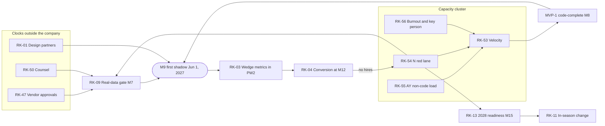
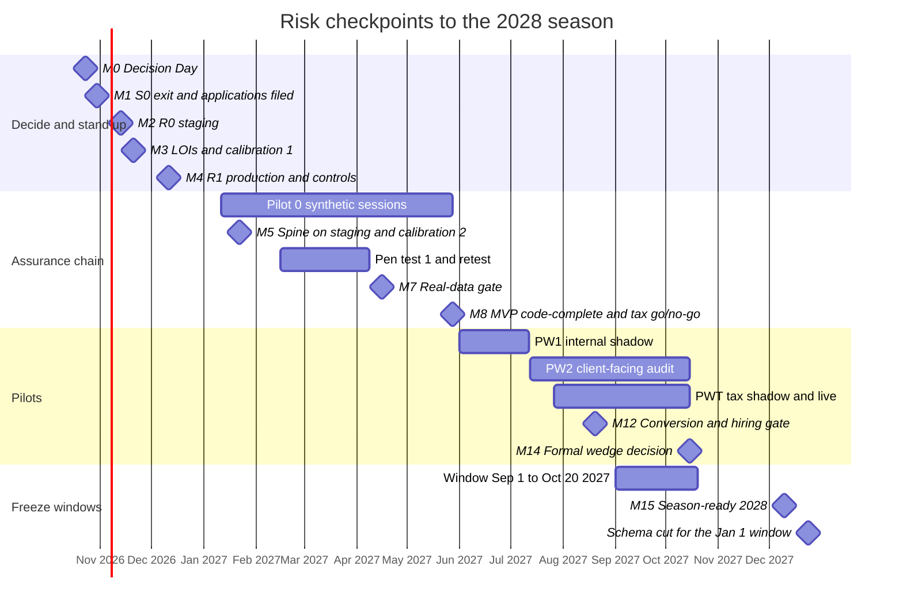

# 11 · Risk register

> Chapter of the Accrued engineering and build plan. Written Saturday 2026-10-17; Sprint 0 starts Monday 2026-10-19.
>
> **Readers.** Both founders and their Claude Code sessions. **N** = notanaskhan, the technical co-founder who built the repo and owns the red-zone backend. **AY** = ayushkbhatia, the product and design founder, who codes through Claude Code. **Counsel** = outside lawyer; AY runs the engagement (F-09).
>
> **What this chapter is.** One de-duplicated register of every risk raised in chapters 01 (§1.8.9), 02–06 and 09, in `wf1_summary.txt` and in the journeys, domain-compliance, integrations and engine digests. Each risk has one ID (`RK-nn`), a rating, a measurable early-warning signal, the mitigation the plan already schedules, a pre-agreed contingency, an owner, its epics, its decisions and ADRs, and a review cadence. It closes with a heat map, the top 12, the kill, pivot and stop-ship signals (the repo build plan's, updated for Accrued), and a calendar of risk checkpoints on chapter 01's milestones.
>
> **What wins.** Chapter 01 is the plan of record for dates, owners, epics and scope. Chapter 09 is the register of record for decision IDs (`DEC-01…DEC-99`, plus chapter 01's proposed DEC-100 and DEC-101) and proposed ADR IDs (`P-01…P-63`). Where a digest dated a risk differently (most often "before Jan 1, 2027"), this chapter re-dates it to chapter 01's calendar and says so in §11.2.2.
>
> **Reading the IDs.** Epics are bold (**P-04**, **T-01**). Proposed ADRs always carry the word ADR ("ADR P-07"), so they never read as the epic of the same number. Compliance requirements are "requirement R-04" and conflicts "conflict C-05", so they never read as the epics **R-01** or **C-01**. Scope exclusions are "exclusion X-01". Milestones are M0–M24, pilot windows PW0–PW5 and PWT, contracts C1–C21, write classes W1–W9 and invariants INV-1…INV-5 (chapter 01 §1.2).
>
> **Labels.** **(inferred)** marks this chapter's own reasoning where no source states it. Every rating is this chapter's judgement except the ten chapter 01 rated, which are kept. **[verify]** marks a vendor, legal or pricing fact to confirm before a contract or code depends on it.

---

## 11.0 The chapter in one screen

**63 risks in 8 categories.** 2 critical, 12 high, 43 medium and 6 low. N owns 27 rows, AY 18, both founders 17 and counsel 1.

| Rank | ID | Risk | L / I | Owner | Next checkpoint |
|---|---|---|---|---|---|
| 1 | RK-53 | Velocity below plan; frontend throughput on the Accrued kits unmeasured | H / H | both | M3 calibration, Fri Nov 20 |
| 2 | RK-54 | N's red lane is the bottleneck (PH2 demand 109%) | H / H | both | Red-review queue age, every Contract Monday |
| 3 | RK-01 | Design partners do not commit (none signed today) | M / H | AY | M1 Fri Oct 30 (≥6 conversations); M3 (≥2 LOIs) |
| 4 | RK-09 | Real-data gate (M7, Apr 16, 2027) slips | M / H | both | M4 Fri Dec 11 (auditor engaged, pen test booked) |
| 5 | RK-47 | Long-lead vendor approvals slip | H / M | AY | M1 Fri Oct 30 (every application filed) |
| 6 | RK-50 | Counsel deliverables late (§7216 text, MSA/DPA, Pub 1345, BAA) | M / H | counsel | Engagement signed by Fri Oct 30 |
| 7 | RK-55 | AY's non-code load starves the design-system lane (PH1 demand 114%) | H / M | AY | M3, then M5 |
| 8 | RK-03 | The audit-evidence wedge misses its kill/pivot metrics | M / H | both | PW1 exit Mon Jul 12, 2027 |
| 9 | RK-56 | Founder burnout and key-person concentration | M / H | both | Monthly |
| 10 | RK-11 | An in-season change breaks a live path | M / H | N | R4 Tue Aug 31, 2027 |
| 11 | RK-41 | Prompt injection and hostile client content | M / H | N | M6 pen test; M9 shadow |
| 12 | RK-13 | 2028 season readiness misses the Dec 24, 2027 schema cut | M / H | N | M15 Fri Dec 10, 2027 |

**What the register concludes.**

1. **The largest threat is capacity, not technology.** RK-53, RK-54, RK-55 and RK-56 are one cluster. The per-founder ledger runs at 104–114% in PH1–PH3, and N's red lane is the narrow pipe. The controls are the calibration gates (M3, M5, M8, M14, M15) and the pre-agreed cut tiers. Invoking a tier is routine operation, not failure.
2. **The binding chain to real data runs through people outside the company.** Design partners (RK-01), the SOC 2 auditor and pen tester (RK-09), counsel (RK-50) and vendors (RK-47) all start their clocks in S0. **F-09** is the most important non-code epic in the plan.
3. **Compliance risks are rated low-likelihood because the plan builds fail-closed gates before each data class.** They stay on an irreversible-harm watch list (§11.4.3) with stop-ship rules (§11.6.4), so their low score never means low attention.
4. **The tax pilot is the largest optional bet, and it is fenced.** The M8 go/no-go (Fri May 28, 2027) has explicit criteria. A NO-GO is a planned branch that frees about 110 tasks, not a failure.
5. **In-season risk arrives on Sep 1, 2027**, with the first busy-season window (ADR P-29) for EBP and tax firms. The freeze contract (chapter 01 §1.2.4) is the control, and it has no year-one exception.

**Operating rhythm (recommended).** Ten minutes of every Contract Monday go to the top 12 and the slack on critical paths CP-A and CP-B. The sprint review on Friday of week 2 reads the velocity log against RK-53…RK-57. The full register is reviewed quarterly with the restore drill and access review, and its security and compliance rows feed the SOC 2 risk assessment. Each M-gate reviews every row that names it (§11.7).

---

## 11.1 How to read and run this register

### 11.1.1 Scales

Ratings are **residual**: they assume the mitigations this plan already schedules happen on time. The contingency is what to do when they do not.

| Likelihood | Meaning, over the risk's horizon (before its gate, or the next 12 months if continuous) |
|---|---|
| **H** | More likely than not (> 50%), or already happening |
| **M** | Plausible (20–50%) |
| **L** | Unlikely (< 20%) given the planned controls |

| Impact | Meaning |
|---|---|
| **H** | Moves a dated gate (M7, M8, M9, M10, M11, M13, M15 or M16) by more than two weeks; or creates legal, regulatory, professional-standards or data-incident exposure; or loses a design partner or the M12 conversion gate |
| **M** | Consumes a cut tier or up to two weeks of slip; a SEV2; or a partner-visible defect fixed inside the window |
| **L** | Absorbed inside the sprint's 22.5% reserve, with no partner-visible effect |

**Score** = likelihood × impact, with H = 3, M = 2, L = 1. **Bands:** 9 critical · 6 high · 3–4 medium · 1–2 low.

### 11.1.2 Fields

| Field | Rule |
|---|---|
| **Early-warning signal** | Something measurable that changes *before* the impact lands, with a date or threshold where one exists |
| **Mitigation** | Controls already in the plan, with the epic or ADR that delivers them |
| **Contingency** | *Trigger → action.* Chapter 01's pre-agreed fallback where one exists (§1.2.2 gates, §1.8.4 cut tiers, §1.8.6 slip order); otherwise this chapter's recommendation |
| **Owner** | AY, N, both or counsel. The owner watches the signal and invokes the contingency; the owner does not do all the work. "N + counsel" means N owns the engineering and AY runs the counsel workstream |
| **Epics** | Chapter 01 §1.4 IDs |
| **DEC / ADR** | Chapter 09 IDs only. Chapter-minted proposal numbers from chapters 03, 05 and 06 are never cited |

### 11.1.3 Review cadence codes

| Code | When | Forum |
|---|---|---|
| **CM** | Every Contract Monday (day 1 of each sprint) | 10 minutes of the 60-minute slot |
| **SR** | Sprint review, Friday of week 2 | With the velocity log and capacity ledger |
| **Monthly** | First Contract Monday of each month | AI and compliance rows |
| **Quarterly** | With the quarterly restore drill and access review | Full register; SOC 2 risk-assessment export |
| **Gate** | At each M-gate the row names | Gate review (§11.7) |
| **Window** | At each R4 review (Aug 31, 2027 · Dec 10, 2027 · Aug 25, 2028 · Dec 8, 2028) and weekly inside each busy-season window (ADR P-29) | Release-train review |

### 11.1.4 Where the register lives

**Recommendation (inferred).** Keep this chapter as the baseline. Track the live status as GitHub issues titled `RK-nn: <title>` and labelled `risk`, the same pattern chapter 09 §9.1.1 uses for `decision` issues. Each issue body carries the rating, owner, signal, trigger and a status (*open · watching · triggered · retired*). Status changes in issues cost no build and no deploy, which honours the batch-merge working agreement. Re-ratings that change the top 12 are recorded at the next Contract Monday.

- **Numbers are never reused.** A retired risk keeps its ID, like ADR numbers.
- **Retire** a row when its gate has passed and no residual exposure remains.
- **Add** a row when a session, a retro or a postmortem finds a new risk. A SEV1 or SEV2 postmortem always checks whether its cause is already a row.
- **Claude Code sessions** follow one rule: if a task trips a row's early-warning signal (for example, it adds a matrix action, a write adapter or a migration after Jun 1, 2027), say so in the PR and link the `RK` issue. If a stop-ship condition (§11.6.4) occurs, stop and raise it.

---

## 11.2 Consolidation: sources and de-duplication

### 11.2.1 Source map

Every source risk maps to one or more RK rows. Where several sources raised the same risk, it appears once.

| Source | Items | Consolidated as |
|---|---|---|
| Ch. 01 §1.8.9, top risks | #1 velocity · #2 real-data gate · #3 N's red lane · #4 design partners · #5 compliance missteps · #6 in-season changes · #7 vendor dependencies · #8 data-model churn · #9 tax computation · #10 burnout | RK-53 · RK-09 · RK-54 · RK-01, RK-02 · RK-25, RK-27, RK-28, RK-32 · RK-11 · RK-47, RK-48, RK-49 · RK-16 · RK-19 · RK-56 |
| Ch. 01 §1.8.5, critical paths | CP-A … CP-I | CP-A → RK-09, RK-10 · CP-B → RK-54 · CP-C → RK-53 · CP-D → RK-12 · CP-E → RK-13 · CP-F → RK-19, RK-21 · CP-G → RK-49, RK-32 · CP-H → RK-14 · CP-I → RK-23 |
| Ch. 02 §2.3.1, debt register | D1–D18 | D1, D2 → RK-37 · D3–D7, D18 → RK-18 · D8–D11, D16, D17 → RK-57 · D12 → RK-10 · D13 → RK-42 · D14 → RK-15 · D15 → RK-29, RK-30 |
| Ch. 03 | §13 migrations · §14 busy-season targets · D-13 statutory tables in repo files | RK-16 · RK-20 · RK-36, RK-63 |
| Ch. 04 | FE-02 contrast · §10.6 screen sizing · FE-13 Undo (settled by DEC-24) · FE-21 handoff in the repo · §11 budgets | RK-22 · RK-53 · RK-40 · RK-37 · RK-20 |
| Ch. 05 §5.7.5 and §5.4–5.6 | Red-zone serialisation · methodology and Sheets late · TASK-014 blocked · SOC 2 timing pushes real-data AI · build-plan rule makes sessions refuse work · expiring flags · token-streaming expectations · library-agent content cost · threat table · eval gates · cost layers | RK-54 · RK-23 · RK-10 · RK-09, RK-42 · RK-57 · RK-15 · RK-62 · RK-61 · RK-41 · RK-42, RK-44 · RK-45 |
| Ch. 06 | §0.1 calendar · D-OPS-21 offshore access · §5.7 change management · §3.8 missing kill switches · §7.6 approvals · Appendix C facts to verify · §2.9 Actions cost | RK-09 · RK-26 · RK-30 · RK-11, RK-51 · RK-47 · RK-47, RK-05 · RK-05 |
| Ch. 09 | §9.2 row X-9 (freeze start) · §9.2 row X-10 (SAS 149) · §9.4.1 drafting load · §9.6–9.7 design gaps | RK-11 · RK-14 · RK-58 · RK-62 |
| `wf1_summary.txt` | Portal scope leaks "the highest-risk failure" · busy-season polling load · group-audit timing · frontend ≈10% of measured output · flags expiring in season · provider-terms register empty · conflicts with ADR-040, 005, 024, 065 and 111 | RK-24 · RK-20 · RK-14 · RK-53 · RK-15 · RK-42 · RK-33, RK-40, RK-46, RK-24 |
| Journeys digest §E | E1 e-signature · E2 ledger write · E3 model text to clients · E4 AI on real data · E5 write integrations · E6 firm-built agents · E7 group-audit timing · E8 missing boards · E9 portal mobile · E10 delegation · E11 vocabulary · E12 roles · E13 engagement types · E14 inbox semantics · E15 figures that disagree | RK-27 · RK-33 · RK-46 · RK-42 · RK-33, RK-48 · RK-23 · RK-14 · RK-62 · RK-62 · RK-62 · RK-17 · RK-24 · RK-16 · RK-16 · RK-62 |
| Domain-compliance digest §5 (20 ranked) | #1 §7216 · #2 provider terms · #3 8879 · #4 ERO creep · #5 archive integrity · #6 reserved judgment · #7 independence · #8 Safeguards · #9 SOC 2 · #10 retention · #11 legal-hold roles · #12 confirmation integrity · #13 PHI · #14 rules data · #15 licensed content · #16 residency · #17 timing misses · #18 ESIGN consent · #19 records requests · #20 CCPA terms | RK-25, RK-26 · RK-42 · RK-27 · RK-28 · RK-31 · RK-40 · RK-32 · RK-29 · RK-30 · RK-34 · RK-34 · RK-24 · RK-35 · RK-36 · RK-38 · RK-39 · RK-14 · RK-27 · RK-34 · RK-50 |
| Integrations digest §10 | #1 Wolters Kluwer · #2 first ledger · #3 CAS posting in MVP · #4 Intuit metering · #5 KBA vendor · #6 IRIS 1099 · #7 catalogue honesty · #8 Google CASA · #9 busy-season freeze · #10 seed hygiene | RK-48 · RK-49 · RK-33 · RK-49, RK-05 · RK-27, RK-47 · RK-28 · RK-60 · RK-47 · RK-12 · RK-62 |
| Engine digest §0 and §1.25 | 18 engine conflicts · SAS 149 "before Jan 1, 2027" · D1–D10 and X-01…X-08 guardrails | #1–3, 8–10, 15, 18 → RK-23 · #4–7 → RK-58 · #11 → RK-20 · #12 → RK-15, RK-63 · #13, 14 → RK-17 · #16 → RK-42 · #17 → RK-44 · SAS 149 → RK-14 · guardrails → RK-60 |
| Repo `docs/product/build-plan.md` | Phase 4 kill or pivot signals · Phase 0 discovery thresholds (left blank) · Phase 0 business and legal setup | §11.6 · §11.6.2 · RK-59 |

### 11.2.2 Risks retired or re-dated by chapter 01's calendar

Several digests wrote their risks against a Jan–Mar 2027 freeze and "before Jan 1, 2027" deadlines. Chapter 09 (row X-9) and chapter 01 removed both: no real data enters Accrued before Tue Jun 1, 2027, and the busy-season freeze (ADR P-29) starts per firm at first real data.

| As the source stated it | Why it changed | Now |
|---|---|---|
| Group-audit screens ship before Jan 1, 2027 or slip to 2028 (wf1, engine digest, journeys E7) | DEC-65: Dec-2026 and Dec-2027 year-ends are NO-GO at plan velocity; Dec-2028 is the target | RK-14, the residual commercial risk |
| Compliance-critical items by Dec 31, 2026; all agent migrations by the Dec 18 train (compliance digest §0.11, ch. 05 §5.7.1) | DEC-05 as amended by chapter 01: model migrations land before Jun 1, 2027; the 2028 window needs its schemas by Dec 24, 2027 | RK-16 and RK-13 |
| TY2026 rules tables by Dec 31, 2026 (compliance #14) | No TY2026 real data until the extension pilot | RK-36: TY2026 extension rules before Sep 1, 2027; TY2027 rules by Dec 10, 2027 |
| 2027-season integrations stable before Jan 1, 2027 (integrations §0.8) | First real tax use is the Sep and Oct 2027 extensions | RK-12 and RK-47 |
| First real firm in shadow Mon May 3, 2027 (ch. 06 D-OPS-01, ch. 09 DEC-05) | Chapter 01 §1.9 amends DEC-05 to Tue Jun 1 at honest velocity | RK-09 and RK-53 |
| SQMS 1 screens for the Dec 15, 2026 evaluation | Cannot make 2026; the Technology Resource Pack ships instead (**F-09**) | RK-14 |
| Seed AI consents expire Dec 31, 2026 (compliance §0.11) | The demo clock is fixed at Mon Sep 14, 2026, so the expiry is a seed fact, not a calendar risk (inferred) | RK-62 |
| 9 flags fail CI on Jan 5–13, 2027 (ch. 02 D14, ch. 05) | Renewed in the Dec 14–18, 2026 bundle | RK-15, residual |
| About 40% of N's capacity on agent work through December (ch. 05 §5.7.1) | Chapter 01 places runtime v2 in S29–S38 | RK-54 |

---

## 11.3 The register

Each category has a summary table and a detail table. Scores are L × I (§11.1.1).

### 11.3.1 Market and pilot

| ID | Risk | L | I | Score | Owner | Epics | DEC / ADR | Review |
|---|---|---|---|---|---|---|---|---|
| RK-01 | Design partners do not commit: fewer than 2 signed LOIs and no named target list per window by M3. None is signed today | M | H | 6 | AY | **F-09**, **Q-04** | DEC-05 · proposed DEC-100 | Weekly to M3, then CM |
| RK-02 | A partner disengages, or its champion leaves, during Pilot 0, shadow or live, so a window runs with one firm or none | M | M | 4 | AY | **F-09**, **Q-04**, **A-01** | DEC-05 · DEC-68 · ADR P-29 | CM from M5 |
| RK-03 | The audit-evidence wedge misses its kill/pivot metrics: portal activation, PBC delivered through the portal, evidence acceptance, request-to-accepted time | M | H | 6 | both | **R-01**, **P-06**, **A-01**, **Q-04** | DEC-05 · DEC-48 | Gate (M9, M10, M12, M14); weekly in PW2 |
| RK-04 | Paid conversion misses M12 (fewer than 2 of 3 partners sign season-2 agreements), so no hires and the spill list applies | M | M | 4 | AY | **F-09**, **Q-04** | proposed DEC-100 · proposed DEC-101 | Gate (M4, M12) |
| RK-05 | Runway: no revenue before the first client-facing month (Jul 2027) against a $125k–265k year-one external envelope (inferred; no source states the cash position) | M | H | 6 | both | **F-09**, **Q-01** | DEC-03 · proposed DEC-100 | Monthly |
| RK-06 | No qualifying tax partner: a CCH Axcess firm with 5–15 extended returns and a CCH admin in Pilot 0, so M8 criterion (b) fails | M | M | 4 | AY | **T-01**, **T-02**, **F-09** | DEC-49 · ADR P-18 | Gate (M3, M5, M8) |
| RK-07 | Pilot support exceeds the reserve (10% in shadow, 15–25% live, 25–30% in season) and starves planned work | M | M | 4 | both | **Q-04** | DEC-68 · ADR P-29 | SR from M9 |
| RK-08 | Positioning pressure: an incumbent or AI-native entrant ships comparable PBC and AI-evidence features before Jul 2027 (inferred; no source assesses competitors) | M | M | 4 | AY | **F-09** | proposed DEC-100 | Quarterly |

| ID | Early-warning signal | Mitigation | Contingency (trigger → action) |
|---|---|---|---|
| RK-01 | Fewer than 6 conversations booked by Fri Oct 30 (M1). Fewer than 2 LOIs or no named list per window on Fri Nov 20 (M3). No Pilot 0 session booked by Mon Jan 11, 2027 | AY's outreach to ≥6 firms from Oct 19; a named target list per window (audit/EBP, extension-season tax, CAS); a priced founding-partner agreement (50% of list for 24 months, cancel within the first 60 days of client-facing use); the SQMS 1 Technology Resource Pack sent to prospects by Dec 15 as a door-opener; Pilot 0 on the synthetic tenant from Jan 11; two audit windows plus a tax window widen the funnel | **< 2 LOIs at M3** → Pilot 0 continues on synthetic data and prior-year replay; PW1 slides to Jun 15 (chapter 01 M3). **No LOI by M5** → wedge review (§11.6) before spending PH2 capacity on client-facing surfaces |
| RK-02 | Two missed biweekly Pilot 0 sessions in a row; champion response > 5 business days; shadow exit not reached after 6 weeks; PW2 portal activation < 60% at week 3 | Named champion and success metrics in the agreement; shadow before live; Tue/Thu office hours; first response within 2 business hours in season; rollback on the day (flag off plus binder export); no onboarding between Jan 15 and Apr 15 | **A firm leaves** → flag off, binder export returns the evidence, data return and deletion per the exit terms; promote the next firm on that window's target list into the following window. **A window drops to zero firms** → run it as an internal shadow on prior-year replay |
| RK-03 | PW1 screener agreement with staff decisions < 90%, or dangerous-error recall below the eval floor (needs_revision recall ≥ 0.97); PW2 week 4 portal activation < 60% or PBC through the portal < 50%; median request → accepted no better than the firm's baseline by week 8 | Thresholds recorded before PW1 (§11.6.2); success metrics written into the agreement; MVP-1 scoped to the first season; screener, upload reviewer and matcher cleared on Bedrock; SHL-10 and HOME-01 lite show cited value to staff | **Amber** → fix the top-10 usability issues inside the window and extend PW2 to Oct-15 filers. **Red at M14** → pivot menu (§11.6.3) |
| RK-04 | Proposed DEC-100 undecided or contested at M4; partners decline to price season 2 in the July retros; usage falling in August | Pricing hypothesis tested in discovery and decided at M4; founding price from the first client-facing month; case study; season-2 agreement drafted by Jul 13 | **< 2 of 3 sign on Aug 20** → stay at two founders and pre-schedule the spill list (§1.8.6). **0 of 3** → wedge review (§11.6) |
| RK-05 | Monthly external spend above the envelope pro rata for 2 consecutive months; any quote > 25% above its §1.6.7 line (SOC 2, pen test, counsel, DocuSign ID Verification); GitHub Actions above $350 a month after going private | DEC-03 approves the year-one envelope with AWS budget alarms; every quote verified before contract [verify]; Actions minutes trimmed (stage 2 only on ready-for-review, backend shards skipped on frontend-only diffs); optional spend held (Google CASA only if a partner runs Gmail; Xero and NetSuite applications only on discovery evidence) | **Overrun** → defer optional vendors; a tax NO-GO at M8 also saves DocuSign ID Verification and delta #2. **Never** cut gate spend (SOC 2, pen test, insurance, counsel), because that removes the M7 path. Record the cash position and months of runway on Decision Day so this row can be rated on facts |
| RK-06 | No tax firm on the PWT target list at M3; the CCH admin misses the April–May Pilot 0 sessions; CCH format not signed off by Fri May 14, 2027 | A dedicated PWT target list (CCH Axcess Tax, 1065 and 1040 extensions); the Pilot 0 tax slice validates the import/export format on synthetic returns; counsel's §7216 text by M8 | **M8 NO-GO** → S16–S21 capacity goes to EBP workpapers and audit completion, or to **A-09** if an audit partner commits a Dec-2027 group audit and throughput is ≥ 110%; tax targets the 2028 extension season |
| RK-07 | Support hours above the reserve for 2 consecutive sprints; SEV3 backlog > 5 open items; first-response SLA missed twice in a month | Support reserve in the ledger (≈ 418 tasks over the horizon); AY owns triage and office hours, N owns SEV1/2; runbooks; the onboarding kit (bulk import, templates as database content) reduces setup work | **Trigger** → pause onboarding of the next firm; invoke the next cut tier instead of borrowing from the hardening reserve; bring the M12 hire forward if conversion passes |
| RK-08 | Partners cite a competing tool in discovery or retros; a partner's current PBC vendor ships AI screening | Differentiate on what the plan already builds: cited AI output with named humans deciding, the white-label portal, SOC 2 and §7216 posture, and coordination with the firm's own tools (binder export, CCH file bridge) | **Trigger** → re-test pricing (DEC-100) and lead with the trust story. Do not chase feature parity outside D1–D10 |

### 11.3.2 Timing and calendar

| ID | Risk | L | I | Score | Owner | Epics | DEC / ADR | Review |
|---|---|---|---|---|---|---|---|---|
| RK-09 | The real-data gate M7 (Fri Apr 16, 2027) slips: Type I report late, pen-test highs open, Bedrock register or evals not current, insurance, WISP or MSA/DPA missing | M | H | 6 | both (N controls; AY auditor, counsel, insurance) | **Q-02**, **Q-01**, **Q-03**, **F-09** | DEC-05 · DEC-26 · ADR P-55 | CM; weekly from Mon Mar 1, 2027 |
| RK-10 | Staging (R0, Fri Nov 13) or production with canary (R1, Fri Dec 11) is late. TASK-014 has been blocked since Oct 6 and nothing is deployed | M | M | 4 | N | **Q-01**, **F-01** | DEC-03 · DEC-22 · ADR P-55 · ADR P-56 | Weekly to M4 |
| RK-11 | An in-season change breaks a live path inside a busy-season window under ADR P-29 (Sep 1 – Oct 20, 2027 for EBP and tax firms; Jan 1 – Apr 20, 2028 for every live firm) | M | H | 6 | N | **Q-04**, **F-01**, **Q-03** | DEC-68 · DEC-54 · ADR P-29 · ADR P-56 | Window |
| RK-12 | The tax-pilot chain (CP-D, ≈ 2 weeks slack) misses the Sep 1 window: delta #2 findings, DocuSign ID Verification, CCH validation or the **T-01** gate late | M | M | 4 | both (N **T-01**, **N-02**; AY **T-02**) | **T-01**, **T-02**, **N-02**, **K-02** | DEC-25 · DEC-49 · DEC-52 · DEC-85 · ADR P-12 · ADR P-18 · ADR P-26 | Gate (M8, M11, M13) |
| RK-13 | 2028 season readiness (CP-E, ≈ 1 sprint slack) misses the Dec 24, 2027 cut for the completion, release, archive and runtime-v2 schemas | M | H | 6 | N | **A-06**, **A-07**, **P-10**, **T-03**, **N-04** | DEC-83 · DEC-71 · ADR P-43 · ADR P-47 | CM from S24 |
| RK-14 | Group audit (Dec-2028 year-ends) and QM screens (the Dec 15, 2028 SQMS cycle) arrive later than partners with those needs expect | M | M | 4 | both | **A-09**, **A-03**, **Q-05**, **F-09** | DEC-65 · DEC-66 · DEC-67 · ADR P-63 | Gate (M3, M8, M12, M19) |
| RK-15 | Flag expiries inside a window turn CI red (9 flags expire Jan 5–13, 2027; every later renewal) | L | M | 2 | N | **F-01**, **Q-04** | DEC-55 · ADR P-28 | Gate (M4; each R4) |

| ID | Early-warning signal | Mitigation | Contingency (trigger → action) |
|---|---|---|---|
| RK-09 | Auditor engagement letter unsigned on Dec 11 (M4); pen-test vendor not booked by Dec 11 (chapter 06 recommends Dec 4); provider-terms entry not drafted by Dec 11; counsel drafts not in by Fri Jan 29; readiness gaps open on Fri Feb 26; any critical or high finding open on Fri Mar 26, two weeks before the Apr 9 retest deadline. SOC auditors are CPA firms in their own Jan–Apr season, so fieldwork slots are the long pole | Every clock started in S0 (DEC-17); production from Dec 11, so controls operate 11 weeks before the Mar 1 as-of date; compliance tool chosen by Oct 30; pen test Feb 15 – Mar 5 on the production-equivalent build; **Q-03** reserve funds remediation; ≈ 6 weeks of CP-A slack to Jun 1 | **Type I report late** → gate moves to Fri May 14, shadow to Jun 15, R3 to Jul 27 (tier 3). There is no exception path (DEC-05): real data never enters on the promise of a report |
| RK-10 | AWS organisation and Control Tower not live by Oct 30 (M1); Terraform staging not applied from CI by Fri Nov 6; WorkOS still "pending" on the allowlist on Nov 13; restore-drill tooling not ready by Fri Dec 4 | DEC-03 on Decision Day unblocks TASK-014; **Q-01** partly reserve-funded; ECS Fargate, RDS and Temporal Cloud (no Kubernetes); fake OIDC on synthetic staging if WorkOS slips; build-once-promote with the release-manifest PR | **R1 late** → each week of slip moves the Type I as-of date one week (chapter 01 M4). **Slip > 3 weeks** → apply the M7 May 14 fallback early and re-plan PW1 to Jun 15 |
| RK-11 | Hotfix lane used more than once a week inside a window; a flag flip requested outside the Tuesday 7 pm CT slot; a non-expand-only migration in a window; a live-path PR labelled "feature"; the deploy lock bypassed | The freeze contract (§1.2.4): defect-only changes on live paths; new modules dark behind default-off flags; expand-only migrations after 8 pm CT; Tuesday flips with staging e2e, a shadow run, a written rollback and both founders' approval; no promotion in deadline weeks; weekly release train; no year-one exception | **Break on a live path** → flag off for the affected firm; roll back through the release-manifest PR; read-only mode for a data-integrity incident; the binder export lets the firm continue in its own tool; postmortem within 5 business days whose action is a test, rule or alert |
| RK-12 | Any M8 criterion not green on May 28 (throughput < 95%, partner, counsel text, DocuSign ID Verification contract); delta #2 highs open on Wed Aug 11; a CCH reconciliation failure on any shadow return Jul 27 – Aug 13 | Go/no-go at M8 with explicit criteria; shadow Jul 27 – Aug 13 before live; record-mode signatures first (C7 record mode in S14); the TRI gate fails closed and tax agents stay off unless the taxpayer consented and the agent cleared | **M11 at risk** → the pilot narrows to Sep 30 (1041) and Oct 15 (1040) filers. **M13 at risk** → 8879 falls back to record mode. **NO-GO at M8** → tax moves to the 2028 extension season |
| RK-13 | An **A-06** or **A-07** schema PR not merged by S28 (one sprint before M15); **P-10** runtime-v2 schema not on `main` by Dec 10; the December load test fails; TY2027 rules or organizers not loaded through admin import by Dec 10 | The M15 checklist; schemas land before the Jan 1 window and code merges dark; the per-firm Tuesday flip on Mar 21, 2028 follows a shadow on one engagement; ADR P-43 and ADR P-14 accepted in 2026 | **Cut missed** → late items stay dark until after Apr 20, 2028, and Dec-YE reports are issued from the firm's tool through the binder export (M16 fallback) |
| RK-14 | An audit partner makes group audit for Dec-2027 year-ends a condition; a partner needs SQMS 1 monitoring screens for its 2027 cycle | DEC-65 records Jun-2027 and Dec-2027 as NO-GO at plan velocity; AUD-31 single-entity mapping in **A-03** (S20–S23) de-risks the taxonomy; the fallback of upload TBs, manual eliminations and component rooms on POR-14; the SQMS 1 Technology Resource Pack by Dec 15, 2026 | **Partner insists** → Dec-2027 group audit only as the M8 alternative to the tax pilot (throughput ≥ 110% and a committed partner) or with the M12 hires; otherwise Dec-2028 year-ends behind `ff.group_audit` (M19) |
| RK-15 | Renewal PR missing from the Dec 14–18, 2026 bundle; any flag whose expiry falls inside the next window at an R4 review | Renew the 9 flags in the Dec 14–18 bundle; module enablement moves to database entitlements (ADR P-28), so flags carry rollout only; every renewal calendared to expire outside a window (≤ 90 days, ADR-089) | **Expired flag fails `make check-fast`** → hotfix-lane renewal PR with no feature content |

### 11.3.3 Technical

| ID | Risk | L | I | Score | Owner | Epics | DEC / ADR | Review |
|---|---|---|---|---|---|---|---|---|
| RK-16 | Data-model churn after real data: a breaking change to work items, requests, client grants, roles or the review grammar is needed after Jun 1, 2027 | L | H | 3 | N | **F-03**, **P-04**, **P-03**, **P-06**, **P-08** | DEC-06 · DEC-07 · DEC-09 · DEC-33 · DEC-34 · DEC-36 · ADR P-04 · ADR P-38 · ADR P-07 · ADR P-09 | Gate (M5, M8) |
| RK-17 | Status vocabulary drift: the handoff's draft `lib/status.js`, or the repo's request `received` (which means Accrued's "Uploaded – needs review"), leaks into code and mislabels evidence | L | H | 3 | both (AY the YAML; N codegen and migration) | **F-03**, **F-05**, **P-06** | DEC-08 · DEC-09 · ADR P-34 · ADR P-44 | Gate (M2) |
| RK-18 | The delivery system is not trustworthy: PR CI red since Oct 7, nightly e2e red, stage 2 not run on `main`, 55 deferred AC suites, an empty security suite | L | H | 3 | N (AY writes the AC tests) | **F-01**, **Q-03** | DEC-02 · DEC-10 · ADR P-02 | Weekly to M1, then SR |
| RK-19 | Deterministic engines produce wrong numbers: tax engines (MACRS, §706(d), §752, PTET rounding, DNI), sampler, materiality, SUM, EBP tie-outs | M | H | 6 | AY | **A-03**, **A-04**, **A-05**, **A-06**, **T-04**, **T-05**, **T-06**, **T-07** | DEC-76 · DEC-77 · DEC-81 · DEC-84 · ADR P-57 · ADR P-62 | Gate (M8, M15, M17, M18) |
| RK-20 | Busy-season load exceeds capacity: polling until SSE, peak uploads, OCR, and provider quotas (Bedrock, Textract, SES, QBO) | M | M | 4 | N | **Q-01**, **P-10**, **P-09**, **Q-03** | DEC-23 · ADR P-15 · ADR P-47 | Window (December load test) |
| RK-21 | The document pipeline (OCR, word boxes, regions, masked renditions with logged reveal) is late or inaccurate, delaying notices, tax forms and bank statements | M | M | 4 | N | **P-11**, **P-03**, **N-04**, **T-04**, **C-01** | DEC-42 · ADR P-32 · ADR P-48 | CM from S17 |
| RK-22 | The design-system cut stalls or fails AA: Atelier replaced in one cut, the AA ink ladder, parity tiers, 51 legacy screens | M | M | 4 | AY | **F-05**, **F-06** | DEC-04 · DEC-11 · DEC-15 · DEC-16 · ADR P-03 | SR to M5 |
| RK-23 | The configurable engine, Sheets and the editor (**K-03**, **K-04**, **F-08**, **A-10**) prove larger than sized, pushing engine-based journeys past M22 | M | M | 4 | N | **K-03**, **K-04**, **F-08**, **A-10**, **X-01** | DEC-56 · DEC-80 · DEC-90 · ADR P-41 · ADR P-59 · ADR P-22 | Gate (M21, M22) |

| ID | Early-warning signal | Mitigation | Contingency (trigger → action) |
|---|---|---|---|
| RK-16 | A PH3 design needs a DROP, RENAME or type change on a table holding real data; a migration PR after Jun 1 that is not expand-only; a vN+1 request for C1, C3 or C5 after S15 | The model migrated once, before data (**F-03**, S0–S4: work items for all five kinds, the request enum, client grants, roles, review-grammar and citation-v2 schemas); single reversible migrations until Jun 1 (ADR P-38), strict expand/contract after; the contract register with consumer tests in the provider's CI | **Breaking change needed** → expand/contract with a throttled Temporal backfill and dual read; the contract step lands in a later batch outside any window; inside a window the feature stays dark until it closes |
| RK-17 | A PR importing values from `lib/status.js`; status words in copy that are not in `status-vocabulary.yaml`; exhaustiveness-test (L11) failures; about 40 objects still using unregistered words (gap N-06) | One registry generated from blueprint §3.3.1, addendum §3.2 and gap §6.5 into StrEnums, OpenAPI enums and `status.ts` (ADR P-34); the request enum migrated in S1 to draft · requested · uploaded · received · returned · not_applicable (ADR P-44); the glossary PR by Oct 30 | **Drift found** → block the merge on registry drift; fix the data in one migration while pre-launch |
| RK-18 | `main` not green 5 days running by Oct 30; e2e not green 3 nights running; `backend/tests/security/` still empty in S2; an AC back-fill tranche behind (red zone first); coverage below 95% with no ratchet date | **F-01** S0 checklist (ruleset, stage 2 on `main`, stale assertions fixed, shard timings refreshed, path filters); ADR-078 independent tests restored in the other founder's session; **Q-03** back-fills the 55 suites, red zone first, before real data (PH2 exit); mutation testing on red modules; DEC-10 coverage ratchet | **Signal fires** → merge freeze (fix PRs only) until `main` is green; red-zone feature PRs wait for their back-filled suite; the escaped-defect log directs extra back-fill |
| RK-19 | Golden fixtures disagree with specs (the blueprint §9.8 seed already disagrees with TXP-02 on Schedule L lines); CPA review findings; any reconciliation difference to CCH on a pilot return; the materiality golden (252,200 / 189,150 / 12,610) failing after a refactor; a property test finding a rounding split that does not foot | Pure-function engines stamped with `engine_version` and `inputs_hash`; blueprint §9.8 golden tests and Hypothesis invariants; CPA review before M18; CCH stays the engine of record (DEC-77); golden-tested parameters in repo files reviewed yearly with a CPA, calendars in the database (ADR P-62); a seeded, versioned sampler (ADR P-57) | **Wrong number found** → the engine output shows as shadow and is not used for decisions; a correction ships as a new engine version, never an in-place change to signed figures; 1065 depth stays in shadow and the coordination kit carries the season (M18 fallback) |
| RK-20 | The December load test at ×100 (ADR-075) misses p95 targets (lists ≤ 500 ms, mutations ≤ 400 ms, commit → SSE ≤ 2 s); RDS connections > 70% at peak; provider quota increases not requested by November; Fargate scaling events in a deadline week | Read models over joins; composite and partial indexes; RDS Proxy or PgBouncer in transaction mode; per-firm fair queuing and admission control; polling only while visible and running; one SSE stream per tab (ADR P-15) from **P-10**; quota increases requested each November | **Target missed** → raise polling intervals by flag; scale RDS vertically; pause batch work classes (agent columns, insights) in deadline weeks; read-only mode as the last resort |
| RK-21 | The **P-11** OCR slice not started by S28; notice extraction on the synthetic CP2000 set below the eval bar; no Textract provider-terms entry | Amazon Textract inside the AWS boundary with a provider-terms entry (ADR P-32); citations v2 with regions (ADR P-48); immutability kept through the pipeline; a manual-keying path designed for every OCR surface | **Late or inaccurate** → notices launch with upload plus human extraction and code comparison; the **T-04** shadow from Mar 20, 2028 uses manual entry for unreadable forms |
| RK-22 | DS-S1 tokens not merged by Oct 30; axe failures on gallery specimens; tier-A parity failures > 0.5% for 2 sprints; legacy screens still on Atelier at M5 | One cut behind a codemod (DEC-04); the AA ladder (ink-2 .70, ink-3 .66) with reference-contrast mode for parity runs only (DEC-11); the in-app gallery with Playwright parity and axe; legacy screens moved under the new shell and replaced epic by epic | **Stall** → parity tiers B and C stay advisory; tier-3 kits defer by one sprint; nothing ships below AA |
| RK-23 | **K-03** (4.4 FW) over by > 25% at mid-window; the engine conflicts not settled by their DEC dates; T18 and T20 kits not at parity by S55 | D3 hybrid: designed audit, tax and close workpapers never need the engine; the engine lands in PH6, after real usage; one editor at a time and no CRDT (ADR P-59); templates v2 (ADR P-41); the spill list | **Over size** → spill items 1–10 move after GA; engine-based P2 depth follows GA; GA keeps Aug 31, 2029 |

### 11.3.4 Security and compliance

| ID | Risk | L | I | Score | Owner | Epics | DEC / ADR | Review |
|---|---|---|---|---|---|---|---|---|
| RK-24 | Tenant, wall or portal-scope leak: a firm, client, third party, K-1 recipient or component auditor sees data outside its scope (INV-3, INV-4) | L | H | 3 | N | **P-08**, **P-06**, **R-01**, **G-01**, **A-09**, **Q-03** | DEC-33 · DEC-34 · DEC-43 · DEC-63 · DEC-67 · ADR P-06 · ADR P-09 · ADR P-10 | CM; each pen test |
| RK-25 | §7216: tax return information (TRI) reaches a model or an offshore user without the per-taxpayer consent set (both spouses on joint returns) | L | H | 3 | N + counsel | **T-01**, **Q-02**, **G-02**, **T-02** | DEC-49 · DEC-52 · ADR P-12 | Monthly; weekly in PWT |
| RK-26 | Offshore support access: content-level support sessions on TRI tenants by Accrued staff outside the US before counsel answers chapter 06's D-OPS-21 | M | M | 4 | both + counsel | **Q-02**, **G-04**, **Q-04** | DEC-52 · DEC-72 · ADR P-12 | Gate (M7, M11) |
| RK-27 | Invalid Form 8879 authorizations: the wrong KBA-failure flow, missing evidence items, amount drift after signing, SMS-only identity, missing ESIGN consumer consent | L | H | 3 | N + counsel | **N-02**, **T-01**, **K-02** | DEC-25 · DEC-85 · ADR P-26 | Gate (M8, M13); weekly in PWT |
| RK-28 | Accrued drifts into ERO or transmitter duties (MeF, ETIN, IRIS TCC) | L | H | 3 | both | **T-01**, **C-02** | DEC-49 · ADR P-18 | Gate (M11, M21) |
| RK-29 | Safeguards Rule gaps at the real-data line: portal MFA optional (ADR-030), no incident register or FTC clock, no DPA notification SLA, no WISP | L | H | 3 | N (AY WISP and DPA) | **Q-02**, **G-02**, **P-08**, **P-01** | DEC-22 · DEC-34 · DEC-35 · ADR P-54 · ADR P-09 | Gate (M7) |
| RK-30 | The SOC 2 report is qualified, or the Type II window logs exceptions, most likely in two-founder change management with AI-authored code | M | M | 4 | N (AY policies and vendors) | **Q-02**, **F-01**, **Q-03** | DEC-02 · DEC-26 · ADR P-02 · ADR P-56 | Quarterly; monthly May–Jul 2027 |
| RK-31 | Archive integrity is not provable: hash chain deferred, rows mutable after lock, Object Lock GOVERNANCE only, run traces expire before packaging (AU-C 230) | L | H | 3 | N | **Q-02**, **A-07**, **P-10**, **Q-05** | DEC-71 · DEC-83 · ADR P-43 · ADR P-14 · ADR P-47 | Gate (M7, M15, M16) |
| RK-32 | The product impairs independence: CAS posting or policy acceptance for an attest client; G2 not blocking sign-off | L | H | 3 | N (AY the CLI-08 UI) | **C-02**, **P-07**, **G-01** | DEC-53 · DEC-69 · DEC-91 · ADR P-13 · ADR P-16 · ADR P-08 | Gate (M20, M21) |
| RK-33 | An external write (W7 DocuSign, W2 CCH export, W6 send-as, W1 QBO posting, W5 GRC sync, W8 webhooks) runs without approval, runs twice, or reaches the wrong system | L | H | 3 | N | **A-02**, **N-02**, **T-01**, **N-03**, **C-02**, **X-02**, **G-03** | DEC-46 · DEC-69 · ADR P-17 · ADR P-16 · ADR P-18 · ADR P-60 · ADR P-21 | Gate (before each first write) |
| RK-34 | Retention, legal hold, destruction or client-records errors: one global retention setting today, holds not reference-counted, export without dual control | M | M | 4 | N + counsel | **Q-02**, **Q-05**, **A-07** | DEC-71 · DEC-72 · ADR P-14 · ADR P-31 | Quarterly |
| RK-35 | PHI enters evidence (health and welfare plan audits, health-tech SOC clients) without a BAA chain | L | H | 3 | AY + counsel (N the PHI flag) | **Q-02**, **A-05**, **F-09** | DEC-26 · DEC-52 | Gate (M7, M9) |
| RK-36 | Seasonal rules data wrong or hard-coded: due dates, disaster postponements, the 8879 form set and Pub 1345 tolerances, 1099 thresholds | M | M | 4 | AY (N the service) | **K-02**, **T-03**, **T-08**, **C-02** | DEC-76 · DEC-85 · ADR P-62 | Window |
| RK-37 | Repository and supply-chain exposure: the repo public since Oct 4, secrets in history, unvetted dependencies, handoff images in git | L | H | 3 | N | **F-01**, **Q-01** | DEC-02 · DEC-16 · DEC-18 · ADR P-02 | Weekly to M1; quarterly |
| RK-38 | Licensed-content exposure: AICPA standards text, TSC criteria, publisher methodology, research corpora | L | M | 2 | AY | **K-01**, **K-05**, **X-01**, **T-09** | DEC-19 · DEC-94 | Quarterly |
| RK-39 | Data residency or sub-processor disclosure drift: a resource outside us-east-2/us-west-2, a Bedrock global profile, ADM-04 naming Anthropic as the client-data processor instead of AWS Bedrock | L | M | 2 | N | **Q-01**, **Q-02**, **G-02** | DEC-03 · DEC-52 · ADR P-55 · ADR P-12 | Quarterly |

| ID | Early-warning signal | Mitigation | Contingency (trigger → action) |
|---|---|---|---|
| RK-24 | Any failure in `test_portal_scope_isolation.py`, `test_walls_and_need_to_know.py`, `test_tenant_isolation.py` or the INV-3/INV-4 journey assertions; a pen-test #1 or delta #1 finding on role union or host pinning; an SSE stream that stays open after a wall change; a notification row that stores client content as text | Forced RLS across 4 database roles (kept); `visible()` generalised to five scope kinds (ADR P-06); `client_access_grants` with role union and `scope_only` (ADR P-09); stricter-only role overrides (ADR P-10); walled rows answer 404 with no hidden-by-wall counts (DEC-43); the host is a branding hint only; generated allow/deny tests; pen test #1 covers tenant isolation and role union; delta #1 before client-facing use | **Leak confirmed** → SEV1 and stop-ship (§11.6.4): disable portal sign-in or switch to read-only mode, preserve logs, notify affected firms within 72 hours under the DPA with counsel's templates; resume only with a regression test and both founders' approval |
| RK-25 | §7216 consent text not counsel-approved by May 28 (M8 criterion c); the property test "every `tri` capability refuses without both consents" missing from CI; any `consent_7216` refusal not audited; an offshore user receiving TIN plaintext in `test_tri_and_offshore.py`; a provider-terms change without the re-consent flag | The TRI data class and gateway condition 6, failing closed, in **T-01** before M11; checks at the tool layer and at the gateway; both spouses on joint returns; agents never receive full TINs; offshore masking server-side; consent recipients generated from the register (naming AWS Bedrock); an agents-off path tested end to end; delta #2 covers TRI and the consent gate | **Breach or near-miss** → tax agents off for the firm (the pilot is designed to work agents-off); platform AI pause; SEV1 with counsel; Accrued gives the firm the facts for its own notifications |
| RK-26 | No counsel answer on D-OPS-21 by M7; an on-call rota for a TRI tenant with no US-located responder; a TRI-tenant support request outside US-staff hours. Chapter 06 inferred from commit timestamps that some repo work happens outside the US, so the rota needs checking | DEC-72: content sessions on TRI tenants are run only by US-located staff until counsel answers; sessions scoped per return or work item, at most 2 hours, approved by the firm; metadata-only emergency path | **No US-located responder** → metadata-only support for TRI tenants and firm staff reproduce the issue on a screen share. **Counsel requires offshore-disclosure consents** → add them to the consent set (requirement R-02) before PWT |
| RK-27 | DocuSign ID Verification contract unsigned at M8; counsel has not confirmed this season's Pub 1345 tolerances by Mon Aug 2, 2027; the re-lock test (drift > $50 to total income or AGI, or > $14 to total tax, withholding, refund or amount owed) failing; SIG-01 still shows the "24-hour lockout" copy (design follow-up DF-11) | Provider-hosted KBA (conflict C-06); handwritten fallback after 3 failures (conflict C-05); the 5-item evidence package in COMPLIANCE-mode storage with a 3-year floor; ERSD acceptance stored; SMS-only identity refused; the amount-hash re-lock with tolerances as database rows; record mode first | **Any criterion unmet** → 8879 in record mode (tier 3: import the firm's own provider evidence); the ERO collects wet signatures; affected returns are re-signed before transmission in CCH |
| RK-28 | A partner asks Accrued to transmit returns or file 1099s through IRIS; a PR adding MeF, ETIN, EFIN or IRIS TCC code; copy implying Accrued files | Requirement R-04 and ADR P-18 ("never transmit"); TAX-12 records a human "Mark transmitted"; CLS-13 exports a file; "never ERO or transmitter" tests in **T-01**; no IRS applications (chapter 06 D-OPS-18) | **Request or PR** → decline and route the filing to the firm's engine. Revisit only through a new ADR after counsel |
| RK-29 | **G-02** security center (S9–S14) slipping past S13; MFA enforcement for portal owners and signers untested on staging by M6; incident register and FTC clock absent from the compliance kernel at M6; WISP not approved by early April | M7 criteria: MFA for staff and for portal owners and signers; incident register with the FTC clock; WISP; DPA with a 72-hour notification SLA; ADR P-54 (WorkOS AuthKit with mandatory MFA); ADR P-09 (MFA on TRI, signing and approving scopes); the Pub 5708 "Accrued controls" WISP section | **Gap at M7** → no exception: the gate holds and M7 moves (RK-09). A Qualified Individual's written exception is not a substitute for portal MFA on TRI scopes |
| RK-30 | Readiness in the compliance tool shows failing change-management controls in February; any ruleset bypass or emergency-bypass issue in a window; a PR merged without the non-author's approval; a missed quarterly access review or restore drill | Rulesets with the non-author's code-owner review and no bypass actors; the release-manifest PR for production; PRs record the authoring and reviewer models (ADR-084); Claude Code sessions are tools, never reviewers; quarterly access reviews and restore drills; controls operating from Dec 11 | **Exception logged** → remediate and retest; disclose it with a remediation letter in the vendor-diligence pack; extend the Type II observation window if exceptions cluster |
| RK-31 | Hash chain not in the compliance kernel by M7; `test_immutability.py` not covering locked-engagement rows; the **A-07** seal manifest not in COMPLIANCE mode on staging by S30; a run adopted 90 days earlier failing to export with its tool calls | ADR-007 hash chain pulled into **Q-02** (conflict C-13); database immutability triggers with an enumerated `archived_write` exception; seal manifests in COMPLIANCE mode and evidence in GOVERNANCE with bypass denied (chapter 06 D-OPS-06); decision-relevant run records persisted (ADR P-47, conflict C-12); integrity sweeps | **Unproven at M16** → reports are released from the firm's tool through the binder export. **Integrity mismatch** → SEV1 and stop-ship |
| RK-32 | A seed or pilot client holding both an audit and a CAS engagement with W1 posting enabled in tests; the attest flag not derived across engagements in the **C-02** shadow | Attest flag derived across engagements (ADR P-13); W1 hard-off for attest clients under the ET 1.295 lock; the policy principal stays dormant and never applies to attest clients (ADR P-08); G2 blocks assignment and sign-off; annual and per-assignment independence confirmations (DEC-91) | **Signal fires** → the write-capability kill switch for that capability and firm; JE export instead of posting |
| RK-33 | A write-adapter PR without a `write-capabilities.yaml` entry; `test_connector_write_interception.py` failing; a missing idempotency key; no delta pen test booked before a first write (W1 Nov 2028, W6 Feb 2029, API and MCP Jul 2029) | One framework, ADR P-17, with per-adapter ADRs only where a new trust boundary is crossed; every write human-approved, idempotent, dry-run first, read back and shown in a client-visible log; `connections` stays read-only; a delta pen test before each new real-data write surface; W7 DocuSign is the first entry | **Bad write** → write-capability kill switch; the "Export instead" path; a reversing entry approved by a named human; incident record with the client-visible log as evidence |
| RK-34 | Per-record-type retention floors missing from the kernel at M7; hold reference counting failing tests; a staging destruction batch touching held records; a client-records request that cannot be produced within the DPA SLA | ADR P-14: retention per record type and service line, reference-counted holds, dual-approved crypto-shred batches with certificates; dual-approval firm export (DEC-72); counsel confirms the floors; **Q-05** destruction UI in Q4 2028; client withdrawal only of unaccepted uploads (ADR P-31) | **Error found** → freeze destruction batches until fixed; restore from backup within retention; disclose to the firm |
| RK-35 | A pilot engagement list includes a health and welfare plan or a health-tech client before a BAA chain exists; screening flags PHI in an EBP census | The `phi` tag (DEC-52); BAA posture in the M7 diligence pack; an AWS BAA; the founding-partner agreement includes a BAA where plan PHI is possible; census masking with logged reveal | **PHI engagement proposed** → exclude it from the pilot until the BAA chain is signed. **PHI arrived unexpectedly** → purge through the ADR P-31 / ADR P-14 path and tell the firm |
| RK-36 | TY2026 extension rules (due dates, holidays, the 8879 form set, Pub 1345 tolerances) not loaded through admin import by Aug 2, 2027; a disaster postponement announced with no named rules owner; rules edited in a code PR | Effective-dated rules tables as database content (C21, **K-02**) edited through admin import; frequently changing calendars in the database and golden-tested parameters in repo files (ADR P-62); a named content owner; a yearly CPA review | **Wrong rule found** → correct it through admin import (no deploy); notify affected firms; re-lock affected 8879s |
| RK-37 | A gitleaks finding; the repo still public after Tue Oct 20; a dependency PR that bypasses the allowlist; a PNG or handoff image staged in git | Secret scan, then rotation, then private on day 1; Team plan with rulesets, push protection, CodeQL and Dependabot; dependencies only through the protected allowlist; images pinned by digest; a text-only handoff mirror (DEC-18), never the 1.1 GB of PNGs; Claude Code never runs with production credentials or real client documents | **Exposure found** → rotate the credential; record it in the SOC 2 risk assessment; incident review |
| RK-38 | A knowledge import containing licensed text; licensed-text detector hits in evals; a real publisher's name in a content pack | ADR-056 licence gating; fictional publishers only (D8); research corpus limited to the public IRC, regulations and rulings (DEC-94); the detector eval at 0 hits | **Hit** → hide the text on licence expiry or removal; notify affected firms |
| RK-39 | A Terraform plan creating resources outside us-east-2 and us-west-2 (beyond the allowed global services); a sub-processor added without a register entry; ADM-04 copy naming Anthropic as the client-data processor (gap N-02) | SCP region deny; the sub-processor list and consent recipients generated from the provider-terms register; re-consent on any material register change; Bedrock model-invocation logging off | **Drift** → revert the configuration; trigger re-consent; update the trust page |

### 11.3.5 AI and model

| ID | Risk | L | I | Score | Owner | Epics | DEC / ADR | Review |
|---|---|---|---|---|---|---|---|---|
| RK-40 | An agent takes, or appears to take, a final verb: sign off, release, send, post, export, transmit or decide (INV-1) | L | H | 3 | N | **P-04**, **Q-02**, **P-10**, **W-02**, **K-04** | DEC-24 · DEC-28 · DEC-36 · DEC-50 · DEC-53 · ADR P-07 · ADR P-35 · ADR P-08 · ADR P-49 | CM; each new matrix action |
| RK-41 | Prompt injection and hostile client content (hidden text, instruction-in-file, poisoned memory, firm-instruction abuse) mislead screening or attempt exfiltration | M | H | 6 | N (AY drafts the threat model) | **Q-02**, **P-10**, **W-02**, **G-02**, **K-05** | DEC-41 · DEC-87 · DEC-90 · ADR P-46 · ADR P-24 · ADR P-52 | Monthly; each prompt change |
| RK-42 | Agents are not cleared on Bedrock for the pilot: register entry, route parity, real-model passes (the screener has none yet) or the firm's opt-in missing | M | M | 4 | N | **Q-02**, **G-02** | DEC-41 · DEC-48 · ADR P-46 · ADR P-48 | Gate (M5, M7, M10) |
| RK-43 | A model or provider change: a pinned model retired, a Bedrock quota or price change, behaviour drift after an upgrade | M | M | 4 | N | **Q-02**, **P-10**, **Q-03** | DEC-41 · DEC-87 · ADR P-46 · ADR P-47 | Monthly; Window |
| RK-44 | Output quality drift and automation bias: an override rate above the 8% tolerance, busy reviewers accepting wrong suggestions | M | M | 4 | AY | **I-03**, **Q-05**, **P-04**, **G-02** | DEC-50 · DEC-96 · ADR P-49 | Monthly from M10 |
| RK-45 | Agent cost runs away or the margin breaks: triggers, columns and schedules burn minutes; USD per agent-minute falls below its floor | L | M | 2 | N | **P-10**, **G-04**, **W-03**, **K-03** | DEC-51 · DEC-55 · ADR P-28 · ADR P-50 · ADR P-51 | Monthly from M17 |
| RK-46 | Model-drafted text reaches a client or an agency with an error (professional-liability exposure) | L | H | 3 | both | **N-03**, **N-04**, **R-01**, **X-01** | DEC-79 · ADR P-25 | Gate (before **N-03**; each firm enablement) |

| ID | Early-warning signal | Mitigation | Contingency (trigger → action) |
|---|---|---|---|
| RK-40 | A new matrix action without an agent deny; any edit to the I-AGENT-NEVER test; an INV-1 failure in any journey; agent-copy lint hits ("approved", "signed off", "sent", "I decided"); an approval grant used twice | The five-layer human-only gate (matrix deny, `require_live_human`, a DB CHECK on `actor_kind='human'`, a static caller rule, a single-use approval grant); compensating-event Undo with an effect hold (DEC-24); the policy principal dormant (ADR P-08); I-AGENT-NEVER and generated matrix tests; INV-1 asserted in every journey | **Final verb executed** → SEV1 and stop-ship; platform or per-firm agent pause; reverse through a compensating event; root cause before resuming |
| RK-41 | Adversarial containment < 1.0 on `tool_result_injection` or `instruction_in_file`; injection-signal flags on screening results rising; a pen-test source-review finding in `ai_gateway`; `docs/architecture/ai-threat-model.md` still missing at M1 (ADR-064 requires it) | Client content marked untrusted in the next turn; propose-only tools; scope pinning; no HTTP, email or filesystem tools; a link sanitiser; approval grants for every write; injection-signal scanning; memory items only after human approval; adversarial evals at 1.0 containment; a source-assisted pen test of `ai_gateway` | **Containment breach** → demote the capability to shadow; platform AI pause; quarantine the document. **Data left scope** → SEV1 |
| RK-42 | Provider-terms entry not drafted by Dec 11; a Bedrock parity report older than 90 days; no committed passing real-model run for the screener by M5; the guidance-drafter judge still uncalibrated; TASK-076 opt-in not recorded for a firm on Jun 1 | A0 work in S0–S1 (Bedrock access, route parity, the register entry with counsel as second approver); per-agent Bedrock evals as M7 criteria, including shadow-stage runs; the firm's opt-in before any run; three first-runnable agents only | **An agent not cleared** → the pilot runs with the cleared subset (matcher, upload reviewer); the screener stays in shadow; deterministic checks (period, totals) carry PW1–PW2 |
| RK-43 | A provider deprecation notice; parity drift on rerun; override rate rising after a model change; cost per case up > 10% (the ADR-070 gate) | Pinned model versions; route parity under 90 days old; no model or prompt upgrade inside a window without the full eval suite and a shadow run (freeze rule 4); cost baselines in `evals/baselines.yaml`; two routes | **Change hurts** → pin the prior version; freeze prompt rollouts for the capability; turn the capability off (every product path works agents-off) |
| RK-44 | Monthly override rate > 8% for any agent with ≥ 25 outputs; the monthly sample of 25 labelled outputs below the eval bar; "accepted, then corrected" events rising | One override-rate read model shared by INS-02 and ADM-11; the monthly labelled accuracy sample; drift alerts freeze prompt rollouts; citations verified before display; decision-card options computed by code; sign-offs go stale on change | **Above tolerance** → demote the agent to shadow; raise a QM finding (ADM-11); review with the firm's reviewers in office hours |
| RK-45 | USD per agent-minute below floor for 2 consecutive usage months; anomaly-job alerts; engagement budgets crossing 80% early in the month | Two-layer budgets (USD safety caps at 3× expected; agent-minute entitlements); an estimate before every run; per-engagement action caps; kill switches; schedules pause under budget policy; the +10% eval cost gate; code computes counts and plans | **Trigger** → pause scheduled agents; tighten caps; reprice overage (DEC-100) at renewal |
| RK-46 | A firm asks to enable client drafts before the drafter's evals pass; pre-send checks failing in shadow; agency correspondence without manager approval | ADR P-25's six conditions (boundary at live stage, a partner switch with fresh MFA, a human sender, deterministic pre-send checks, approval for agency letters, mechanical templates unchanged); off by default per firm; MVP-1 sends no model text at all | **Error reaches a client** → turn the firm's switch off; platform AI pause; correct with a human-written follow-up; incident review |

### 11.3.6 Vendor and integration

| ID | Risk | L | I | Score | Owner | Epics | DEC / ADR | Review |
|---|---|---|---|---|---|---|---|---|
| RK-47 | Long-lead approvals slip: Wolters Kluwer, Intuit production keys, DocuSign Go-Live and ID Verification, Microsoft publisher verification, NetSuite SDN, SES production access, WorkOS, Bedrock quotas | H | M | 6 | AY (N answers security questionnaires) | **F-09**, **A-02**, **N-02**, **T-01**, **C-01**, **N-03**, **Q-01** | DEC-17 · DEC-22 · DEC-25 · DEC-46 · DEC-70 · DEC-75 | Weekly to M1, then CM |
| RK-48 | CCH Axcess has no public API: the file-bridge format is unvalidated, Wolters Kluwer partnership timing is unknown, the K-1 PDF source is undecided | M | M | 4 | AY (N the adapter) | **T-01**, **T-02**, **T-04**, **T-05** | DEC-49 · DEC-78 · ADR P-18 · ADR P-17 | Gate (M5, M8, M17) |
| RK-49 | First live ledger: ADR-045 forbids assuming QBO; the audit wedge (NetSuite) and CAS (QBO) point different ways; Intuit read-call metering and the NetSuite SDN lead time | M | M | 4 | AY (N the connector) | **A-02**, **C-01**, **W-01** | DEC-70 · ADR P-17 | Gate (M3, M10, M20) |
| RK-50 | Counsel deliverables late or incomplete: MSA/DPA (CCPA, Safeguards flow-down, 72-hour SLA), §7216 text naming AWS Bedrock, Pub 1345 and KBA, ERSD, the offshore question, BAA posture, retention floors | M | H | 6 | counsel (AY runs) | **F-09**, **Q-02**, **T-01**, **N-02** | DEC-17 · DEC-25 · DEC-52 · DEC-71 · DEC-72 · DEC-85 · ADR P-12 · ADR P-26 · ADR P-14 | CM; weekly Jan–Apr 2027 |
| RK-51 | A critical SaaS dependency (Bedrock, WorkOS, Temporal Cloud, SES) fails in a deadline week | M | M | 4 | N | **Q-01**, **Q-04** | DEC-22 · DEC-26 · ADR P-55 | Window |
| RK-52 | Email deliverability and white-label sender domains: SES production access, per-firm DKIM, portal invites landing in spam | M | M | 4 | N (AY domains and partner IT) | **Q-01**, **R-01**, **P-01** | DEC-59 · DEC-74 · ADR P-11 | Gate (M2, M10) |

| ID | Early-warning signal | Mitigation | Contingency (trigger → action) |
|---|---|---|---|
| RK-47 | Any chapter 06 §7.6 application without a submitted date on Oct 30 (M1); no vendor response after twice its typical lead time; the DocuSign go/no-go not taken on Fri Dec 4 | Every application filed in S0 with a dated ticket (DEC-17); Xero, NetSuite SDN and Google CASA only on discovery evidence; fallbacks already designed: file bridge, TB and GL file import for 5 ledgers, record-mode signatures, portal upload instead of mailbox ingest, fake OIDC on synthetic staging | **Vendor late** → apply that vendor's fallback (chapter 06 §7.6) and slip the dependent slice, never the gate; if the live ledger read slips, apply the tier-1 cut "AUD-06 v1 read-only from file import" (live read moves to Sep 2027) |
| RK-48 | No CCH admin in Pilot 0; the export workbook rejected by the partner's Axcess on synthetic returns; the K-1 PDF source (DEC-78) unresolved by S16 | The file bridge (W2 file mode): export workbook, import diff to a checkpoint, a manual "Mark transmitted", ack import; the same sync-chip states, so a later API swap is invisible; partnership pursued in parallel; CCH stays the engine of record | **Format fails** → M8 NO-GO, or a coordination-only pilot (organizer, documents, return tracking) without the bridge; the 2028 workspace stays in file mode |
| RK-49 | Discovery shows no majority ledger by M3; the Intuit app assessment unanswered by Fri Jan 29, 2027; hourly-sync metering cost above plan [verify] | Choose at M3 from discovery (DEC-70); file import already exists for QBO, Xero, QBD, NetSuite and Intacct; "Export instead" stays (ADR-108); one live ledger before the connector contract freezes ("two before general") | **Ledger late** → tier-1 cut (AUD-06 read-only from file import; live read in Sep 2027); for CAS, the shadow runs one more close (M20 fallback) |
| RK-50 | Counsel engagement letter unsigned on Oct 30; drafts not in by Jan 29, 2027 (chapter 06 §7.6); §7216 consent text not approved by May 14 (two weeks before M8); BAA posture unresolved at M7 | Counsel engaged in S0 with a dated scope (**F-09**); requests batched by gate (the M7 pack, the M8 tax pack, the M13 Pub 1345 pack); $25k–60k in the spend envelope | **Late** → M7 moves (RK-09); a tax NO-GO at M8 if the §7216 text is not approved; signatures stay in record mode |
| RK-51 | Provider status incidents trending; SLO burn-rate alarms; Temporal schedule-to-start p95 above target | SLOs with burn-rate alarms; the status page within 30 minutes of an incident; runbooks; the us-west-2 pilot light (RPO 5 min, regional RTO < 8 h); polling fallback; agents-off product paths; kill switches (outbound email pause, model route disable) | **Outage** → SEV2 runbook; the firm communicates from its own mailbox; non-urgent work moves out of the deadline week |
| RK-52 | SES production access not granted by Nov 13; DKIM verification failing on the canary; bounce or complaint rates near SES thresholds; partner IT slow to add DNS records before Jul 13 | A neutral portal and mail domain (DEC-59); per-firm DKIM and custom MAIL FROM; email templates as database content; reminder cadence as templates (DEC-74); ADM-10 DNS states | **Not ready** → send from the neutral platform domain under the firm's display name until DNS is ready; staff share portal links directly; outbound email pause for a reputation incident |

### 11.3.7 Team and process

| ID | Risk | L | I | Score | Owner | Epics | DEC / ADR | Review |
|---|---|---|---|---|---|---|---|---|
| RK-53 | Velocity below plan: 14 tasks per FW is unproven for two founders with tests and reviews restored, and frontend on the Accrued kits is unmeasured (≈ 10% of the repo's measured output) | H | H | 9 | both | all; **F-05**, **Q-03** | DEC-05 · proposed DEC-101 · ADR P-56 | SR; Gate (M3, M5, M8, M14, M15) |
| RK-54 | N's red lane is the bottleneck: N carries the red backend, infra, the compliance kernel, SEV1/2 on-call and the Qualified Individual role; N's PH2 demand is 109% | H | H | 9 | both | **P-03**, **P-04**, **P-06**, **P-07**, **P-08**, **Q-01**, **Q-02**, **A-07**, **T-01**, **N-02** | DEC-02 · ADR P-02 | CM (red-review queue age) |
| RK-55 | AY's non-code load starves the design-system and frontend lane: vendors, counsel, SOC 2 policies, partners, sales and design follow-ups at a 60% coding share; AY's PH1 demand is 114% | H | M | 6 | AY | **F-05**, **F-09**, **P-01**, **R-01**, **I-01** | DEC-04 · DEC-17 | SR to M5, then Gate |
| RK-56 | Founder burnout and key-person concentration: sustained > 100% load, on-call windows, and single holders of red-zone and partner knowledge | M | H | 6 | both | **Q-04**, **Q-03** | DEC-02 · proposed DEC-101 | Monthly |
| RK-57 | Delivery discipline erodes under pressure: per-fix deploys, hand-merged generated files, hot-file collisions, PRs over 600 lines, sessions that skip independent tests, a local production build against a hosted database | M | M | 4 | both | **F-01**, **F-03**, **Q-03** | DEC-02 · DEC-13 · DEC-54 · ADR P-38 · ADR P-39 · ADR P-56 | SR |
| RK-58 | Decision backlog: 99 decisions, and 40 ADRs needed by Nov 13 (≈ 2.5 per working day); open decisions stop sessions, or are decided by default without a real look | M | M | 4 | both | **F-02** | DEC-01…DEC-19 · ADR P-02 · ADR P-38 | CM to M4 |
| RK-59 | Company formation, founder agreements and IP assignment incomplete (the repo build plan's Phase 0 legal setup; inferred as still open) | L | H | 3 | both + counsel | **F-09** | — | Gate (M0, M3) |

| ID | Early-warning signal | Mitigation | Contingency (trigger → action) |
|---|---|---|---|
| RK-53 | M3 frontend tasks per day < 85% of plan; M5 planned-epic throughput < 90%; the escaped-defect log rising; median PR > 600 hand-written lines; Saturdays used outside the crunch weeks | Velocity of record at 14 tasks per FW (≈ 0.4× the measured peak) with a 22.5% reserve; calibration at M3, M5, M8, M14 and M15; contract-first fixtures so frontend and backend run in parallel; templates first (213 of 278 boards use T1–T22); ADR-086 auto-merge earned from about S10; the M12 hiring gate | **M3 < 85%** → tier 1. **M5 80–90%** → tiers 1–2; **< 80%** → tier 3 (shadow Jun 15, R3 Jul 27). **M8 < 95%** → tax NO-GO. **M15 without auto-merge** → drop the +15% gain from S39 and pre-schedule spill items 1–3 |
| RK-54 | Red-review queue > 2 working days for 2 sprints (§1.8.7); red tickets > 25% of N's sprint; CP-B slack consumed (review-grammar services in S10–S16 late); N paged out of hours more than twice a week | ≈ 330 amber backend tasks named to AY; N builds frontend only on established kits; red tickets capped at 25%, each with AC tests written by AY; review SLAs (red PRs within 1 working day); the first hire is backend; runbooks so both founders can operate every red area by PH3; AY is deputy Qualified Individual | **Queue trigger** → move amber work to AY; defer non-critical red epics (**P-02** search already sits in PH5); bring the backend hire forward if M12 passes. Red-zone review is never relaxed to recover time |
| RK-55 | AY's PH1 demand still > 110% at M3; DS tiers 0–1 not at parity tier A by M5; **F-09** milestones (LOIs, counsel, insurance) slipping at the same time | Tier-1 cuts are AY-heavy (HOME-01 lite, POR-20 replaced by import, ADM-10 minimal, KNW-01 read-only); N builds admin and settings frontends on the T12 and T1 kits; AY's non-code time is budgeted (≈ 37 FW, 16 of it in **F-09**); AY's coding share rises to 75% after Jan 22 | **Trigger** → move T12 admin screens to N; defer design follow-ups that do not block the next freeze; the frontend hire is second, after the backend hire |
| RK-56 | More than 2 Saturdays in a month outside the M8 and M13 crunch weeks (velocity log); more than 3 pages a week; review latency rising; no time off in a quarter | 5-day planning weeks; Saturdays only as a measured buffer; a named backup for every live window; both founders trained on every red runbook by PH3; cut tiers invoked instead of overtime | **Trigger** → invoke the next cut tier; pause onboarding; bring the hire forward; consider key-person cover (inferred) |
| RK-57 | More than 2 renumber or regeneration conflicts per sprint; a hand edit to `openapi.json`, `_matrix.py` or `_flags.py`; a merge outside the Tue/Thu windows without a ship-now reason; the make guard tripping; an AC test written in the author's own session | Number blocks; the single-head Alembic check; the regenerate-never-hand-merge hook; per-module registries (ADR P-39); one protected bundle per sprint; the `router.tsx` split; batch merges on the release train with opt-in previews (ADR P-56); the make guard and `guard_bash.py`; the AGENTS.md rewrite (S0-17) and chapter 09 §9.1.2 session rules | **Trigger** → serialise hot-file edits through the Contract Monday bundle; revoke green-zone auto-merge and return to line-by-line review for one sprint |
| RK-58 | Any ★ decision unrecorded on Fri Oct 23; ADRs needed by Nov 13 not drafted by Nov 6; sessions stopping on open decisions more than twice a week | Decision Day after drafts exist; default-on-silence for engineering and product rows (never for money, counsel or red-zone ADRs); Claude Code drafts each ADR from existing chapter text; one batched review session a day per founder | **Trigger** → an undecided item blocks only its first epic; reorder the sprint to unblocked epics |
| RK-59 | No signed founder agreement, IP assignment or company-formation evidence by M0; a design partner's or insurer's diligence asks for it | The repo build plan's Phase 0 checklist (employment-agreement IP and non-solicit check, company formation, counsel, insurance), added to **F-09** with counsel (inferred) | **Gap found** → pause partner contracting until the assignments are signed |

### 11.3.8 Scope

| ID | Risk | L | I | Score | Owner | Epics | DEC / ADR | Review |
|---|---|---|---|---|---|---|---|---|
| RK-60 | Scope creep past D1–D10 and exclusions X-01…X-08: partners ask for Single Audit, e-file, payments, peer benchmarks, ESG or a corporate workspace | M | M | 4 | AY | **F-02**; all | DEC-19 · DEC-89 · DEC-99 · ADR P-27 · ADR P-30 | Gate (each re-baseline) |
| RK-61 | Total scope grows (≈ 2,120 tasks ± 20%; frontend under-sampled; tax engines grow under golden tests) and GA slips | M | M | 4 | both | PH6–PH7 epics | proposed DEC-101 | Gate (M14, M15, M22) |
| RK-62 | Design gaps and disagreements: CLI-03 and WB-05 undesigned, 50 R2 revisions, missing 390-px portal frames, seed figures that disagree, kit sample data leaking into fixtures | M | L | 2 | AY | **W-03**, **T-06**, **F-04**, **R-01** | DEC-18 · DEC-32 · DEC-45 · DEC-47 | CM (epics starting next sprint) |
| RK-63 | Firm content and rules land in commits instead of the database, so every content change becomes a deploy and is blocked inside a window | L | M | 2 | AY | **K-01**, **K-02**, **R-01**, **T-03**, **Q-04** | DEC-55 · DEC-76 · ADR P-28 · ADR P-62 | SR |

| ID | Early-warning signal | Mitigation | Contingency (trigger → action) |
|---|---|---|---|
| RK-60 | Discovery notes or retros asking for excluded areas; a PR adding an excluded enum, table, seed row or nav item | **F-02** guards (the 13-item nav test, persona lint, Single Audit fixed at "Coming soon", a data test for excluded frameworks and types); catalogue honesty (only built connectors show Available); payments as link-outs (ADR P-27) | **Request** → record it in `docs/product/discovery/`; revisit only at a re-baseline, as an explicit scope decision |
| RK-61 | Re-baselines at M5 or M14 showing sizing error > +10%; tax engines over their allowance by > 25% under golden tests | The ± 20% allowance; the spill list (≈ 207 tasks of P2 and wave-7/8 depth); the D3 hybrid; hires at M12 | **Trigger** → apply the spill list; GA keeps Aug 31, 2029 with P2 depth after it (chapter 01 §1.8.8) |
| RK-62 | An epic starts with an undesigned state; the WB-05 design task not done by S12; the CLI-03 board not ready by S44; parity runs against inconsistent epoch counts | Design follow-ups DF-01…DF-42 with needed-by dates; states composed from kits with AY's sign-off in the screen contract; client count 184 at E0 (DEC-47); seeds never built from kit sample data; 390-px frames specified from spec text (DEC-45) | **Gap at build time** → build the documented fallback (the CLI-02 relationships list; WB-05 from C-11 plus T4f) and record the deviation in `docs/screens/<ID>.md` |
| RK-63 | A PR adding PBC templates, email templates, rules or library agents as constants or migrations; the seed loader writing a non-synthetic tenant | Admin import endpoints (**K-01**, **K-02**, **R-01**, **T-03**); the seed loader writes only the synthetic Brightwater Hale tenant; entitlements in the database (ADR P-28); calendars in the database (ADR P-62) | **Trigger** → move the content behind an admin import before the next window; until then, edit it through the hotfix lane only if it blocks a live firm |

---

## 11.4 Heat map

### 11.4.1 Likelihood × impact

| Likelihood ↓ · Impact → | **Low** | **Medium** | **High** |
|---|---|---|---|
| **High** | — | RK-47 · RK-55 | **RK-53 · RK-54** |
| **Medium** | RK-62 | RK-02 · RK-04 · RK-06 · RK-07 · RK-08 · RK-10 · RK-12 · RK-14 · RK-20 · RK-21 · RK-22 · RK-23 · RK-26 · RK-30 · RK-34 · RK-36 · RK-42 · RK-43 · RK-44 · RK-48 · RK-49 · RK-51 · RK-52 · RK-57 · RK-58 · RK-60 · RK-61 | RK-01 · RK-03 · RK-05 · RK-09 · RK-11 · RK-13 · RK-19 · RK-41 · RK-50 · RK-56 |
| **Low** | — | RK-15 · RK-38 · RK-39 · RK-45 · RK-63 | RK-16 · RK-17 · RK-18 · RK-24 · RK-25 · RK-27 · RK-28 · RK-29 · RK-31 · RK-32 · RK-33 · RK-35 · RK-37 · RK-40 · RK-46 · RK-59 |

### 11.4.2 Distribution

| Category | Critical (9) | High (6) | Medium (3–4) | Low (1–2) | Total |
|---|---|---|---|---|---|
| Market and pilot | — | 3 | 5 | — | 8 |
| Timing and calendar | — | 3 | 3 | 1 | 7 |
| Technical | — | 1 | 7 | — | 8 |
| Security and compliance | — | — | 14 | 2 | 16 |
| AI and model | — | 1 | 5 | 1 | 7 |
| Vendor and integration | — | 2 | 4 | — | 6 |
| Team and process | 2 | 2 | 3 | — | 7 |
| Scope | — | — | 2 | 2 | 4 |
| **Total** | **2** | **12** | **43** | **6** | **63** |

| Owner | Critical | High | Medium | Low | Total |
|---|---|---|---|---|---|
| N | — | 3 | 21 | 3 | 27 |
| AY | — | 4 | 11 | 3 | 18 |
| both | 2 | 4 | 11 | — | 17 |
| counsel (AY runs) | — | 1 | — | — | 1 |

**Reading the distribution.** Security and compliance has the most rows and no high ones, because the plan puts a fail-closed gate in front of each data class. N owns 27 rows, 21 of them medium; that ownership load is itself a symptom of RK-54. **Recommendation:** AY co-chairs the monthly review of the security, compliance and AI rows as deputy Qualified Individual, so N's time on the register goes to the rows that need red-zone judgement.

### 11.4.3 Irreversible-harm watch list

These rows score low because their likelihood is low, but the harm cannot be undone: a regulator, a court, a peer reviewer or a client cannot be "rolled back". They are governed by the stop-ship rules in §11.6.4 and by tests that run on every PR, not by their rank.

| ID | Harm | The test that guards it |
|---|---|---|
| RK-24 | Cross-tenant, wall or portal-scope exposure | INV-3 and INV-4 in every journey; `test_portal_scope_isolation.py`, `test_tenant_isolation.py`, `test_walls_and_need_to_know.py` |
| RK-25 | §7216 disclosure (criminal §7216, civil §6713) | The `consent_7216` property test; `test_tri_and_offshore.py` |
| RK-27 | Returns transmitted without a valid 8879 | The Pub 1345 re-lock and 3-failure fallback tests |
| RK-28 | Acting as an ERO or transmitter | The "never ERO or transmitter" tests |
| RK-31 | An archive that cannot prove it was not altered | `test_immutability.py`; integrity sweeps; the seal manifest check |
| RK-32 | Independence impaired by the product | The attest-flag derivation test; W1 hard-off for attest clients |
| RK-33 | An unapproved or duplicated write into a client's system | `test_connector_write_interception.py`; idempotency tests |
| RK-40 | An agent executes a final verb | I-AGENT-NEVER; INV-1 in every journey |
| RK-46 | Model text reaches a client with an error | ADR P-25 pre-send checks; `test_output_controls.py` |

### 11.4.4 How the top risks feed each other

The loop through RK-04 is the one to watch: a weak pilot means no hires at M12, which keeps N's lane the bottleneck through CP-E and into the first full busy season.

---

## 11.5 The top 12

Ranked by score, with ties broken by how soon the risk can bite and how hard it is to reverse. **Next in line:** RK-19 (engine correctness, score 6), which peaks with the 2028 tax workspace and is reviewed at M8, M15, M17 and M18; and RK-05 (runway, score 6), which stays out of the top 12 only because no source states the cash position. Record it on Decision Day.

**1 · RK-53 Velocity below plan (H/H, both).**
*Why it ranks.* Every date in chapter 01 comes from one assumption: 14 tasks per founder-week with independent tests and cross-review restored, about 0.4× the measured peak. The repo's history measures backend work by one founder working seven-day weeks. Frontend on the Accrued kits, the majority of the 303-row catalogue, is about 10% of that history.
*What would move it.* Two clean calibration points: M3 (frontend tasks per day on the kits) and M5 (planned-epic throughput for S1–S5).
*Do now.* Start the velocity log and escaped-defect log on day 1. Record each task's lines, lane and whether its AC tests were written in the other founder's session.
*Trigger and fallback.* M3 < 85% → tier 1. M5 < 80% → tier 3: shadow Jun 15, R3 Jul 27. The cut lists are agreed now, so invoking them takes a Contract Monday, not a debate.

**2 · RK-54 N's red lane is the bottleneck (H/H, both).**
*Why it ranks.* CP-B, the model and trust spine, has zero slack in PH1–PH2. N's lane runs at 105–109% while N also stands up AWS, runs the compliance kernel, holds SEV1/2 on-call and is the Qualified Individual. Every red-zone PR also waits on review by the same scarce reviewer pair.
*What would move it.* The red-review queue age, measured every Contract Monday.
*Do now.* Name the ≈ 330 amber tasks to AY in the issue tracker, so the split is visible rather than verbal. Cap red tickets at 25% from S1.
*Trigger and fallback.* Queue > 2 working days for 2 sprints → move amber work to AY. If M12 passes, the first hire is backend.

**3 · RK-01 Design partners do not commit (M/H, AY).**
*Why it ranks.* Chapter 01 makes design partners the critical path, and none is signed today. Without a partner, the shadow on Jun 1 has no data, the M12 conversion gate has nobody to convert, and the wedge metrics in §11.6 cannot be measured.
*What would move it.* At least 6 conversations booked by Oct 30; at least 2 LOIs and a named list per window by Nov 20.
*Do now.* Book the conversations and send the priced founding-partner agreement with the first follow-up, not after the second meeting.
*Trigger and fallback.* < 2 LOIs at M3 → Pilot 0 on synthetic data plus prior-year replay, and PW1 moves to Jun 15.

**4 · RK-09 The real-data gate slips (M/H, both).**
*Why it ranks.* M7 has no exception path, and its inputs belong to people outside the company: a SOC 2 auditor working through its own busy season, a pen tester booked 6–8 weeks out, counsel, an insurer and AWS.
*What would move it.* An auditor engaged and a pen tester booked by Dec 11; no high finding still open on Mar 26.
*Do now.* Choose the compliance tool by Oct 30. Shortlist auditors (never a design-partner firm) in S1.
*Trigger and fallback.* Type I report late → M7 on May 14, shadow Jun 15, R3 Jul 27.

**5 · RK-47 Long-lead vendor approvals slip (H/M, AY).**
*Why it ranks.* At least one of eight approvals will run late; the question is which. Every approval has a designed fallback, which is why the impact is medium.
*What would move it.* A submitted date on every chapter 06 §7.6 row by Oct 30.
*Do now.* File the applications in S0. N answers the security questionnaires within 3 working days of receipt.
*Trigger and fallback.* Apply that vendor's fallback (file bridge, file import, record mode, portal upload) and slip the dependent slice, never the gate.

**6 · RK-50 Counsel deliverables late (M/H, counsel run by AY).**
*Why it ranks.* Counsel sits on four gates at once: M7 (MSA/DPA, WISP review, BAA posture), M8 (§7216 consent text naming AWS Bedrock), M11 (the offshore answer) and M13 (Pub 1345 and KBA). Lawyers' lead times run 4–12 weeks.
*What would move it.* An engagement letter by Oct 30; drafts by Jan 29.
*Do now.* Send counsel one scoped list batched by gate, with needed-by dates, rather than questions one at a time.
*Trigger and fallback.* Late M7 pack → RK-09's fallback. §7216 text not approved by May 14 → tax NO-GO at M8.

**7 · RK-55 AY's non-code load (H/M, AY).**
*Why it ranks.* AY's lane is the binding lane in PH1 at 114%, while AY also runs the vendor, counsel, insurance, partner and pricing programme (**F-09**, ≈ 16 FW of non-code work to Dec 2027).
*What would move it.* AY's PH1 demand at M3, and DS tiers 0–1 reaching parity tier A by M5.
*Do now.* Assign the T12 admin and settings frontends to N from the start, as chapter 01 §1.3.1 allows.
*Trigger and fallback.* Apply the AY-heavy tier-1 cuts (HOME-01 lite, POR-20 replaced by import, ADM-10 minimal).

**8 · RK-03 The wedge misses its kill/pivot metrics (M/H, both).**
*Why it ranks.* This is the existential risk. Everything else delays Accrued; this one says the product is wrong. It ranks eighth only because it cannot be measured before Jun 2027.
*What would move it.* The thresholds in §11.6.2, recorded before the first discovery call so they cannot drift.
*Do now.* Write the discovery thresholds into `docs/product/discovery/` in S0, as the repo build plan requires.
*Trigger and fallback.* Amber → fix inside the window. Red at M14 → the pivot menu (§11.6.3).

**9 · RK-56 Founder burnout and key-person concentration (M/H, both).**
*Why it ranks.* The plan is honest about 5-day weeks, but the ledger runs above 100% from S7 to S21, and the repo was built in 17-hour, 7-day weeks. Two people hold everything: N the red zone and on-call, AY the partners and counsel.
*What would move it.* Saturdays outside crunch weeks in the velocity log; pages per week; time off per quarter.
*Do now.* Write the runbook skeletons in S0 (chapter 06 §0.3 #10). They are the knowledge transfer that makes a backup real.
*Trigger and fallback.* Cut scope before adding hours: the next tier, a paused onboarding, or a hire brought forward.

**10 · RK-11 An in-season change breaks a live path (M/H, N).**
*Why it ranks.* From Sep 1, 2027, real firms rely on Accrued during their deadline weeks, while the plan keeps building (dark) through every window.
*What would move it.* Hotfix-lane frequency and flag-flip discipline during the first window.
*Do now.* Accept ADR P-29 in the Dec 14–18 bundle, and rehearse a Tuesday flip and a rollback on staging before M9.
*Trigger and fallback.* Flag off for the affected firm, roll back through the release-manifest PR, and the binder export keeps the firm working in its own tool.

**11 · RK-41 Prompt injection and hostile client content (M/H, N).**
*Why it ranks.* Agents read client uploads from Jun 1, 2027. Hidden text that tells the screener "this statement is valid" is cheap to plant. Propose-only tools and the absence of send or HTTP tools keep exfiltration unlikely, but a misled screening flag accepted by busy staff is a plausible harm.
*What would move it.* Adversarial containment at 1.0 on Bedrock, and the pen test's source review of `ai_gateway`.
*Do now.* AY drafts `docs/architecture/ai-threat-model.md` in S0 (ADR-064 requires it, and it does not exist); N reviews.
*Trigger and fallback.* Demote the capability to shadow; platform AI pause; SEV1 if data left scope.

**12 · RK-13 2028 readiness misses the Dec 24, 2027 cut (M/H, N).**
*Why it ranks.* CP-E has about one sprint of slack, and it runs through N's lane in the same months as the extension season and pilot support. Missing the cut means no new red schema until Apr 20, 2028, and the first report released on Accrued slips by a season.
*What would move it.* The **A-06** and **A-07** schema PRs merged by S28.
*Do now.* Nothing in S0. Put ADR P-43 and ADR P-14 on the 2026 ADR calendar so the 2027 build starts from accepted designs.
*Trigger and fallback.* Late items stay dark until after Apr 20, 2028; reports are released from the firm's tool through the binder export.

---

## 11.6 Kill, pivot and stop-ship signals

### 11.6.1 What the repo build plan says, and what changes for Accrued

The repo's `docs/product/build-plan.md` sets three kill-or-pivot signals for its live pilot: a low client connection rate, a low retrievable share and low auditor acceptance. Any of them means rethinking the wedge, not adding features. Its Phase 0 also asks for three discovery thresholds to be written down before the first call (minimum retrievable share, share of controllers willing to grant ledger access, share of partners willing to accept retrieved evidence), and leaves all three blank.

**Three things change for Accrued.**
1. **The wedge is no longer retrieval-first.** MVP-1 is the audit-evidence spine with a white-label portal, screening and matching. Ledger retrieval is one path among several, and file import plus "Export instead" stay the default. So portal adoption and evidence acceptance become the primary signals, and retrieval becomes a secondary one (W3 below) whose failure narrows the product rather than killing it.
2. **There is a commercial gate and a tax pilot.** M12 conversion and the PWT outcome are signals in their own right.
3. **Some failures are not pivots but stops.** A scope leak or a §7216 breach is not a reason to rethink the wedge. It is a reason to stop a flow today (§11.6.4).

**Rule (kept from the build plan).** The thresholds are written down before the evidence arrives: discovery thresholds before the first call, shadow and live thresholds before PW1 starts. They may be tightened later, never loosened.

### 11.6.2 Wedge signals and thresholds

The numbers are this chapter's recommendation (inferred) except W4, W5, W6 and W7's green values, which are chapter 01's PW2 success criteria. Record them in `docs/product/discovery/thresholds.md` in S0.

| # | Signal | Measured where | Green: proceed | Amber: fix inside the window | Red: kill/pivot review | First read | Decided at | Owner |
|---|---|---|---|---|---|---|---|---|
| W1 | Firms willing to run at least one engagement's PBC on a white-label portal this year | Discovery notes | ≥ 50% of qualified conversations | 25–49% | < 25% | M3 | M5 | AY |
| W2 | Partners willing to accept AI-screened, cited evidence; then PW1 screener agreement with staff decisions | Discovery, then PW1 shadow scoring | ≥ 60%; agreement ≥ 90% | 40–59%; 80–89% | < 40%; < 80% | M3; Jul 12, 2027 | M10 | both |
| W3 | Retrievable share (tiers A–C) on ≥ 10 tagged request lists; then the share of invited clients who connect a ledger in PW2 (the build plan's original test) | Discovery tagging; POR-16 connections | Retrievable ≥ 30%; connect ≥ 30% | 15–29% | < 15% | M3; Oct 15, 2027 | M14 | AY |
| W4 | Portal activation: invited client contacts who sign in | Portal read model | ≥ 80% | 50–79% | < 50% after 4 weeks at ≥ 2 firms | Weekly in PW2 | M14 | AY |
| W5 | PBC items delivered through the portal | Requests metrics | ≥ 70% | 40–69% | < 40% | Weekly in PW2 | M14 | AY |
| W6 | Median request → accepted against the firm's prior-year baseline | Request timestamps | Faster than baseline (≥ 20% faster recommended) | 0–19% faster | Slower than baseline at week 8 | PW2 week 8 | M14 | both |
| W7 | Screener override rate on Bedrock in live stage | ADM-11 / INS-02 read model | ≤ 8% | 9–15% | > 15% for 2 consecutive months | Monthly from M10 | M14 | AY |
| W8 | Champion reliance: shadow exit (≥ 2 engagements, no open SEV1/2, champion confirms) | PW1 | By Jul 12, 2027 | By Aug 10 | Not reached by Aug 10 | Jul 12 | M10, M12 | both |
| W9 | Paid conversion: season-2 agreements | Contracts | ≥ 2 of 3 partners | 1 of 3 | 0 of 3 | Jul retros | M12 | AY |
| W10 | Tax pilot: returns that reconcile to CCH; median 8879 sent → signed | PWT | Every return; < 48 h | Each exception fixed the same week; 48–96 h | Partners re-run returns outside Accrued, or > 20% of returns fall back to manual coordination | Weekly Aug–Oct 2027 | M14 | AY |

### 11.6.3 The pivot menu

When a red signal persists to its decision date, the founders choose from this menu, in this order of preference. Each option keeps the code that works and changes what is sold first.

| If | Then (recommended) | What it costs |
|---|---|---|
| **P1.** Portal adoption is red (W1, W4 or W5) but screening and matching are green (W2, W7) | Lead with the firm-side evidence workbench: the inbox, screening and matching on documents received through existing channels, exactly as in PW1. The portal becomes optional. Re-test the portal through EBP third-party rooms (TPAs, recordkeepers, banks), where the firm, not the client, drives adoption (inferred) | Little: **N-01**, **A-01**, **P-06** and the agents are already in MVP-1 |
| **P2.** The portal is green but AI acceptance is red (W2 or W7) | Ship deterministic screening only (period, totals, file checks), keep agents in shadow, and sell Accrued as the PBC and evidence system of record. Re-test AI in the next window | Agents' live stage slips; no rework |
| **P3.** Audit signals are red but the tax pilot is green (W10) | Promote the tax coordination line: bring **T-03** and **N-04** forward and keep the 2028 tax workspace; push audit depth (**A-04**…**A-08**) back one season. Re-plan at M14 | A re-plan of PH4–PH5; group audit moves further out |
| **P4.** Retrieval is red (W3) | Keep file import and "Export instead" as the default; defer the second and third live ledgers | None for MVP-1 |
| **P5.** Two or more of W4–W7 are red at ≥ 2 firms **and** W9 is red | Kill or rethink the wedge, as the build plan instructs: stop starting new epics for one sprint and run a structured review with every partner before any further build | The plan of record is suspended until the review decides |

**Decision dates.** The early read is the PW1 exit (Mon Jul 12, 2027). The commercial read is M12 (Fri Aug 20). The formal wedge decision is M14 (Fri Oct 15, 2027), at the extension-season retros and re-baseline #4. Both founders decide; neither decides alone.

### 11.6.4 Stop-ship signals (not pivots)

Each of these stops the affected flow **for every firm** the moment it is confirmed. It is a SEV1. The flow resumes only when a regression test that would have caught it is on `main` and both founders approve.

| Signal | Stop | Rows |
|---|---|---|
| A confirmed cross-tenant, wall or portal-scope exposure (INV-3, INV-4) | The affected surface: portal sign-in disabled or read-only mode | RK-24 |
| TRI reached a model, or an offshore user saw TIN plaintext, without the consent set | Tax agents platform-wide; the TRI-bearing feature | RK-25, RK-26 |
| An agent executed a final verb (INV-1) | That capability, platform-wide | RK-40 |
| An integrity mismatch on locked or archived records | Release and archive (G8, G9) | RK-31 |
| An external write executed without its approval grant, or executed twice | That write capability | RK-33 |
| A return transmitted on an 8879 that should have been re-locked | Signing flows (record mode only) | RK-27 |
| Model-drafted text sent to a client outside ADR P-25's conditions | Client drafts, platform-wide | RK-46 |

### 11.6.5 Delivery-plan pivots

These come from chapter 01 §1.8.7, plus one rule this chapter adds.

| Gate | Measured | Threshold → action |
|---|---|---|
| M3 (Nov 20, 2026) | Frontend tasks per day on the kits; red-lane throughput | < 85% → cut tier 1 now |
| M5 (Jan 22, 2027) | Planned-epic throughput S1–S5 per founder | ≥ 90% hold · 80–90% tiers 1–2 · < 80% tier 3 |
| M8 (May 28, 2027) | Throughput S7–S14; red-review latency | ≥ 95% with partner and counsel ready → tax GO; otherwise NO-GO |
| M14 (Oct 15, 2027) | Throughput S16–S25 including support; conversion | Re-plan PH4–PH5; add the hires' capacity if M12 passed |
| M15 (Dec 10, 2027) | Escaped defects; auto-merge earned? | Not earned → drop the +15% gain from S39 and pre-schedule spill items 1–3 |
| **Any two consecutive gates < 75%** (inferred) | Throughput | Re-plan scope, not dates: remove a 2028 service line (CAS first, then the full tax workspace) instead of moving pilot dates a second time |

---

## 11.7 Risk checkpoint calendar

### 11.7.1 Standing cadence

| Cadence | When | Reviews | Who |
|---|---|---|---|
| Contract Monday | Day 1 of every sprint (S1 Mon Nov 2, S2 Mon Nov 16, …) | Top 12; CP-A and CP-B slack; red-review queue age (RK-54); new rows raised by sessions; triggers due in the next sprint | both |
| Sprint review | Friday of week 2 | Velocity log and capacity ledger (RK-53…RK-57); escaped-defect log (RK-18); support hours from M9 (RK-07) | both |
| Monthly | First Contract Monday of the month | AI rows (RK-40…RK-46); compliance rows due that month; spend against envelope (RK-05); burnout signals (RK-56) | AY chairs; N attends |
| Quarterly | With the restore drill and access review | Full register re-rating; retire rows; SOC 2 risk-assessment export (RK-30) | both |
| Window | Each R4 review (Tue Aug 31, 2027 · Fri Dec 10, 2027 · Aug 25, 2028 · Fri Dec 8, 2028), then weekly inside each window | RK-11, RK-15, RK-20, RK-36, RK-51 | N; both approve flips |

### 11.7.2 Dated checkpoints, M0 to M24

| Date | M | Checkpoint | Risks reviewed | Trigger → pre-agreed action | Owner |
|---|---|---|---|---|---|
| Mon Oct 19, 2026 | S0 | Open `risk` issues for the top 12; record discovery thresholds (§11.6.2); start every long-lead clock; secret scan and go private | RK-01, RK-03, RK-37, RK-47, RK-50 | — | both |
| Fri Oct 23 | **M0** | Decision Day: the ★ decisions; DEC-03 budget with the cash position recorded; DEC-05 posture | RK-05, RK-09, RK-10, RK-58, RK-59 | Undecided item → blocks only its first epic | both |
| Fri Oct 30 | **M1** | S0 exit: repo private, `main` green, applications filed, ≥ 6 conversations booked, counsel engaged, compliance tool chosen, threat model drafted | RK-01, RK-18, RK-37, RK-41, RK-47, RK-50, RK-57 | `main` red → merge freeze continues; unfiled application → owner and date at the next Contract Monday | N, AY |
| Fri Nov 13 | **M2** | R0 staging; C1 and C2 frozen; request enum migrated; WorkOS and SES live | RK-10, RK-16, RK-17, RK-52 | R0 late → re-plan R1, with the Type I as-of date moving week for week | N |
| Fri Nov 20 | **M3** | ≥ 2 LOIs; ledger choice; group-audit record; calibration #1; discovery read of W1–W3 | RK-01, RK-03, RK-06, RK-14, RK-49, RK-53, RK-55 | < 2 LOIs → Pilot 0 synthetic plus replay, PW1 Jun 15; < 85% → tier 1 | AY; both |
| Fri Dec 4 | — | DocuSign go/no-go; pen-test vendor booked | RK-09, RK-27, RK-47 | DocuSign no-go → record-mode signatures for 2027 | N, AY |
| Fri Dec 11 | **M4** | R1 production with canary; controls operating; auditor engaged; first restore drill; pricing (proposed DEC-100); provider-terms draft | RK-04, RK-09, RK-10, RK-30, RK-42 | Each week late → Type I as-of date +1 week | N |
| Mon Dec 14 – Fri Dec 18 | M4 bundle | 9 flags renewed; ADR P-29 accepted | RK-11, RK-15 | — | N |
| Fri Jan 22, 2027 | **M5** | Spine on staging; calibration #2; Pilot 0 running since Mon Jan 11 | RK-02, RK-22, RK-42, RK-53, RK-54, RK-55 | ≥ 90% hold · 80–90% tiers 1–2 · < 80% tier 3 | both |
| Fri Jan 29 | — | Counsel drafts (MSA/DPA, §7216 templates, Pub 1345) | RK-25, RK-29, RK-50 | Late → escalate scope; prepare the M7 fallback | AY |
| Fri Mar 5 | **M6** | Pen test #1 complete; Type I as-of date (Mar 1) passed | RK-09, RK-24, RK-30, RK-41 | Critical or high finding open on Mar 26 → prepare the May 14 fallback | N |
| Fri Apr 9 | — | Pen-test criticals and highs retested closed | RK-09 | Not closed → M7 moves to May 14 | N |
| Fri Apr 16 | **M7** | Real-data gate | RK-09, RK-26, RK-29, RK-31, RK-34, RK-35, RK-42 | Type I late → May 14; shadow Jun 15; R3 Jul 27 | both |
| Fri May 28 | **M8** | MVP-1 code-complete; tax go/no-go; calibration #3 | RK-06, RK-12, RK-18, RK-25, RK-27, RK-48, RK-50, RK-53 | Any tax criterion red → NO-GO: EBP and completion, or **A-09** | both |
| Tue Jun 1 | **M9** | First internal shadow; the firm's busy-season clock (ADR P-29) starts | RK-02, RK-03, RK-07, RK-11, RK-42 | Shadow moves in 2-week steps; R3 keeps ≥ 4 weeks of shadow | both |
| Mon Jul 12 | PW1 exit | Shadow exit; first wedge read (W2, W8) | RK-03, RK-41, RK-44 | Amber → extend shadow; red → wedge review | both |
| Tue Jul 13 | **M10** | Client-facing pilot; delta #1 (Jun 21 – Jul 2) closed | RK-03, RK-24, RK-46, RK-52 | R3 → Jul 27, then Aug 10 | both |
| Tue Aug 17 | **M11** | Tax coordination live; delta #2 (Aug 2 – Aug 11) closed | RK-12, RK-25, RK-26, RK-28 | Pilot narrows to Sep 30 and Oct 15 filers | N, AY |
| Fri Aug 20 | **M12** | Paid conversion and hiring gate (W9) | RK-04, RK-54, RK-56, RK-61 | < 2 of 3 → stay at two founders, apply the spill list | both |
| Tue Aug 31 | **M13** · R4 | 8879 and K-1 release; Sep 1 window opens | RK-11, RK-27, RK-36, RK-51 | 8879 → record mode | N |
| Fri Oct 15 | **M14** | Extension season closes; Type II report in hand; re-baseline #4; formal wedge decision | RK-03, RK-08, RK-30, RK-53, RK-61 | Pivot menu (§11.6.3) | both |
| Nov 2027 | — | Pen test #2 (release and archive, runtime v2 and SSE, notices) | RK-24, RK-31, RK-41 | Findings closed before the Jan 1 window | N |
| Fri Dec 10 | **M15** · R4 | Season-ready 2028; December load test; schemas by Fri Dec 24; auto-merge earned? | RK-13, RK-15, RK-20, RK-36, RK-53 | Late items dark until Apr 20, 2028 | N |
| Tue Mar 21, 2028 | **M16** | Release and archive flipped per firm | RK-11, RK-13, RK-31 | Reports from the firm's tool through the binder export | both |
| Tue May 2 | **M17** | 1040 review workspace; runtime v2 for cleared agents | RK-19, RK-21, RK-43, RK-45 | — | AY, N |
| Tue Aug 1 / Tue Aug 22 | **M18** | 1065 entity workspace; 1041 | RK-19, RK-48 | 1065 depth stays in shadow | AY |
| Fri Sep 29 | **M19** | Group audit behind `ff.group_audit` | RK-14, RK-24 | Upload TBs and manual eliminations only | N |
| Tue Oct 31 | **M20** | CAS live on October closes (read-only) | RK-32, RK-49 | Shadow continues one more close | AY |
| Fri Dec 8 | **M21** · R4 | W1 posting for non-attest clients; QM for the Dec 15 SQMS evaluation | RK-14, RK-32, RK-33, RK-34 | Posting waits for Tue Apr 24, 2029 | N |
| Fri Apr 27, 2029 | **M22** | Engine core | RK-23, RK-61 | Spill list applies | N |
| Fri Aug 17, 2029 | **M23** | All 28 journeys walkable in production | RK-60, RK-61 | Spill list after GA | both |
| Fri Aug 31, 2029 | **M24** | GA: 30 days within SLO; runbooks rehearsed | RK-20, RK-30, RK-51 | GA keeps its date, with P2 depth after it | both |

### 11.7.3 The first fourteen months at a glance

---

## 11.8 What this chapter asks of the founders this week

1. **Both, Mon Oct 19.** Open `RK-nn` issues for the top 12 with the owners in §11.5. Retire nothing in the first quarter.
2. **AY, by Fri Oct 30.** Write the discovery thresholds W1–W3 into `docs/product/discovery/thresholds.md` before the first partner call, and the PW1–PW2 thresholds W4–W8 before Mon Jan 11, 2027.
3. **Both, Fri Oct 23 (Decision Day).** Record the cash position and months of runway next to DEC-03, so RK-05 can be rated on facts. Confirm company formation and IP assignment (RK-59).
4. **AY, S0.** Draft `docs/architecture/ai-threat-model.md` for N's review (RK-41), and send counsel one scoped list batched by gate (RK-50).
5. **N, S0.** Add the red-review queue age and the escaped-defect count to the Contract Monday agenda template (RK-54, RK-18).
6. **Both, every Contract Monday.** Ten minutes on the top 12 and the CP-A/CP-B slack; any row whose trigger fires gets its pre-agreed action that day, not a new discussion.

---

### Sources

All read-only.
- **Plan of record:** `plan/sections/01-strategy-roadmap.md` (§1.2 gates, §1.3 lanes and contracts, §1.4 epics, §1.5 milestones, §1.6 pilots, §1.8 capacity and §1.8.9 top risks, §1.9 decisions); `plan/epic_catalogue.json`.
- **Register of record:** `plan/sections/09-decisions-adrs.md` (§9.2 conflicts, §9.3 DEC register, §9.4 ADR backlog, §9.6 design follow-ups, §9.7 gap register).
- **Chapters:** `02-current-state.md` (§2.3 debt register and Sprint 0 checklist); `03-backend-architecture.md` (§0, §13, §14); `04-frontend-architecture.md` (§0, §10.6, §11, §13); `05-agent-architecture.md` (§5.4 safety, §5.5 evaluation, §5.6 cost, §5.7.5 risks); `06-platform-ops-security.md` (§0, §2, §3.8, §5, §7.6, Appendix C).
- **Digests:** `plan/wf1_summary.txt`; `digests/cross/journeys.md` §E; `digests/cross/domain-compliance.md` §0, §5, §6, §7; `digests/cross/integrations.md` §0, §10; `digests/cross/engine-waves-5-8.md` §0, §1.25, §4.
- **Repo:** `abacus/docs/product/build-plan.md` (§1 principles, §4 Phase 0, §8 Phase 4 kill or pivot signals, §9 choosing the season).
